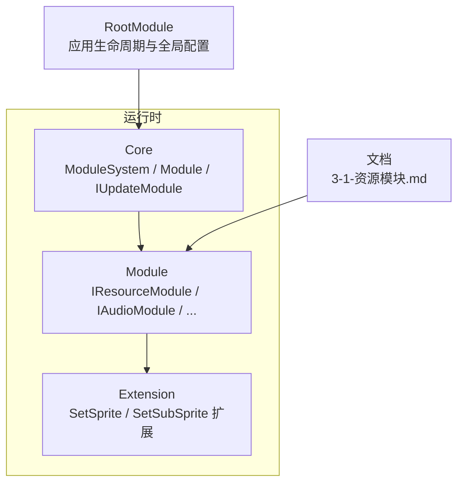
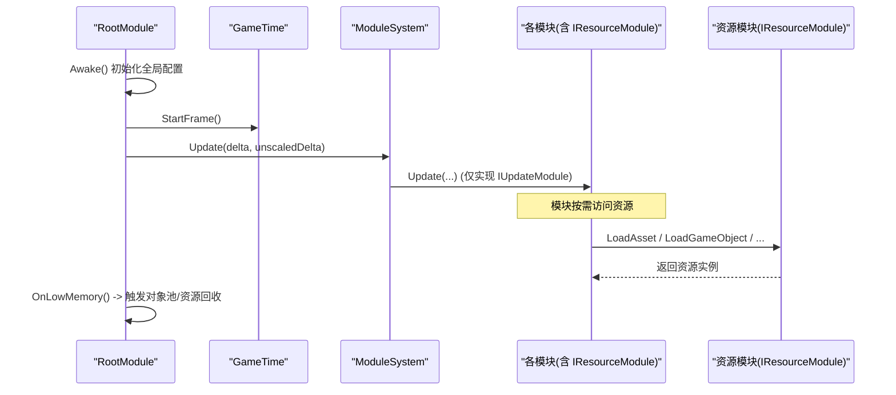
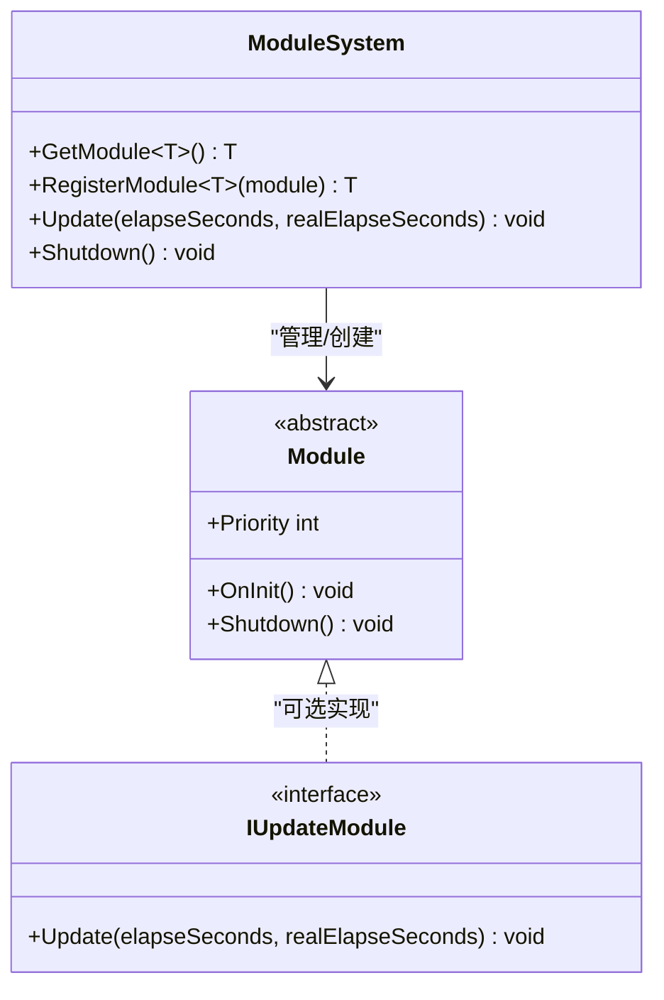
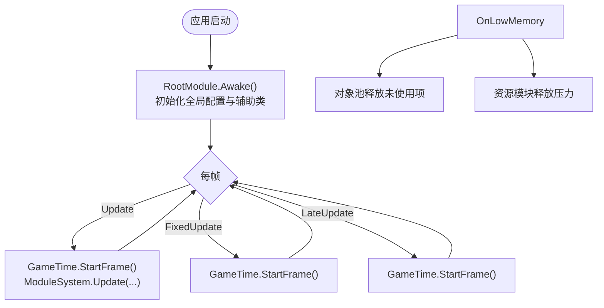
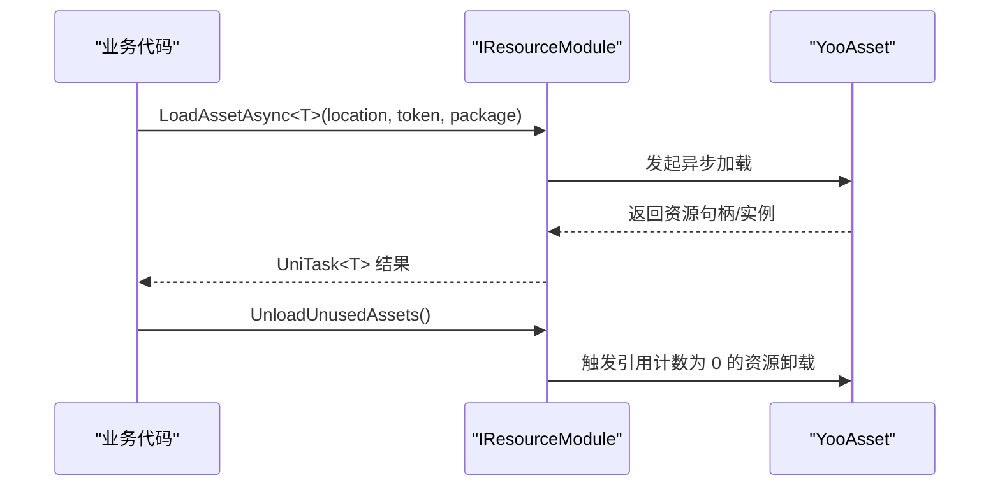
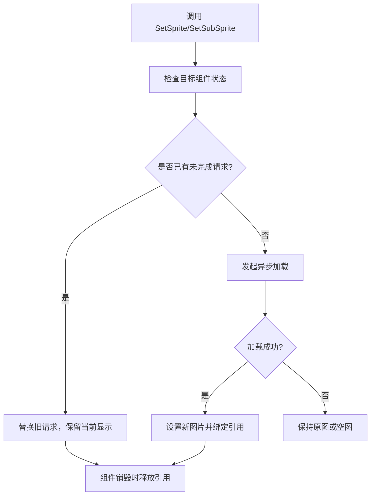
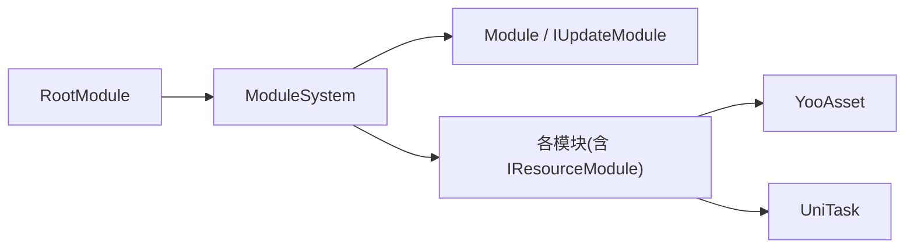

# API 参考

<cite>
**本文引用的文件**   
- [README.md](file://README.md)
- [ModuleSystem.cs](file://UnityProject/Assets/TEngine/Runtime/Core/ModuleSystem.cs)
- [Module.cs](file://UnityProject/Assets/TEngine/Runtime/Core/Module.cs)
- [RootModule.cs](file://UnityProject/Assets/TEngine/Runtime/Module/RootModule.cs)
- [3-1-资源模块.md](file://Books/3-1-资源模块.md)
</cite>

## 目录
1. [简介](#简介)
2. [项目结构](#项目结构)
3. [核心组件](#核心组件)
4. [架构总览](#架构总览)
5. [详细组件分析](#详细组件分析)
6. [依赖关系分析](#依赖关系分析)
7. [性能与内存](#性能与内存)
8. [故障排查](#故障排查)
9. [版本兼容与迁移](#版本兼容与迁移)
10. [结论](#结论)

## 简介
本 API 参考聚焦 TEngine 框架的公共接口、模块系统与关键运行时入口，覆盖：
- 核心 API：模块系统 ModuleSystem、模块抽象 Module、更新接口 IUpdateModule、根模块 RootModule
- 模块 API：以资源模块 IResourceModule 为代表（结合文档说明其对外能力）
- 工具 API：基于资源模块的图片扩展 SetSprite/SetSubSprite（文档中提供完整签名）

目标是为开发者提供准确、可检索、可直接落地的 API 使用指南，包含参数说明、返回值描述、调用流程、注意事项与兼容性建议。

## 项目结构
TEngine 的核心运行时代码位于 UnityProject/Assets/TEngine/Runtime，其中：
- Core：模块系统、时间、日志、数据结构等基础能力
- Module：各功能模块（资源、UI、音频、流程、场景、计时器等）
- Extension：扩展方法（如图片设置扩展）

图表来源
- [ModuleSystem.cs:1-208](file://UnityProject/Assets/TEngine/Runtime/Core/ModuleSystem.cs#L1-L208)
- [Module.cs:1-40](file://UnityProject/Assets/TEngine/Runtime/Core/Module.cs#L1-L40)
- [RootModule.cs:1-304](file://UnityProject/Assets/TEngine/Runtime/Module/RootModule.cs#L1-L304)
- [3-1-资源模块.md:1-645](file://Books/3-1-资源模块.md#L1-L645)

章节来源
- [README.md:1-334](file://README.md#L1-L334)

## 核心组件
本节梳理 TEngine 的核心 API 族：模块系统、模块抽象、更新机制与根模块。

- ModuleSystem（模块系统）
  - 职责：模块注册、查找、优先级排序、统一 Update 调度、Shutdown 清理
  - 关键方法
    - GetModule<T>()：按接口类型获取或自动创建模块实例
    - RegisterModule<T>(Module)：手动注册自定义模块并纳入更新列表
    - Update(elapseSeconds, realElapseSeconds)：每帧驱动实现 IUpdateModule 的模块
    - Shutdown()：关闭所有模块并清理内部缓存与池
  - 行为要点
    - 通过接口反射构造具体模块类型，支持默认数量预分配以减少 GC
    - 维护按优先级排序的模块链表与执行列表，变更时延迟重建执行列表
    - 对未实现 IUpdateModule 的模块不参与 Update 循环

- Module（模块抽象）
  - 职责：定义模块生命周期钩子与优先级
  - 关键成员
    - Priority：模块优先级（数值越大越先执行，关闭顺序相反）
    - OnInit()：初始化回调
    - Shutdown()：销毁与释放回调

- IUpdateModule（更新接口）
  - 职责：声明每帧 Update 回调，供 ModuleSystem 统一调度
  - 关键方法
    - Update(elapseSeconds, realElapseSeconds)：逻辑时间与真实时间增量

- RootModule（根模块）
  - 职责：应用级生命周期、全局配置注入、低内存事件处理、驱动 ModuleSystem.Update
  - 关键能力
    - FrameRate/GameSpeed/RunInBackground/NeverSleep 等全局运行时属性
    - Awake/Update/LateUpdate/FixedUpdate 中驱动 GameTime 与 ModuleSystem
    - OnLowMemory 触发对象池与资源模块的回收策略
    - 动态加载 TextHelper/LogHelper/JsonHelper 并注入到 Utility 层

章节来源
- [ModuleSystem.cs:1-208](file://UnityProject/Assets/TEngine/Runtime/Core/ModuleSystem.cs#L1-L208)
- [Module.cs:1-40](file://UnityProject/Assets/TEngine/Runtime/Core/Module.cs#L1-L40)
- [RootModule.cs:1-304](file://UnityProject/Assets/TEngine/Runtime/Module/RootModule.cs#L1-L304)

## 架构总览
下图展示从应用启动到模块调用的整体流程，以及资源模块在其中的位置。

图表来源
- [RootModule.cs:116-144](file://UnityProject/Assets/TEngine/Runtime/Module/RootModule.cs#L116-L144)
- [ModuleSystem.cs:29-42](file://UnityProject/Assets/TEngine/Runtime/Core/ModuleSystem.cs#L29-L42)
- [3-1-资源模块.md:346-450](file://Books/3-1-资源模块.md#L346-L450)

## 详细组件分析

### 模块系统 API（ModuleSystem）
- 设计模式
  - 工厂+反射：根据接口名推断模块类型并实例化
  - 观察者式更新：维护 IUpdateModule 列表，延迟构建执行队列
- 复杂度
  - 模块注册与插入：O(n)（按优先级插入双向链表）
  - Update 遍历：O(k)，k 为实现了 IUpdateModule 的模块数
- 错误处理
  - 非接口类型传入 GetModule<T>() 抛出异常
  - 找不到模块类型或无法创建实例抛出异常
- 使用示例（路径引用）
  - 获取模块：[ModuleSystem.cs:68-89](file://UnityProject/Assets/TEngine/Runtime/Core/ModuleSystem.cs#L68-L89)
  - 注册自定义模块：[ModuleSystem.cs:128-141](file://UnityProject/Assets/TEngine/Runtime/Core/ModuleSystem.cs#L128-L141)
  - 每帧更新：[ModuleSystem.cs:29-42](file://UnityProject/Assets/TEngine/Runtime/Core/ModuleSystem.cs#L29-L42)
  - 关闭清理：[ModuleSystem.cs:47-60](file://UnityProject/Assets/TEngine/Runtime/Core/ModuleSystem.cs#L47-L60)

图表来源
- [ModuleSystem.cs:1-208](file://UnityProject/Assets/TEngine/Runtime/Core/ModuleSystem.cs#L1-L208)
- [Module.cs:1-40](file://UnityProject/Assets/TEngine/Runtime/Core/Module.cs#L1-L40)

章节来源
- [ModuleSystem.cs:1-208](file://UnityProject/Assets/TEngine/Runtime/Core/ModuleSystem.cs#L1-L208)
- [Module.cs:1-40](file://UnityProject/Assets/TEngine/Runtime/Core/Module.cs#L1-L40)

### 根模块 API（RootModule）
- 职责
  - 全局运行时配置：帧率、游戏速度、后台运行、禁止休眠
  - 生命周期：Awake/Update/LateUpdate/FixedUpdate 驱动 GameTime 与 ModuleSystem
  - 低内存响应：触发对象池与资源模块的回收
  - 辅助注入：TextHelper/LogHelper/JsonHelper 动态装配
- 关键方法与属性（路径引用）
  - FrameRate/GameSpeed/RunInBackground/NeverSleep：[RootModule.cs:63-111](file://UnityProject/Assets/TEngine/Runtime/Module/RootModule.cs#L63-L111)
  - PauseGame/ResumeGame/ResetNormalGameSpeed：[RootModule.cs:172-207](file://UnityProject/Assets/TEngine/Runtime/Module/RootModule.cs#L172-L207)
  - Awake/Update/LateUpdate/FixedUpdate：[RootModule.cs:116-154](file://UnityProject/Assets/TEngine/Runtime/Module/RootModule.cs#L116-L154)
  - OnLowMemory：[RootModule.cs:287-302](file://UnityProject/Assets/TEngine/Runtime/Module/RootModule.cs#L287-L302)

图表来源
- [RootModule.cs:116-154](file://UnityProject/Assets/TEngine/Runtime/Module/RootModule.cs#L116-L154)
- [RootModule.cs:287-302](file://UnityProject/Assets/TEngine/Runtime/Module/RootModule.cs#L287-L302)

章节来源
- [RootModule.cs:1-304](file://UnityProject/Assets/TEngine/Runtime/Module/RootModule.cs#L1-L304)

### 资源模块 API（IResourceModule）
说明：以下 API 来自资源模块文档，描述了面向开发者的统一资源加载与管理接口。实际实现由 YooAsset 驱动，但对外暴露统一的 TEngine 接口。

- 资源加载
  - 同步加载：LoadAsset<T>(location, packageName = "")
  - 同步实例化 GameObject：LoadGameObject(location, parent = null, packageName = "")
  - 异步加载（UniTask）：LoadAssetAsync<T>(location, cancellationToken = default, packageName = "")
  - 异步实例化 GameObject：LoadGameObjectAsync(location, parent = null, cancellationToken = default, packageName = "")
  - 回调方式加载：LoadAsset<T>(location, callback, packageName = "")
- 资源管理
  - UnloadAsset(asset)
  - UnloadUnusedAssets()
  - ForceUnloadAllAssets()
  - ForceUnloadUnusedAssets(performGCCollect)
  - HasAsset(location, packageName = "")
  - CheckLocationValid(location, packageName = "")
- 资源包管理
  - GetPackageVersion(customPackageName = "")
  - RequestPackageVersionAsync(appendTimeTicks = false, timeout = 60, customPackageName = "")
  - UpdatePackageManifestAsync(packageVersion, timeout = 60, customPackageName = "")
  - CreateResourceDownloader(customPackageName = "")
  - ClearCacheFilesAsync(clearMode = EFileClearMode.ClearUnusedBundleFiles, customPackageName = "")
  - ClearAllBundleFiles(customPackageName = "")
- 资源信息
  - GetAssetInfo(location, packageName = "")
  - GetAssetInfos(resTag, packageName = "")
  - GetAssetInfos(tags[], packageName = "")
- 远端服务地址
  - SetRemoteServicesUrl(defaultHostServer, fallbackHostServer)

使用示例（路径引用）
- 基础加载 API 与最佳实践：[3-1-资源模块.md:346-450](file://Books/3-1-资源模块.md#L346-L450)
- 完整 API 参考：[3-1-资源模块.md:397-577](file://Books/3-1-资源模块.md#L397-L577)

图表来源
- [3-1-资源模块.md:346-450](file://Books/3-1-资源模块.md#L346-L450)
- [3-1-资源模块.md:397-577](file://Books/3-1-资源模块.md#L397-L577)

章节来源
- [3-1-资源模块.md:1-645](file://Books/3-1-资源模块.md#L1-L645)

### 工具 API（SetSprite / SetSubSprite 扩展）
说明：为 UI Image 与 2D SpriteRenderer 提供的图片设置扩展，自动管理资源引用与生命周期，支持取消与回调。

- 方法概览（路径引用）
  - Image.SetSprite(location, setNativeSize = false, callback = null, cancellationToken = default)
  - SpriteRenderer.SetSprite(location, callback = null, cancellationToken = default)
  - Image.SetSubSprite(location, spriteName, setNativeSize = false, cancellationToken = default)
  - SpriteRenderer.SetSubSprite(location, spriteName, cancellationToken = default)
- 行为要点
  - 自动绑定资源引用，替换或销毁时自动释放旧资源
  - 支持取消操作，避免无效写回
  - 图集子图支持 SpriteAtlas 与纹理切片，共享加载句柄与克隆缓存

使用示例（路径引用）
- API 签名与用法说明：[3-1-资源模块.md:261-323](file://Books/3-1-资源模块.md#L261-L323)
- 工作原理与最佳实践：[3-1-资源模块.md:325-342](file://Books/3-1-资源模块.md#L325-L342)

图表来源
- [3-1-资源模块.md:261-323](file://Books/3-1-资源模块.md#L261-L323)
- [3-1-资源模块.md:325-342](file://Books/3-1-资源模块.md#L325-L342)

章节来源
- [3-1-资源模块.md:261-342](file://Books/3-1-资源模块.md#L261-L342)

## 依赖关系分析
- 耦合关系
  - RootModule 依赖 ModuleSystem 进行模块调度
  - ModuleSystem 依赖 Module/IUpdateModule 抽象与反射机制
  - 资源模块 IResourceModule 作为上层抽象，屏蔽 YooAsset 细节
- 外部依赖
  - Unity 运行时（Application/Screen/Time 等）
  - YooAsset（资源加载与缓存）
  - UniTask（异步编程模型）

图表来源
- [RootModule.cs:116-154](file://UnityProject/Assets/TEngine/Runtime/Module/RootModule.cs#L116-L154)
- [ModuleSystem.cs:29-42](file://UnityProject/Assets/TEngine/Runtime/Core/ModuleSystem.cs#L29-L42)
- [3-1-资源模块.md:346-450](file://Books/3-1-资源模块.md#L346-L450)

章节来源
- [RootModule.cs:1-304](file://UnityProject/Assets/TEngine/Runtime/Module/RootModule.cs#L1-L304)
- [ModuleSystem.cs:1-208](file://UnityProject/Assets/TEngine/Runtime/Core/ModuleSystem.cs#L1-L208)
- [3-1-资源模块.md:1-645](file://Books/3-1-资源模块.md#L1-L645)

## 性能与内存
- 模块系统
  - 预分配模块数组容量以减少 GCAlloc
  - 延迟构建执行列表，仅在模块集合变化时重建
- 资源模块
  - LRU/ARC 缓存策略，自动释放引用计数为 0 的资源
  - 推荐优先使用 LoadGameObject/LoadGameObjectAsync，借助 AssetsReference 自动管理生命周期
  - 定期调用 UnloadUnusedAssets() 释放未使用资源
- 图片扩展
  - SetSprite/SetSubSprite 自动管理引用，避免重复加载与泄漏
  - 支持取消操作，减少无效 IO 与渲染开销

章节来源
- [ModuleSystem.cs:12-22](file://UnityProject/Assets/TEngine/Runtime/Core/ModuleSystem.cs#L12-L22)
- [3-1-资源模块.md:581-637](file://Books/3-1-资源模块.md#L581-L637)

## 故障排查
- 模块相关
  - 使用 GetModule<T>() 时传入非接口类型会抛异常；请确保 T 为接口
  - 找不到模块类型或无法创建实例会抛异常；检查命名空间与程序集名称是否正确
- 根模块相关
  - 低内存回调触发后，若对象池或资源模块未正确释放，可能导致卡顿或崩溃；确认 OnLowMemory 已触发相应释放逻辑
- 资源相关
  - 资源重名会导致定位失败；确保打包资源唯一
  - 资源地址缺少后缀仍应正确；加载时无需添加 .prefab/.png 等后缀
  - WebGL 平台需正确选择 Remote 或 StreamingAssets 模式

章节来源
- [ModuleSystem.cs:68-89](file://UnityProject/Assets/TEngine/Runtime/Core/ModuleSystem.cs#L68-L89)
- [RootModule.cs:287-302](file://UnityProject/Assets/TEngine/Runtime/Module/RootModule.cs#L287-L302)
- [3-1-资源模块.md:631-637](file://Books/3-1-资源模块.md#L631-L637)

## 版本兼容与迁移
- 环境要求
  - Unity 版本：推荐 2021.3.20f1c1，支持 2019.4 / 2020.3 / 2021.3 / 2022.3
  - 平台：Windows、macOS、Android、iOS、WebGL、微信小游戏
- 热更新与资源
  - 集成 HybridCLR 与 YooAsset，全平台热更新流程已验证
  - 资源模块默认使用 Addressable 可寻址定位，无需后缀
- 迁移建议
  - 将直接调用 YooAsset 的代码迁移至 IResourceModule 统一接口
  - 将手动 Dispose 资源改为使用 LoadGameObject/AssetsReference 自动管理
  - 使用 SetSprite/SetSubSprite 替代手动设置 Sprite，降低泄漏风险

章节来源
- [README.md:52-85](file://README.md#L52-L85)
- [README.md:205-224](file://README.md#L205-L224)
- [3-1-资源模块.md:346-450](file://Books/3-1-资源模块.md#L346-L450)
- [3-1-资源模块.md:581-637](file://Books/3-1-资源模块.md#L581-L637)

## 结论
TEngine 通过 ModuleSystem 提供稳定、可扩展的模块调度机制，RootModule 负责应用级生命周期与全局配置，资源模块 IResourceModule 封装 YooAsset 并提供统一、高性能的资源加载与管理 API。配合 SetSprite/SetSubSprite 等工具扩展，开发者可以以最小成本获得商业级的资源与 UI 开发体验。建议在项目中优先采用框架提供的统一接口与自动化管理机制，以获得更好的性能与可维护性。