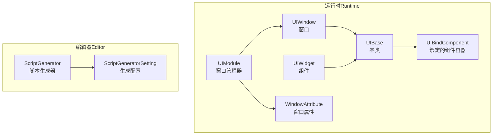
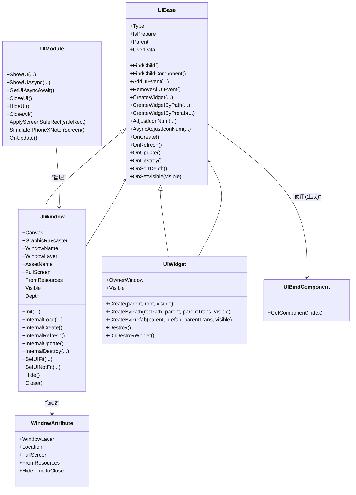
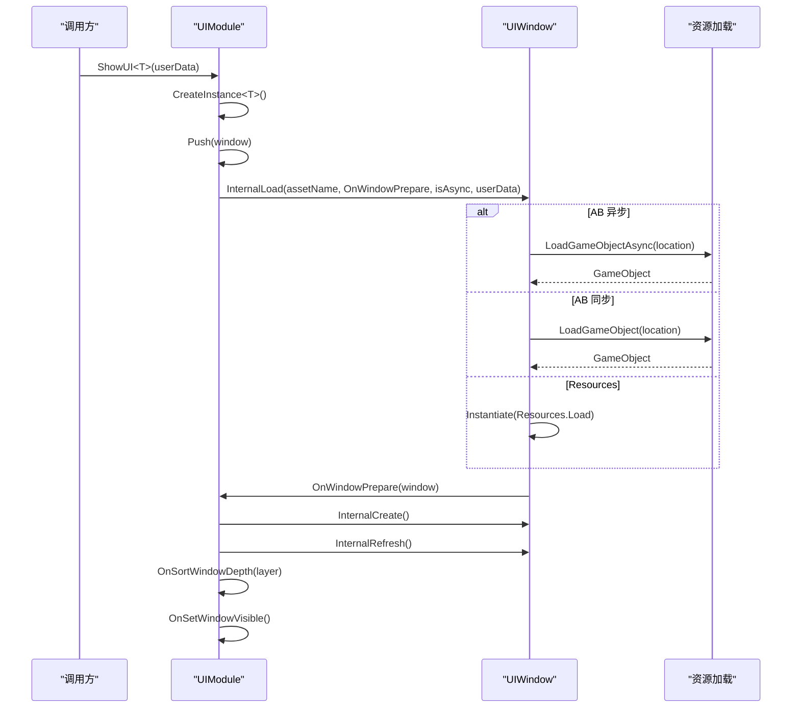
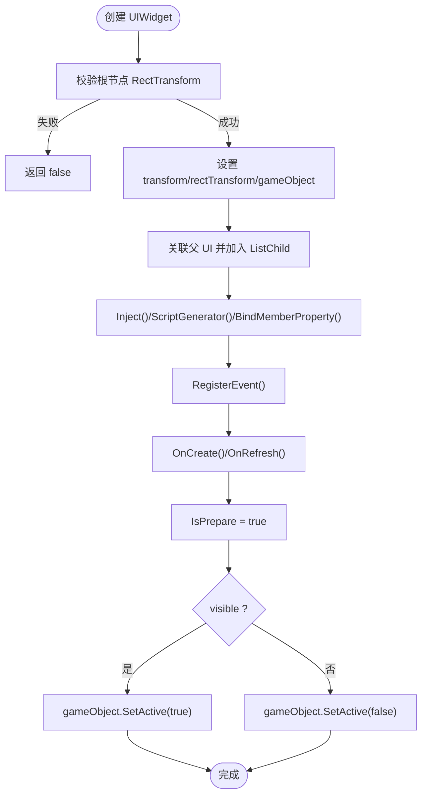
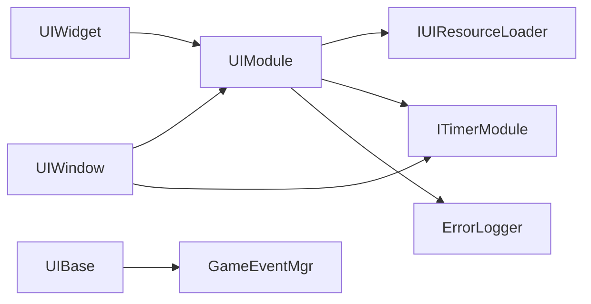

# UI 系统 API

<cite>
**本文引用的文件**   
- [UIBase.cs](file://UnityProject/Assets/GameScripts/HotFix/GameLogic/Module/UIModule/UIBase.cs)
- [UIWindow.cs](file://UnityProject/Assets/GameScripts/HotFix/GameLogic/Module/UIModule/UIWindow.cs)
- [UIWidget.cs](file://UnityProject/Assets/GameScripts/HotFix/GameLogic/Module/UIModule/UIWidget.cs)
- [UIModule.cs](file://UnityProject/Assets/GameScripts/HotFix/GameLogic/Module/UIModule/UIModule.cs)
- [WindowAttribute.cs](file://UnityProject/Assets/GameScripts/HotFix/GameLogic/Module/UIModule/WindowAttribute.cs)
- [UIBindComponent.cs](file://UnityProject/Assets/GameScripts/HotFix/GameLogic/Module/UIModule/UIBindComponent/UIBindComponent.cs)
- [3-5-UI模块.md](file://Books/3-5-UI模块.md)
- [ScriptGenerator.cs](file://UnityProject/Assets/Editor/UIScriptGenerator/ScriptGenerator.cs)
- [ScriptGeneratorSetting.cs](file://UnityProject/Assets/Editor/UIScriptGenerator/ScriptGeneratorSetting.cs)
</cite>

## 目录
1. [简介](#简介)
2. [项目结构](#项目结构)
3. [核心组件](#核心组件)
4. [架构总览](#架构总览)
5. [详细组件分析](#详细组件分析)
6. [依赖关系分析](#依赖关系分析)
7. [性能与资源优化](#性能与资源优化)
8. [故障排查指南](#故障排查指南)
9. [结论](#结论)
10. [附录：API 速查表](#附录api-速查表)

## 简介
本文件为 TEngine UI 系统的完整 API 文档，覆盖窗口管理、控件绑定、事件处理、动画与更新、脚本生成器与自定义规则等。重点说明 UIWindow、UIWidget、UIBindComponent 等核心组件的使用方法，并提供实际开发示例与最佳实践。

## 项目结构
UI 系统位于热更代码路径下，核心类集中在 UIModule 命名空间；编辑器侧提供 UI 脚本生成工具。

**图示来源**
- [UIModule.cs:15-31](file://UnityProject/Assets/GameScripts/HotFix/GameLogic/Module/UIModule/UIModule.cs#L15-L31)
- [UIBase.cs:18-45](file://UnityProject/Assets/GameScripts/HotFix/GameLogic/Module/UIModule/UIBase.cs#L18-L45)
- [UIWindow.cs:11-35](file://UnityProject/Assets/GameScripts/HotFix/GameLogic/Module/UIModule/UIWindow.cs#L11-L35)
- [UIWidget.cs:7-33](file://UnityProject/Assets/GameScripts/HotFix/GameLogic/Module/UIModule/UIWidget.cs#L7-L33)
- [WindowAttribute.cs:5-21](file://UnityProject/Assets/GameScripts/HotFix/GameLogic/Module/UIModule/WindowAttribute.cs#L5-L21)
- [UIBindComponent.cs:17-20](file://UnityProject/Assets/GameScripts/HotFix/GameLogic/Module/UIModule/UIBindComponent/UIBindComponent.cs#L17-L20)
- [ScriptGenerator.cs](file://UnityProject/Assets/Editor/UIScriptGenerator/ScriptGenerator.cs)
- [ScriptGeneratorSetting.cs](file://UnityProject/Assets/Editor/UIScriptGenerator/ScriptGeneratorSetting.cs)

**章节来源**
- [UIModule.cs:15-31](file://UnityProject/Assets/GameScripts/HotFix/GameLogic/Module/UIModule/UIModule.cs#L15-L31)
- [UIBase.cs:18-45](file://UnityProject/Assets/GameScripts/HotFix/GameLogic/Module/UIModule/UIBase.cs#L18-L45)
- [UIWindow.cs:11-35](file://UnityProject/Assets/GameScripts/HotFix/GameLogic/Module/UIModule/UIWindow.cs#L11-L35)
- [UIWidget.cs:7-33](file://UnityProject/Assets/GameScripts/HotFix/GameLogic/Module/UIModule/UIWidget.cs#L7-L33)
- [WindowAttribute.cs:5-21](file://UnityProject/Assets/GameScripts/HotFix/GameLogic/Module/UIModule/WindowAttribute.cs#L5-L21)
- [UIBindComponent.cs:17-20](file://UnityProject/Assets/GameScripts/HotFix/GameLogic/Module/UIModule/UIBindComponent/UIBindComponent.cs#L17-L20)

## 核心组件
- UIBase：所有 UI 的抽象基类，提供生命周期钩子、查找节点、事件注册、Widget 创建与销毁等通用能力。
- UIWindow：窗口级 UI，负责面板加载、层级排序、全屏遮挡、可见性与交互控制、深度排序、安全区域适配等。
- UIWidget：组件级 UI，支持在窗口内动态创建、嵌套、独立 Update 驱动与自动销毁。
- UIModule：UI 子系统入口，维护窗口堆栈、层级与可见性、屏幕安全区、资源加载接口、错误日志等。
- WindowAttribute：标记窗口的层级、资源地址、是否全屏、是否从 Resources 加载、隐藏后关闭延时等。
- UIBindComponent：由生成器生成的 MonoBehaviour 辅助组件，用于按索引获取绑定的 Unity 组件列表。

**章节来源**
- [UIBase.cs:18-45](file://UnityProject/Assets/GameScripts/HotFix/GameLogic/Module/UIModule/UIBase.cs#L18-L45)
- [UIWindow.cs:11-35](file://UnityProject/Assets/GameScripts/HotFix/GameLogic/Module/UIModule/UIWindow.cs#L11-L35)
- [UIWidget.cs:7-33](file://UnityProject/Assets/GameScripts/HotFix/GameLogic/Module/UIModule/UIWidget.cs#L7-L33)
- [UIModule.cs:15-31](file://UnityProject/Assets/GameScripts/HotFix/GameLogic/Module/UIModule/UIModule.cs#L15-L31)
- [WindowAttribute.cs:5-21](file://UnityProject/Assets/GameScripts/HotFix/GameLogic/Module/UIModule/WindowAttribute.cs#L5-L21)
- [UIBindComponent.cs:17-20](file://UnityProject/Assets/GameScripts/HotFix/GameLogic/Module/UIModule/UIBindComponent/UIBindComponent.cs#L17-L20)

## 架构总览
UI 系统采用“纯 C# + 事件驱动”的轻量架构，UI 脚本不依赖 MonoBehaviour 生命周期，由 UIModule 帧更新驱动。UIBase 统一生命周期与事件机制，UIWindow 与 UIWidget 分别承担窗口与组件职责，通过 UIModule 进行集中管理与调度。

**图示来源**
- [UIBase.cs:18-608](file://UnityProject/Assets/GameScripts/HotFix/GameLogic/Module/UIModule/UIBase.cs#L18-L608)
- [UIWindow.cs:11-524](file://UnityProject/Assets/GameScripts/HotFix/GameLogic/Module/UIModule/UIWindow.cs#L11-L524)
- [UIWidget.cs:7-315](file://UnityProject/Assets/GameScripts/HotFix/GameLogic/Module/UIModule/UIWidget.cs#L7-L315)
- [UIModule.cs:15-732](file://UnityProject/Assets/GameScripts/HotFix/GameLogic/Module/UIModule/UIModule.cs#L15-L732)
- [WindowAttribute.cs:5-78](file://UnityProject/Assets/GameScripts/HotFix/GameLogic/Module/UIModule/WindowAttribute.cs#L5-L78)
- [UIBindComponent.cs:17-39](file://UnityProject/Assets/GameScripts/HotFix/GameLogic/Module/UIModule/UIBindComponent/UIBindComponent.cs#L17-L39)

## 详细组件分析

### UIWindow 窗口
- 职责
  - 面板实例化与资源加载（AB 或 Resources）
  - 层级排序与全屏遮挡
  - 可见性与交互控制
  - 安全区域适配（刘海屏）
  - 生命周期钩子：OnCreate/OnRefresh/OnUpdate/OnDestroy
- 关键 API
  - Init(name, layer, fullScreen, assetName, fromResources, hideTimeToClose)
  - InternalLoad(location, prepareCallback, isAsync, userDatas)
  - Visible / Depth / FullScreen / FromResources
  - SetUIFit / SetUINotFit
  - Hide / Close
  - OnCreate / OnRefresh / OnUpdate / OnDestroy（重写）
- 典型流程
  - 打开：UIModule.ShowUI -> CreateInstance -> Push -> InternalLoad -> Handle_Completed -> InternalCreate -> InternalRefresh -> OnSortWindowDepth -> OnSetWindowVisible
  - 关闭：UIModule.CloseUI -> InternalDestroy -> Pop -> OnSortWindowDepth -> OnSetWindowVisible

**图示来源**
- [UIModule.cs:298-321](file://UnityProject/Assets/GameScripts/HotFix/GameLogic/Module/UIModule/UIModule.cs#L298-L321)
- [UIModule.cs:472-516](file://UnityProject/Assets/GameScripts/HotFix/GameLogic/Module/UIModule/UIModule.cs#L472-L516)
- [UIWindow.cs:314-354](file://UnityProject/Assets/GameScripts/HotFix/GameLogic/Module/UIModule/UIWindow.cs#L314-L354)
- [UIWindow.cs:464-502](file://UnityProject/Assets/GameScripts/HotFix/GameLogic/Module/UIModule/UIWindow.cs#L464-L502)

**章节来源**
- [UIWindow.cs:11-524](file://UnityProject/Assets/GameScripts/HotFix/GameLogic/Module/UIModule/UIWindow.cs#L11-L524)
- [UIModule.cs:298-321](file://UnityProject/Assets/GameScripts/HotFix/GameLogic/Module/UIModule/UIModule.cs#L298-L321)
- [UIModule.cs:472-516](file://UnityProject/Assets/GameScripts/HotFix/GameLogic/Module/UIModule/UIModule.cs#L472-L516)

### UIWidget 组件
- 职责
  - 在窗口内动态创建、挂载到父节点
  - 独立 Update 驱动（若重写 OnUpdate）
  - 自动继承父 Canvas 的排序层
  - 生命周期：Create -> Inject -> ScriptGenerator -> BindMemberProperty -> RegisterEvent -> OnCreate -> OnRefresh -> IsPrepare
- 关键 API
  - Create(parentUI, widgetRoot, visible)
  - CreateByPath(resPath, parentUI, parentTrans, visible)
  - CreateByPrefab(parentUI, goPrefab, parentTrans, visible)
  - Destroy()
  - Visible / OwnerWindow
  - OnUpdate / OnSetVisible / OnDestroyWidget（内部）

**图示来源**
- [UIWidget.cs:142-248](file://UnityProject/Assets/GameScripts/HotFix/GameLogic/Module/UIModule/UIWidget.cs#L142-L248)
- [UIWidget.cs:250-272](file://UnityProject/Assets/GameScripts/HotFix/GameLogic/Module/UIModule/UIWidget.cs#L250-L272)

**章节来源**
- [UIWidget.cs:7-315](file://UnityProject/Assets/GameScripts/HotFix/GameLogic/Module/UIModule/UIWidget.cs#L7-L315)

### UIBase 基类
- 职责
  - 统一生命周期钩子：OnCreate/OnRefresh/OnUpdate/OnDestroy
  - 事件系统封装：AddUIEvent/RemoveAllUIEvent
  - 节点查找：FindChild/FindChildComponent
  - Widget 工厂方法：CreateWidget/CreateWidgetByPath/CreateWidgetByPrefab/AdjustIconNum/AsyncAdjustIconNum
  - 依赖注入点：Injector
- 关键 API
  - FindChild(path/trans, path)
  - FindChildComponent<T>(path/trans, path)
  - AddUIEvent(...)/RemoveAllUIEvent()
  - CreateWidget<T>(...)/CreateWidgetByPath<T>(...)/CreateWidgetByPrefab<T>(...)
  - AdjustIconNum<T>(...)/AsyncAdjustIconNum<T>(...)
  - OnCreate/OnRefresh/OnUpdate/OnDestroy/OnSortDepth/OnSetVisible

**章节来源**
- [UIBase.cs:18-608](file://UnityProject/Assets/GameScripts/HotFix/GameLogic/Module/UIModule/UIBase.cs#L18-L608)

### UIModule 模块
- 职责
  - 窗口堆栈管理、层级与可见性控制
  - 屏幕安全区适配与 iPhone X 模拟
  - 资源加载接口 IUIResourceLoader 的统一入口
  - 错误日志记录器集成
- 关键 API
  - ShowUI<T>/ShowUIAsync<T>/ShowUIAsyncAwait<T>
  - GetUIAsyncAwait<T>/GetUIAsync<T>
  - CloseUI<T>/HideUI<T>/CloseAll()/CloseAllWithOut<T>()
  - ApplyScreenSafeRect(safeRect)/SimulateIPhoneXNotchScreen()
  - OnUpdate()

**章节来源**
- [UIModule.cs:15-732](file://UnityProject/Assets/GameScripts/HotFix/GameLogic/Module/UIModule/UIModule.cs#L15-L732)

### WindowAttribute 窗口属性
- 作用
  - 声明窗口层级、资源定位、是否全屏、是否从 Resources 加载、隐藏后关闭延时
- 常用字段
  - WindowLayer、Location、FullScreen、FromResources、HideTimeToClose

**章节来源**
- [WindowAttribute.cs:5-78](file://UnityProject/Assets/GameScripts/HotFix/GameLogic/Module/UIModule/WindowAttribute.cs#L5-L78)

### UIBindComponent 绑定组件
- 作用
  - 由脚本生成器生成的 MonoBehaviour 组件，保存按顺序绑定的 Unity 组件列表，提供按索引取组件的方法
- 关键 API
  - GetComponent<T>(index)

**章节来源**
- [UIBindComponent.cs:17-39](file://UnityProject/Assets/GameScripts/HotFix/GameLogic/Module/UIModule/UIBindComponent/UIBindComponent.cs#L17-L39)

## 依赖关系分析
- UIModule 依赖：
  - IUIResourceLoader（资源加载策略）
  - GameEventMgr（事件系统，通过 UIBase 间接使用）
  - TimerModule（延迟关闭计时器）
  - ErrorLogger（调试期错误日志）
- UIWindow 依赖：
  - UIModule.Resource（资源加载）
  - UIModule.UIRoot（UI 根节点）
  - ModuleSystem.GetModule<ITimerModule>（定时器）
- UIWidget 依赖：
  - UIModule.Resource（路径创建时）
  - 父级 Canvas（排序层继承）

**图示来源**
- [UIModule.cs:31-31](file://UnityProject/Assets/GameScripts/HotFix/GameLogic/Module/UIModule/UIModule.cs#L31-L31)
- [UIModule.cs:69-93](file://UnityProject/Assets/GameScripts/HotFix/GameLogic/Module/UIModule/UIModule.cs#L69-L93)
- [UIWindow.cs:514-522](file://UnityProject/Assets/GameScripts/HotFix/GameLogic/Module/UIModule/UIWindow.cs#L514-L522)
- [UIBase.cs:284-330](file://UnityProject/Assets/GameScripts/HotFix/GameLogic/Module/UIModule/UIBase.cs#L284-L330)

**章节来源**
- [UIModule.cs:31-93](file://UnityProject/Assets/GameScripts/HotFix/GameLogic/Module/UIModule/UIModule.cs#L31-L93)
- [UIWindow.cs:514-522](file://UnityProject/Assets/GameScripts/HotFix/GameLogic/Module/UIModule/UIWindow.cs#L514-L522)
- [UIBase.cs:284-330](file://UnityProject/Assets/GameScripts/HotFix/GameLogic/Module/UIModule/UIBase.cs#L284-L330)

## 性能与资源优化
- 更新优化
  - 仅当子类重写 OnUpdate 时才驱动该 UI 的帧更新，避免空跑
  - 子节点 Update 列表缓存与脏标记，减少遍历开销
- 资源加载
  - 优先使用 AB 异步加载，必要时回退 Resources
  - UIWidget 路径创建通过 UIModule.Resource 统一管理
- 列表项优化
  - 使用 AdjustIconNum/AsyncAdjustIconNum 批量创建与回收，避免频繁 GC
- 层级与可见性
  - 全屏窗口会遮挡其后的窗口，合理设置 FullScreen 与层级
- 安全区域
  - 异形屏使用 ApplyScreenSafeRect 或 SetUIFit 保证布局正确

**章节来源**
- [UIBase.cs:176-187](file://UnityProject/Assets/GameScripts/HotFix/GameLogic/Module/UIModule/UIBase.cs#L176-L187)
- [UIWindow.cs:356-425](file://UnityProject/Assets/GameScripts/HotFix/GameLogic/Module/UIModule/UIWindow.cs#L356-L425)
- [UIWidget.cs:71-140](file://UnityProject/Assets/GameScripts/HotFix/GameLogic/Module/UIModule/UIWidget.cs#L71-L140)
- [UIBase.cs:477-578](file://UnityProject/Assets/GameScripts/HotFix/GameLogic/Module/UIModule/UIBase.cs#L477-L578)
- [UIModule.cs:116-174](file://UnityProject/Assets/GameScripts/HotFix/GameLogic/Module/UIModule/UIModule.cs#L116-L174)

## 故障排查指南
- 未找到 UIRoot
  - 现象：初始化时报错
  - 排查：确保场景中存在 UIRoot 且包含 Canvas/Camera
- 面板缺少 Canvas
  - 现象：加载完成后抛异常
  - 排查：检查预制体根节点是否包含 Canvas 组件
- 事件未触发
  - 现象：AddUIEvent 后无回调
  - 排查：确认事件类型一致，且在面板销毁前未提前移除
- 层级显示异常
  - 现象：窗口被遮挡或层级错乱
  - 排查：检查 WindowAttribute 的 WindowLayer 与 FullScreen 配置
- 异形屏布局错位
  - 现象：顶部/底部被刘海遮挡
  - 排查：调用 ApplyScreenSafeRect 或使用 SetUIFit/SetUINotFit

**章节来源**
- [UIModule.cs:49-61](file://UnityProject/Assets/GameScripts/HotFix/GameLogic/Module/UIModule/UIModule.cs#L49-L61)
- [UIWindow.cs:484-497](file://UnityProject/Assets/GameScripts/HotFix/GameLogic/Module/UIModule/UIWindow.cs#L484-L497)
- [UIBase.cs:299-330](file://UnityProject/Assets/GameScripts/HotFix/GameLogic/Module/UIModule/UIBase.cs#L299-L330)
- [WindowAttribute.cs:23-43](file://UnityProject/Assets/GameScripts/HotFix/GameLogic/Module/UIModule/WindowAttribute.cs#L23-L43)
- [UIModule.cs:116-174](file://UnityProject/Assets/GameScripts/HotFix/GameLogic/Module/UIModule/UIModule.cs#L116-L174)

## 结论
TEngine UI 系统以纯 C# 实现、事件驱动为核心，通过 UIModule 统一管理窗口生命周期与层级，UIWindow 与 UIWidget 分别承担窗口与组件职责，配合脚本生成器与资源模块，形成高效、可拓展的商业级 UI 工作流。遵循本文档的 API 与最佳实践，可快速构建稳定、高性能的用户界面。

## 附录：API 速查表

### UIModule（窗口管理）
- ShowUI<T>(params object[] userDatas)
- ShowUIAsync<T>(params object[] userDatas)
- ShowUIAsyncAwait<T>(params object[] userDatas) -> T
- GetUIAsyncAwait<T>(CancellationToken) -> T
- GetUIAsync<T>(Action<T>)
- CloseUI<T>()
- HideUI<T>()
- CloseAll(bool isShutDown = false)
- CloseAllWithOut(UIWindow withOut)
- CloseAllWithOut<T>()
- ApplyScreenSafeRect(Rect safeRect)
- SimulateIPhoneXNotchScreen()

**章节来源**
- [UIModule.cs:245-364](file://UnityProject/Assets/GameScripts/HotFix/GameLogic/Module/UIModule/UIModule.cs#L245-L364)
- [UIModule.cs:366-470](file://UnityProject/Assets/GameScripts/HotFix/GameLogic/Module/UIModule/UIModule.cs#L366-L470)
- [UIModule.cs:561-636](file://UnityProject/Assets/GameScripts/HotFix/GameLogic/Module/UIModule/UIModule.cs#L561-L636)
- [UIModule.cs:116-174](file://UnityProject/Assets/GameScripts/HotFix/GameLogic/Module/UIModule/UIModule.cs#L116-L174)

### UIWindow（窗口）
- Init(name, layer, fullScreen, assetName, fromResources, hideTimeToClose)
- InternalLoad(location, prepareCallback, isAsync, userDatas)
- InternalCreate()
- InternalRefresh()
- InternalUpdate()
- InternalDestroy(bool isShutDown = false)
- Visible (bool)
- Depth (int)
- FullScreen (bool)
- FromResources (bool)
- SetUIFit(RectTransform fitRect, bool liuHaiFit=true, float topSpacing=0, bool bottomFit=true, float bottomSpacing=0)
- SetUINotFit(RectTransform rect)
- SetUINotFit(RectTransform rect, RectTransform refRect)
- Hide()
- Close()
- 生命周期：OnCreate(), OnRefresh(), OnUpdate(), OnDestroy()

**章节来源**
- [UIWindow.cs:237-245](file://UnityProject/Assets/GameScripts/HotFix/GameLogic/Module/UIModule/UIWindow.cs#L237-L245)
- [UIWindow.cs:314-354](file://UnityProject/Assets/GameScripts/HotFix/GameLogic/Module/UIModule/UIWindow.cs#L314-L354)
- [UIWindow.cs:356-425](file://UnityProject/Assets/GameScripts/HotFix/GameLogic/Module/UIModule/UIWindow.cs#L356-L425)
- [UIWindow.cs:427-522](file://UnityProject/Assets/GameScripts/HotFix/GameLogic/Module/UIModule/UIWindow.cs#L427-L522)

### UIWidget（组件）
- Create(UIBase parentUI, GameObject widgetRoot, bool visible = true)
- CreateByPath(string resPath, UIBase parentUI, Transform parentTrans = null, bool visible = true)
- CreateByPrefab(UIBase parentUI, GameObject goPrefab, Transform parentTrans, bool visible = true)
- Destroy()
- Visible (bool)
- OwnerWindow (UIWindow)
- 生命周期：OnCreate(), OnRefresh(), OnUpdate(), OnDestroyWidget()

**章节来源**
- [UIWidget.cs:142-248](file://UnityProject/Assets/GameScripts/HotFix/GameLogic/Module/UIModule/UIWidget.cs#L142-L248)
- [UIWidget.cs:276-315](file://UnityProject/Assets/GameScripts/HotFix/GameLogic/Module/UIModule/UIWidget.cs#L276-L315)

### UIBase（基类）
- FindChild(string path)
- FindChild(Transform trans, string path)
- FindChildComponent<T>(string path)
- FindChildComponent<T>(Transform trans, string path)
- AddUIEvent(int eventType, Action handler)
- AddUIEvent<T>(int eventType, Action<T> handler)
- AddUIEvent<T,U>(int eventType, Action<T,U> handler)
- AddUIEvent<T,U,V>(int eventType, Action<T,U,V> handler)
- AddUIEvent<T,U,V,W>(int eventType, Action<T,U,V,W> handler)
- RemoveAllUIEvent()
- CreateWidget<T>(string goPath, bool visible = true)
- CreateWidget<T>(Transform parentTrans, string goPath, bool visible = true)
- CreateWidget<T>(GameObject goRoot, bool visible = true)
- CreateWidgetByPath<T>(Transform parentTrans, string assetLocation, bool visible = true)
- CreateWidgetByPathAsync<T>(Transform parentTrans, string assetLocation, bool visible = true)
- CreateWidgetByPrefab<T>(GameObject goPrefab, Transform parentTrans = null, bool visible = true)
- CreateWidgetByType<T>(Transform parentTrans, bool visible = true)
- CreateWidgetByTypeAsync<T>(Transform parentTrans, bool visible = true)
- AdjustIconNum<T>(List<T> listIcon, int number, Transform parentTrans, GameObject prefab = null, string assetPath = "")
- AsyncAdjustIconNum<T>(List<T> listIcon, int tarNum, Transform parentTrans, GameObject prefab = null, string assetPath = "", int maxNumPerFrame = 5, Action<T,int> updateAction = null)
- 生命周期：OnCreate(), OnRefresh(), OnUpdate(), OnDestroy(), OnSortDepth(), OnSetVisible(bool)

**章节来源**
- [UIBase.cs:241-278](file://UnityProject/Assets/GameScripts/HotFix/GameLogic/Module/UIModule/UIBase.cs#L241-L278)
- [UIBase.cs:299-330](file://UnityProject/Assets/GameScripts/HotFix/GameLogic/Module/UIModule/UIBase.cs#L299-L330)
- [UIBase.cs:334-608](file://UnityProject/Assets/GameScripts/HotFix/GameLogic/Module/UIModule/UIBase.cs#L334-L608)

### WindowAttribute（窗口属性）
- WindowLayer (int/UILayer)
- Location (string)
- FullScreen (bool)
- FromResources (bool)
- HideTimeToClose (int)

**章节来源**
- [WindowAttribute.cs:5-78](file://UnityProject/Assets/GameScripts/HotFix/GameLogic/Module/UIModule/WindowAttribute.cs#L5-L78)

### UIBindComponent（绑定组件）
- GetComponent<T>(int index)

**章节来源**
- [UIBindComponent.cs:17-39](file://UnityProject/Assets/GameScripts/HotFix/GameLogic/Module/UIModule/UIBindComponent/UIBindComponent.cs#L17-L39)

## UI 脚本生成器与自定义规则

### 生成器概览
- 入口：在 UI 根节点右键选择 ScriptGenerator 菜单，将生成的绑定代码复制到剪贴板
- 输出：自动生成 ScriptGenerator 方法与成员变量绑定，同时生成 UIBindComponent 组件
- 命名规范：默认前缀包括 m_go_、m_tf_、m_rect_、m_text_、m_btn_、m_img_、m_scroll_、m_tmp_ 等，长前缀优先匹配

**章节来源**
- [3-5-UI模块.md:60-125](file://Books/3-5-UI模块.md#L60-L125)

### 自定义规则配置
- 配置文件：ScriptGeneratorSetting.asset
- 可配置项
  - 前缀映射（GameObject/Transform/RectTransform/Button/Image/TextMeshProUGUI 等）
  - 特殊节点 m_item 表示 UIWidget 容器，不会继续遍历
- 编辑器扩展：UIComponentInspectorEditor 提供可视化编辑体验

**章节来源**
- [3-5-UI模块.md:60-125](file://Books/3-5-UI模块.md#L60-L125)
- [ScriptGenerator.cs](file://UnityProject/Assets/Editor/UIScriptGenerator/ScriptGenerator.cs)
- [ScriptGeneratorSetting.cs](file://UnityProject/Assets/Editor/UIScriptGenerator/ScriptGeneratorSetting.cs)

### 使用步骤
1. 在 Scene 中编排 UI，遵守默认或自定义命名规范
2. 在 UI 根节点右键 ScriptGenerator，复制生成代码
3. 新建 UI 脚本，粘贴生成代码，并在 BindMemberProperty 中创建 UIWidget
4. 在 RegisterEvent 中注册事件，在 OnRefresh 中刷新数据
5. 通过 UIModule.ShowUI<T>() 或 ShowUIAsync<T>() 打开窗口

**章节来源**
- [3-5-UI模块.md:108-125](file://Books/3-5-UI模块.md#L108-L125)
- [3-5-UI模块.md:128-226](file://Books/3-5-UI模块.md#L128-L226)

## 实际开发示例（基于框架 API）

### 打开与关闭窗口
- 同步打开：UIModule.ShowUI<GameMainUI>(userData)
- 异步打开：UIModule.ShowUIAsync<GameMainUI>(userData)
- 等待加载完成：await UIModule.ShowUIAsyncAwait<GameMainUI>(userData)
- 关闭窗口：UIModule.CloseUI<GameMainUI>()
- 隐藏后延时关闭：设置 WindowAttribute.HideTimeToClose，调用 UIModule.HideUI<GameMainUI>()

**章节来源**
- [UIModule.cs:245-364](file://UnityProject/Assets/GameScripts/HotFix/GameLogic/Module/UIModule/UIModule.cs#L245-L364)
- [WindowAttribute.cs:43-43](file://UnityProject/Assets/GameScripts/HotFix/GameLogic/Module/UIModule/WindowAttribute.cs#L43-L43)

### 创建与销毁 UIWidget
- 通过路径创建：CreateWidgetByPath<T>(parentTrans, assetLocation)
- 通过类型名创建：CreateWidgetByType<T>(parentTrans)
- 通过预制体创建：CreateWidgetByPrefab<T>(prefab, parentTrans)
- 调整列表数量：AdjustIconNum<T>(list, count, parentTrans, prefab, assetPath)
- 异步批量创建：AsyncAdjustIconNum<T>(list, targetCount, parentTrans, prefab, assetPath, maxNumPerFrame, updateAction)
- 销毁：widget.Destroy()

**章节来源**
- [UIBase.cs:396-465](file://UnityProject/Assets/GameScripts/HotFix/GameLogic/Module/UIModule/UIBase.cs#L396-L465)
- [UIBase.cs:477-578](file://UnityProject/Assets/GameScripts/HotFix/GameLogic/Module/UIModule/UIBase.cs#L477-L578)
- [UIWidget.cs:300-315](file://UnityProject/Assets/GameScripts/HotFix/GameLogic/Module/UIModule/UIWidget.cs#L300-L315)

### 事件处理
- 注册事件：AddUIEvent(eventType, handler)
- 移除事件：RemoveAllUIEvent()（在销毁时自动调用）
- 推荐：在 RegisterEvent 中注册，在 OnDestroy 中无需手动移除

**章节来源**
- [UIBase.cs:299-330](file://UnityProject/Assets/GameScripts/HotFix/GameLogic/Module/UIModule/UIBase.cs#L299-L330)

### 动画与更新
- 帧更新：重写 OnUpdate()，仅在需要时驱动
- 子节点更新：若子节点重写 OnUpdate，父节点会收集并驱动
- 建议：使用 UniTask 或协程驱动动画，避免每帧复杂计算

**章节来源**
- [UIBase.cs:176-187](file://UnityProject/Assets/GameScripts/HotFix/GameLogic/Module/UIModule/UIBase.cs#L176-L187)
- [UIWindow.cs:356-425](file://UnityProject/Assets/GameScripts/HotFix/GameLogic/Module/UIModule/UIWindow.cs#L356-L425)
- [UIWidget.cs:71-140](file://UnityProject/Assets/GameScripts/HotFix/GameLogic/Module/UIModule/UIWidget.cs#L71-L140)

### 资源加载策略
- AB 异步加载：UIModule.Resource.LoadGameObjectAsync(location, parent)
- AB 同步加载：UIModule.Resource.LoadGameObject(location, parent)
- Resources 加载：UIWindow.FromResources = true 时走 Resources.Load
- 建议：优先 AB 异步，避免阻塞主线程

**章节来源**
- [UIWindow.cs:314-336](file://UnityProject/Assets/GameScripts/HotFix/GameLogic/Module/UIModule/UIWindow.cs#L314-L336)
- [UIModule.cs:31-31](file://UnityProject/Assets/GameScripts/HotFix/GameLogic/Module/UIModule/UIModule.cs#L31-L31)