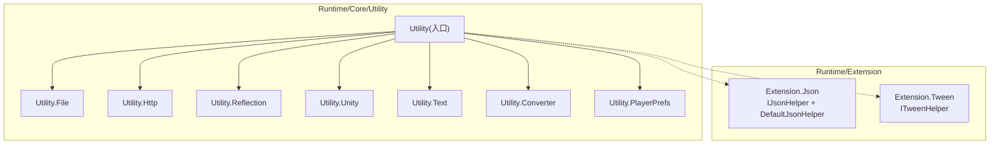
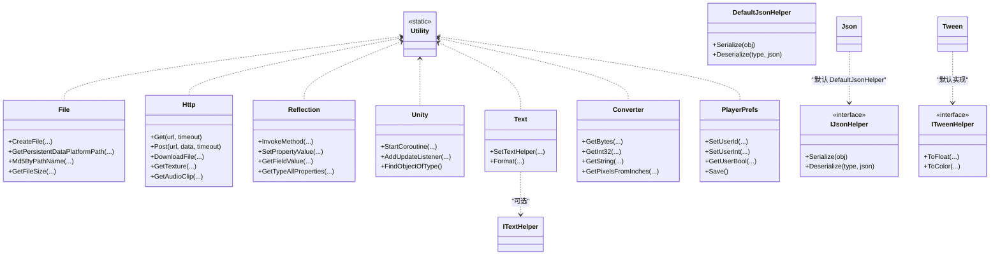
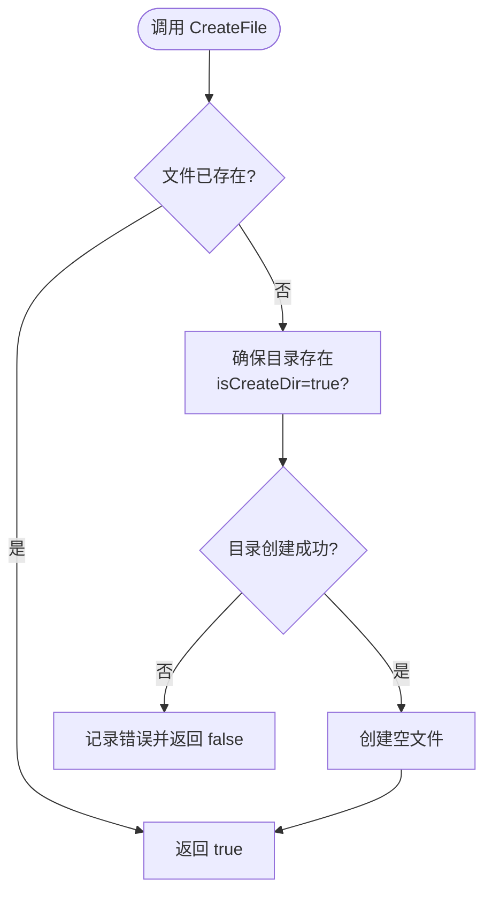
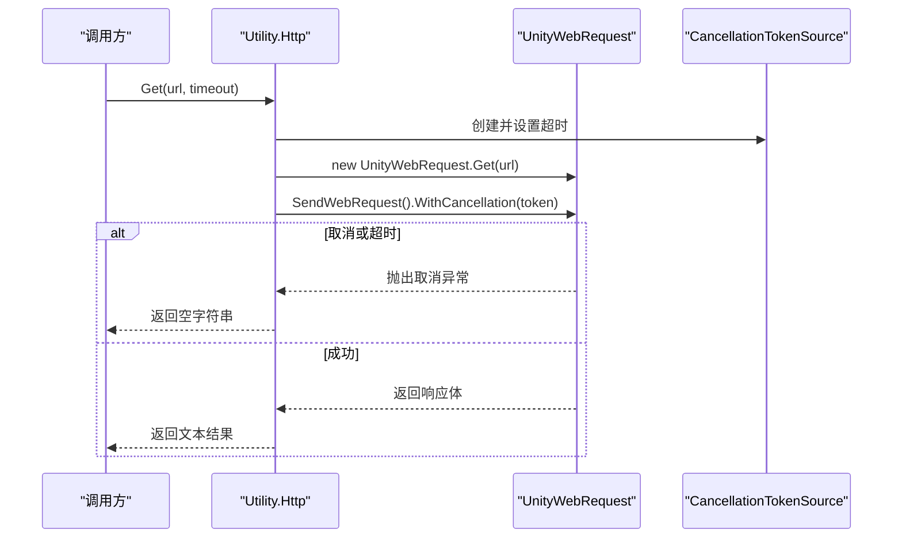
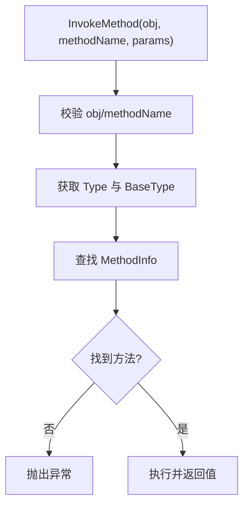
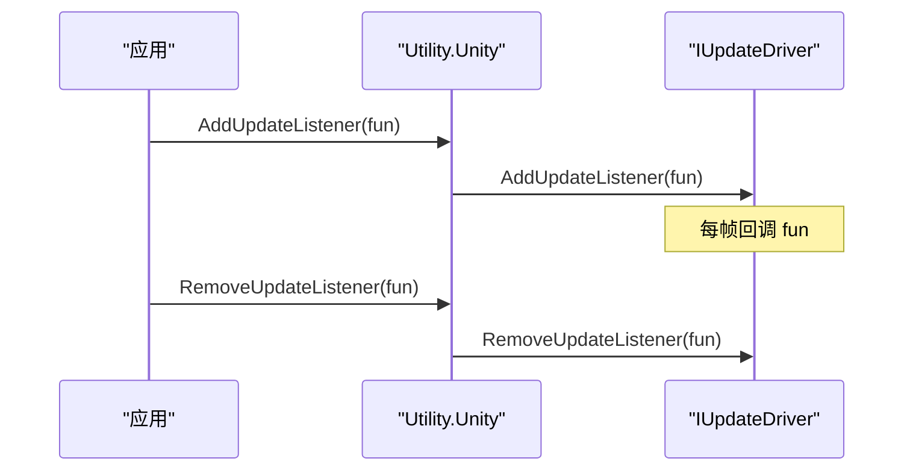
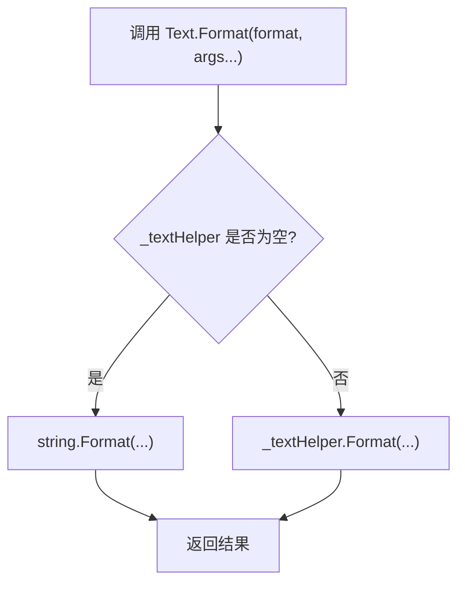
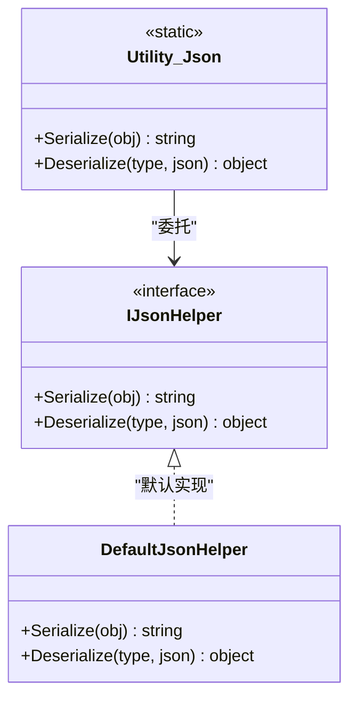
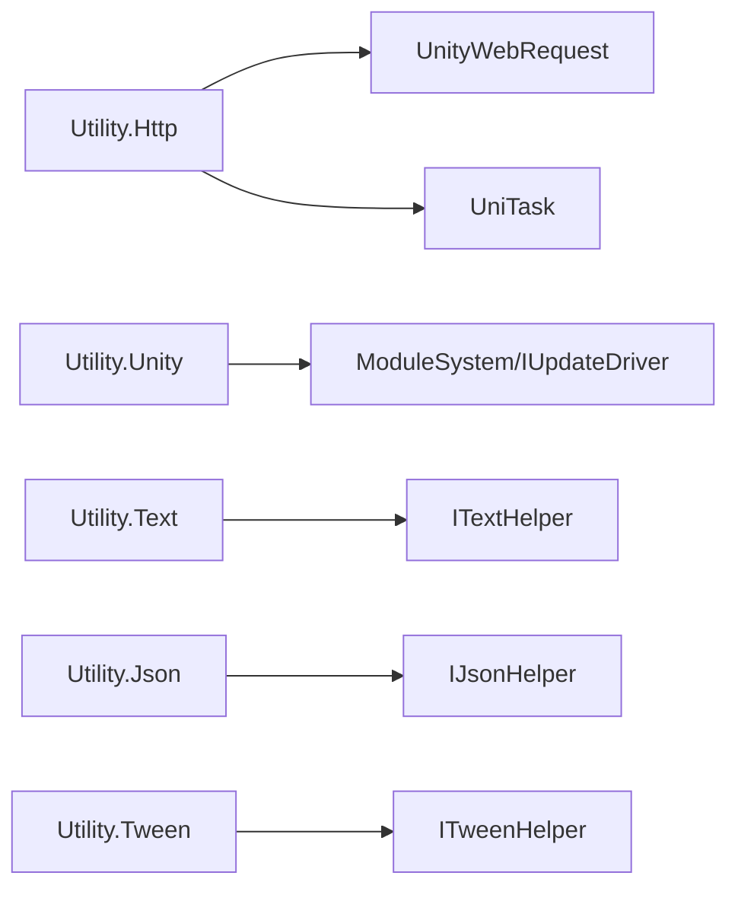

# 工具与扩展 API

<cite>
**本文引用的文件**   
- [Utility.cs](file://UnityProject/Assets/TEngine/Runtime/Core/Utility/Utility.cs)
- [Utility.File.cs](file://UnityProject/Assets/TEngine/Runtime/Core/Utility/Utility.File.cs)
- [Utility.Http.cs](file://UnityProject/Assets/TEngine/Runtime/Core/Utility/Utility.Http.cs)
- [Utility.Reflection.cs](file://UnityProject/Assets/TEngine/Runtime/Core/Utility/Utility.Reflection.cs)
- [Utility.Unity.cs](file://UnityProject/Assets/TEngine/Runtime/Core/Utility/Utility.Unity.cs)
- [Utility.Text.cs](file://UnityProject/Assets/TEngine/Runtime/Core/Utility/Utility.Text.cs)
- [Utility.Converter.cs](file://UnityProject/Assets/TEngine/Runtime/Core/Utility/Utility.Converter.cs)
- [Utility.PlayerPrefs.cs](file://UnityProject/Assets/TEngine/Runtime/Core/Utility/Utility.PlayerPrefs.cs)
- [ITextHelper.cs](file://UnityProject/Assets/TEngine/Runtime/Core/Utility/Utility.Text.ITextHelper.cs)
- [ITweenHelper.cs](file://UnityProject/Assets/TEngine/Runtime/Extension/Tween/ITweenHelper.cs)
- [Utility.Json.IJsonHelper.cs](file://UnityProject/Assets/TEngine/Runtime/Extension/Json/Utility.Json.IJsonHelper.cs)
- [DefaultJsonHelper.cs](file://UnityProject/Assets/TEngine/Runtime/Extension/Json/DefaultJsonHelper.cs)
- [Utility.Json.cs](file://UnityProject/Assets/TEngine/Runtime/Extension/Json/Utility.Json.cs)
- [Utility.Tween.cs](file://UnityProject/Assets/TEngine/Runtime/Extension/Tween/Utility.Tween.cs)
</cite>

## 目录
1. [简介](#简介)
2. [项目结构](#项目结构)
3. [核心组件](#核心组件)
4. [架构总览](#架构总览)
5. [详细组件分析](#详细组件分析)
6. [依赖关系分析](#依赖关系分析)
7. [性能考量](#性能考量)
8. [故障排查指南](#故障排查指南)
9. [结论](#结论)
10. [附录：使用示例与最佳实践](#附录使用示例与最佳实践)

## 简介
本章节面向“工具与扩展”API，系统性梳理 TEngine 的 Utility 命名空间及其扩展模块。内容覆盖：
- 文件操作、路径处理、MD5、字节长度格式化等
- HTTP 网络请求（协程与 UniTask 异步）
- JSON 序列化（可插拔 IJsonHelper）
- 反射工具（方法/属性/字段访问）
- Unity 生命周期与协程封装
- 文本格式化（可插拔 ITextHelper）
- 类型转换与字节编解码
- PlayerPrefs 增强（用户隔离、布尔支持、全局开关）
- Tween 动画扩展（可插拔 ITweenHelper）

## 项目结构
Utility 相关代码主要位于 Runtime/Core/Utility 与 Runtime/Extension 两个目录下：
- Runtime/Core/Utility：基础工具集（文件、HTTP、反射、Unity、文本、转换器、PlayerPrefs）
- Runtime/Extension：可扩展能力（JSON、Tween、Material 等）

图表来源
- [Utility.cs:1-9](file://UnityProject/Assets/TEngine/Runtime/Core/Utility/Utility.cs#L1-L9)
- [Utility.File.cs:1-255](file://UnityProject/Assets/TEngine/Runtime/Core/Utility/Utility.File.cs#L1-L255)
- [Utility.Http.cs:1-270](file://UnityProject/Assets/TEngine/Runtime/Core/Utility/Utility.Http.cs#L1-L270)
- [Utility.Reflection.cs:1-358](file://UnityProject/Assets/TEngine/Runtime/Core/Utility/Utility.Reflection.cs#L1-L358)
- [Utility.Unity.cs:1-351](file://UnityProject/Assets/TEngine/Runtime/Core/Utility/Utility.Unity.cs#L1-L351)
- [Utility.Text.cs:1-615](file://UnityProject/Assets/TEngine/Runtime/Core/Utility/Utility.Text.cs#L1-L615)
- [Utility.Converter.cs:1-836](file://UnityProject/Assets/TEngine/Runtime/Core/Utility/Utility.Converter.cs#L1-L836)
- [Utility.PlayerPrefs.cs:1-291](file://UnityProject/Assets/TEngine/Runtime/Core/Utility/Utility.PlayerPrefs.cs#L1-L291)
- [Utility.Json.cs:1-200](file://UnityProject/Assets/TEngine/Runtime/Extension/Json/Utility.Json.cs#L1-L200)
- [Utility.Tween.cs:1-200](file://UnityProject/Assets/TEngine/Runtime/Extension/Tween/Utility.Tween.cs#L1-L200)

章节来源
- [Utility.cs:1-9](file://UnityProject/Assets/TEngine/Runtime/Core/Utility/Utility.cs#L1-L9)

## 核心组件
- Utility.File：文件创建、路径规范化、沙盒路径、MD5、文件大小与长度格式化、UTF-8 BOM 处理
- Utility.Http：GET/POST、下载文件、获取纹理/音频、UniTask 与协程双模式
- Utility.Reflection：动态调用方法、读写属性/字段、枚举成员名与类型映射
- Utility.Unity：协程管理、Update/FixedUpdate/LateUpdate 注入、Destroy/Gizmos/Pause 事件、FindObjectOfType 兼容
- Utility.Text：可插拔字符串格式化（ITextHelper），默认回退到 string.Format
- Utility.Converter：像素/英寸/厘米换算、基础类型与字节数组互转、编码转换
- Utility.PlayerPrefs：全局开关、用户隔离键、布尔值存取、配置项检查与保存
- Extension.Json：可插拔 JSON 序列化（IJsonHelper + DefaultJsonHelper）
- Extension.Tween：可插拔动画（ITweenHelper）

章节来源
- [Utility.File.cs:1-255](file://UnityProject/Assets/TEngine/Runtime/Core/Utility/Utility.File.cs#L1-L255)
- [Utility.Http.cs:1-270](file://UnityProject/Assets/TEngine/Runtime/Core/Utility/Utility.Http.cs#L1-L270)
- [Utility.Reflection.cs:1-358](file://UnityProject/Assets/TEngine/Runtime/Core/Utility/Utility.Reflection.cs#L1-L358)
- [Utility.Unity.cs:1-351](file://UnityProject/Assets/TEngine/Runtime/Core/Utility/Utility.Unity.cs#L1-L351)
- [Utility.Text.cs:1-615](file://UnityProject/Assets/TEngine/Runtime/Core/Utility/Utility.Text.cs#L1-L615)
- [Utility.Converter.cs:1-836](file://UnityProject/Assets/TEngine/Runtime/Core/Utility/Utility.Converter.cs#L1-L836)
- [Utility.PlayerPrefs.cs:1-291](file://UnityProject/Assets/TEngine/Runtime/Core/Utility/Utility.PlayerPrefs.cs#L1-L291)
- [Utility.Json.cs:1-200](file://UnityProject/Assets/TEngine/Runtime/Extension/Json/Utility.Json.cs#L1-L200)
- [Utility.Tween.cs:1-200](file://UnityProject/Assets/TEngine/Runtime/Extension/Tween/Utility.Tween.cs#L1-L200)

## 架构总览
Utility 采用“静态类 + 可插拔接口”的设计：
- 所有工具以静态类暴露，便于直接调用
- 文本、JSON、Tween 通过接口实现解耦，允许替换默认实现
- HTTP 同时提供协程与 UniTask 两种异步模型，适配不同业务风格

图表来源
- [Utility.cs:1-9](file://UnityProject/Assets/TEngine/Runtime/Core/Utility/Utility.cs#L1-L9)
- [Utility.File.cs:1-255](file://UnityProject/Assets/TEngine/Runtime/Core/Utility/Utility.File.cs#L1-L255)
- [Utility.Http.cs:1-270](file://UnityProject/Assets/TEngine/Runtime/Core/Utility/Utility.Http.cs#L1-L270)
- [Utility.Reflection.cs:1-358](file://UnityProject/Assets/TEngine/Runtime/Core/Utility/Utility.Reflection.cs#L1-L358)
- [Utility.Unity.cs:1-351](file://UnityProject/Assets/TEngine/Runtime/Core/Utility/Utility.Unity.cs#L1-L351)
- [Utility.Text.cs:1-615](file://UnityProject/Assets/TEngine/Runtime/Core/Utility/Utility.Text.cs#L1-L615)
- [Utility.Converter.cs:1-836](file://UnityProject/Assets/TEngine/Runtime/Core/Utility/Utility.Converter.cs#L1-L836)
- [Utility.PlayerPrefs.cs:1-291](file://UnityProject/Assets/TEngine/Runtime/Core/Utility/Utility.PlayerPrefs.cs#L1-L291)
- [Utility.Json.IJsonHelper.cs:1-200](file://UnityProject/Assets/TEngine/Runtime/Extension/Json/Utility.Json.IJsonHelper.cs#L1-L200)
- [DefaultJsonHelper.cs:1-200](file://UnityProject/Assets/TEngine/Runtime/Extension/Json/DefaultJsonHelper.cs#L1-L200)
- [ITweenHelper.cs:1-200](file://UnityProject/Assets/TEngine/Runtime/Extension/Tween/ITweenHelper.cs#L1-L200)

## 详细组件分析

### 文件与路径工具（Utility.File）
- 功能要点
  - 创建文件并自动创建目录（可控制是否创建目录）
  - 获取平台沙盒路径（Android 与非 Android 差异）
  - 路径分隔符标准化
  - MD5 计算（失败返回错误标记）
  - 文件大小与人类可读长度格式化
  - UTF-8 BOM 去除与文本读取
- 典型用法
  - 在资源加载前校验文件存在性与完整性
  - 日志或缓存写入时统一路径与大小展示

图表来源
- [Utility.File.cs:35-103](file://UnityProject/Assets/TEngine/Runtime/Core/Utility/Utility.File.cs#L35-L103)

章节来源
- [Utility.File.cs:1-255](file://UnityProject/Assets/TEngine/Runtime/Core/Utility/Utility.File.cs#L1-L255)

### 网络请求（Utility.Http）
- 功能要点
  - GET/POST 多种重载（字符串、字典、WWWForm）
  - UniTask 异步版本（支持取消令牌与超时）
  - 协程版本（回调式）
  - 下载文件、获取纹理、获取音频、PUT 上传二进制
- 关键流程（UniTask GET）

图表来源
- [Utility.Http.cs:25-32](file://UnityProject/Assets/TEngine/Runtime/Core/Utility/Utility.Http.cs#L25-L32)
- [Utility.Http.cs:92-117](file://UnityProject/Assets/TEngine/Runtime/Core/Utility/Utility.Http.cs#L92-L117)

章节来源
- [Utility.Http.cs:1-270](file://UnityProject/Assets/TEngine/Runtime/Core/Utility/Utility.Http.cs#L1-L270)

### 反射工具（Utility.Reflection）
- 功能要点
  - 动态调用方法（支持实例/静态、公共/私有）
  - 读写属性与字段（支持非 public）
  - 枚举类型的所有属性/字段名称与类型映射
- 注意事项
  - 参数为空或方法不存在会抛异常
  - 频繁反射有性能开销，建议缓存 Type/MethodInfo

图表来源
- [Utility.Reflection.cs:22-49](file://UnityProject/Assets/TEngine/Runtime/Core/Utility/Utility.Reflection.cs#L22-L49)

章节来源
- [Utility.Reflection.cs:1-358](file://UnityProject/Assets/TEngine/Runtime/Core/Utility/Utility.Reflection.cs#L1-L358)

### Unity 生命周期与协程（Utility.Unity）
- 功能要点
  - 统一的协程启动/停止（支持绑定 GameObject/MonoBehaviour）
  - Update/FixedUpdate/LateUpdate 监听注入
  - Destroy/Gizmos/Pause 事件注册
  - FindObjectOfType 跨版本兼容
- 设计要点
  - 内部通过 IUpdateDriver 驱动更新循环
  - GameCoroutine 包装 Coroutine 并提供名称与绑定对象

图表来源
- [Utility.Unity.cs:176-186](file://UnityProject/Assets/TEngine/Runtime/Core/Utility/Utility.Unity.cs#L176-L186)
- [Utility.Unity.cs:316-324](file://UnityProject/Assets/TEngine/Runtime/Core/Utility/Utility.Unity.cs#L316-L324)

章节来源
- [Utility.Unity.cs:1-351](file://UnityProject/Assets/TEngine/Runtime/Core/Utility/Utility.Unity.cs#L1-L351)

### 文本格式化（Utility.Text）
- 功能要点
  - SetTextHelper 注入自定义 ITextHelper
  - Format 多参数重载，未设置 Helper 时回退到 string.Format
- 扩展点
  - 实现 ITextHelper 以接入第三方格式化库或本地化系统

图表来源
- [Utility.Text.cs:16-41](file://UnityProject/Assets/TEngine/Runtime/Core/Utility/Utility.Text.cs#L16-L41)

章节来源
- [Utility.Text.cs:1-615](file://UnityProject/Assets/TEngine/Runtime/Core/Utility/Utility.Text.cs#L1-L615)
- [Utility.Text.ITextHelper.cs:1-200](file://UnityProject/Assets/TEngine/Runtime/Core/Utility/Utility.Text.ITextHelper.cs#L1-L200)

### 类型转换与编解码（Utility.Converter）
- 功能要点
  - 像素/英寸/厘米换算（需先设置 ScreenDpi）
  - 基础类型与 byte[] 互转（含 unsafe 优化）
  - UTF-8 字符串编解码
- 注意事项
  - 未设置 DPI 将抛出异常
  - 大数组编解码注意内存分配与 GC

章节来源
- [Utility.Converter.cs:1-836](file://UnityProject/Assets/TEngine/Runtime/Core/Utility/Utility.Converter.cs#L1-L836)

### 持久化存储（Utility.PlayerPrefs）
- 功能要点
  - 全局启用/禁用开关
  - 用户隔离键（userId_key）
  - 布尔值存取（底层以 int 存储）
  - 配置项检查与保存
- 典型场景
  - 游戏设置、用户偏好、离线数据

章节来源
- [Utility.PlayerPrefs.cs:1-291](file://UnityProject/Assets/TEngine/Runtime/Core/Utility/Utility.PlayerPrefs.cs#L1-L291)

### JSON 序列化（Extension.Json）
- 组件说明
  - IJsonHelper：定义序列化/反序列化接口
  - DefaultJsonHelper：默认实现（基于常见 JSON 库）
  - Utility.Json：对外暴露静态 API，内部委托给 IJsonHelper
- 使用方式
  - 通过 Utility.Json 进行序列化/反序列化
  - 可通过替换 IJsonHelper 实现自定义序列化器

图表来源
- [Utility.Json.IJsonHelper.cs:1-200](file://UnityProject/Assets/TEngine/Runtime/Extension/Json/Utility.Json.IJsonHelper.cs#L1-L200)
- [DefaultJsonHelper.cs:1-200](file://UnityProject/Assets/TEngine/Runtime/Extension/Json/DefaultJsonHelper.cs#L1-L200)
- [Utility.Json.cs:1-200](file://UnityProject/Assets/TEngine/Runtime/Extension/Json/Utility.Json.cs#L1-L200)

章节来源
- [Utility.Json.IJsonHelper.cs:1-200](file://UnityProject/Assets/TEngine/Runtime/Extension/Json/Utility.Json.IJsonHelper.cs#L1-L200)
- [DefaultJsonHelper.cs:1-200](file://UnityProject/Assets/TEngine/Runtime/Extension/Json/DefaultJsonHelper.cs#L1-L200)
- [Utility.Json.cs:1-200](file://UnityProject/Assets/TEngine/Runtime/Extension/Json/Utility.Json.cs#L1-L200)

### 动画扩展（Extension.Tween）
- 组件说明
  - ITweenHelper：定义 ToFloat/ToColor 等动画接口
  - Utility.Tween：对外暴露静态 API，内部委托给 ITweenHelper
- 使用方式
  - 通过 Utility.Tween 发起动画
  - 可替换 ITweenHelper 以集成不同动画库

章节来源
- [ITweenHelper.cs:1-200](file://UnityProject/Assets/TEngine/Runtime/Extension/Tween/ITweenHelper.cs#L1-L200)
- [Utility.Tween.cs:1-200](file://UnityProject/Assets/TEngine/Runtime/Extension/Tween/Utility.Tween.cs#L1-L200)

## 依赖关系分析
- 外部依赖
  - UnityWebRequest（网络）
  - Cysharp.Threading.Tasks.UniTask（异步）
  - UnityEngine（平台 API）
- 内部依赖
  - Utility.Unity 依赖 IUpdateDriver（由模块系统提供）
  - Utility.Text 依赖 ITextHelper（可插拔）
  - Extension.Json 依赖 IJsonHelper（可插拔）
  - Extension.Tween 依赖 ITweenHelper（可插拔）

图表来源
- [Utility.Http.cs:1-270](file://UnityProject/Assets/TEngine/Runtime/Core/Utility/Utility.Http.cs#L1-L270)
- [Utility.Unity.cs:316-324](file://UnityProject/Assets/TEngine/Runtime/Core/Utility/Utility.Unity.cs#L316-L324)
- [Utility.Text.cs:16-41](file://UnityProject/Assets/TEngine/Runtime/Core/Utility/Utility.Text.cs#L16-L41)
- [Utility.Json.cs:1-200](file://UnityProject/Assets/TEngine/Runtime/Extension/Json/Utility.Json.cs#L1-L200)
- [Utility.Tween.cs:1-200](file://UnityProject/Assets/TEngine/Runtime/Extension/Tween/Utility.Tween.cs#L1-L200)

章节来源
- [Utility.Http.cs:1-270](file://UnityProject/Assets/TEngine/Runtime/Core/Utility/Utility.Http.cs#L1-L270)
- [Utility.Unity.cs:1-351](file://UnityProject/Assets/TEngine/Runtime/Core/Utility/Utility.Unity.cs#L1-L351)
- [Utility.Text.cs:1-615](file://UnityProject/Assets/TEngine/Runtime/Core/Utility/Utility.Text.cs#L1-L615)
- [Utility.Json.cs:1-200](file://UnityProject/Assets/TEngine/Runtime/Extension/Json/Utility.Json.cs#L1-L200)
- [Utility.Tween.cs:1-200](file://UnityProject/Assets/TEngine/Runtime/Extension/Tween/Utility.Tween.cs#L1-L200)

## 性能考量
- 反射调用（Utility.Reflection）
  - 避免在热路径中频繁反射；缓存 Type/MethodInfo/PropertyInfo
  - 对批量数据序列化/反序列化建议使用专用库而非反射
- 网络请求（Utility.Http）
  - 合理设置超时时间，避免长时间阻塞
  - 大量并发请求时注意连接池与内存占用
- 编解码（Utility.Converter）
  - 大数组编解码尽量复用 buffer，减少 GC
  - 使用 unsafe 版本提升性能但需注意安全边界
- 文本格式化（Utility.Text）
  - 自定义 ITextHelper 可能引入额外开销，按需启用
- PlayerPrefs（Utility.PlayerPrefs）
  - Save 调用频率不宜过高，建议批量写入后统一保存

[本节为通用指导，不直接分析具体文件]

## 故障排查指南
- 反射相关异常
  - 现象：找不到方法/属性/字段
  - 排查：确认方法签名、可见性（Public/Private）、BaseType 是否正确
  - 参考：[Utility.Reflection.cs:22-49](file://UnityProject/Assets/TEngine/Runtime/Core/Utility/Utility.Reflection.cs#L22-L49)
- 网络请求超时或取消
  - 现象：返回空字符串或抛出取消异常
  - 排查：检查超时设置、取消令牌、服务器可达性
  - 参考：[Utility.Http.cs:92-117](file://UnityProject/Assets/TEngine/Runtime/Core/Utility/Utility.Http.cs#L92-L117)
- 屏幕 DPI 未设置
  - 现象：像素/英寸/厘米换算抛出异常
  - 排查：在调用 Converter 前先设置 ScreenDpi
  - 参考：[Utility.Converter.cs:35-58](file://UnityProject/Assets/TEngine/Runtime/Core/Utility/Utility.Converter.cs#L35-L58)
- PlayerPrefs 无效
  - 现象：读不到数据或布尔值异常
  - 排查：检查 _enable 开关、用户 ID 是否设置、键名是否一致
  - 参考：[Utility.PlayerPrefs.cs:150-167](file://UnityProject/Assets/TEngine/Runtime/Core/Utility/Utility.PlayerPrefs.cs#L150-L167)

章节来源
- [Utility.Reflection.cs:22-49](file://UnityProject/Assets/TEngine/Runtime/Core/Utility/Utility.Reflection.cs#L22-L49)
- [Utility.Http.cs:92-117](file://UnityProject/Assets/TEngine/Runtime/Core/Utility/Utility.Http.cs#L92-L117)
- [Utility.Converter.cs:35-58](file://UnityProject/Assets/TEngine/Runtime/Core/Utility/Utility.Converter.cs#L35-L58)
- [Utility.PlayerPrefs.cs:150-167](file://UnityProject/Assets/TEngine/Runtime/Core/Utility/Utility.PlayerPrefs.cs#L150-L167)

## 结论
Utility 命名空间提供了稳定且可扩展的工具集，结合可插拔接口（ITextHelper、IJsonHelper、ITweenHelper）使框架具备良好的扩展性与可测试性。在网络、反射、编解码等高频场景中，应关注性能与异常处理，遵循缓存与批量化原则，以获得更优的运行效率与稳定性。

[本节为总结性内容，不直接分析具体文件]

## 附录：使用示例与最佳实践
- 文件与路径
  - 在资源初始化阶段，使用 Utility.File.CreateFile 确保缓存目录存在，并使用 Md5ByPathName 校验资源完整性
  - 使用 GetPersistentDataPlatformPath 获取跨平台一致的沙盒路径
- 网络请求
  - 优先使用 UniTask 版本的 Get/Post，配合 CancellationTokenSource 控制超时
  - 对于需要回调的场景，使用协程版本 DownloadFile/GetTexture/GetAudioClip
- 反射
  - 对频繁调用的方法，预先缓存 Type 与 MethodInfo，避免运行时查找
  - 使用 GetTypeAllProperties/GetTypeFieldsNameAndTypeMapping 生成元数据用于配置表映射
- Unity 生命周期
  - 使用 AddUpdateListener/AddFixedUpdateListener 注入逻辑，避免 MonoBehaviour 耦合
  - 使用 StopCoroutine(GameCoroutine) 精确停止指定协程
- 文本格式化
  - 在游戏启动时设置 Text.SetTextHelper，接入本地化或高性能格式化库
- 类型转换
  - 在 UI 尺寸计算前设置 Converter.ScreenDpi，再进行像素/英寸/厘米换算
  - 大数据传输时使用 Converter.GetBytes/GetString 进行高效编解码
- PlayerPrefs
  - 在登录成功后设置 SetUserId，后续使用 GetUserXxx 系列方法进行用户隔离存储
  - 关闭 _enable 可用于测试环境禁用持久化
- JSON 与 Tween
  - 通过 Utility.Json 进行数据序列化，必要时替换 IJsonHelper 以适配不同后端协议
  - 通过 Utility.Tween 发起动画，替换 ITweenHelper 以集成不同动画引擎

[本节为实践指导，不直接分析具体文件]