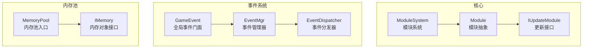
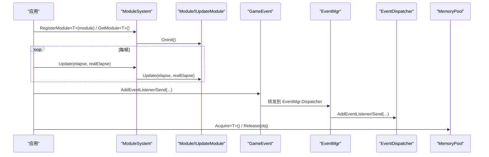
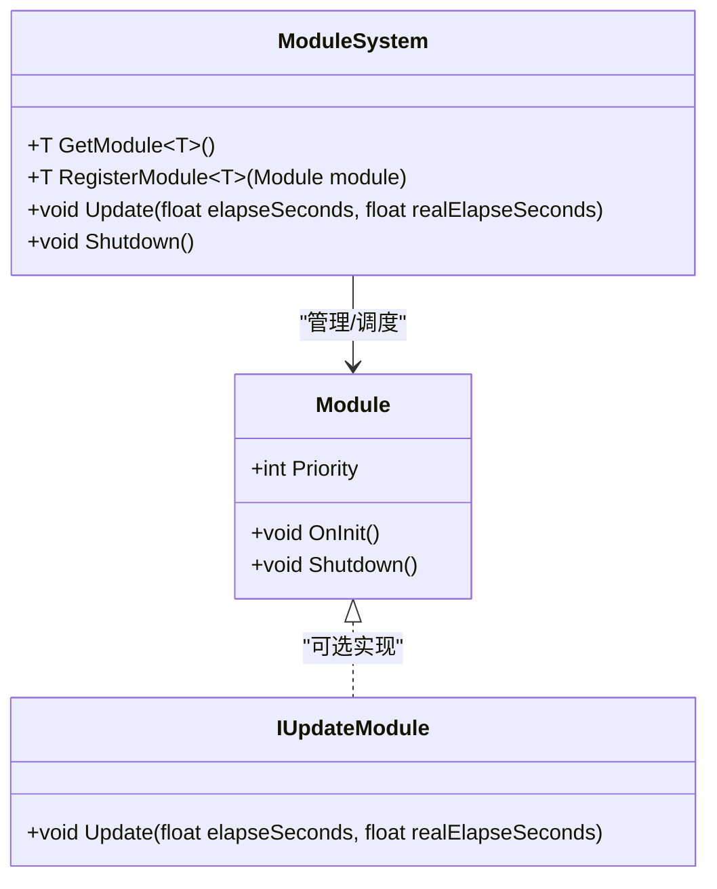
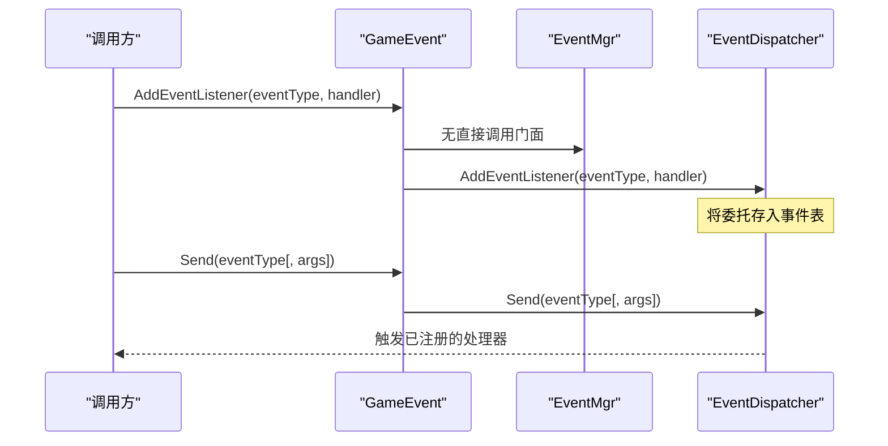
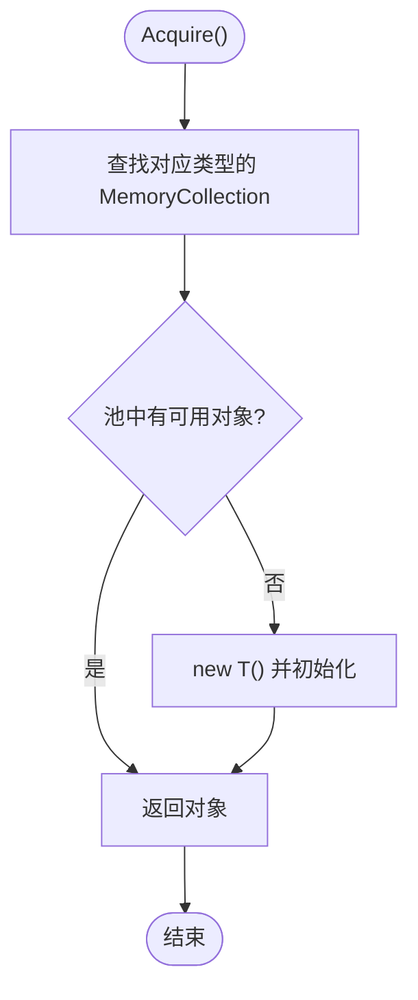
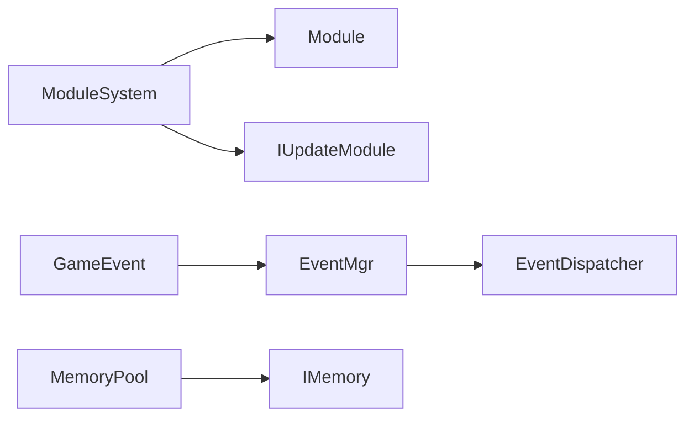

# 核心 API

<cite>
**本文引用的文件**   
- [ModuleSystem.cs](file://UnityProject/Assets/TEngine/Runtime/Core/ModuleSystem.cs)
- [Module.cs](file://UnityProject/Assets/TEngine/Runtime/Core/Module.cs)
- [GameEvent.cs](file://UnityProject/Assets/TEngine/Runtime/Core/GameEvent/GameEvent.cs)
- [EventMgr.cs](file://UnityProject/Assets/TEngine/Runtime/Core/GameEvent/EventMgr.cs)
- [EventDispatcher.cs](file://UnityProject/Assets/TEngine/Runtime/Core/GameEvent/EventDispatcher.cs)
- [MemoryPool.cs](file://UnityProject/Assets/TEngine/Runtime/Core/MemoryPool/MemoryPool.cs)
- [IMemory.cs](file://UnityProject/Assets/TEngine/Runtime/Core/MemoryPool/IMemory.cs)
</cite>

## 目录
1. [简介](#简介)
2. [项目结构](#项目结构)
3. [核心组件](#核心组件)
4. [架构总览](#架构总览)
5. [详细组件分析](#详细组件分析)
6. [依赖关系分析](#依赖关系分析)
7. [性能考虑](#性能考虑)
8. [故障排查指南](#故障排查指南)
9. [结论](#结论)
10. [附录：常用使用模式与最佳实践](#附录常用使用模式与最佳实践)

## 简介
本文件聚焦 TEngine 的核心 API，覆盖以下关键能力：
- 模块系统 ModuleSystem 与模块基类 Module、IUpdateModule 接口
- 事件系统核心接口与类型安全的事件订阅/发布机制（GameEvent、EventMgr、EventDispatcher）
- 内存池基础接口 IMemory 与静态入口 MemoryPool

文档提供类继承关系图、方法签名说明、参数类型定义、返回值描述，并给出实际代码示例路径与常见使用模式。

## 项目结构
围绕核心 API 的相关源码位于 Runtime/Core 下，分为三大子域：
- Core/ModuleSystem.cs、Core/Module.cs：模块系统与模块抽象
- Core/GameEvent/*：事件系统（全局事件门面、事件管理器、底层分发器）
- Core/MemoryPool/*：内存池（静态入口与内存对象接口）

图表来源
- [ModuleSystem.cs:9-208](file://UnityProject/Assets/TEngine/Runtime/Core/ModuleSystem.cs#L9-L208)
- [Module.cs:8-39](file://UnityProject/Assets/TEngine/Runtime/Core/Module.cs#L8-L39)
- [GameEvent.cs:8-18](file://UnityProject/Assets/TEngine/Runtime/Core/GameEvent/GameEvent.cs#L8-L18)
- [EventMgr.cs:9-88](file://UnityProject/Assets/TEngine/Runtime/Core/GameEvent/EventMgr.cs#L9-L88)
- [EventDispatcher.cs:9-199](file://UnityProject/Assets/TEngine/Runtime/Core/GameEvent/EventDispatcher.cs#L9-L199)
- [MemoryPool.cs:9-208](file://UnityProject/Assets/TEngine/Runtime/Core/MemoryPool/MemoryPool.cs#L9-L208)
- [IMemory.cs:6-12](file://UnityProject/Assets/TEngine/Runtime/Core/MemoryPool/IMemory.cs#L6-L12)

章节来源
- [ModuleSystem.cs:9-208](file://UnityProject/Assets/TEngine/Runtime/Core/ModuleSystem.cs#L9-L208)
- [Module.cs:8-39](file://UnityProject/Assets/TEngine/Runtime/Core/Module.cs#L8-L39)
- [GameEvent.cs:8-800](file://UnityProject/Assets/TEngine/Runtime/Core/GameEvent/GameEvent.cs#L8-L800)
- [EventMgr.cs:9-88](file://UnityProject/Assets/TEngine/Runtime/Core/GameEvent/EventMgr.cs#L9-L88)
- [EventDispatcher.cs:9-199](file://UnityProject/Assets/TEngine/Runtime/Core/GameEvent/EventDispatcher.cs#L9-L199)
- [MemoryPool.cs:9-208](file://UnityProject/Assets/TEngine/Runtime/Core/MemoryPool/MemoryPool.cs#L9-L208)
- [IMemory.cs:6-12](file://UnityProject/Assets/TEngine/Runtime/Core/MemoryPool/IMemory.cs#L6-L12)

## 核心组件
- 模块系统
  - ModuleSystem：模块注册、获取、生命周期管理、按优先级排序的 Update 调度
  - Module：模块抽象基类，要求实现 OnInit/Shutdown，可重写 Priority
  - IUpdateModule：可选实现的更新接口，用于参与框架每帧轮询
- 事件系统
  - GameEvent：全局事件门面，提供 Add/Remove/Send 等静态 API，支持 int/string 两种事件标识
  - EventMgr：事件管理器，维护 wrap 接口映射与底层 Dispatcher
  - EventDispatcher：底层事件表与分发逻辑，基于委托泛型重载
- 内存池
  - IMemory：内存对象需实现的 Clear 接口
  - MemoryPool：静态入口，提供 Acquire/Release/Add/Remove/RemoveAll 等操作，支持严格检查

章节来源
- [ModuleSystem.cs:9-208](file://UnityProject/Assets/TEngine/Runtime/Core/ModuleSystem.cs#L9-L208)
- [Module.cs:8-39](file://UnityProject/Assets/TEngine/Runtime/Core/Module.cs#L8-L39)
- [GameEvent.cs:8-800](file://UnityProject/Assets/TEngine/Runtime/Core/GameEvent/GameEvent.cs#L8-L800)
- [EventMgr.cs:9-88](file://UnityProject/Assets/TEngine/Runtime/Core/GameEvent/EventMgr.cs#L9-L88)
- [EventDispatcher.cs:9-199](file://UnityProject/Assets/TEngine/Runtime/Core/GameEvent/EventDispatcher.cs#L9-L199)
- [MemoryPool.cs:9-208](file://UnityProject/Assets/TEngine/Runtime/Core/MemoryPool/MemoryPool.cs#L9-L208)
- [IMemory.cs:6-12](file://UnityProject/Assets/TEngine/Runtime/Core/MemoryPool/IMemory.cs#L6-L12)

## 架构总览
下图展示模块系统、事件系统与内存池之间的协作关系与调用链。

图表来源
- [ModuleSystem.cs:29-42](file://UnityProject/Assets/TEngine/Runtime/Core/ModuleSystem.cs#L29-L42)
- [ModuleSystem.cs:128-141](file://UnityProject/Assets/TEngine/Runtime/Core/ModuleSystem.cs#L128-L141)
- [GameEvent.cs:28-101](file://UnityProject/Assets/TEngine/Runtime/Core/GameEvent/GameEvent.cs#L28-L101)
- [EventMgr.cs:30-78](file://UnityProject/Assets/TEngine/Runtime/Core/GameEvent/EventMgr.cs#L30-L78)
- [EventDispatcher.cs:32-199](file://UnityProject/Assets/TEngine/Runtime/Core/GameEvent/EventDispatcher.cs#L32-L199)
- [MemoryPool.cs:71-101](file://UnityProject/Assets/TEngine/Runtime/Core/MemoryPool/MemoryPool.cs#L71-L101)

## 详细组件分析

### 模块系统 ModuleSystem 与模块基类 Module
- 职责
  - ModuleSystem：集中管理模块实例、按优先级排序、统一 Update 调度、Shutdown 清理
  - Module：定义模块生命周期回调与优先级
  - IUpdateModule：标记需要被框架每帧调用的模块
- 关键 API
  - ModuleSystem.GetModule<T>()：通过接口类型获取或自动创建模块
  - ModuleSystem.RegisterModule<T>(Module)：手动注册自定义模块
  - ModuleSystem.Update(elapseSeconds, realElapseSeconds)：每帧驱动 IUpdateModule
  - ModuleSystem.Shutdown()：关闭所有模块并清理资源
  - Module.Priority：返回优先级（数值越大越先执行，关闭顺序相反）
  - Module.OnInit()/Shutdown()：初始化/销毁回调
- 行为要点
  - 首次 GetModule<T>() 会按约定名反射构造模块，并注册到内部列表
  - 注册时根据 Priority 插入有序链表；若实现 IUpdateModule，则加入更新队列
  - Shutdown 逆序调用各模块 Shutdown，并清空集合与内存池

图表来源
- [Module.cs:8-39](file://UnityProject/Assets/TEngine/Runtime/Core/Module.cs#L8-L39)
- [ModuleSystem.cs:9-208](file://UnityProject/Assets/TEngine/Runtime/Core/ModuleSystem.cs#L9-L208)

章节来源
- [ModuleSystem.cs:29-42](file://UnityProject/Assets/TEngine/Runtime/Core/ModuleSystem.cs#L29-L42)
- [ModuleSystem.cs:68-120](file://UnityProject/Assets/TEngine/Runtime/Core/ModuleSystem.cs#L68-L120)
- [ModuleSystem.cs:128-194](file://UnityProject/Assets/TEngine/Runtime/Core/ModuleSystem.cs#L128-L194)
- [Module.cs:22-39](file://UnityProject/Assets/TEngine/Runtime/Core/Module.cs#L22-L39)

### 事件系统：GameEvent、EventMgr、EventDispatcher
- 职责
  - GameEvent：对外暴露的全局事件门面，支持 int/string 事件标识，提供 Add/Has/Remove/Send 等静态方法
  - EventMgr：事件管理器，持有 EventDispatcher，并提供 wrap 接口注册与获取
  - EventDispatcher：底层事件表与分发逻辑，基于委托泛型重载，保证类型安全
- 关键 API
  - GameEvent.AddEventListener(eventType, handler)：添加监听（支持 0~6 个参数）
  - GameEvent.HasEventListener(eventType, handler)：判断是否已注册
  - GameEvent.RemoveEventListener(eventType, handler)：移除监听
  - GameEvent.Send(eventType[, args])：发送事件
  - EventMgr.GetInterface<T>()：获取 wrap 接口实例
  - EventMgr.RegWrapInterface<T>(callerWrap)：注册 wrap 接口
  - EventDispatcher.AddEventListener/Send/RemoveEventListener：底层注册与分发
- 类型安全机制
  - 通过 Action<T1...Tn> 泛型重载确保参数类型在编译期确定
  - 支持 int 与 string 两种事件标识（string 会被转换为运行时 ID）

图表来源
- [GameEvent.cs:28-101](file://UnityProject/Assets/TEngine/Runtime/Core/GameEvent/GameEvent.cs#L28-L101)
- [GameEvent.cs:594-798](file://UnityProject/Assets/TEngine/Runtime/Core/GameEvent/GameEvent.cs#L594-L798)
- [EventDispatcher.cs:32-199](file://UnityProject/Assets/TEngine/Runtime/Core/GameEvent/EventDispatcher.cs#L32-L199)

章节来源
- [GameEvent.cs:8-800](file://UnityProject/Assets/TEngine/Runtime/Core/GameEvent/GameEvent.cs#L8-L800)
- [EventMgr.cs:9-88](file://UnityProject/Assets/TEngine/Runtime/Core/GameEvent/EventMgr.cs#L9-L88)
- [EventDispatcher.cs:9-199](file://UnityProject/Assets/TEngine/Runtime/Core/GameEvent/EventDispatcher.cs#L9-L199)

### 内存池：IMemory 与 MemoryPool
- 职责
  - IMemory：内存对象需实现的清理接口
  - MemoryPool：静态入口，负责按类型管理对象池，提供获取、归还、批量增删、统计信息
- 关键 API
  - MemoryPool.Acquire<T>()：从池中获取对象
  - MemoryPool.Acquire(Type)：按类型获取对象
  - MemoryPool.Release(IMemory)：归还对象
  - MemoryPool.Add<T>(count)/Add(Type,count)：预分配对象
  - MemoryPool.Remove<T>(count)/Remove(Type,count)：回收指定数量
  - MemoryPool.RemoveAll<T>()/RemoveAll(Type)：清空某类型池
  - MemoryPool.GetAllMemoryPoolInfos()：获取所有池统计信息
  - MemoryPool.EnableStrictCheck：开启严格类型检查
- 约束与校验
  - 启用严格检查时，仅允许非抽象类且实现 IMemory 的类型
  - Release(null) 会抛出异常

图表来源
- [MemoryPool.cs:71-85](file://UnityProject/Assets/TEngine/Runtime/Core/MemoryPool/MemoryPool.cs#L71-L85)
- [MemoryPool.cs:187-205](file://UnityProject/Assets/TEngine/Runtime/Core/MemoryPool/MemoryPool.cs#L187-L205)

章节来源
- [MemoryPool.cs:9-208](file://UnityProject/Assets/TEngine/Runtime/Core/MemoryPool/MemoryPool.cs#L9-L208)
- [IMemory.cs:6-12](file://UnityProject/Assets/TEngine/Runtime/Core/MemoryPool/IMemory.cs#L6-L12)

## 依赖关系分析
- ModuleSystem 依赖 Module 与 IUpdateModule，并通过内部有序链表维护模块执行顺序
- GameEvent 作为门面，委托给 EventMgr 与 EventDispatcher 完成具体注册与分发
- MemoryPool 通过类型字典管理多个 MemoryCollection（内部实现），对外暴露统一静态 API

图表来源
- [ModuleSystem.cs:9-208](file://UnityProject/Assets/TEngine/Runtime/Core/ModuleSystem.cs#L9-L208)
- [Module.cs:8-39](file://UnityProject/Assets/TEngine/Runtime/Core/Module.cs#L8-L39)
- [GameEvent.cs:8-18](file://UnityProject/Assets/TEngine/Runtime/Core/GameEvent/GameEvent.cs#L8-L18)
- [EventMgr.cs:9-88](file://UnityProject/Assets/TEngine/Runtime/Core/GameEvent/EventMgr.cs#L9-L88)
- [EventDispatcher.cs:9-199](file://UnityProject/Assets/TEngine/Runtime/Core/GameEvent/EventDispatcher.cs#L9-L199)
- [MemoryPool.cs:9-208](file://UnityProject/Assets/TEngine/Runtime/Core/MemoryPool/MemoryPool.cs#L9-L208)
- [IMemory.cs:6-12](file://UnityProject/Assets/TEngine/Runtime/Core/MemoryPool/IMemory.cs#L6-L12)

章节来源
- [ModuleSystem.cs:9-208](file://UnityProject/Assets/TEngine/Runtime/Core/ModuleSystem.cs#L9-L208)
- [GameEvent.cs:8-800](file://UnityProject/Assets/TEngine/Runtime/Core/GameEvent/GameEvent.cs#L8-L800)
- [MemoryPool.cs:9-208](file://UnityProject/Assets/TEngine/Runtime/Core/MemoryPool/MemoryPool.cs#L9-L208)

## 性能考虑
- 模块系统
  - 使用 LinkedList 维护模块顺序，避免频繁扩容；Update 前构建一次执行列表以减少 GC
  - 建议合理设置模块 Priority，减少不必要的跨层调用
- 事件系统
  - 使用泛型委托减少装箱与类型转换开销；string 事件会在内部转换为运行时 ID
  - 建议在合适时机 RemoveEventListener，避免悬挂引用导致内存泄漏
- 内存池
  - 预分配 Add<T>(count) 可减少运行时分配；合理使用 RemoveAll 控制峰值
  - 开启 EnableStrictCheck 可在开发期发现不合规类型，上线前关闭以提升性能

[本节为通用指导，无需特定文件引用]

## 故障排查指南
- 模块相关
  - 通过接口获取模块时报错：确认传入的是接口类型而非具体类
  - 找不到模块类型：检查命名空间与程序集名称是否符合约定
  - 模块未执行 Update：确认模块实现了 IUpdateModule 接口
- 事件相关
  - 事件未触发：检查 AddEventListener 与 Send 的事件标识一致（int/string）
  - 重复注册：HasEventListener 可用于去重
  - 内存泄漏：确保在适当生命周期 RemoveEventListener
- 内存池相关
  - Release(null) 抛异常：确保归还的对象非空
  - 严格检查失败：确认类型为非抽象类且实现 IMemory

章节来源
- [ModuleSystem.cs:68-89](file://UnityProject/Assets/TEngine/Runtime/Core/ModuleSystem.cs#L68-L89)
- [GameEvent.cs:28-101](file://UnityProject/Assets/TEngine/Runtime/Core/GameEvent/GameEvent.cs#L28-L101)
- [MemoryPool.cs:91-101](file://UnityProject/Assets/TEngine/Runtime/Core/MemoryPool/MemoryPool.cs#L91-L101)
- [MemoryPool.cs:164-185](file://UnityProject/Assets/TEngine/Runtime/Core/MemoryPool/MemoryPool.cs#L164-L185)

## 结论
TEngine 的核心 API 以模块系统为骨架，以事件系统为纽带，以内存池为性能保障。通过统一的静态门面与清晰的接口契约，开发者可以以低耦合的方式组织游戏逻辑，获得良好的扩展性与可维护性。

[本节为总结性内容，无需特定文件引用]

## 附录：常用使用模式与最佳实践
- 模块注册与获取
  - 推荐通过接口获取模块：GetModule<Ixxx>()，由框架按约定自动创建
  - 也可手动注册：RegisterModule<Ixxx>(new XxxModule())，便于测试或替换实现
- 模块生命周期
  - 在 OnInit 中完成初始化；在 Shutdown 中释放资源
  - 若需要每帧更新，实现 IUpdateModule 并在 Update 中处理逻辑
- 事件订阅与发布
  - 使用 GameEvent.AddEventListener/Send 进行解耦通信
  - 使用 HasEventListener 做幂等注册；在对象销毁前 RemoveEventListener
  - 优先使用 int 事件标识以获得更好性能；string 适合配置化场景
- 内存池使用
  - 对高频短生命周期的对象，使用 MemoryPool.Acquire/Release
  - 启动阶段预分配：Add<T>(count)，降低运行时分配压力
  - 调试阶段开启 EnableStrictCheck，上线前关闭

[本节为通用指导，无需特定文件引用]