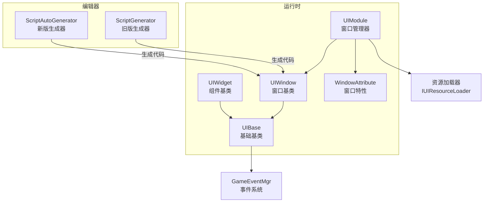
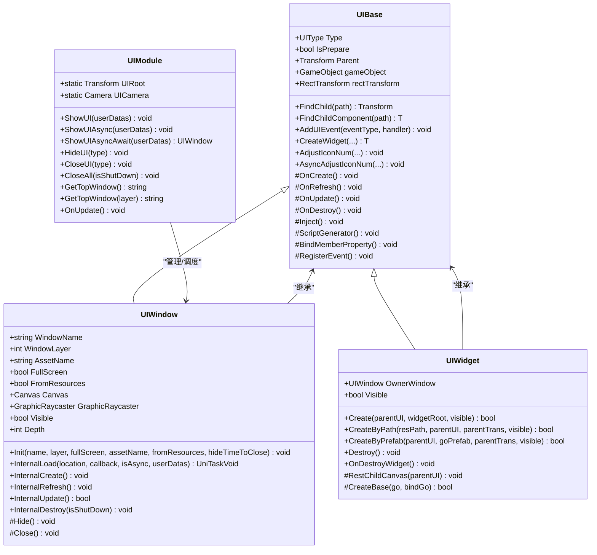
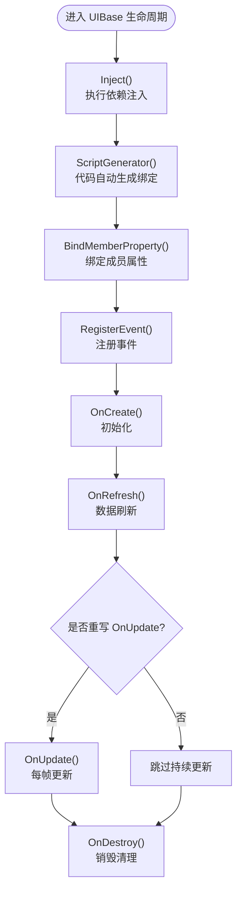
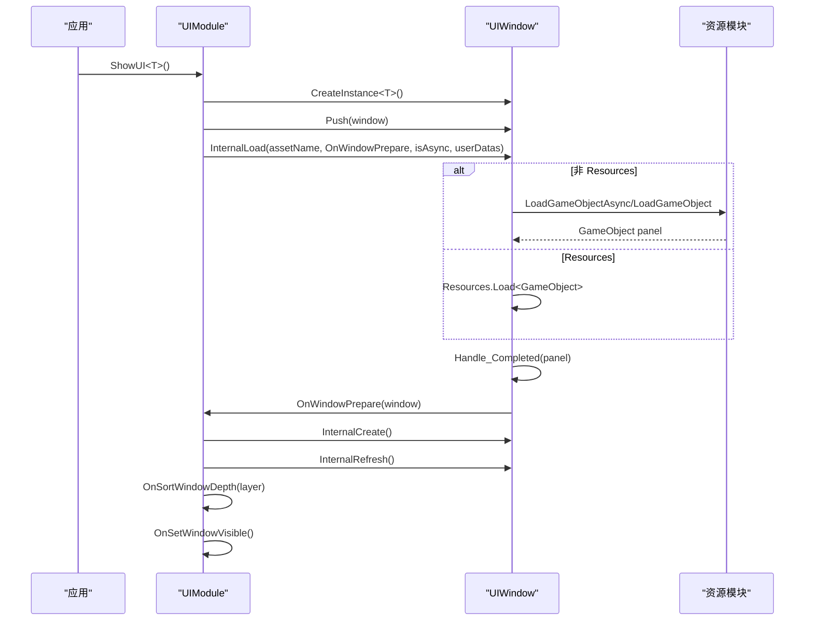
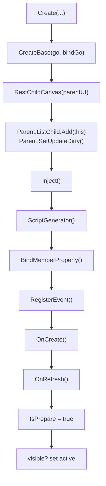
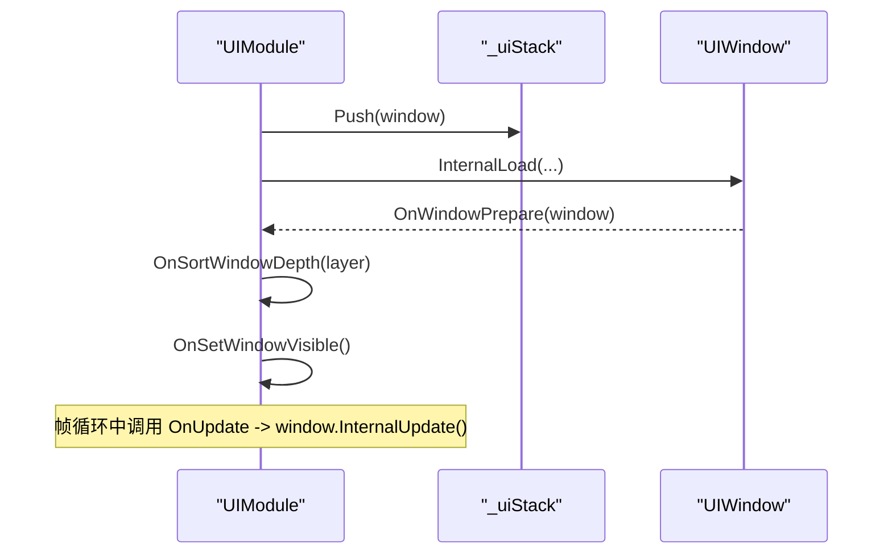
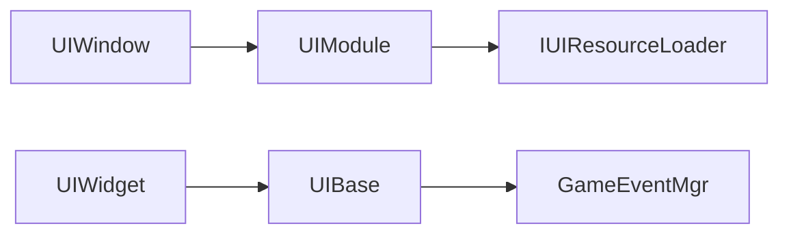

# UI 模块 API

<cite>
**本文引用的文件**   
- [UIBase.cs](file://UnityProject/Assets/GameScripts/HotFix/GameLogic/Module/UIModule/UIBase.cs)
- [UIWindow.cs](file://UnityProject/Assets/GameScripts/HotFix/GameLogic/Module/UIModule/UIWindow.cs)
- [UIWidget.cs](file://UnityProject/Assets/GameScripts/HotFix/GameLogic/Module/UIModule/UIWidget.cs)
- [UIModule.cs](file://UnityProject/Assets/GameScripts/HotFix/GameLogic/Module/UIModule/UIModule.cs)
- [WindowAttribute.cs](file://UnityProject/Assets/GameScripts/HotFix/GameLogic/Module/UIModule/WindowAttribute.cs)
- [3-5-UI模块.md](file://Books/3-5-UI模块.md)
- [ScriptGenerator.cs](file://UnityProject/Assets/Editor/UIScriptGenerator/ScriptGenerator.cs)
- [ScriptAutoGenerator.cs](file://UnityProject/Assets/Editor/UIScriptGenerator/ScriptAutoGenerator.cs)
</cite>

## 目录
1. [简介](#简介)
2. [项目结构](#项目结构)
3. [核心组件](#核心组件)
4. [架构总览](#架构总览)
5. [详细组件分析](#详细组件分析)
6. [依赖关系分析](#依赖关系分析)
7. [性能与优化](#性能与优化)
8. [故障排查](#故障排查)
9. [结论](#结论)
10. [附录：常用 API 速查](#附录常用-api-速查)

## 简介
本文件为 TEngine UI 模块的权威 API 文档，聚焦以下目标：
- 完整记录 UIBase、UIWindow、UIWidget 三个核心基类的接口定义与使用方法
- 说明 UI 生命周期（OnCreate、OnRefresh、OnUpdate、OnDestroy）与事件绑定机制（AddUIEvent）
- 提供组件查找方法（FindChild、FindChildComponent）的使用指南
- 文档化 UIModule 的管理能力：窗口显示/隐藏、层级管理、全屏面板控制
- 给出创建自定义 UI 窗口和组件的完整示例流程，包括脚本生成器使用、资源自动管理、依赖注入支持
- 解释 UI 与资源模块的集成方式与事件驱动架构原理
- 总结性能优化技巧与常见问题解决方案

## 项目结构
UI 模块的核心代码位于热更新逻辑层，编辑器侧提供脚本生成工具。关键路径如下：
- 运行时核心：UnityProject/Assets/GameScripts/HotFix/GameLogic/Module/UIModule
- 编辑器工具：UnityProject/Assets/Editor/UIScriptGenerator
- 文档与示例：Books/3-5-UI模块.md

图表来源
- [UIModule.cs:15-31](file://UnityProject/Assets/GameScripts/HotFix/GameLogic/Module/UIModule/UIModule.cs#L15-L31)
- [UIWindow.cs:11-35](file://UnityProject/Assets/GameScripts/HotFix/GameLogic/Module/UIModule/UIWindow.cs#L11-L35)
- [UIWidget.cs:7-33](file://UnityProject/Assets/GameScripts/HotFix/GameLogic/Module/UIModule/UIWidget.cs#L7-L33)
- [UIBase.cs:18-45](file://UnityProject/Assets/GameScripts/HotFix/GameLogic/Module/UIModule/UIBase.cs#L18-L45)
- [WindowAttribute.cs](file://UnityProject/Assets/GameScripts/HotFix/GameLogic/Module/UIModule/WindowAttribute.cs)
- [ScriptGenerator.cs:12-58](file://UnityProject/Assets/Editor/UIScriptGenerator/ScriptGenerator.cs#L12-L58)
- [ScriptAutoGenerator.cs:30-76](file://UnityProject/Assets/Editor/UIScriptGenerator/ScriptAutoGenerator.cs#L30-L76)

章节来源
- [UIModule.cs:15-31](file://UnityProject/Assets/GameScripts/HotFix/GameLogic/Module/UIModule/UIModule.cs#L15-L31)
- [UIWindow.cs:11-35](file://UnityProject/Assets/GameScripts/HotFix/GameLogic/Module/UIModule/UIWindow.cs#L11-L35)
- [UIWidget.cs:7-33](file://UnityProject/Assets/GameScripts/HotFix/GameLogic/Module/UIModule/UIWidget.cs#L7-L33)
- [UIBase.cs:18-45](file://UnityProject/Assets/GameScripts/HotFix/GameLogic/Module/UIModule/UIBase.cs#L18-L45)
- [ScriptGenerator.cs:12-58](file://UnityProject/Assets/Editor/UIScriptGenerator/ScriptGenerator.cs#L12-L58)
- [ScriptAutoGenerator.cs:30-76](file://UnityProject/Assets/Editor/UIScriptGenerator/ScriptAutoGenerator.cs#L30-L76)

## 核心组件
本节概述三个核心基类的职责与关键接口。

- UIBase
  - 所有 UI 的基础抽象，提供生命周期钩子、事件绑定、子组件管理、查找与动态创建 Widget 的能力
  - 关键字段与方法：Parent、Type、IsPrepare、ListChild、FindChild、FindChildComponent<T>、AddUIEvent、CreateWidget*、AdjustIconNum、AsyncAdjustIconNum
- UIWindow
  - 窗口级 UI，封装 Canvas、GraphicRaycaster、可见性、层级深度、全屏控制、资源加载与初始化流程
  - 关键字段与方法：Canvas、GraphicRaycaster、Visible、Depth、FullScreen、AssetName、FromResources、Init、InternalLoad、InternalCreate、InternalRefresh、InternalUpdate、InternalDestroy
- UIWidget
  - 组件级 UI，用于可复用 UI 片段，支持嵌套、独立生命周期、父窗口访问
  - 关键字段与方法：OwnerWindow、Visible、Create/CreateByPath/CreateByPrefab、RestChildCanvas、Destroy、OnDestroyWidget

章节来源
- [UIBase.cs:18-608](file://UnityProject/Assets/GameScripts/HotFix/GameLogic/Module/UIModule/UIBase.cs#L18-L608)
- [UIWindow.cs:11-524](file://UnityProject/Assets/GameScripts/HotFix/GameLogic/Module/UIModule/UIWindow.cs#L11-L524)
- [UIWidget.cs:7-315](file://UnityProject/Assets/GameScripts/HotFix/GameLogic/Module/UIModule/UIWidget.cs#L7-L315)

## 架构总览
UI 模块采用“纯 C# + 事件驱动”的设计，UIBase 作为根抽象，UIWindow 负责窗口管理与资源加载，UIWidget 负责可复用组件组合。UIModule 作为单例管理器，统一调度窗口堆栈、层级排序、可见性与帧更新。

图表来源
- [UIBase.cs:18-608](file://UnityProject/Assets/GameScripts/HotFix/GameLogic/Module/UIModule/UIBase.cs#L18-L608)
- [UIWindow.cs:11-524](file://UnityProject/Assets/GameScripts/HotFix/GameLogic/Module/UIModule/UIWindow.cs#L11-L524)
- [UIWidget.cs:7-315](file://UnityProject/Assets/GameScripts/HotFix/GameLogic/Module/UIModule/UIWidget.cs#L7-L315)
- [UIModule.cs:15-732](file://UnityProject/Assets/GameScripts/HotFix/GameLogic/Module/UIModule/UIModule.cs#L15-L732)

## 详细组件分析

### UIBase 详解
- 生命周期钩子
  - OnCreate：首次创建时调用，适合初始化数据与状态
  - OnRefresh：每次刷新时调用，适合数据同步
  - OnUpdate：每帧更新，若子类未重写则默认不持续驱动
  - OnDestroy：销毁前清理
- 事件系统
  - AddUIEvent：基于 GameEventMgr 的事件注册，支持多参数泛型重载；移除通过 RemoveAllUIEvent
- 组件查找
  - FindChild：按路径查找 Transform
  - FindChildComponent<T>：按路径查找并获取指定 Component
- 动态创建 Widget
  - CreateWidget：在已有父节点下创建 UIWidget
  - CreateWidgetByPath / CreateWidgetByPathAsync：通过资源地址异步或同步创建
  - CreateWidgetByPrefab：通过预制体实例化
  - CreateWidgetByType / CreateWidgetByTypeAsync：按类型名定位资源
  - AdjustIconNum / AsyncAdjustIconNum：批量调整图标数量，支持分帧异步创建
- 依赖注入
  - Injector：静态回调，可在框架中设置以注入服务或依赖

图表来源
- [UIBase.cs:136-199](file://UnityProject/Assets/GameScripts/HotFix/GameLogic/Module/UIModule/UIBase.cs#L136-L199)
- [UIBase.cs:241-332](file://UnityProject/Assets/GameScripts/HotFix/GameLogic/Module/UIModule/UIBase.cs#L241-L332)
- [UIBase.cs:336-606](file://UnityProject/Assets/GameScripts/HotFix/GameLogic/Module/UIModule/UIBase.cs#L336-L606)

章节来源
- [UIBase.cs:18-608](file://UnityProject/Assets/GameScripts/HotFix/GameLogic/Module/UIModule/UIBase.cs#L18-L608)

### UIWindow 详解
- 窗口属性
  - WindowName、WindowLayer、AssetName、FullScreen、FromResources、Visible、Depth
  - Canvas、GraphicRaycaster 暴露以便外部操作
- 生命周期与加载
  - Init：初始化窗口元信息
  - InternalLoad：根据 FromResources 选择 Resources.Load 或资源模块加载
  - Handle_Completed：完成加载后配置 Canvas/Raycaster，标记 IsPrepare 并触发回调
  - InternalCreate：注入、脚本生成、绑定、注册事件、调用 OnCreate
  - InternalRefresh：调用 OnRefresh
  - InternalUpdate：遍历子 Widget 更新，决定是否继续驱动 OnUpdate
  - InternalDestroy：清理事件、子 Widget、面板对象，标记 IsDestroyed
- 刘海屏适配
  - SetUIFit、SetUINotFit：安全区域适配辅助方法
- 快捷关闭
  - Hide：调用 UIModule.HideUI
  - Close：调用 UIModule.CloseUI

图表来源
- [UIModule.cs:298-336](file://UnityProject/Assets/GameScripts/HotFix/GameLogic/Module/UIModule/UIModule.cs#L298-L336)
- [UIWindow.cs:314-354](file://UnityProject/Assets/GameScripts/HotFix/GameLogic/Module/UIModule/UIWindow.cs#L314-L354)
- [UIWindow.cs:464-502](file://UnityProject/Assets/GameScripts/HotFix/GameLogic/Module/UIModule/UIWindow.cs#L464-L502)

章节来源
- [UIWindow.cs:11-524](file://UnityProject/Assets/GameScripts/HotFix/GameLogic/Module/UIModule/UIWindow.cs#L11-L524)
- [UIModule.cs:472-516](file://UnityProject/Assets/GameScripts/HotFix/GameLogic/Module/UIModule/UIModule.cs#L472-L516)

### UIWidget 详解
- 生命周期
  - Create：内部调用 CreateImp，依次执行 CreateBase、RestChildCanvas、注入、脚本生成、绑定、注册事件、OnCreate、OnRefresh、IsPrepare
  - CreateByPath：通过资源地址加载并创建
  - CreateByPrefab：通过预制体实例化并创建
  - Destroy：从父 ListChild 移除，调用 OnDestroy 与 OnDestroyWidget
  - OnDestroyWidget：递归销毁子 Widget，释放事件，销毁 GameObject
- 可见性与父窗口
  - Visible：控制 activeSelf 并触发 OnSetVisible
  - OwnerWindow：向上查找最近的 UIWindow 父节点
- 层级与排序
  - RestChildCanvas：将子 Canvas 的 sortingOrder 对齐到父 Canvas

图表来源
- [UIWidget.cs:142-274](file://UnityProject/Assets/GameScripts/HotFix/GameLogic/Module/UIModule/UIWidget.cs#L142-L274)

章节来源
- [UIWidget.cs:7-315](file://UnityProject/Assets/GameScripts/HotFix/GameLogic/Module/UIModule/UIWidget.cs#L7-L315)

### UIModule 管理功能
- 窗口显示/隐藏
  - ShowUI / ShowUIAsync / ShowUIAsyncAwait：同步/异步打开窗口，支持 await 返回窗口实例
  - HideUI：延迟关闭（支持 HideTimeToClose），必要时触发全屏遮挡逻辑
  - CloseUI：销毁窗口并从堆栈弹出
  - CloseAll / CloseAllWithOut：批量关闭
- 层级与可见性
  - OnSortWindowDepth：按层计算 depth，保证同层内顺序
  - OnSetWindowVisible：处理全屏面板遮挡后续窗口
- 查询与状态
  - HasWindow<T>/HasWindow(Type)：是否存在
  - GetTopWindow()/GetTopWindow(layer)：顶层窗口名称
  - IsAnyLoading：是否有窗口仍在加载
- 资源与根节点
  - UIRoot、UICamera：UI 根节点与专用摄像机
  - Resource：IUIResourceLoader 资源加载接口

图表来源
- [UIModule.cs:666-704](file://UnityProject/Assets/GameScripts/HotFix/GameLogic/Module/UIModule/UIModule.cs#L666-L704)
- [UIModule.cs:712-730](file://UnityProject/Assets/GameScripts/HotFix/GameLogic/Module/UIModule/UIModule.cs#L712-L730)

章节来源
- [UIModule.cs:15-732](file://UnityProject/Assets/GameScripts/HotFix/GameLogic/Module/UIModule/UIModule.cs#L15-L732)

## 依赖关系分析
- UIModule 依赖资源模块接口 IUIResourceLoader 进行资源加载
- UIBase 依赖 GameEventMgr 实现事件绑定
- UIWindow 依赖 UIModule 进行显示/隐藏与层级管理
- UIWidget 依赖父级 UIBase 与 Canvas 层级体系

图表来源
- [UIModule.cs:31](file://UnityProject/Assets/GameScripts/HotFix/GameLogic/Module/UIModule/UIModule.cs#L31)
- [UIBase.cs:284-332](file://UnityProject/Assets/GameScripts/HotFix/GameLogic/Module/UIModule/UIBase.cs#L284-L332)
- [UIWindow.cs:504-512](file://UnityProject/Assets/GameScripts/HotFix/GameLogic/Module/UIModule/UIWindow.cs#L504-L512)

章节来源
- [UIModule.cs:31](file://UnityProject/Assets/GameScripts/HotFix/GameLogic/Module/UIModule/UIModule.cs#L31)
- [UIBase.cs:284-332](file://UnityProject/Assets/GameScripts/HotFix/GameLogic/Module/UIModule/UIBase.cs#L284-L332)
- [UIWindow.cs:504-512](file://UnityProject/Assets/GameScripts/HotFix/GameLogic/Module/UIModule/UIWindow.cs#L504-L512)

## 性能与优化
- 更新优化
  - 仅在重写 OnUpdate 时才驱动该 UI 的每帧更新，避免无谓开销
  - 子 Widget 更新列表缓存与脏标记，减少重复遍历
- 资源加载
  - 优先使用异步加载（LoadGameObjectAsync），避免阻塞主线程
  - 合理使用 FromResources 与资源模块，区分内置与 AB 资源
- 批量创建
  - 使用 AdjustIconNum / AsyncAdjustIconNum 分批创建大量图标，降低帧卡顿
- 层级与排序
  - 合理设置 WindowLayer，避免频繁变更 Depth
  - 全屏面板应谨慎使用，避免遮挡过多窗口导致可见性重算

[本节为通用指导，不直接分析具体文件]

## 故障排查
- 找不到 Canvas
  - 现象：窗口加载完成后抛异常提示未找到 Canvas
  - 原因：预制体根节点缺少 Canvas 组件
  - 解决：确保窗口预制体根节点包含 Canvas，且 sortingLayerName 与 overrideSorting 正确
- 事件未触发或内存泄漏
  - 现象：面板关闭后仍有事件回调
  - 原因：未在 OnDestroy 或 Destroy 中移除事件监听
  - 解决：使用 AddUIEvent 并在 RemoveAllUIEvent 中统一清理
- 子组件查找失败
  - 现象：FindChild 或 FindChildComponent 返回 null
  - 原因：路径错误或节点不存在
  - 解决：检查命名规范与路径，确保脚本生成器生成的绑定一致
- 层级混乱
  - 现象：窗口重叠异常
  - 原因：手动修改 Depth 或 Layer 不当
  - 解决：通过 UIModule 的层级管理接口设置，避免直接操作底层排序

章节来源
- [UIWindow.cs:484-497](file://UnityProject/Assets/GameScripts/HotFix/GameLogic/Module/UIModule/UIWindow.cs#L484-L497)
- [UIBase.cs:324-332](file://UnityProject/Assets/GameScripts/HotFix/GameLogic/Module/UIModule/UIBase.cs#L324-L332)
- [UIBase.cs:241-278](file://UnityProject/Assets/GameScripts/HotFix/GameLogic/Module/UIModule/UIBase.cs#L241-L278)

## 结论
TEngine UI 模块通过清晰的基类分层与 UIModule 的统一管理，提供了轻量、可扩展、事件驱动的 UI 框架。开发者可以借助脚本生成器快速搭建界面，结合资源模块与事件系统构建高性能、易维护的 UI 系统。遵循本文档的 API 与最佳实践，可显著提升开发效率与运行稳定性。

[本节为总结，不直接分析具体文件]

## 附录：常用 API 速查
- 生命周期
  - OnCreate、OnRefresh、OnUpdate、OnDestroy
- 事件绑定
  - AddUIEvent(eventType, handler)、RemoveAllUIEvent
- 组件查找
  - FindChild(path)、FindChildComponent<T>(path)
- 动态创建
  - CreateWidget<T>(parent/go/path)、CreateWidgetByPath<T>、CreateWidgetByPathAsync<T>、CreateWidgetByPrefab<T>、CreateWidgetByType<T>
- 批量图标
  - AdjustIconNum<T>、AsyncAdjustIconNum<T>
- 窗口管理
  - ShowUI<T>、ShowUIAsync<T>、ShowUIAsyncAwait<T>、HideUI<T>、CloseUI<T>、CloseAll、CloseAllWithOut<T>
- 窗口属性
  - Visible、Depth、FullScreen、AssetName、FromResources、WindowName、WindowLayer

章节来源
- [UIBase.cs:241-606](file://UnityProject/Assets/GameScripts/HotFix/GameLogic/Module/UIModule/UIBase.cs#L241-L606)
- [UIWindow.cs:55-138](file://UnityProject/Assets/GameScripts/HotFix/GameLogic/Module/UIModule/UIWindow.cs#L55-L138)
- [UIModule.cs:246-470](file://UnityProject/Assets/GameScripts/HotFix/GameLogic/Module/UIModule/UIModule.cs#L246-L470)