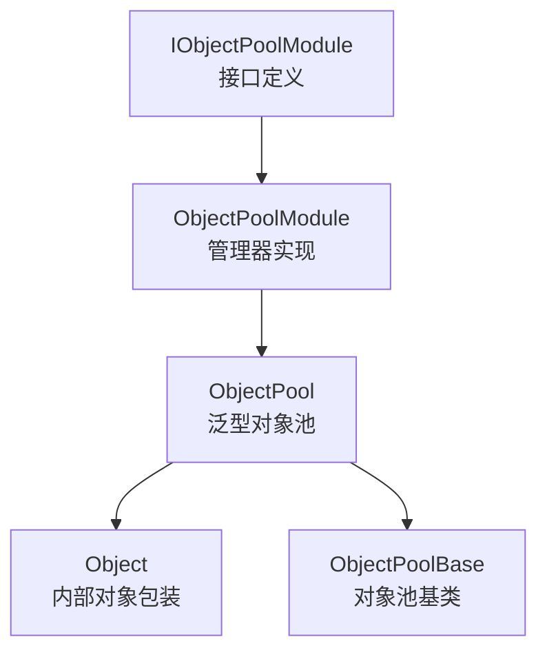
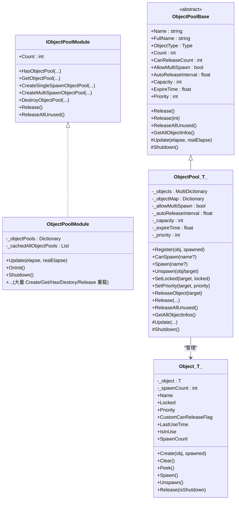
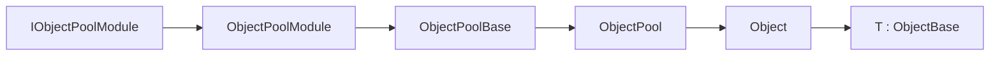

# 对象池模块 API

<cite>
**本文引用的文件**   
- [IObjectPoolModule.cs](file://UnityProject/Assets/TEngine/Runtime/Module/ObjectPoolModule/IObjectPoolModule.cs)
- [ObjectPoolModule.cs](file://UnityProject/Assets/TEngine/Runtime/Module/ObjectPoolModule/ObjectPoolModule.cs)
- [ObjectPoolModule.Object.cs](file://UnityProject/Assets/TEngine/Runtime/Module/ObjectPoolModule/ObjectPoolModule.Object.cs)
- [ObjectPoolModule.ObjectPool.cs](file://UnityProject/Assets/TEngine/Runtime/Module/ObjectPoolModule/ObjectPoolModule.ObjectPool.cs)
- [ObjectPoolBase.cs](file://UnityProject/Assets/TEngine/Runtime/Module/ObjectPoolModule/ObjectPoolBase.cs)
- [3-4-对象池模块.md](file://Books/3-4-对象池模块.md)
</cite>

## 目录
1. [简介](#简介)
2. [项目结构](#项目结构)
3. [核心组件](#核心组件)
4. [架构总览](#架构总览)
5. [详细组件分析](#详细组件分析)
6. [依赖关系分析](#依赖关系分析)
7. [性能与内存优化](#性能与内存优化)
8. [故障排查指南](#故障排查指南)
9. [结论](#结论)
10. [附录：API 参考与示例](#附录api-参考与示例)

## 简介
本文件为 TEngine 对象池模块的 API 文档，聚焦 IObjectPoolModule 接口的对象池管理能力、ObjectPoolModule 的实现细节、ObjectPoolBase 基类能力，以及泛型对象池 ObjectPool<T> 的初始化、重置、容量与过期策略。文档同时提供与 Unity 生命周期集成的说明、GC 优化建议、配置项与最佳实践，并给出可操作的代码示例路径（以“章节来源”形式引用源码位置）。

## 项目结构
对象池模块位于 Runtime/Module/ObjectPoolModule 下，采用分文件 partial class 组织：
- IObjectPoolModule.cs：对外暴露的对象池管理接口
- ObjectPoolModule.cs：管理器实现（含创建、查询、销毁、批量释放等）
- ObjectPoolModule.Object.cs：内部对象包装 Object<T>，封装实际业务对象的生命周期与统计
- ObjectPoolModule.ObjectPool.cs：泛型对象池 ObjectPool<T>，实现具体池化逻辑
- ObjectPoolBase.cs：对象池抽象基类，统一属性与生命周期钩子

图表来源
- [IObjectPoolModule.cs:9-743](file://UnityProject/Assets/TEngine/Runtime/Module/ObjectPoolModule/IObjectPoolModule.cs#L9-L743)
- [ObjectPoolModule.cs:9-800](file://UnityProject/Assets/TEngine/Runtime/Module/ObjectPoolModule/ObjectPoolModule.cs#L9-L800)
- [ObjectPoolModule.ObjectPool.cs:12-602](file://UnityProject/Assets/TEngine/Runtime/Module/ObjectPoolModule/ObjectPoolModule.ObjectPool.cs#L12-L602)
- [ObjectPoolModule.Object.cs:11-187](file://UnityProject/Assets/TEngine/Runtime/Module/ObjectPoolModule/ObjectPoolModule.Object.cs#L11-L187)
- [ObjectPoolBase.cs:8-132](file://UnityProject/Assets/TEngine/Runtime/Module/ObjectPoolModule/ObjectPoolBase.cs#L8-L132)

章节来源
- [IObjectPoolModule.cs:9-743](file://UnityProject/Assets/TEngine/Runtime/Module/ObjectPoolModule/IObjectPoolModule.cs#L9-L743)
- [ObjectPoolModule.cs:9-800](file://UnityProject/Assets/TEngine/Runtime/Module/ObjectPoolModule/ObjectPoolModule.cs#L9-L800)
- [ObjectPoolModule.ObjectPool.cs:12-602](file://UnityProject/Assets/TEngine/Runtime/Module/ObjectPoolModule/ObjectPoolModule.ObjectPool.cs#L12-L602)
- [ObjectPoolModule.Object.cs:11-187](file://UnityProject/Assets/TEngine/Runtime/Module/ObjectPoolModule/ObjectPoolModule.Object.cs#L11-L187)
- [ObjectPoolBase.cs:8-132](file://UnityProject/Assets/TEngine/Runtime/Module/ObjectPoolModule/ObjectPoolBase.cs#L8-L132)

## 核心组件
- IObjectPoolModule：对象池管理的统一入口，提供创建、获取、检查、销毁、批量释放等能力。
- ObjectPoolModule：管理器实现，维护所有对象池实例，负责轮询更新与生命周期管理。
- ObjectPoolBase：对象池抽象基类，定义名称、类型、容量、过期时间、优先级、自动释放间隔等公共属性与 Release/Shutdown 等生命周期方法。
- ObjectPool<T>：泛型对象池实现，封装对象的注册、获取、回收、锁定、优先级设置、释放筛选与批量清理。
- Object<T>：内部对象包装，持有真实业务对象，跟踪是否在使用、使用次数、最后使用时间、优先级、锁定状态等，并在 Spawn/Unspawn/Release 时触发回调。

章节来源
- [IObjectPoolModule.cs:9-743](file://UnityProject/Assets/TEngine/Runtime/Module/ObjectPoolModule/IObjectPoolModule.cs#L9-L743)
- [ObjectPoolModule.cs:9-800](file://UnityProject/Assets/TEngine/Runtime/Module/ObjectPoolModule/ObjectPoolModule.cs#L9-L800)
- [ObjectPoolBase.cs:8-132](file://UnityProject/Assets/TEngine/Runtime/Module/ObjectPoolModule/ObjectPoolBase.cs#L8-L132)
- [ObjectPoolModule.ObjectPool.cs:12-602](file://UnityProject/Assets/TEngine/Runtime/Module/ObjectPoolModule/ObjectPoolModule.ObjectPool.cs#L12-L602)
- [ObjectPoolModule.Object.cs:11-187](file://UnityProject/Assets/TEngine/Runtime/Module/ObjectPoolModule/ObjectPoolModule.Object.cs#L11-L187)

## 架构总览
对象池模块通过 IObjectPoolModule 暴露统一 API；ObjectPoolModule 作为容器管理多个 ObjectPool<T>；每个 ObjectPool<T> 管理若干 Object<T> 包装对象；Object<T> 在获取/释放时调用业务对象的 OnSpawn/OnUnspawn/Release 钩子，配合 ExpireTime/AutoReleaseInterval/Priority/Capacity 进行资源回收与内存控制。

图表来源
- [IObjectPoolModule.cs:9-743](file://UnityProject/Assets/TEngine/Runtime/Module/ObjectPoolModule/IObjectPoolModule.cs#L9-L743)
- [ObjectPoolModule.cs:9-800](file://UnityProject/Assets/TEngine/Runtime/Module/ObjectPoolModule/ObjectPoolModule.cs#L9-L800)
- [ObjectPoolBase.cs:8-132](file://UnityProject/Assets/TEngine/Runtime/Module/ObjectPoolModule/ObjectPoolBase.cs#L8-L132)
- [ObjectPoolModule.ObjectPool.cs:12-602](file://UnityProject/Assets/TEngine/Runtime/Module/ObjectPoolModule/ObjectPoolModule.ObjectPool.cs#L12-L602)
- [ObjectPoolModule.Object.cs:11-187](file://UnityProject/Assets/TEngine/Runtime/Module/ObjectPoolModule/ObjectPoolModule.Object.cs#L11-L187)

## 详细组件分析

### IObjectPoolModule 接口
- 功能要点
  - 对象池数量 Count
  - 存在性检查 HasObjectPool（按类型、名称、条件）
  - 获取对象池 GetObjectPool（按类型、名称、条件）
  - 创建单次/多次获取对象池 CreateSingleSpawnObjectPool/CreateMultiSpawnObjectPool（多种参数组合：name/capacity/expireTime/priority/autoReleaseInterval）
  - 销毁 DestroyObjectPool（按类型、名称、实例）
  - 批量释放 Release/ReleaseAllUnused
- 设计特点
  - 重载丰富，便于不同场景快速创建与查询
  - 支持 Predicate 条件查询，便于监控与调试

章节来源
- [IObjectPoolModule.cs:9-743](file://UnityProject/Assets/TEngine/Runtime/Module/ObjectPoolModule/IObjectPoolModule.cs#L9-L743)

### ObjectPoolModule 管理器
- 职责
  - 维护所有对象池字典 _objectPools 与缓存列表 _cachedAllObjectPools
  - 实现 Update 轮询，驱动各对象池的自动释放
  - 提供 OnInit/Shutdown 生命周期钩子
  - 实现 IObjectPoolModule 全部接口
- 关键行为
  - 创建对象池：InternalCreateObjectPool（由各类 Create* 重载转发）
  - 查询对象池：HasObjectPool/GetObjectPool/GetAllObjectPools 等
  - 销毁对象池：DestroyObjectPool 系列
  - 批量释放：Release/ReleaseAllUnused

章节来源
- [ObjectPoolModule.cs:9-800](file://UnityProject/Assets/TEngine/Runtime/Module/ObjectPoolModule/ObjectPoolModule.cs#L9-L800)

### ObjectPoolBase 基类
- 公共属性
  - Name/FullName：标识对象池
  - ObjectType：对象类型
  - Count/CanReleaseCount：池大小与可释放数量
  - AllowMultiSpawn：是否允许多次获取
  - AutoReleaseInterval/Capacity/ExpireTime/Priority：自动释放间隔、容量、过期时间、优先级
- 生命周期
  - Release()/Release(int)/ReleaseAllUnused()：释放策略
  - GetAllObjectInfos()：用于监控与诊断
  - Update/Shutdown：框架集成点

章节来源
- [ObjectPoolBase.cs:8-132](file://UnityProject/Assets/TEngine/Runtime/Module/ObjectPoolModule/ObjectPoolBase.cs#L8-L132)

### ObjectPool<T> 泛型对象池
- 数据结构
  - _objects：按名称分组的多重字典，存储 Object<T>
  - _objectMap：目标对象到 Object<T> 的映射，支持按 target 查找
  - 缓存列表：_cachedCanReleaseObjects/_cachedToReleaseObjects 减少分配
- 核心流程
  - Register：注册对象，必要时触发 Release 以维持容量
  - CanSpawn/Spawn：根据 AllowMultiSpawn 判断可用性并返回对象
  - Unspawn：回收对象，若超过容量且无使用则触发 Release
  - SetLocked/SetPriority：运行时调整对象锁定与优先级
  - ReleaseObject：按条件释放单个对象
  - Release/ReleaseAllUnused：批量释放，默认按过期时间与优先级/LRU 排序
  - Update：按 AutoReleaseInterval 周期性触发 Release
  - Shutdown：彻底释放所有对象并清空集合
- 复杂度与性能
  - 查找/插入/删除平均 O(1)（基于字典）
  - 批量释放默认 O(n log n)（排序），可通过自定义筛选回调优化

章节来源
- [ObjectPoolModule.ObjectPool.cs:12-602](file://UnityProject/Assets/TEngine/Runtime/Module/ObjectPoolModule/ObjectPoolModule.ObjectPool.cs#L12-L602)

### Object<T> 内部对象包装
- 作用
  - 包装业务对象 T，记录 IsInUse/SpawnCount/LastUseTime/Priority/Locked/CustomCanReleaseFlag 等
  - 在 Spawn/Unspawn/Release 时调用业务对象的 OnSpawn/OnUnspawn/Release
  - 通过 MemoryPool 复用自身以减少 GC
- 关键点
  - Create：从内存池获取，必要时触发 OnSpawn
  - Spawn/Unspawn：计数与时间戳更新，异常保护（计数小于 0）
  - Release：调用业务 Release 后归还内存池

章节来源
- [ObjectPoolModule.Object.cs:11-187](file://UnityProject/Assets/TEngine/Runtime/Module/ObjectPoolModule/ObjectPoolModule.Object.cs#L11-L187)

## 依赖关系分析
- 耦合关系
  - ObjectPoolModule 依赖 ObjectPoolBase 与 IObjectPoolModule
  - ObjectPool<T> 继承 ObjectPoolBase，依赖 Object<T>
  - Object<T> 依赖业务对象 T（需继承 ObjectBase）
- 外部依赖
  - GameFramework 数据结构（如 GameFrameworkMultiDictionary、GameFrameworkLinkedListRange）
  - MemoryPool：用于内部对象与业务对象的内存复用
  - Log/Utility：日志与文本格式化
- 潜在循环
  - 无直接循环依赖；Object<T> 仅单向引用业务对象

图表来源
- [IObjectPoolModule.cs:9-743](file://UnityProject/Assets/TEngine/Runtime/Module/ObjectPoolModule/IObjectPoolModule.cs#L9-L743)
- [ObjectPoolModule.cs:9-800](file://UnityProject/Assets/TEngine/Runtime/Module/ObjectPoolModule/ObjectPoolModule.cs#L9-L800)
- [ObjectPoolBase.cs:8-132](file://UnityProject/Assets/TEngine/Runtime/Module/ObjectPoolModule/ObjectPoolBase.cs#L8-L132)
- [ObjectPoolModule.ObjectPool.cs:12-602](file://UnityProject/Assets/TEngine/Runtime/Module/ObjectPoolModule/ObjectPoolModule.ObjectPool.cs#L12-L602)
- [ObjectPoolModule.Object.cs:11-187](file://UnityProject/Assets/TEngine/Runtime/Module/ObjectPoolModule/ObjectPoolModule.Object.cs#L11-L187)

## 性能与内存优化
- 容量与过期
  - Capacity：限制池中最大对象数，超出时触发 Release
  - ExpireTime：按 LastUseTime 判定过期，优先回收长时间未用对象
- 自动释放
  - AutoReleaseInterval：定时触发 Release，避免内存膨胀
- 优先级与 LRU
  - Priority：高优先级对象更晚被回收
  - LastUseTime：同优先级下，最近使用的对象更晚被回收
- 内存复用
  - 业务对象通过 MemoryPool 复用（示例中 Actor.Create 使用 MemoryPool.Acquire）
  - 内部 Object<T> 也通过 MemoryPool 复用
- Unity 生命周期集成
  - Object<T>.Spawn/Unspawn 调用业务对象 OnSpawn/OnUnspawn，适合在此处挂载/卸载 Unity 组件或订阅事件
  - ObjectPoolModule.Update 每帧驱动自动释放，可与 Unity 主循环同步
- GC 优化建议
  - 在 Release 中清空所有引用，避免 GC 延迟
  - 合理设置 ExpireTime 与 AutoReleaseInterval，避免频繁分配
  - 使用批量操作（ReleaseAllUnused）减少逐条释放开销

章节来源
- [ObjectPoolModule.ObjectPool.cs:12-602](file://UnityProject/Assets/TEngine/Runtime/Module/ObjectPoolModule/ObjectPoolModule.ObjectPool.cs#L12-L602)
- [ObjectPoolModule.Object.cs:11-187](file://UnityProject/Assets/TEngine/Runtime/Module/ObjectPoolModule/ObjectPoolModule.Object.cs#L11-L187)
- [3-4-对象池模块.md:28-62](file://Books/3-4-对象池模块.md#L28-L62)

## 故障排查指南
- 常见异常
  - 对象为空：Register/Unspawn/ReleaseObject 等对空对象抛出异常
  - 目标不存在：Unspawn/SetLocked/SetPriority 找不到 target 时报错
  - 计数异常：Unspawn 导致 spawnCount < 0 时报错
  - 参数非法：Capacity/ExpireTime 负数或条件为空时报错
- 定位建议
  - 使用 GetAllObjectInfos 输出对象信息（名称、锁定、优先级、最后使用时间、使用次数）
  - 通过 HasObjectPool/GetObjectPool 确认对象池是否存在与正确命名
  - 检查 ReleaseObject 的 CustomCanReleaseFlag 与 Locked 状态，确保可释放条件满足
- 处理策略
  - 确保每次 Spawn 都有对应的 Unspawn
  - 在业务对象 Release 中清理所有引用
  - 合理设置 AutoReleaseInterval 与 ExpireTime，避免长期占用

章节来源
- [ObjectPoolModule.ObjectPool.cs:148-403](file://UnityProject/Assets/TEngine/Runtime/Module/ObjectPoolModule/ObjectPoolModule.ObjectPool.cs#L148-L403)
- [ObjectPoolModule.Object.cs:116-187](file://UnityProject/Assets/TEngine/Runtime/Module/ObjectPoolModule/ObjectPoolModule.Object.cs#L116-L187)

## 结论
TEngine 对象池模块通过 IObjectPoolModule 提供统一的对象池管理能力，ObjectPoolModule 负责管理与调度，ObjectPool<T> 实现具体的池化逻辑，Object<T> 封装业务对象生命周期。借助容量、过期、优先级与自动释放机制，结合 MemoryPool 与 Unity 生命周期钩子，可在保证性能的同时有效降低 GC 压力。

## 附录：API 参考与示例

### IObjectPoolModule 主要 API
- 创建
  - CreateSingleSpawnObjectPool<T>(...)
  - CreateMultiSpawnObjectPool<T>(...)
- 查询
  - HasObjectPool<T>() / HasObjectPool(Type) / HasObjectPool<T>(string) / HasObjectPool(Type,string) / HasObjectPool(Predicate)
  - GetObjectPool<T>() / GetObjectPool(Type) / GetObjectPool<T>(string) / GetObjectPool(Type,string) / GetObjectPool(Predicate)
  - GetAllObjectPools() / GetAllObjectPools(bool) / GetAllObjectPools(List)
- 销毁
  - DestroyObjectPool<T>() / DestroyObjectPool(Type) / DestroyObjectPool<T>(string) / DestroyObjectPool(Type,string) / DestroyObjectPool(IObjectPool<T>) / DestroyObjectPool(ObjectPoolBase)
- 批量释放
  - Release()
  - ReleaseAllUnused()

章节来源
- [IObjectPoolModule.cs:9-743](file://UnityProject/Assets/TEngine/Runtime/Module/ObjectPoolModule/IObjectPoolModule.cs#L9-L743)

### ObjectPool<T> 主要 API
- 注册：Register(T obj, bool spawned)
- 获取：CanSpawn()/CanSpawn(string), Spawn()/Spawn(string)
- 回收：Unspawn(T)/Unspawn(object)
- 控制：SetLocked(T/object,bool), SetPriority(T/object,int)
- 释放：ReleaseObject(T/object), Release(), Release(int), Release(callback), ReleaseAllUnused()
- 信息：GetAllObjectInfos()

章节来源
- [ObjectPoolModule.ObjectPool.cs:148-498](file://UnityProject/Assets/TEngine/Runtime/Module/ObjectPoolModule/ObjectPoolModule.ObjectPool.cs#L148-L498)

### 使用示例（步骤与路径）
- 定义对象类（继承 ObjectBase，实现 Release）
  - 参考：[3-4-对象池模块.md:28-62](file://Books/3-4-对象池模块.md#L28-L62)
- 创建对象池（单次/多次获取）
  - 参考：[3-4-对象池模块.md:64-84](file://Books/3-4-对象池模块.md#L64-L84)
- 使用对象池（获取/释放）
  - 参考：[3-4-对象池模块.md:86-125](file://Books/3-4-对象池模块.md#L86-L125)
- 批量操作与性能监控
  - 使用 ReleaseAllUnused 与 GetAllObjectInfos 进行批量清理与监控
  - 参考：[ObjectPoolModule.ObjectPool.cs:468-498](file://UnityProject/Assets/TEngine/Runtime/Module/ObjectPoolModule/ObjectPoolModule.ObjectPool.cs#L468-L498)

### 与 Unity 生命周期集成
- 在业务对象的 OnSpawn/OnUnspawn 中完成 Unity 组件的启用/禁用、事件订阅/取消订阅
- 在 Release 中清空所有引用，避免 GC 泄漏
- 通过 ObjectPoolModule.Update 驱动的自动释放，与 Unity 主循环保持一致

章节来源
- [ObjectPoolModule.Object.cs:116-187](file://UnityProject/Assets/TEngine/Runtime/Module/ObjectPoolModule/ObjectPoolModule.Object.cs#L116-L187)
- [ObjectPoolModule.cs:35-41](file://UnityProject/Assets/TEngine/Runtime/Module/ObjectPoolModule/ObjectPoolModule.cs#L35-L41)

### 配置选项速查
- name：对象池名称（用于区分同名对象）
- capacity：对象池容量上限
- expireTime：对象过期秒数（基于 LastUseTime）
- priority：对象优先级（影响释放顺序）
- autoReleaseInterval：自动释放间隔秒数

章节来源
- [ObjectPoolBase.cs:72-105](file://UnityProject/Assets/TEngine/Runtime/Module/ObjectPoolModule/ObjectPoolBase.cs#L72-L105)
- [ObjectPoolModule.ObjectPool.cs:35-49](file://UnityProject/Assets/TEngine/Runtime/Module/ObjectPoolModule/ObjectPoolModule.ObjectPool.cs#L35-L49)

### 最佳实践
- 选择对象池类型
  - 单次获取：唯一对象（玩家、主摄像机）
  - 多次获取：可复用对象（子弹、特效）
- 正确实现 Release
  - 清理所有引用，避免内存泄漏
- 合理使用批量操作
  - 使用 ReleaseAllUnused 在场景切换或关卡结束时清理
- 监控与调优
  - 使用 GetAllObjectInfos 观察对象使用情况
  - 调整 Capacity/ExpireTime/AutoReleaseInterval/Priority 平衡性能与内存

章节来源
- [3-4-对象池模块.md:187-218](file://Books/3-4-对象池模块.md#L187-L218)