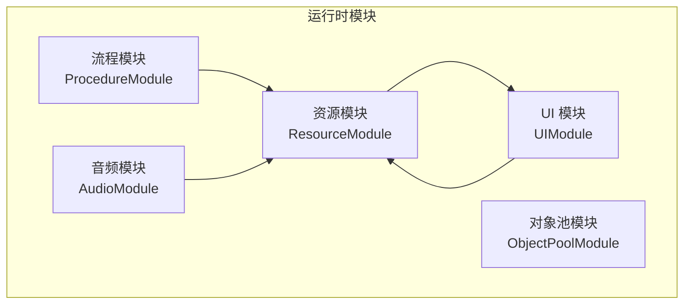
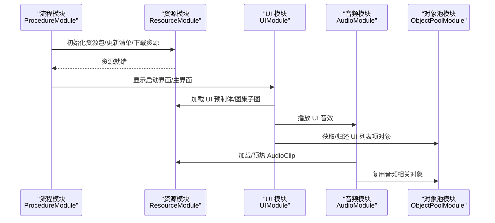
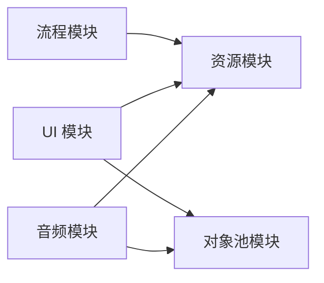

# 模块 API

<cite>
**本文引用的文件**   
- [3-1-资源模块.md](file://Books/3-1-资源模块.md)
- [3-5-UI模块.md](file://Books/3-5-UI模块.md)
- [3-7-流程模块.md](file://Books/3-7-流程模块.md)
- [IAudioModule.cs](file://UnityProject/Assets/TEngine/Runtime/Module/AudioModule/IAudioModule.cs)
- [IObjectPoolModule.cs](file://UnityProject/Assets/TEngine/Runtime/Module/ObjectPoolModule/IObjectPoolModule.cs)
- [IProcedureModule.cs](file://UnityProject/Assets/TEngine/Runtime/Module/ProcedureModule/IProcedureModule.cs)
</cite>

## 目录
1. [简介](#简介)
2. [项目结构](#项目结构)
3. [核心组件](#核心组件)
4. [架构总览](#架构总览)
5. [详细组件分析](#详细组件分析)
6. [依赖关系分析](#依赖关系分析)
7. [性能考虑](#性能考虑)
8. [故障排查指南](#故障排查指南)
9. [结论](#结论)
10. [附录：自定义模块开发规范](#附录自定义模块开发规范)

## 简介
本文件为 TEngine 各功能模块的 API 文档，覆盖以下内置模块与接口：
- 资源管理模块（ResourceModule）
- UI 模块（UIModule）
- 流程控制模块（ProcedureModule）
- 音频模块（AudioModule）
- 对象池模块（ObjectPoolModule）

文档目标：
- 提供每个模块的公共接口、方法说明、配置选项与使用示例
- 明确模块间依赖关系、初始化顺序与数据流向
- 给出自定义模块开发的接口规范（基类扩展点、生命周期回调、错误处理机制）

## 项目结构
TEngine 的模块以“Runtime/Module”为核心组织，配套文档位于 Books 目录。关键路径：
- UnityProject/Assets/TEngine/Runtime/Module
  - AudioModule
  - ObjectPoolModule
  - ProcedureModule
- Books
  - 3-1-资源模块.md
  - 3-5-UI模块.md
  - 3-7-流程模块.md

图表来源
- [3-1-资源模块.md:1-645](file://Books/3-1-资源模块.md#L1-L645)
- [3-5-UI模块.md:1-800](file://Books/3-5-UI模块.md#L1-L800)
- [3-7-流程模块.md:1-302](file://Books/3-7-流程模块.md#L1-L302)

章节来源
- [3-1-资源模块.md:1-645](file://Books/3-1-资源模块.md#L1-L645)
- [3-5-UI模块.md:1-800](file://Books/3-5-UI模块.md#L1-L800)
- [3-7-流程模块.md:1-302](file://Books/3-7-流程模块.md#L1-L302)

## 核心组件
本节概述各模块的职责与对外能力：
- 资源管理模块（ResourceModule）
  - 基于 YooAsset 的资源加载与生命周期管理
  - 提供同步/异步/回调三种加载方式
  - 支持资源包版本更新、清单更新、下载器创建与缓存清理
  - 暴露 SetSprite/SetSubSprite 等便捷扩展
- UI 模块（UIModule）
  - 轻量级 UI 框架，纯 C# 实现，事件驱动
  - 提供 UIWindow/UIWidget 分层与脚本生成工具
  - 与资源模块集成，自动管理 UI 资源引用
- 流程控制模块（ProcedureModule）
  - 商业化启动流程状态机，涵盖启动、闪屏、预加载、资源更新、热更新、进入游戏等阶段
  - 支持自定义流程节点与异步流程
- 音频模块（AudioModule）
  - 统一音频播放、音量与开关控制
  - 支持按类型（音乐/音效/UI音效/语音）分组管理
  - 提供 AudioClip 对象池管理与预热
- 对象池模块（ObjectPoolModule）
  - 通用对象池管理器，支持单次/多次获取策略
  - 提供容量、过期时间、优先级、自动释放间隔等参数化配置
  - 支持查询、销毁、批量释放未使用对象

章节来源
- [3-1-资源模块.md:1-645](file://Books/3-1-资源模块.md#L1-L645)
- [3-5-UI模块.md:1-800](file://Books/3-5-UI模块.md#L1-L800)
- [3-7-流程模块.md:1-302](file://Books/3-7-流程模块.md#L1-L302)
- [IAudioModule.cs:1-128](file://UnityProject/Assets/TEngine/Runtime/Module/AudioModule/IAudioModule.cs#L1-L128)
- [IObjectPoolModule.cs:1-745](file://UnityProject/Assets/TEngine/Runtime/Module/ObjectPoolModule/IObjectPoolModule.cs#L1-L745)

## 架构总览
下图展示模块间的依赖关系与典型调用链：
- 流程模块驱动游戏启动与资源更新
- 资源模块为 UI、音频等模块提供资源加载能力
- UI 模块通过资源模块加载预制体与图片
- 音频模块可复用资源模块提供的音频资源
- 对象池模块被多个模块用于对象复用与内存优化

图表来源
- [3-7-流程模块.md:84-108](file://Books/3-7-流程模块.md#L84-L108)
- [3-1-资源模块.md:346-577](file://Books/3-1-资源模块.md#L346-L577)
- [3-5-UI模块.md:128-226](file://Books/3-5-UI模块.md#L128-L226)
- [IAudioModule.cs:72-127](file://UnityProject/Assets/TEngine/Runtime/Module/AudioModule/IAudioModule.cs#L72-L127)
- [IObjectPoolModule.cs:133-409](file://UnityProject/Assets/TEngine/Runtime/Module/ObjectPoolModule/IObjectPoolModule.cs#L133-L409)

## 详细组件分析

### 资源管理模块（ResourceModule）
职责与特性：
- 自动化资源引用管理（AssetsReference），无需手动 Dispose
- 智能对象池与 LRU 缓存策略
- 多运行模式（编辑器模拟、离线、联机、WebGL）
- 统一的资源加载 API（同步/异步 UniTask/回调）
- 资源包版本管理、清单更新、下载器创建与缓存清理
- SetSprite/SetSubSprite 扩展，自动管理图片资源

常用 API 分类与说明（摘要）：
- 资源加载
  - LoadAsset<T>(location, packageName)
  - LoadGameObject(location, parent, packageName)
  - LoadAssetAsync<T>(location, cancellationToken, packageName)
  - LoadGameObjectAsync(location, parent, cancellationToken, packageName)
  - LoadAsset<T>(location, callback, packageName)
- 资源管理
  - UnloadAsset(asset)
  - UnloadUnusedAssets()
  - ForceUnloadAllAssets()
  - ForceUnloadUnusedAssets(performGCCollect)
  - HasAsset(location, packageName)
  - CheckLocationValid(location, packageName)
- 资源包管理
  - GetPackageVersion(customPackageName)
  - RequestPackageVersionAsync(appendTimeTicks, timeout, customPackageName)
  - UpdatePackageManifestAsync(packageVersion, timeout, customPackageName)
  - CreateResourceDownloader(customPackageName)
  - ClearCacheFilesAsync(clearMode, customPackageName)
  - ClearAllBundleFiles(customPackageName)
- 资源信息
  - GetAssetInfo(location, packageName)
  - GetAssetInfos(resTag, packageName)
  - GetAssetInfos(tags[], packageName)
- 远端服务地址设置
  - SetRemoteServicesUrl(defaultHostServer, fallbackHostServer)

配置选项（摘要）：
- 运行模式：EditorSimulateMode / OfflinePlayMode / HostPlayMode / WebPlayMode
- WebGL 资源加载方式：Remote / StreamingAssets
- 资源校验等级、自动卸载间隔、对象池容量与过期时间

使用示例（路径参考）：
- 基础加载与异步加载：[3-1-资源模块.md:346-394](file://Books/3-1-资源模块.md#L346-L394)
- 完整 API 参考：[3-1-资源模块.md:397-577](file://Books/3-1-资源模块.md#L397-L577)
- SetSprite/SetSubSprite 扩展：[3-1-资源模块.md:153-331](file://Books/3-1-资源模块.md#L153-L331)

最佳实践（摘要）：
- 优先使用 LoadGameObject/LoadGameObjectAsync 自动管理资源
- 动态资源使用 AssetsReference.Ref 绑定引用
- 合理使用资源包隔离不同模块资源
- 定期调用 UnloadUnusedAssets 回收未使用资源

章节来源
- [3-1-资源模块.md:1-645](file://Books/3-1-资源模块.md#L1-L645)

### UI 模块（UIModule）
职责与特性：
- 轻量级 UI 框架，纯 C# 实现，由 UIModule 帧更新驱动
- 分层设计：UIBase → UIWindow / UIWidget
- 代码自动生成，提升开发效率
- 与事件系统深度集成，支持 MVE 架构
- 与资源模块集成，自动管理 UI 资源引用

常用 API 与概念（摘要）：
- 打开面板
  - ShowUI<T>(userData)
  - ShowUIAsync<T>(userData)
- 生命周期与扩展点
  - ScriptGenerator()：绑定 UI 节点与方法
  - BindMemberProperty()：创建/绑定 Widget
  - RegisterEvent()：注册 UI 事件监听
  - OnRefresh()：刷新 UI 数据
  - OnUpdate()：每帧更新（仅重写时驱动）

使用示例（路径参考）：
- 基础打开面板：[3-5-UI模块.md:128-138](file://Books/3-5-UI模块.md#L128-L138)
- UIWindow 完整示例：[3-5-UI模块.md:140-226](file://Books/3-5-UI模块.md#L140-L226)
- UIWidget 设计与拓展：[3-5-UI模块.md:267-800](file://Books/3-5-UI模块.md#L267-L800)

章节来源
- [3-5-UI模块.md:1-800](file://Books/3-5-UI模块.md#L1-L800)

### 流程控制模块（ProcedureModule）
职责与特性：
- 商业化启动流程状态机，覆盖从启动到进入游戏的完整流程
- 标准流程节点：Launch、Splash、InitPackage、Preload、InitResources、UpdateVersion、UpdateManifest、CreateDownloader、DownloadFile、DownloadOver、ClearCache、LoadAssembly、StartGame
- 支持自定义流程节点与异步流程（UniTask）

常用 API（摘要）：
- 流程切换
  - ChangeState<T>(procedureOwner)
- 流程生命周期
  - OnEnter(procedureOwner)
  - OnUpdate(procedureOwner, elapseSeconds, realElapseSeconds)
  - OnLeave(procedureOwner, isShutdown)

执行顺序（摘要）：
- Launch → Splash → InitPackage → InitResources →（根据运行模式分支）→ Preload → LoadAssembly → StartGame

使用示例（路径参考）：
- 自定义流程节点与注册：[3-7-流程模块.md:111-176](file://Books/3-7-流程模块.md#L111-L176)
- API 参考与最佳实践：[3-7-流程模块.md:179-293](file://Books/3-7-流程模块.md#L179-L293)

章节来源
- [3-7-流程模块.md:1-302](file://Books/3-7-流程模块.md#L1-L302)

### 音频模块（AudioModule）
职责与特性：
- 统一音频播放、音量与开关控制
- 按类型（Music/Sound/UISound/Voice）分组管理
- 提供 AudioClip 对象池管理与预热
- 支持渐消停止与全局重启

公共接口（IAudioModule）摘要：
- 属性
  - Volume、Enable
  - MusicVolume、SoundVolume、UISoundVolume、VoiceVolume
  - MusicEnable、SoundEnable、UISoundEnable、VoiceEnable
  - AudioMixer、InstanceRoot、AudioClipPool
- 方法
  - Initialize(audioGroupConfigs, instanceRoot, audioMixer)
  - Restart()
  - Play(type, path, bLoop, volume, bAsync, bInPool)
  - Stop(type, fadeout)
  - StopAll(fadeout)
  - PutInAudioPool(list)
  - RemoveClipFromPool(list)
  - CleanSoundPool()

使用示例（路径参考）：
- 接口定义与说明：[IAudioModule.cs:1-128](file://UnityProject/Assets/TEngine/Runtime/Module/AudioModule/IAudioModule.cs#L1-L128)

章节来源
- [IAudioModule.cs:1-128](file://UnityProject/Assets/TEngine/Runtime/Module/AudioModule/IAudioModule.cs#L1-L128)

### 对象池模块（ObjectPoolModule）
职责与特性：
- 通用对象池管理器，支持单次/多次获取策略
- 丰富的构造参数：名称、容量、过期时间、优先级、自动释放间隔
- 提供查询、销毁、批量释放未使用对象的能力

公共接口（IObjectPoolModule）摘要：
- 查询与获取
  - Count
  - HasObjectPool(...)
  - GetObjectPool(...)
  - GetAllObjectPools(...)
- 创建对象池
  - CreateSingleSpawnObjectPool(...)
  - CreateMultiSpawnObjectPool(...)
- 销毁与管理
  - DestroyObjectPool(...)
  - Release()
  - ReleaseAllUnused()

使用示例（路径参考）：
- 接口定义与全部重载：[IObjectPoolModule.cs:1-745](file://UnityProject/Assets/TEngine/Runtime/Module/ObjectPoolModule/IObjectPoolModule.cs#L1-L745)

章节来源
- [IObjectPoolModule.cs:1-745](file://UnityProject/Assets/TEngine/Runtime/Module/ObjectPoolModule/IObjectPoolModule.cs#L1-L745)

## 依赖关系分析
- 流程模块依赖资源模块进行资源准备与更新
- UI 模块依赖资源模块加载 UI 资源，并可能依赖对象池模块复用 UI 元素
- 音频模块依赖资源模块加载 AudioClip，并可借助对象池模块复用音频相关对象
- 对象池模块为其他模块提供通用的对象复用能力

图表来源
- [3-7-流程模块.md:84-108](file://Books/3-7-流程模块.md#L84-L108)
- [3-1-资源模块.md:346-577](file://Books/3-1-资源模块.md#L346-L577)
- [3-5-UI模块.md:128-226](file://Books/3-5-UI模块.md#L128-L226)
- [IAudioModule.cs:72-127](file://UnityProject/Assets/TEngine/Runtime/Module/AudioModule/IAudioModule.cs#L72-L127)
- [IObjectPoolModule.cs:133-409](file://UnityProject/Assets/TEngine/Runtime/Module/ObjectPoolModule/IObjectPoolModule.cs#L133-L409)

章节来源
- [3-7-流程模块.md:84-108](file://Books/3-7-流程模块.md#L84-L108)
- [3-1-资源模块.md:346-577](file://Books/3-1-资源模块.md#L346-L577)
- [3-5-UI模块.md:128-226](file://Books/3-5-UI模块.md#L128-L226)
- [IAudioModule.cs:72-127](file://UnityProject/Assets/TEngine/Runtime/Module/AudioModule/IAudioModule.cs#L72-L127)
- [IObjectPoolModule.cs:133-409](file://UnityProject/Assets/TEngine/Runtime/Module/ObjectPoolModule/IObjectPoolModule.cs#L133-L409)

## 性能考虑
- 资源模块
  - 使用异步加载避免阻塞主线程
  - 合理设置对象池容量与过期时间，减少 GC 压力
  - 定期调用 UnloadUnusedAssets 释放未使用资源
- UI 模块
  - 使用 UIWidget 组合复用，避免频繁 Instantiate/Destroy
  - 仅在需要时重写 OnUpdate，降低每帧开销
- 音频模块
  - 预热常用 AudioClip，减少首次播放卡顿
  - 使用对象池复用 AudioSource 等资源
- 对象池模块
  - 根据对象生命周期设置合适的过期时间与自动释放间隔
  - 使用单次获取策略避免对象被意外复用导致状态污染

[本节为通用指导，不直接分析具体文件]

## 故障排查指南
常见问题与建议：
- 资源加载失败或地址无效
  - 检查资源定位地址是否有效（CheckLocationValid）
  - 确认资源包是否正确初始化与更新
- UI 资源泄漏或未释放
  - 确保使用 LoadGameObject/LoadGameObjectAsync 或 AssetsReference.Ref 绑定资源
  - 检查 UI 销毁时是否正确释放事件监听与资源
- 音频播放异常或爆音
  - 检查音频类型与音量设置是否正确
  - 确认 AudioClip 已预热且对象池配置合理
- 对象池未释放或内存增长
  - 调用 Release/ReleaseAllUnused 释放未使用对象
  - 检查对象生命周期与过期时间配置

章节来源
- [3-1-资源模块.md:397-577](file://Books/3-1-资源模块.md#L397-L577)
- [3-5-UI模块.md:128-226](file://Books/3-5-UI模块.md#L128-L226)
- [IAudioModule.cs:72-127](file://UnityProject/Assets/TEngine/Runtime/Module/AudioModule/IAudioModule.cs#L72-L127)
- [IObjectPoolModule.cs:689-743](file://UnityProject/Assets/TEngine/Runtime/Module/ObjectPoolModule/IObjectPoolModule.cs#L689-L743)

## 结论
TEngine 的模块体系围绕资源管理、UI 交互、流程控制、音频与对象池展开，形成稳定可扩展的架构。通过统一的接口与良好的生命周期管理，开发者可以高效构建商业级游戏应用。遵循本文档的接口规范与最佳实践，能够显著提升开发效率与运行稳定性。

[本节为总结性内容，不直接分析具体文件]

## 附录：自定义模块开发规范
扩展点与生命周期：
- 模块基类与接口
  - 流程模块：ProcedureBase 提供 OnEnter/OnUpdate/OnLeave 生命周期
  - 音频模块：IAudioModule 定义音频播放与控制接口
  - 对象池模块：IObjectPoolModule 定义对象池管理与查询接口
- 初始化顺序
  - 流程模块负责驱动各模块初始化，建议先初始化资源模块，再初始化 UI/音频等上层模块
- 错误处理机制
  - 流程模块中建议使用 UniTask 异步操作，并在异常时记录日志与回退逻辑
  - 资源模块提供 CheckLocationValid/HasAsset 等方法进行前置校验
  - 对象池模块提供 DestroyObjectPool/ReleaseAllUnused 进行资源清理

自定义流程节点示例（路径参考）：
- 自定义流程节点与注册：[3-7-流程模块.md:111-176](file://Books/3-7-流程模块.md#L111-L176)

章节来源
- [3-7-流程模块.md:111-176](file://Books/3-7-流程模块.md#L111-L176)
- [IAudioModule.cs:1-128](file://UnityProject/Assets/TEngine/Runtime/Module/AudioModule/IAudioModule.cs#L1-L128)
- [IObjectPoolModule.cs:1-745](file://UnityProject/Assets/TEngine/Runtime/Module/ObjectPoolModule/IObjectPoolModule.cs#L1-L745)