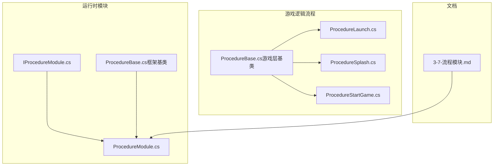
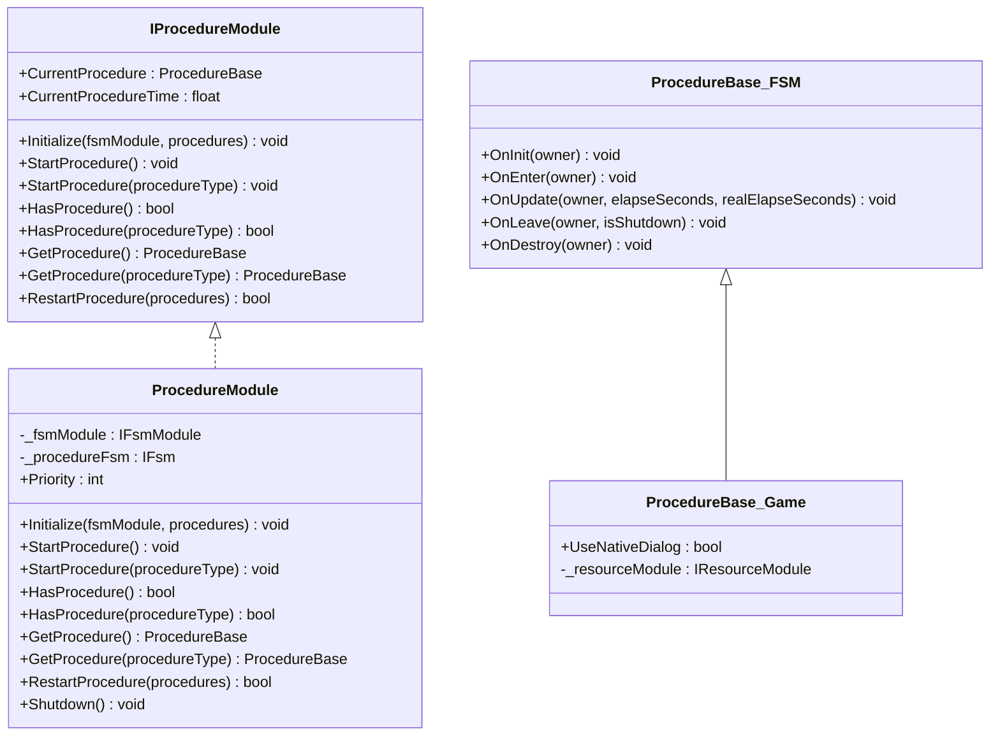
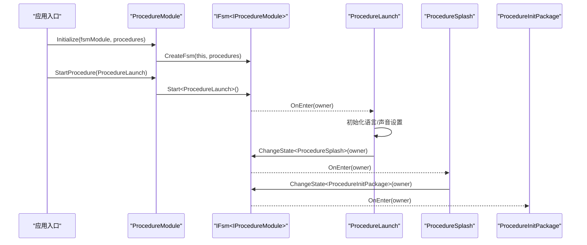
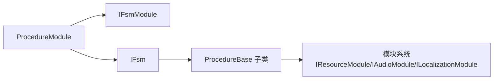

# 流程控制模块 API

<cite>
**本文引用的文件**   
- [IProcedureModule.cs](file://UnityProject/Assets/TEngine/Runtime/Module/ProcedureModule/IProcedureModule.cs)
- [ProcedureBase.cs（框架基类）](file://UnityProject/Assets/TEngine/Runtime/Module/ProcedureModule/ProcedureBase.cs)
- [ProcedureModule.cs](file://UnityProject/Assets/TEngine/Runtime/Module/ProcedureModule/ProcedureModule.cs)
- [3-7-流程模块.md](file://Books/3-7-流程模块.md)
- [ProcedureBase.cs（游戏层基类）](file://UnityProject/Assets/GameScripts/Procedure/ProcedureBase.cs)
- [ProcedureLaunch.cs](file://UnityProject/Assets/GameScripts/Procedure/ProcedureLaunch.cs)
- [ProcedureSplash.cs](file://UnityProject/Assets/GameScripts/Procedure/ProcedureSplash.cs)
- [ProcedureStartGame.cs](file://UnityProject/Assets/GameScripts/Procedure/ProcedureStartGame.cs)
</cite>

## 目录
1. [简介](#简介)
2. [项目结构](#项目结构)
3. [核心组件](#核心组件)
4. [架构总览](#架构总览)
5. [详细组件分析](#详细组件分析)
6. [依赖关系分析](#依赖关系分析)
7. [性能与监控](#性能与监控)
8. [故障排查指南](#故障排查指南)
9. [结论](#结论)
10. [附录：示例与最佳实践](#附录示例与最佳实践)

## 简介
本文件为 TEngine 流程控制模块的 API 文档，聚焦以下目标：
- 记录 IProcedureModule 接口的流程管理方法（启动、切换、状态查询、重启等）。
- 文档化 ProcedureBase 基类的生命周期钩子（OnInit/OnEnter/OnUpdate/OnLeave/OnDestroy）与状态管理机制。
- 说明 ProcedureModule 的流程注册、优先级、条件判断与高级功能。
- 提供自定义流程创建、参数传递、异常处理、流程组合模式的实践指导。
- 解释 FSM（有限状态机）在流程控制中的应用以及与模块系统的集成方式。
- 包含调试工具与性能监控方法的说明。

## 项目结构
流程控制相关代码主要分布在以下位置：
- 运行时模块：TEngine.Runtime.Module.ProcedureModule
  - IProcedureModule.cs：流程管理器接口
  - ProcedureBase.cs：流程基类（继承自 FSM 状态）
  - ProcedureModule.cs：流程管理器实现
- 游戏逻辑流程：GameScripts/Procedure
  - ProcedureBase.cs：业务层流程基类扩展
  - 具体流程节点：如 ProcedureLaunch、ProcedureSplash、ProcedureStartGame 等
- 文档：Books/3-7-流程模块.md：流程模块使用指南与示例

图表来源
- [IProcedureModule.cs:1-83](file://UnityProject/Assets/TEngine/Runtime/Module/ProcedureModule/IProcedureModule.cs#L1-L83)
- [ProcedureBase.cs（框架基类）:1-59](file://UnityProject/Assets/TEngine/Runtime/Module/ProcedureModule/ProcedureBase.cs#L1-L59)
- [ProcedureModule.cs:1-209](file://UnityProject/Assets/TEngine/Runtime/Module/ProcedureModule/ProcedureModule.cs#L1-L209)
- [ProcedureBase.cs（游戏层基类）:1-15](file://UnityProject/Assets/GameScripts/Procedure/ProcedureBase.cs#L1-L15)
- [ProcedureLaunch.cs:1-95](file://UnityProject/Assets/GameScripts/Procedure/ProcedureLaunch.cs#L1-L95)
- [ProcedureSplash.cs:1-23](file://UnityProject/Assets/GameScripts/Procedure/ProcedureSplash.cs#L1-L23)
- [ProcedureStartGame.cs:1-24](file://UnityProject/Assets/GameScripts/Procedure/ProcedureStartGame.cs#L1-L24)
- [3-7-流程模块.md:1-302](file://Books/3-7-流程模块.md#L1-L302)

章节来源
- [IProcedureModule.cs:1-83](file://UnityProject/Assets/TEngine/Runtime/Module/ProcedureModule/IProcedureModule.cs#L1-L83)
- [ProcedureBase.cs（框架基类）:1-59](file://UnityProject/Assets/TEngine/Runtime/Module/ProcedureModule/ProcedureBase.cs#L1-L59)
- [ProcedureModule.cs:1-209](file://UnityProject/Assets/TEngine/Runtime/Module/ProcedureModule/ProcedureModule.cs#L1-L209)
- [3-7-流程模块.md:1-302](file://Books/3-7-流程模块.md#L1-L302)

## 核心组件
- IProcedureModule：流程管理器接口，定义当前流程、持续时间、初始化、启动、存在性检查、获取、重启等方法。
- ProcedureBase（框架基类）：继承自 FSM 状态，暴露 OnInit/OnEnter/OnUpdate/OnLeave/OnDestroy 生命周期钩子。
- ProcedureModule：流程管理器实现，封装 FSM 的创建、销毁、流程启动与查询，并提供模块优先级。
- 游戏层 ProcedureBase：扩展框架基类，提供 UseNativeDialog 属性与资源模块访问。

章节来源
- [IProcedureModule.cs:1-83](file://UnityProject/Assets/TEngine/Runtime/Module/ProcedureModule/IProcedureModule.cs#L1-L83)
- [ProcedureBase.cs（框架基类）:1-59](file://UnityProject/Assets/TEngine/Runtime/Module/ProcedureModule/ProcedureBase.cs#L1-L59)
- [ProcedureModule.cs:1-209](file://UnityProject/Assets/TEngine/Runtime/Module/ProcedureModule/ProcedureModule.cs#L1-L209)
- [ProcedureBase.cs（游戏层基类）:1-15](file://UnityProject/Assets/GameScripts/Procedure/ProcedureBase.cs#L1-L15)

## 架构总览
流程模块基于 FSM（有限状态机）驱动，每个流程节点是一个状态。流程管理器负责创建、启动、切换和销毁流程状态。

图表来源
- [IProcedureModule.cs:1-83](file://UnityProject/Assets/TEngine/Runtime/Module/ProcedureModule/IProcedureModule.cs#L1-L83)
- [ProcedureBase.cs（框架基类）:1-59](file://UnityProject/Assets/TEngine/Runtime/Module/ProcedureModule/ProcedureBase.cs#L1-L59)
- [ProcedureModule.cs:1-209](file://UnityProject/Assets/TEngine/Runtime/Module/ProcedureModule/ProcedureModule.cs#L1-L209)
- [ProcedureBase.cs（游戏层基类）:1-15](file://UnityProject/Assets/GameScripts/Procedure/ProcedureBase.cs#L1-L15)

## 详细组件分析

### IProcedureModule 接口
职责与方法概览：
- CurrentProcedure：获取当前流程实例。
- CurrentProcedureTime：获取当前流程已运行时间。
- Initialize(IFsmModule, params ProcedureBase[])：初始化流程管理器并注册流程集合。
- StartProcedure<T>() / StartProcedure(Type)：启动指定类型流程。
- HasProcedure<T>() / HasProcedure(Type)：检查是否已注册某流程。
- GetProcedure<T>() / GetProcedure(Type)：获取已注册的流程实例。
- RestartProcedure(params ProcedureBase[])：销毁旧 FSM 并以新流程集合重新初始化，默认从第一个流程开始。

注意事项：
- 未初始化时调用上述方法会抛出异常。
- RestartProcedure 会销毁现有 FSM 并重建，注意外部引用失效。

章节来源
- [IProcedureModule.cs:1-83](file://UnityProject/Assets/TEngine/Runtime/Module/ProcedureModule/IProcedureModule.cs#L1-L83)

### ProcedureBase（框架基类）
生命周期钩子：
- OnInit(owner)：状态初始化时调用。
- OnEnter(owner)：进入状态时调用。
- OnUpdate(owner, elapseSeconds, realElapseSeconds)：每帧轮询更新。
- OnLeave(owner, isShutdown)：离开状态时调用。
- OnDestroy(owner)：状态销毁时调用。

设计要点：
- 所有钩子均通过 base 调用以维持 FSM 内部状态一致性。
- 子类应覆盖相应钩子实现流程逻辑，避免直接操作 FSM 内部状态。

章节来源
- [ProcedureBase.cs（框架基类）:1-59](file://UnityProject/Assets/TEngine/Runtime/Module/ProcedureModule/ProcedureBase.cs#L1-L59)

### ProcedureModule（流程管理器实现）
关键特性：
- Priority：模块优先级（-2），影响模块轮询顺序与关闭顺序。
- Initialize：校验 FSM 管理器有效性，创建 FSM 并注入流程集合。
- StartProcedure：校验 FSM 是否已初始化，委托 FSM 启动流程。
- HasProcedure/GetProcedure：校验 FSM 后返回状态存在性与实例。
- RestartProcedure：校验流程数组非空，销毁旧 FSM，重新初始化并启动首个流程。
- Shutdown：销毁 FSM 并释放引用。

错误处理：
- 未初始化或无效 FSM 时抛出异常。
- RestartProcedure 参数非法时抛出异常。

章节来源
- [ProcedureModule.cs:1-209](file://UnityProject/Assets/TEngine/Runtime/Module/ProcedureModule/ProcedureModule.cs#L1-L209)

### 游戏层 ProcedureBase 与具体流程
- 游戏层 ProcedureBase：
  - UseNativeDialog：指示某些流程是否使用原生对话框。
  - _resourceModule：便捷访问资源模块。
- 典型流程节点：
  - ProcedureLaunch：初始化语言与声音设置，随后切换到闪屏流程。
  - ProcedureSplash：展示闪屏动画，随后切换到初始化 Package 流程。
  - ProcedureStartGame：隐藏加载 UI，进入游戏主流程。

章节来源
- [ProcedureBase.cs（游戏层基类）:1-15](file://UnityProject/Assets/GameScripts/Procedure/ProcedureBase.cs#L1-L15)
- [ProcedureLaunch.cs:1-95](file://UnityProject/Assets/GameScripts/Procedure/ProcedureLaunch.cs#L1-L95)
- [ProcedureSplash.cs:1-23](file://UnityProject/Assets/GameScripts/Procedure/ProcedureSplash.cs#L1-L23)
- [ProcedureStartGame.cs:1-24](file://UnityProject/Assets/GameScripts/Procedure/ProcedureStartGame.cs#L1-L24)

### 流程切换序列（示例）
以下序列图展示了从启动到闪屏再到初始化 Package 的典型流程切换路径。

图表来源
- [ProcedureModule.cs:86-123](file://UnityProject/Assets/TEngine/Runtime/Module/ProcedureModule/ProcedureModule.cs#L86-L123)
- [ProcedureLaunch.cs:17-43](file://UnityProject/Assets/GameScripts/Procedure/ProcedureLaunch.cs#L17-L43)
- [ProcedureSplash.cs:13-20](file://UnityProject/Assets/GameScripts/Procedure/ProcedureSplash.cs#L13-L20)

## 依赖关系分析
- ProcedureModule 依赖 IFsmModule 来创建和管理 FSM。
- 流程节点（ProcedureBase 子类）通过 FSM 提供的 ChangeState 进行流程切换。
- 游戏层流程可访问模块系统（如 IResourceModule、IAudioModule、ILocalizationModule）完成业务逻辑。

图表来源
- [ProcedureModule.cs:10-12](file://UnityProject/Assets/TEngine/Runtime/Module/ProcedureModule/ProcedureModule.cs#L10-L12)
- [ProcedureLaunch.cs:15-20](file://UnityProject/Assets/GameScripts/Procedure/ProcedureLaunch.cs#L15-L20)

章节来源
- [ProcedureModule.cs:1-209](file://UnityProject/Assets/TEngine/Runtime/Module/ProcedureModule/ProcedureModule.cs#L1-L209)
- [ProcedureLaunch.cs:1-95](file://UnityProject/Assets/GameScripts/Procedure/ProcedureLaunch.cs#L1-L95)

## 性能与监控
- 模块优先级：ProcedureModule.Priority = -2，确保其在模块系统中具有合适的轮询与关闭顺序。
- 流程持续时间：通过 CurrentProcedureTime 可监控当前流程的运行时长，便于性能分析与超时检测。
- 异步流程：推荐使用 UniTask 进行异步操作，避免阻塞主线程；在流程中显示进度以提升用户体验。
- 日志与调试：结合 Log 输出关键步骤信息，辅助定位问题。

章节来源
- [ProcedureModule.cs:22-26](file://UnityProject/Assets/TEngine/Runtime/Module/ProcedureModule/ProcedureModule.cs#L22-L26)
- [IProcedureModule.cs:18-24](file://UnityProject/Assets/TEngine/Runtime/Module/ProcedureModule/IProcedureModule.cs#L18-L24)
- [3-7-流程模块.md:243-293](file://Books/3-7-流程模块.md#L243-L293)

## 故障排查指南
常见问题与处理建议：
- 未初始化即调用流程 API：
  - 现象：抛出“必须首先初始化流程”的异常。
  - 处理：确保先调用 Initialize 再调用 StartProcedure/HasProcedure/GetProcedure。
- 重启流程失败：
  - 现象：RestartProcedure 抛出“参数无效”异常。
  - 处理：传入非空流程数组，并确保流程类型正确。
- 流程切换不生效：
  - 现象：ChangeState 调用后无响应。
  - 处理：确认 FSM 已初始化且目标流程已注册；检查流程生命周期钩子是否正确调用 base。

章节来源
- [ProcedureModule.cs:101-123](file://UnityProject/Assets/TEngine/Runtime/Module/ProcedureModule/ProcedureModule.cs#L101-L123)
- [ProcedureModule.cs:192-207](file://UnityProject/Assets/TEngine/Runtime/Module/ProcedureModule/ProcedureModule.cs#L192-L207)

## 结论
TEngine 的流程控制模块以 FSM 为核心，通过 IProcedureModule 提供统一的流程管理 API，ProcedureBase 提供清晰的生命周期钩子，ProcedureModule 负责 FSM 的创建、销毁与流程调度。该设计具备良好的可扩展性与可维护性，适合构建商业级启动与资源更新流程。

## 附录：示例与最佳实践

### 创建自定义流程
- 继承游戏层 ProcedureBase，实现 UseNativeDialog 与必要生命周期钩子。
- 在 OnEnter 中执行初始化逻辑，使用 UniTask 进行异步操作。
- 在适当时机调用 ChangeState 切换到下一个流程。

章节来源
- [ProcedureBase.cs（游戏层基类）:1-15](file://UnityProject/Assets/GameScripts/Procedure/ProcedureBase.cs#L1-L15)
- [3-7-流程模块.md:111-175](file://Books/3-7-流程模块.md#L111-L175)

### 流程间参数传递
- 通过流程实例字段或共享数据对象传递参数。
- 在流程切换前准备数据，在目标流程的 OnEnter 中读取并使用。

章节来源
- [ProcedureLaunch.cs:17-43](file://UnityProject/Assets/GameScripts/Procedure/ProcedureLaunch.cs#L17-L43)
- [ProcedureSplash.cs:13-20](file://UnityProject/Assets/GameScripts/Procedure/ProcedureSplash.cs#L13-L20)

### 异常处理
- 在流程中使用 try/catch 捕获异常并记录日志。
- 对不可恢复的错误进行降级处理或回退到安全流程。

章节来源
- [ProcedureLaunch.cs:45-81](file://UnityProject/Assets/GameScripts/Procedure/ProcedureLaunch.cs#L45-L81)

### 流程组合模式
- 将复杂流程拆分为多个细粒度流程节点，通过 ChangeState 组合成完整链路。
- 根据运行模式（编辑器模拟、离线、联机）分支选择不同流程路径。

章节来源
- [3-7-流程模块.md:84-108](file://Books/3-7-流程模块.md#L84-L108)

### FSM 与模块系统集成
- 流程节点通过 ModuleSystem 获取所需模块（如 IResourceModule、IAudioModule、ILocalizationModule）。
- 在流程生命周期中协调各模块完成初始化、配置与清理。

章节来源
- [ProcedureLaunch.cs:15-20](file://UnityProject/Assets/GameScripts/Procedure/ProcedureLaunch.cs#L15-L20)
- [ProcedureLaunch.cs:45-81](file://UnityProject/Assets/GameScripts/Procedure/ProcedureLaunch.cs#L45-L81)