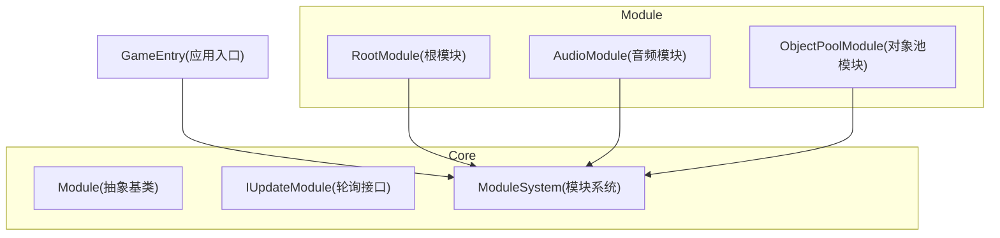
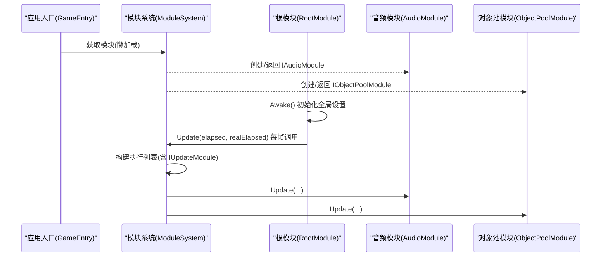
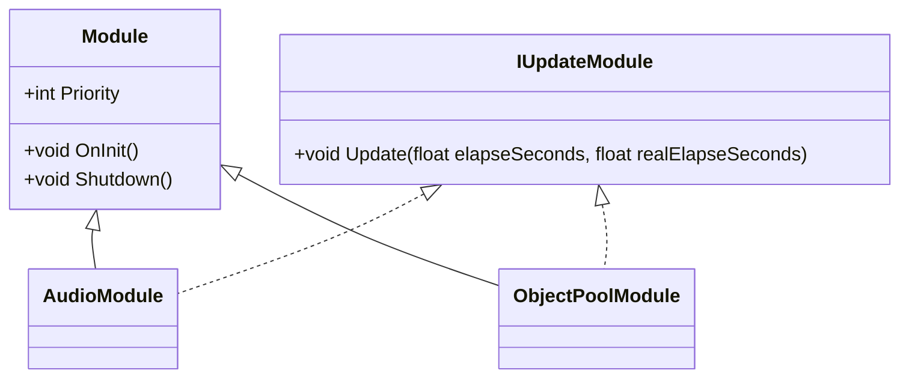
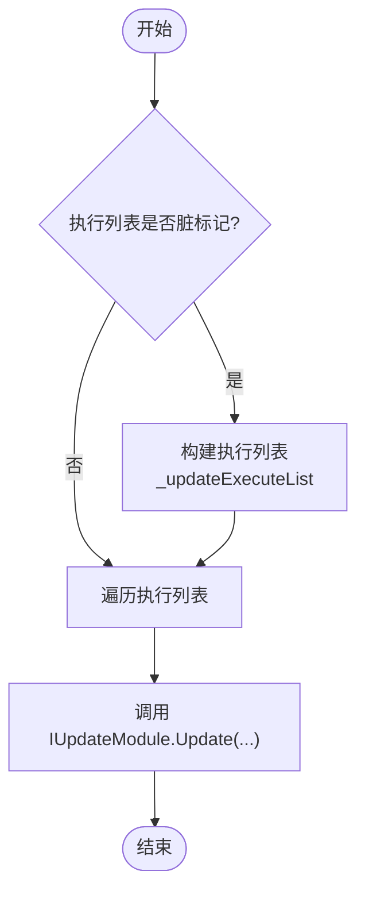
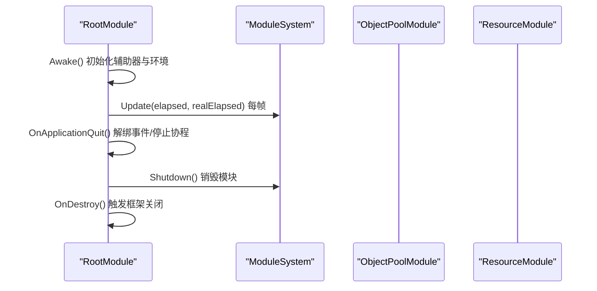
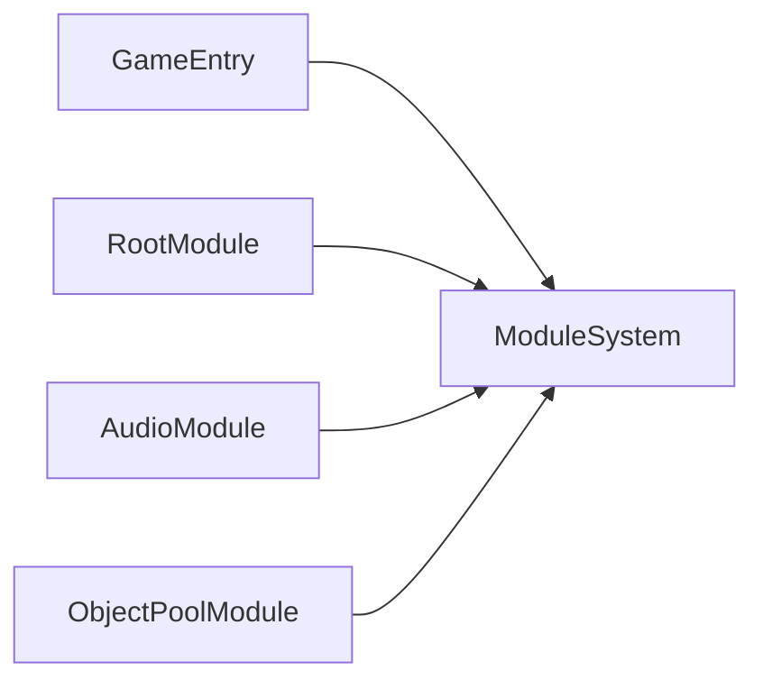

# 自定义模块开发

<cite>
**本文引用的文件**   
- [Module.cs](file://UnityProject/Assets/TEngine/Runtime/Core/Module.cs)
- [ModuleSystem.cs](file://UnityProject/Assets/TEngine/Runtime/Core/ModuleSystem.cs)
- [RootModule.cs](file://UnityProject/Assets/TEngine/Runtime/Module/RootModule.cs)
- [AudioModule.cs](file://UnityProject/Assets/TEngine/Runtime/Module/AudioModule/AudioModule.cs)
- [ObjectPoolModule.cs](file://UnityProject/Assets/TEngine/Runtime/Module/ObjectPoolModule/ObjectPoolModule.cs)
- [GameEntry.cs](file://UnityProject/Assets/GameScripts/GameEntry.cs)
</cite>

## 目录
1. [简介](#简介)
2. [项目结构](#项目结构)
3. [核心组件](#核心组件)
4. [架构总览](#架构总览)
5. [详细组件分析](#详细组件分析)
6. [依赖关系分析](#依赖关系分析)
7. [性能与优化](#性能与优化)
8. [故障排查指南](#故障排查指南)
9. [结论](#结论)
10. [附录：示例与最佳实践](#附录示例与最佳实践)

## 简介
本指南面向希望在 TEngine 框架中开发“自定义模块”的开发者，系统讲解 Module 基类接口、ModuleSystem 的注册与生命周期管理、RootModule 的根节点职责，以及模块间通信、依赖注入、事件与资源集成方式。文档同时提供流程图、时序图与类图，帮助快速理解并落地实现。

## 项目结构
TEngine 的模块体系位于 Runtime 层，核心由以下部分组成：
- Core 层：Module 抽象基类与 IUpdateModule 轮询接口；ModuleSystem 静态管理器
- Module 层：各功能模块（如 AudioModule、ObjectPoolModule 等）继承 Module 并实现各自能力
- RootModule：作为 Unity MonoBehaviour 挂载在场景中，负责全局初始化、帧循环驱动与模块系统调度
- GameEntry：应用入口，触发关键模块的懒加载与流程启动

图表来源
- [Module.cs:1-40](file://UnityProject/Assets/TEngine/Runtime/Core/Module.cs#L1-L40)
- [ModuleSystem.cs:1-208](file://UnityProject/Assets/TEngine/Runtime/Core/ModuleSystem.cs#L1-L208)
- [RootModule.cs:1-304](file://UnityProject/Assets/TEngine/Runtime/Module/RootModule.cs#L1-L304)
- [AudioModule.cs:1-571](file://UnityProject/Assets/TEngine/Runtime/Module/AudioModule/AudioModule.cs#L1-L571)
- [ObjectPoolModule.cs:1-800](file://UnityProject/Assets/TEngine/Runtime/Module/ObjectPoolModule/ObjectPoolModule.cs#L1-L800)
- [GameEntry.cs:1-15](file://UnityProject/Assets/GameScripts/GameEntry.cs#L1-L15)

章节来源
- [Module.cs:1-40](file://UnityProject/Assets/TEngine/Runtime/Core/Module.cs#L1-L40)
- [ModuleSystem.cs:1-208](file://UnityProject/Assets/TEngine/Runtime/Core/ModuleSystem.cs#L1-L208)
- [RootModule.cs:1-304](file://UnityProject/Assets/TEngine/Runtime/Module/RootModule.cs#L1-L304)
- [GameEntry.cs:1-15](file://UnityProject/Assets/GameScripts/GameEntry.cs#L1-L15)

## 核心组件
- Module 抽象基类
  - 定义模块优先级 Priority
  - 强制实现 OnInit 与 Shutdown
- IUpdateModule 轮询接口
  - 提供 Update(elapseSeconds, realElapseSeconds) 回调，供 ModuleSystem 每帧调用
- ModuleSystem 模块系统
  - 负责模块注册、按优先级排序、延迟构建执行列表、统一更新与关闭清理
  - 支持通过接口类型获取或自动创建模块
- RootModule 根模块
  - 作为场景中的 MonoBehaviour，负责全局设置、时间驱动、低内存处理、模块系统关闭
- 典型内置模块
  - AudioModule：音频播放、分类控制、对象池缓存
  - ObjectPoolModule：通用对象池管理与回收策略

章节来源
- [Module.cs:1-40](file://UnityProject/Assets/TEngine/Runtime/Core/Module.cs#L1-L40)
- [ModuleSystem.cs:1-208](file://UnityProject/Assets/TEngine/Runtime/Core/ModuleSystem.cs#L1-L208)
- [RootModule.cs:1-304](file://UnityProject/Assets/TEngine/Runtime/Module/RootModule.cs#L1-L304)
- [AudioModule.cs:1-571](file://UnityProject/Assets/TEngine/Runtime/Module/AudioModule/AudioModule.cs#L1-L571)
- [ObjectPoolModule.cs:1-800](file://UnityProject/Assets/TEngine/Runtime/Module/ObjectPoolModule/ObjectPoolModule.cs#L1-L800)

## 架构总览
下图展示从应用入口到模块系统的完整调用链，以及 RootModule 如何驱动 ModuleSystem 的 Update。

图表来源
- [GameEntry.cs:1-15](file://UnityProject/Assets/GameScripts/GameEntry.cs#L1-L15)
- [ModuleSystem.cs:1-208](file://UnityProject/Assets/TEngine/Runtime/Core/ModuleSystem.cs#L1-L208)
- [RootModule.cs:1-304](file://UnityProject/Assets/TEngine/Runtime/Module/RootModule.cs#L1-L304)
- [AudioModule.cs:1-571](file://UnityProject/Assets/TEngine/Runtime/Module/AudioModule/AudioModule.cs#L1-L571)
- [ObjectPoolModule.cs:1-800](file://UnityProject/Assets/TEngine/Runtime/Module/ObjectPoolModule/ObjectPoolModule.cs#L1-L800)

## 详细组件分析

### Module 与 IUpdateModule 接口设计
- Module
  - Priority：模块优先级，越大越先执行 Update，Shutdown 顺序相反
  - OnInit：模块初始化钩子
  - Shutdown：模块销毁钩子
- IUpdateModule
  - Update(elapseSeconds, realElapseSeconds)：逻辑帧与真实帧时间参数

图表来源
- [Module.cs:1-40](file://UnityProject/Assets/TEngine/Runtime/Core/Module.cs#L1-L40)
- [AudioModule.cs:1-571](file://UnityProject/Assets/TEngine/Runtime/Module/AudioModule/AudioModule.cs#L1-L571)
- [ObjectPoolModule.cs:1-800](file://UnityProject/Assets/TEngine/Runtime/Module/ObjectPoolModule/ObjectPoolModule.cs#L1-L800)

章节来源
- [Module.cs:1-40](file://UnityProject/Assets/TEngine/Runtime/Core/Module.cs#L1-L40)

### ModuleSystem：模块注册、初始化顺序与依赖解析
- 模块存储
  - _modules：按 Priority 升序排列的 LinkedList
  - _updateModules：仅包含实现 IUpdateModule 的模块，同样按 Priority 排序
  - _moduleMaps：接口类型到 Module 实例的映射
- 关键流程
  - RegisterModule<T>(module)：将自定义模块注册到系统，并按优先级插入
  - GetModule<T>()：若未存在则根据接口名反射构造模块，再注册
  - BuildExecuteList()：惰性构建每帧执行列表，避免频繁分配
  - Update(elapsed, realElapsed)：遍历执行列表调用 IUpdateModule.Update
  - Shutdown()：逆序调用所有模块 Shutdown，并清理内存池与缓存

图表来源
- [ModuleSystem.cs:1-208](file://UnityProject/Assets/TEngine/Runtime/Core/ModuleSystem.cs#L1-L208)

章节来源
- [ModuleSystem.cs:1-208](file://UnityProject/Assets/TEngine/Runtime/Core/ModuleSystem.cs#L1-L208)

### RootModule：根模块与全局服务提供者
- 职责
  - 初始化文本、日志、JSON 辅助器
  - 设置屏幕 DPI、帧率、游戏速度、后台运行、休眠策略
  - 订阅低内存事件，协调对象池与资源模块释放
  - 每帧调用 ModuleSystem.Update，驱动所有 IUpdateModule
  - 退出时调用 ModuleSystem.Shutdown 进行统一清理
- 关键点
  - 使用静态 Instance 暴露全局访问点
  - 在 OnDestroy 中触发框架关闭（非编辑器环境）

图表来源
- [RootModule.cs:1-304](file://UnityProject/Assets/TEngine/Runtime/Module/RootModule.cs#L1-L304)
- [ModuleSystem.cs:1-208](file://UnityProject/Assets/TEngine/Runtime/Core/ModuleSystem.cs#L1-L208)

章节来源
- [RootModule.cs:1-304](file://UnityProject/Assets/TEngine/Runtime/Module/RootModule.cs#L1-L304)

### 模块间通信与依赖注入机制
- 依赖注入
  - 通过 ModuleSystem.GetModule<T>() 以接口形式获取任意已注册模块
  - 首次访问会按需反射创建模块实例，并注册到系统
- 模块间通信
  - 推荐通过接口解耦，避免直接耦合具体实现
  - 对于跨模块状态变更，可结合事件系统（框架内已有事件基础设施）与配置表模块进行数据同步
- 示例路径
  - 音频模块在 OnInit 中获取 IResourceModule 用于异步加载音频资源
  - 对象池模块提供统一的对象池管理能力，其他模块通过接口获取并使用

章节来源
- [AudioModule.cs:320-332](file://UnityProject/Assets/TEngine/Runtime/Module/AudioModule/AudioModule.cs#L320-L332)
- [ModuleSystem.cs:62-141](file://UnityProject/Assets/TEngine/Runtime/Core/ModuleSystem.cs#L62-L141)

### 模块生命周期方法说明
- Awake/Start/Update/Dispose
  - 模块本身不直接实现这些 Unity 生命周期；它们由 RootModule 与 ModuleSystem 协同驱动
  - 模块应实现：
    - OnInit：完成依赖获取、内部状态初始化
    - Update：实现 IUpdateModule 接口，进行逻辑更新
    - Shutdown：释放资源、取消订阅、清空缓存
- 建议
  - 避免在 OnInit 中进行耗时操作
  - Update 中避免频繁分配与装箱
  - Shutdown 中确保与外部系统解绑

章节来源
- [Module.cs:22-39](file://UnityProject/Assets/TEngine/Runtime/Core/Module.cs#L22-L39)
- [ModuleSystem.cs:143-194](file://UnityProject/Assets/TEngine/Runtime/Core/ModuleSystem.cs#L143-L194)
- [RootModule.cs:116-167](file://UnityProject/Assets/TEngine/Runtime/Module/RootModule.cs#L116-L167)

### 与框架其他系统的集成
- 资源管理
  - 通过 IResourceModule 异步加载资源，配合对象池减少 GC
  - 音频模块演示了与资源模块的协作模式
- 事件系统
  - 建议使用框架事件系统进行模块间松耦合通信
- 日志系统
  - RootModule 在启动阶段设置日志辅助器，模块可通过 Log 接口输出

章节来源
- [AudioModule.cs:320-332](file://UnityProject/Assets/TEngine/Runtime/Module/AudioModule/AudioModule.cs#L320-L332)
- [RootModule.cs:214-285](file://UnityProject/Assets/TEngine/Runtime/Module/RootModule.cs#L214-L285)

## 依赖关系分析
- 模块与 ModuleSystem 的关系
  - 所有模块均通过 ModuleSystem 注册与获取
  - IUpdateModule 被 ModuleSystem 统一管理更新
- RootModule 与 ModuleSystem
  - RootModule 每帧驱动 ModuleSystem.Update
  - RootModule 在退出时调用 ModuleSystem.Shutdown
- 业务入口与模块
  - GameEntry 在 Awake 中触发关键模块的懒加载，随后启动流程

图表来源
- [GameEntry.cs:1-15](file://UnityProject/Assets/GameScripts/GameEntry.cs#L1-L15)
- [ModuleSystem.cs:1-208](file://UnityProject/Assets/TEngine/Runtime/Core/ModuleSystem.cs#L1-L208)
- [RootModule.cs:1-304](file://UnityProject/Assets/TEngine/Runtime/Module/RootModule.cs#L1-L304)
- [AudioModule.cs:1-571](file://UnityProject/Assets/TEngine/Runtime/Module/AudioModule/AudioModule.cs#L1-L571)
- [ObjectPoolModule.cs:1-800](file://UnityProject/Assets/TEngine/Runtime/Module/ObjectPoolModule/ObjectPoolModule.cs#L1-L800)

章节来源
- [GameEntry.cs:1-15](file://UnityProject/Assets/GameScripts/GameEntry.cs#L1-L15)
- [ModuleSystem.cs:1-208](file://UnityProject/Assets/TEngine/Runtime/Core/ModuleSystem.cs#L1-L208)

## 性能与优化
- 模块优先级
  - 合理设置 Priority，保证关键模块优先更新，降低整体抖动
- 执行列表惰性构建
  - ModuleSystem 仅在模块增减时重建执行列表，减少每帧开销
- 对象池与资源池
  - 使用 ObjectPoolModule 与 ResourceModule 减少 GC 与重复加载
- 更新逻辑
  - Update 中避免频繁 new、装箱、字符串拼接
  - 批量处理与增量计算，避免全量遍历

[本节为通用指导，无需代码引用]

## 故障排查指南
- 模块未找到异常
  - 现象：GetModule<T>() 抛出异常
  - 原因：接口命名或程序集名称不正确，导致反射无法定位模块类型
  - 解决：检查接口命名空间与程序集名称，确保符合 ModuleSystem 的默认构造规则
- 模块未更新
  - 现象：实现 IUpdateModule 的模块未被调用
  - 原因：未在 ModuleSystem 中注册或未实现 IUpdateModule
  - 解决：使用 RegisterModule<T>() 注册，并确保实现 IUpdateModule
- 低内存无响应
  - 现象：低内存事件触发后未释放资源
  - 原因：未正确实现对象池或资源模块的低内存回调
  - 解决：参考 RootModule.OnLowMemory 的实现，确保对象池与资源模块释放

章节来源
- [ModuleSystem.cs:62-141](file://UnityProject/Assets/TEngine/Runtime/Core/ModuleSystem.cs#L62-L141)
- [RootModule.cs:287-302](file://UnityProject/Assets/TEngine/Runtime/Module/RootModule.cs#L287-L302)

## 结论
TEngine 的模块系统以 Module 抽象基类与 IUpdateModule 接口为核心，通过 ModuleSystem 统一管理模块的生命周期、优先级与更新调度。RootModule 作为根节点负责全局初始化与帧驱动，GameEntry 作为入口触发关键模块的懒加载。遵循接口化依赖、合理使用对象池与资源模块、谨慎设置优先级，可在保证扩展性的同时获得良好性能。

[本节为总结性内容，无需代码引用]

## 附录：示例与最佳实践

### 自定义模块开发步骤
- 定义模块接口
  - 例如：IMyService，暴露对外能力
- 实现模块类
  - 继承 Module，实现 OnInit、Shutdown
  - 如需每帧更新，实现 IUpdateModule.Update
- 注册模块
  - 在合适时机调用 ModuleSystem.RegisterModule<IMyService>(new MyService())
  - 或通过 ModuleSystem.GetModule<IMyService>() 懒加载
- 依赖注入
  - 在 OnInit 中通过 ModuleSystem.GetModule<IResourceModule>() 等方式获取依赖
- 事件处理
  - 使用框架事件系统订阅/发布事件，避免直接耦合
- 错误处理
  - 在 OnInit/Update/Shutdown 中捕获异常并记录日志
  - 对资源加载失败、空引用等进行防御性检查

章节来源
- [ModuleSystem.cs:122-141](file://UnityProject/Assets/TEngine/Runtime/Core/ModuleSystem.cs#L122-L141)
- [Module.cs:22-39](file://UnityProject/Assets/TEngine/Runtime/Core/Module.cs#L22-L39)

### 代码示例路径（不含具体代码）
- 模块基类与接口定义
  - [Module.cs:1-40](file://UnityProject/Assets/TEngine/Runtime/Core/Module.cs#L1-L40)
- 模块系统注册与获取
  - [ModuleSystem.cs:62-141](file://UnityProject/Assets/TEngine/Runtime/Core/ModuleSystem.cs#L62-L141)
- 根模块驱动与关闭
  - [RootModule.cs:116-167](file://UnityProject/Assets/TEngine/Runtime/Module/RootModule.cs#L116-L167)
- 音频模块依赖资源模块
  - [AudioModule.cs:320-332](file://UnityProject/Assets/TEngine/Runtime/Module/AudioModule/AudioModule.cs#L320-L332)
- 对象池模块更新与清理
  - [ObjectPoolModule.cs:35-70](file://UnityProject/Assets/TEngine/Runtime/Module/ObjectPoolModule/ObjectPoolModule.cs#L35-L70)
- 应用入口触发模块懒加载
  - [GameEntry.cs:1-15](file://UnityProject/Assets/GameScripts/GameEntry.cs#L1-L15)

### 最佳实践清单
- 使用接口解耦模块依赖
- 合理设置模块优先级，避免长耗时逻辑阻塞关键模块
- 在 Update 中避免分配与装箱
- 使用对象池与资源池减少 GC 与 IO
- 在 Shutdown 中彻底释放资源与解绑事件
- 使用日志系统记录关键路径与异常信息

[本节为通用指导，无需代码引用]