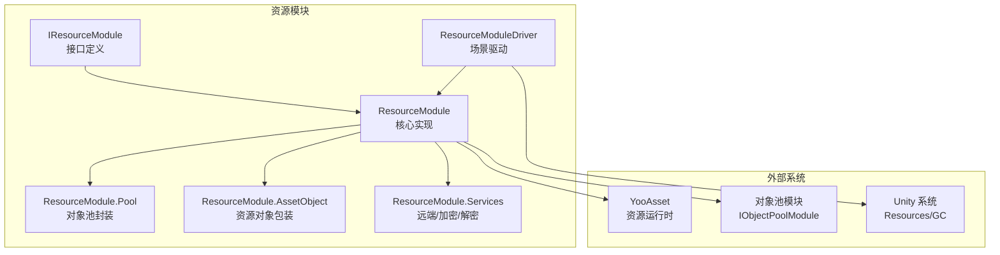
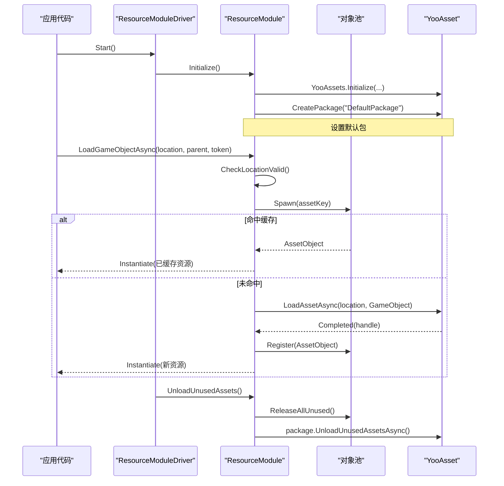
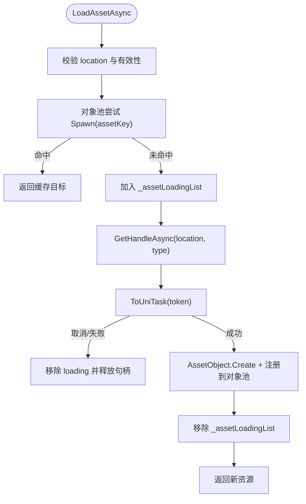
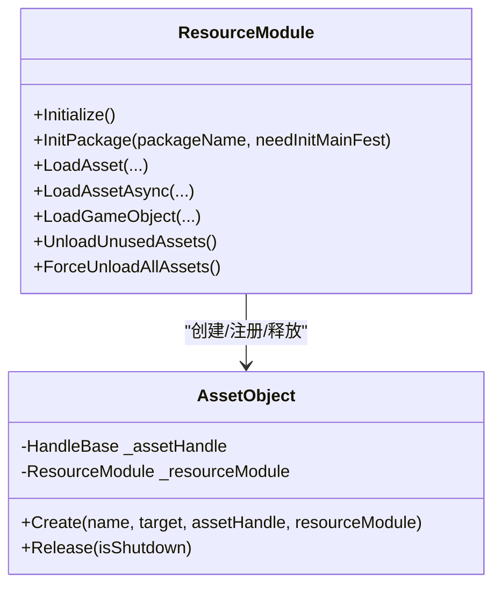
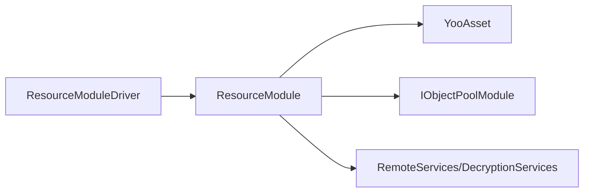

# 资源管理模块 API

<cite>
**本文引用的文件**   
- [IResourceModule.cs](file://UnityProject/Assets/TEngine/Runtime/Module/ResourceModule/IResourceModule.cs)
- [ResourceModule.cs](file://UnityProject/Assets/TEngine/Runtime/Module/ResourceModule/ResourceModule.cs)
- [ResourceModule.Pool.cs](file://UnityProject/Assets/TEngine/Runtime/Module/ResourceModule/ResourceModule.Pool.cs)
- [ResourceModule.AssetObject.cs](file://UnityProject/Assets/TEngine/Runtime/Module/ResourceModule/ResourceModule.AssetObject.cs)
- [ResourceModule.Services.cs](file://UnityProject/Assets/TEngine/Runtime/Module/ResourceModule/ResourceModule.Services.cs)
- [ResourceModuleDriver.cs](file://UnityProject/Assets/TEngine/Runtime/Module/ResourceModule/ResourceModuleDriver.cs)
- [3-1-资源模块.md](file://Books/3-1-资源模块.md)
</cite>

## 目录
1. [简介](#简介)
2. [项目结构](#项目结构)
3. [核心组件](#核心组件)
4. [架构总览](#架构总览)
5. [详细组件分析](#详细组件分析)
6. [依赖关系分析](#依赖关系分析)
7. [性能与内存优化](#性能与内存优化)
8. [故障排查指南](#故障排查指南)
9. [结论](#结论)
10. [附录：API 速查表](#附录api-速查表)

## 简介
本文件为 TEngine 资源管理模块的完整 API 文档，聚焦 IResourceModule 接口、ResourceModule 实现、ResourceModuleDriver 配置与扩展点，以及与 YooAsset 的集成方式。内容涵盖资源加载（同步/异步/回调）、卸载与回收、缓存与对象池、资源包管理、远程服务与解密、低内存处理、错误处理机制，并提供最佳实践与性能建议。

## 项目结构
资源模块位于 UnityProject/Assets/TEngine/Runtime/Module/ResourceModule 下，采用“主类 + 分部文件”的组织方式：
- IResourceModule.cs：对外暴露的资源管理接口
- ResourceModule.cs：核心实现（初始化、YooAsset 集成、加载/卸载、版本与清单、下载器）
- ResourceModule.Pool.cs：资源对象池封装与参数
- ResourceModule.AssetObject.cs：资源对象包装与句柄生命周期
- ResourceModule.Services.cs：远端服务、加密/解密服务
- ResourceModuleDriver.cs：场景组件，负责注入配置、驱动释放策略

图表来源
- [IResourceModule.cs:1-356](file://UnityProject/Assets/TEngine/Runtime/Module/ResourceModule/IResourceModule.cs#L1-L356)
- [ResourceModule.cs:1-1254](file://UnityProject/Assets/TEngine/Runtime/Module/ResourceModule/ResourceModule.cs#L1-L1254)
- [ResourceModule.Pool.cs:1-68](file://UnityProject/Assets/TEngine/Runtime/Module/ResourceModule/ResourceModule.Pool.cs#L1-L68)
- [ResourceModule.AssetObject.cs:1-64](file://UnityProject/Assets/TEngine/Runtime/Module/ResourceModule/ResourceModule.AssetObject.cs#L1-L64)
- [ResourceModule.Services.cs:1-269](file://UnityProject/Assets/TEngine/Runtime/Module/ResourceModule/ResourceModule.Services.cs#L1-L269)
- [ResourceModuleDriver.cs:1-324](file://UnityProject/Assets/TEngine/Runtime/Module/ResourceModule/ResourceModuleDriver.cs#L1-L324)

章节来源
- [3-1-资源模块.md:1-645](file://Books/3-1-资源模块.md#L1-L645)

## 核心组件
- IResourceModule：定义资源模块对外能力，包括运行模式、资源加载/卸载、包管理、远端服务、低内存回调等。
- ResourceModule：实现 IResourceModule，封装 YooAsset 调用、资源对象池、异步加载队列、资源信息缓存、下载器与清理。
- ResourceModuleDriver：场景组件，将编辑器/设置中的配置注入到 ResourceModule，并周期性触发系统级资源释放与 GC。

章节来源
- [IResourceModule.cs:1-356](file://UnityProject/Assets/TEngine/Runtime/Module/ResourceModule/IResourceModule.cs#L1-L356)
- [ResourceModule.cs:1-1254](file://UnityProject/Assets/TEngine/Runtime/Module/ResourceModule/ResourceModule.cs#L1-L1254)
- [ResourceModuleDriver.cs:1-324](file://UnityProject/Assets/TEngine/Runtime/Module/ResourceModule/ResourceModuleDriver.cs#L1-L324)

## 架构总览
ResourceModule 在 Initialize 中初始化 YooAsset，创建默认包；InitPackage 根据运行模式（EditorSimulateMode/OfflinePlayMode/HostPlayMode/WebPlayMode）构建不同参数并初始化包；加载流程通过 GetHandleSync/GetHandleAsync 获取 YooAsset 句柄，结合 AssetObject 与对象池进行复用与引用计数管理；卸载与回收由 UnloadUnusedAssets/ForceUnloadAllAssets 等统一入口协调对象池与包的释放；Driver 在 Update 中按间隔触发 Resources.UnloadUnusedAssets 与模块级回收，并可按需执行 GC。

图表来源
- [ResourceModuleDriver.cs:236-324](file://UnityProject/Assets/TEngine/Runtime/Module/ResourceModule/ResourceModuleDriver.cs#L236-L324)
- [ResourceModule.cs:119-138](file://UnityProject/Assets/TEngine/Runtime/Module/ResourceModule/ResourceModule.cs#L119-L138)
- [ResourceModule.cs:872-922](file://UnityProject/Assets/TEngine/Runtime/Module/ResourceModule/ResourceModule.cs#L872-L922)
- [ResourceModule.Pool.cs:43-66](file://UnityProject/Assets/TEngine/Runtime/Module/ResourceModule/ResourceModule.Pool.cs#L43-L66)

## 详细组件分析

### IResourceModule 接口
职责
- 提供统一的资源加载/卸载、包管理、远端服务、低内存回调等能力。
- 暴露运行模式、并发下载、失败重试、自动卸载包等配置项。

关键方法分类
- 初始化与包管理
  - Initialize / InitPackage(customPackageName, needInitMainFest)
  - DefaultPackageName / PackageVersion / GetPackageVersion
  - RequestPackageVersionAsync / UpdatePackageManifestAsync
  - CreateResourceDownloader / ClearCacheFilesAsync / ClearAllBundleFiles
- 资源查询与信息
  - HasAsset / CheckLocationValid
  - GetAssetInfo / GetAssetInfos(resTag/tags)
- 资源加载
  - 同步：LoadAsset<T>(location, packageName) / LoadAsset(location, Type, packageName)
  - 异步 UniTask：LoadAssetAsync<T>(location, cancellationToken, packageName) / LoadAssetAsync(location, Type, cancellationToken, packageName)
  - 回调：LoadAsset<T>(location, callback, packageName)
  - GameObject：LoadGameObject / LoadGameObjectAsync
  - 句柄：LoadAssetSyncHandle / LoadAssetAsyncHandle
- 资源卸载与回收
  - UnloadAsset / UnloadUnusedAssets / ForceUnloadAllAssets / ForceUnloadUnusedAssets(performGCCollect)
- 远端服务与低内存
  - SetRemoteServicesUrl(defaultHostServer, fallbackHostServer)
  - OnLowMemory / SetForceUnloadUnusedAssetsAction(action)

章节来源
- [IResourceModule.cs:1-356](file://UnityProject/Assets/TEngine/Runtime/Module/ResourceModule/IResourceModule.cs#L1-L356)

### ResourceModule 实现
职责
- 封装 YooAsset 初始化、包创建与多模式初始化（编辑器模拟、离线、联机、WebGL）。
- 维护资源对象池、正在加载集合、资源信息缓存。
- 提供同步/异步/回调三种加载模式，支持取消与进度回调。
- 统一管理资源卸载、回收、下载器与缓存清理。

核心流程要点
- 初始化
  - Initialize：初始化 YooAsset、设置时间切片、创建默认包、绑定对象池模块。
  - InitPackage：根据 PlayMode 选择参数类型（EditorSimulateModeParameters/OfflinePlayModeParameters/HostPlayModeParameters/WebPlayModeParameters），并可选择直接请求并更新清单。
- 资源定位与校验
  - GetAssetInfo：优先从本地缓存读取，否则查询 YooAsset 并按包名缓存。
  - HasAsset：检查位置有效性、存在性、是否需要远程下载。
  - CheckLocationValid：委托 YooAsset 或对应包校验。
- 资源加载
  - 同步：GetHandleSync -> handle.AssetObject -> 包装为 AssetObject 并注册到对象池。
  - 异步 UniTask：GetHandleAsync -> ToUniTask(cancellationToken) -> 成功则注册对象池，失败/取消则释放句柄。
  - 回调：TryWaitingLoading 去重等待，GetHandleAsync -> 进度回调 -> 成功/失败回调。
  - GameObject：实例化时通过 AssetsReference.Instantiate 绑定引用，销毁时自动释放。
- 卸载与回收
  - UnloadUnusedAssets：释放对象池中未使用项，并遍历已初始化包执行 UnloadUnusedAssetsAsync。
  - ForceUnloadAllAssets：遍历包执行 UnloadAllAssetsAsync（WebGL 平台跳过）。
  - ForceUnloadUnusedAssets：触发 Driver 注册的回调以执行系统级释放与 GC。
- 下载与缓存
  - CreateResourceDownloader：基于包创建下载器，支持最大并发与重试次数。
  - ClearCacheFilesAsync/ClearAllBundleFiles：清理缓存或沙盒路径。

图表来源
- [ResourceModule.cs:823-870](file://UnityProject/Assets/TEngine/Runtime/Module/ResourceModule/ResourceModule.cs#L823-L870)
- [ResourceModule.cs:1199-1221](file://UnityProject/Assets/TEngine/Runtime/Module/ResourceModule/ResourceModule.cs#L1199-L1221)

章节来源
- [ResourceModule.cs:1-1254](file://UnityProject/Assets/TEngine/Runtime/Module/ResourceModule/ResourceModule.cs#L1-L1254)

### ResourceModule.Pool 与 AssetObject
- ResourceModule.Pool：封装对象池参数（AutoReleaseInterval/Capacity/ExpireTime/Priority），提供 UnloadAsset 与 SetObjectPoolModule。
- AssetObject：继承 ObjectBase，持有 AssetHandle 与 ResourceModule 引用，在 Release 时释放句柄，避免内存泄漏。

图表来源
- [ResourceModule.Pool.cs:1-68](file://UnityProject/Assets/TEngine/Runtime/Module/ResourceModule/ResourceModule.Pool.cs#L1-L68)
- [ResourceModule.AssetObject.cs:1-64](file://UnityProject/Assets/TEngine/Runtime/Module/ResourceModule/ResourceModule.AssetObject.cs#L1-L64)

章节来源
- [ResourceModule.Pool.cs:1-68](file://UnityProject/Assets/TEngine/Runtime/Module/ResourceModule/ResourceModule.Pool.cs#L1-L68)
- [ResourceModule.AssetObject.cs:1-64](file://UnityProject/Assets/TEngine/Runtime/Module/ResourceModule/ResourceModule.AssetObject.cs#L1-L64)

### ResourceModule.Services（远端与解密）
- RemoteServices：实现 IRemoteServices，拼接默认与备用服务器地址。
- IDecryptionServices/IWebDecryptionServices：提供文件流与偏移两种解密方案，分别用于主机与 WebGL 平台。
- BundleStream：自定义 FileStream，在读取时进行字节异或解密。

章节来源
- [ResourceModule.Services.cs:1-269](file://UnityProject/Assets/TEngine/Runtime/Module/ResourceModule/ResourceModule.Services.cs#L1-L269)

### ResourceModuleDriver（配置与释放驱动）
职责
- 从场景/设置读取配置（运行模式、加密类型、下载并发、失败重试、WebGL 加载方式等），注入到 ResourceModule。
- 启动时调用 ResourceModule.Initialize，并设置低内存回调。
- Update 中按最小/最大间隔触发 Resources.UnloadUnusedAssets，并根据 UseSystemUnloadUnusedAssets 决定是否调用模块级 UnloadUnusedAssets，必要时执行 GC.Collect。

配置项说明
- PackageName：默认资源包名称。
- PlayMode：运行模式（编辑器优先 EditorPrefs，运行时若为 EditorSimulateMode 则降级为 OfflinePlayMode）。
- EncryptionType：加密类型。
- UpdatableWhilePlaying：是否边玩边下载。
- Milliseconds：异步操作每帧时间切片。
- AutoUnloadBundleWhenUnused：是否自动卸载引用计数为 0 的包。
- DownloadingMaxNum/FailureTryAgain：下载并发与重试次数。
- Min/MaxUnloadUnusedAssetsInterval：系统释放间隔范围。
- UseSystemUnloadUnusedAssets：是否启用系统释放策略。
- AssetAutoReleaseInterval/Capacity/ExpireTime/Priority：对象池参数。

章节来源
- [ResourceModuleDriver.cs:1-324](file://UnityProject/Assets/TEngine/Runtime/Module/ResourceModule/ResourceModuleDriver.cs#L1-L324)

## 依赖关系分析
- ResourceModule 依赖 YooAsset 进行资源打包与加载，依赖对象池模块进行资源复用。
- ResourceModuleDriver 依赖 Settings.UpdateSetting 获取热更地址与 WebGL 加载方式。
- ResourceModule.Services 依赖 YooAsset 的 IRemoteServices/IDecryptionServices/IWebDecryptionServices 接口。

图表来源
- [ResourceModuleDriver.cs:236-270](file://UnityProject/Assets/TEngine/Runtime/Module/ResourceModule/ResourceModuleDriver.cs#L236-L270)
- [ResourceModule.cs:119-138](file://UnityProject/Assets/TEngine/Runtime/Module/ResourceModule/ResourceModule.cs#L119-L138)
- [ResourceModule.Services.cs:12-32](file://UnityProject/Assets/TEngine/Runtime/Module/ResourceModule/ResourceModule.Services.cs#L12-L32)

章节来源
- [ResourceModuleDriver.cs:1-324](file://UnityProject/Assets/TEngine/Runtime/Module/ResourceModule/ResourceModuleDriver.cs#L1-L324)
- [ResourceModule.cs:1-1254](file://UnityProject/Assets/TEngine/Runtime/Module/ResourceModule/ResourceModule.cs#L1-L1254)
- [ResourceModule.Services.cs:1-269](file://UnityProject/Assets/TEngine/Runtime/Module/ResourceModule/ResourceModule.Services.cs#L1-L269)

## 性能与内存优化
- 优先使用 LoadGameObject/LoadGameObjectAsync：框架自动添加 AssetsReference，无需手动 Dispose。
- 合理使用对象池参数：调整 AssetCapacity/AssetExpireTime/AssetAutoReleaseInterval 平衡命中率与内存占用。
- 控制异步时间切片：Milliseconds 影响 YooAsset 每帧任务分配，过大可能导致卡顿，过小可能拖慢加载。
- 定期回收：在合适时机调用 UnloadUnusedAssets，或在低内存事件触发 ForceUnloadUnusedAssets(true)。
- WebGL 平台注意：不支持 ForceUnloadAllAssets，应依赖系统释放与对象池策略。
- 资源命名与后缀：加载时无需后缀，打包不可重名，避免定位歧义。
- 分包与预取：大型项目可创建多个资源包，配合 CreateResourceDownloader 预下载常用包。

章节来源
- [3-1-资源模块.md:581-637](file://Books/3-1-资源模块.md#L581-L637)
- [ResourceModule.cs:429-447](file://UnityProject/Assets/TEngine/Runtime/Module/ResourceModule/ResourceModule.cs#L429-L447)
- [ResourceModuleDriver.cs:289-320](file://UnityProject/Assets/TEngine/Runtime/Module/ResourceModule/ResourceModuleDriver.cs#L289-L320)

## 故障排查指南
常见问题与定位
- 资源不存在或无效
  - 现象：HasAsset 返回 NotExist 或 CheckLocationValid 为 false。
  - 排查：确认 location 是否正确、是否属于指定 packageName、是否已打包且无重名。
  - 相关逻辑：HasAsset/CheckLocationValid/GetAssetInfo。
- 需要远程下载但未下载
  - 现象：HasAsset 返回 AssetOnline。
  - 排查：检查 HostServerURL/FallbackHostServerURL 与网络连通性，确认是否调用 CreateResourceDownloader 并执行下载。
- 异步加载被取消或失败
  - 现象：LoadAssetAsync 返回 null 或回调失败。
  - 排查：检查 CancellationToken 是否提前取消、handle.Status 是否为 Failed。
- 内存泄漏或未释放
  - 现象：频繁加载后内存不降。
  - 排查：确保使用 LoadGameObject 系列或正确调用 UnloadAsset；检查对象池参数与自动释放间隔；在低内存时触发 ForceUnloadUnusedAssets。
- WebGL 平台限制
  - 现象：ForceUnloadAllAssets 无效。
  - 排查：改用系统释放与对象池策略，避免直接强制卸载。

章节来源
- [ResourceModule.cs:571-620](file://UnityProject/Assets/TEngine/Runtime/Module/ResourceModule/ResourceModule.cs#L571-L620)
- [ResourceModule.cs:823-870](file://UnityProject/Assets/TEngine/Runtime/Module/ResourceModule/ResourceModule.cs#L823-L870)
- [ResourceModule.cs:429-447](file://UnityProject/Assets/TEngine/Runtime/Module/ResourceModule/ResourceModule.cs#L429-L447)

## 结论
TEngine 资源模块在 YooAsset 之上提供了统一的资源管理 API，通过对象池与 AssetsReference 自动化引用管理，显著降低开发者心智负担。ResourceModuleDriver 将配置与释放策略解耦，便于在不同运行模式下灵活部署。推荐优先使用高层 API（LoadGameObject/LoadGameObjectAsync），并结合对象池与系统释放策略进行内存优化。

## 附录：API 速查表
- 初始化与包管理
  - Initialize / InitPackage(customPackageName, needInitMainFest)
  - DefaultPackageName / PackageVersion / GetPackageVersion
  - RequestPackageVersionAsync / UpdatePackageManifestAsync
  - CreateResourceDownloader / ClearCacheFilesAsync / ClearAllBundleFiles
- 资源查询
  - HasAsset(location, packageName)
  - CheckLocationValid(location, packageName)
  - GetAssetInfo / GetAssetInfos(resTag/tags)
- 资源加载
  - 同步：LoadAsset<T>(location, packageName) / LoadAsset(location, Type, packageName)
  - 异步 UniTask：LoadAssetAsync<T>(location, cancellationToken, packageName) / LoadAssetAsync(location, Type, cancellationToken, packageName)
  - 回调：LoadAsset<T>(location, callback, packageName)
  - GameObject：LoadGameObject / LoadGameObjectAsync
  - 句柄：LoadAssetSyncHandle / LoadAssetAsyncHandle
- 卸载与回收
  - UnloadAsset / UnloadUnusedAssets / ForceUnloadAllAssets / ForceUnloadUnusedAssets(performGCCollect)
- 远端服务与低内存
  - SetRemoteServicesUrl(defaultHostServer, fallbackHostServer)
  - OnLowMemory / SetForceUnloadUnusedAssetsAction(action)

章节来源
- [IResourceModule.cs:1-356](file://UnityProject/Assets/TEngine/Runtime/Module/ResourceModule/IResourceModule.cs#L1-L356)