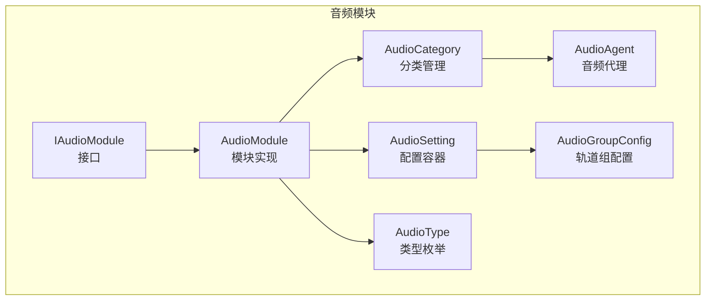
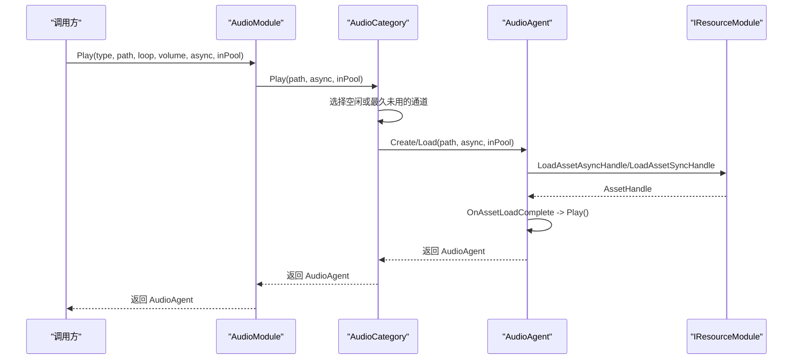
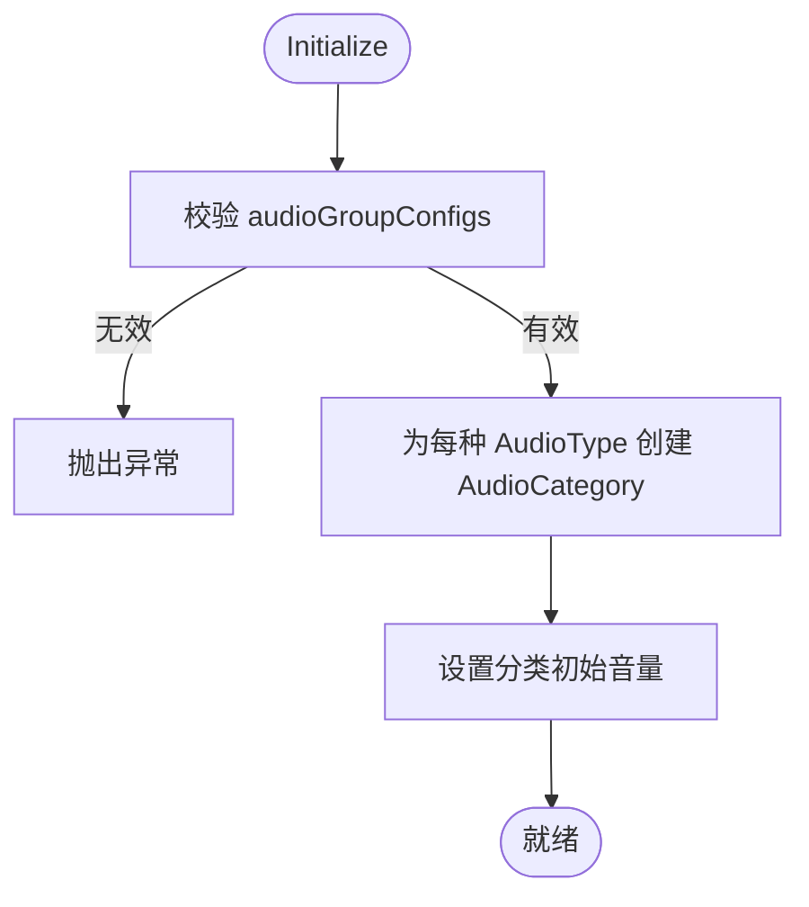
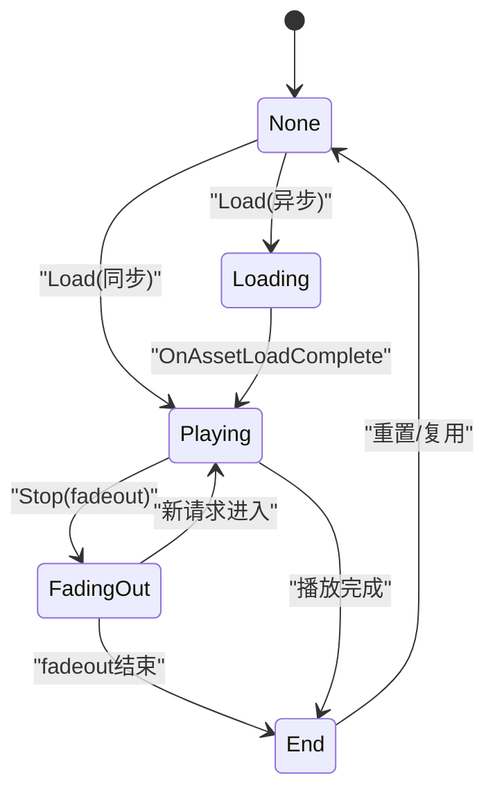
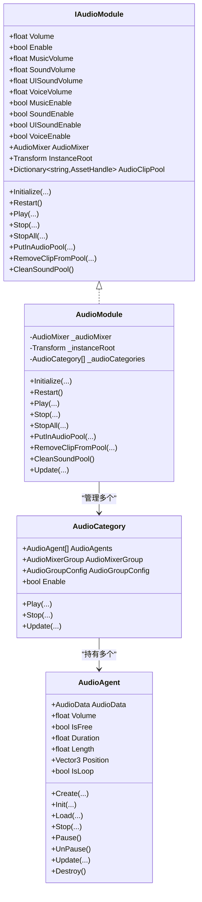

# 音频模块 API

<cite>
**本文引用的文件**   
- [IAudioModule.cs](file://UnityProject/Assets/TEngine/Runtime/Module/AudioModule/IAudioModule.cs)
- [AudioModule.cs](file://UnityProject/Assets/TEngine/Runtime/Module/AudioModule/AudioModule.cs)
- [AudioAgent.cs](file://UnityProject/Assets/TEngine/Runtime/Module/AudioModule/AudioAgent.cs)
- [AudioCategory.cs](file://UnityProject/Assets/TEngine/Runtime/Module/AudioModule/AudioCategory.cs)
- [AudioGroupConfig.cs](file://UnityProject/Assets/TEngine/Runtime/Module/AudioModule/AudioGroupConfig.cs)
- [AudioSetting.cs](file://UnityProject/Assets/TEngine/Runtime/Module/AudioModule/AudioSetting.cs)
- [AudioType.cs](file://UnityProject/Assets/TEngine/Runtime/Module/AudioModule/AudioType.cs)
</cite>

## 目录
1. [简介](#简介)
2. [项目结构](#项目结构)
3. [核心组件](#核心组件)
4. [架构总览](#架构总览)
5. [详细组件分析](#详细组件分析)
6. [依赖关系分析](#依赖关系分析)
7. [性能与内存优化](#性能与内存优化)
8. [配置系统](#配置系统)
9. [使用示例与最佳实践](#使用示例与最佳实践)
10. [故障排查](#故障排查)
11. [结论](#结论)

## 简介
本文件为 TEngine 音频模块的完整 API 文档，聚焦以下目标：
- 记录 IAudioModule 接口的播放、音量控制、音效管理等核心能力。
- 详细说明 AudioModule 的实现：音频分类管理、音频池优化、3D 音频支持。
- 文档化 AudioAgent 的实例管理：播放状态控制、淡入淡出、循环播放等。
- 提供背景音乐、音效、语音的播放示例（含异步加载、预加载、内存优化）。
- 解释音频配置系统：音量设置、质量与平台适配思路。
- 给出性能优化技巧与常见问题排查方法。

## 项目结构
音频模块位于 UnityProject/Assets/TEngine/Runtime/Module/AudioModule 下，核心文件如下：
- IAudioModule.cs：音频模块对外接口定义
- AudioModule.cs：音频模块实现，负责分类、混音器、资源池、生命周期
- AudioCategory.cs：按类型分组的声道管理与复用策略
- AudioAgent.cs：单个音频实例代理，封装 AudioSource 与播放逻辑
- AudioGroupConfig.cs：音频轨道组配置（音量、通道数、3D 衰减参数）
- AudioSetting.cs：ScriptableObject 配置容器
- AudioType.cs：音频类型枚举（音乐、音效、UI 音效、语音）



图表来源
- [IAudioModule.cs:8-127](file://UnityProject/Assets/TEngine/Runtime/Module/AudioModule/IAudioModule.cs#L8-L127)
- [AudioModule.cs:11-571](file://UnityProject/Assets/TEngine/Runtime/Module/AudioModule/AudioModule.cs#L11-L571)
- [AudioCategory.cs:8-196](file://UnityProject/Assets/TEngine/Runtime/Module/AudioModule/AudioCategory.cs#L8-L196)
- [AudioAgent.cs:7-432](file://UnityProject/Assets/TEngine/Runtime/Module/AudioModule/AudioAgent.cs#L7-L432)
- [AudioGroupConfig.cs:7-70](file://UnityProject/Assets/TEngine/Runtime/Module/AudioModule/AudioGroupConfig.cs#L7-L70)
- [AudioSetting.cs:5-9](file://UnityProject/Assets/TEngine/Runtime/Module/AudioModule/AudioSetting.cs#L5-L9)
- [AudioType.cs:7-33](file://UnityProject/Assets/TEngine/Runtime/Module/AudioModule/AudioType.cs#L7-L33)

章节来源
- [AudioModule.cs:11-571](file://UnityProject/Assets/TEngine/Runtime/Module/AudioModule/AudioModule.cs#L11-L571)
- [IAudioModule.cs:8-127](file://UnityProject/Assets/TEngine/Runtime/Module/AudioModule/IAudioModule.cs#L8-L127)

## 核心组件
- IAudioModule：定义音频模块对外 API，包括总音量、分类音量与开关、播放/停止、对象池操作、初始化与重启。
- AudioModule：模块实现，维护 AudioMixer、分类列表、实例根节点、音频对象池；提供 Update 轮询。
- AudioCategory：按 AudioType 分组，管理一组 AudioAgent，负责空闲通道选择与复用。
- AudioAgent：封装 AudioSource，处理加载、播放、暂停、停止、淡出、循环、位置更新等。
- AudioGroupConfig：描述每个分类的默认音量、最大通道数、3D 衰减模式与距离范围。
- AudioSetting：ScriptableObject，承载 AudioGroupConfig[] 配置。
- AudioType：枚举，包含 Sound、UISound、Music、Voice。

章节来源
- [IAudioModule.cs:8-127](file://UnityProject/Assets/TEngine/Runtime/Module/AudioModule/IAudioModule.cs#L8-L127)
- [AudioModule.cs:11-571](file://UnityProject/Assets/TEngine/Runtime/Module/AudioModule/AudioModule.cs#L11-L571)
- [AudioCategory.cs:8-196](file://UnityProject/Assets/TEngine/Runtime/Module/AudioModule/AudioCategory.cs#L8-L196)
- [AudioAgent.cs:7-432](file://UnityProject/Assets/TEngine/Runtime/Module/AudioModule/AudioAgent.cs#L7-L432)
- [AudioGroupConfig.cs:7-70](file://UnityProject/Assets/TEngine/Runtime/Module/AudioModule/AudioGroupConfig.cs#L7-L70)
- [AudioSetting.cs:5-9](file://UnityProject/Assets/TEngine/Runtime/Module/AudioModule/AudioSetting.cs#L5-L9)
- [AudioType.cs:7-33](file://UnityProject/Assets/TEngine/Runtime/Module/AudioModule/AudioType.cs#L7-L33)

## 架构总览
音频模块采用“模块-分类-代理”三层结构：
- 模块层（AudioModule）：统一入口，管理 AudioMixer、分类、对象池、全局音量与开关。
- 分类层（AudioCategory）：按类型隔离，维护固定数量的 AudioAgent 池，实现通道复用与上限控制。
- 代理层（AudioAgent）：封装 AudioSource，负责具体音频资源的加载、播放、状态机与淡出。



图表来源
- [AudioModule.cs:441-458](file://UnityProject/Assets/TEngine/Runtime/Module/AudioModule/AudioModule.cs#L441-L458)
- [AudioCategory.cs:122-164](file://UnityProject/Assets/TEngine/Runtime/Module/AudioModule/AudioCategory.cs#L122-L164)
- [AudioAgent.cs:198-277](file://UnityProject/Assets/TEngine/Runtime/Module/AudioModule/AudioAgent.cs#L198-L277)
- [AudioAgent.cs:326-375](file://UnityProject/Assets/TEngine/Runtime/Module/AudioModule/AudioAgent.cs#L326-L375)

## 详细组件分析

### IAudioModule 接口
职责与关键成员：
- 音量与开关：Volume、Enable、MusicVolume/SoundVolume/UISoundVolume/VoiceVolume、对应 Enable 属性。
- 混音器与实例根：AudioMixer、InstanceRoot。
- 音频对象池：AudioClipPool（字典，键为路径，值为 AssetHandle）。
- 生命周期：Initialize、Restart。
- 播放控制：Play、Stop、StopAll。
- 对象池管理：PutInAudioPool、RemoveClipFromPool、CleanSoundPool。

设计要点：
- 所有音量通过 AudioMixer 以分贝形式设置，避免线性缩放导致的精度问题。
- 分类开关通过 AudioCategory.Enable 控制，内部会停止该分类下的所有 Agent。
- 对象池基于 YooAsset 的 AssetHandle，支持异步预加载与释放。

章节来源
- [IAudioModule.cs:8-127](file://UnityProject/Assets/TEngine/Runtime/Module/AudioModule/IAudioModule.cs#L8-L127)

### AudioModule 实现
职责与关键点：
- 初始化：从 Settings.AudioSetting.audioGroupConfigs 构建各分类 AudioCategory，并创建实例根节点。
- 全局音量与开关：Volume/Enable 直接映射到 AudioListener.volume。
- 分类音量：通过 AudioMixer.SetFloat 设置 Music/UI/Voice 等分贝值，同时缓存线性音量用于恢复。
- 分类开关：MusicEnable/SoundEnable/UISoundEnable/VoiceEnable 控制对应分类的启用状态。
- 播放：委托给对应分类的 Play，并设置 IsLoop 与 Volume。
- 停止：Stop/StopAll 遍历分类执行 Stop(fadeout)。
- 对象池：PutInAudioPool 异步预加载 AudioClip 并加入字典；Remove/Clean 释放并清理。
- 更新：Update 轮询所有分类，驱动淡出与状态机。



图表来源
- [AudioModule.cs:322-396](file://UnityProject/Assets/TEngine/Runtime/Module/AudioModule/AudioModule.cs#L322-L396)

章节来源
- [AudioModule.cs:11-571](file://UnityProject/Assets/TEngine/Runtime/Module/AudioModule/AudioModule.cs#L11-L571)

### AudioCategory 分类管理
职责与关键点：
- 维护固定数量的 AudioAgent 列表，作为可复用声道池。
- Play 时优先选择空闲通道；若无空闲，则复用播放时长最长的通道（近似 LRU），触发 fadeout 平滑过渡。
- Enable 关闭时会停止所有 Agent。
- Update 轮询所有 Agent，推进其状态机。

```mermaid
flowchart TD
PStart([Play(path)]) --> CheckEnable{"分类启用?"}
CheckEnable --> |否| ReturnNull["返回 null"]
CheckEnable --> |是| FindFree["查找空闲或最久未用通道"]
FindFree --> HasFree{"找到可用通道?"}
HasFree --> |否| LogErr["记录错误日志"] --> ReturnNull
HasFree --> |是| UseAgent["创建或复用 AudioAgent"]
UseAgent --> ReturnAgent["返回 AudioAgent"]
```

图表来源
- [AudioCategory.cs:122-164](file://UnityProject/Assets/TEngine/Runtime/Module/AudioModule/AudioCategory.cs#L122-L164)

章节来源
- [AudioCategory.cs:8-196](file://UnityProject/Assets/TEngine/Runtime/Module/AudioModule/AudioCategory.cs#L8-L196)

### AudioAgent 音频代理
职责与关键点：
- 生命周期：Create/Init/Load/OnAssetLoadComplete/Update/Destroy。
- 播放控制：Play/Pause/UnPause/Stop（支持 fadeout）。
- 状态机：None/Loading/Playing/FadingOut/End。
- 资源管理：支持从对象池获取 AssetHandle；非池化资源在加载完成后及时 Dispose。
- 3D 音频：继承 AudioGroupConfig 中的 rolloffMode/minDistance/maxDistance。
- 循环播放：IsLoop 属性映射到 AudioSource.loop。



图表来源
- [AudioAgent.cs:241-277](file://UnityProject/Assets/TEngine/Runtime/Module/AudioModule/AudioAgent.cs#L241-L277)
- [AudioAgent.cs:326-375](file://UnityProject/Assets/TEngine/Runtime/Module/AudioModule/AudioAgent.cs#L326-L375)
- [AudioAgent.cs:381-414](file://UnityProject/Assets/TEngine/Runtime/Module/AudioModule/AudioAgent.cs#L381-L414)

章节来源
- [AudioAgent.cs:7-432](file://UnityProject/Assets/TEngine/Runtime/Module/AudioModule/AudioAgent.cs#L7-L432)

### AudioGroupConfig 与 AudioSetting
- AudioGroupConfig：声明每个分类的默认音量、最大通道数、3D 衰减模式与距离范围。
- AudioSetting：ScriptableObject，保存 AudioGroupConfig[]，供 AudioModule 初始化使用。

章节来源
- [AudioGroupConfig.cs:7-70](file://UnityProject/Assets/TEngine/Runtime/Module/AudioModule/AudioGroupConfig.cs#L7-L70)
- [AudioSetting.cs:5-9](file://UnityProject/Assets/TEngine/Runtime/Module/AudioModule/AudioSetting.cs#L5-L9)

### AudioType 枚举
- Sound：普通音效
- UISound：UI 音效
- Music：背景音乐
- Voice：语音
- Max：边界值

章节来源
- [AudioType.cs:7-33](file://UnityProject/Assets/TEngine/Runtime/Module/AudioModule/AudioType.cs#L7-L33)

## 依赖关系分析
- AudioModule 依赖：
  - ModuleSystem 获取 IResourceModule
  - Settings.AudioSetting 读取配置
  - UnityEngine.Audio.AudioMixer 进行音量控制
  - YooAsset.AssetHandle 进行资源加载与释放
- AudioCategory 依赖：
  - AudioModule.InstanceRoot 作为父节点
  - AudioAgent 作为子项
- AudioAgent 依赖：
  - IResourceModule 进行资源加载
  - AudioSource 进行播放
  - Transform 管理位置（可用于 3D 音频）



图表来源
- [IAudioModule.cs:8-127](file://UnityProject/Assets/TEngine/Runtime/Module/AudioModule/IAudioModule.cs#L8-L127)
- [AudioModule.cs:11-571](file://UnityProject/Assets/TEngine/Runtime/Module/AudioModule/AudioModule.cs#L11-L571)
- [AudioCategory.cs:8-196](file://UnityProject/Assets/TEngine/Runtime/Module/AudioModule/AudioCategory.cs#L8-L196)
- [AudioAgent.cs:7-432](file://UnityProject/Assets/TEngine/Runtime/Module/AudioModule/AudioAgent.cs#L7-L432)

章节来源
- [AudioModule.cs:11-571](file://UnityProject/Assets/TEngine/Runtime/Module/AudioModule/AudioModule.cs#L11-L571)
- [AudioCategory.cs:8-196](file://UnityProject/Assets/TEngine/Runtime/Module/AudioModule/AudioCategory.cs#L8-L196)
- [AudioAgent.cs:7-432](file://UnityProject/Assets/TEngine/Runtime/Module/AudioModule/AudioAgent.cs#L7-L432)

## 性能与内存优化
- 通道复用与上限控制
  - 每类声音有固定最大通道数（由 AudioGroupConfig.AgentHelperCount 决定），超过后复用播放时间最长的通道，并通过淡出避免突兀切换。
- 对象池减少 GC 与加载开销
  - 通过 PutInAudioPool 预加载常用 AudioClip 并缓存 AssetHandle；播放时优先从池中取用，降低运行时加载压力。
- 资源句柄生命周期管理
  - 非池化资源在加载完成后立即 Dispose，避免长期占用内存；池化资源交由模块统一 CleanSoundPool 释放。
- 3D 音频参数调优
  - 根据场景选择合适的 rolloffMode（对数/线性/自定义），合理设置 minDistance/maxDistance，避免远距离频繁计算导致性能损耗。
- 分类开关与静音
  - 使用分类开关（如 MusicEnable）而非逐个停止，减少 CPU 开销；必要时将 Music 音量设为极低分贝（接近静音）以避免复杂恢复逻辑。

[本节为通用指导，不直接分析具体文件]

## 配置系统
- AudioSetting（ScriptableObject）
  - 字段：audioGroupConfigs（AudioGroupConfig[]）
  - 用途：集中管理各分类的默认音量、通道数、3D 衰减参数等。
- AudioGroupConfig
  - 关键字段：
    - AudioType：分类类型（需与 AudioMixer 中分类名一致）
    - Volume：默认音量（0~1）
    - AgentHelperCount：该类声音的最大并发通道数
    - audioRolloffMode：3D 衰减模式
    - minDistance/maxDistance：3D 声音最小/最大距离
- AudioMixer 与命名约定
  - 分类音量名称常量：MusicVolume、UISoundVolume、VoiceVolume
  - AudioCategory 与 AudioAgent 通过匹配 AudioMixer 组名来绑定输出组，确保分类音量生效。

章节来源
- [AudioSetting.cs:5-9](file://UnityProject/Assets/TEngine/Runtime/Module/AudioModule/AudioSetting.cs#L5-L9)
- [AudioGroupConfig.cs:7-70](file://UnityProject/Assets/TEngine/Runtime/Module/AudioModule/AudioGroupConfig.cs#L7-L70)
- [AudioModule.cs:13-19](file://UnityProject/Assets/TEngine/Runtime/Module/AudioModule/AudioModule.cs#L13-L19)
- [AudioCategory.cs:74-99](file://UnityProject/Assets/TEngine/Runtime/Module/AudioModule/AudioCategory.cs#L74-L99)
- [AudioAgent.cs:221-227](file://UnityProject/Assets/TEngine/Runtime/Module/AudioModule/AudioAgent.cs#L221-L227)

## 使用示例与最佳实践

### 播放背景音乐（Music）
- 步骤
  - 通过 IAudioModule.Play(AudioType.Music, path, bLoop=true, volume=...) 播放。
  - 使用 MusicVolume 调整背景音乐音量；MusicEnable 控制是否开启。
- 建议
  - 长音频建议使用对象池预加载，减少首次播放卡顿。
  - 场景切换时避免重复创建新的背景乐实例，复用已有 AudioAgent。

章节来源
- [IAudioModule.cs:96-96](file://UnityProject/Assets/TEngine/Runtime/Module/AudioModule/IAudioModule.cs#L96-L96)
- [AudioModule.cs:441-458](file://UnityProject/Assets/TEngine/Runtime/Module/AudioModule/AudioModule.cs#L441-L458)

### 播放音效（Sound）
- 步骤
  - 通过 IAudioModule.Play(AudioType.Sound, path, bLoop=false, volume=...) 播放短音效。
  - 使用 SoundVolume 调整音效音量；SoundEnable 控制是否开启。
- 建议
  - 高频短音效适合开启对象池预加载，提升响应速度。
  - 注意限制并发通道数，避免过多同时播放造成混音压力。

章节来源
- [IAudioModule.cs:96-96](file://UnityProject/Assets/TEngine/Runtime/Module/AudioModule/IAudioModule.cs#L96-L96)
- [AudioCategory.cs:122-164](file://UnityProject/Assets/TEngine/Runtime/Module/AudioModule/AudioCategory.cs#L122-L164)

### 播放语音（Voice）
- 步骤
  - 通过 IAudioModule.Play(AudioType.Voice, path, bLoop=false, volume=...) 播放语音。
  - 使用 VoiceVolume 调整语音音量；VoiceEnable 控制是否开启。
- 建议
  - 语音通常较长，建议按需预加载，并在不需要时及时释放（RemoveClipFromPool/CleanSoundPool）。
  - 若需要 3D 定位，可在 AudioGroupConfig 中设置合适的 3D 衰减参数。

章节来源
- [IAudioModule.cs:96-96](file://UnityProject/Assets/TEngine/Runtime/Module/AudioModule/IAudioModule.cs#L96-L96)
- [AudioGroupConfig.cs:32-47](file://UnityProject/Assets/TEngine/Runtime/Module/AudioModule/AudioGroupConfig.cs#L32-L47)

### 异步加载与预加载
- 异步加载
  - 调用 Play(..., bAsync=true) 时，AudioAgent 内部通过 IResourceModule.LoadAssetAsyncHandle 异步加载，完成后自动播放。
- 预加载
  - 在游戏启动或场景加载阶段，调用 PutInAudioPool(list) 批量预加载常用音频路径，后续播放直接从对象池取用。
- 释放
  - 不再需要的音频可通过 RemoveClipFromPool(list) 或 CleanSoundPool() 释放，避免内存泄漏。

章节来源
- [AudioAgent.cs:241-277](file://UnityProject/Assets/TEngine/Runtime/Module/AudioModule/AudioAgent.cs#L241-L277)
- [AudioModule.cs:499-553](file://UnityProject/Assets/TEngine/Runtime/Module/AudioModule/AudioModule.cs#L499-L553)

### 内存优化策略
- 池化资源与非池化资源区分
  - 高频短音效建议池化；低频长音频建议按需加载并及时释放。
- 及时释放资源句柄
  - 非池化资源在加载完成后立即 Dispose；池化资源在模块 Shutdown 或主动清理时释放。
- 控制并发通道数
  - 根据设备性能与游戏需求，合理设置 AudioGroupConfig.AgentHelperCount，避免过多 AudioSource 同时运行。

章节来源
- [AudioAgent.cs:326-375](file://UnityProject/Assets/TEngine/Runtime/Module/AudioModule/AudioAgent.cs#L326-L375)
- [AudioModule.cs:540-553](file://UnityProject/Assets/TEngine/Runtime/Module/AudioModule/AudioModule.cs#L540-L553)

## 故障排查
- 无声音或音量异常
  - 检查 Enable/Volume 是否为真且大于 0；确认 AudioListener.volume 未被外部修改。
  - 检查分类开关（MusicEnable/SoundEnable/UISoundEnable/VoiceEnable）是否被禁用。
  - 核对 AudioMixer 中对应分类音量名称是否与代码常量一致。
- 播放卡顿或延迟
  - 确认是否使用了异步加载；对热点音频进行预加载。
  - 检查是否频繁创建/销毁 AudioAgent，尽量复用。
- 通道不足或覆盖播放
  - 增加 AudioGroupConfig.AgentHelperCount；或减少同时播放的同类型声音数量。
- 3D 音频不生效
  - 检查 AudioGroupConfig.audioRolloffMode/minDistance/maxDistance 是否正确设置。
  - 确认 AudioSource.outputAudioMixerGroup 已正确绑定到分类组。
- 内存增长
  - 检查是否忘记调用 RemoveClipFromPool/CleanSoundPool；确认非池化资源是否在加载完成后 Dispose。

章节来源
- [AudioModule.cs:44-91](file://UnityProject/Assets/TEngine/Runtime/Module/AudioModule/AudioModule.cs#L44-L91)
- [AudioModule.cs:96-316](file://UnityProject/Assets/TEngine/Runtime/Module/AudioModule/AudioModule.cs#L96-L316)
- [AudioCategory.cs:122-164](file://UnityProject/Assets/TEngine/Runtime/Module/AudioModule/AudioCategory.cs#L122-L164)
- [AudioAgent.cs:221-227](file://UnityProject/Assets/TEngine/Runtime/Module/AudioModule/AudioAgent.cs#L221-L227)
- [AudioModule.cs:499-553](file://UnityProject/Assets/TEngine/Runtime/Module/AudioModule/AudioModule.cs#L499-L553)

## 结论
TEngine 音频模块通过清晰的三层架构（模块-分类-代理）实现了可扩展、高性能的音频播放体系。IAudioModule 提供了统一的播放与音量控制接口；AudioModule 负责分类管理与对象池优化；AudioCategory 保证通道复用与上限控制；AudioAgent 封装了播放状态机与淡出效果。配合 AudioSetting 与 AudioGroupConfig，开发者可以灵活配置音量、通道数与 3D 音频参数，并结合异步加载与对象池策略，获得良好的性能与用户体验。