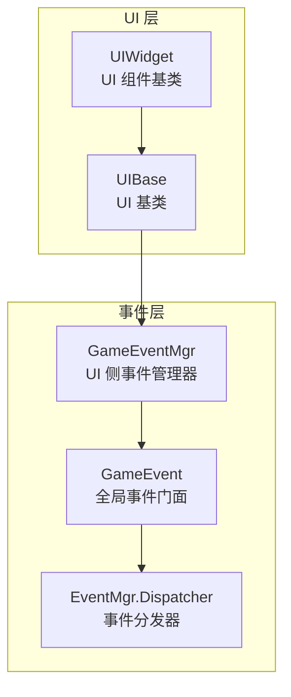
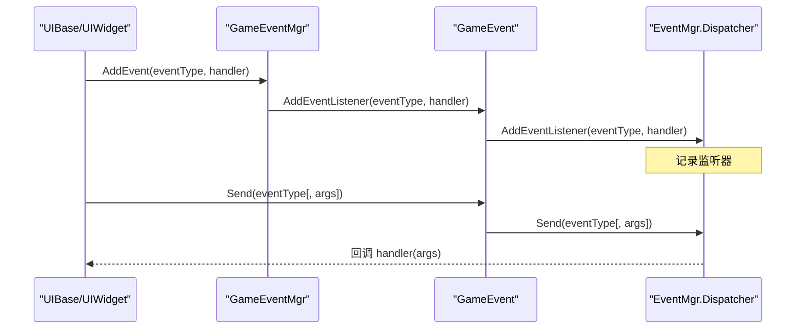
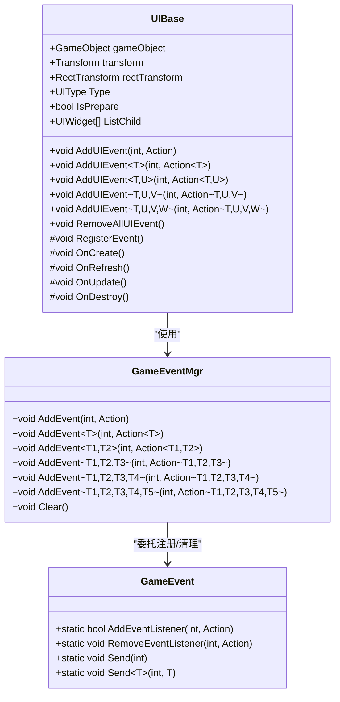
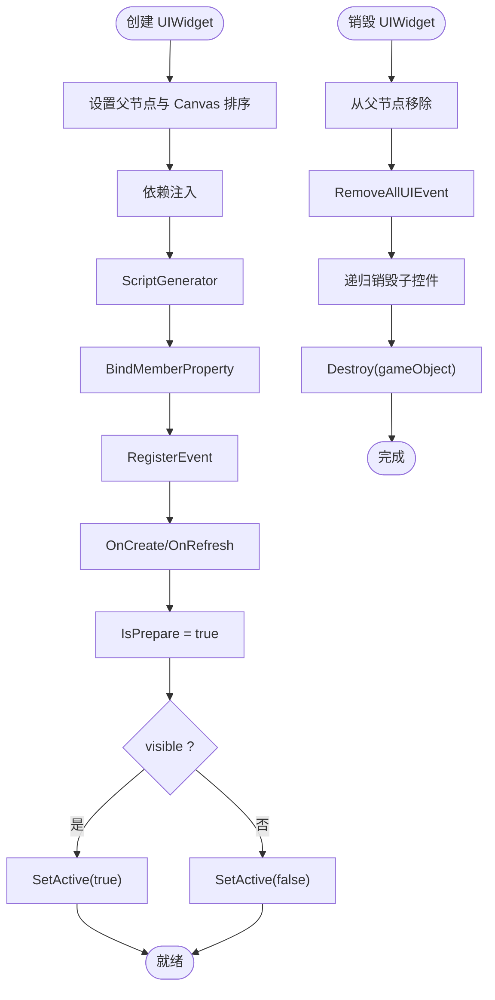
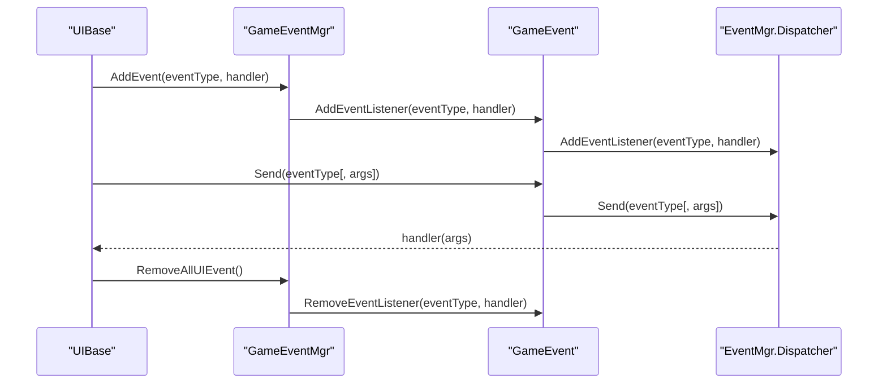

# UI 事件系统

<cite>
**本文引用的文件**   
- [GameLogic/UIBase.cs](file://UnityProject/Assets/GameScripts/HotFix/GameLogic/Module/UIModule/UIBase.cs)
- [GameLogic/UIWidget.cs](file://UnityProject/Assets/GameScripts/HotFix/GameLogic/Module/UIModule/UIWidget.cs)
- [TEngine/Runtime/Core/GameEvent/GameEvent.cs](file://UnityProject/Assets/TEngine/Runtime/Core/GameEvent/GameEvent.cs)
- [TEngine/Runtime/Core/GameEvent/GameEventMgr.cs](file://UnityProject/Assets/TEngine/Runtime/Core/GameEvent/GameEventMgr.cs)
</cite>

## 目录
1. [简介](#简介)
2. [项目结构](#项目结构)
3. [核心组件](#核心组件)
4. [架构总览](#架构总览)
5. [详细组件分析](#详细组件分析)
6. [依赖关系分析](#依赖关系分析)
7. [性能与内存优化](#性能与内存优化)
8. [最佳实践](#最佳实践)
9. [常见交互场景示例](#常见交互场景示例)
10. [故障排查指南](#故障排查指南)
11. [结论](#结论)

## 简介
本文面向 TEngine 的 UI 事件系统，系统性阐述 UI 事件的注册、分发与处理机制。重点说明 UIBase 中的事件绑定方法（AddUIEvent、RemoveAllUIEvent），解释 UI 事件如何与全局事件系统集成，并给出性能优化策略（事件池、弱引用、内存管理）与事件驱动编程的最佳实践（命名规范、错误处理、调试技巧）。文末提供按钮点击、输入框变化、列表滚动等常见 UI 交互场景的事件处理思路与参考路径。

## 项目结构
围绕 UI 事件系统的核心代码主要分布在以下位置：
- GameLogic/UIBase.cs：UI 基类，封装 UI 生命周期、子控件创建、以及通过 GameEventMgr 与全局事件系统对接的方法。
- GameLogic/UIWidget.cs：UI 组件基类，继承自 UIBase，负责 UI 组件的生命周期、可见性、更新调度与销毁时的资源清理。
- TEngine/Runtime/Core/GameEvent/GameEvent.cs：全局事件门面，对外暴露 AddEventListener/RemoveEventListener/Send 等静态接口，内部委托给 EventMgr.Dispatcher。
- TEngine/Runtime/Core/GameEvent/GameEventMgr.cs：UI 侧事件管理器，持有当前 UI 实例订阅的所有事件与处理器，并在 Clear 时统一解绑，避免内存泄漏。

图表来源
- [GameLogic/UIBase.cs:282-332](file://UnityProject/Assets/GameScripts/HotFix/GameLogic/Module/UIModule/UIBase.cs#L282-L332)
- [GameLogic/UIWidget.cs:7-315](file://UnityProject/Assets/GameScripts/HotFix/GameLogic/Module/UIModule/UIWidget.cs#L7-L315)
- [TEngine/Runtime/Core/GameEvent/GameEvent.cs:8-18](file://UnityProject/Assets/TEngine/Runtime/Core/GameEvent/GameEvent.cs#L8-L18)
- [TEngine/Runtime/Core/GameEvent/GameEventMgr.cs:9-109](file://UnityProject/Assets/TEngine/Runtime/Core/GameEvent/GameEventMgr.cs#L9-L109)

章节来源
- [GameLogic/UIBase.cs:1-608](file://UnityProject/Assets/GameScripts/HotFix/GameLogic/Module/UIModule/UIBase.cs#L1-L608)
- [GameLogic/UIWidget.cs:1-315](file://UnityProject/Assets/GameScripts/HotFix/GameLogic/Module/UIModule/UIWidget.cs#L1-L315)
- [TEngine/Runtime/Core/GameEvent/GameEvent.cs:1-810](file://UnityProject/Assets/TEngine/Runtime/Core/GameEvent/GameEvent.cs#L1-L810)
- [TEngine/Runtime/Core/GameEvent/GameEventMgr.cs:1-109](file://UnityProject/Assets/TEngine/Runtime/Core/GameEvent/GameEventMgr.cs#L1-L109)

## 核心组件
- UIBase
  - 提供 UI 生命周期钩子（OnCreate/OnRefresh/OnUpdate/OnDestroy）、查找子节点、创建 UIWidget 等能力。
  - 通过私有字段 _eventMgr（类型为 GameEventMgr）与全局事件系统对接，提供 AddUIEvent 系列重载方法与 RemoveAllUIEvent。
- GameEventMgr
  - 维护当前 UI 实例订阅的事件类型与处理器列表，在 AddEvent 时调用 GameEvent.AddEventListener 完成注册，并在 Clear 时统一移除监听，防止内存泄漏。
- GameEvent
  - 全局事件门面，提供 AddEventListener/RemoveEventListener/Send 等静态接口，内部委托给 EventMgr.Dispatcher 进行实际的分发与存储。

章节来源
- [GameLogic/UIBase.cs:282-332](file://UnityProject/Assets/GameScripts/HotFix/GameLogic/Module/UIModule/UIBase.cs#L282-L332)
- [TEngine/Runtime/Core/GameEvent/GameEventMgr.cs:9-109](file://UnityProject/Assets/TEngine/Runtime/Core/GameEvent/GameEventMgr.cs#L9-L109)
- [TEngine/Runtime/Core/GameEvent/GameEvent.cs:8-18](file://UnityProject/Assets/TEngine/Runtime/Core/GameEvent/GameEvent.cs#L8-L18)

## 架构总览
UI 事件系统采用“UI 层 + 事件层”的分层设计：
- UI 层（UIBase/UIWidget）：负责 UI 生命周期与业务逻辑，通过 AddUIEvent 将处理器注册到 GameEventMgr。
- 事件层（GameEventMgr/GameEvent/EventMgr.Dispatcher）：负责事件注册、去重、分发与生命周期管理。

图表来源
- [GameLogic/UIBase.cs:299-330](file://UnityProject/Assets/GameScripts/HotFix/GameLogic/Module/UIModule/UIBase.cs#L299-L330)
- [TEngine/Runtime/Core/GameEvent/GameEventMgr.cs:51-105](file://UnityProject/Assets/TEngine/Runtime/Core/GameEvent/GameEventMgr.cs#L51-L105)
- [TEngine/Runtime/Core/GameEvent/GameEvent.cs:28-118](file://UnityProject/Assets/TEngine/Runtime/Core/GameEvent/GameEvent.cs#L28-L118)

## 详细组件分析

### UIBase 事件绑定与生命周期
- 事件绑定
  - AddUIEvent(int eventType, Action handler) 及其泛型重载：将处理器注册到 GameEventMgr，再由 GameEventMgr 委托 GameEvent 完成最终注册。
  - RemoveAllUIEvent()：释放当前 UI 持有的 GameEventMgr，并在其 Clear 中统一移除所有已注册的监听，避免内存泄漏。
- 生命周期钩子
  - RegisterEvent：建议在此处集中注册 UI 相关事件。
  - OnCreate/OnRefresh/OnUpdate/OnDestroy：用于初始化、刷新、每帧更新与销毁清理。
- 子控件与数据
  - ListChild/_listUpdateChild：管理子 UIWidget 与需要更新的子项集合。
  - UserData/UserDatas：自定义数据容器。

图表来源
- [GameLogic/UIBase.cs:18-200](file://UnityProject/Assets/GameScripts/HotFix/GameLogic/Module/UIModule/UIBase.cs#L18-L200)
- [GameLogic/UIBase.cs:282-332](file://UnityProject/Assets/GameScripts/HotFix/GameLogic/Module/UIModule/UIBase.cs#L282-L332)
- [TEngine/Runtime/Core/GameEvent/GameEventMgr.cs:9-109](file://UnityProject/Assets/TEngine/Runtime/Core/GameEvent/GameEventMgr.cs#L9-L109)
- [TEngine/Runtime/Core/GameEvent/GameEvent.cs:28-118](file://UnityProject/Assets/TEngine/Runtime/Core/GameEvent/GameEvent.cs#L28-L118)

章节来源
- [GameLogic/UIBase.cs:18-200](file://UnityProject/Assets/GameScripts/HotFix/GameLogic/Module/UIModule/UIBase.cs#L18-L200)
- [GameLogic/UIBase.cs:282-332](file://UnityProject/Assets/GameScripts/HotFix/GameLogic/Module/UIModule/UIBase.cs#L282-L332)

### UIWidget 生命周期与事件清理
- 创建流程
  - Create/CreateByPrefab/CreateByPath：设置父节点、Canvas 排序、注入依赖、执行 ScriptGenerator/BindMemberProperty/RegisterEvent/OnCreate/OnRefresh，并标记 IsPrepare。
- 可见性与更新
  - Visible：控制 GameObject.activeSelf 并触发 OnSetVisible。
  - InternalUpdate：递归收集需要更新的子项，调用 OnUpdate，并根据是否重写 Update 决定是否需要继续下一帧更新。
- 销毁流程
  - OnDestroyWidget：从父节点移除、调用 RemoveAllUIEvent 清理事件、递归销毁子控件、销毁 GameObject。
  - Destroy：主动销毁入口，先移除父节点 ListChild，再调用 OnDestroy/OnDestroyWidget。

图表来源
- [GameLogic/UIWidget.cs:151-233](file://UnityProject/Assets/GameScripts/HotFix/GameLogic/Module/UIModule/UIWidget.cs#L151-L233)
- [GameLogic/UIWidget.cs:276-315](file://UnityProject/Assets/GameScripts/HotFix/GameLogic/Module/UIModule/UIWidget.cs#L276-L315)

章节来源
- [GameLogic/UIWidget.cs:151-233](file://UnityProject/Assets/GameScripts/HotFix/GameLogic/Module/UIModule/UIWidget.cs#L151-L233)
- [GameLogic/UIWidget.cs:276-315](file://UnityProject/Assets/GameScripts/HotFix/GameLogic/Module/UIModule/UIWidget.cs#L276-L315)

### 全局事件系统与 UI 集成
- GameEvent
  - 提供静态 AddEventListener/RemoveEventListener/Send 接口，支持 int 与 string 两种事件类型标识。
  - 内部通过 EventMgr.Dispatcher 完成实际的监听管理与分发。
- GameEventMgr
  - 为每个 UI 实例持有事件与处理器列表，在 AddEvent 时调用 GameEvent.AddEventListener，并在 Clear 时遍历列表调用 GameEvent.RemoveEventListener 以解绑。
- 集成方式
  - UIBase 通过 GameEventMgr 间接使用 GameEvent，从而将 UI 事件纳入全局事件系统，实现跨模块通信。

图表来源
- [GameLogic/UIBase.cs:299-330](file://UnityProject/Assets/GameScripts/HotFix/GameLogic/Module/UIModule/UIBase.cs#L299-L330)
- [TEngine/Runtime/Core/GameEvent/GameEventMgr.cs:51-105](file://UnityProject/Assets/TEngine/Runtime/Core/GameEvent/GameEventMgr.cs#L51-L105)
- [TEngine/Runtime/Core/GameEvent/GameEvent.cs:28-118](file://UnityProject/Assets/TEngine/Runtime/Core/GameEvent/GameEvent.cs#L28-L118)

章节来源
- [TEngine/Runtime/Core/GameEvent/GameEvent.cs:28-118](file://UnityProject/Assets/TEngine/Runtime/Core/GameEvent/GameEvent.cs#L28-L118)
- [TEngine/Runtime/Core/GameEvent/GameEventMgr.cs:51-105](file://UnityProject/Assets/TEngine/Runtime/Core/GameEvent/GameEventMgr.cs#L51-L105)

## 依赖关系分析
- 耦合度
  - UIBase 仅依赖 GameEventMgr，不直接依赖 GameEvent，降低 UI 层对全局事件实现的耦合。
  - GameEventMgr 依赖 GameEvent，承担 UI 侧的订阅清单与生命周期管理职责。
  - GameEvent 依赖 EventMgr.Dispatcher，作为全局门面简化调用。
- 内聚性
  - UIBase 聚焦 UI 生命周期与事件绑定；UIWidget 聚焦 UI 组件生命周期与更新调度；GameEventMgr 专注 UI 侧事件清单管理；GameEvent 专注全局事件门面。
- 循环依赖
  - 未发现循环依赖。UI 层单向依赖事件层。

图表来源
- [GameLogic/UIBase.cs:282-332](file://UnityProject/Assets/GameScripts/HotFix/GameLogic/Module/UIModule/UIBase.cs#L282-L332)
- [TEngine/Runtime/Core/GameEvent/GameEventMgr.cs:9-109](file://UnityProject/Assets/TEngine/Runtime/Core/GameEvent/GameEventMgr.cs#L9-L109)
- [TEngine/Runtime/Core/GameEvent/GameEvent.cs:8-18](file://UnityProject/Assets/TEngine/Runtime/Core/GameEvent/GameEvent.cs#L8-L18)

章节来源
- [GameLogic/UIBase.cs:282-332](file://UnityProject/Assets/GameScripts/HotFix/GameLogic/Module/UIModule/UIBase.cs#L282-L332)
- [TEngine/Runtime/Core/GameEvent/GameEventMgr.cs:9-109](file://UnityProject/Assets/TEngine/Runtime/Core/GameEvent/GameEventMgr.cs#L9-L109)
- [TEngine/Runtime/Core/GameEvent/GameEvent.cs:8-18](file://UnityProject/Assets/TEngine/Runtime/Core/GameEvent/GameEvent.cs#L8-L18)

## 性能与内存优化
- 事件池
  - GameEventMgr 通过 MemoryPool.Acquire<GameEventMgr>() 获取实例，并在 RemoveAllUIEvent 中通过 MemoryPool.Release(_eventMgr) 归还对象，减少 GC 压力。
- 弱引用
  - 当前实现未显式使用弱引用；若需避免长生命周期对象被事件强引用导致无法回收，可在上层业务中确保及时 RemoveAllUIEvent，或在更高层面引入弱引用包装（需扩展 EventMgr.Dispatcher）。
- 内存管理
  - GameEventMgr.Clear 会遍历已注册事件并调用 GameEvent.RemoveEventListener 逐一解绑，避免残留监听导致的内存泄漏。
  - UIWidget.OnDestroyWidget 会调用 RemoveAllUIEvent，确保 UI 销毁时自动清理事件。
- 更新优化
  - UIWidget.InternalUpdate 通过 _updateListValid 与 _listUpdateChild 缓存需要更新的子项，减少每帧重复构建更新列表的开销。

章节来源
- [GameLogic/UIBase.cs:282-332](file://UnityProject/Assets/GameScripts/HotFix/GameLogic/Module/UIModule/UIBase.cs#L282-L332)
- [TEngine/Runtime/Core/GameEvent/GameEventMgr.cs:30-49](file://UnityProject/Assets/TEngine/Runtime/Core/GameEvent/GameEventMgr.cs#L30-L49)
- [GameLogic/UIWidget.cs:71-140](file://UnityProject/Assets/GameScripts/HotFix/GameLogic/Module/UIModule/UIWidget.cs#L71-L140)
- [GameLogic/UIWidget.cs:276-315](file://UnityProject/Assets/GameScripts/HotFix/GameLogic/Module/UIModule/UIWidget.cs#L276-L315)

## 最佳实践
- 事件命名规范
  - 建议使用语义化字符串或常量枚举定义事件名，避免魔法字符串；string 与 int 两种类型均可使用，推荐统一风格。
- 注册与解绑
  - 在 RegisterEvent 中集中注册事件；在 OnDestroy/OnDestroyWidget 中确保 RemoveAllUIEvent 被调用（UIWidget 已内置）。
- 错误处理
  - 在事件处理器中进行空值检查与异常捕获，避免单个处理器异常影响其他监听者。
- 调试技巧
  - 使用 HasEventListener 判断是否已注册，避免重复注册。
  - 结合日志输出事件名称与参数，便于定位问题。
- 性能考虑
  - 高频事件（如滚动、拖拽）建议节流或合并处理，避免每帧大量派发。
  - 避免在事件处理器中进行重型计算，必要时异步或分帧处理。

[本节为通用指导，不直接分析具体文件]

## 常见交互场景示例
以下为常见 UI 交互场景的事件处理思路与参考路径（不展示具体代码内容）：
- 按钮点击
  - 在 UI 的 RegisterEvent 中通过 AddUIEvent 注册按钮点击事件；在对应处理器中执行业务逻辑（如跳转、提交表单）。
  - 参考路径：[GameLogic/UIBase.cs:299-330](file://UnityProject/Assets/GameScripts/HotFix/GameLogic/Module/UIModule/UIBase.cs#L299-L330)
- 输入框变化
  - 在输入框的文本变化事件中触发 AddUIEvent 注册；在处理器中校验输入、更新状态或联动其他 UI。
  - 参考路径：[GameLogic/UIBase.cs:299-330](file://UnityProject/Assets/GameScripts/HotFix/GameLogic/Module/UIModule/UIBase.cs#L299-L330)
- 列表滚动
  - 在滚动事件处理器中进行节流处理，按需更新可见项；结合 UIWidget 的 AdjustIconNum/AsyncAdjustIconNum 进行动态生成与回收。
  - 参考路径：[GameLogic/UIBase.cs:477-578](file://UnityProject/Assets/GameScripts/HotFix/GameLogic/Module/UIModule/UIBase.cs#L477-L578)

[本节为概念性示例，不直接分析具体文件]

## 故障排查指南
- 事件未触发
  - 检查是否在 RegisterEvent 中正确调用 AddUIEvent。
  - 确认事件类型一致（int/string），且发送端与接收端匹配。
  - 参考路径：[GameLogic/UIBase.cs:299-330](file://UnityProject/Assets/GameScripts/HotFix/GameLogic/Module/UIModule/UIBase.cs#L299-L330)
- 内存泄漏
  - 确认 UI 销毁时调用了 RemoveAllUIEvent（UIWidget 已内置）。
  - 检查是否存在长生命周期对象被事件强引用。
  - 参考路径：[GameLogic/UIWidget.cs:276-315](file://UnityProject/Assets/GameScripts/HotFix/GameLogic/Module/UIModule/UIWidget.cs#L276-L315)
- 重复注册
  - 使用 HasEventListener 判断是否已注册，避免重复添加。
  - 参考路径：[TEngine/Runtime/Core/GameEvent/GameEvent.cs:120-231](file://UnityProject/Assets/TEngine/Runtime/Core/GameEvent/GameEvent.cs#L120-L231)

章节来源
- [GameLogic/UIBase.cs:299-330](file://UnityProject/Assets/GameScripts/HotFix/GameLogic/Module/UIModule/UIBase.cs#L299-L330)
- [GameLogic/UIWidget.cs:276-315](file://UnityProject/Assets/GameScripts/HotFix/GameLogic/Module/UIModule/UIWidget.cs#L276-L315)
- [TEngine/Runtime/Core/GameEvent/GameEvent.cs:120-231](file://UnityProject/Assets/TEngine/Runtime/Core/GameEvent/GameEvent.cs#L120-L231)

## 结论
TEngine 的 UI 事件系统通过 UIBase 与 GameEventMgr 将 UI 层与全局事件系统解耦，既保证了 UI 事件的可维护性，又实现了跨模块通信的能力。借助事件池与统一的清理机制，系统在性能与内存管理方面具备良好表现。遵循本文的最佳实践与常见问题排查建议，可进一步提升 UI 事件驱动开发的质量与稳定性。