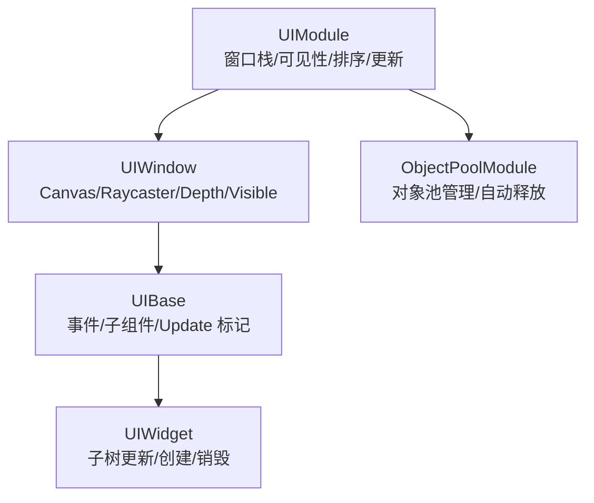
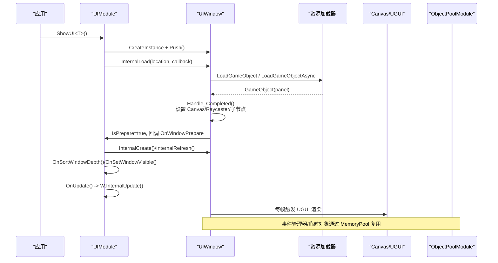
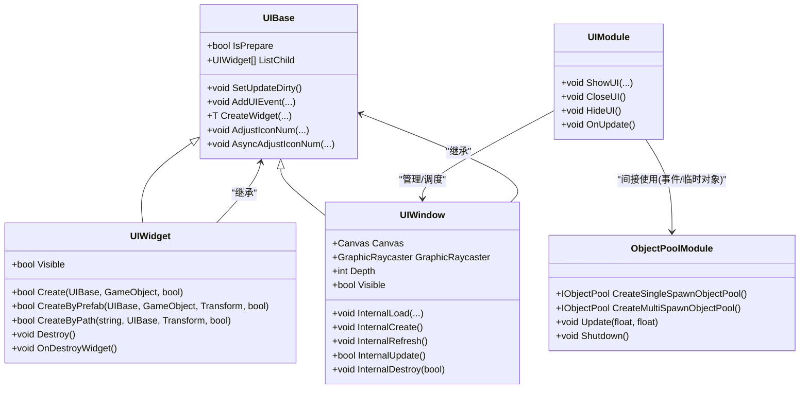
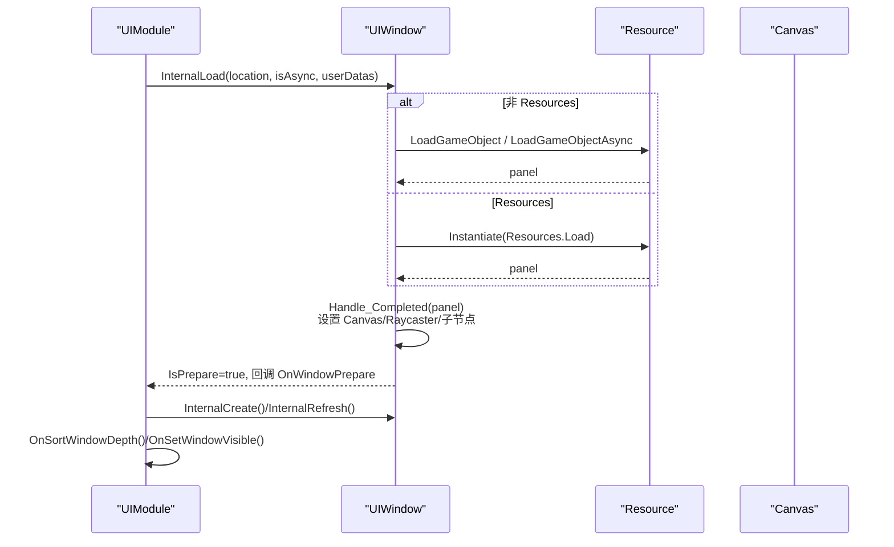
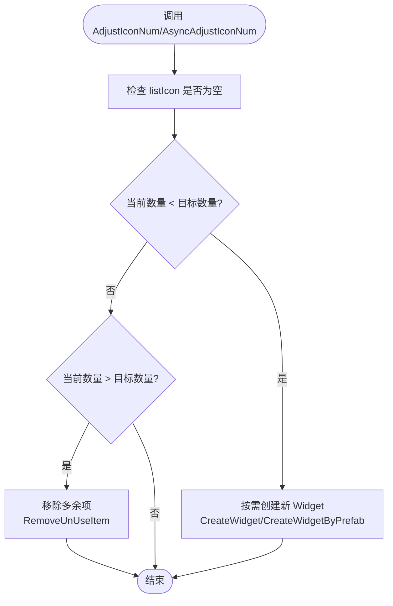
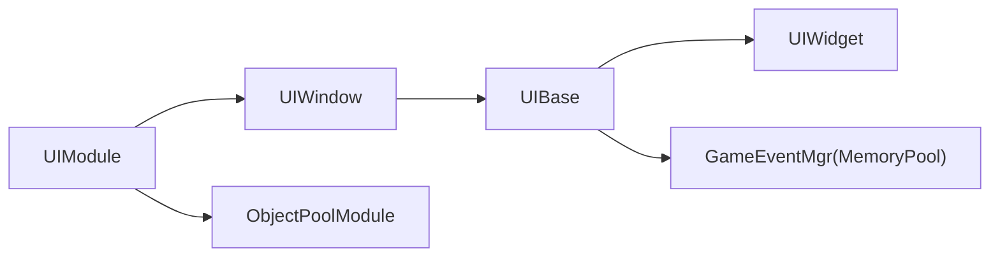
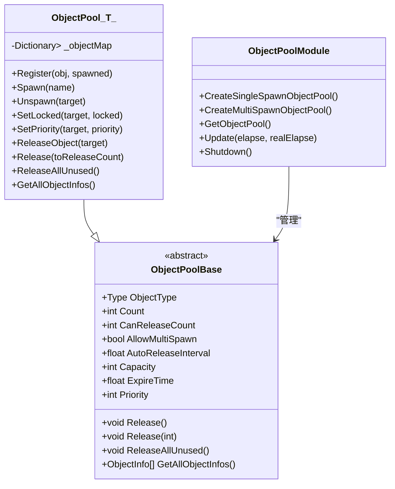
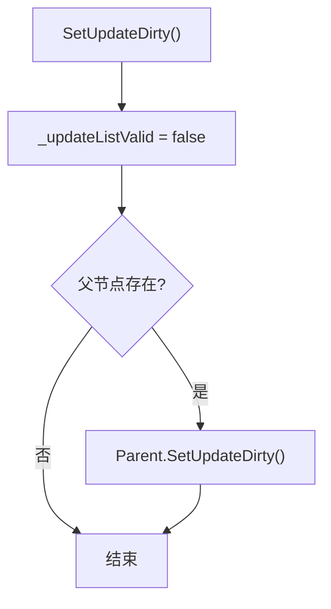

# UI 性能优化

<cite>
**本文引用的文件**   
- [UIBase.cs](file://UnityProject/Assets/GameScripts/HotFix/GameLogic/Module/UIModule/UIBase.cs)
- [UIWindow.cs](file://UnityProject/Assets/GameScripts/HotFix/GameLogic/Module/UIModule/UIWindow.cs)
- [UIWidget.cs](file://UnityProject/Assets/GameScripts/HotFix/GameLogic/Module/UIModule/UIWidget.cs)
- [UIModule.cs](file://UnityProject/Assets/GameScripts/HotFix/GameLogic/Module/UIModule/UIModule.cs)
- [ObjectPoolBase.cs](file://UnityProject/Assets/TEngine/Runtime/Module/ObjectPoolModule/ObjectPoolBase.cs)
- [ObjectPoolModule.Object.cs](file://UnityProject/Assets/TEngine/Runtime/Module/ObjectPoolModule/ObjectPoolModule.Object.cs)
- [ObjectPoolModule.ObjectPool.cs](file://UnityProject/Assets/TEngine/Runtime/Module/ObjectPoolModule/ObjectPoolModule.ObjectPool.cs)
- [ObjectPoolModule.cs](file://UnityProject/Assets/TEngine/Runtime/Module/ObjectPoolModule/ObjectPoolModule.cs)
</cite>

## 目录
1. [引言](#引言)
2. [项目结构](#项目结构)
3. [核心组件](#核心组件)
4. [架构总览](#架构总览)
5. [详细组件分析](#详细组件分析)
6. [依赖关系分析](#依赖关系分析)
7. [性能优化策略](#性能优化策略)
8. [内存管理与对象池](#内存管理与对象池)
9. [更新机制与帧率控制](#更新机制与帧率控制)
10. [渲染与 DrawCall 优化](#渲染与-drawcall-优化)
11. [性能监控与分析](#性能监控与分析)
12. [故障排查指南](#故障排查指南)
13. [结论](#结论)

## 引言
本文件面向 TEngine 的 UI 子系统，系统性阐述 UI 对象的复用机制、渲染优化、内存管理、更新机制与性能监控方法。重点覆盖：
- UI 对象池与自定义对象池的使用与扩展
- Canvas 分组、批处理与 DrawCall 减少策略
- 资源释放、垃圾回收优化与内存泄漏预防
- 增量更新、脏标记与帧率控制
- Profiler 使用、瓶颈定位与优化效果评估

## 项目结构
UI 子系统由以下关键模块组成：
- UIModule：窗口生命周期、层级排序、可见性控制、全局更新调度
- UIWindow/UIBase：窗口基类，负责加载、创建、刷新、销毁、深度与可见性
- UIWidget：UI 子组件基类，负责自身生命周期与子树更新
- ObjectPoolModule：通用对象池系统，提供可配置的对象复用与自动释放

图表来源
- [UIModule.cs:15-94](file://UnityProject/Assets/GameScripts/HotFix/GameLogic/Module/UIModule/UIModule.cs#L15-L94)
- [UIWindow.cs:11-524](file://UnityProject/Assets/GameScripts/HotFix/GameLogic/Module/UIModule/UIWindow.cs#L11-L524)
- [UIBase.cs:18-608](file://UnityProject/Assets/GameScripts/HotFix/GameLogic/Module/UIModule/UIBase.cs#L18-L608)
- [UIWidget.cs:7-315](file://UnityProject/Assets/GameScripts/HotFix/GameLogic/Module/UIModule/UIWidget.cs#L7-L315)
- [ObjectPoolModule.cs:9-70](file://UnityProject/Assets/TEngine/Runtime/Module/ObjectPoolModule/ObjectPoolModule.cs#L9-L70)

章节来源
- [UIModule.cs:15-94](file://UnityProject/Assets/GameScripts/HotFix/GameLogic/Module/UIModule/UIModule.cs#L15-L94)
- [UIWindow.cs:11-524](file://UnityProject/Assets/GameScripts/HotFix/GameLogic/Module/UIModule/UIWindow.cs#L11-L524)
- [UIBase.cs:18-608](file://UnityProject/Assets/GameScripts/HotFix/GameLogic/Module/UIModule/UIBase.cs#L18-L608)
- [UIWidget.cs:7-315](file://UnityProject/Assets/GameScripts/HotFix/GameLogic/Module/UIModule/UIWidget.cs#L7-L315)
- [ObjectPoolModule.cs:9-70](file://UnityProject/Assets/TEngine/Runtime/Module/ObjectPoolModule/ObjectPoolModule.cs#L9-L70)

## 核心组件
- UIModule：维护窗口堆栈、层深排序、可见性判定、全局 OnUpdate 调度；提供窗口打开/关闭/隐藏等 API。
- UIWindow：封装 Canvas、GraphicRaycaster、子 Canvas/Raycaster 列表；实现 Depth/Visible 属性与内部生命周期 InternalLoad/InternalCreate/InternalRefresh/InternalUpdate/InternalDestroy。
- UIBase：统一的事件绑定（基于 GameEventMgr）、子组件 ListChild、Update 脏标记与递归更新入口。
- UIWidget：继承 UIBase，提供 Create/CreateByPrefab/CreateByPath 等便捷创建方式，以及子树 InternalUpdate 与 OnDestroyWidget 清理。
- ObjectPoolModule：对象池管理器，支持单例/多实例获取、容量/过期时间/优先级/自动释放间隔等配置，提供 Release/ReleaseAllUnused 等能力。

章节来源
- [UIModule.cs:15-94](file://UnityProject/Assets/GameScripts/HotFix/GameLogic/Module/UIModule/UIModule.cs#L15-L94)
- [UIWindow.cs:11-524](file://UnityProject/Assets/GameScripts/HotFix/GameLogic/Module/UIModule/UIWindow.cs#L11-L524)
- [UIBase.cs:18-608](file://UnityProject/Assets/GameScripts/HotFix/GameLogic/Module/UIModule/UIBase.cs#L18-L608)
- [UIWidget.cs:7-315](file://UnityProject/Assets/GameScripts/HotFix/GameLogic/Module/UIModule/UIWidget.cs#L7-L315)
- [ObjectPoolModule.cs:9-70](file://UnityProject/Assets/TEngine/Runtime/Module/ObjectPoolModule/ObjectPoolModule.cs#L9-L70)

## 架构总览
下图展示 UI 窗口从“打开”到“渲染”的关键流程，以及与对象池系统的交互点。

图表来源
- [UIModule.cs:298-336](file://UnityProject/Assets/GameScripts/HotFix/GameLogic/Module/UIModule/UIModule.cs#L298-L336)
- [UIWindow.cs:314-336](file://UnityProject/Assets/GameScripts/HotFix/GameLogic/Module/UIModule/UIWindow.cs#L314-L336)
- [UIWindow.cs:464-502](file://UnityProject/Assets/GameScripts/HotFix/GameLogic/Module/UIModule/UIWindow.cs#L464-L502)
- [UIModule.cs:472-516](file://UnityProject/Assets/GameScripts/HotFix/GameLogic/Module/UIModule/UIModule.cs#L472-L516)
- [UIModule.cs:712-730](file://UnityProject/Assets/GameScripts/HotFix/GameLogic/Module/UIModule/UIModule.cs#L712-L730)

## 详细组件分析

### 组件类图（UI 体系）

图表来源
- [UIBase.cs:18-608](file://UnityProject/Assets/GameScripts/HotFix/GameLogic/Module/UIModule/UIBase.cs#L18-L608)
- [UIWindow.cs:11-524](file://UnityProject/Assets/GameScripts/HotFix/GameLogic/Module/UIModule/UIWindow.cs#L11-L524)
- [UIWidget.cs:7-315](file://UnityProject/Assets/GameScripts/HotFix/GameLogic/Module/UIModule/UIWidget.cs#L7-L315)
- [UIModule.cs:15-732](file://UnityProject/Assets/GameScripts/HotFix/GameLogic/Module/UIModule/UIModule.cs#L15-L732)
- [ObjectPoolModule.cs:9-70](file://UnityProject/Assets/TEngine/Runtime/Module/ObjectPoolModule/ObjectPoolModule.cs#L9-L70)

### 窗口打开与准备时序

图表来源
- [UIWindow.cs:314-336](file://UnityProject/Assets/GameScripts/HotFix/GameLogic/Module/UIModule/UIWindow.cs#L314-L336)
- [UIWindow.cs:464-502](file://UnityProject/Assets/GameScripts/HotFix/GameLogic/Module/UIModule/UIWindow.cs#L464-L502)
- [UIModule.cs:472-516](file://UnityProject/Assets/GameScripts/HotFix/GameLogic/Module/UIModule/UIModule.cs#L472-L516)

### 子组件创建与数量调整流程

图表来源
- [UIBase.cs:477-578](file://UnityProject/Assets/GameScripts/HotFix/GameLogic/Module/UIModule/UIBase.cs#L477-L578)
- [UIBase.cs:580-604](file://UnityProject/Assets/GameScripts/HotFix/GameLogic/Module/UIModule/UIBase.cs#L580-L604)

## 依赖关系分析
- UIModule 依赖 UIWindow 的生命周期与可见性控制，并通过 OnUpdate 驱动所有窗口的 InternalUpdate。
- UIWindow 持有 Canvas 与 Raycaster，并批量同步子 Canvas/Raycaster 的状态。
- UIBase 通过 GameEventMgr 进行事件绑定，GameEventMgr 通过 MemoryPool 获取与释放，降低 GC 压力。
- ObjectPoolModule 为框架内对象复用提供基础能力，UI 侧可通过 MemoryPool 间接受益。

图表来源
- [UIModule.cs:712-730](file://UnityProject/Assets/GameScripts/HotFix/GameLogic/Module/UIModule/UIModule.cs#L712-L730)
- [UIWindow.cs:484-497](file://UnityProject/Assets/GameScripts/HotFix/GameLogic/Module/UIModule/UIWindow.cs#L484-L497)
- [UIBase.cs:284-330](file://UnityProject/Assets/GameScripts/HotFix/GameLogic/Module/UIModule/UIBase.cs#L284-L330)
- [ObjectPoolModule.cs:9-70](file://UnityProject/Assets/TEngine/Runtime/Module/ObjectPoolModule/ObjectPoolModule.cs#L9-L70)

## 性能优化策略

### UI 对象复用机制
- 窗口复用：UIModule 在 ShowUI 时优先尝试复用已存在的窗口实例，避免重复加载与构建。
- 子组件复用：UIBase 提供 AdjustIconNum/AsyncAdjustIconNum，按目标数量动态增删 UIWidget，减少频繁 Instantiate/Destroy。
- 事件对象复用：UIBase 中的 GameEventMgr 通过 MemoryPool 获取与释放，避免频繁分配。

章节来源
- [UIModule.cs:298-336](file://UnityProject/Assets/GameScripts/HotFix/GameLogic/Module/UIModule/UIModule.cs#L298-L336)
- [UIBase.cs:477-578](file://UnityProject/Assets/GameScripts/HotFix/GameLogic/Module/UIModule/UIBase.cs#L477-L578)
- [UIBase.cs:284-330](file://UnityProject/Assets/GameScripts/HotFix/GameLogic/Module/UIModule/UIBase.cs#L284-L330)

### 自定义对象池的实现与使用
- 对象池抽象：ObjectPoolBase 定义统一的接口（Count/CanReleaseCount/Capacity/ExpireTime/Priority/Release 等）。
- 具体实现：ObjectPool<T> 提供注册、Spawn/Unspawn、锁定、优先级、过期时间与自动释放逻辑。
- 管理器：ObjectPoolModule 统一管理多个对象池，支持按类型/名称查询、批量释放与周期性自动释放。

图表来源
- [ObjectPoolBase.cs:8-132](file://UnityProject/Assets/TEngine/Runtime/Module/ObjectPoolModule/ObjectPoolBase.cs#L8-L132)
- [ObjectPoolModule.ObjectPool.cs:12-602](file://UnityProject/Assets/TEngine/Runtime/Module/ObjectPoolModule/ObjectPoolModule.ObjectPool.cs#L12-L602)
- [ObjectPoolModule.cs:9-70](file://UnityProject/Assets/TEngine/Runtime/Module/ObjectPoolModule/ObjectPoolModule.cs#L9-L70)

章节来源
- [ObjectPoolBase.cs:8-132](file://UnityProject/Assets/TEngine/Runtime/Module/ObjectPoolModule/ObjectPoolBase.cs#L8-L132)
- [ObjectPoolModule.ObjectPool.cs:12-602](file://UnityProject/Assets/TEngine/Runtime/Module/ObjectPoolModule/ObjectPoolModule.ObjectPool.cs#L12-L602)
- [ObjectPoolModule.cs:9-70](file://UnityProject/Assets/TEngine/Runtime/Module/ObjectPoolModule/ObjectPoolModule.cs#L9-L70)

## 内存管理与对象池

### 资源释放与生命周期
- 窗口销毁：UIWindow.InternalDestroy 会遍历子组件执行 OnDestroy/OnDestroyWidget，随后销毁面板 GameObject。
- 组件销毁：UIWidget.OnDestroyWidget 会递归销毁子组件并销毁自身 GameObject。
- 事件清理：UIBase.RemoveAllUIEvent 释放 GameEventMgr 实例，避免事件引用导致泄漏。

章节来源
- [UIWindow.cs:427-458](file://UnityProject/Assets/GameScripts/HotFix/GameLogic/Module/UIModule/UIWindow.cs#L427-L458)
- [UIWidget.cs:282-311](file://UnityProject/Assets/GameScripts/HotFix/GameLogic/Module/UIModule/UIWidget.cs#L282-L311)
- [UIBase.cs:324-330](file://UnityProject/Assets/GameScripts/HotFix/GameLogic/Module/UIModule/UIBase.cs#L324-L330)

### 垃圾回收优化
- 使用 MemoryPool 获取/释放 GameEventMgr，减少频繁分配。
- 使用对象池管理 UI 相关临时对象（如数据容器、缓存列表），降低 GC 频率。
- 合理设置对象池容量与过期时间，避免长期驻留无用对象。

章节来源
- [UIBase.cs:284-330](file://UnityProject/Assets/GameScripts/HotFix/GameLogic/Module/UIModule/UIBase.cs#L284-L330)
- [ObjectPoolModule.ObjectPool.cs:408-466](file://UnityProject/Assets/TEngine/Runtime/Module/ObjectPoolModule/ObjectPoolModule.ObjectPool.cs#L408-L466)

### 内存泄漏预防
- 确保每次 CreateWidget/AsyncAdjustIconNum 后，对应数量的 Destroy/OnDestroyWidget 被调用。
- 窗口关闭或隐藏后，及时取消定时器与事件订阅。
- 对象池使用完成后，在合适时机调用 Release/ReleaseAllUnused 或等待自动释放。

章节来源
- [UIBase.cs:580-604](file://UnityProject/Assets/GameScripts/HotFix/GameLogic/Module/UIModule/UIBase.cs#L580-L604)
- [UIWindow.cs:514-522](file://UnityProject/Assets/GameScripts/HotFix/GameLogic/Module/UIModule/UIWindow.cs#L514-L522)
- [ObjectPoolModule.ObjectPool.cs:468-479](file://UnityProject/Assets/TEngine/Runtime/Module/ObjectPoolModule/ObjectPoolModule.ObjectPool.cs#L468-L479)

## 更新机制与帧率控制

### 增量更新与脏标记
- UIBase.SetUpdateDirty 将父级更新列表标记为无效，促使下一帧重建更新队列。
- UIWindow.InternalUpdate 与 UIWidget.InternalUpdate 均维护 _listUpdateChild 与 _updateListValid，仅对需要更新的子节点执行 OnUpdate，减少无意义遍历。

图表来源
- [UIBase.cs:232-239](file://UnityProject/Assets/GameScripts/HotFix/GameLogic/Module/UIModule/UIBase.cs#L232-L239)

章节来源
- [UIBase.cs:232-239](file://UnityProject/Assets/GameScripts/HotFix/GameLogic/Module/UIModule/UIBase.cs#L232-L239)
- [UIWindow.cs:356-425](file://UnityProject/Assets/GameScripts/HotFix/GameLogic/Module/UIModule/UIWindow.cs#L356-L425)
- [UIWidget.cs:71-140](file://UnityProject/Assets/GameScripts/HotFix/GameLogic/Module/UIModule/UIWidget.cs#L71-L140)

### 帧率控制
- UIModule.OnUpdate 逐帧遍历窗口并调用 InternalUpdate，建议结合业务逻辑在 OnUpdate 中做节流（如限频更新、条件跳过）。
- 大量异步创建场景可使用 AsyncAdjustIconNum 的分帧策略（maxNumPerFrame + UniTask.Yield）平滑负载。

章节来源
- [UIModule.cs:712-730](file://UnityProject/Assets/GameScripts/HotFix/GameLogic/Module/UIModule/UIModule.cs#L712-L730)
- [UIBase.cs:511-578](file://UnityProject/Assets/GameScripts/HotFix/GameLogic/Module/UIModule/UIBase.cs#L511-L578)

## 渲染与 DrawCall 优化

### Canvas 分组与层级排序
- UIWindow 在 Handle_Completed 中获取 Canvas 与 GraphicRaycaster，并收集子 Canvas/Raycaster，便于统一控制。
- Depth 属性设置主 Canvas.sortingOrder，并同步子 Canvas 的排序顺序，保证窗口层级正确。
- UIModule.OnSortWindowDepth 根据 WindowLayer 计算层级深度，保证同层窗口按打开顺序排列。

章节来源
- [UIWindow.cs:484-497](file://UnityProject/Assets/GameScripts/HotFix/GameLogic/Module/UIModule/UIWindow.cs#L484-L497)
- [UIWindow.cs:87-138](file://UnityProject/Assets/GameScripts/HotFix/GameLogic/Module/UIModule/UIWindow.cs#L87-L138)
- [UIModule.cs:480-491](file://UnityProject/Assets/GameScripts/HotFix/GameLogic/Module/UIModule/UIModule.cs#L480-L491)

### 批处理与 DrawCall 减少
- 图集与材质合并：建议使用 Unity SpriteAtlas 或自定义图集，减少材质切换。
- 静态 UI 分离：将不常变化的 UI 元素放入独立 Canvas，开启 Static Batching。
- 动态 UI 分组：将频繁变动的 UI 元素放入另一个 Canvas，避免影响静态批处理。
- 纹理尺寸与格式：压缩纹理、合理尺寸，减少 GPU 带宽占用。
- 避免过度嵌套：UI 层级过深会增加布局与渲染开销，尽量扁平化。

[本节为通用优化建议，不直接分析具体文件]

## 性能监控与分析

### Profiler 使用
- 使用 Unity Profiler 观察 CPU/GPU 耗时，重点关注 UI 相关的 DrawCall、Batch、Layout 与 GC 分配。
- 结合 UIModule.OnUpdate 与 UIWindow.InternalUpdate 的调用点，定位高频更新区域。

[本节为通用指导，不直接分析具体文件]

### 瓶颈定位
- 若 DrawCall 异常升高，检查是否出现过多材质/图集切换，或 Canvas 分组不合理。
- 若 GC 频繁，检查是否存在频繁的 Instantiate/Destroy 或未释放的事件订阅。
- 若帧率波动，检查是否存在一次性大任务（如大量 UI 创建）未分帧处理。

[本节为通用指导，不直接分析具体文件]

### 优化效果评估
- 对比优化前后：DrawCall、GC Alloc、帧时间分布、UI 更新耗时。
- 使用对象池与分帧创建后，应观察到 GC Alloc 下降、帧时间更平稳。

[本节为通用指导，不直接分析具体文件]

## 故障排查指南

### 常见问题
- 窗口无法显示：检查 Visible 属性与层设置是否正确；确认 Canvas.overrideSorting 与 sortingOrder 设置。
- 子组件未更新：检查 SetUpdateDirty 是否被调用，或 OnUpdate 是否被重写且返回 needUpdate。
- 内存泄漏：检查事件订阅是否移除、定时器是否取消、对象是否归还对象池。

章节来源
- [UIWindow.cs:143-188](file://UnityProject/Assets/GameScripts/HotFix/GameLogic/Module/UIModule/UIWindow.cs#L143-L188)
- [UIBase.cs:232-239](file://UnityProject/Assets/GameScripts/HotFix/GameLogic/Module/UIModule/UIBase.cs#L232-L239)
- [UIBase.cs:324-330](file://UnityProject/Assets/GameScripts/HotFix/GameLogic/Module/UIModule/UIBase.cs#L324-L330)
- [UIWindow.cs:514-522](file://UnityProject/Assets/GameScripts/HotFix/GameLogic/Module/UIModule/UIWindow.cs#L514-L522)

## 结论
TEngine 的 UI 子系统通过窗口复用、子组件动态增减、增量更新与脏标记机制，有效降低了运行时开销；配合对象池系统与合理的 Canvas 分组策略，可在复杂 UI 场景中显著减少 DrawCall 与 GC 压力。建议在开发过程中持续使用 Profiler 监控关键指标，并结合对象池与分帧策略进行渐进式优化，以获得稳定流畅的用户体验。