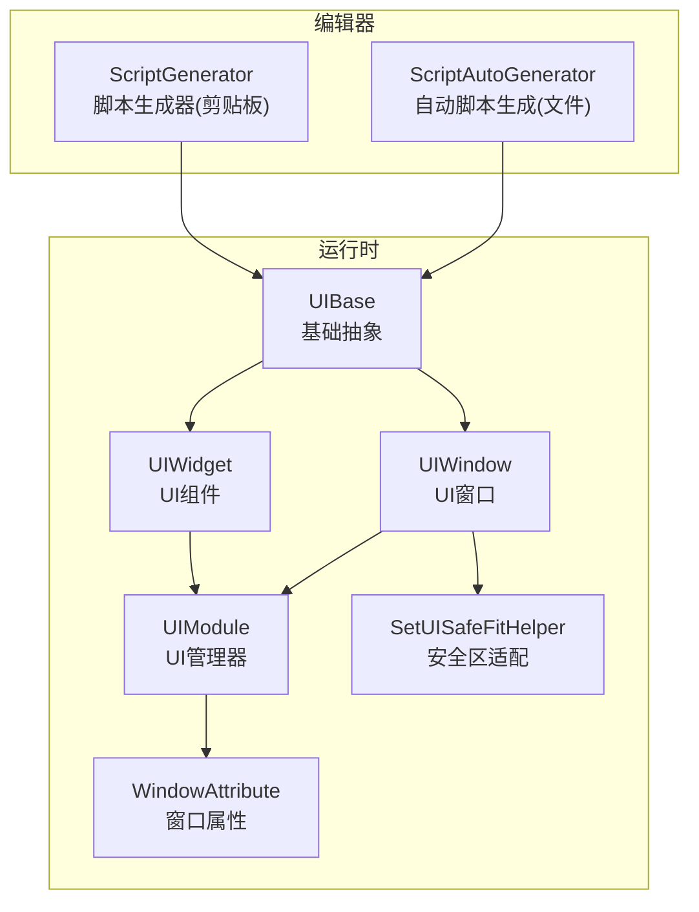
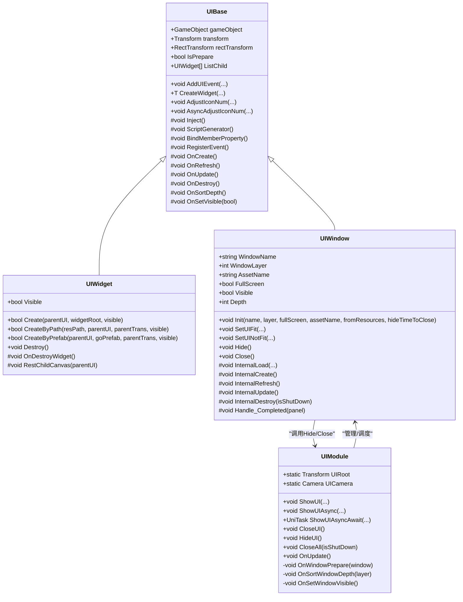
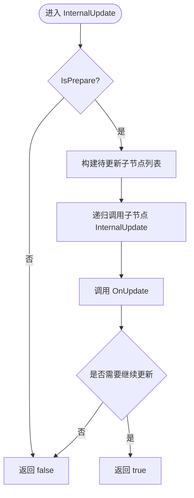
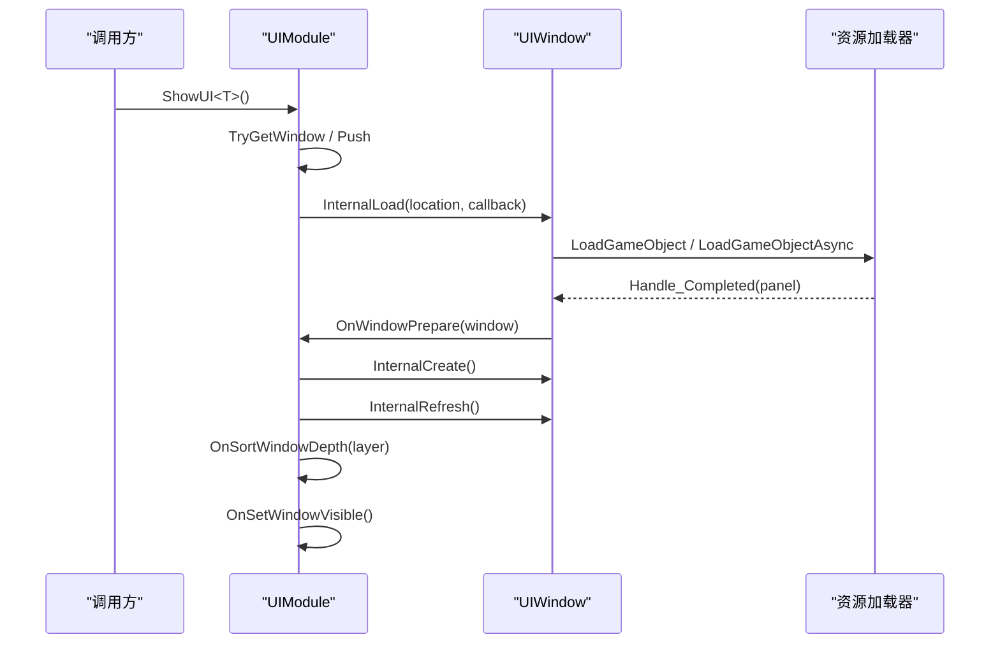
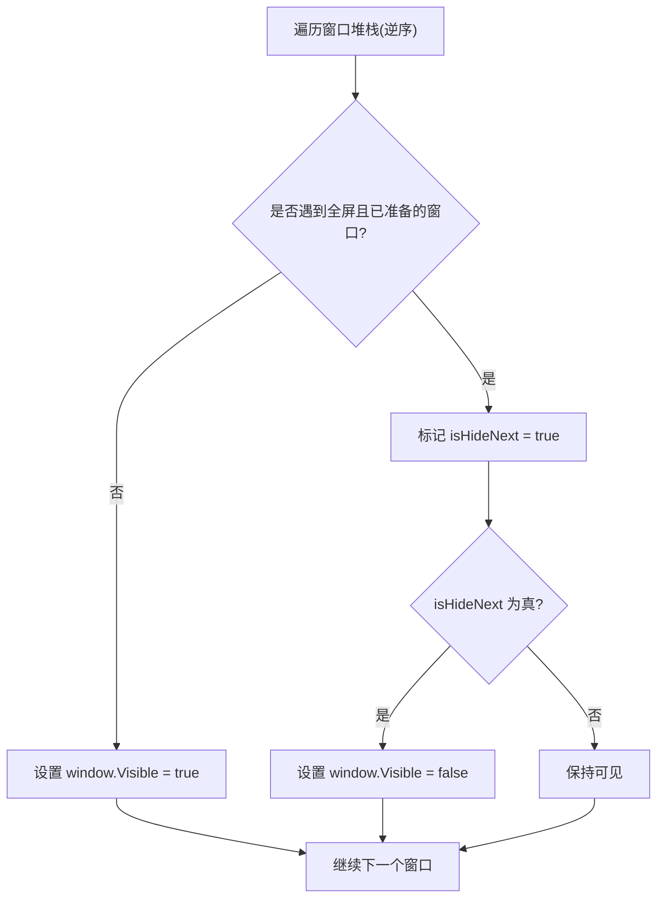
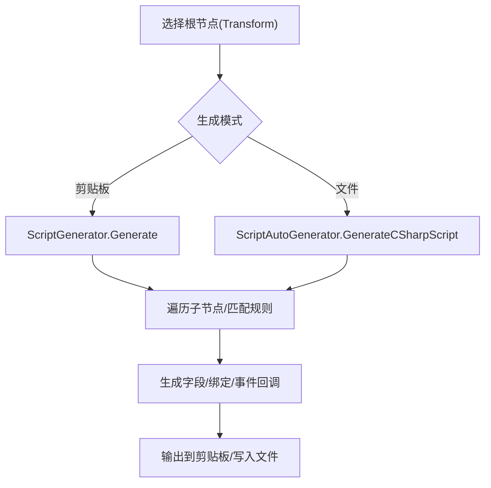
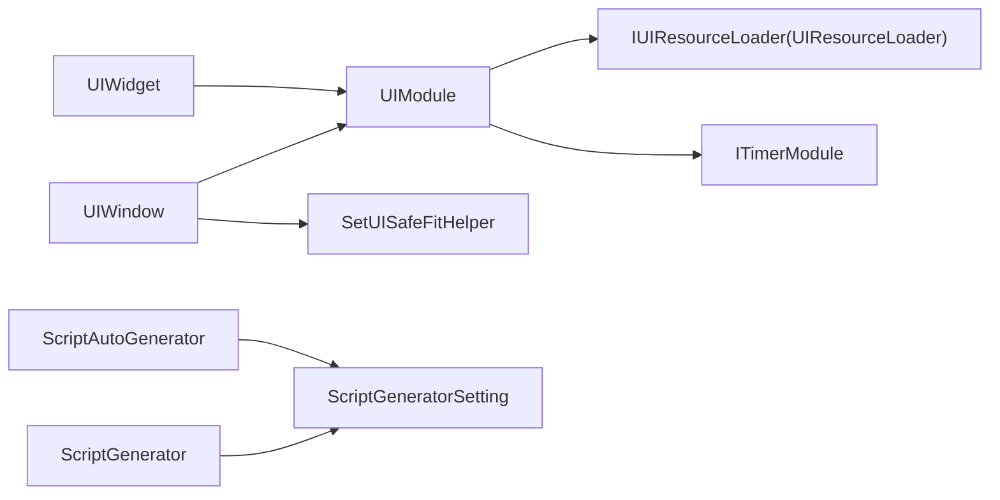

# UI 框架

<cite>
**本文引用的文件**   
- [UIBase.cs](file://UnityProject/Assets/GameScripts/HotFix/GameLogic/Module/UIModule/UIBase.cs)
- [UIWidget.cs](file://UnityProject/Assets/GameScripts/HotFix/GameLogic/Module/UIModule/UIWidget.cs)
- [UIWindow.cs](file://UnityProject/Assets/GameScripts/HotFix/GameLogic/Module/UIModule/UIWindow.cs)
- [UIModule.cs](file://UnityProject/Assets/GameScripts/HotFix/GameLogic/Module/UIModule/UIModule.cs)
- [WindowAttribute.cs](file://UnityProject/Assets/GameScripts/HotFix/GameLogic/Module/UIModule/WindowAttribute.cs)
- [SetUISafeFitHelper.cs](file://UnityProject/Assets/GameScripts/HotFix/GameLogic/Module/UIModule/SetUISafeFitHelper.cs)
- [ScriptGenerator.cs](file://UnityProject/Assets/Editor/UIScriptGenerator/ScriptGenerator.cs)
- [ScriptAutoGenerator.cs](file://UnityProject/Assets/Editor/UIScriptGenerator/ScriptAutoGenerator.cs)
</cite>

## 目录
1. [简介](#简介)
2. [项目结构](#项目结构)
3. [核心组件](#核心组件)
4. [架构总览](#架构总览)
5. [详细组件分析](#详细组件分析)
6. [依赖关系分析](#依赖关系分析)
7. [性能与内存优化](#性能与内存优化)
8. [故障排查指南](#故障排查指南)
9. [结论](#结论)
10. [附录：完整开发流程](#附录完整开发流程)

## 简介
本文件系统性梳理 TEngine 的纯 C# UI 框架，重点解释 UIWindow 与 UIWidget 的分层设计、脱离 Mono 生命周期的运行机制、窗口生命周期与显示隐藏策略、全屏面板管理、脚本自动生成工具（预制体到代码映射）、事件绑定、数据绑定、动画控制方式，以及性能优化、内存管理与跨平台适配的最佳实践。文档同时提供从预制体制作到逻辑绑定的端到端工作流程说明。

## 项目结构
UI 框架位于热更模块中，核心由基类、窗口、组件、管理器与属性配置组成；编辑器侧提供脚本生成工具，将 Unity 预制体节点自动映射为可运行的 C# 代码。

图示来源
- [UIBase.cs:18-116](file://UnityProject/Assets/GameScripts/HotFix/GameLogic/Module/UIModule/UIBase.cs#L18-L116)
- [UIWidget.cs:7-34](file://UnityProject/Assets/GameScripts/HotFix/GameLogic/Module/UIModule/UIWidget.cs#L7-L34)
- [UIWindow.cs:11-35](file://UnityProject/Assets/GameScripts/HotFix/GameLogic/Module/UIModule/UIWindow.cs#L11-L35)
- [UIModule.cs:15-31](file://UnityProject/Assets/GameScripts/HotFix/GameLogic/Module/UIModule/UIModule.cs#L15-L31)
- [WindowAttribute.cs:8-21](file://UnityProject/Assets/GameScripts/HotFix/GameLogic/Module/UIModule/WindowAttribute.cs#L8-L21)
- [SetUISafeFitHelper.cs:5-44](file://UnityProject/Assets/GameScripts/HotFix/GameLogic/Module/UIModule/SetUISafeFitHelper.cs#L5-L44)
- [ScriptGenerator.cs:8-135](file://UnityProject/Assets/Editor/UIScriptGenerator/ScriptGenerator.cs#L8-L135)
- [ScriptAutoGenerator.cs:14-254](file://UnityProject/Assets/Editor/UIScriptGenerator/ScriptAutoGenerator.cs#L14-L254)

章节来源
- [UIBase.cs:18-116](file://UnityProject/Assets/GameScripts/HotFix/GameLogic/Module/UIModule/UIBase.cs#L18-L116)
- [UIModule.cs:15-31](file://UnityProject/Assets/GameScripts/HotFix/GameLogic/Module/UIModule/UIModule.cs#L15-L31)

## 核心组件
- UIBase：所有 UI 实体的抽象基类，定义生命周期钩子、事件系统、子节点管理、查找辅助方法、动态创建 UIWidget 的工具方法等。
- UIWidget：窗口内嵌的可复用 UI 组件，支持按路径/资源/类型创建，维护可见性与层级排序，具备独立更新与销毁流程。
- UIWindow：顶层 UI 窗口，封装 Canvas、GraphicRaycaster、层级深度、可见性、交互性、全屏标志、刘海屏适配等。
- UIModule：UI 管理器，负责窗口堆栈、加载、显示/隐藏/关闭、全屏遮挡处理、层级排序、Update 驱动、安全区域设置等。
- WindowAttribute：标记窗口的层级、资源地址、是否全屏、是否内置资源、隐藏后延迟关闭时间等元信息。
- SetUISafeFitHelper：移动设备刘海屏/底部安全区适配工具。

章节来源
- [UIBase.cs:18-608](file://UnityProject/Assets/GameScripts/HotFix/GameLogic/Module/UIModule/UIBase.cs#L18-L608)
- [UIWidget.cs:7-315](file://UnityProject/Assets/GameScripts/HotFix/GameLogic/Module/UIModule/UIWidget.cs#L7-L315)
- [UIWindow.cs:11-524](file://UnityProject/Assets/GameScripts/HotFix/GameLogic/Module/UIModule/UIWindow.cs#L11-L524)
- [UIModule.cs:15-732](file://UnityProject/Assets/GameScripts/HotFix/GameLogic/Module/UIModule/UIModule.cs#L15-L732)
- [WindowAttribute.cs:8-78](file://UnityProject/Assets/GameScripts/HotFix/GameLogic/Module/UIModule/WindowAttribute.cs#L8-L78)
- [SetUISafeFitHelper.cs:5-176](file://UnityProject/Assets/GameScripts/HotFix/GameLogic/Module/UIModule/SetUISafeFitHelper.cs#L5-L176)

## 架构总览
UI 框架采用“管理器 + 抽象基类 + 具体窗口/组件”的分层架构。UIModule 作为单例管理器，持有窗口堆栈并驱动每帧更新；UIWindow 代表一个完整的界面，UIWidget 表示界面内的可复用组件。两者均继承自 UIBase，共享生命周期、事件系统与通用能力。编辑器侧通过脚本生成器将 Unity 预制体节点映射为代码，实现“所见即所得”的 UI 开发体验。

图示来源
- [UIBase.cs:18-608](file://UnityProject/Assets/GameScripts/HotFix/GameLogic/Module/UIModule/UIBase.cs#L18-L608)
- [UIWidget.cs:7-315](file://UnityProject/Assets/GameScripts/HotFix/GameLogic/Module/UIModule/UIWidget.cs#L7-L315)
- [UIWindow.cs:11-524](file://UnityProject/Assets/GameScripts/HotFix/GameLogic/Module/UIModule/UIWindow.cs#L11-L524)
- [UIModule.cs:15-732](file://UnityProject/Assets/GameScripts/HotFix/GameLogic/Module/UIModule/UIModule.cs#L15-L732)

## 详细组件分析

### UIWindow 与 UIWidget 分层设计
- 职责分离：UIWindow 负责整窗的生命周期、Canvas 与 Raycaster 管理、层级深度与可见性、全屏遮挡、安全区适配；UIWidget 负责单个 UI 元素的创建、可见性、子树更新与销毁。
- 生命周期解耦：两者均不依赖 MonoBehaviour 生命周期，而是通过 UIModule 的 Update 驱动与内部钩子（OnCreate/OnRefresh/OnUpdate/OnDestroy）完成初始化与刷新。
- 更新机制：UIWindow 与 UIWidget 各自维护需要更新的子节点列表，避免全量遍历，提升性能。

图示来源
- [UIWindow.cs:356-425](file://UnityProject/Assets/GameScripts/HotFix/GameLogic/Module/UIModule/UIWindow.cs#L356-L425)
- [UIWidget.cs:71-140](file://UnityProject/Assets/GameScripts/HotFix/GameLogic/Module/UIModule/UIWidget.cs#L71-L140)

章节来源
- [UIWindow.cs:11-524](file://UnityProject/Assets/GameScripts/HotFix/GameLogic/Module/UIModule/UIWindow.cs#L11-L524)
- [UIWidget.cs:7-315](file://UnityProject/Assets/GameScripts/HotFix/GameLogic/Module/UIModule/UIWidget.cs#L7-L315)

### 窗口生命周期与显示隐藏机制
- 打开流程：UIModule.ShowUI -> TryGetWindow -> Push -> InternalLoad -> OnWindowPrepare -> InternalCreate -> InternalRefresh -> OnSortWindowDepth -> OnSetWindowVisible。
- 显示/隐藏：Visible 属性切换 Canvas 所在 Layer 与 GraphicRaycaster 状态；FullScreen 窗口会遮挡其后的窗口。
- 关闭流程：CloseUI -> InternalDestroy -> Pop -> OnSortWindowDepth -> OnSetWindowVisible。
- 延迟隐藏：HideUI 支持设置 HideTimeToClose，到时自动 CloseUI。

图示来源
- [UIModule.cs:298-336](file://UnityProject/Assets/GameScripts/HotFix/GameLogic/Module/UIModule/UIModule.cs#L298-L336)
- [UIModule.cs:472-516](file://UnityProject/Assets/GameScripts/HotFix/GameLogic/Module/UIModule/UIModule.cs#L472-L516)
- [UIWindow.cs:314-349](file://UnityProject/Assets/GameScripts/HotFix/GameLogic/Module/UIModule/UIWindow.cs#L314-L349)
- [UIWindow.cs:464-502](file://UnityProject/Assets/GameScripts/HotFix/GameLogic/Module/UIModule/UIWindow.cs#L464-L502)

章节来源
- [UIModule.cs:298-336](file://UnityProject/Assets/GameScripts/HotFix/GameLogic/Module/UIModule/UIModule.cs#L298-L336)
- [UIModule.cs:472-516](file://UnityProject/Assets/GameScripts/HotFix/GameLogic/Module/UIModule/UIModule.cs#L472-L516)
- [UIWindow.cs:314-349](file://UnityProject/Assets/GameScripts/HotFix/GameLogic/Module/UIModule/UIWindow.cs#L314-L349)
- [UIWindow.cs:464-502](file://UnityProject/Assets/GameScripts/HotFix/GameLogic/Module/UIModule/UIWindow.cs#L464-L502)

### 全屏面板管理
- 全屏标志：UIWindow.FullScreen 标记是否为全屏窗口。
- 遮挡逻辑：OnSetWindowVisible 在遇到第一个已准备且全屏的窗口时，将其后的窗口全部隐藏，确保全屏面板始终在最上层。
- 层级排序：OnSortWindowDepth 根据窗口层级计算 Canvas.sortingOrder，保证同层窗口顺序正确。

图示来源
- [UIModule.cs:493-516](file://UnityProject/Assets/GameScripts/HotFix/GameLogic/Module/UIModule/UIModule.cs#L493-L516)
- [UIWindow.cs:143-188](file://UnityProject/Assets/GameScripts/HotFix/GameLogic/Module/UIModule/UIWindow.cs#L143-L188)

章节来源
- [UIModule.cs:493-516](file://UnityProject/Assets/GameScripts/HotFix/GameLogic/Module/UIModule/UIModule.cs#L493-L516)
- [UIWindow.cs:143-188](file://UnityProject/Assets/GameScripts/HotFix/GameLogic/Module/UIModule/UIWindow.cs#L143-L188)

### UI 脚本自动生成工具
- 两种模式：
  - 剪贴板模式：ScriptGenerator.Generate 将选中根节点下的 UI 元素解析为字段声明、绑定代码、事件回调，复制到剪贴板供开发者粘贴。
  - 文件模式：ScriptAutoGenerator.GenerateCSharpScript 直接生成 .cs 文件（支持 partial 类），并可额外生成实现文件（GenerateImpCSharpScript）。
- 规则匹配：依据 ScriptGeneratorSetting 中的规则（uiElementRegex -> componentName），识别 Button/Toggle/Slider/Text/Image 等组件或自定义 UIWidget。
- 变量命名：支持下划线前缀或 m_ 前缀的代码风格，自动规范化字段名。
- 事件绑定：自动生成 onClick/onValueChanged 监听，支持 UniTask 异步回调。
- 预制体到代码映射：
  - 根节点为窗口：生成继承 UIWindow 的类，并附加 [Window] 属性（location 默认文件名）。
  - 根节点以 Widget 前缀开头：生成继承 UIWidget 的局部类，便于复用。
  - 子节点按规则生成字段与绑定语句，UIWidget 类型使用 CreateWidget 创建。

图示来源
- [ScriptGenerator.cs:60-135](file://UnityProject/Assets/Editor/UIScriptGenerator/ScriptGenerator.cs#L60-L135)
- [ScriptGenerator.cs:137-332](file://UnityProject/Assets/Editor/UIScriptGenerator/ScriptGenerator.cs#L137-L332)
- [ScriptAutoGenerator.cs:89-254](file://UnityProject/Assets/Editor/UIScriptGenerator/ScriptAutoGenerator.cs#L89-L254)
- [ScriptAutoGenerator.cs:258-363](file://UnityProject/Assets/Editor/UIScriptGenerator/ScriptAutoGenerator.cs#L258-L363)

章节来源
- [ScriptGenerator.cs:60-135](file://UnityProject/Assets/Editor/UIScriptGenerator/ScriptGenerator.cs#L60-L135)
- [ScriptGenerator.cs:137-332](file://UnityProject/Assets/Editor/UIScriptGenerator/ScriptGenerator.cs#L137-L332)
- [ScriptAutoGenerator.cs:89-254](file://UnityProject/Assets/Editor/UIScriptGenerator/ScriptAutoGenerator.cs#L89-L254)
- [ScriptAutoGenerator.cs:258-363](file://UnityProject/Assets/Editor/UIScriptGenerator/ScriptAutoGenerator.cs#L258-L363)

### UI 事件绑定、数据绑定与动画控制
- 事件绑定：
  - 手动：通过 UIBase.AddUIEvent 注册/移除全局事件，内部使用 GameEventMgr 与对象池管理实例。
  - 自动生成：脚本生成器为 Button/Toggle/Slider/Dropdown 等生成监听绑定与回调桩函数，支持 UniTask 异步回调。
- 数据绑定：
  - 通过生成的字段与绑定代码访问 UI 元素，结合业务逻辑进行赋值/读取。
  - 可使用 UIBindComponent（文件模式）集中管理绑定索引，减少 Find 开销。
- 动画控制：
  - 生成器支持 AnimationCurve 字段绑定，配合外部动画系统或 Tween 库驱动。
  - 可在 OnUpdate 中按需更新动画参数，或使用 UIWidget 的可见性控制显隐。

章节来源
- [UIBase.cs:282-332](file://UnityProject/Assets/GameScripts/HotFix/GameLogic/Module/UIModule/UIBase.cs#L282-L332)
- [ScriptGenerator.cs:297-332](file://UnityProject/Assets/Editor/UIScriptGenerator/ScriptGenerator.cs#L297-L332)
- [ScriptAutoGenerator.cs:318-363](file://UnityProject/Assets/Editor/UIScriptGenerator/ScriptAutoGenerator.cs#L318-L363)

### 跨平台适配与安全区
- 屏幕安全区：UIModule.ApplyScreenSafeRect 将屏幕安全区转换为 UGUI 坐标并设置 CanvasScaler 与 RectTransform.offsetMin/offsetMax。
- 刘海屏适配：SetUISafeFitHelper 针对顶部挖孔与底部手势条进行偏移补偿，并提供 SetUINotFit 让特定节点不受适配影响。
- 模拟异形屏：UIModule.SimulateIPhoneXNotchScreen 用于测试不同方向的安全区效果。

章节来源
- [UIModule.cs:118-174](file://UnityProject/Assets/GameScripts/HotFix/GameLogic/Module/UIModule/UIModule.cs#L118-L174)
- [SetUISafeFitHelper.cs:48-128](file://UnityProject/Assets/GameScripts/HotFix/GameLogic/Module/UIModule/SetUISafeFitHelper.cs#L48-L128)
- [UIWindow.cs:247-298](file://UnityProject/Assets/GameScripts/HotFix/GameLogic/Module/UIModule/UIWindow.cs#L247-L298)

## 依赖关系分析
- UIModule 依赖 IUIResourceLoader（默认实现 UIResourceLoader）进行资源加载，依赖 Timer 模块进行延迟隐藏。
- UIWindow 依赖 UIModule 获取 UIRoot 与资源加载接口，依赖 SetUISafeFitHelper 进行安全区适配。
- UIWidget 依赖 UIModule.Resource 进行按路径创建，依赖父级 UIBase 的管理能力。
- 编辑器脚本生成器依赖 Unity Editor API 与配置项 ScriptGeneratorSetting。

图示来源
- [UIModule.cs:30-31](file://UnityProject/Assets/GameScripts/HotFix/GameLogic/Module/UIModule/UIModule.cs#L30-L31)
- [UIWindow.cs:314-336](file://UnityProject/Assets/GameScripts/HotFix/GameLogic/Module/UIModule/UIWindow.cs#L314-L336)
- [UIWidget.cs:164-179](file://UnityProject/Assets/GameScripts/HotFix/GameLogic/Module/UIModule/UIWidget.cs#L164-L179)
- [ScriptGenerator.cs:60-135](file://UnityProject/Assets/Editor/UIScriptGenerator/ScriptGenerator.cs#L60-L135)
- [ScriptAutoGenerator.cs:89-254](file://UnityProject/Assets/Editor/UIScriptGenerator/ScriptAutoGenerator.cs#L89-L254)

章节来源
- [UIModule.cs:30-31](file://UnityProject/Assets/GameScripts/HotFix/GameLogic/Module/UIModule/UIModule.cs#L30-L31)
- [UIWindow.cs:314-336](file://UnityProject/Assets/GameScripts/HotFix/GameLogic/Module/UIModule/UIWindow.cs#L314-L336)
- [UIWidget.cs:164-179](file://UnityProject/Assets/GameScripts/HotFix/GameLogic/Module/UIModule/UIWidget.cs#L164-L179)

## 性能与内存优化
- 更新优化：UIWindow/UIWidget 仅对需要更新的子节点执行 OnUpdate，并通过 _updateListValid 缓存更新列表，避免每帧重建。
- 层级排序优化：仅在 Visible 变化或 Depth 设置时触发 _OnSortDepth，并批量同步子 Canvas.sortingOrder。
- 资源加载：支持 Resources 与 AB 两套路径，优先异步加载，避免阻塞主线程。
- 对象池：GameEventMgr 通过 MemoryPool 分配与回收，降低 GC 压力。
- 列表管理：UIBase 提供 AdjustIconNum/AsyncAdjustIconNum 批量创建/销毁 UIWidget，支持分帧异步创建，避免卡顿。
- 内存释放：InternalDestroy/OnDestroyWidget 统一清理事件、子节点与 GameObject，防止悬挂引用。

章节来源
- [UIWindow.cs:356-425](file://UnityProject/Assets/GameScripts/HotFix/GameLogic/Module/UIModule/UIWindow.cs#L356-L425)
- [UIWidget.cs:71-140](file://UnityProject/Assets/GameScripts/HotFix/GameLogic/Module/UIModule/UIWidget.cs#L71-L140)
- [UIBase.cs:477-604](file://UnityProject/Assets/GameScripts/HotFix/GameLogic/Module/UIModule/UIBase.cs#L477-L604)
- [UIBase.cs:282-332](file://UnityProject/Assets/GameScripts/HotFix/GameLogic/Module/UIModule/UIBase.cs#L282-L332)
- [UIWindow.cs:427-458](file://UnityProject/Assets/GameScripts/HotFix/GameLogic/Module/UIModule/UIWindow.cs#L427-L458)
- [UIWidget.cs:276-313](file://UnityProject/Assets/GameScripts/HotFix/GameLogic/Module/UIModule/UIWidget.cs#L276-L313)

## 故障排查指南
- 未找到 UIRoot：UIModule.OnInit 会在场景不存在 UIRoot 时报错，请检查场景根节点名称与层级。
- Canvas 缺失：UIWindow.Handle_Completed 要求根节点包含 Canvas，否则抛出异常。
- 重复窗口：Push 时会检测同名窗口，重复打开将抛异常，需先关闭或复用已有窗口。
- 事件泄漏：确保在 OnDestroy/OnDestroyWidget 中移除事件，避免残留回调导致崩溃。
- 安全区异常：若 UI 布局错位，检查 ApplyScreenSafeRect 与 SetUISafeFitHelper 的配置与调用时机。

章节来源
- [UIModule.cs:49-61](file://UnityProject/Assets/GameScripts/HotFix/GameLogic/Module/UIModule/UIModule.cs#L49-L61)
- [UIWindow.cs:484-493](file://UnityProject/Assets/GameScripts/HotFix/GameLogic/Module/UIModule/UIWindow.cs#L484-L493)
- [UIModule.cs:666-704](file://UnityProject/Assets/GameScripts/HotFix/GameLogic/Module/UIModule/UIModule.cs#L666-L704)
- [UIBase.cs:324-332](file://UnityProject/Assets/GameScripts/HotFix/GameLogic/Module/UIModule/UIBase.cs#L324-L332)
- [SetUISafeFitHelper.cs:48-128](file://UnityProject/Assets/GameScripts/HotFix/GameLogic/Module/UIModule/SetUISafeFitHelper.cs#L48-L128)

## 结论
TEngine UI 框架通过纯 C# 抽象与 UIModule 管理器实现了与 Mono 生命周期解耦的 UI 体系。UIWindow 与 UIWidget 的职责清晰、更新高效、生命周期可控；编辑器脚本生成器将 Unity 预制体快速映射为可运行代码，显著提升开发效率。配合安全区适配、全屏遮挡、延迟隐藏与对象池/内存池机制，可满足多平台、高性能的 UI 需求。

## 附录：完整开发流程
- 预制体制作：
  - 在 Unity 中搭建 UI 层级，合理命名节点以便脚本生成器识别。
  - 如需复用组件，以 Widget 前缀命名根节点，生成 UIWidget 子类。
- 生成代码：
  - 选择根节点，使用菜单生成代码（剪贴板或文件模式）。
  - 根据需要启用 UniTask 异步回调与 partial 类实现分离。
- 逻辑绑定：
  - 在生成的类中实现业务逻辑，使用字段访问 UI 元素。
  - 通过 UIBase.AddUIEvent 订阅全局事件，或在生成的回调中处理交互。
- 窗口管理：
  - 使用 UIModule.ShowUI/ShowUIAsync 打开窗口，CloseUI/HideUI 关闭或隐藏。
  - 通过 WindowAttribute 配置层级、资源地址、全屏与延迟关闭时间。
- 适配与优化：
  - 调用 SetUIFit 进行刘海屏/底部安全区适配。
  - 使用 AdjustIconNum/AsyncAdjustIconNum 批量管理列表项，避免卡顿。
  - 在 OnUpdate 中谨慎更新，必要时使用 UIWidget 的 Visible 控制显隐。

章节来源
- [ScriptGenerator.cs:60-135](file://UnityProject/Assets/Editor/UIScriptGenerator/ScriptGenerator.cs#L60-L135)
- [ScriptAutoGenerator.cs:89-254](file://UnityProject/Assets/Editor/UIScriptGenerator/ScriptAutoGenerator.cs#L89-L254)
- [WindowAttribute.cs:45-76](file://UnityProject/Assets/GameScripts/HotFix/GameLogic/Module/UIModule/WindowAttribute.cs#L45-L76)
- [UIWindow.cs:247-298](file://UnityProject/Assets/GameScripts/HotFix/GameLogic/Module/UIModule/UIWindow.cs#L247-L298)
- [UIBase.cs:477-604](file://UnityProject/Assets/GameScripts/HotFix/GameLogic/Module/UIModule/UIBase.cs#L477-L604)