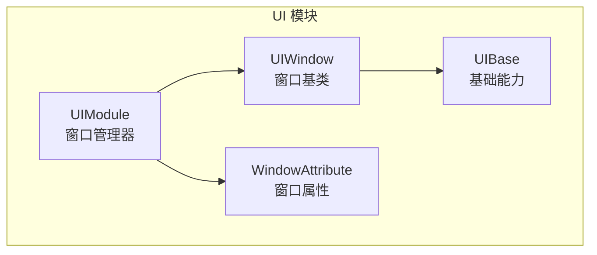
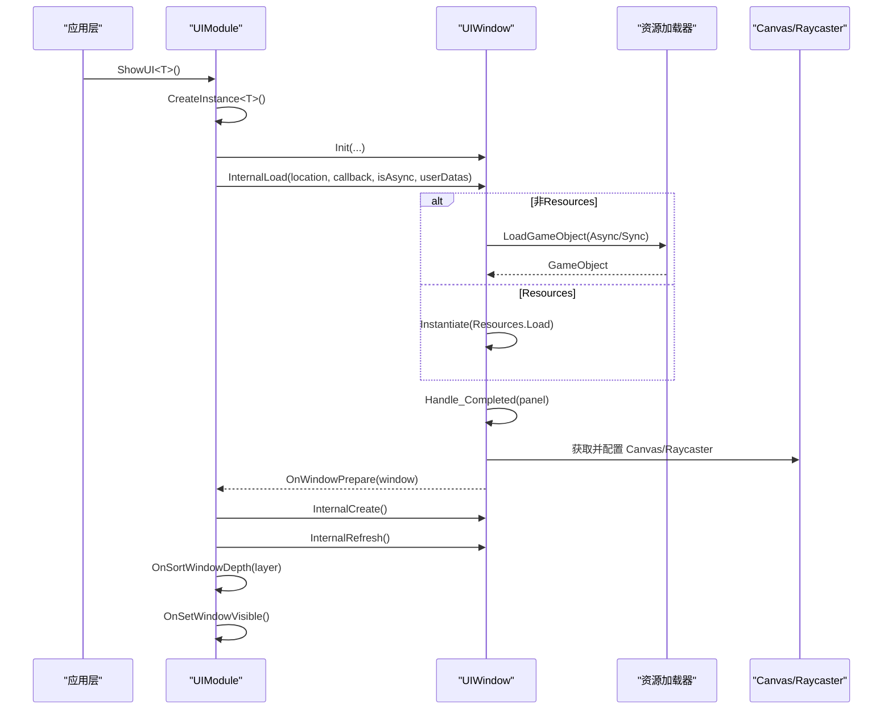
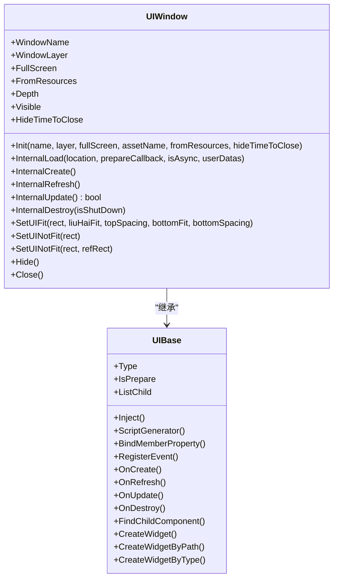
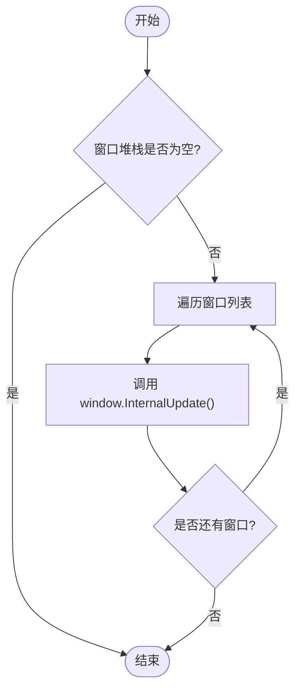
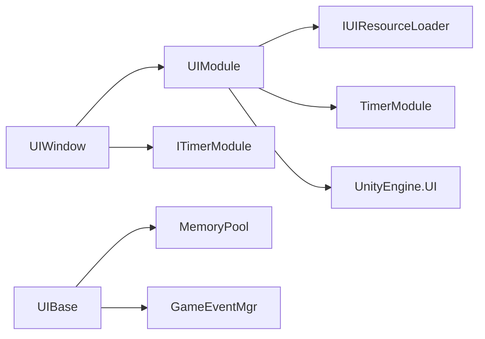

# UI 窗口系统

<cite>
**本文引用的文件**   
- [UIWindow.cs](file://UnityProject/Assets/GameScripts/HotFix/GameLogic/Module/UIModule/UIWindow.cs)
- [UIBase.cs](file://UnityProject/Assets/GameScripts/HotFix/GameLogic/Module/UIModule/UIBase.cs)
- [UIModule.cs](file://UnityProject/Assets/GameScripts/HotFix/GameLogic/Module/UIModule/UIModule.cs)
- [WindowAttribute.cs](file://UnityProject/Assets/GameScripts/HotFix/GameLogic/Module/UIModule/WindowAttribute.cs)
</cite>

## 目录
1. [简介](#简介)
2. [项目结构](#项目结构)
3. [核心组件](#核心组件)
4. [架构总览](#架构总览)
5. [详细组件分析](#详细组件分析)
6. [依赖关系分析](#依赖关系分析)
7. [性能考量](#性能考量)
8. [故障排查指南](#故障排查指南)
9. [结论](#结论)
10. [附录：开发示例与最佳实践](#附录开发示例与最佳实践)

## 简介
本文件系统性梳理 TEngine UI 窗口系统的实现与设计，重点围绕 UIWindow 基类、UIModule 管理器、UIBase 基础能力以及 WindowAttribute 配置属性展开。文档覆盖以下主题：
- 窗口生命周期管理（Init、InternalLoad、InternalCreate、InternalDestroy）
- 显示隐藏机制、全屏面板管理与层级控制（Depth、Visible、Interactable）
- 资源加载流程（异步/同步、资源缓存、内存管理）
- 刘海屏适配与屏幕适配方案
- 事件处理、动画控制与性能优化策略
- 完整窗口开发示例与最佳实践

## 项目结构
UI 窗口系统位于 GameLogic 模块的 UIModule 子命名空间下，核心文件包括：
- UIBase：UI 基础抽象，提供组件查找、事件管理、Widget 创建等通用能力
- UIWindow：窗口基类，封装 Canvas/Raycaster、可见性、层级、资源加载与销毁
- UIModule：UI 管理器，负责窗口堆栈、层级排序、可见性调度、安全区域设置、更新循环
- WindowAttribute：窗口元数据（层级、资源地址、是否全屏、是否从 Resources 加载、自动关闭延时）

**图示来源**
- [UIModule.cs:15-31](file://UnityProject/Assets/GameScripts/HotFix/GameLogic/Module/UIModule/UIModule.cs#L15-L31)
- [UIBase.cs:18-45](file://UnityProject/Assets/GameScripts/HotFix/GameLogic/Module/UIModule/UIBase.cs#L18-L45)
- [UIWindow.cs:11-75](file://UnityProject/Assets/GameScripts/HotFix/GameLogic/Module/UIModule/UIWindow.cs#L11-L75)
- [WindowAttribute.cs:8-77](file://UnityProject/Assets/GameScripts/HotFix/GameLogic/Module/UIModule/WindowAttribute.cs#L8-L77)

**章节来源**
- [UIModule.cs:15-31](file://UnityProject/Assets/GameScripts/HotFix/GameLogic/Module/UIModule/UIModule.cs#L15-L31)
- [UIBase.cs:18-45](file://UnityProject/Assets/GameScripts/HotFix/GameLogic/Module/UIModule/UIBase.cs#L18-L45)
- [UIWindow.cs:11-75](file://UnityProject/Assets/GameScripts/HotFix/GameLogic/Module/UIModule/UIWindow.cs#L11-L75)
- [WindowAttribute.cs:8-77](file://UnityProject/Assets/GameScripts/HotFix/GameLogic/Module/UIModule/WindowAttribute.cs#L8-L77)

## 核心组件
- UIModule：单例 UI 管理器，维护窗口堆栈、层级排序、可见性调度、安全区域设置、全局更新回调；提供 Show/Hide/Close 等 API。
- UIWindow：继承自 UIBase，封装窗口实例的生命周期、Canvas/Raycaster 管理、可见性与交互控制、深度排序、刘海屏适配、资源加载与销毁。
- UIBase：提供 UI 通用能力，如依赖注入、脚本生成、成员绑定、事件注册、Update 分发、Widget 动态创建与回收。
- WindowAttribute：声明式配置窗口层级、资源定位、是否全屏、是否从 Resources 加载、隐藏后自动关闭延时。

**章节来源**
- [UIModule.cs:15-31](file://UnityProject/Assets/GameScripts/HotFix/GameLogic/Module/UIModule/UIModule.cs#L15-L31)
- [UIWindow.cs:11-75](file://UnityProject/Assets/GameScripts/HotFix/GameLogic/Module/UIModule/UIWindow.cs#L11-L75)
- [UIBase.cs:18-45](file://UnityProject/Assets/GameScripts/HotFix/GameLogic/Module/UIModule/UIBase.cs#L18-L45)
- [WindowAttribute.cs:8-77](file://UnityProject/Assets/GameScripts/HotFix/GameLogic/Module/UIModule/WindowAttribute.cs#L8-L77)

## 架构总览
下图展示窗口打开到显示的完整调用链，包括管理器初始化、实例化、资源加载、准备回调、创建刷新、层级排序与可见性调度。

**图示来源**
- [UIModule.cs:298-321](file://UnityProject/Assets/GameScripts/HotFix/GameLogic/Module/UIModule/UIModule.cs#L298-L321)
- [UIModule.cs:472-516](file://UnityProject/Assets/GameScripts/HotFix/GameLogic/Module/UIModule/UIModule.cs#L472-L516)
- [UIWindow.cs:314-336](file://UnityProject/Assets/GameScripts/HotFix/GameLogic/Module/UIModule/UIWindow.cs#L314-L336)
- [UIWindow.cs:464-502](file://UnityProject/Assets/GameScripts/HotFix/GameLogic/Module/UIModule/UIWindow.cs#L464-L502)

## 详细组件分析

### UIWindow 基类设计
- 生命周期方法
  - Init：设置窗口名、层级、全屏标志、资源地址、是否从 Resources 加载、隐藏后自动关闭延时
  - InternalLoad：根据 FromResources 分支选择同步/异步加载资源，完成后统一进入 Handle_Completed
  - InternalCreate：执行 Inject、ScriptGenerator、BindMemberProperty、RegisterEvent、OnCreate
  - InternalDestroy：移除事件、销毁子 Widget、释放回调、调用 OnDestroy、销毁面板对象
- 显示与隐藏
  - Visible：通过切换 Canvas 所在 Layer（WINDOW_SHOW_LAYER/WINDOW_HIDE_LAYER）控制显隐，同时联动 Interactable 与 _OnSortDepth
  - Hide/Close：分别调用 UIModule.HideUI/CloseUI
- 层级与可见性
  - Depth：读写 Canvas.sortingOrder，并级联调整子 Canvas 的排序顺序；支持延迟排序标记
  - Interactable：控制 GraphicRaycaster 及其子 Raycaster 的启用状态
- 刘海屏适配
  - SetUIFit/SetUINotFit：基于 SetUISafeFitHelper 对 RectTransform 进行安全区适配或解除适配
- 更新与刷新
  - InternalUpdate：遍历子 Widget 并调用其 InternalUpdate，必要时触发 OnUpdate
  - InternalRefresh：仅触发 OnRefresh

**图示来源**
- [UIBase.cs:18-45](file://UnityProject/Assets/GameScripts/HotFix/GameLogic/Module/UIModule/UIBase.cs#L18-L45)
- [UIBase.cs:136-199](file://UnityProject/Assets/GameScripts/HotFix/GameLogic/Module/UIModule/UIBase.cs#L136-L199)
- [UIBase.cs:241-278](file://UnityProject/Assets/GameScripts/HotFix/GameLogic/Module/UIModule/UIBase.cs#L241-L278)
- [UIBase.cs:336-465](file://UnityProject/Assets/GameScripts/HotFix/GameLogic/Module/UIModule/UIBase.cs#L336-L465)
- [UIWindow.cs:11-75](file://UnityProject/Assets/GameScripts/HotFix/GameLogic/Module/UIModule/UIWindow.cs#L11-L75)
- [UIWindow.cs:87-218](file://UnityProject/Assets/GameScripts/HotFix/GameLogic/Module/UIModule/UIWindow.cs#L87-L218)
- [UIWindow.cs:237-245](file://UnityProject/Assets/GameScripts/HotFix/GameLogic/Module/UIModule/UIWindow.cs#L237-L245)
- [UIWindow.cs:247-298](file://UnityProject/Assets/GameScripts/HotFix/GameLogic/Module/UIModule/UIWindow.cs#L247-L298)
- [UIWindow.cs:314-354](file://UnityProject/Assets/GameScripts/HotFix/GameLogic/Module/UIModule/UIWindow.cs#L314-L354)
- [UIWindow.cs:356-458](file://UnityProject/Assets/GameScripts/HotFix/GameLogic/Module/UIModule/UIWindow.cs#L356-L458)
- [UIWindow.cs:504-522](file://UnityProject/Assets/GameScripts/HotFix/GameLogic/Module/UIModule/UIWindow.cs#L504-L522)

**章节来源**
- [UIWindow.cs:87-218](file://UnityProject/Assets/GameScripts/HotFix/GameLogic/Module/UIModule/UIWindow.cs#L87-L218)
- [UIWindow.cs:237-245](file://UnityProject/Assets/GameScripts/HotFix/GameLogic/Module/UIModule/UIWindow.cs#L237-L245)
- [UIWindow.cs:247-298](file://UnityProject/Assets/GameScripts/HotFix/GameLogic/Module/UIModule/UIWindow.cs#L247-L298)
- [UIWindow.cs:314-354](file://UnityProject/Assets/GameScripts/HotFix/GameLogic/Module/UIModule/UIWindow.cs#L314-L354)
- [UIWindow.cs:356-458](file://UnityProject/Assets/GameScripts/HotFix/GameLogic/Module/UIModule/UIWindow.cs#L356-L458)
- [UIWindow.cs:464-502](file://UnityProject/Assets/GameScripts/HotFix/GameLogic/Module/UIModule/UIWindow.cs#L464-L502)
- [UIWindow.cs:504-522](file://UnityProject/Assets/GameScripts/HotFix/GameLogic/Module/UIModule/UIWindow.cs#L504-L522)

### UIModule 管理器
- 窗口堆栈与层级
  - Push/Pop：按 WindowLayer 插入与移除，保证同层内顺序
  - OnSortWindowDepth：为同层窗口分配递增 Depth（基于 LAYER_DEEP 与 WINDOW_DEEP）
  - OnSetWindowVisible：从栈顶向下扫描，首个 FullScreen 窗口之后的窗口强制隐藏
- 生命周期钩子
  - OnWindowPrepare：在资源加载完成后调用 InternalCreate、InternalRefresh，并排序与可见性调度
- 安全区域与异形屏
  - ApplyScreenSafeRect：将屏幕安全区映射到 CanvasScaler 坐标系，设置 UIRoot RectTransform 的 offsetMin/offsetMax
  - SimulateIPhoneXNotchScreen：模拟 iPhone X 刘海屏安全区
- 更新循环
  - OnUpdate：遍历窗口调用 InternalUpdate

**图示来源**
- [UIModule.cs:712-730](file://UnityProject/Assets/GameScripts/HotFix/GameLogic/Module/UIModule/UIModule.cs#L712-L730)

**章节来源**
- [UIModule.cs:49-94](file://UnityProject/Assets/GameScripts/HotFix/GameLogic/Module/UIModule/UIModule.cs#L49-L94)
- [UIModule.cs:116-176](file://UnityProject/Assets/GameScripts/HotFix/GameLogic/Module/UIModule/UIModule.cs#L116-L176)
- [UIModule.cs:472-516](file://UnityProject/Assets/GameScripts/HotFix/GameLogic/Module/UIModule/UIModule.cs#L472-L516)
- [UIModule.cs:666-710](file://UnityProject/Assets/GameScripts/HotFix/GameLogic/Module/UIModule/UIModule.cs#L666-L710)
- [UIModule.cs:712-730](file://UnityProject/Assets/GameScripts/HotFix/GameLogic/Module/UIModule/UIModule.cs#L712-L730)

### WindowAttribute 配置属性
- 字段说明
  - WindowLayer：窗口层级（支持 int 与 UILayer 枚举）
  - Location：资源定位地址（为空则使用类型名）
  - FullScreen：是否全屏
  - FromResources：是否从 Unity Resources 加载
  - HideTimeToClose：隐藏后自动关闭延时（秒）
- 构造重载
  - 支持多种组合参数，便于不同场景快速配置

**章节来源**
- [WindowAttribute.cs:8-77](file://UnityProject/Assets/GameScripts/HotFix/GameLogic/Module/UIModule/WindowAttribute.cs#L8-L77)

## 依赖关系分析
- UIModule 依赖
  - IUIResourceLoader：通过 Resource 接口加载 GameObject（异步/同步）
  - GameModule.Timer：用于隐藏后自动关闭计时器
  - UnityEngine.UI：Canvas、GraphicRaycaster、CanvasScaler 等
- UIWindow 依赖
  - UIModule.Resource：资源加载
  - ModuleSystem.GetModule<ITimerModule>：取消隐藏计时器
- UIBase 依赖
  - MemoryPool：GameEventMgr 池化复用
  - TEngine.GameEventMgr：事件总线

**图示来源**
- [UIModule.cs:30-31](file://UnityProject/Assets/GameScripts/HotFix/GameLogic/Module/UIModule/UIModule.cs#L30-L31)
- [UIModule.cs:411-414](file://UnityProject/Assets/GameScripts/HotFix/GameLogic/Module/UIModule/UIModule.cs#L411-L414)
- [UIWindow.cs:514-522](file://UnityProject/Assets/GameScripts/HotFix/GameLogic/Module/UIModule/UIWindow.cs#L514-L522)
- [UIBase.cs:284-330](file://UnityProject/Assets/GameScripts/HotFix/GameLogic/Module/UIModule/UIBase.cs#L284-L330)

**章节来源**
- [UIModule.cs:30-31](file://UnityProject/Assets/GameScripts/HotFix/GameLogic/Module/UIModule/UIModule.cs#L30-L31)
- [UIModule.cs:411-414](file://UnityProject/Assets/GameScripts/HotFix/GameLogic/Module/UIModule/UIModule.cs#L411-L414)
- [UIWindow.cs:514-522](file://UnityProject/Assets/GameScripts/HotFix/GameLogic/Module/UIModule/UIWindow.cs#L514-L522)
- [UIBase.cs:284-330](file://UnityProject/Assets/GameScripts/HotFix/GameLogic/Module/UIModule/UIBase.cs#L284-L330)

## 性能考量
- 资源加载
  - 优先使用异步加载避免阻塞主线程；若 FromResources=true，则走 Unity Resources 路径
  - 建议在大型界面中使用异步加载并在加载期间显示 Loading 提示
- 更新优化
  - InternalUpdate 仅在 IsPrepare 且 Visible 时执行；子 Widget 的更新通过 ListChild 聚合，减少每帧遍历开销
  - 未覆写 OnUpdate 时，_hasOverrideUpdate=false，可跳过不必要的更新逻辑
- 层级与可见性
  - Depth 变更会级联更新子 Canvas 的 sortingOrder，建议批量设置以减少重复赋值
  - Visible 切换通过 Layer 切换，配合 GraphicRaycaster 的启用/禁用，避免无效射线检测
- 内存管理
  - InternalDestroy 中销毁子 Widget 与面板对象，并清理回调引用，防止内存泄漏
  - GameEventMgr 通过 MemoryPool 复用，降低 GC 压力

[本节为通用性能指导，不直接分析具体代码文件]

## 故障排查指南
- 找不到 Canvas
  - 现象：Handle_Completed 抛出异常，提示未在面板中找到 Canvas
  - 排查：确保预制体根节点包含 Canvas 组件，且未被禁用
  - 参考位置：[UIWindow.cs:484-493](file://UnityProject/Assets/GameScripts/HotFix/GameLogic/Module/UIModule/UIWindow.cs#L484-L493)
- 窗口未显示或无法交互
  - 现象：Visible=true 但不可点击
  - 排查：检查 GraphicRaycaster 是否启用；确认窗口所在 Layer 为 WINDOW_SHOW_LAYER
  - 参考位置：[UIWindow.cs:143-218](file://UnityProject/Assets/GameScripts/HotFix/GameLogic/Module/UIModule/UIWindow.cs#L143-L218)
- 全屏窗口遮挡下层
  - 现象：全屏窗口出现后，后续窗口被强制隐藏
  - 排查：确认 FullScreen 标志；理解 OnSetWindowVisible 的遮挡逻辑
  - 参考位置：[UIModule.cs:493-516](file://UnityProject/Assets/GameScripts/HotFix/GameLogic/Module/UIModule/UIModule.cs#L493-L516)
- 异形屏布局错位
  - 现象：刘海屏顶部/底部控件被遮挡
  - 排查：调用 ApplyScreenSafeRect 或 SetUIFit；检查 CanvasScaler 是否存在
  - 参考位置：[UIModule.cs:116-176](file://UnityProject/Assets/GameScripts/HotFix/GameLogic/Module/UIModule/UIModule.cs#L116-L176)、[UIWindow.cs:247-298](file://UnityProject/Assets/GameScripts/HotFix/GameLogic/Module/UIModule/UIWindow.cs#L247-L298)

**章节来源**
- [UIWindow.cs:484-493](file://UnityProject/Assets/GameScripts/HotFix/GameLogic/Module/UIModule/UIWindow.cs#L484-L493)
- [UIWindow.cs:143-218](file://UnityProject/Assets/GameScripts/HotFix/GameLogic/Module/UIModule/UIWindow.cs#L143-L218)
- [UIModule.cs:493-516](file://UnityProject/Assets/GameScripts/HotFix/GameLogic/Module/UIModule/UIModule.cs#L493-L516)
- [UIModule.cs:116-176](file://UnityProject/Assets/GameScripts/HotFix/GameLogic/Module/UIModule/UIModule.cs#L116-L176)
- [UIWindow.cs:247-298](file://UnityProject/Assets/GameScripts/HotFix/GameLogic/Module/UIModule/UIWindow.cs#L247-L298)

## 结论
TEngine UI 窗口系统以 UIModule 为核心，UIWindow 为承载单元，UIBase 提供通用能力，WindowAttribute 进行声明式配置。系统通过分层堆栈、Canvas Layer 与 GraphicRaycaster 控制显隐与交互，结合异步资源加载与内存池机制保障性能。刘海屏适配通过安全区映射与辅助工具类实现，满足多端屏幕差异需求。整体架构清晰、扩展性强，适合中大型项目的 UI 管理。

[本节为总结性内容，不直接分析具体代码文件]

## 附录：开发示例与最佳实践

### 窗口开发步骤
- 定义窗口类并添加 WindowAttribute
  - 指定 WindowLayer、Location、FullScreen、FromResources、HideTimeToClose
  - 参考：[WindowAttribute.cs:8-77](file://UnityProject/Assets/GameScripts/HotFix/GameLogic/Module/UIModule/WindowAttribute.cs#L8-L77)
- 实现生命周期回调
  - 重写 OnCreate、OnRefresh、OnUpdate、OnDestroy 等方法
  - 参考：[UIBase.cs:162-199](file://UnityProject/Assets/GameScripts/HotFix/GameLogic/Module/UIModule/UIBase.cs#L162-L199)
- 打开/关闭窗口
  - 使用 UIModule.ShowUI<T>() / CloseUI<T>() / HideUI<T>()
  - 参考：[UIModule.cs:246-321](file://UnityProject/Assets/GameScripts/HotFix/GameLogic/Module/UIModule/UIModule.cs#L246-L321)、[UIModule.cs:366-420](file://UnityProject/Assets/GameScripts/HotFix/GameLogic/Module/UIModule/UIModule.cs#L366-L420)
- 资源加载与缓存
  - 默认通过 IUIResourceLoader 异步加载；如需从 Resources 加载，设置 FromResources=true
  - 参考：[UIWindow.cs:314-336](file://UnityProject/Assets/GameScripts/HotFix/GameLogic/Module/UIModule/UIWindow.cs#L314-L336)
- 刘海屏适配
  - 在 OnCreate 中调用 SetUIFit 或 UIModule.ApplyScreenSafeRect
  - 参考：[UIWindow.cs:247-298](file://UnityProject/Assets/GameScripts/HotFix/GameLogic/Module/UIModule/UIWindow.cs#L247-L298)、[UIModule.cs:116-176](file://UnityProject/Assets/GameScripts/HotFix/GameLogic/Module/UIModule/UIModule.cs#L116-L176)
- 事件处理
  - 使用 AddUIEvent/RemoveAllUIEvent 注册与注销事件
  - 参考：[UIBase.cs:284-330](file://UnityProject/Assets/GameScripts/HotFix/GameLogic/Module/UIModule/UIBase.cs#L284-L330)
- 动画控制
  - 在 OnUpdate 中实现自定义动画逻辑；或使用外部动画库（如 DOTween）
  - 参考：[UIBase.cs:176-187](file://UnityProject/Assets/GameScripts/HotFix/GameLogic/Module/UIModule/UIBase.cs#L176-L187)

### 最佳实践
- 使用异步加载避免卡顿，并在加载期间提供 Loading 提示
- 合理设置 WindowLayer，避免层级混乱导致渲染问题
- 对于频繁创建的子元素，使用 UIBase.CreateWidget* 系列方法与对象池
- 及时注销事件与定时器，避免内存泄漏
- 在全屏窗口场景中，谨慎叠加多个 FullScreen 窗口，避免遮挡逻辑引发意外隐藏

[本节为通用指导，不直接分析具体代码文件]