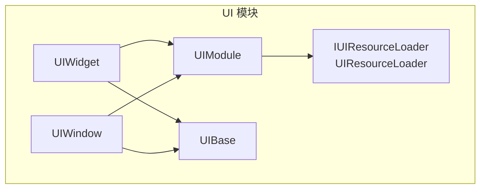
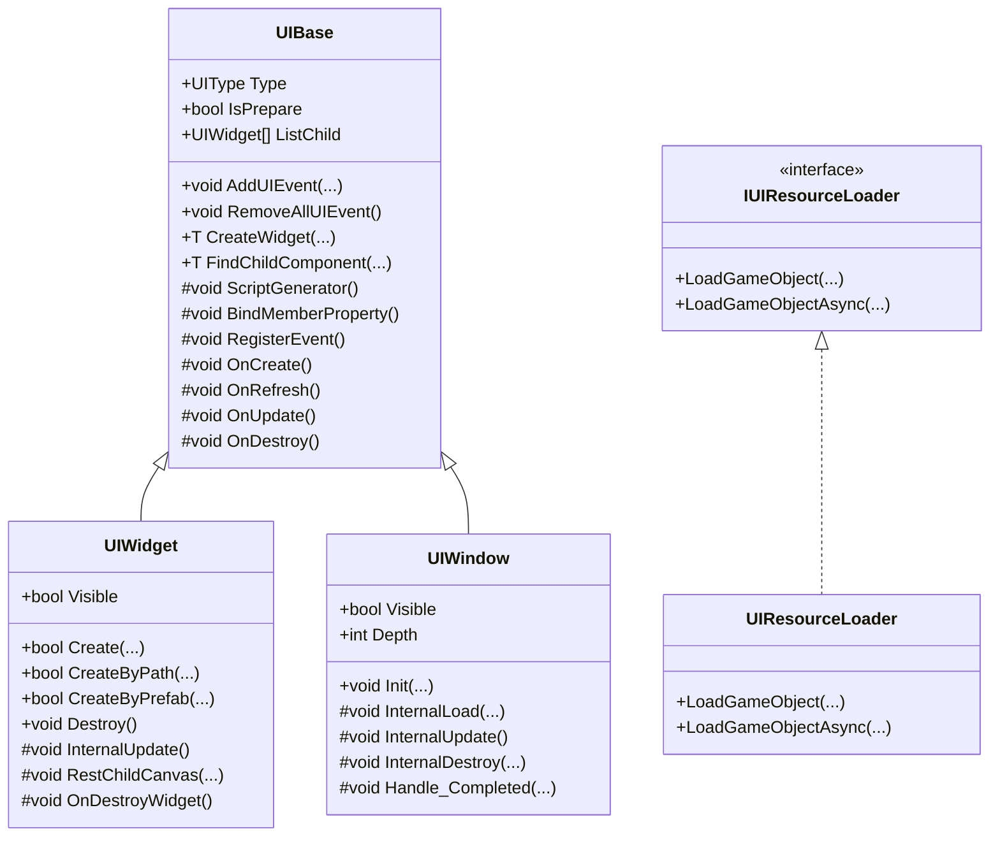
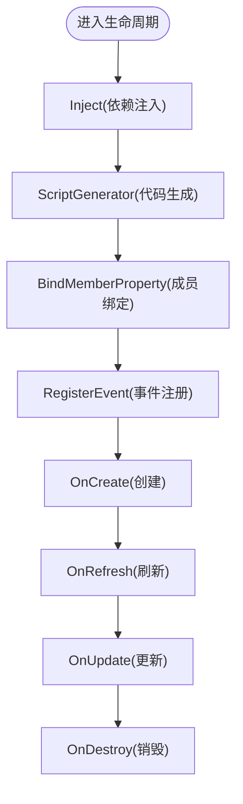
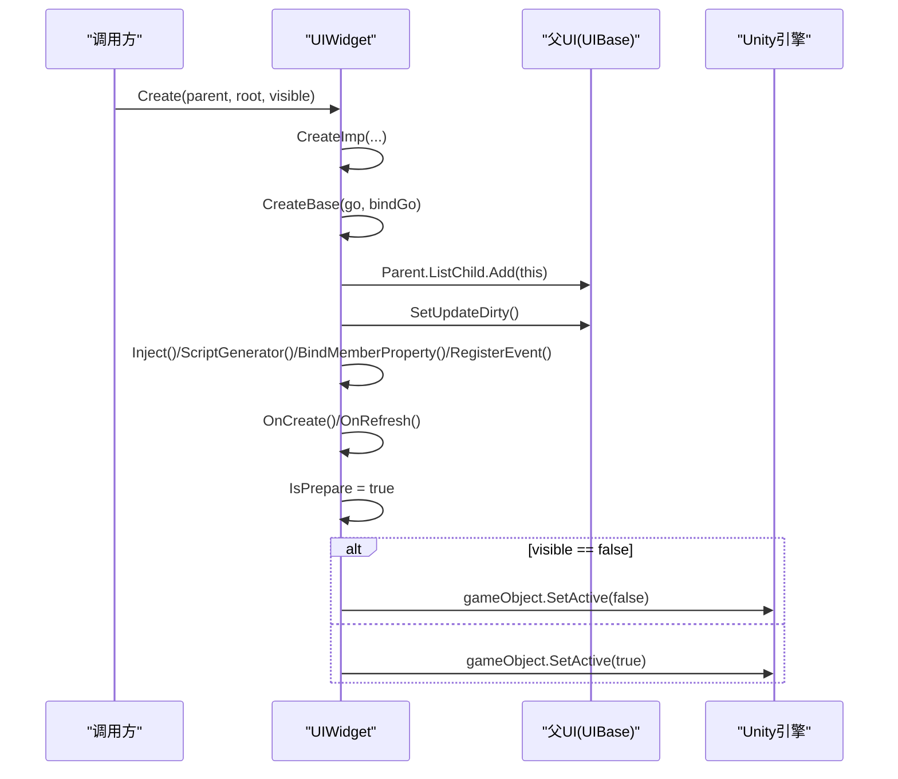
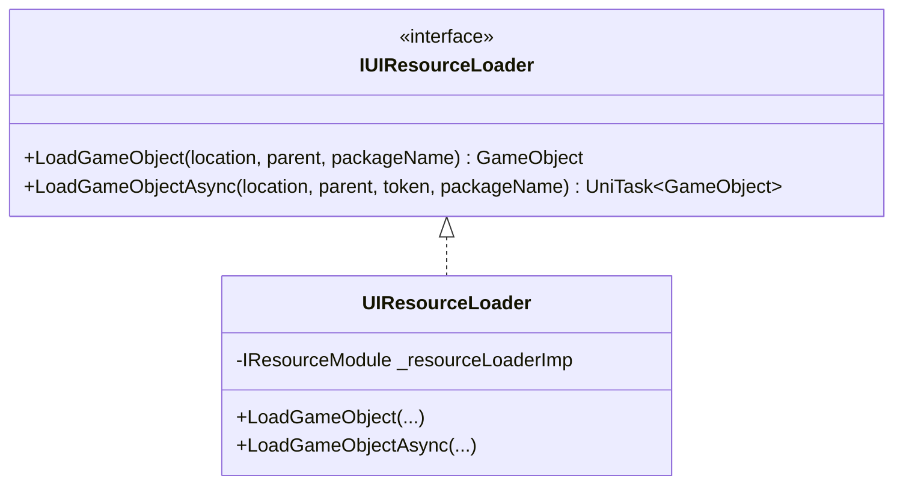
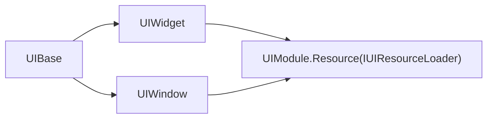

# UI 组件系统

<cite>
**本文引用的文件**   
- [UIBase.cs](file://UnityProject/Assets/GameScripts/HotFix/GameLogic/Module/UIModule/UIBase.cs)
- [UIWidget.cs](file://UnityProject/Assets/GameScripts/HotFix/GameLogic/Module/UIModule/UIWidget.cs)
- [UIWindow.cs](file://UnityProject/Assets/GameScripts/HotFix/GameLogic/Module/UIModule/UIWindow.cs)
- [IUIResourceLoader.cs](file://UnityProject/Assets/GameScripts/HotFix/GameLogic/Module/UIModule/IUIResourceLoader.cs)
- [UIModule.cs](file://UnityProject/Assets/GameScripts/HotFix/GameLogic/Module/UIModule/UIModule.cs)
</cite>

## 目录
1. [简介](#简介)
2. [项目结构](#项目结构)
3. [核心组件](#核心组件)
4. [架构总览](#架构总览)
5. [详细组件分析](#详细组件分析)
6. [依赖关系分析](#依赖关系分析)
7. [性能与优化](#性能与优化)
8. [故障排查指南](#故障排查指南)
9. [结论](#结论)
10. [附录：自定义组件开发指南](#附录自定义组件开发指南)

## 简介
本文件系统性梳理 TEngine 的 UI 组件体系，围绕以下目标展开：
- 深入解释 UIWidget 基类的设计原理、生命周期管理与更新机制
- 详解 UI 绑定系统（自动属性绑定、事件绑定、数据绑定）
- 说明 IUIResourceLoader 接口与资源加载策略
- 阐述组件查找机制、缓存策略与性能优化
- 提供自定义 UI 组件的开发指南、使用示例与调优建议

## 项目结构
UI 模块的核心代码位于 Unity 项目的热更脚本路径下，关键文件如下：
- UIBase：UI 基类，定义类型、父子关系、生命周期钩子、事件管理、子组件创建与查找等通用能力
- UIWidget：窗口内嵌组件基类，负责组件实例化、可见性控制、层级排序与每帧更新
- UIWindow：窗口容器基类，负责面板加载、Canvas/Raycaster 管理、显示隐藏、深度排序等
- IUIResourceLoader：UI 资源加载器接口及默认实现，统一同步/异步加载 GameObject
- UIModule：UI 模块入口，对外暴露资源加载器与 UI 树根节点



图表来源
- [UIModule.cs:15-15](file://UnityProject/Assets/GameScripts/HotFix/GameLogic/Module/UIModule/UIModule.cs#L15-L15)
- [UIBase.cs:18-106](file://UnityProject/Assets/GameScripts/HotFix/GameLogic/Module/UIModule/UIBase.cs#L18-L106)
- [UIWidget.cs:7-33](file://UnityProject/Assets/GameScripts/HotFix/GameLogic/Module/UIModule/UIWidget.cs#L7-L33)
- [UIWindow.cs:11-35](file://UnityProject/Assets/GameScripts/HotFix/GameLogic/Module/UIModule/UIWindow.cs#L11-L35)
- [IUIResourceLoader.cs:11-33](file://UnityProject/Assets/GameScripts/HotFix/GameLogic/Module/UIModule/IUIResourceLoader.cs#L11-L33)

章节来源
- [UIModule.cs:15-15](file://UnityProject/Assets/GameScripts/HotFix/GameLogic/Module/UIModule/UIModule.cs#L15-L15)
- [UIBase.cs:18-106](file://UnityProject/Assets/GameScripts/HotFix/GameLogic/Module/UIModule/UIBase.cs#L18-L106)
- [UIWidget.cs:7-33](file://UnityProject/Assets/GameScripts/HotFix/GameLogic/Module/UIModule/UIWidget.cs#L7-L33)
- [UIWindow.cs:11-35](file://UnityProject/Assets/GameScripts/HotFix/GameLogic/Module/UIModule/UIWindow.cs#L11-L35)
- [IUIResourceLoader.cs:11-33](file://UnityProject/Assets/GameScripts/HotFix/GameLogic/Module/UIModule/IUIResourceLoader.cs#L11-L33)

## 核心组件
- UIBase：定义 UIType（None/Window/Widget）、父子关系、UserData、GameObject/Transform/RectTransform 抽象、IsPrepare 状态、ListChild 子组件列表、Update 脏标记、FindChild/FindChildComponent 查找、AddUIEvent/RemoveAllUIEvent 事件管理、CreateWidget* 系列工厂方法等。
- UIWidget：继承 UIBase，封装组件级生命周期（Create/CreateByPath/CreateByPrefab -> Inject/ScriptGenerator/BindMemberProperty/RegisterEvent/OnCreate/OnRefresh/IsPrepare），Visible 显隐控制，RestChildCanvas 层级排序修正，InternalUpdate 子树更新调度，Destroy/OnDestroyWidget 销毁流程。
- UIWindow：继承 UIBase，封装窗口面板加载（InternalLoad）、Canvas/Raycaster 管理、Depth/Visible/Interactable 控制、TryInvoke/Handle_Completed 回调、InternalUpdate 子树更新、InternalDestroy 销毁流程。
- IUIResourceLoader：定义 LoadGameObject / LoadGameObjectAsync 接口；UIResourceLoader 默认实现委托给 IResourceModule。

章节来源
- [UIBase.cs:18-106](file://UnityProject/Assets/GameScripts/HotFix/GameLogic/Module/UIModule/UIBase.cs#L18-L106)
- [UIBase.cs:241-332](file://UnityProject/Assets/GameScripts/HotFix/GameLogic/Module/UIModule/UIBase.cs#L241-L332)
- [UIBase.cs:334-606](file://UnityProject/Assets/GameScripts/HotFix/GameLogic/Module/UIModule/UIBase.cs#L334-L606)
- [UIWidget.cs:7-315](file://UnityProject/Assets/GameScripts/HotFix/GameLogic/Module/UIModule/UIWidget.cs#L7-L315)
- [UIWindow.cs:11-524](file://UnityProject/Assets/GameScripts/HotFix/GameLogic/Module/UIModule/UIWindow.cs#L11-L524)
- [IUIResourceLoader.cs:11-69](file://UnityProject/Assets/GameScripts/HotFix/GameLogic/Module/UIModule/IUIResourceLoader.cs#L11-L69)

## 架构总览
UI 模块采用“基类 + 扩展”的分层设计：
- 基类层：UIBase 提供通用能力（生命周期钩子、事件、查找、子组件工厂）
- 组件层：UIWidget 面向“窗口内嵌组件”，强调轻量、可复用、可批量生成
- 窗口层：UIWindow 面向“全屏/半屏窗口”，强调面板加载、渲染层级、交互控制
- 资源层：IUIResourceLoader 抽象资源加载，默认实现对接框架资源模块



图表来源
- [UIBase.cs:18-106](file://UnityProject/Assets/GameScripts/HotFix/GameLogic/Module/UIModule/UIBase.cs#L18-L106)
- [UIWidget.cs:7-315](file://UnityProject/Assets/GameScripts/HotFix/GameLogic/Module/UIModule/UIWidget.cs#L7-L315)
- [UIWindow.cs:11-524](file://UnityProject/Assets/GameScripts/HotFix/GameLogic/Module/UIModule/UIWindow.cs#L11-L524)
- [IUIResourceLoader.cs:11-69](file://UnityProject/Assets/GameScripts/HotFix/GameLogic/Module/UIModule/IUIResourceLoader.cs#L11-L69)

## 详细组件分析

### UIBase：UI 基类与生命周期
- 生命周期钩子顺序（由子类重写）：
  - 注入：Inject（外部 Injector 回调）
  - 代码生成：ScriptGenerator（编辑器辅助生成字段/方法）
  - 成员绑定：BindMemberProperty（自动绑定 UI 元素到字段）
  - 事件注册：RegisterEvent（集中注册 UI 事件）
  - 创建：OnCreate（初始化逻辑）
  - 刷新：OnRefresh（数据刷新）
  - 更新：OnUpdate（每帧更新）
  - 销毁：OnDestroy（释放资源）
- 事件系统：通过 GameEventMgr 池化对象，提供多参数泛型 AddUIEvent，并在 RemoveAllUIEvent 中释放内存池对象，避免 GC 抖动。
- 子组件管理：ListChild 维护子 UIWidget；SetUpdateDirty 标记 Update 列表失效，触发下一帧重建有效更新集合。
- 查找工具：FindChild / FindChildComponent 基于 Transform.Find 快速定位节点或组件。
- 工厂方法：CreateWidget* 系列支持从路径、预制体、类型等方式创建 UIWidget，并内置异步版本与批量调整图标数量的工具方法。



图表来源
- [UIBase.cs:136-199](file://UnityProject/Assets/GameScripts/HotFix/GameLogic/Module/UIModule/UIBase.cs#L136-L199)

章节来源
- [UIBase.cs:18-106](file://UnityProject/Assets/GameScripts/HotFix/GameLogic/Module/UIModule/UIBase.cs#L18-L106)
- [UIBase.cs:136-199](file://UnityProject/Assets/GameScripts/HotFix/GameLogic/Module/UIModule/UIBase.cs#L136-L199)
- [UIBase.cs:241-332](file://UnityProject/Assets/GameScripts/HotFix/GameLogic/Module/UIModule/UIBase.cs#L241-L332)
- [UIBase.cs:334-606](file://UnityProject/Assets/GameScripts/HotFix/GameLogic/Module/UIModule/UIBase.cs#L334-L606)

### UIWidget：组件基类与更新机制
- 创建流程：
  - Create / CreateByPath / CreateByPrefab 最终调用 CreateImp
  - CreateImp 执行：CreateBase -> RestChildCanvas -> 设置父节点 -> 加入 Parent.ListChild -> SetUpdateDirty -> Inject -> ScriptGenerator -> BindMemberProperty -> RegisterEvent -> OnCreate -> OnRefresh -> IsPrepare = true -> 可见性处理
- 可见性：Visible 属性控制 gameObject.activeSelf，并回调 OnSetVisible
- 层级排序：RestChildCanvas 将子 Canvas sortingOrder 按父 Canvas 偏移，保证 UI 层级正确
- 更新机制：InternalUpdate 遍历子节点，收集需要更新的子节点列表，若存在子节点需要更新则强制 OnUpdate 被调用；否则根据 _hasOverrideUpdate 决定是否继续参与更新
- 销毁：Destroy 移除父节点引用，调用 OnDestroy 与 OnDestroyWidget；OnDestroyWidget 递归销毁子节点并释放 Unity 对象



图表来源
- [UIWidget.cs:151-233](file://UnityProject/Assets/GameScripts/HotFix/GameLogic/Module/UIModule/UIWidget.cs#L151-L233)

章节来源
- [UIWidget.cs:7-315](file://UnityProject/Assets/GameScripts/HotFix/GameLogic/Module/UIModule/UIWidget.cs#L7-L315)

### UIWindow：窗口容器与渲染层级
- 面板加载：InternalLoad 支持同步/异步加载，FromResources 分支走 Resources.Load，非 FromResources 走 UIModule.Resource
- 完成回调：Handle_Completed 设置面板名称、获取 Canvas/Raycaster、配置 overrideSorting/sortingOrder、通知 UI 管理器 IsPrepare=true 并触发 prepareCallback
- 显示隐藏：Visible 通过切换 layer 控制显示/隐藏，同时联动 Interactable（GraphicRaycaster.enabled）与 OnSetVisible
- 深度排序：Depth 修改 Canvas.sortingOrder 并同步子 Canvas 相对偏移，必要时触发 _OnSortDepth
- 更新：InternalUpdate 与 UIWidget 类似，但仅在 IsPrepare && Visible 时执行
- 销毁：InternalDestroy 清理事件、子节点、回调、面板对象，并取消隐藏关闭定时器

```mermaid
sequenceDiagram
participant Manager as "UI管理器"
participant Window as "UIWindow"
participant Res as "UIModule.Resource"
participant Unity as "Unity引擎"
Manager->>Window : InternalLoad(location, callback, isAsync, userDatas)
alt FromResources
Window->>Unity : Instantiate(Resources.Load<GameObject>(location), UIRoot)
else
alt isAsync
Window->>Res : LoadGameObjectAsync(location, UIRoot)
Res-->>Window : panel
else
Window->>Res : LoadGameObject(location, UIRoot)
Res-->>Window : panel
end
end
Window->>Window : Handle_Completed(panel)
Window->>Manager : IsPrepare = true; callback?.Invoke(this)
```

图表来源
- [UIWindow.cs:314-336](file://UnityProject/Assets/GameScripts/HotFix/GameLogic/Module/UIModule/UIWindow.cs#L314-L336)
- [UIWindow.cs:464-502](file://UnityProject/Assets/GameScripts/HotFix/GameLogic/Module/UIModule/UIWindow.cs#L464-L502)

章节来源
- [UIWindow.cs:11-524](file://UnityProject/Assets/GameScripts/HotFix/GameLogic/Module/UIModule/UIWindow.cs#L11-L524)

### IUIResourceLoader：资源加载策略
- 接口定义：LoadGameObject（同步）、LoadGameObjectAsync（异步）
- 默认实现：UIResourceLoader 委托给 ModuleSystem.GetModule<IResourceModule>，屏蔽具体资源后端差异
- 使用场景：UIWidget.CreateByPath、UIBase.CreateWidgetByPath/Async 等方法通过 UIModule.Resource 访问该加载器



图表来源
- [IUIResourceLoader.cs:11-69](file://UnityProject/Assets/GameScripts/HotFix/GameLogic/Module/UIModule/IUIResourceLoader.cs#L11-L69)

章节来源
- [IUIResourceLoader.cs:11-69](file://UnityProject/Assets/GameScripts/HotFix/GameLogic/Module/UIModule/IUIResourceLoader.cs#L11-L69)

## 依赖关系分析
- 组件耦合：
  - UIWidget 与 UIWindow 均依赖 UIBase 提供的通用能力
  - UIWidget 在创建时通过 UIModule.Resource 进行资源加载（间接依赖 IUIResourceLoader）
  - UIWindow 直接通过 UIModule.Resource 加载面板
- 更新链：
  - UIBase.SetUpdateDirty 向上冒泡标记父节点更新列表失效
  - UIWidget.InternalUpdate 与 UIWindow.InternalUpdate 分别维护子节点更新集合，减少无效 OnUpdate 调用
- 事件链：
  - UIBase 内部持有 GameEventMgr 池化实例，AddUIEvent 注册事件，RemoveAllUIEvent 释放池对象



图表来源
- [UIBase.cs:232-239](file://UnityProject/Assets/GameScripts/HotFix/GameLogic/Module/UIModule/UIBase.cs#L232-L239)
- [UIWidget.cs:164-179](file://UnityProject/Assets/GameScripts/HotFix/GameLogic/Module/UIModule/UIWidget.cs#L164-L179)
- [UIWindow.cs:314-336](file://UnityProject/Assets/GameScripts/HotFix/GameLogic/Module/UIModule/UIWindow.cs#L314-L336)

章节来源
- [UIBase.cs:232-239](file://UnityProject/Assets/GameScripts/HotFix/GameLogic/Module/UIModule/UIBase.cs#L232-L239)
- [UIWidget.cs:164-179](file://UnityProject/Assets/GameScripts/HotFix/GameLogic/Module/UIModule/UIWidget.cs#L164-L179)
- [UIWindow.cs:314-336](file://UnityProject/Assets/GameScripts/HotFix/GameLogic/Module/UIModule/UIWindow.cs#L314-L336)

## 性能与优化
- 更新优化
  - 子节点更新集合缓存：_listUpdateChild 与 _updateListValid 避免每帧重复构建
  - 仅当存在子节点需要更新或子类重写 OnUpdate 时才调用 OnUpdate，降低空更新开销
- 资源加载
  - 优先使用 UIModule.Resource 统一加载，避免分散的资源管理
  - 大量图标/子项建议使用 AdjustIconNum / AsyncAdjustIconNum 分批创建，避免单帧压力
- 层级排序
  - RestChildCanvas 一次性修正子 Canvas sortingOrder，避免频繁排序
  - UIWindow.Depth 变更时同步子 Canvas 相对偏移，减少重绘
- 事件管理
  - GameEventMgr 使用内存池，避免频繁分配
  - 在 RemoveAllUIEvent 中释放池对象，防止泄漏

章节来源
- [UIWidget.cs:71-140](file://UnityProject/Assets/GameScripts/HotFix/GameLogic/Module/UIModule/UIWidget.cs#L71-L140)
- [UIWindow.cs:356-425](file://UnityProject/Assets/GameScripts/HotFix/GameLogic/Module/UIModule/UIWindow.cs#L356-L425)
- [UIBase.cs:477-578](file://UnityProject/Assets/GameScripts/HotFix/GameLogic/Module/UIModule/UIBase.cs#L477-L578)
- [UIBase.cs:284-332](file://UnityProject/Assets/GameScripts/HotFix/GameLogic/Module/UIModule/UIBase.cs#L284-L332)

## 故障排查指南
- 找不到 RectTransform
  - 现象：CreateBase 断言失败
  - 原因：根 GameObject 未包含 RectTransform
  - 解决：确保 UI 根节点为 RectTransform
- Canvas 缺失
  - 现象：UIWindow.Handle_Completed 抛出异常
  - 原因：面板缺少 Canvas 组件
  - 解决：在面板根节点添加 Canvas
- 事件未触发或泄漏
  - 现象：事件不响应或内存增长
  - 原因：未在 RegisterEvent 中注册或未在销毁时解绑
  - 解决：在 RegisterEvent 中 AddUIEvent，并确保 RemoveAllUIEvent 被调用（框架在销毁路径中已处理）
- 层级错乱
  - 现象：子 UI 被遮挡或点击无效
  - 原因：Canvas sortingOrder 未正确设置或 Raycaster 被禁用
  - 解决：检查 RestChildCanvas 与 UIWindow.Visible/Interactable 逻辑

章节来源
- [UIWidget.cs:235-247](file://UnityProject/Assets/GameScripts/HotFix/GameLogic/Module/UIModule/UIWidget.cs#L235-L247)
- [UIWindow.cs:484-497](file://UnityProject/Assets/GameScripts/HotFix/GameLogic/Module/UIModule/UIWindow.cs#L484-L497)
- [UIBase.cs:284-332](file://UnityProject/Assets/GameScripts/HotFix/GameLogic/Module/UIModule/UIBase.cs#L284-L332)

## 结论
TEngine UI 组件系统以 UIBase 为核心，向上支撑 UIWindow 窗口容器，向下扩展 UIWidget 组件，配合 IUIResourceLoader 统一资源加载，形成清晰分层与可扩展架构。其更新机制、事件系统与批量创建工具为复杂 UI 场景提供了良好的性能基础与开发体验。

## 附录：自定义组件开发指南
- 继承与重写
  - 继承 UIWidget 或 UIWindow
  - 重写生命周期钩子：ScriptGenerator、BindMemberProperty、RegisterEvent、OnCreate、OnRefresh、OnUpdate、OnDestroy
- 自动属性绑定
  - 使用编辑器生成的 ScriptGenerator/BindMemberProperty 将 UI 元素映射到字段，避免手动 Find
- 事件绑定
  - 在 RegisterEvent 中使用 AddUIEvent 注册事件，框架会在销毁时统一清理
- 数据绑定
  - 在 OnRefresh 中根据业务数据刷新 UI 元素
- 组件查找
  - 使用 FindChild / FindChildComponent 快速定位节点或组件
- 批量创建
  - 使用 AdjustIconNum / AsyncAdjustIconNum 高效创建大量子项
- 资源加载
  - 通过 UIModule.Resource.LoadGameObject / LoadGameObjectAsync 加载资源
- 示例流程（无代码）
  - 新建 MyButton : UIWidget
  - 重写 ScriptGenerator/BindMemberProperty 绑定按钮节点
  - 重写 RegisterEvent 绑定点击事件
  - 重写 OnRefresh 根据数据更新文本/图标
  - 在父 UI 中通过 CreateWidget<MyButton> 或 AdjustIconNum 创建实例

章节来源
- [UIBase.cs:141-199](file://UnityProject/Assets/GameScripts/HotFix/GameLogic/Module/UIModule/UIBase.cs#L141-L199)
- [UIBase.cs:241-332](file://UnityProject/Assets/GameScripts/HotFix/GameLogic/Module/UIModule/UIBase.cs#L241-L332)
- [UIBase.cs:334-606](file://UnityProject/Assets/GameScripts/HotFix/GameLogic/Module/UIModule/UIBase.cs#L334-L606)
- [UIWidget.cs:142-233](file://UnityProject/Assets/GameScripts/HotFix/GameLogic/Module/UIModule/UIWidget.cs#L142-L233)
- [IUIResourceLoader.cs:11-69](file://UnityProject/Assets/GameScripts/HotFix/GameLogic/Module/UIModule/IUIResourceLoader.cs#L11-L69)