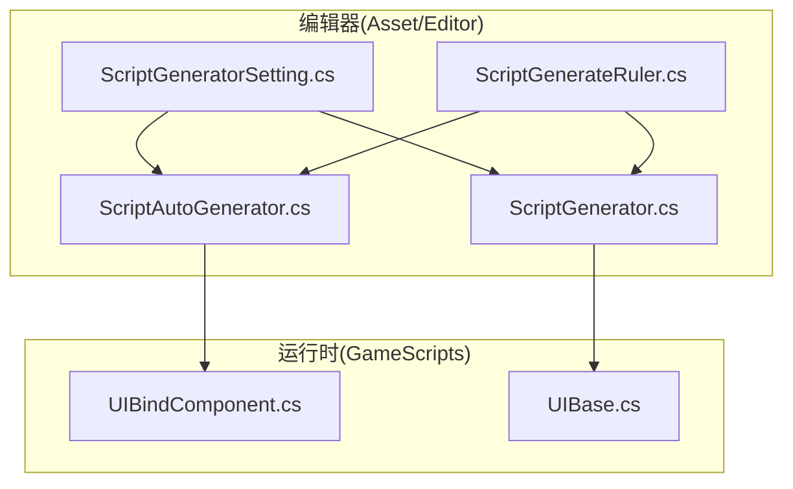
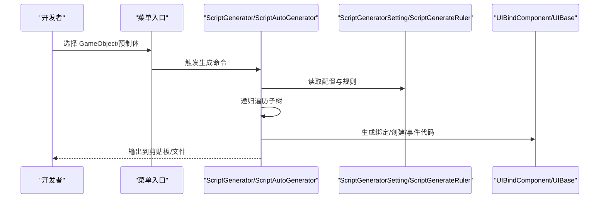
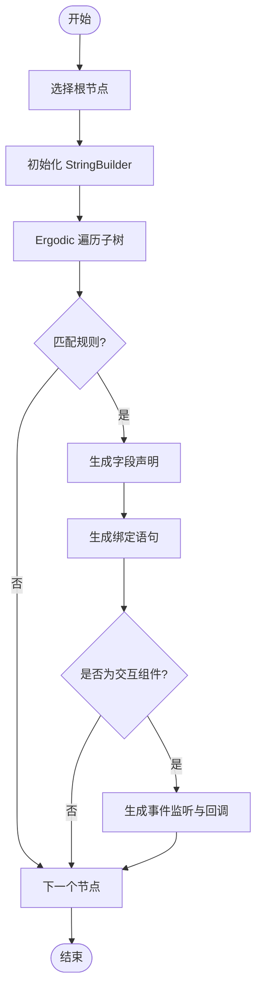
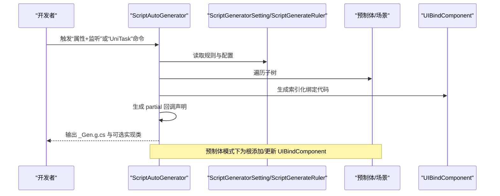
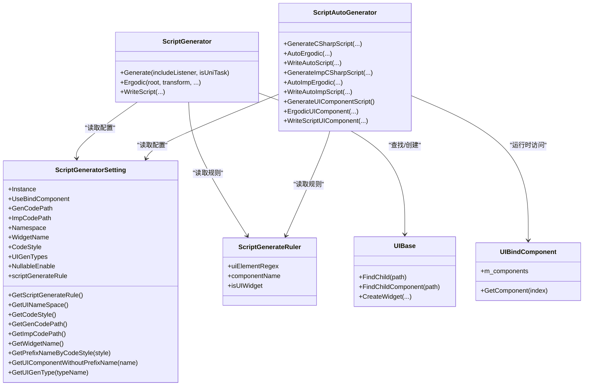

# UI 脚本生成器

<cite>
**本文引用的文件**   
- [ScriptAutoGenerator.cs](file://UnityProject/Assets/Editor/UIScriptGenerator/ScriptAutoGenerator.cs)
- [ScriptGenerator.cs](file://UnityProject/Assets/Editor/UIScriptGenerator/ScriptGenerator.cs)
- [ScriptGenerateRuler.cs](file://UnityProject/Assets/Editor/UIScriptGenerator/ScriptGenerateRuler.cs)
- [ScriptGeneratorSetting.cs](file://UnityProject/Assets/Editor/UIScriptGenerator/ScriptGeneratorSetting.cs)
- [UIBindComponent.cs](file://UnityProject/Assets/GameScripts/HotFix/GameLogic/Module/UIModule/UIBindComponent/UIBindComponent.cs)
- [UIBase.cs](file://UnityProject/Assets/GameScripts/HotFix/GameLogic/Module/UIModule/UIBase.cs)
</cite>

## 目录
1. [简介](#简介)
2. [项目结构](#项目结构)
3. [核心组件](#核心组件)
4. [架构总览](#架构总览)
5. [详细组件分析](#详细组件分析)
6. [依赖关系分析](#依赖关系分析)
7. [性能与可维护性](#性能与可维护性)
8. [使用指南](#使用指南)
9. [故障排查](#故障排查)
10. [结论](#结论)

## 简介
本文件面向 TEngine 的 UI 脚本自动生成器，系统性说明其工作原理、预制体到 C# 代码的映射规则、核心算法（节点遍历、类型识别、模板生成）、自动化流程（从扫描到输出）、配置项与自定义规则、编辑器集成与批量/增量生成方式，以及生成代码的结构与扩展方法。目标是帮助开发者在不深入源码的情况下也能正确使用并扩展该工具链。

## 项目结构
UI 脚本生成器位于 Unity 编辑器的扩展模块中，主要包含以下文件：
- ScriptGeneratorSetting.cs：全局配置与规则定义
- ScriptGenerateRuler.cs：字段命名风格、组件枚举、规则数据模型
- ScriptGenerator.cs：传统模式（FindChild/FindChildComponent）的代码生成
- ScriptAutoGenerator.cs：自动绑定模式（UIBindComponent）的代码生成
- UIBindComponent.cs：运行时绑定组件（索引化访问子组件）
- UIBase.cs：UI 基类，提供 FindChild/CreateWidget 等能力

图表来源
- [ScriptGeneratorSetting.cs:1-207](file://UnityProject/Assets/Editor/UIScriptGenerator/ScriptGeneratorSetting.cs#L1-L207)
- [ScriptGenerateRuler.cs:1-100](file://UnityProject/Assets/Editor/UIScriptGenerator/ScriptGenerateRuler.cs#L1-L100)
- [ScriptGenerator.cs:1-343](file://UnityProject/Assets/Editor/UIScriptGenerator/ScriptGenerator.cs#L1-L343)
- [ScriptAutoGenerator.cs:1-829](file://UnityProject/Assets/Editor/UIScriptGenerator/ScriptAutoGenerator.cs#L1-L829)
- [UIBindComponent.cs:1-39](file://UnityProject/Assets/GameScripts/HotFix/GameLogic/Module/UIModule/UIBindComponent/UIBindComponent.cs#L1-L39)
- [UIBase.cs:240-460](file://UnityProject/Assets/GameScripts/HotFix/GameLogic/Module/UIModule/UIBase.cs#L240-L460)

章节来源
- [ScriptGeneratorSetting.cs:1-207](file://UnityProject/Assets/Editor/UIScriptGenerator/ScriptGeneratorSetting.cs#L1-L207)
- [ScriptGenerateRuler.cs:1-100](file://UnityProject/Assets/Editor/UIScriptGenerator/ScriptGenerateRuler.cs#L1-L100)
- [ScriptGenerator.cs:1-343](file://UnityProject/Assets/Editor/UIScriptGenerator/ScriptGenerator.cs#L1-L343)
- [ScriptAutoGenerator.cs:1-829](file://UnityProject/Assets/Editor/UIScriptGenerator/ScriptAutoGenerator.cs#L1-L829)
- [UIBindComponent.cs:1-39](file://UnityProject/Assets/GameScripts/HotFix/GameLogic/Module/UIModule/UIBindComponent/UIBindComponent.cs#L1-L39)
- [UIBase.cs:240-460](file://UnityProject/Assets/GameScripts/HotFix/GameLogic/Module/UIModule/UIBase.cs#L240-L460)

## 核心组件
- ScriptGeneratorSetting：集中管理生成器行为的全局配置，包括是否启用 UIBindComponent、默认保存路径、命名空间、子组件前缀、字段命名风格、UI 基类映射、可空引用开关、组件匹配规则列表等。
- ScriptGenerateRuler：定义字段命名风格枚举、规则数据模型（正则前缀、目标组件类型、是否作为 UIWidget 处理）、UI 组件枚举、以及规则在 Inspector 中的绘制逻辑。
- ScriptGenerator：传统模式的代码生成器，通过路径查找（FindChild/FindChildComponent）和 CreateWidget 生成属性与事件回调。
- ScriptAutoGenerator：自动绑定模式的代码生成器，基于 UIBindComponent 的索引化组件访问，支持 UniTask 异步回调、实现类分离生成、预制体模式下的组件注入与保存。
- UIBindComponent：运行时组件，维护一个 Component 列表，按索引提供强类型访问，避免反射与重复查找。
- UIBase：UI 框架基类，提供 FindChild、FindChildComponent、CreateWidget 等方法，供生成的代码调用。

章节来源
- [ScriptGeneratorSetting.cs:1-207](file://UnityProject/Assets/Editor/UIScriptGenerator/ScriptGeneratorSetting.cs#L1-L207)
- [ScriptGenerateRuler.cs:1-100](file://UnityProject/Assets/Editor/UIScriptGenerator/ScriptGenerateRuler.cs#L1-L100)
- [ScriptGenerator.cs:1-343](file://UnityProject/Assets/Editor/UIScriptGenerator/ScriptGenerator.cs#L1-L343)
- [ScriptAutoGenerator.cs:1-829](file://UnityProject/Assets/Editor/UIScriptGenerator/ScriptAutoGenerator.cs#L1-L829)
- [UIBindComponent.cs:1-39](file://UnityProject/Assets/GameScripts/HotFix/GameLogic/Module/UIModule/UIBindComponent/UIBindComponent.cs#L1-L39)
- [UIBase.cs:240-460](file://UnityProject/Assets/GameScripts/HotFix/GameLogic/Module/UIModule/UIBase.cs#L240-L460)

## 架构总览
生成器的工作流分为两条主线：
- 传统模式（ScriptGenerator）：根据选中根节点递归遍历子树，依据规则匹配节点名前缀，生成字段声明、绑定语句、初始化回调与事件回调，最终输出到剪贴板或文件。
- 自动绑定模式（ScriptAutoGenerator）：同样遍历子树，但生成的是基于 UIBindComponent 的索引化绑定代码，并在运行时通过组件列表进行强类型访问；同时支持生成实现类（partial class）以分离业务逻辑。

图表来源
- [ScriptGenerator.cs:12-135](file://UnityProject/Assets/Editor/UIScriptGenerator/ScriptGenerator.cs#L12-L135)
- [ScriptAutoGenerator.cs:30-254](file://UnityProject/Assets/Editor/UIScriptGenerator/ScriptAutoGenerator.cs#L30-L254)
- [ScriptGeneratorSetting.cs:117-207](file://UnityProject/Assets/Editor/UIScriptGenerator/ScriptGeneratorSetting.cs#L117-L207)
- [ScriptGenerateRuler.cs:25-100](file://UnityProject/Assets/Editor/UIScriptGenerator/ScriptGenerateRuler.cs#L25-L100)
- [UIBindComponent.cs:18-39](file://UnityProject/Assets/GameScripts/HotFix/GameLogic/Module/UIModule/UIBindComponent/UIBindComponent.cs#L18-L39)
- [UIBase.cs:240-460](file://UnityProject/Assets/GameScripts/HotFix/GameLogic/Module/UIModule/UIBase.cs#L240-L460)

## 详细组件分析

### ScriptGenerator（传统模式）
职责
- 暴露多个菜单项，支持“仅属性”“属性+监听”“UniTask 版本”。
- 递归遍历选中根节点的子树，按规则匹配节点名前缀，生成字段、绑定、初始化与事件回调。
- 将生成的代码复制到剪贴板，便于粘贴到现有窗口/控件脚本中。

关键流程
- Generate：收集变量、绑定、初始化、回调字符串，组装命名空间、类声明、生命周期方法。
- Ergodic：深度优先遍历 Transform 树，跳过 UIWidget 根节点继续遍历。
- WriteScript：根据规则确定组件类型，生成字段声明与绑定语句；对 Button/Toggle/Slider 等生成事件监听与 partial 回调方法。
- GetBtnFuncName/GetToggleFuncName/GetTMPDropdownFuncName/GetSliderFuncName：根据命名风格生成回调方法名。

图表来源
- [ScriptGenerator.cs:60-135](file://UnityProject/Assets/Editor/UIScriptGenerator/ScriptGenerator.cs#L60-L135)
- [ScriptGenerator.cs:137-151](file://UnityProject/Assets/Editor/UIScriptGenerator/ScriptGenerator.cs#L137-L151)
- [ScriptGenerator.cs:219-332](file://UnityProject/Assets/Editor/UIScriptGenerator/ScriptGenerator.cs#L219-L332)

章节来源
- [ScriptGenerator.cs:12-135](file://UnityProject/Assets/Editor/UIScriptGenerator/ScriptGenerator.cs#L12-L135)
- [ScriptGenerator.cs:137-151](file://UnityProject/Assets/Editor/UIScriptGenerator/ScriptGenerator.cs#L137-L151)
- [ScriptGenerator.cs:219-332](file://UnityProject/Assets/Editor/UIScriptGenerator/ScriptGenerator.cs#L219-L332)

### ScriptAutoGenerator（自动绑定模式）
职责
- 基于 UIBindComponent 的索引化访问生成绑定代码，减少运行时查找开销。
- 支持 UniTask 异步回调，生成实现类（partial class）分离业务逻辑。
- 在预制体模式下为根物体添加/清理 UIBindComponent，并将匹配的组件注册到列表中。

关键流程
- GenerateCSharpScript：准备变量、绑定、初始化、回调字符串；计算 UI 基类类型；递归遍历；写入文件（_Gen.g.cs），可选生成实现类。
- AutoErgodic/WriteAutoScript：遍历子树，按规则匹配节点名前缀，生成字段与绑定语句；对 Button/Toggle/Dropdown/Slider 生成事件监听与 partial 回调。
- GenerateImpCSharpScript/AutoImpErgodic/WriteAutoImpScript：生成实现类，包含空的 partial 回调方法体，供开发者填充。
- GenerateUIComponentScript/ErgodicUIComponent/WriteScriptUIComponent：在预制体模式下为根物体添加/清空 UIBindComponent，并按规则将组件加入列表。

图表来源
- [ScriptAutoGenerator.cs:89-254](file://UnityProject/Assets/Editor/UIScriptGenerator/ScriptAutoGenerator.cs#L89-L254)
- [ScriptAutoGenerator.cs:258-363](file://UnityProject/Assets/Editor/UIScriptGenerator/ScriptAutoGenerator.cs#L258-L363)
- [ScriptAutoGenerator.cs:367-526](file://UnityProject/Assets/Editor/UIScriptGenerator/ScriptAutoGenerator.cs#L367-L526)
- [ScriptAutoGenerator.cs:533-633](file://UnityProject/Assets/Editor/UIScriptGenerator/ScriptAutoGenerator.cs#L533-L633)

章节来源
- [ScriptAutoGenerator.cs:89-254](file://UnityProject/Assets/Editor/UIScriptGenerator/ScriptAutoGenerator.cs#L89-L254)
- [ScriptAutoGenerator.cs:258-363](file://UnityProject/Assets/Editor/UIScriptGenerator/ScriptAutoGenerator.cs#L258-L363)
- [ScriptAutoGenerator.cs:367-526](file://UnityProject/Assets/Editor/UIScriptGenerator/ScriptAutoGenerator.cs#L367-L526)
- [ScriptAutoGenerator.cs:533-633](file://UnityProject/Assets/Editor/UIScriptGenerator/ScriptAutoGenerator.cs#L533-L633)

### ScriptGeneratorSetting（配置中心）
职责
- 提供单例访问与菜单创建。
- 管理生成器开关（UseBindComponent）、默认保存路径、命名空间、子组件名称、字段命名风格、UI 基类映射、可空引用开关、组件匹配规则列表。
- 提供静态方法获取规则、命名空间、代码风格、路径、UI 基类等。

重点字段与方法
- UseBindComponent：控制是否采用 UIBindComponent 模式。
- GenCodePath/ImpCodePath：生成代码与实现类的默认路径。
- Namespace：生成代码的命名空间。
- WidgetName：子组件（如 item）前缀，用于跳过继续遍历。
- CodeStyle：字段命名风格（下划线前缀或 m_ 前缀）。
- UIGenTypes：UIWindow/UIWidget 等基类映射。
- NullableEnable：是否生成可空引用标记。
- scriptGenerateRule：组件匹配规则列表，按 uiElementRegex 前缀匹配节点名。

章节来源
- [ScriptGeneratorSetting.cs:1-207](file://UnityProject/Assets/Editor/UIScriptGenerator/ScriptGeneratorSetting.cs#L1-L207)

### ScriptGenerateRuler（规则与枚举）
职责
- 定义字段命名风格枚举 UIFieldCodeStyle。
- 定义规则数据模型 ScriptGenerateRuler（uiElementRegex、componentName、isUIWidget）。
- 定义 UI 组件枚举 UIComponentName，覆盖常见 UGUI 与 TMPro 组件。
- 提供 PropertyDrawer 在 Inspector 中可视化编辑规则。

章节来源
- [ScriptGenerateRuler.cs:1-100](file://UnityProject/Assets/Editor/UIScriptGenerator/ScriptGenerateRuler.cs#L1-L100)

### UIBindComponent（运行时绑定组件）
职责
- 维护一个 Component 列表，按索引提供强类型访问。
- 生成代码通过索引访问对应组件，避免每次 Find/GetComponent 的开销。

章节来源
- [UIBindComponent.cs:1-39](file://UnityProject/Assets/GameScripts/HotFix/GameLogic/Module/UIModule/UIBindComponent/UIBindComponent.cs#L1-L39)

### UIBase（UI 基类）
职责
- 提供 FindChild/FindChildComponent 方法，供传统模式生成代码调用。
- 提供 CreateWidget 系列方法，用于实例化 UIWidget。

章节来源
- [UIBase.cs:240-460](file://UnityProject/Assets/GameScripts/HotFix/GameLogic/Module/UIModule/UIBase.cs#L240-L460)

## 依赖关系分析
- ScriptGenerator 与 ScriptAutoGenerator 均依赖 ScriptGeneratorSetting 与 ScriptGenerateRuler 提供的配置与规则。
- ScriptAutoGenerator 在自动绑定模式下依赖 UIBindComponent 进行运行时组件访问。
- ScriptGenerator 在传统模式下依赖 UIBase 的查找与创建方法。
- 两者都支持 UniTask 异步回调，需引入 Cysharp.Threading.Tasks。

图表来源
- [ScriptGenerator.cs:1-343](file://UnityProject/Assets/Editor/UIScriptGenerator/ScriptGenerator.cs#L1-L343)
- [ScriptAutoGenerator.cs:1-829](file://UnityProject/Assets/Editor/UIScriptGenerator/ScriptAutoGenerator.cs#L1-L829)
- [ScriptGeneratorSetting.cs:1-207](file://UnityProject/Assets/Editor/UIScriptGenerator/ScriptGeneratorSetting.cs#L1-L207)
- [ScriptGenerateRuler.cs:1-100](file://UnityProject/Assets/Editor/UIScriptGenerator/ScriptGenerateRuler.cs#L1-L100)
- [UIBindComponent.cs:1-39](file://UnityProject/Assets/GameScripts/HotFix/GameLogic/Module/UIModule/UIBindComponent/UIBindComponent.cs#L1-L39)
- [UIBase.cs:240-460](file://UnityProject/Assets/GameScripts/HotFix/GameLogic/Module/UIModule/UIBase.cs#L240-L460)

章节来源
- [ScriptGenerator.cs:1-343](file://UnityProject/Assets/Editor/UIScriptGenerator/ScriptGenerator.cs#L1-L343)
- [ScriptAutoGenerator.cs:1-829](file://UnityProject/Assets/Editor/UIScriptGenerator/ScriptAutoGenerator.cs#L1-L829)
- [ScriptGeneratorSetting.cs:1-207](file://UnityProject/Assets/Editor/UIScriptGenerator/ScriptGeneratorSetting.cs#L1-L207)
- [ScriptGenerateRuler.cs:1-100](file://UnityProject/Assets/Editor/UIScriptGenerator/ScriptGenerateRuler.cs#L1-L100)
- [UIBindComponent.cs:1-39](file://UnityProject/Assets/GameScripts/HotFix/GameLogic/Module/UIModule/UIBindComponent/UIBindComponent.cs#L1-L39)
- [UIBase.cs:240-460](file://UnityProject/Assets/GameScripts/HotFix/GameLogic/Module/UIModule/UIBase.cs#L240-L460)

## 性能与可维护性
- 自动绑定模式（UIBindComponent）通过索引化访问组件，避免重复查找，适合大型 UI 树与频繁访问的场景。
- 传统模式（FindChild/FindChildComponent）更灵活，但存在运行时查找成本；适用于小型 UI 或需要动态路径的场景。
- 生成代码使用 partial class 与实现类分离，便于业务逻辑扩展而不污染生成代码。
- 支持 UniTask 异步回调，提升交互响应性与可读性。
- 可空引用标记（NullableEnable）有助于编译期检查潜在的空引用问题。

[本节为通用指导，不直接分析具体文件]

## 使用指南

### 编辑器集成
- 传统模式菜单项：GameObject/ScriptGenerator/UIProperty、UIPropertyAndListener、以及对应的 UniTask 版本。
- 自动绑定模式菜单项：GameObject/ScriptGenerator/UIPropertyBindComponent、UIPropertyAndListenerBindComponent、以及对应的 UniTask 版本。
- 设置入口：GameObject/ScriptGenerator/About 打开 TEngine 设置面板。

章节来源
- [ScriptGenerator.cs:12-58](file://UnityProject/Assets/Editor/UIScriptGenerator/ScriptGenerator.cs#L12-L58)
- [ScriptAutoGenerator.cs:30-76](file://UnityProject/Assets/Editor/UIScriptGenerator/ScriptAutoGenerator.cs#L30-L76)
- [ScriptGenerator.cs:334-341](file://UnityProject/Assets/Editor/UIScriptGenerator/ScriptGenerator.cs#L334-L341)

### 批量生成与增量更新
- 自动绑定模式支持将生成代码保存到指定路径（GenCodePath），文件名后缀为 _Gen.g.cs，并设置为只读，避免手动修改。
- 若目标文件已存在且为只读，会先移除只读属性再删除旧文件，然后重新写入，最后刷新资源数据库。
- 实现类（ImpCodePath）仅在不存在时生成，避免覆盖已有业务逻辑。

章节来源
- [ScriptAutoGenerator.cs:215-247](file://UnityProject/Assets/Editor/UIScriptGenerator/ScriptAutoGenerator.cs#L215-L247)
- [ScriptAutoGenerator.cs:416-435](file://UnityProject/Assets/Editor/UIScriptGenerator/ScriptAutoGenerator.cs#L416-L435)

### 配置选项与自定义规则
- 使用 BindComponent：在 ScriptGeneratorSetting 中切换 UseBindComponent，决定使用自动绑定还是传统模式。
- 命名空间：设置 Namespace，统一生成代码的命名空间。
- 子组件前缀：设置 WidgetName（如 item），用于跳过继续遍历。
- 字段命名风格：CodeStyle 支持下划线前缀或 m_ 前缀。
- UI 基类映射：UIGenTypes 可配置 UIWindow/UIWidget 等基类，支持泛型与非泛型。
- 可空引用：NullableEnable 开启后生成可空引用标记。
- 组件匹配规则：scriptGenerateRule 列表，按 uiElementRegex 前缀匹配节点名，指定 componentName 与 isUIWidget。

章节来源
- [ScriptGeneratorSetting.cs:31-97](file://UnityProject/Assets/Editor/UIScriptGenerator/ScriptGeneratorSetting.cs#L31-L97)
- [ScriptGenerateRuler.cs:25-100](file://UnityProject/Assets/Editor/UIScriptGenerator/ScriptGenerateRuler.cs#L25-L100)

### 使用方法
- 传统模式：
  - 选中预制体根节点，选择“UIProperty”或“UIPropertyAndListener”，生成代码到剪贴板，粘贴到现有窗口脚本中。
  - 如需 UniTask 异步回调，选择对应的 UniTask 菜单项。
- 自动绑定模式：
  - 选中预制体根节点，选择“UIPropertyBindComponent”或“UIPropertyAndListenerBindComponent”，生成 _Gen.g.cs 与可选实现类。
  - 在预制体模式下，工具会为根物体添加/更新 UIBindComponent，并将匹配的组件注册到列表中。

章节来源
- [ScriptGenerator.cs:12-58](file://UnityProject/Assets/Editor/UIScriptGenerator/ScriptGenerator.cs#L12-L58)
- [ScriptAutoGenerator.cs:30-76](file://UnityProject/Assets/Editor/UIScriptGenerator/ScriptAutoGenerator.cs#L30-L76)
- [ScriptAutoGenerator.cs:533-633](file://UnityProject/Assets/Editor/UIScriptGenerator/ScriptAutoGenerator.cs#L533-L633)

### 生成代码结构与扩展
- 传统模式生成代码结构：
  - 命名空间、类声明（继承 UIWindow/UIWidget）、字段声明、ScriptGenerator 生命周期方法（绑定与初始化）、事件回调 partial 方法。
- 自动绑定模式生成代码结构：
  - 命名空间、partial class（继承 UIWindow/UIWidget）、字段声明、ScriptGenerator 生命周期方法（通过 UIBindComponent 索引访问）、事件回调 partial 方法。
  - 实现类（可选）：同名 partial class，包含空的 partial 回调方法体，供开发者填充业务逻辑。

章节来源
- [ScriptGenerator.cs:60-135](file://UnityProject/Assets/Editor/UIScriptGenerator/ScriptGenerator.cs#L60-L135)
- [ScriptAutoGenerator.cs:134-208](file://UnityProject/Assets/Editor/UIScriptGenerator/ScriptAutoGenerator.cs#L134-L208)
- [ScriptAutoGenerator.cs:392-409](file://UnityProject/Assets/Editor/UIScriptGenerator/ScriptAutoGenerator.cs#L392-L409)

## 故障排查
- 未找到组件类型：当规则指定的 componentName 无法解析为实际类型时，会记录警告或错误日志。检查规则列表与命名空间是否正确。
- 预制体保存失败：在预制体模式下，工具会尝试应用更改并保存资产；如遇异常，会记录错误日志。确保有权限写入资产目录。
- 索引越界：运行时通过 UIBindComponent.GetComponent<T>(index) 访问组件时，若索引超出范围，会记录错误日志。检查生成代码与预制体结构是否一致。
- 命名冲突：实现类生成时会检测目标文件是否存在，若已存在则跳过生成，避免覆盖业务逻辑。

章节来源
- [ScriptAutoGenerator.cs:606-633](file://UnityProject/Assets/Editor/UIScriptGenerator/ScriptAutoGenerator.cs#L606-L633)
- [ScriptAutoGenerator.cs:726-776](file://UnityProject/Assets/Editor/UIScriptGenerator/ScriptAutoGenerator.cs#L726-L776)
- [UIBindComponent.cs:22-37](file://UnityProject/Assets/GameScripts/HotFix/GameLogic/Module/UIModule/UIBindComponent/UIBindComponent.cs#L22-L37)

## 结论
TEngine 的 UI 脚本自动生成器提供了两种模式以满足不同场景需求：传统模式灵活直观，自动绑定模式高效稳定。通过统一的配置中心与规则系统，开发者可以便捷地定制字段命名、组件映射、UI 基类等行为。结合编辑器集成、批量生成与实现类分离，既能提升开发效率，又能保证代码的可维护性与可扩展性。建议在新项目中优先采用自动绑定模式，并结合 UniTask 异步回调优化交互体验。

[本节为总结性内容，不直接分析具体文件]