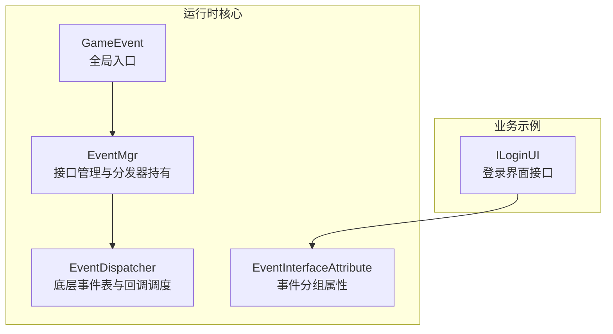
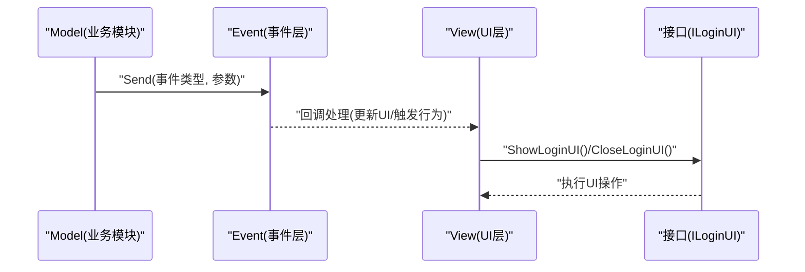
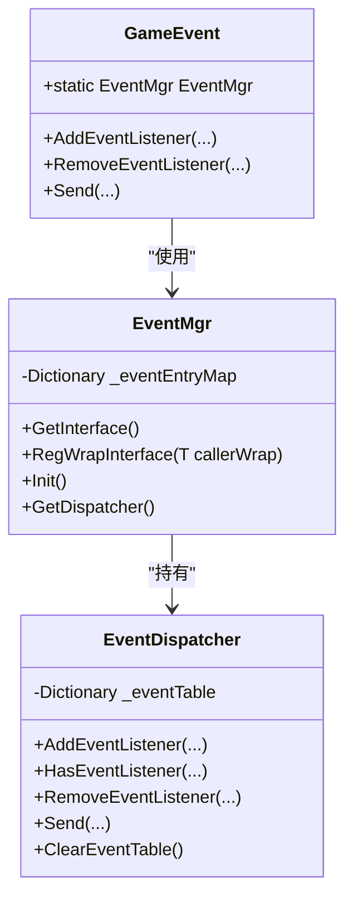
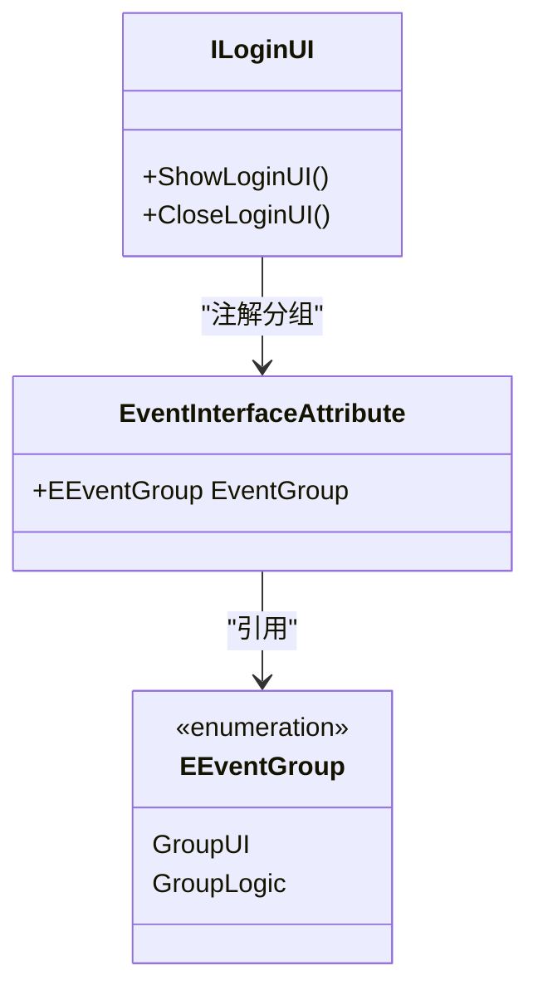
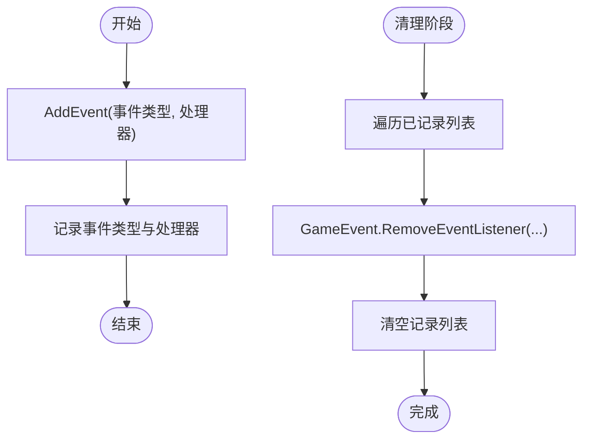
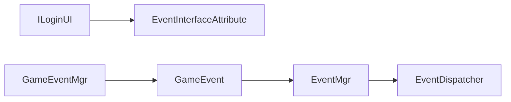

# MVE 架构模式

<cite>
**本文引用的文件**   
- [ILoginUI.cs](file://UnityProject/Assets/GameScripts/HotFix/GameLogic/IEvent/ILoginUI.cs)
- [EventInterfaceAttribute.cs](file://UnityProject/Assets/TEngine/Runtime/Core/GameEvent/EventInterfaceAttribute.cs)
- [EventMgr.cs](file://UnityProject/Assets/TEngine/Runtime/Core/GameEvent/EventMgr.cs)
- [GameEvent.cs](file://UnityProject/Assets/TEngine/Runtime/Core/GameEvent/GameEvent.cs)
- [EventDispatcher.cs](file://UnityProject/Assets/TEngine/Runtime/Core/GameEvent/EventDispatcher.cs)
- [GameEventMgr.cs](file://UnityProject/Assets/TEngine/Runtime/Core/GameEvent/GameEventMgr.cs)
</cite>

## 目录
1. [简介](#简介)
2. [项目结构](#项目结构)
3. [核心组件](#核心组件)
4. [架构总览](#架构总览)
5. [详细组件分析](#详细组件分析)
6. [依赖关系分析](#依赖关系分析)
7. [性能与内存考量](#性能与内存考量)
8. [故障排查指南](#故障排查指南)
9. [结论](#结论)
10. [附录：迁移与实践指南](#附录迁移与实践指南)

## 简介
本文件系统性阐述 TEngine 中 Model-View-Event（MVE）架构模式的落地方式，围绕“模型-视图-事件”的职责分离、事件驱动范式如何解耦业务逻辑与 UI 展示、接口契约设计原则（以 ILoginUI 为例）、模块间通信最佳实践展开。文档同时给出优缺点分析、适用场景、迁移路径以及实际项目中的重构经验总结，帮助读者在 TEngine 中稳定、可维护地构建游戏 UI 与业务交互。

## 项目结构
在本仓库中，MVE 的核心能力集中在以下位置：
- 事件系统与接口契约：位于 Runtime/Core/GameEvent 目录，提供事件分发、接口分组与注册机制
- 示例接口契约：位于 GameScripts/HotFix/GameLogic/IEvent，定义 UI 层对外暴露的接口（如 ILoginUI）

图表来源
- [GameEvent.cs:8-18](file://UnityProject/Assets/TEngine/Runtime/Core/GameEvent/GameEvent.cs#L8-L18)
- [EventMgr.cs:9-78](file://UnityProject/Assets/TEngine/Runtime/Core/GameEvent/EventMgr.cs#L9-L78)
- [EventDispatcher.cs:9-22](file://UnityProject/Assets/TEngine/Runtime/Core/GameEvent/EventDispatcher.cs#L9-L22)
- [EventInterfaceAttribute.cs:8-30](file://UnityProject/Assets/TEngine/Runtime/Core/GameEvent/EventInterfaceAttribute.cs#L8-L30)
- [ILoginUI.cs:5-11](file://UnityProject/Assets/GameScripts/HotFix/GameLogic/IEvent/ILoginUI.cs#L5-L11)

章节来源
- [GameEvent.cs:8-18](file://UnityProject/Assets/TEngine/Runtime/Core/GameEvent/GameEvent.cs#L8-L18)
- [EventMgr.cs:9-78](file://UnityProject/Assets/TEngine/Runtime/Core/GameEvent/EventMgr.cs#L9-L78)
- [EventDispatcher.cs:9-22](file://UnityProject/Assets/TEngine/Runtime/Core/GameEvent/EventDispatcher.cs#L9-L22)
- [EventInterfaceAttribute.cs:8-30](file://UnityProject/Assets/TEngine/Runtime/Core/GameEvent/EventInterfaceAttribute.cs#L8-L30)
- [ILoginUI.cs:5-11](file://UnityProject/Assets/GameScripts/HotFix/GameLogic/IEvent/ILoginUI.cs#L5-L11)

## 核心组件
- Model（数据模型）
  - 职责：承载游戏状态与数据，不感知 UI 细节；通过事件或接口向 View 暴露变更
  - 在 TEngine 中通常由业务模块实现，并通过 GameEvent 或 EventMgr 进行跨模块通信
- View（视图层）
  - 职责：负责 UI 展示与用户输入；订阅事件或调用接口以响应 Model 变化
  - 在 TEngine 中常通过 ILoginUI 等接口被外部逻辑调用，或通过事件系统监听业务事件
- Event（事件层）
  - 职责：提供类型安全、低耦合的消息通道；支持按组划分（GroupUI/GroupLogic）
  - 关键类：GameEvent、EventMgr、EventDispatcher、EventInterfaceAttribute

章节来源
- [GameEvent.cs:8-18](file://UnityProject/Assets/TEngine/Runtime/Core/GameEvent/GameEvent.cs#L8-L18)
- [EventMgr.cs:9-78](file://UnityProject/Assets/TEngine/Runtime/Core/GameEvent/EventMgr.cs#L9-L78)
- [EventDispatcher.cs:9-22](file://UnityProject/Assets/TEngine/Runtime/Core/GameEvent/EventDispatcher.cs#L9-L22)
- [EventInterfaceAttribute.cs:8-30](file://UnityProject/Assets/TEngine/Runtime/Core/GameEvent/EventInterfaceAttribute.cs#L8-L30)

## 架构总览
下图展示了 MVE 在 TEngine 中的典型交互：Model 产生业务事件，Event 层进行分发，View 订阅并更新 UI；同时，View 也可通过接口（如 ILoginUI）被 Model 或中间层调用，形成双向解耦。

图表来源
- [GameEvent.cs:583-798](file://UnityProject/Assets/TEngine/Runtime/Core/GameEvent/GameEvent.cs#L583-L798)
- [EventDispatcher.cs:71-195](file://UnityProject/Assets/TEngine/Runtime/Core/GameEvent/EventDispatcher.cs#L71-L195)
- [ILoginUI.cs:5-11](file://UnityProject/Assets/GameScripts/HotFix/GameLogic/IEvent/ILoginUI.cs#L5-L11)

## 详细组件分析

### 事件系统核心：GameEvent / EventMgr / EventDispatcher
- GameEvent
  - 作为全局静态入口，统一封装 Add/Remove/Send 等操作，内部委托给 EventMgr.Dispatcher
  - 支持 int 与 string 两种事件标识，string 会通过 RuntimeId 转换为 int 以提升性能
- EventMgr
  - 管理“接口包装”（InterfaceWrap），用于将具体实现注入到框架，供其他模块通过泛型获取
  - 持有 EventDispatcher 实例，并提供 Init 清理方法
- EventDispatcher
  - 底层事件表（Dictionary<int, EventDelegateData>）与回调调度
  - 提供 Add/Has/Remove/Send 系列重载，覆盖 0~6 个参数的 Action 委托

图表来源
- [GameEvent.cs:8-18](file://UnityProject/Assets/TEngine/Runtime/Core/GameEvent/GameEvent.cs#L8-L18)
- [EventMgr.cs:9-87](file://UnityProject/Assets/TEngine/Runtime/Core/GameEvent/EventMgr.cs#L9-L87)
- [EventDispatcher.cs:9-22](file://UnityProject/Assets/TEngine/Runtime/Core/GameEvent/EventDispatcher.cs#L9-L22)

章节来源
- [GameEvent.cs:8-18](file://UnityProject/Assets/TEngine/Runtime/Core/GameEvent/GameEvent.cs#L8-L18)
- [EventMgr.cs:9-87](file://UnityProject/Assets/TEngine/Runtime/Core/GameEvent/EventMgr.cs#L9-L87)
- [EventDispatcher.cs:9-22](file://UnityProject/Assets/TEngine/Runtime/Core/GameEvent/EventDispatcher.cs#L9-L22)

### 接口契约与分组：EventInterfaceAttribute 与 ILoginUI
- EventInterfaceAttribute
  - 用于标注接口所属的事件分组（GroupUI/GroupLogic），便于后续按组管理生命周期或权限控制
- ILoginUI
  - 示例 UI 接口，声明 ShowLoginUI/CloseLoginUI 等方法，供业务侧调用而不直接耦合 UI 实现

图表来源
- [EventInterfaceAttribute.cs:8-30](file://UnityProject/Assets/TEngine/Runtime/Core/GameEvent/EventInterfaceAttribute.cs#L8-L30)
- [ILoginUI.cs:5-11](file://UnityProject/Assets/GameScripts/HotFix/GameLogic/IEvent/ILoginUI.cs#L5-L11)

章节来源
- [EventInterfaceAttribute.cs:8-30](file://UnityProject/Assets/TEngine/Runtime/Core/GameEvent/EventInterfaceAttribute.cs#L8-L30)
- [ILoginUI.cs:5-11](file://UnityProject/Assets/GameScripts/HotFix/GameLogic/IEvent/ILoginUI.cs#L5-L11)

### 事件生命周期与内存回收：GameEventMgr
- GameEventMgr
  - 为 UI 相关事件提供统一的 AddEvent 重载族，并在内部记录已添加的监听，以便在 Clear 时批量移除，避免内存泄漏
  - 适合在 UI 生命周期内集中管理事件订阅与释放

图表来源
- [GameEventMgr.cs:11-49](file://UnityProject/Assets/TEngine/Runtime/Core/GameEvent/GameEventMgr.cs#L11-L49)
- [GameEventMgr.cs:57-107](file://UnityProject/Assets/TEngine/Runtime/Core/GameEvent/GameEventMgr.cs#L57-L107)

章节来源
- [GameEventMgr.cs:11-49](file://UnityProject/Assets/TEngine/Runtime/Core/GameEvent/GameEventMgr.cs#L11-L49)
- [GameEventMgr.cs:57-107](file://UnityProject/Assets/TEngine/Runtime/Core/GameEvent/GameEventMgr.cs#L57-L107)

## 依赖关系分析
- GameEvent 依赖 EventMgr 作为门面
- EventMgr 依赖 EventDispatcher 进行底层事件表管理
- ILoginUI 通过 EventInterfaceAttribute 标记分组，便于后续扩展按组管理
- GameEventMgr 依赖 GameEvent 进行事件增删，自身负责生命周期内的清理

图表来源
- [ILoginUI.cs:5-11](file://UnityProject/Assets/GameScripts/HotFix/GameLogic/IEvent/ILoginUI.cs#L5-L11)
- [EventInterfaceAttribute.cs:8-30](file://UnityProject/Assets/TEngine/Runtime/Core/GameEvent/EventInterfaceAttribute.cs#L8-L30)
- [GameEvent.cs:8-18](file://UnityProject/Assets/TEngine/Runtime/Core/GameEvent/GameEvent.cs#L8-L18)
- [EventMgr.cs:9-78](file://UnityProject/Assets/TEngine/Runtime/Core/GameEvent/EventMgr.cs#L9-L78)
- [EventDispatcher.cs:9-22](file://UnityProject/Assets/TEngine/Runtime/Core/GameEvent/EventDispatcher.cs#L9-L22)
- [GameEventMgr.cs:57-107](file://UnityProject/Assets/TEngine/Runtime/Core/GameEvent/GameEventMgr.cs#L57-L107)

章节来源
- [ILoginUI.cs:5-11](file://UnityProject/Assets/GameScripts/HotFix/GameLogic/IEvent/ILoginUI.cs#L5-L11)
- [EventInterfaceAttribute.cs:8-30](file://UnityProject/Assets/TEngine/Runtime/Core/GameEvent/EventInterfaceAttribute.cs#L8-L30)
- [GameEvent.cs:8-18](file://UnityProject/Assets/TEngine/Runtime/Core/GameEvent/GameEvent.cs#L8-L18)
- [EventMgr.cs:9-78](file://UnityProject/Assets/TEngine/Runtime/Core/GameEvent/EventMgr.cs#L9-L78)
- [EventDispatcher.cs:9-22](file://UnityProject/Assets/TEngine/Runtime/Core/GameEvent/EventDispatcher.cs#L9-L22)
- [GameEventMgr.cs:57-107](file://UnityProject/Assets/TEngine/Runtime/Core/GameEvent/GameEventMgr.cs#L57-L107)

## 性能与内存考量
- 事件标识选择
  - 优先使用 int 类型事件标识以减少字符串哈希与分配；string 类型会经 RuntimeId 转换，存在额外开销
- 事件表与回调
  - EventDispatcher 使用 Dictionary<int, EventDelegateData> 存储事件表，查找与插入均为 O(1) 平均复杂度
- 内存回收
  - GameEventMgr 在 Clear 时遍历已记录监听并调用 GameEvent.RemoveEventListener，避免悬挂引用导致内存泄漏
- 接口注入
  - EventMgr 通过泛型 RegWrapInterface 注册接口实现，减少反射与装箱开销，提升运行期性能

章节来源
- [EventDispatcher.cs:11-22](file://UnityProject/Assets/TEngine/Runtime/Core/GameEvent/EventDispatcher.cs#L11-L22)
- [GameEventMgr.cs:30-49](file://UnityProject/Assets/TEngine/Runtime/Core/GameEvent/GameEventMgr.cs#L30-L49)
- [EventMgr.cs:42-57](file://UnityProject/Assets/TEngine/Runtime/Core/GameEvent/EventMgr.cs#L42-L57)

## 故障排查指南
- 事件未触发
  - 检查是否正确调用 AddEventListener 且事件类型一致（int/string）
  - 确认 Send 调用方与监听方是否在同一 EventDispatcher 上下文
- 内存泄漏
  - 确保在 UI 销毁或模块卸载时调用 GameEventMgr.Clear 或对应 RemoveEventListener
- 接口为空
  - 检查是否通过 EventMgr.RegWrapInterface 注册了接口实现
  - 使用 EventMgr.GetInterface<T>() 获取前确保已注册

章节来源
- [GameEvent.cs:28-118](file://UnityProject/Assets/TEngine/Runtime/Core/GameEvent/GameEvent.cs#L28-L118)
- [GameEvent.cs:233-316](file://UnityProject/Assets/TEngine/Runtime/Core/GameEvent/GameEvent.cs#L233-L316)
- [GameEventMgr.cs:30-49](file://UnityProject/Assets/TEngine/Runtime/Core/GameEvent/GameEventMgr.cs#L30-L49)
- [EventMgr.cs:30-57](file://UnityProject/Assets/TEngine/Runtime/Core/GameEvent/EventMgr.cs#L30-L57)

## 结论
TEngine 的 MVE 模式通过清晰的分层与事件驱动机制，有效解耦了 Model 与 View，提升了代码的可维护性与可扩展性。借助 EventInterfaceAttribute 的分组能力与 EventMgr 的接口注入机制，可以在复杂项目中实现稳定的模块间通信。配合 GameEventMgr 的生命周期管理，能够显著降低内存泄漏风险。建议在大型 UI 与多模块协作场景中采用该模式，并结合事件分组与接口契约进行规范化开发。

## 附录：迁移与实践指南

### 从传统耦合到 MVE 的重构步骤
- 识别 UI 与业务耦合点
  - 将 UI 对业务模块的直接调用抽取为事件或接口（如 ILoginUI）
- 定义事件契约
  - 使用 EventInterfaceAttribute 标注接口分组（GroupUI/GroupLogic）
- 建立事件通道
  - 使用 GameEvent.AddEventListener/Send 或 GameEventMgr 统一管理 UI 事件
- 注入接口实现
  - 通过 EventMgr.RegWrapInterface 注册 UI 接口实现，供业务侧通过 GetInterface<T>() 调用
- 完善生命周期
  - 在 UI 销毁或模块卸载时调用 GameEventMgr.Clear 或显式 RemoveEventListener

### 最佳实践
- 事件命名与分组
  - 使用有意义的 int 常量或 string 事件名，并按功能域划分 GroupUI/GroupLogic
- 接口粒度
  - 接口方法应聚焦单一职责，避免巨型接口；必要时拆分为多个细粒度接口
- 事件参数
  - 尽量传递轻量数据结构，避免大对象频繁分配；必要时使用对象池
- 错误处理
  - 在事件回调中捕获异常并上报日志，防止单个回调失败影响整体流程

### 实际案例要点（基于现有代码）
- ILoginUI 定义了登录 UI 的对外能力，结合 EventInterfaceAttribute 将其归入 UI 分组
- 业务模块可通过 EventMgr.GetInterface<ILoginUI>() 调用 UI 能力，无需直接依赖 UI 实现
- 使用 GameEventMgr 在 UI 生命周期内集中管理事件订阅与释放，避免内存泄漏

章节来源
- [ILoginUI.cs:5-11](file://UnityProject/Assets/GameScripts/HotFix/GameLogic/IEvent/ILoginUI.cs#L5-L11)
- [EventInterfaceAttribute.cs:8-30](file://UnityProject/Assets/TEngine/Runtime/Core/GameEvent/EventInterfaceAttribute.cs#L8-L30)
- [EventMgr.cs:30-57](file://UnityProject/Assets/TEngine/Runtime/Core/GameEvent/EventMgr.cs#L30-L57)
- [GameEventMgr.cs:57-107](file://UnityProject/Assets/TEngine/Runtime/Core/GameEvent/GameEventMgr.cs#L57-L107)