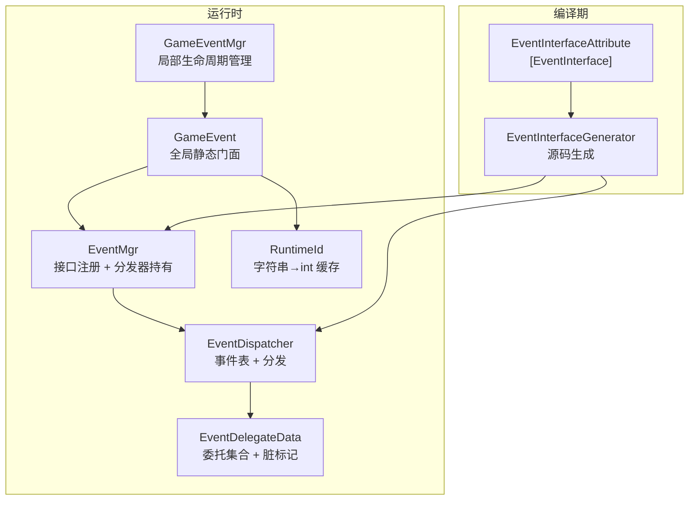
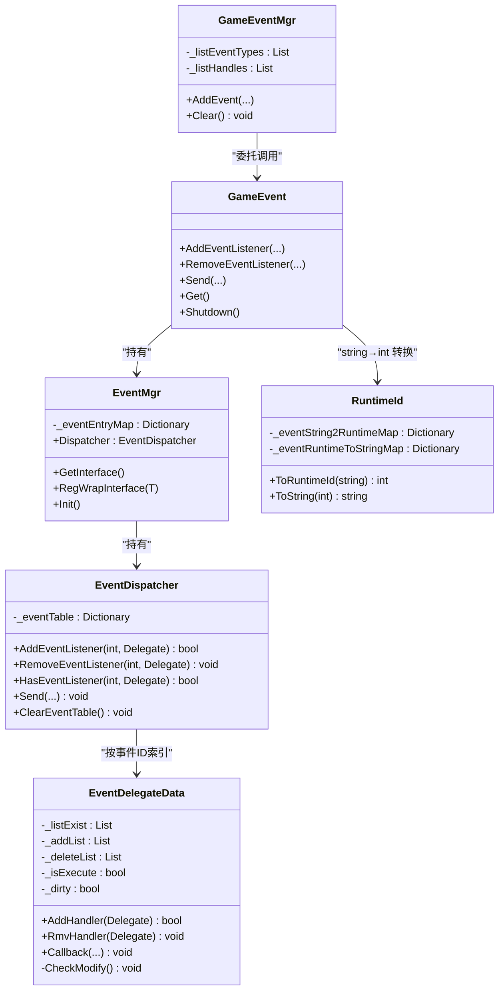
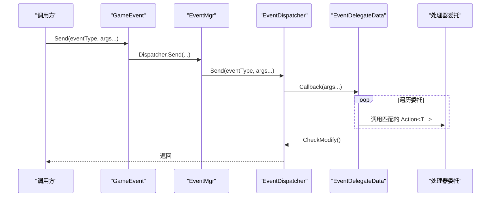
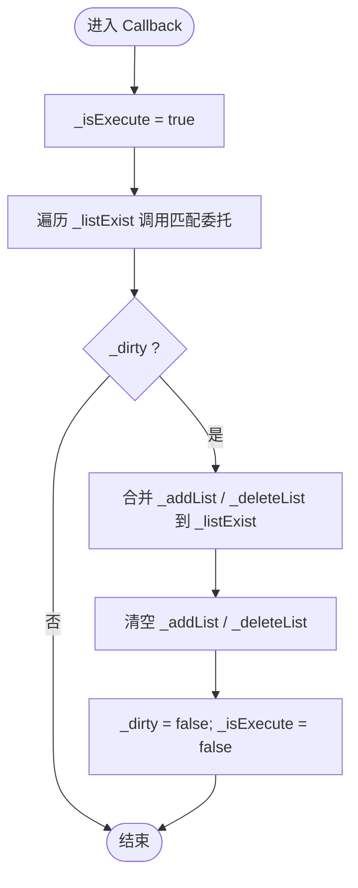
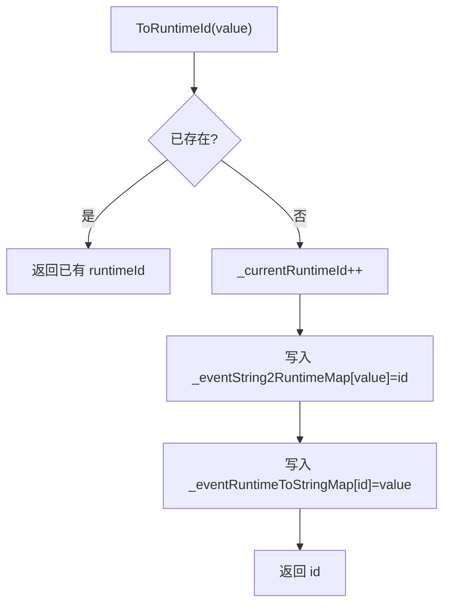
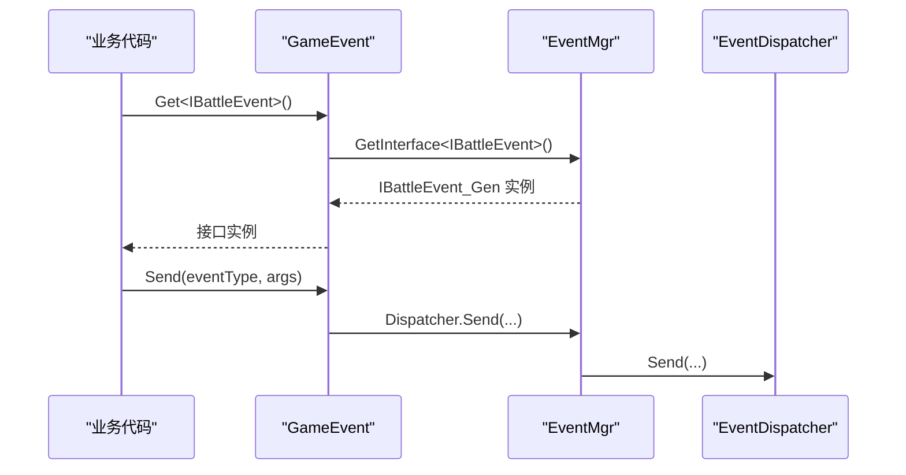
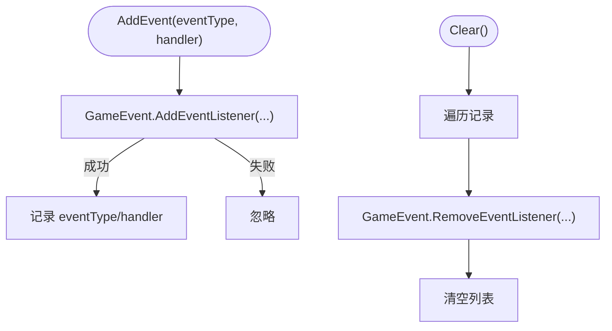
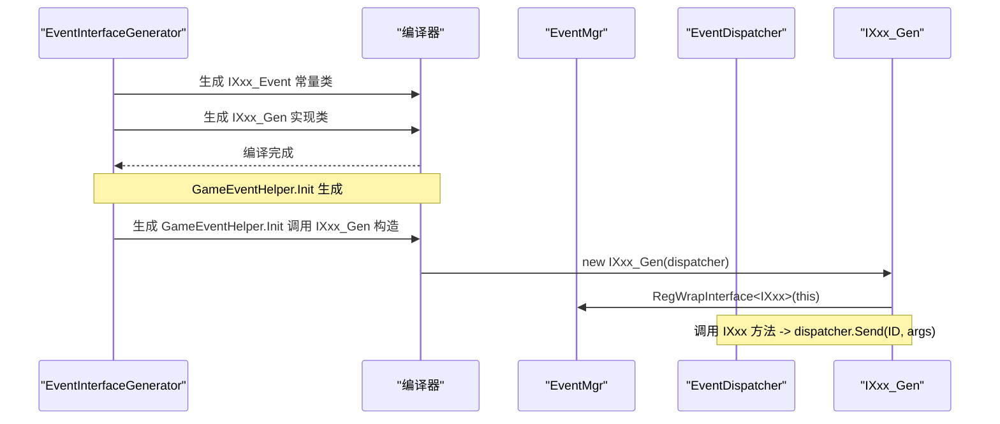
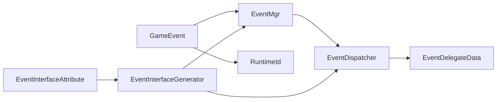

# 事件机制原理

<cite>
**本文引用的文件**   
- [EventDispatcher.cs](file://UnityProject/Assets/TEngine/Runtime/Core/GameEvent/EventDispatcher.cs)
- [EventDelegateData.cs](file://UnityProject/Assets/TEngine/Runtime/Core/GameEvent/EventDelegateData.cs)
- [EventMgr.cs](file://UnityProject/Assets/TEngine/Runtime/Core/GameEvent/EventMgr.cs)
- [GameEvent.cs](file://UnityProject/Assets/TEngine/Runtime/Core/GameEvent/GameEvent.cs)
- [GameEventMgr.cs](file://UnityProject/Assets/TEngine/Runtime/Core/GameEvent/GameEventMgr.cs)
- [RuntimeId.cs](file://UnityProject/Assets/TEngine/Runtime/Core/GameEvent/RuntimeId.cs)
- [EventInterfaceAttribute.cs](file://UnityProject/Assets/TEngine/Runtime/Core/GameEvent/EventInterfaceAttribute.cs)
- [EventInterfaceGenerator.cs](file://Tools/GameEventSourceGenerator/SourceGenerator/Generator/EventInterfaceGenerator.cs)
- [3-2-事件模块.md](file://Books/3-2-事件模块.md)
</cite>

## 目录
1. [简介](#简介)
2. [项目结构](#项目结构)
3. [核心组件](#核心组件)
4. [架构总览](#架构总览)
5. [详细组件分析](#详细组件分析)
6. [依赖关系分析](#依赖关系分析)
7. [性能与零 GC 设计](#性能与零-gc-设计)
8. [故障排查指南](#故障排查指南)
9. [结论](#结论)
10. [附录：命名规范与最佳实践](#附录：命名规范与最佳实践)

## 简介
本文件系统性解析 TEngine 事件系统的底层实现，覆盖以下关键主题：
- EventDispatcher 的事件分发机制与委托链管理
- 事件 ID 管理策略（string/int 类型选择与 RuntimeId 缓存）
- 事件订阅/取消订阅的生命周期管理（含 UI 自动清理与 GameEventMgr 批量管理）
- 零 GC 设计与内存优化（对象池、预分配、避免装箱/重复分配）
- 接口事件的 Source Generator 生成流程与委托链构建
- 数据结构设计、内存布局优化与性能关键路径分析
- 设计模式、命名规范与最佳实践

## 项目结构
事件系统位于 UnityProject/Assets/TEngine/Runtime/Core/GameEvent 下，核心由门面类、分发器、委托数据、运行时 ID 映射以及 Source Generator 组成。

**图表来源**
- [GameEvent.cs:8-18](file://UnityProject/Assets/TEngine/Runtime/Core/GameEvent/GameEvent.cs#L8-L18)
- [EventMgr.cs:9-88](file://UnityProject/Assets/TEngine/Runtime/Core/GameEvent/EventMgr.cs#L9-L88)
- [EventDispatcher.cs:9-199](file://UnityProject/Assets/TEngine/Runtime/Core/GameEvent/EventDispatcher.cs#L9-L199)
- [EventDelegateData.cs:9-286](file://UnityProject/Assets/TEngine/Runtime/Core/GameEvent/EventDelegateData.cs#L9-L286)
- [RuntimeId.cs:10-55](file://UnityProject/Assets/TEngine/Runtime/Core/GameEvent/RuntimeId.cs#L10-L55)
- [GameEventMgr.cs:9-109](file://UnityProject/Assets/TEngine/Runtime/Core/GameEvent/GameEventMgr.cs#L9-L109)
- [EventInterfaceAttribute.cs:8-30](file://UnityProject/Assets/TEngine/Runtime/Core/GameEvent/EventInterfaceAttribute.cs#L8-L30)
- [EventInterfaceGenerator.cs:9-74](file://Tools/GameEventSourceGenerator/SourceGenerator/Generator/EventInterfaceGenerator.cs#L9-L74)

**章节来源**
- [GameEvent.cs:8-18](file://UnityProject/Assets/TEngine/Runtime/Core/GameEvent/GameEvent.cs#L8-L18)
- [EventMgr.cs:9-88](file://UnityProject/Assets/TEngine/Runtime/Core/GameEvent/EventMgr.cs#L9-L88)
- [EventDispatcher.cs:9-199](file://UnityProject/Assets/TEngine/Runtime/Core/GameEvent/EventDispatcher.cs#L9-L199)
- [EventDelegateData.cs:9-286](file://UnityProject/Assets/TEngine/Runtime/Core/GameEvent/EventDelegateData.cs#L9-L286)
- [RuntimeId.cs:10-55](file://UnityProject/Assets/TEngine/Runtime/Core/GameEvent/RuntimeId.cs#L10-L55)
- [GameEventMgr.cs:9-109](file://UnityProject/Assets/TEngine/Runtime/Core/GameEvent/GameEventMgr.cs#L9-L109)
- [EventInterfaceAttribute.cs:8-30](file://UnityProject/Assets/TEngine/Runtime/Core/GameEvent/EventInterfaceAttribute.cs#L8-L30)
- [EventInterfaceGenerator.cs:9-74](file://Tools/GameEventSourceGenerator/SourceGenerator/Generator/EventInterfaceGenerator.cs#L9-L74)

## 核心组件
- GameEvent：全局静态门面，统一对外暴露 AddEventListener/RemoveEventListener/Send/Get 等 API，内部委托给 EventMgr。
- EventMgr：维护接口实现实例的注册表（Type → InterfaceWrap），并持有 EventDispatcher 实例；提供 Init 清理。
- EventDispatcher：基于 Dictionary<int, EventDelegateData> 的事件表，负责增删监听与按 eventType 分发回调。
- EventDelegateData：每个事件类型的委托集合，支持在分发期间安全地增删委托（脏标记 + 延迟合并）。
- RuntimeId：字符串到 int 的运行时映射，避免频繁哈希计算，提升 string 事件性能。
- GameEventMgr：为局部作用域（非 UI 类）提供批量 AddEvent 和 Clear 能力，简化生命周期管理。
- EventInterfaceAttribute + EventInterfaceGenerator：编译期扫描带 [EventInterface] 的接口，自动生成事件 ID 常量类、接口实现类与初始化代码。

**章节来源**
- [GameEvent.cs:8-18](file://UnityProject/Assets/TEngine/Runtime/Core/GameEvent/GameEvent.cs#L8-L18)
- [EventMgr.cs:9-88](file://UnityProject/Assets/TEngine/Runtime/Core/GameEvent/EventMgr.cs#L9-L88)
- [EventDispatcher.cs:9-199](file://UnityProject/Assets/TEngine/Runtime/Core/GameEvent/EventDispatcher.cs#L9-L199)
- [EventDelegateData.cs:9-286](file://UnityProject/Assets/TEngine/Runtime/Core/GameEvent/EventDelegateData.cs#L9-L286)
- [RuntimeId.cs:10-55](file://UnityProject/Assets/TEngine/Runtime/Core/GameEvent/RuntimeId.cs#L10-L55)
- [GameEventMgr.cs:9-109](file://UnityProject/Assets/TEngine/Runtime/Core/GameEvent/GameEventMgr.cs#L9-L109)
- [EventInterfaceAttribute.cs:8-30](file://UnityProject/Assets/TEngine/Runtime/Core/GameEvent/EventInterfaceAttribute.cs#L8-L30)
- [EventInterfaceGenerator.cs:9-74](file://Tools/GameEventSourceGenerator/SourceGenerator/Generator/EventInterfaceGenerator.cs#L9-L74)

## 架构总览
事件系统采用“门面 + 管理器 + 分发器”的分层架构，结合 Source Generator 将接口方法转为强类型事件调用，兼顾灵活性与类型安全。

**图表来源**
- [GameEvent.cs:8-18](file://UnityProject/Assets/TEngine/Runtime/Core/GameEvent/GameEvent.cs#L8-L18)
- [EventMgr.cs:9-88](file://UnityProject/Assets/TEngine/Runtime/Core/GameEvent/EventMgr.cs#L9-L88)
- [EventDispatcher.cs:9-199](file://UnityProject/Assets/TEngine/Runtime/Core/GameEvent/EventDispatcher.cs#L9-L199)
- [EventDelegateData.cs:9-286](file://UnityProject/Assets/TEngine/Runtime/Core/GameEvent/EventDelegateData.cs#L9-L286)
- [RuntimeId.cs:10-55](file://UnityProject/Assets/TEngine/Runtime/Core/GameEvent/RuntimeId.cs#L10-L55)
- [GameEventMgr.cs:9-109](file://UnityProject/Assets/TEngine/Runtime/Core/GameEvent/GameEventMgr.cs#L9-L109)

## 详细组件分析

### EventDispatcher：事件分发与委托链
- 数据结构：Dictionary<int, EventDelegateData> 作为事件表，键为事件 ID，值为委托集合封装。
- 订阅/取消订阅：AddEventListener/RemoveEventListener/HasEventListener 直接操作对应 EventDelegateData。
- 分发：Send 重载根据参数个数调用 EventDelegateData.Callback(...)，内部遍历委托列表并按 Action 泛型匹配执行。
- 线程/并发安全：通过 EventDelegateData 的 _isExecute 与 _dirty 标志，保证在分发过程中增删委托不会破坏迭代。

**图表来源**
- [GameEvent.cs:594-687](file://UnityProject/Assets/TEngine/Runtime/Core/GameEvent/GameEvent.cs#L594-L687)
- [EventDispatcher.cs:71-195](file://UnityProject/Assets/TEngine/Runtime/Core/GameEvent/EventDispatcher.cs#L71-L195)
- [EventDelegateData.cs:121-284](file://UnityProject/Assets/TEngine/Runtime/Core/GameEvent/EventDelegateData.cs#L121-L284)

**章节来源**
- [EventDispatcher.cs:9-199](file://UnityProject/Assets/TEngine/Runtime/Core/GameEvent/EventDispatcher.cs#L9-L199)
- [EventDelegateData.cs:9-286](file://UnityProject/Assets/TEngine/Runtime/Core/GameEvent/EventDelegateData.cs#L9-L286)

### EventDelegateData：委托集合与脏标记
- 三个列表：_listExist（当前有效）、_addList（分发中新增）、_deleteList（分发中删除）。
- 分发期间增删：设置 _isExecute = true，并将变更写入 _addList/_deleteList，不直接修改 _listExist。
- 分发后合并：CheckModify 将 _addList 并入 _listExist，并从 _listExist 移除 _deleteList，然后清空临时列表。
- 复杂度：Contains/Remove 为 O(n)，适合中小规模委托数；若需高频增删可考虑 HashSet 或分桶优化。

**图表来源**
- [EventDelegateData.cs:96-116](file://UnityProject/Assets/TEngine/Runtime/Core/GameEvent/EventDelegateData.cs#L96-L116)
- [EventDelegateData.cs:121-284](file://UnityProject/Assets/TEngine/Runtime/Core/GameEvent/EventDelegateData.cs#L121-L284)

**章节来源**
- [EventDelegateData.cs:9-286](file://UnityProject/Assets/TEngine/Runtime/Core/GameEvent/EventDelegateData.cs#L9-L286)

### RuntimeId：字符串到整型的运行时映射
- 目的：将字符串事件名转换为稳定的 int，避免每次哈希开销。
- 机制：首次 ToRuntimeId 时建立双向映射（string↔int），后续命中缓存直接返回。
- 适用场景：string 事件仅在动态拼接事件名时使用；优先使用 int/接口事件以获得更好性能。

**图表来源**
- [RuntimeId.cs:32-44](file://UnityProject/Assets/TEngine/Runtime/Core/GameEvent/RuntimeId.cs#L32-L44)

**章节来源**
- [RuntimeId.cs:10-55](file://UnityProject/Assets/TEngine/Runtime/Core/GameEvent/RuntimeId.cs#L10-L55)

### GameEvent 与 EventMgr：门面与接口注册
- GameEvent：所有 Add/Remove/Send 均转发至 EventMgr.Dispatcher；Get<T> 通过 EventMgr.GetInterface<T> 获取接口实现。
- EventMgr：维护 Type → InterfaceWrap 的字典，用于 Source Generator 生成的实现类注册；Init 清理事件表与接口注册表。

**图表来源**
- [GameEvent.cs:585-597](file://UnityProject/Assets/TEngine/Runtime/Core/GameEvent/GameEvent.cs#L585-L597)
- [EventMgr.cs:30-40](file://UnityProject/Assets/TEngine/Runtime/Core/GameEvent/EventMgr.cs#L30-L40)
- [EventDispatcher.cs:71-195](file://UnityProject/Assets/TEngine/Runtime/Core/GameEvent/EventDispatcher.cs#L71-L195)

**章节来源**
- [GameEvent.cs:8-18](file://UnityProject/Assets/TEngine/Runtime/Core/GameEvent/GameEvent.cs#L8-L18)
- [EventMgr.cs:9-88](file://UnityProject/Assets/TEngine/Runtime/Core/GameEvent/EventMgr.cs#L9-L88)

### GameEventMgr：局部生命周期管理
- 用途：为非 UI 类提供批量 AddEvent 与一次性 Clear 的能力，避免手动 RemoveEventListener。
- 行为：AddEvent 成功后记录 eventType 与 handler，Clear 时遍历并调用 GameEvent.RemoveEventListener。

**图表来源**
- [GameEventMgr.cs:51-49](file://UnityProject/Assets/TEngine/Runtime/Core/GameEvent/GameEventMgr.cs#L51-L49)

**章节来源**
- [GameEventMgr.cs:9-109](file://UnityProject/Assets/TEngine/Runtime/Core/GameEvent/GameEventMgr.cs#L9-L109)

### Source Generator：接口事件与委托链构建
- 输入：带有 [EventInterface] 的接口定义。
- 输出：
  - 事件 ID 常量类（如 IBattleEvent_Event），包含每个方法的 int 常量。
  - 接口实现类（如 IBattleEvent_Gen），构造时向 EventMgr 注册自身，并在方法中调用 EventDispatcher.Send。
  - GameEventHelper.Init 与分组辅助类，用于集中注册与便捷 Add/Remove 绑定。
- 关键点：实现类构造函数中调用 GameEvent.EventMgr.RegWrapInterface<T>(this)，使 GameEvent.Get<T>() 能返回该实现。

**图表来源**
- [EventInterfaceGenerator.cs:93-107](file://Tools/GameEventSourceGenerator/SourceGenerator/Generator/EventInterfaceGenerator.cs#L93-L107)
- [EventInterfaceGenerator.cs:263-312](file://Tools/GameEventSourceGenerator/SourceGenerator/Generator/EventInterfaceGenerator.cs#L263-L312)
- [EventInterfaceGenerator.cs:229-260](file://Tools/GameEventSourceGenerator/SourceGenerator/Generator/EventInterfaceGenerator.cs#L229-L260)
- [EventMgr.cs:47-57](file://UnityProject/Assets/TEngine/Runtime/Core/GameEvent/EventMgr.cs#L47-L57)

**章节来源**
- [EventInterfaceAttribute.cs:8-30](file://UnityProject/Assets/TEngine/Runtime/Core/GameEvent/EventInterfaceAttribute.cs#L8-L30)
- [EventInterfaceGenerator.cs:9-74](file://Tools/GameEventSourceGenerator/SourceGenerator/Generator/EventInterfaceGenerator.cs#L9-L74)
- [EventInterfaceGenerator.cs:229-312](file://Tools/GameEventSourceGenerator/SourceGenerator/Generator/EventInterfaceGenerator.cs#L229-L312)
- [EventMgr.cs:47-57](file://UnityProject/Assets/TEngine/Runtime/Core/GameEvent/EventMgr.cs#L47-L57)

## 依赖关系分析
- GameEvent 依赖 EventMgr 与 RuntimeId。
- EventMgr 依赖 EventDispatcher 与 Type 字典。
- EventDispatcher 依赖 EventDelegateData。
- Source Generator 依赖 EventInterfaceAttribute 与 EventMgr/EventDispatcher 的约定。

**图表来源**
- [GameEvent.cs:8-18](file://UnityProject/Assets/TEngine/Runtime/Core/GameEvent/GameEvent.cs#L8-L18)
- [EventMgr.cs:9-88](file://UnityProject/Assets/TEngine/Runtime/Core/GameEvent/EventMgr.cs#L9-L88)
- [EventDispatcher.cs:9-199](file://UnityProject/Assets/TEngine/Runtime/Core/GameEvent/EventDispatcher.cs#L9-L199)
- [EventDelegateData.cs:9-286](file://UnityProject/Assets/TEngine/Runtime/Core/GameEvent/EventDelegateData.cs#L9-L286)
- [EventInterfaceGenerator.cs:9-74](file://Tools/GameEventSourceGenerator/SourceGenerator/Generator/EventInterfaceGenerator.cs#L9-L74)
- [EventInterfaceAttribute.cs:8-30](file://UnityProject/Assets/TEngine/Runtime/Core/GameEvent/EventInterfaceAttribute.cs#L8-L30)

**章节来源**
- [GameEvent.cs:8-18](file://UnityProject/Assets/TEngine/Runtime/Core/GameEvent/GameEvent.cs#L8-L18)
- [EventMgr.cs:9-88](file://UnityProject/Assets/TEngine/Runtime/Core/GameEvent/EventMgr.cs#L9-L88)
- [EventDispatcher.cs:9-199](file://UnityProject/Assets/TEngine/Runtime/Core/GameEvent/EventDispatcher.cs#L9-L199)
- [EventDelegateData.cs:9-286](file://UnityProject/Assets/TEngine/Runtime/Core/GameEvent/EventDelegateData.cs#L9-L286)
- [EventInterfaceGenerator.cs:9-74](file://Tools/GameEventSourceGenerator/SourceGenerator/Generator/EventInterfaceGenerator.cs#L9-L74)
- [EventInterfaceAttribute.cs:8-30](file://UnityProject/Assets/TEngine/Runtime/Core/GameEvent/EventInterfaceAttribute.cs#L8-L30)

## 性能与零 GC 设计
- 事件 ID 选择：
  - 优先使用 int 事件或接口事件（由 Source Generator 生成 int 常量），避免 string 哈希与装箱。
  - string 事件通过 RuntimeId.ToRuntimeId 进行一次映射并缓存，减少重复哈希。
- 委托集合优化：
  - EventDelegateData 使用 List<Delegate> 存储，避免在分发期间修改主列表，降低 GC 压力。
  - 分发期间增删通过 _addList/_deleteList 暂存，分发结束后一次性合并，减少中间分配。
- 预分配与复用：
  - EventDispatcher 的 _eventTable 使用 Dictionary<int, EventDelegateData>，按需创建 EventDelegateData 实例。
  - EventMgr 的 _eventEntryMap 使用 Type 作为键，避免字符串键带来的额外开销。
- 零 GC 注意事项：
  - 尽量避免在热路径上创建临时对象（如匿名委托、LINQ 中间结果）。
  - 使用 GameEventMgr 批量管理生命周期，减少多次 RemoveEventListener 的开销。
  - 在 UI 内使用 AddUIEvent（框架集成）自动清理，避免泄漏与重复注册。

[本节为通用性能指导，不直接分析具体文件]

## 故障排查指南
- 忘记初始化接口事件：
  - 现象：接口事件全部无响应且无报错。
  - 处理：确保在入口最先调用 GameEventHelper.Init()。
- UI 外部使用 AddEventListener 导致泄漏：
  - 现象：窗口销毁后仍持有回调引用。
  - 处理：UI 内使用 AddUIEvent；非 UI 类使用 GameEventMgr.Clear() 或显式 RemoveEventListener。
- 手写事件 ID 冲突或拼写错误：
  - 现象：事件无法匹配或误触发。
  - 处理：使用 Source Generator 生成的事件 ID 常量，或使用 RuntimeId.ToRuntimeId。
- 回调签名不匹配：
  - 现象：运行时异常或无响应。
  - 处理：优先使用接口事件以在编译期检查类型；确保发送与监听参数一致。
- 误用不存在的方法：
  - 现象：编译错误或逻辑缺失。
  - 处理：使用 RemoveEventListener（单个）、GameEventMgr.Clear（局部批量）或 GameEvent.Shutdown（全局退出）。

**章节来源**
- [3-2-事件模块.md:289-389](file://Books/3-2-事件模块.md#L289-L389)

## 结论
TEngine 事件系统通过清晰的分层架构与 Source Generator 实现了高性能、类型安全且易用的事件机制。EventDispatcher 与 EventDelegateData 的组合保证了分发期间的安全性与低分配；RuntimeId 提供了 string 事件的轻量映射；GameEventMgr 与 UI 生命周期集成简化了订阅管理。推荐优先使用接口事件与 int 事件，遵循命名规范与最佳实践，以获得稳定且高效的通信体验。

[本节为总结性内容，不直接分析具体文件]

## 附录：命名规范与最佳实践
- 接口事件命名：
  - 接口：I + 动词/业务名词（如 IBattleEvent）。
  - 方法：On + 过去式动词 + 名词（如 OnHpChanged）。
- 事件 ID：
  - 禁止手写 int 常量，使用 Source Generator 生成的常量（如 IBattleEvent_Event.OnHpChanged）。
- 生命周期：
  - UI 内始终使用 AddUIEvent，自动清理。
  - 非 UI 类使用 GameEventMgr 批量管理，或在 Dispose 中显式 RemoveEventListener。
- 性能：
  - 优先 int/接口事件；仅在动态拼接时使用 string 事件。
  - 避免在热路径创建临时对象，减少 GC 压力。

**章节来源**
- [3-2-事件模块.md:417-425](file://Books/3-2-事件模块.md#L417-L425)
- [3-2-事件模块.md:393-416](file://Books/3-2-事件模块.md#L393-L416)