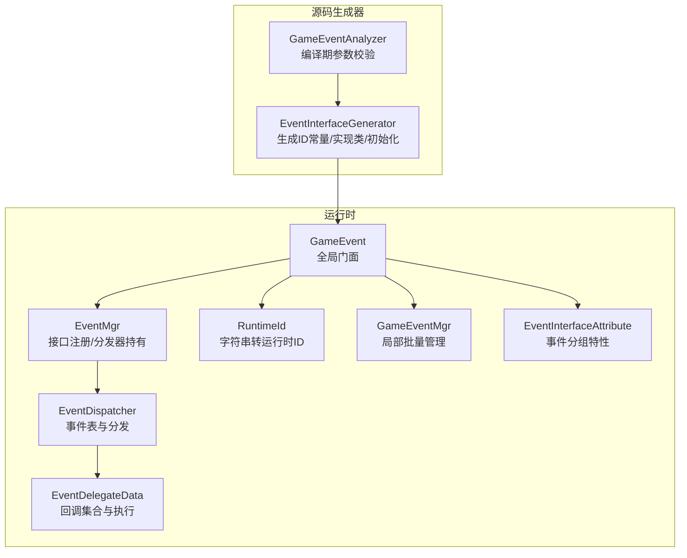
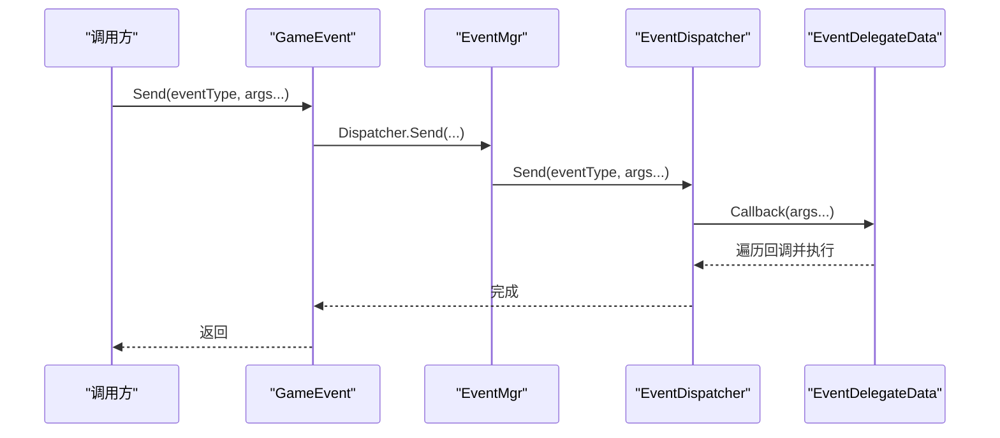
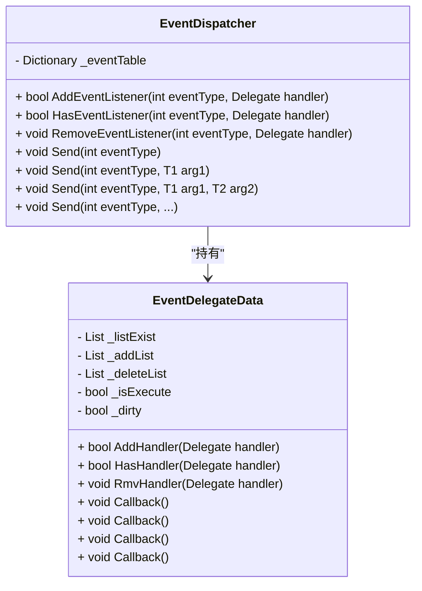
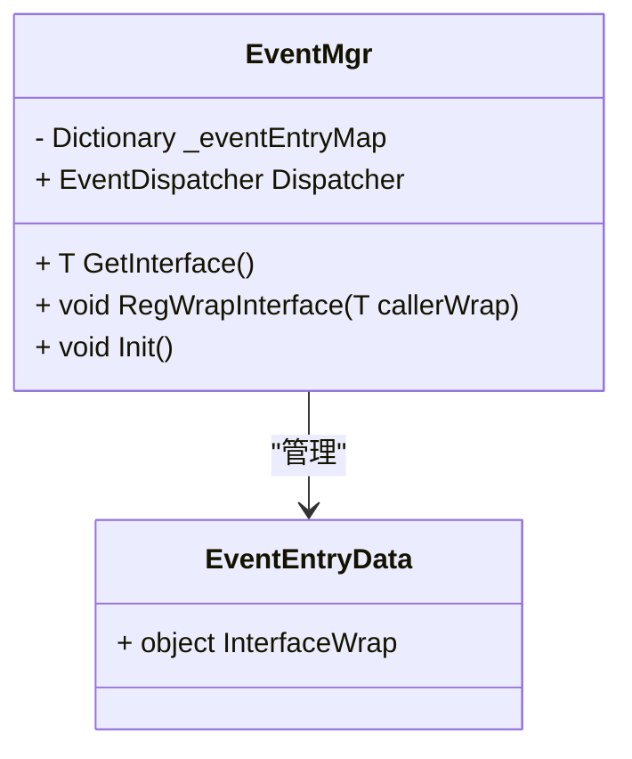
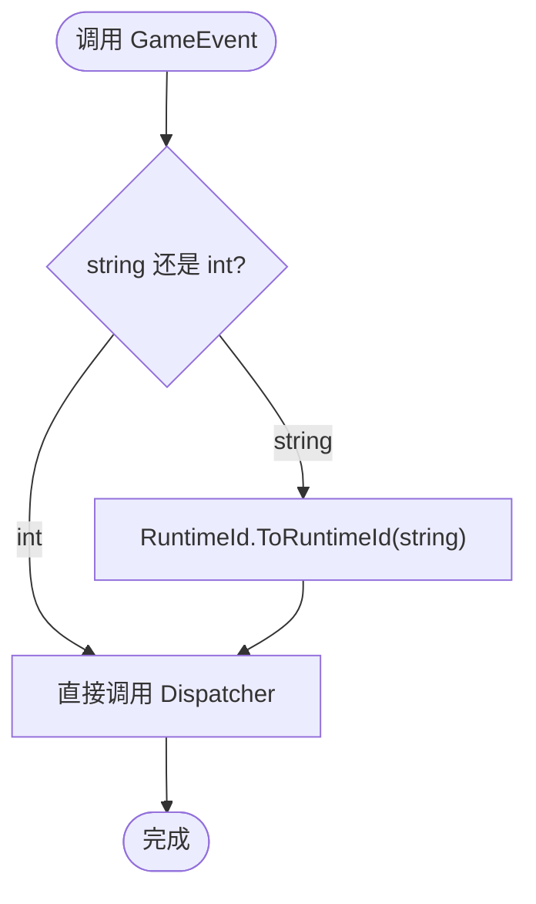
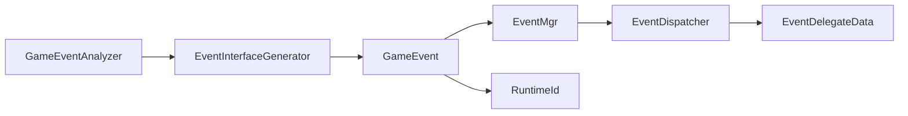
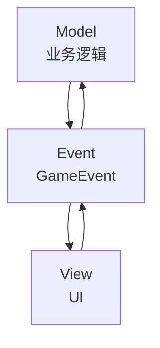
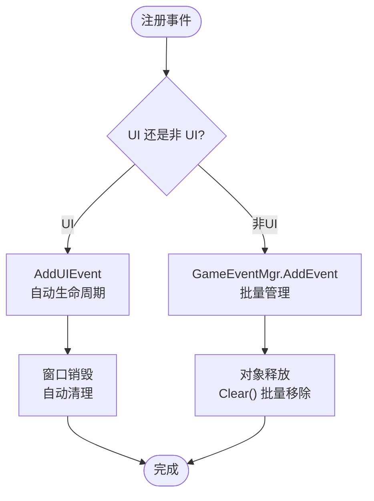
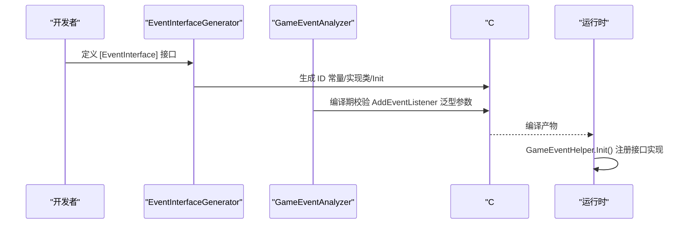

# 事件系统

<cite>
**本文引用的文件**   
- [EventDispatcher.cs](file://UnityProject/Assets/TEngine/Runtime/Core/GameEvent/EventDispatcher.cs)
- [EventDelegateData.cs](file://UnityProject/Assets/TEngine/Runtime/Core/GameEvent/EventDelegateData.cs)
- [EventMgr.cs](file://UnityProject/Assets/TEngine/Runtime/Core/GameEvent/EventMgr.cs)
- [GameEvent.cs](file://UnityProject/Assets/TEngine/Runtime/Core/GameEvent/GameEvent.cs)
- [GameEventMgr.cs](file://UnityProject/Assets/TEngine/Runtime/Core/GameEvent/GameEventMgr.cs)
- [RuntimeId.cs](file://UnityProject/Assets/TEngine/Runtime/Core/GameEvent/RuntimeId.cs)
- [EventInterfaceAttribute.cs](file://UnityProject/Assets/TEngine/Runtime/Core/GameEvent/EventInterfaceAttribute.cs)
- [EventInterfaceGenerator.cs](file://Tools/GameEventSourceGenerator/SourceGenerator/Generator/EventInterfaceGenerator.cs)
- [GameEventAnalyzer.cs](file://Tools/GameEventSourceGenerator/GameEventAnalyzer/Analyzer/GameEventAnalyzer.cs)
- [3-2-事件模块.md](file://Books/3-2-事件模块.md)
</cite>

## 目录
1. [简介](#简介)
2. [项目结构](#项目结构)
3. [核心组件](#核心组件)
4. [架构总览](#架构总览)
5. [详细组件分析](#详细组件分析)
6. [依赖关系分析](#依赖关系分析)
7. [性能与零GC优化](#性能与零gc优化)
8. [MVE架构与事件驱动范式](#mve架构与事件驱动范式)
9. [事件ID管理（string/int）](#事件id管理stringint)
10. [订阅与生命周期管理](#订阅与生命周期管理)
11. [事件源生成器工作原理](#事件源生成器工作原理)
12. [最佳实践与命名规范](#最佳实践与命名规范)
13. [调试、性能分析与内存泄漏防护](#调试性能分析与内存泄漏防护)
14. [结论](#结论)

## 简介
本文件系统性梳理 TEngine 事件系统的实现原理与使用方式，重点解释：
- 零 GC 的事件分发机制与 EventDispatcher 的工作方式
- MVE（Model-View-Event）架构在框架中的应用
- 事件 ID 的 string/int 管理机制
- 事件订阅/取消订阅的生命周期管理
- 事件源生成器（Source Generator）如何提升开发效率
- 设计、命名与性能优化的最佳实践
- 调试、性能分析与内存泄漏防护技巧

## 项目结构
事件系统位于 Runtime/Core/GameEvent 目录下，包含运行时核心类；同时提供 Source Generator 工具链用于编译期类型安全与代码生成。

**图表来源**
- [GameEvent.cs:8-18](file://UnityProject/Assets/TEngine/Runtime/Core/GameEvent/GameEvent.cs#L8-L18)
- [EventMgr.cs:9-24](file://UnityProject/Assets/TEngine/Runtime/Core/GameEvent/EventMgr.cs#L9-L24)
- [EventDispatcher.cs:9-14](file://UnityProject/Assets/TEngine/Runtime/Core/GameEvent/EventDispatcher.cs#L9-L14)
- [EventDelegateData.cs:9-16](file://UnityProject/Assets/TEngine/Runtime/Core/GameEvent/EventDelegateData.cs#L9-L16)
- [RuntimeId.cs:10-25](file://UnityProject/Assets/TEngine/Runtime/Core/GameEvent/RuntimeId.cs#L10-L25)
- [GameEventMgr.cs:9-13](file://UnityProject/Assets/TEngine/Runtime/Core/GameEvent/GameEventMgr.cs#L9-L13)
- [EventInterfaceAttribute.cs:8-29](file://UnityProject/Assets/TEngine/Runtime/Core/GameEvent/EventInterfaceAttribute.cs#L8-L29)
- [EventInterfaceGenerator.cs:10-74](file://Tools/GameEventSourceGenerator/SourceGenerator/Generator/EventInterfaceGenerator.cs#L10-L74)
- [GameEventAnalyzer.cs:14-65](file://Tools/GameEventSourceGenerator/GameEventAnalyzer/Analyzer/GameEventAnalyzer.cs#L14-L65)

**章节来源**
- [3-2-事件模块.md:11-31](file://Books/3-2-事件模块.md#L11-L31)

## 核心组件
- GameEvent：全局静态门面，统一对外暴露 AddEventListener/Send/RemoveEventListener/Get 等 API，内部委托给 EventMgr。
- EventMgr：维护接口实现实例的映射（RegWrapInterface/GetInterface），并持有 EventDispatcher。
- EventDispatcher：基于 int 事件类型的底层分发器，维护事件表与回调集合，负责 Send/Add/Has/Remove。
- EventDelegateData：封装单个事件的回调列表与执行逻辑，支持在分发期间安全地增删回调。
- RuntimeId：字符串到 int 的运行时 ID 转换与缓存，避免重复哈希计算。
- GameEventMgr：为局部作用域提供批量 Add/Clear 能力，简化非 UI 类的生命周期管理。
- EventInterfaceAttribute + Source Generator：通过特性标记接口，编译期生成事件 ID 常量、接口实现类与初始化方法，保证类型安全。

**章节来源**
- [GameEvent.cs:8-18](file://UnityProject/Assets/TEngine/Runtime/Core/GameEvent/GameEvent.cs#L8-L18)
- [EventMgr.cs:9-24](file://UnityProject/Assets/TEngine/Runtime/Core/GameEvent/EventMgr.cs#L9-L24)
- [EventDispatcher.cs:9-14](file://UnityProject/Assets/TEngine/Runtime/Core/GameEvent/EventDispatcher.cs#L9-L14)
- [EventDelegateData.cs:9-16](file://UnityProject/Assets/TEngine/Runtime/Core/GameEvent/EventDelegateData.cs#L9-L16)
- [RuntimeId.cs:10-25](file://UnityProject/Assets/TEngine/Runtime/Core/GameEvent/RuntimeId.cs#L10-L25)
- [GameEventMgr.cs:9-13](file://UnityProject/Assets/TEngine/Runtime/Core/GameEvent/GameEventMgr.cs#L9-L13)
- [EventInterfaceAttribute.cs:8-29](file://UnityProject/Assets/TEngine/Runtime/Core/GameEvent/EventInterfaceAttribute.cs#L8-L29)

## 架构总览
事件系统采用“门面 + 管理器 + 分发器”的分层设计：
- 门面层（GameEvent）：屏蔽内部细节，提供简洁 API。
- 管理层（EventMgr）：管理接口实现实例与分发器。
- 分发层（EventDispatcher + EventDelegateData）：高性能事件表与回调执行。
- 辅助层（RuntimeId）：字符串 ID 到 int 的转换与缓存。
- 扩展层（Source Generator + Analyzer）：编译期生成与校验，保障类型安全与一致性。

**图表来源**
- [GameEvent.cs:594-687](file://UnityProject/Assets/TEngine/Runtime/Core/GameEvent/GameEvent.cs#L594-L687)
- [EventMgr.cs:73-78](file://UnityProject/Assets/TEngine/Runtime/Core/GameEvent/EventMgr.cs#L73-L78)
- [EventDispatcher.cs:75-195](file://UnityProject/Assets/TEngine/Runtime/Core/GameEvent/EventDispatcher.cs#L75-L195)
- [EventDelegateData.cs:121-284](file://UnityProject/Assets/TEngine/Runtime/Core/GameEvent/EventDelegateData.cs#L121-L284)

## 详细组件分析

### EventDispatcher：零 GC 事件分发核心
- 数据结构：Dictionary<int, EventDelegateData> 作为事件表，键为 int 事件 ID，值为回调集合。
- 添加监听：AddEventListener 查找或创建 EventDelegateData，再调用其 AddHandler。
- 发送事件：Send 重载支持 0~6 个泛型参数，直接调用对应 EventDelegateData.Callback。
- 查询与移除：HasEventListener/RemoveEventListener 基于 EventDelegateData 操作。

**图表来源**
- [EventDispatcher.cs:9-195](file://UnityProject/Assets/TEngine/Runtime/Core/GameEvent/EventDispatcher.cs#L9-L195)
- [EventDelegateData.cs:9-284](file://UnityProject/Assets/TEngine/Runtime/Core/GameEvent/EventDelegateData.cs#L9-L284)

**章节来源**
- [EventDispatcher.cs:9-195](file://UnityProject/Assets/TEngine/Runtime/Core/GameEvent/EventDispatcher.cs#L9-L195)
- [EventDelegateData.cs:9-284](file://UnityProject/Assets/TEngine/Runtime/Core/GameEvent/EventDelegateData.cs#L9-L284)

### EventMgr：接口实现管理与分发器持有
- 接口注册：RegWrapInterface<T> 将接口实现实例存入 Type -> Entry 的映射。
- 接口获取：GetInterface<T> 从映射中取出实现实例供 GameEvent.Get<T>() 使用。
- 分发器：持有 EventDispatcher 并提供 ClearEventTable 清理。

**图表来源**
- [EventMgr.cs:14-24](file://UnityProject/Assets/TEngine/Runtime/Core/GameEvent/EventMgr.cs#L14-L24)
- [EventMgr.cs:30-57](file://UnityProject/Assets/TEngine/Runtime/Core/GameEvent/EventMgr.cs#L30-L57)
- [EventMgr.cs:73-87](file://UnityProject/Assets/TEngine/Runtime/Core/GameEvent/EventMgr.cs#L73-L87)

**章节来源**
- [EventMgr.cs:9-87](file://UnityProject/Assets/TEngine/Runtime/Core/GameEvent/EventMgr.cs#L9-L87)

### GameEvent：全局门面
- 所有 AddEventListener/RemoveEventListener/Send/HasEventListener 均委托给 EventMgr.Dispatcher。
- string 版本通过 RuntimeId.ToRuntimeId 转换为 int 后走同一分发路径。
- Get<T> 通过 EventMgr.GetInterface<T> 获取接口实现。

**图表来源**
- [GameEvent.cs:28-118](file://UnityProject/Assets/TEngine/Runtime/Core/GameEvent/GameEvent.cs#L28-L118)
- [GameEvent.cs:325-398](file://UnityProject/Assets/TEngine/Runtime/Core/GameEvent/GameEvent.cs#L325-L398)
- [GameEvent.cs:585-588](file://UnityProject/Assets/TEngine/Runtime/Core/GameEvent/GameEvent.cs#L585-L588)
- [RuntimeId.cs:32-44](file://UnityProject/Assets/TEngine/Runtime/Core/GameEvent/RuntimeId.cs#L32-L44)

**章节来源**
- [GameEvent.cs:8-18](file://UnityProject/Assets/TEngine/Runtime/Core/GameEvent/GameEvent.cs#L8-L18)
- [GameEvent.cs:28-118](file://UnityProject/Assets/TEngine/Runtime/Core/GameEvent/GameEvent.cs#L28-L118)
- [GameEvent.cs:325-398](file://UnityProject/Assets/TEngine/Runtime/Core/GameEvent/GameEvent.cs#L325-L398)
- [GameEvent.cs:585-588](file://UnityProject/Assets/TEngine/Runtime/Core/GameEvent/GameEvent.cs#L585-L588)

### GameEventMgr：局部批量管理
- 记录已注册的 (eventType, handler) 对，Clear 时统一移除，避免手动逐个 Remove。
- 仅支持 int 事件，最多 5 个泛型参数。

**章节来源**
- [GameEventMgr.cs:9-49](file://UnityProject/Assets/TEngine/Runtime/Core/GameEvent/GameEventMgr.cs#L9-L49)
- [GameEventMgr.cs:59-105](file://UnityProject/Assets/TEngine/Runtime/Core/GameEvent/GameEventMgr.cs#L59-L105)

### RuntimeId：字符串到 int 的运行时 ID
- 维护双向映射：string -> int 与 int -> string，避免重复哈希。
- ToString 可用于调试输出原始事件名。

**章节来源**
- [RuntimeId.cs:10-54](file://UnityProject/Assets/TEngine/Runtime/Core/GameEvent/RuntimeId.cs#L10-L54)

### EventInterfaceAttribute：事件分组特性
- 定义 EEventGroup（UI/Logic）与 EventInterfaceAttribute，用于标注事件接口。

**章节来源**
- [EventInterfaceAttribute.cs:8-29](file://UnityProject/Assets/TEngine/Runtime/Core/GameEvent/EventInterfaceAttribute.cs#L8-L29)

## 依赖关系分析
- GameEvent 依赖 EventMgr 与 RuntimeId。
- EventMgr 依赖 EventDispatcher 与内部 EventEntryData。
- EventDispatcher 依赖 EventDelegateData。
- Source Generator 生成代码依赖 GameEvent.EventMgr 与 EventDispatcher。
- Analyzer 在编译期检查 AddEventListener 的泛型参数与接口方法签名一致。

**图表来源**
- [GameEvent.cs:8-18](file://UnityProject/Assets/TEngine/Runtime/Core/GameEvent/GameEvent.cs#L8-L18)
- [EventMgr.cs:73-78](file://UnityProject/Assets/TEngine/Runtime/Core/GameEvent/EventMgr.cs#L73-L78)
- [EventDispatcher.cs:9-14](file://UnityProject/Assets/TEngine/Runtime/Core/GameEvent/EventDispatcher.cs#L9-L14)
- [EventInterfaceGenerator.cs:98-106](file://Tools/GameEventSourceGenerator/SourceGenerator/Generator/EventInterfaceGenerator.cs#L98-L106)
- [GameEventAnalyzer.cs:72-166](file://Tools/GameEventSourceGenerator/GameEventAnalyzer/Analyzer/GameEventAnalyzer.cs#L72-L166)

**章节来源**
- [GameEvent.cs:8-18](file://UnityProject/Assets/TEngine/Runtime/Core/GameEvent/GameEvent.cs#L8-L18)
- [EventMgr.cs:73-78](file://UnityProject/Assets/TEngine/Runtime/Core/GameEvent/EventMgr.cs#L73-L78)
- [EventDispatcher.cs:9-14](file://UnityProject/Assets/TEngine/Runtime/Core/GameEvent/EventDispatcher.cs#L9-L14)
- [EventInterfaceGenerator.cs:98-106](file://Tools/GameEventSourceGenerator/SourceGenerator/Generator/EventInterfaceGenerator.cs#L98-L106)
- [GameEventAnalyzer.cs:72-166](file://Tools/GameEventSourceGenerator/GameEventAnalyzer/Analyzer/GameEventAnalyzer.cs#L72-L166)

## 性能与零GC优化
- 使用 int 事件 ID：避免字符串比较与分配，减少 GC 压力。
- 字符串事件经 RuntimeId.ToRuntimeId 转为 int 并缓存，后续复用。
- EventDelegateData 在分发期间允许增删回调，通过脏标记与延迟合并避免迭代过程中修改集合导致的异常与额外分配。
- 分发路径短且无装箱：Send 重载直接按 Action<T...> 类型调用，减少反射与装箱开销。
- 建议优先使用 int/接口事件，避免频繁 string 事件。

**章节来源**
- [RuntimeId.cs:32-44](file://UnityProject/Assets/TEngine/Runtime/Core/GameEvent/RuntimeId.cs#L32-L44)
- [EventDelegateData.cs:96-116](file://UnityProject/Assets/TEngine/Runtime/Core/GameEvent/EventDelegateData.cs#L96-L116)
- [EventDispatcher.cs:75-195](file://UnityProject/Assets/TEngine/Runtime/Core/GameEvent/EventDispatcher.cs#L75-L195)
- [3-2-事件模块.md:217-233](file://Books/3-2-事件模块.md#L217-L233)

## MVE架构与事件驱动范式
- Model（模型层）：业务数据与状态变更，通过事件通知变化。
- View（视图层）：UI 监听事件更新显示，使用 AddUIEvent 自动生命周期管理。
- Event（事件层）：解耦 Model 与 View，通过 GameEvent 进行通信。
- 推荐模式：
  - 模块间通信使用接口事件（类型安全）。
  - UI 内部使用 AddUIEvent（自动清理）。
  - 非 UI 类使用 GameEventMgr 批量管理。

[此图为概念图，不绑定具体源码]

**章节来源**
- [3-2-事件模块.md:133-273](file://Books/3-2-事件模块.md#L133-L273)

## 事件ID管理（string/int）
- int 事件 ID：由 Source Generator 生成的常量类提供，如 IBattleEvent_Event.OnHpChanged。
- string 事件 ID：动态拼接时使用，内部通过 RuntimeId.ToRuntimeId 转为 int。
- 命名规范：
  - 接口方法：On + 过去式动词 + 名词（如 OnHpChanged）。
  - 接口名：I + 业务名词（如 IBattleEvent）。
  - 禁止手写硬编码 int 常量，统一使用生成器生成的常量。

**章节来源**
- [EventInterfaceGenerator.cs:229-260](file://Tools/GameEventSourceGenerator/SourceGenerator/Generator/EventInterfaceGenerator.cs#L229-L260)
- [3-2-事件模块.md:417-425](file://Books/3-2-事件模块.md#L417-L425)

## 订阅与生命周期管理
- UI 内：使用 AddUIEvent，窗口销毁时自动清理，无需手动 RemoveEventListener。
- 非 UI 类：
  - 使用 GameEventMgr.AddEvent 批量注册，Clear 一次性移除。
  - 或在 Dispose 中显式 RemoveEventListener。
- 全局清理：GameEvent.Shutdown 在游戏退出时重置所有事件。

**图表来源**
- [3-2-事件模块.md:118-129](file://Books/3-2-事件模块.md#L118-L129)
- [GameEventMgr.cs:33-49](file://UnityProject/Assets/TEngine/Runtime/Core/GameEvent/GameEventMgr.cs#L33-L49)

**章节来源**
- [3-2-事件模块.md:118-129](file://Books/3-2-事件模块.md#L118-L129)
- [GameEventMgr.cs:33-49](file://UnityProject/Assets/TEngine/Runtime/Core/GameEvent/GameEventMgr.cs#L33-L49)

## 事件源生成器工作原理
- 扫描带 [EventInterface] 的接口，为每个接口生成：
  - 事件 ID 常量类（如 IBattleEvent_Event）。
  - 接口实现类（如 IBattleEvent_Gen），内部调用 EventDispatcher.Send。
  - GameEventHelper.Init 方法，构造所有实现类并注册到 EventMgr。
- Analyzer 在编译期检查 AddEventListener 的泛型参数与接口方法参数是否匹配，数量与类型不一致时报错。

**图表来源**
- [EventInterfaceGenerator.cs:30-74](file://Tools/GameEventSourceGenerator/SourceGenerator/Generator/EventInterfaceGenerator.cs#L30-L74)
- [EventInterfaceGenerator.cs:98-106](file://Tools/GameEventSourceGenerator/SourceGenerator/Generator/EventInterfaceGenerator.cs#L98-L106)
- [EventInterfaceGenerator.cs:229-313](file://Tools/GameEventSourceGenerator/SourceGenerator/Generator/EventInterfaceGenerator.cs#L229-L313)
- [GameEventAnalyzer.cs:72-166](file://Tools/GameEventSourceGenerator/GameEventAnalyzer/Analyzer/GameEventAnalyzer.cs#L72-L166)

**章节来源**
- [EventInterfaceGenerator.cs:30-74](file://Tools/GameEventSourceGenerator/SourceGenerator/Generator/EventInterfaceGenerator.cs#L30-L74)
- [EventInterfaceGenerator.cs:98-106](file://Tools/GameEventSourceGenerator/SourceGenerator/Generator/EventInterfaceGenerator.cs#L98-L106)
- [EventInterfaceGenerator.cs:229-313](file://Tools/GameEventSourceGenerator/SourceGenerator/Generator/EventInterfaceGenerator.cs#L229-L313)
- [GameEventAnalyzer.cs:72-166](file://Tools/GameEventSourceGenerator/GameEventAnalyzer/Analyzer/GameEventAnalyzer.cs#L72-L166)

## 最佳实践与命名规范
- 优先使用接口事件进行模块间通信，确保类型安全。
- UI 内部始终使用 AddUIEvent，避免手动清理导致泄漏。
- 非 UI 类使用 GameEventMgr 批量管理，或在 Dispose 中显式 Remove。
- 事件命名：
  - 接口方法：On + 过去式动词 + 名词（如 OnGoldChanged、OnBattleEnded）。
  - 接口名：I + 业务名词（如 IBattleEvent、ITradeEvent）。
- 禁止手写 int 常量作为事件 ID，统一使用 Source Generator 生成的常量。

**章节来源**
- [3-2-事件模块.md:393-425](file://Books/3-2-事件模块.md#L393-L425)

## 调试、性能分析与内存泄漏防护
- 调试：
  - 使用 RuntimeId.ToString(runtimeId) 将 int 事件 ID 还原为字符串，便于日志定位。
  - 确保 GameEventHelper.Init() 在入口最先调用，否则接口事件无响应且无报错。
- 性能分析：
  - 监控高频事件路径，尽量使用 int/接口事件，避免 string 事件。
  - 关注 EventDelegateData 的回调数量，过多回调会增加分发耗时。
- 内存泄漏防护：
  - UI 内使用 AddUIEvent，避免在窗口外部使用 AddEventListener。
  - 非 UI 类使用 GameEventMgr.Clear 或显式 RemoveEventListener。
  - 游戏退出时调用 GameEvent.Shutdown 清理全局状态。

**章节来源**
- [RuntimeId.cs:51-54](file://UnityProject/Assets/TEngine/Runtime/Core/GameEvent/RuntimeId.cs#L51-L54)
- [3-2-事件模块.md:289-378](file://Books/3-2-事件模块.md#L289-L378)

## 结论
TEngine 事件系统通过分层设计与零 GC 优化，提供了高性能、类型安全、易用的事件机制。结合 Source Generator 与 Analyzer，既保证了编译期类型安全，又提升了开发效率。遵循最佳实践与命名规范，配合 AddUIEvent 与 GameEventMgr 的生命周期管理，可有效避免内存泄漏，提升系统稳定性与可维护性。