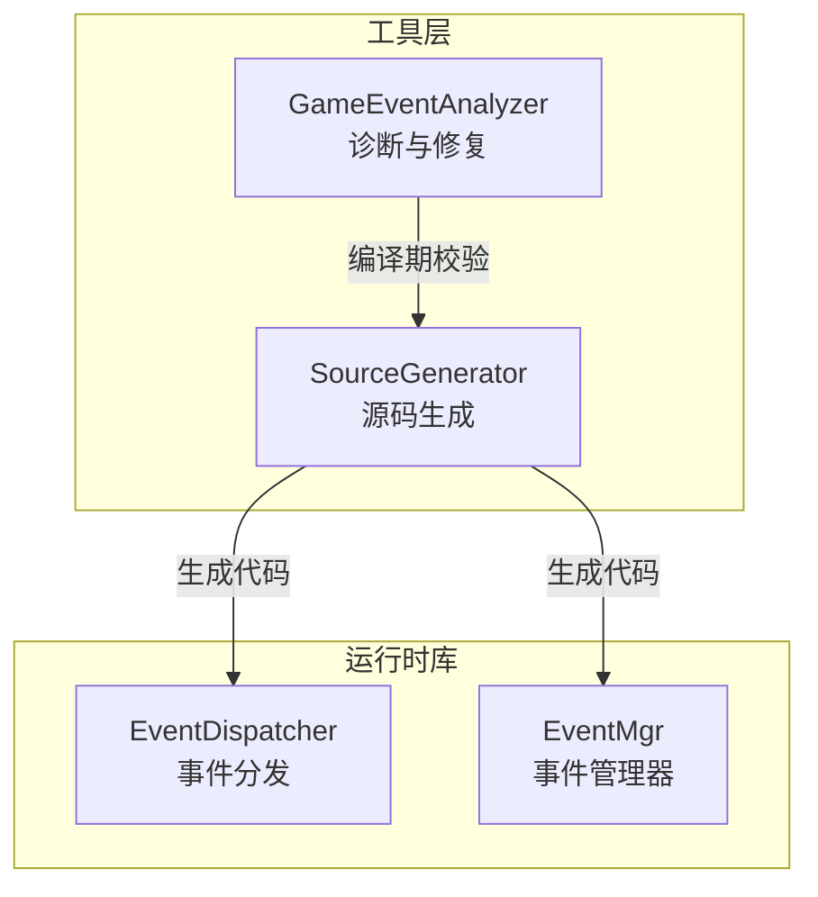
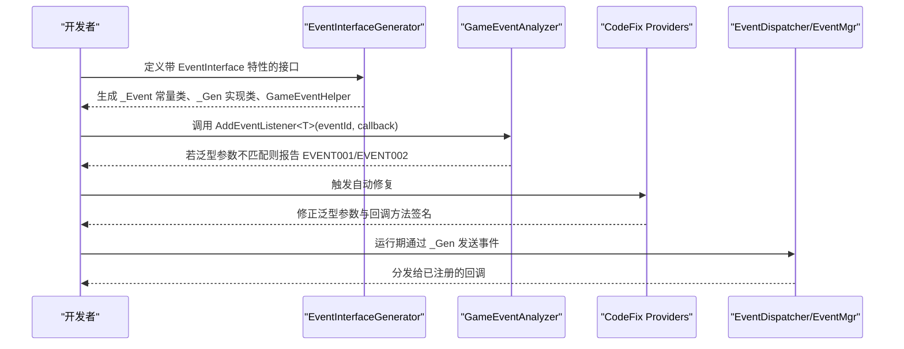
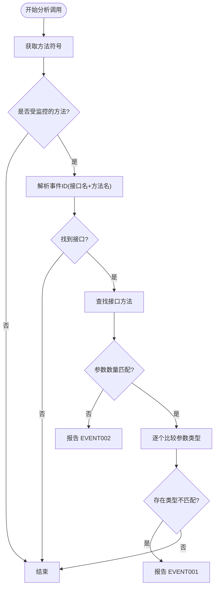
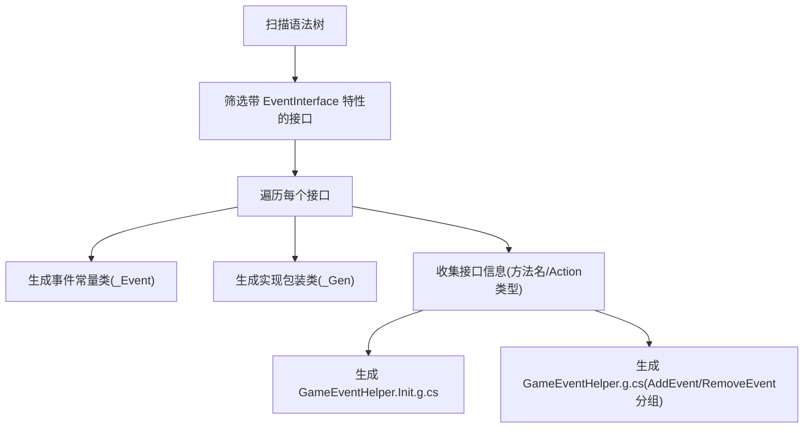
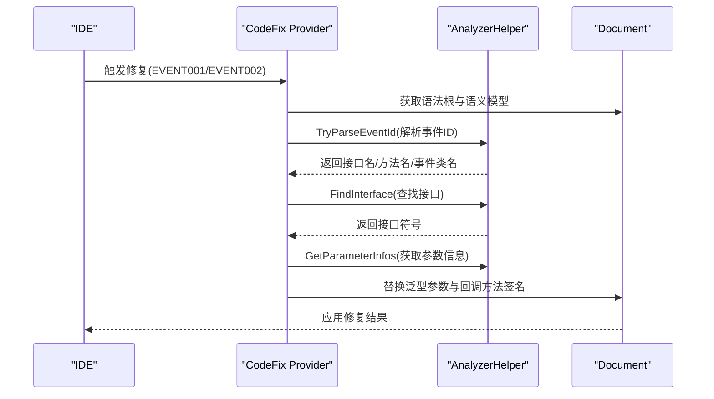
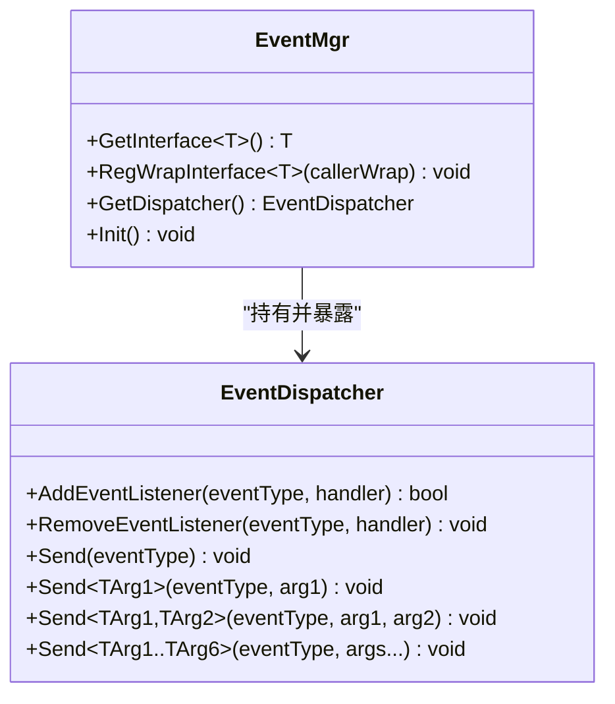
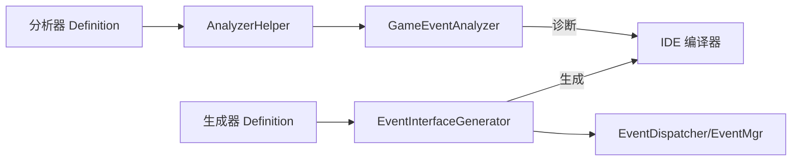

# 代码生成系统

<cite>
**本文引用的文件**   
- [GameEventAnalyzer.cs](file://Tools/GameEventSourceGenerator/GameEventAnalyzer/Analyzer/GameEventAnalyzer.cs)
- [Definition.cs（分析器）](file://Tools/GameEventSourceGenerator/GameEventAnalyzer/Definition.cs)
- [AnalyzerHelper.cs（分析器）](file://Tools/GameEventSourceGenerator/GameEventAnalyzer/Helper/AnalyzerHelper.cs)
- [GameEventTypeCodeFixProvider.cs](file://Tools/GameEventSourceGenerator/GameEventAnalyzer/CodeFix/GameEventTypeCodeFixProvider.cs)
- [GameEventParamCountCodeFixProvider.cs](file://Tools/GameEventSourceGenerator/GameEventAnalyzer/CodeFix/GameEventParamCountCodeFixProvider.cs)
- [EventInterfaceGenerator.cs](file://Tools/GameEventSourceGenerator/SourceGenerator/Generator/EventInterfaceGenerator.cs)
- [Definition.cs（生成器）](file://Tools/GameEventSourceGenerator/SourceGenerator/Definition.cs)
- [EventDispatcher.cs](file://UnityProject/Assets/TEngine/Runtime/Core/GameEvent/EventDispatcher.cs)
- [EventMgr.cs](file://UnityProject/Assets/TEngine/Runtime/Core/GameEvent/EventMgr.cs)
</cite>

## 目录
1. [简介](#简介)
2. [项目结构](#项目结构)
3. [核心组件](#核心组件)
4. [架构总览](#架构总览)
5. [详细组件分析](#详细组件分析)
6. [依赖关系分析](#依赖关系分析)
7. [性能与优化](#性能与优化)
8. [使用指南与调试技巧](#使用指南与调试技巧)
9. [常见问题与排错](#常见问题与排错)
10. [结论](#结论)

## 简介
本技术文档聚焦 TEngine 事件代码生成系统，围绕以下目标展开：
- 深入解释 GameEventAnalyzer 的分析器工作原理，如何通过 Roslyn API 解析源代码并识别事件定义。
- 详细说明 EventInterfaceGenerator 的代码生成流程，包括接口自动生成、类型安全检查和编译时验证。
- 解释 CodeFix 提供器的自动修复功能，如何帮助开发者修正事件类型不匹配等问题。
- 总结代码生成的配置选项、扩展点与性能优化策略。
- 提供使用方法、调试技巧与常见问题解决方案。

该系统由两部分组成：
- 源码生成器：在编译期扫描带有特定标记的接口，自动生成事件常量类、实现包装类以及辅助注册类。
- 诊断分析与自动修复：在编译期检查事件监听调用的泛型参数是否与接口方法签名一致，并提供一键修复。

## 项目结构
该子系统位于 Tools/GameEventSourceGenerator 目录下，包含两个主要工程：
- GameEventAnalyzer：Roslyn 诊断分析器与 CodeFix 提供器，负责编译期校验与自动修复。
- SourceGenerator：Roslyn 源码生成器，负责根据约定生成事件相关代码。

图表来源
- [GameEventAnalyzer.cs:1-167](file://Tools/GameEventSourceGenerator/GameEventAnalyzer/Analyzer/GameEventAnalyzer.cs#L1-L167)
- [EventInterfaceGenerator.cs:1-330](file://Tools/GameEventSourceGenerator/SourceGenerator/Generator/EventInterfaceGenerator.cs#L1-L330)
- [EventDispatcher.cs:1-199](file://UnityProject/Assets/TEngine/Runtime/Core/GameEvent/EventDispatcher.cs#L1-L199)
- [EventMgr.cs:1-89](file://UnityProject/Assets/TEngine/Runtime/Core/GameEvent/EventMgr.cs#L1-L89)

章节来源
- [GameEventAnalyzer.cs:1-167](file://Tools/GameEventSourceGenerator/GameEventAnalyzer/Analyzer/GameEventAnalyzer.cs#L1-L167)
- [EventInterfaceGenerator.cs:1-330](file://Tools/GameEventSourceGenerator/SourceGenerator/Generator/EventInterfaceGenerator.cs#L1-L330)

## 核心组件
- GameEventAnalyzer：基于 Roslyn 的诊断分析器，检测事件监听调用中的泛型参数数量与类型是否匹配接口方法签名。
- AnalyzerHelper：分析器辅助工具，提供事件 ID 解析、接口查找、类型名转换、回调方法定位与参数修复等能力。
- GameEventTypeCodeFixProvider / GameEventParamCountCodeFixProvider：针对 EVENT001/EVENT002 诊断的自动修复提供器，可批量修复泛型参数与回调方法签名。
- EventInterfaceGenerator：源码生成器，扫描带 EventInterface 特性的接口，生成：
  - 事件常量类（如 ITestUI_Event），为每个接口方法生成静态事件 ID。
  - 接口实现包装类（如 ITestUI_Gen），封装 Send 调用并注册到 EventMgr。
  - GameEventHelper 初始化与分组 AddEvent/RemoveEvent 方法，简化事件订阅/取消订阅。
- Definition（分析器/生成器）：集中定义诊断 ID、消息模板、命名空间、特性名等常量。
- EventDispatcher/EventMgr：运行时事件分发与管理基础设施，供生成代码调用。

章节来源
- [Definition.cs（分析器）:1-96](file://Tools/GameEventSourceGenerator/GameEventAnalyzer/Definition.cs#L1-L96)
- [AnalyzerHelper.cs（分析器）:1-243](file://Tools/GameEventSourceGenerator/GameEventAnalyzer/Helper/AnalyzerHelper.cs#L1-L243)
- [GameEventTypeCodeFixProvider.cs:1-253](file://Tools/GameEventSourceGenerator/GameEventAnalyzer/CodeFix/GameEventTypeCodeFixProvider.cs#L1-L253)
- [GameEventParamCountCodeFixProvider.cs:1-339](file://Tools/GameEventSourceGenerator/GameEventAnalyzer/CodeFix/GameEventParamCountCodeFixProvider.cs#L1-L339)
- [EventInterfaceGenerator.cs:1-330](file://Tools/GameEventSourceGenerator/SourceGenerator/Generator/EventInterfaceGenerator.cs#L1-L330)
- [Definition.cs（生成器）:1-7](file://Tools/GameEventSourceGenerator/SourceGenerator/Definition.cs#L1-L7)
- [EventDispatcher.cs:1-199](file://UnityProject/Assets/TEngine/Runtime/Core/GameEvent/EventDispatcher.cs#L1-L199)
- [EventMgr.cs:1-89](file://UnityProject/Assets/TEngine/Runtime/Core/GameEvent/EventMgr.cs#L1-L89)

## 架构总览
下图展示了从“开发者编写接口”到“运行时分发事件”的完整链路，以及编译期的分析与生成过程。

图表来源
- [EventInterfaceGenerator.cs:30-74](file://Tools/GameEventSourceGenerator/SourceGenerator/Generator/EventInterfaceGenerator.cs#L30-L74)
- [GameEventAnalyzer.cs:57-167](file://Tools/GameEventSourceGenerator/GameEventAnalyzer/Analyzer/GameEventAnalyzer.cs#L57-L167)
- [GameEventTypeCodeFixProvider.cs:40-253](file://Tools/GameEventSourceGenerator/GameEventAnalyzer/CodeFix/GameEventTypeCodeFixProvider.cs#L40-L253)
- [GameEventParamCountCodeFixProvider.cs:40-339](file://Tools/GameEventSourceGenerator/GameEventAnalyzer/CodeFix/GameEventParamCountCodeFixProvider.cs#L40-L339)
- [EventDispatcher.cs:71-195](file://UnityProject/Assets/TEngine/Runtime/Core/GameEvent/EventDispatcher.cs#L71-L195)
- [EventMgr.cs:42-78](file://UnityProject/Assets/TEngine/Runtime/Core/GameEvent/EventMgr.cs#L42-L78)

## 详细组件分析

### GameEventAnalyzer 分析器工作原理
GameEventAnalyzer 是 Roslyn 诊断分析器，核心职责是在编译期检查事件监听调用中的泛型参数是否与对应接口方法的参数数量和类型一致。

关键流程：
- 初始化阶段：禁用对自动生成代码的分析，启用并发执行，注册 InvocationExpression 节点分析回调。
- 分析方法调用：
  - 获取被调用的方法符号，判断是否为受监控的事件监听方法（AddUIEvent/AddEventListener/RemoveEventListener）。
  - 提取第一个参数（事件 ID），通过 AnalyzerHelper.TryParseEventId 解析出接口名与方法名。
  - 通过 AnalyzerHelper.FindInterface 查找接口符号，再定位具体方法。
  - 比较泛型参数数量与接口方法参数数量，不一致则报告 EVENT002。
  - 逐个比较泛型参数类型与接口方法参数类型，不一致则报告 EVENT001。

图表来源
- [GameEventAnalyzer.cs:57-167](file://Tools/GameEventSourceGenerator/GameEventAnalyzer/Analyzer/GameEventAnalyzer.cs#L57-L167)
- [AnalyzerHelper.cs（分析器）:15-114](file://Tools/GameEventSourceGenerator/GameEventAnalyzer/Helper/AnalyzerHelper.cs#L15-L114)

章节来源
- [GameEventAnalyzer.cs:1-167](file://Tools/GameEventSourceGenerator/GameEventAnalyzer/Analyzer/GameEventAnalyzer.cs#L1-L167)
- [Definition.cs（分析器）:1-96](file://Tools/GameEventSourceGenerator/GameEventAnalyzer/Definition.cs#L1-L96)
- [AnalyzerHelper.cs（分析器）:1-243](file://Tools/GameEventSourceGenerator/GameEventAnalyzer/Helper/AnalyzerHelper.cs#L1-L243)

### EventInterfaceGenerator 代码生成流程
EventInterfaceGenerator 是 Roslyn 源码生成器，扫描所有带有 EventInterface 特性的接口，并为每个接口生成三类代码：
- 事件常量类（如 ITestUI_Event）：为接口中的每个方法生成静态事件 ID。
- 接口实现包装类（如 ITestUI_Gen）：实现接口，内部通过 EventDispatcher.Send 发送事件，并在构造时向 EventMgr 注册自身。
- GameEventHelper 初始化与分组方法：
  - Init：实例化所有 _Gen 类并传入 EventDispatcher。
  - AddEvent/RemoveEvent 分组：按接口名派生 GroupClassName，为每个接口方法生成 AddEvent/RemoveEvent 静态方法，内部委托到 GameEvent.AddEventListener/RemoveEventListener。

生成步骤概览：
- 遍历语法树，筛选带有 EventInterface 特性的接口。
- 为每个接口生成事件常量类与实现包装类，并添加到上下文。
- 收集所有 _Gen 类名与接口信息，生成 GameEventHelper.Init.g.cs 与 GameEventHelper.g.cs。

图表来源
- [EventInterfaceGenerator.cs:30-74](file://Tools/GameEventSourceGenerator/SourceGenerator/Generator/EventInterfaceGenerator.cs#L30-L74)
- [EventInterfaceGenerator.cs:76-170](file://Tools/GameEventSourceGenerator/SourceGenerator/Generator/EventInterfaceGenerator.cs#L76-L170)
- [EventInterfaceGenerator.cs:229-330](file://Tools/GameEventSourceGenerator/SourceGenerator/Generator/EventInterfaceGenerator.cs#L229-L330)
- [Definition.cs（生成器）:1-7](file://Tools/GameEventSourceGenerator/SourceGenerator/Definition.cs#L1-L7)

章节来源
- [EventInterfaceGenerator.cs:1-330](file://Tools/GameEventSourceGenerator/SourceGenerator/Generator/EventInterfaceGenerator.cs#L1-L330)
- [Definition.cs（生成器）:1-7](file://Tools/GameEventSourceGenerator/SourceGenerator/Definition.cs#L1-L7)

### CodeFix 提供器的自动修复功能
CodeFix 提供器用于在 IDE 中提供“快速修复”操作，自动修正事件监听调用中的泛型参数与回调方法签名问题。

- GameEventTypeCodeFixProvider：处理 EVENT001（类型不匹配）。
  - 解析事件 ID，定位接口方法与参数类型。
  - 构建正确的泛型参数列表，替换调用处的泛型参数。
  - 同时查找回调方法声明，修复其参数列表以匹配接口方法签名。
- GameEventParamCountCodeFixProvider：处理 EVENT002（参数数量不匹配）。
  - 同样解析事件 ID 与接口方法，构建正确泛型参数列表。
  - 支持多种调用形式（成员访问泛型、直接泛型、无泛型标识符），添加或移除泛型参数。
  - 同步修复回调方法参数列表。

图表来源
- [GameEventTypeCodeFixProvider.cs:40-253](file://Tools/GameEventSourceGenerator/GameEventAnalyzer/CodeFix/GameEventTypeCodeFixProvider.cs#L40-L253)
- [GameEventParamCountCodeFixProvider.cs:40-339](file://Tools/GameEventSourceGenerator/GameEventAnalyzer/CodeFix/GameEventParamCountCodeFixProvider.cs#L40-L339)
- [AnalyzerHelper.cs（分析器）:15-243](file://Tools/GameEventSourceGenerator/GameEventAnalyzer/Helper/AnalyzerHelper.cs#L15-L243)

章节来源
- [GameEventTypeCodeFixProvider.cs:1-253](file://Tools/GameEventSourceGenerator/GameEventAnalyzer/CodeFix/GameEventTypeCodeFixProvider.cs#L1-L253)
- [GameEventParamCountCodeFixProvider.cs:1-339](file://Tools/GameEventSourceGenerator/GameEventAnalyzer/CodeFix/GameEventParamCountCodeFixProvider.cs#L1-L339)
- [AnalyzerHelper.cs（分析器）:1-243](file://Tools/GameEventSourceGenerator/GameEventAnalyzer/Helper/AnalyzerHelper.cs#L1-L243)

### 运行时事件分发机制
生成代码在运行期通过 EventDispatcher 与 EventMgr 完成事件的注册与分发：
- EventDispatcher：维护事件表，提供 AddEventListener/RemoveEventListener/Send 等方法，支持多泛型参数的 Send 重载。
- EventMgr：管理接口包装实例的注册与获取，提供 GetInterface<T>() 与 RegWrapInterface<T>()，并持有 EventDispatcher 实例。

图表来源
- [EventDispatcher.cs:1-199](file://UnityProject/Assets/TEngine/Runtime/Core/GameEvent/EventDispatcher.cs#L1-L199)
- [EventMgr.cs:1-89](file://UnityProject/Assets/TEngine/Runtime/Core/GameEvent/EventMgr.cs#L1-L89)

章节来源
- [EventDispatcher.cs:1-199](file://UnityProject/Assets/TEngine/Runtime/Core/GameEvent/EventDispatcher.cs#L1-L199)
- [EventMgr.cs:1-89](file://UnityProject/Assets/TEngine/Runtime/Core/GameEvent/EventMgr.cs#L1-L89)

## 依赖关系分析
- 分析器与生成器共享部分约定：
  - 事件类名后缀：_Event（用于从事件类推导接口名）。
  - 常见命名空间：GameLogic（优先查找接口）。
  - 特性名：EventInterface（用于标记需要生成代码的接口）。
- 生成器依赖运行时库：
  - 生成代码引用 TEngine 命名空间下的 EventDispatcher 与 EventMgr。
  - 生成代码通过 RuntimeId.ToRuntimeId 计算事件 ID。

图表来源
- [Definition.cs（分析器）:1-96](file://Tools/GameEventSourceGenerator/GameEventAnalyzer/Definition.cs#L1-L96)
- [Definition.cs（生成器）:1-7](file://Tools/GameEventSourceGenerator/SourceGenerator/Definition.cs#L1-L7)
- [AnalyzerHelper.cs（分析器）:1-243](file://Tools/GameEventSourceGenerator/GameEventAnalyzer/Helper/AnalyzerHelper.cs#L1-L243)
- [EventInterfaceGenerator.cs:1-330](file://Tools/GameEventSourceGenerator/SourceGenerator/Generator/EventInterfaceGenerator.cs#L1-L330)
- [EventDispatcher.cs:1-199](file://UnityProject/Assets/TEngine/Runtime/Core/GameEvent/EventDispatcher.cs#L1-L199)
- [EventMgr.cs:1-89](file://UnityProject/Assets/TEngine/Runtime/Core/GameEvent/EventMgr.cs#L1-L89)

章节来源
- [Definition.cs（分析器）:1-96](file://Tools/GameEventSourceGenerator/GameEventAnalyzer/Definition.cs#L1-L96)
- [Definition.cs（生成器）:1-7](file://Tools/GameEventSourceGenerator/SourceGenerator/Definition.cs#L1-L7)

## 性能与优化
- 分析器并发执行：通过 EnableConcurrentExecution 提升大规模项目的编译期分析性能。
- 跳过自动生成代码：ConfigureGeneratedCodeAnalysis(GeneratedCodeAnalysisFlags.None) 避免重复分析生成代码，减少开销。
- 接口查找优化：先尝试常见命名空间（GameLogic），再遍历所有语法树，降低全量搜索成本。
- 类型名映射：将系统类型映射为 C# 关键字别名（int/string/bool 等），减少字符串拼接与显示成本。
- 生成器增量输出：按接口为单位生成代码，避免一次性生成超大文件，便于增量编译。

[本节为通用性能建议，不直接分析具体文件]

## 使用指南与调试技巧
- 定义事件接口：
  - 在目标命名空间下定义接口，并为其添加 EventInterface 特性。
  - 接口方法即为事件方法，参数类型决定回调签名。
- 生成代码：
  - 编译项目后，EventInterfaceGenerator 会自动生成 _Event 常量类、_Gen 实现类与 GameEventHelper。
  - 在启动逻辑中调用 GameEventHelper.Init()，确保所有 _Gen 实例被创建并注册。
- 订阅与发布事件：
  - 使用 GameEvent.AddEventListener<T>(Ixxx_Event.Method, callback) 订阅事件。
  - 通过 Ixxx_Gen.Method(...) 发布事件，内部会调用 EventDispatcher.Send。
- 调试与分析：
  - 若出现 EVENT001/EVENT002 诊断，可在 IDE 中使用“快速修复”自动修正泛型参数与回调方法签名。
  - 使用 Roslyn 诊断输出查看错误位置与详细信息，确认事件 ID 解析是否正确。
- 自定义扩展：
  - 修改 Definition.cs（分析器/生成器）中的常量，如特性名、命名空间、方法名列表等。
  - 扩展 AnalyzerHelper 以支持更多事件 ID 解析模式或回调方法定位策略。

章节来源
- [EventInterfaceGenerator.cs:30-74](file://Tools/GameEventSourceGenerator/SourceGenerator/Generator/EventInterfaceGenerator.cs#L30-L74)
- [GameEventAnalyzer.cs:57-167](file://Tools/GameEventSourceGenerator/GameEventAnalyzer/Analyzer/GameEventAnalyzer.cs#L57-L167)
- [GameEventTypeCodeFixProvider.cs:40-253](file://Tools/GameEventSourceGenerator/GameEventAnalyzer/CodeFix/GameEventTypeCodeFixProvider.cs#L40-L253)
- [GameEventParamCountCodeFixProvider.cs:40-339](file://Tools/GameEventSourceGenerator/GameEventAnalyzer/CodeFix/GameEventParamCountCodeFixProvider.cs#L40-L339)

## 常见问题与排错
- 未生成代码：
  - 检查接口是否添加了 EventInterface 特性。
  - 确认生成器工程已正确引用并参与编译。
- 诊断持续报错：
  - 确认事件 ID 解析是否符合 ITestUI_Event.Method 格式。
  - 检查接口是否在常见命名空间（GameLogic）或可通过元数据名称解析。
- 自动修复无效：
  - 确认回调方法在当前语法树中可解析。
  - 检查回调方法签名是否与接口方法参数一致，必要时手动调整后再触发修复。
- 运行期事件未触发：
  - 确认 GameEventHelper.Init() 已被调用。
  - 检查 EventDispatcher 的事件表是否包含对应事件 ID。

章节来源
- [Definition.cs（分析器）:76-96](file://Tools/GameEventSourceGenerator/GameEventAnalyzer/Definition.cs#L76-L96)
- [AnalyzerHelper.cs（分析器）:60-114](file://Tools/GameEventSourceGenerator/GameEventAnalyzer/Helper/AnalyzerHelper.cs#L60-L114)
- [EventInterfaceGenerator.cs:76-170](file://Tools/GameEventSourceGenerator/SourceGenerator/Generator/EventInterfaceGenerator.cs#L76-L170)
- [EventDispatcher.cs:71-195](file://UnityProject/Assets/TEngine/Runtime/Core/GameEvent/EventDispatcher.cs#L71-L195)

## 结论
TEngine 事件代码生成系统通过 Roslyn 源码生成器与诊断分析器，实现了事件接口的自动化代码生成与编译期类型安全检查。结合 CodeFix 提供器，开发者可以在 IDE 中快速修正事件监听调用中的泛型参数与回调方法签名问题，显著提升开发效率与代码质量。运行时通过 EventDispatcher 与 EventMgr 完成高效的事件分发与管理，形成从“定义接口”到“运行时分发”的完整闭环。

[本节为总结性内容，不直接分析具体文件]