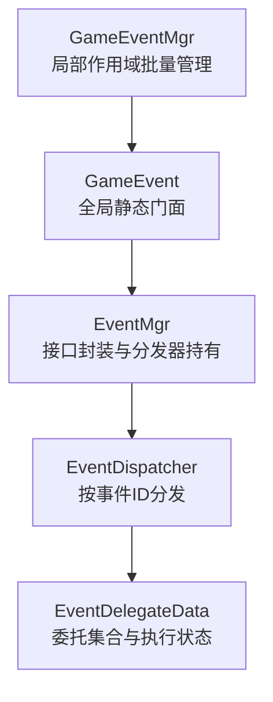
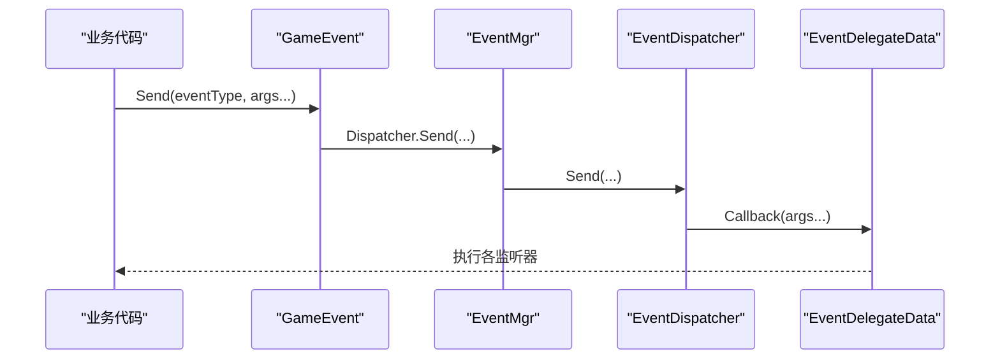
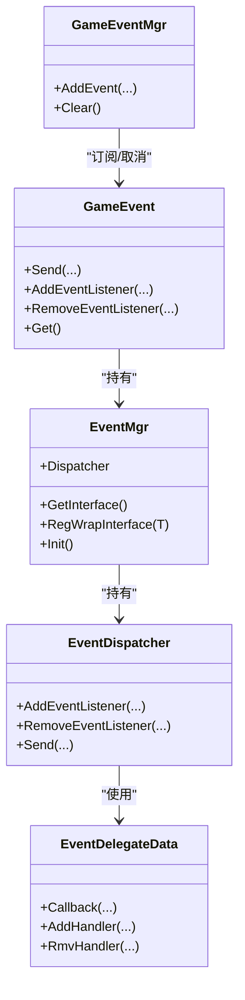

# 性能优化策略

<cite>
**本文引用的文件**   
- [GameEvent.cs](file://UnityProject/Assets/TEngine/Runtime/Core/GameEvent/GameEvent.cs)
- [EventMgr.cs](file://UnityProject/Assets/TEngine/Runtime/Core/GameEvent/EventMgr.cs)
- [EventDispatcher.cs](file://UnityProject/Assets/TEngine/Runtime/Core/GameEvent/EventDispatcher.cs)
- [EventDelegateData.cs](file://UnityProject/Assets/TEngine/Runtime/Core/GameEvent/EventDelegateData.cs)
- [GameEventMgr.cs](file://UnityProject/Assets/TEngine/Runtime/Core/GameEvent/GameEventMgr.cs)
- [3-2-事件模块.md](file://Books/3-2-事件模块.md)
</cite>

## 目录
1. [引言](#引言)
2. [项目结构](#项目结构)
3. [核心组件](#核心组件)
4. [架构总览](#架构总览)
5. [详细组件分析](#详细组件分析)
6. [依赖关系分析](#依赖关系分析)
7. [性能考量与优化策略](#性能考量与优化策略)
8. [故障排查指南](#故障排查指南)
9. [结论](#结论)
10. [附录](#附录)

## 引言
本指南聚焦 TEngine 事件系统的性能瓶颈分析与优化策略，围绕以下目标展开：
- 事件分发频率控制、批量事件处理与异步事件处理机制
- 内存使用优化：事件处理器缓存、委托复用与对象池调优
- 事件优先级管理、条件订阅与动态事件注册的性能影响
- 性能监控指标、基准测试方法与性能调优工具的使用
- 不同平台下的性能差异分析与针对性优化建议

## 项目结构
事件系统位于 UnityProject/Assets/TEngine/Runtime/Core/GameEvent 目录下，核心由门面类、管理器、分发器与委托数据四类组成。文档侧的说明文档位于 Books/3-2-事件模块.md，提供 API 概览与最佳实践。

图表来源
- [GameEvent.cs:8-18](file://UnityProject/Assets/TEngine/Runtime/Core/GameEvent/GameEvent.cs#L8-L18)
- [EventMgr.cs:9-78](file://UnityProject/Assets/TEngine/Runtime/Core/GameEvent/EventMgr.cs#L9-L78)
- [EventDispatcher.cs:9-22](file://UnityProject/Assets/TEngine/Runtime/Core/GameEvent/EventDispatcher.cs#L9-L22)
- [EventDelegateData.cs:9-25](file://UnityProject/Assets/TEngine/Runtime/Core/GameEvent/EventDelegateData.cs#L9-L25)
- [GameEventMgr.cs:9-28](file://UnityProject/Assets/TEngine/Runtime/Core/GameEvent/GameEventMgr.cs#L9-L28)

章节来源
- [GameEvent.cs:8-18](file://UnityProject/Assets/TEngine/Runtime/Core/GameEvent/GameEvent.cs#L8-L18)
- [EventMgr.cs:9-78](file://UnityProject/Assets/TEngine/Runtime/Core/GameEvent/EventMgr.cs#L9-L78)
- [EventDispatcher.cs:9-22](file://UnityProject/Assets/TEngine/Runtime/Core/GameEvent/EventDispatcher.cs#L9-L22)
- [EventDelegateData.cs:9-25](file://UnityProject/Assets/TEngine/Runtime/Core/GameEvent/EventDelegateData.cs#L9-L25)
- [GameEventMgr.cs:9-28](file://UnityProject/Assets/TEngine/Runtime/Core/GameEvent/GameEventMgr.cs#L9-L28)

## 核心组件
- GameEvent：全局静态门面，所有 AddEventListener/RemoveEventListener/Send 等调用均委托给内部 EventMgr.Dispatcher。
- EventMgr：维护接口包装（Source Generator 生成）与 EventDispatcher 实例；提供 Init 清理。
- EventDispatcher：基于 Dictionary<int, EventDelegateData> 的事件表，负责增删监听与 Send 分发。
- EventDelegateData：维护当前委托列表与“添加/删除”延迟队列，支持在回调执行期间安全地增删监听。
- GameEventMgr：实现 IMemory，用于非 UI 类的局部事件生命周期管理，通过 Clear 批量移除。

章节来源
- [GameEvent.cs:8-18](file://UnityProject/Assets/TEngine/Runtime/Core/GameEvent/GameEvent.cs#L8-L18)
- [EventMgr.cs:9-78](file://UnityProject/Assets/TEngine/Runtime/Core/GameEvent/EventMgr.cs#L9-L78)
- [EventDispatcher.cs:9-22](file://UnityProject/Assets/TEngine/Runtime/Core/GameEvent/EventDispatcher.cs#L9-L22)
- [EventDelegateData.cs:9-25](file://UnityProject/Assets/TEngine/Runtime/Core/GameEvent/EventDelegateData.cs#L9-L25)
- [GameEventMgr.cs:9-28](file://UnityProject/Assets/TEngine/Runtime/Core/GameEvent/GameEventMgr.cs#L9-L28)

## 架构总览
事件从上层调用进入 GameEvent，再经 EventMgr 转发到 EventDispatcher，最终落到具体事件的 EventDelegateData 并遍历执行已注册的委托。

图表来源
- [GameEvent.cs:594-688](file://UnityProject/Assets/TEngine/Runtime/Core/GameEvent/GameEvent.cs#L594-L688)
- [EventMgr.cs:70-78](file://UnityProject/Assets/TEngine/Runtime/Core/GameEvent/EventMgr.cs#L70-L78)
- [EventDispatcher.cs:71-195](file://UnityProject/Assets/TEngine/Runtime/Core/GameEvent/EventDispatcher.cs#L71-L195)
- [EventDelegateData.cs:121-284](file://UnityProject/Assets/TEngine/Runtime/Core/GameEvent/EventDelegateData.cs#L121-L284)

## 详细组件分析

### GameEvent 门面
- 职责：对外暴露统一的 Add/Remove/Send 与 Get<T>() 接口，内部统一委托给 EventMgr.Dispatcher。
- 性能要点：
  - string 版本会先通过 RuntimeId.ToRuntimeId 转换为 int，存在额外开销，应优先使用 int 或接口事件。
  - 泛型重载较多，但均为薄封装，实际分发成本在 EventDispatcher。

章节来源
- [GameEvent.cs:20-118](file://UnityProject/Assets/TEngine/Runtime/Core/GameEvent/GameEvent.cs#L20-L118)
- [GameEvent.cs:318-579](file://UnityProject/Assets/TEngine/Runtime/Core/GameEvent/GameEvent.cs#L318-L579)
- [GameEvent.cs:583-798](file://UnityProject/Assets/TEngine/Runtime/Core/GameEvent/GameEvent.cs#L583-L798)

### EventMgr 接口封装
- 职责：维护接口包装映射（Type -> InterfaceWrap），持有 EventDispatcher 并提供 Init 清理。
- 性能要点：
  - 使用 Dictionary<Type, EventEntryData> 存储接口包装，避免字符串键带来的 GC 与哈希开销。
  - Init 同时清空接口映射与事件表，适合场景切换或热更后重置。

章节来源
- [EventMgr.cs:9-78](file://UnityProject/Assets/TEngine/Runtime/Core/GameEvent/EventMgr.cs#L9-L78)

### EventDispatcher 分发器
- 数据结构：Dictionary<int, EventDelegateData> 作为事件表。
- 关键方法：AddEventListener/HasEventListener/RemoveEventListener/Send(多泛型)。
- 性能要点：
  - 查找 O(1)，遍历委托为 O(n)。
  - Send 直接调用 EventDelegateData.Callback，无额外装箱。

章节来源
- [EventDispatcher.cs:9-66](file://UnityProject/Assets/TEngine/Runtime/Core/GameEvent/EventDispatcher.cs#L9-L66)
- [EventDispatcher.cs:69-195](file://UnityProject/Assets/TEngine/Runtime/Core/GameEvent/EventDispatcher.cs#L69-L195)

### EventDelegateData 委托集合与执行状态
- 数据结构：
  - _listExist：当前有效委托列表
  - _addList/_deleteList：在执行期间缓冲的增删操作
  - _isExecute/_dirty：执行期标记与脏数据标志
- 行为特性：
  - 在执行期间允许安全增删监听，结束后统一合并（CheckModify）。
  - 每个泛型 Callback 仅匹配对应 Action<T...> 类型，减少无效分支。
- 性能要点：
  - 避免在执行期间修改主列表，降低迭代器失效风险与额外拷贝。
  - 大量弱类型委托时，类型判断分支会带来一定开销，建议尽量使用强类型事件（int + 泛型）。

章节来源
- [EventDelegateData.cs:9-25](file://UnityProject/Assets/TEngine/Runtime/Core/GameEvent/EventDelegateData.cs#L9-L25)
- [EventDelegateData.cs:32-91](file://UnityProject/Assets/TEngine/Runtime/Core/GameEvent/EventDelegateData.cs#L32-L91)
- [EventDelegateData.cs:93-116](file://UnityProject/Assets/TEngine/Runtime/Core/GameEvent/EventDelegateData.cs#L93-L116)
- [EventDelegateData.cs:121-284](file://UnityProject/Assets/TEngine/Runtime/Core/GameEvent/EventDelegateData.cs#L121-L284)

### GameEventMgr 局部批量管理
- 职责：记录自身订阅的 eventType 与 handler，Clear 时批量移除，避免逐条 RemoveEventListener 的重复逻辑。
- 适用场景：非 UI 类中需要集中管理事件生命周期的模块。

章节来源
- [GameEventMgr.cs:9-49](file://UnityProject/Assets/TEngine/Runtime/Core/GameEvent/GameEventMgr.cs#L9-L49)
- [GameEventMgr.cs:51-105](file://UnityProject/Assets/TEngine/Runtime/Core/GameEvent/GameEventMgr.cs#L51-L105)

## 依赖关系分析
- GameEvent 依赖 EventMgr，EventMgr 持有 EventDispatcher。
- EventDispatcher 依赖 EventDelegateData。
- GameEventMgr 依赖 GameEvent（间接依赖 EventDispatcher）。

图表来源
- [GameEvent.cs:8-18](file://UnityProject/Assets/TEngine/Runtime/Core/GameEvent/GameEvent.cs#L8-L18)
- [EventMgr.cs:9-78](file://UnityProject/Assets/TEngine/Runtime/Core/GameEvent/EventMgr.cs#L9-L78)
- [EventDispatcher.cs:9-22](file://UnityProject/Assets/TEngine/Runtime/Core/GameEvent/EventDispatcher.cs#L9-L22)
- [EventDelegateData.cs:9-25](file://UnityProject/Assets/TEngine/Runtime/Core/GameEvent/EventDelegateData.cs#L9-L25)
- [GameEventMgr.cs:9-28](file://UnityProject/Assets/TEngine/Runtime/Core/GameEvent/GameEventMgr.cs#L9-L28)

## 性能考量与优化策略

### 事件分发频率控制
- 问题：高频事件（如每帧更新）直接触发大量回调会导致 CPU 抖动与卡顿。
- 策略：
  - 节流：对同一事件在固定时间窗口内只保留最后一次触发。
  - 合并：将多次同类型事件合并为一次批量发送。
  - 条件过滤：在发送前检查 HasEventListener，避免空分发。
- 落地建议：
  - 在业务层维护一个轻量调度器，按事件 ID 做节流/合并。
  - 使用 EventDispatcher.HasEventListener 快速判断是否可跳过 Send。

章节来源
- [EventDispatcher.cs:43-52](file://UnityProject/Assets/TEngine/Runtime/Core/GameEvent/EventDispatcher.cs#L43-L52)

### 批量事件处理
- 现状：EventDelegateData 在执行期间支持安全的增删监听（_addList/_deleteList），但不提供跨事件类型的批量合并。
- 建议：
  - 在业务层构建“事件批处理器”，收集一帧内的多个事件，统一发送到 EventDispatcher。
  - 对高频低价值事件进行去重与聚合，减少回调数量。

章节来源
- [EventDelegateData.cs:32-91](file://UnityProject/Assets/TEngine/Runtime/Core/GameEvent/EventDelegateData.cs#L32-L91)
- [EventDelegateData.cs:93-116](file://UnityProject/Assets/TEngine/Runtime/Core/GameEvent/EventDelegateData.cs#L93-L116)

### 异步事件处理机制
- 现状：EventDispatcher.Send 同步遍历执行回调，未内置异步队列。
- 建议：
  - 在业务层引入异步任务队列，将耗时回调投递到后台线程或协程。
  - 注意线程安全：若回调涉及 UI，需切回主线程执行。
  - 对长耗时回调设置超时与失败重试策略。

[本节为通用设计建议，不直接分析具体文件]

### 内存使用优化技巧
- 事件处理器缓存：
  - 避免频繁创建匿名委托，复用已存在的委托实例，减少 GC 压力。
  - 结合 GameEventMgr 统一管理订阅，避免泄漏。
- 委托复用：
  - 对相同签名的回调尽量复用同一委托实例，减少重复分配。
- 对象池调优：
  - 事件参数对象（尤其是大对象）建议使用对象池，避免频繁分配。
  - 结合 MemoryPool 配置调整初始容量与增长策略，降低扩容开销。

章节来源
- [GameEventMgr.cs:30-49](file://UnityProject/Assets/TEngine/Runtime/Core/GameEvent/GameEventMgr.cs#L30-L49)

### 事件优先级管理
- 现状：EventDelegateData 以 List<Delegate> 顺序执行，不支持优先级。
- 建议：
  - 在业务层维护“优先级队列”，按优先级排序后依次分发。
  - 或使用多个 EventDispatcher 实例，按优先级分组事件。

[本节为通用设计建议，不直接分析具体文件]

### 条件订阅与动态事件注册
- 条件订阅：
  - 在 AddEventListener 前根据运行时条件决定是否订阅，减少无用监听。
- 动态事件注册：
  - 使用 Source Generator 生成的接口事件，编译期类型安全，运行时无反射开销。
  - 避免在热点路径上动态新增/移除监听，集中在初始化阶段完成。

章节来源
- [3-2-事件模块.md:138-214](file://Books/3-2-事件模块.md#L138-L214)

### 字符串事件的性能影响
- string 版本会通过 RuntimeId.ToRuntimeId 转换，带来额外开销。
- 建议：
  - 优先使用 int 常量或接口事件。
  - 仅在事件名需动态拼接时使用 string 版本。

章节来源
- [GameEvent.cs:318-579](file://UnityProject/Assets/TEngine/Runtime/Core/GameEvent/GameEvent.cs#L318-L579)
- [3-2-事件模块.md:217-233](file://Books/3-2-事件模块.md#L217-L233)

### 性能监控指标与基准测试
- 建议指标：
  - 每秒事件发送次数、回调执行次数、平均/分位耗时、GC 分配量。
- 基准测试方法：
  - 构造高并发事件场景，统计单帧内 Send 次数与回调总数。
  - 对比开启/关闭节流与批量合并的差异。
- 工具：
  - Unity Profiler 观察 CPU 与 GC 曲线。
  - 自定义计数器埋点，输出关键指标日志。

[本节为通用指导，不直接分析具体文件]

### 不同平台性能差异与优化建议
- 移动端（Android/iOS）：
  - 严格控制事件频率，避免每帧高频事件。
  - 减少委托分配，复用委托与参数对象。
- 桌面端（Windows/macOS）：
  - 可适当放宽频率限制，但仍需关注 GC 峰值。
- 主机平台：
  - 遵循移动端优化原则，并结合平台 SDK 的线程模型进行异步处理。

[本节为通用指导，不直接分析具体文件]

## 故障排查指南
- 常见问题：
  - 忘记初始化接口事件：需在入口最先调用 GameEventHelper.Init()。
  - UI 外部使用 AddEventListener 导致内存泄漏：UI 内请使用 AddUIEvent。
  - 手写事件 ID 硬编码数字：改用 Source Generator 生成的常量。
  - 事件回调签名不匹配：优先使用接口事件以获得编译期检查。
  - 非 UI 类忘记移除监听：使用 GameEventMgr 批量管理或在 Dispose 中移除。
  - 误用不存在的方法：源码中不存在 UnRegisterAll/RegisterListener 等方法。
- 定位建议：
  - 使用 HasEventListener 确认是否存在监听。
  - 通过 EventDispatcher.ClearEventTable 与 EventMgr.Init 进行场景重置。

章节来源
- [3-2-事件模块.md:289-390](file://Books/3-2-事件模块.md#L289-L390)
- [EventDispatcher.cs:17-22](file://UnityProject/Assets/TEngine/Runtime/Core/GameEvent/EventDispatcher.cs#L17-L22)
- [EventMgr.cs:80-87](file://UnityProject/Assets/TEngine/Runtime/Core/GameEvent/EventMgr.cs#L80-L87)

## 结论
TEngine 事件系统以简洁的门面与分发器为核心，具备在回调执行期间安全增删监听的特性。性能优化的关键在于：
- 控制事件频率与批量合并
- 复用委托与参数对象，减少 GC
- 优先使用 int/接口事件，避免 string 转换
- 在业务层实现优先级、条件订阅与异步处理
- 结合平台特性进行差异化优化

## 附录
- 参考文档：Books/3-2-事件模块.md 提供了 API 概览与最佳实践，可作为日常开发对照。