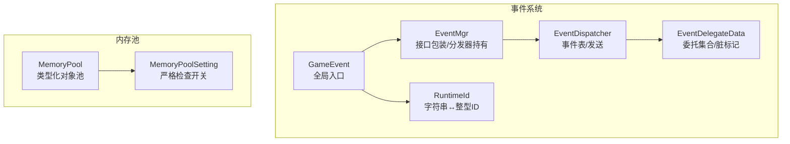
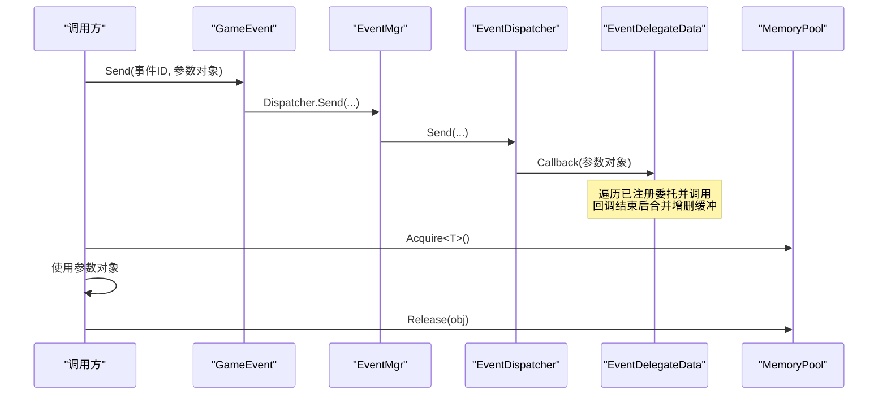
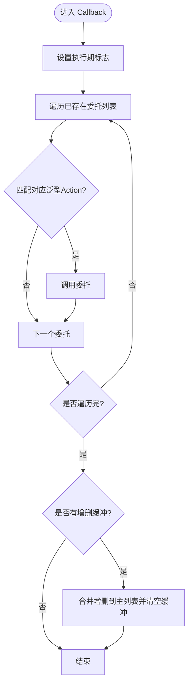
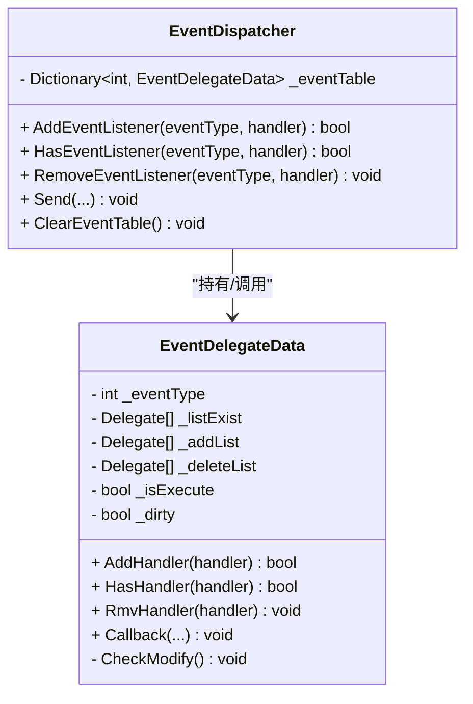
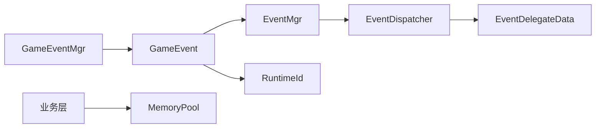

# 零 GC 实现

<cite>
**本文引用的文件**   
- [EventDelegateData.cs](file://UnityProject/Assets/TEngine/Runtime/Core/GameEvent/EventDelegateData.cs)
- [EventDispatcher.cs](file://UnityProject/Assets/TEngine/Runtime/Core/GameEvent/EventDispatcher.cs)
- [EventMgr.cs](file://UnityProject/Assets/TEngine/Runtime/Core/GameEvent/EventMgr.cs)
- [GameEvent.cs](file://UnityProject/Assets/TEngine/Runtime/Core/GameEvent/GameEvent.cs)
- [GameEventMgr.cs](file://UnityProject/Assets/TEngine/Runtime/Core/GameEvent/GameEventMgr.cs)
- [RuntimeId.cs](file://UnityProject/Assets/TEngine/Runtime/Core/GameEvent/RuntimeId.cs)
- [MemoryPool.cs](file://UnityProject/Assets/TEngine/Runtime/Core/MemoryPool/MemoryPool.cs)
- [MemoryPoolSetting.cs](file://UnityProject/Assets/TEngine/Runtime/Core/MemoryPool/MemoryPoolSetting.cs)
</cite>

## 目录
1. [引言](#引言)
2. [项目结构](#项目结构)
3. [核心组件](#核心组件)
4. [架构总览](#架构总览)
5. [详细组件分析](#详细组件分析)
6. [依赖关系分析](#依赖关系分析)
7. [性能与零 GC 权衡](#性能与零-gc-权衡)
8. [故障排查指南](#故障排查指南)
9. [结论](#结论)
10. [附录](#附录)

## 引言
本技术文档聚焦 TEngine 事件系统的“零 GC”实现路径，重点解释如何通过对象池与延迟合并策略避免事件处理过程中的内存分配。文档将深入剖析 EventDelegateData 的结构设计与复用机制、委托缓存策略、事件参数对象的池化管理与生命周期控制，并给出内存预分配算法、对象回收策略和内存泄漏防护机制。同时总结零 GC 设计的技术权衡、性能基准建议与优化技巧，并提供零 GC 编程模式、常见陷阱与调试方法。

## 项目结构
围绕事件系统与内存池的核心代码位于 Runtime/Core 下的 GameEvent 与 MemoryPool 两个子模块：
- GameEvent：提供全局事件入口、分发器、事件数据容器与运行时 ID 映射。
- MemoryPool：提供类型化对象池的获取、归还、统计与严格检查能力。

图表来源
- [GameEvent.cs:1-800](file://UnityProject/Assets/TEngine/Runtime/Core/GameEvent/GameEvent.cs#L1-L800)
- [EventMgr.cs:1-89](file://UnityProject/Assets/TEngine/Runtime/Core/GameEvent/EventMgr.cs#L1-L89)
- [EventDispatcher.cs:1-199](file://UnityProject/Assets/TEngine/Runtime/Core/GameEvent/EventDispatcher.cs#L1-L199)
- [EventDelegateData.cs:1-286](file://UnityProject/Assets/TEngine/Runtime/Core/GameEvent/EventDelegateData.cs#L1-L286)
- [RuntimeId.cs:1-56](file://UnityProject/Assets/TEngine/Runtime/Core/GameEvent/RuntimeId.cs#L1-L56)
- [MemoryPool.cs:1-208](file://UnityProject/Assets/TEngine/Runtime/Core/MemoryPool/MemoryPool.cs#L1-L208)
- [MemoryPoolSetting.cs:1-80](file://UnityProject/Assets/TEngine/Runtime/Core/MemoryPool/MemoryPoolSetting.cs#L1-L80)

章节来源
- [GameEvent.cs:1-800](file://UnityProject/Assets/TEngine/Runtime/Core/GameEvent/GameEvent.cs#L1-L800)
- [EventMgr.cs:1-89](file://UnityProject/Assets/TEngine/Runtime/Core/GameEvent/EventMgr.cs#L1-L89)
- [EventDispatcher.cs:1-199](file://UnityProject/Assets/TEngine/Runtime/Core/GameEvent/EventDispatcher.cs#L1-L199)
- [EventDelegateData.cs:1-286](file://UnityProject/Assets/TEngine/Runtime/Core/GameEvent/EventDelegateData.cs#L1-L286)
- [RuntimeId.cs:1-56](file://UnityProject/Assets/TEngine/Runtime/Core/GameEvent/RuntimeId.cs#L1-L56)
- [MemoryPool.cs:1-208](file://UnityProject/Assets/TEngine/Runtime/Core/MemoryPool/MemoryPool.cs#L1-L208)
- [MemoryPoolSetting.cs:1-80](file://UnityProject/Assets/TEngine/Runtime/Core/MemoryPool/MemoryPoolSetting.cs#L1-L80)

## 核心组件
- GameEvent：对外暴露静态 API（Add/Remove/Send），内部委托给 EventMgr.Dispatcher。
- EventMgr：维护接口包装注册表，持有 EventDispatcher 实例，提供 Init 清理。
- EventDispatcher：维护 int→EventDelegateData 的事件表，负责 Add/Has/Remove/Send。
- EventDelegateData：维护已存在委托列表与增删缓冲列表，支持在回调执行期间安全地增删委托，通过脏标记在回调结束后合并。
- RuntimeId：字符串到整型的运行时 ID 映射，减少字符串键带来的 GC 压力。
- MemoryPool：类型化对象池，提供 Acquire/Release/Add/Remove 等能力，支持严格检查。
- GameEventMgr：为 UI 等模块提供统一订阅管理，并在 Clear 时自动反注册，避免泄漏。

章节来源
- [GameEvent.cs:1-800](file://UnityProject/Assets/TEngine/Runtime/Core/GameEvent/GameEvent.cs#L1-L800)
- [EventMgr.cs:1-89](file://UnityProject/Assets/TEngine/Runtime/Core/GameEvent/EventMgr.cs#L1-L89)
- [EventDispatcher.cs:1-199](file://UnityProject/Assets/TEngine/Runtime/Core/GameEvent/EventDispatcher.cs#L1-L199)
- [EventDelegateData.cs:1-286](file://UnityProject/Assets/TEngine/Runtime/Core/GameEvent/EventDelegateData.cs#L1-L286)
- [RuntimeId.cs:1-56](file://UnityProject/Assets/TEngine/Runtime/Core/GameEvent/RuntimeId.cs#L1-L56)
- [MemoryPool.cs:1-208](file://UnityProject/Assets/TEngine/Runtime/Core/MemoryPool/MemoryPool.cs#L1-L208)
- [GameEventMgr.cs:1-109](file://UnityProject/Assets/TEngine/Runtime/Core/GameEvent/GameEventMgr.cs#L1-L109)

## 架构总览
下图展示从调用方到事件分发的完整链路，以及事件参数对象如何与内存池协作以实现零 GC。

图表来源
- [GameEvent.cs:583-799](file://UnityProject/Assets/TEngine/Runtime/Core/GameEvent/GameEvent.cs#L583-L799)
- [EventMgr.cs:70-89](file://UnityProject/Assets/TEngine/Runtime/Core/GameEvent/EventMgr.cs#L70-L89)
- [EventDispatcher.cs:69-199](file://UnityProject/Assets/TEngine/Runtime/Core/GameEvent/EventDispatcher.cs#L69-L199)
- [EventDelegateData.cs:118-284](file://UnityProject/Assets/TEngine/Runtime/Core/GameEvent/EventDelegateData.cs#L118-L284)
- [MemoryPool.cs:66-101](file://UnityProject/Assets/TEngine/Runtime/Core/MemoryPool/MemoryPool.cs#L66-L101)

## 详细组件分析

### EventDelegateData：零分配委托调度器
- 数据结构
  - _eventType：事件类型标识。
  - _listExist：当前生效的委托列表。
  - _addList/_deleteList：在执行期间收集新增/删除操作，避免在迭代中修改集合导致额外分配或异常。
  - _isExecute：标记是否处于回调执行期。
  - _dirty：标记是否存在未合并的增删操作。
- 关键流程
  - AddHandler/RmvHandler：若处于执行期，记录到缓冲列表并置脏；否则直接操作主列表。
  - CheckModify：非执行期且脏标记为真时，将缓冲中的增删应用到主列表，然后清空缓冲。
  - Callback/T 重载：设置执行期，遍历 _listExist 调用匹配的 Action 泛型重载，最后 CheckModify。
- 零分配要点
  - 不创建临时数组或 LINQ 中间对象。
  - 通过双缓冲列表避免在迭代中修改导致的扩容与分配。
  - 仅在必要时才进行集合扩容，且尽量复用已有容量。

图表来源
- [EventDelegateData.cs:93-116](file://UnityProject/Assets/TEngine/Runtime/Core/GameEvent/EventDelegateData.cs#L93-L116)
- [EventDelegateData.cs:118-284](file://UnityProject/Assets/TEngine/Runtime/Core/GameEvent/EventDelegateData.cs#L118-L284)

章节来源
- [EventDelegateData.cs:1-286](file://UnityProject/Assets/TEngine/Runtime/Core/GameEvent/EventDelegateData.cs#L1-L286)

### EventDispatcher：事件表与分发
- 事件表：Dictionary<int, EventDelegateData>，以整型事件 ID 为键，避免字符串键的 GC 压力。
- 注册/查询/移除：委托给 EventDelegateData 完成。
- 发送：根据事件 ID 查找 EventDelegateData 并调用其 Callback 重载。

图表来源
- [EventDispatcher.cs:1-199](file://UnityProject/Assets/TEngine/Runtime/Core/GameEvent/EventDispatcher.cs#L1-L199)
- [EventDelegateData.cs:1-286](file://UnityProject/Assets/TEngine/Runtime/Core/GameEvent/EventDelegateData.cs#L1-L286)

章节来源
- [EventDispatcher.cs:1-199](file://UnityProject/Assets/TEngine/Runtime/Core/GameEvent/EventDispatcher.cs#L1-L199)

### GameEvent / EventMgr：全局入口与接口包装
- GameEvent：静态门面，所有 Add/Remove/Send 均转发至 EventMgr.Dispatcher。
- EventMgr：维护接口包装注册表（用于生成器生成的接口封装），持有 EventDispatcher 单例，Init 时清理事件表与包装表。

章节来源
- [GameEvent.cs:1-800](file://UnityProject/Assets/TEngine/Runtime/Core/GameEvent/GameEvent.cs#L1-L800)
- [EventMgr.cs:1-89](file://UnityProject/Assets/TEngine/Runtime/Core/GameEvent/EventMgr.cs#L1-L89)

### RuntimeId：字符串到整型 ID 的映射
- 目的：将字符串事件名转换为稳定的整型 ID，避免在热点路径上频繁分配字符串。
- 机制：双向字典缓存映射，首次出现时分配新 ID 并缓存。

章节来源
- [RuntimeId.cs:1-56](file://UnityProject/Assets/TEngine/Runtime/Core/GameEvent/RuntimeId.cs#L1-L56)

### GameEventMgr：UI 等模块的统一订阅管理
- 作用：集中管理模块订阅，Clear 时遍历已订阅列表并调用 GameEvent.RemoveEventListener，防止泄漏。
- 适用场景：UI 窗口、场景管理等需要随生命周期自动解绑的模块。

章节来源
- [GameEventMgr.cs:1-109](file://UnityProject/Assets/TEngine/Runtime/Core/GameEvent/GameEventMgr.cs#L1-L109)

### MemoryPool：类型化对象池
- 能力：按类型维护对象池，Acquire/Release/Add/Remove/RemoveAll，统计信息导出。
- 严格检查：EnableStrictCheck 开启后校验类型合法性，便于开发期发现错误用法。
- 与事件系统结合：事件参数对象（如自定义数据包）可通过 MemoryPool.Acquire 获取，使用完毕后立即 Release，从而避免 GC 分配。

章节来源
- [MemoryPool.cs:1-208](file://UnityProject/Assets/TEngine/Runtime/Core/MemoryPool/MemoryPool.cs#L1-L208)
- [MemoryPoolSetting.cs:1-80](file://UnityProject/Assets/TEngine/Runtime/Core/MemoryPool/MemoryPoolSetting.cs#L1-L80)

## 依赖关系分析
- GameEvent → EventMgr → EventDispatcher → EventDelegateData
- GameEvent → RuntimeId（字符串事件名转整型 ID）
- GameEventMgr → GameEvent（统一管理订阅与释放）
- 业务层 → MemoryPool（参数对象池化）

图表来源
- [GameEvent.cs:1-800](file://UnityProject/Assets/TEngine/Runtime/Core/GameEvent/GameEvent.cs#L1-L800)
- [EventMgr.cs:1-89](file://UnityProject/Assets/TEngine/Runtime/Core/GameEvent/EventMgr.cs#L1-L89)
- [EventDispatcher.cs:1-199](file://UnityProject/Assets/TEngine/Runtime/Core/GameEvent/EventDispatcher.cs#L1-L199)
- [EventDelegateData.cs:1-286](file://UnityProject/Assets/TEngine/Runtime/Core/GameEvent/EventDelegateData.cs#L1-L286)
- [RuntimeId.cs:1-56](file://UnityProject/Assets/TEngine/Runtime/Core/GameEvent/RuntimeId.cs#L1-L56)
- [MemoryPool.cs:1-208](file://UnityProject/Assets/TEngine/Runtime/Core/MemoryPool/MemoryPool.cs#L1-L208)

章节来源
- [GameEvent.cs:1-800](file://UnityProject/Assets/TEngine/Runtime/Core/GameEvent/GameEvent.cs#L1-L800)
- [EventMgr.cs:1-89](file://UnityProject/Assets/TEngine/Runtime/Core/GameEvent/EventMgr.cs#L1-L89)
- [EventDispatcher.cs:1-199](file://UnityProject/Assets/TEngine/Runtime/Core/GameEvent/EventDispatcher.cs#L1-L199)
- [EventDelegateData.cs:1-286](file://UnityProject/Assets/TEngine/Runtime/Core/GameEvent/EventDelegateData.cs#L1-L286)
- [RuntimeId.cs:1-56](file://UnityProject/Assets/TEngine/Runtime/Core/GameEvent/RuntimeId.cs#L1-L56)
- [MemoryPool.cs:1-208](file://UnityProject/Assets/TEngine/Runtime/Core/MemoryPool/MemoryPool.cs#L1-L208)

## 性能与零 GC 权衡
- 零分配关键点
  - 事件分发路径无 LINQ、无装箱、无临时数组；委托调用走强类型 Action 泛型重载，避免反射与动态派发。
  - 事件表使用 int 键，避免字符串键的哈希与分配。
  - 回调期间的增删通过缓冲列表延迟合并，避免迭代中修改集合导致的扩容与分配。
  - 事件参数对象通过 MemoryPool 池化，Acquire/Release 成对使用，消除高频分配。
- 潜在开销
  - Dictionary 查找 O(1) 平均，但极端冲突下可能退化；合理的事件 ID 分布可缓解。
  - List 扩容在批量 AddHandler 时可能发生；建议在初始化阶段预估规模或使用 AddRange 减少扩容次数。
  - 严格检查模式会引入类型校验开销，仅建议在开发期启用。
- 基准测试建议
  - 对比项：传统事件系统 vs TEngine 事件系统（含/不含参数池）。
  - 指标：每帧分配字节数、GC 触发次数、事件分发耗时 P95/P99。
  - 场景：高频小事件（如输入）、低频大数据包事件（如网络同步）。
  - 工具：Unity Profiler、dotnet BenchmarkDotNet、平台原生性能计数器。
- 优化技巧
  - 事件 ID 规划：将高频事件集中在较小范围，提升缓存命中。
  - 参数对象池大小：根据峰值并发估算池初始容量，避免频繁扩容。
  - 批量订阅：在启动阶段一次性完成大量 AddEventListener，减少运行期扩容。
  - 关闭严格检查：发布构建禁用 EnableStrictCheck。

[本节为通用指导，无需具体文件引用]

## 故障排查指南
- 重复添加委托
  - 现象：日志输出“Repeated Add Handler”。
  - 原因：同一委托被多次添加到同一事件。
  - 处理：确保去重或在业务侧保证唯一订阅。
  - 参考位置
    - [EventDelegateData.cs:32-50](file://UnityProject/Assets/TEngine/Runtime/Core/GameEvent/EventDelegateData.cs#L32-L50)
- 删除不存在的委托
  - 现象：日志输出“Delete handle failed, not exist, EventId: ...”。
  - 原因：在非执行期尝试删除未注册的委托。
  - 处理：先 HasEventListener 判断，或统一由 GameEventMgr 管理生命周期。
  - 参考位置
    - [EventDelegateData.cs:77-91](file://UnityProject/Assets/TEngine/Runtime/Core/GameEvent/EventDelegateData.cs#L77-L91)
- 内存泄漏
  - 现象：长时间运行后内存持续增长。
  - 原因：模块未正确反注册事件监听。
  - 处理：使用 GameEventMgr.Clear 或在模块销毁时显式 RemoveEventListener。
  - 参考位置
    - [GameEventMgr.cs:30-49](file://UnityProject/Assets/TEngine/Runtime/Core/GameEvent/GameEventMgr.cs#L30-L49)
- 对象池误用
  - 现象：抛出“Memory is invalid.”或类型校验异常。
  - 原因：Release 空对象或类型未实现 IMemory。
  - 处理：确保 Acquire/Release 配对，类型实现 IMemory，并在开发期开启严格检查。
  - 参考位置
    - [MemoryPool.cs:91-101](file://UnityProject/Assets/TEngine/Runtime/Core/MemoryPool/MemoryPool.cs#L91-L101)
    - [MemoryPool.cs:164-185](file://UnityProject/Assets/TEngine/Runtime/Core/MemoryPool/MemoryPool.cs#L164-L185)

章节来源
- [EventDelegateData.cs:32-91](file://UnityProject/Assets/TEngine/Runtime/Core/GameEvent/EventDelegateData.cs#L32-L91)
- [GameEventMgr.cs:30-49](file://UnityProject/Assets/TEngine/Runtime/Core/GameEvent/GameEventMgr.cs#L30-L49)
- [MemoryPool.cs:91-101](file://UnityProject/Assets/TEngine/Runtime/Core/MemoryPool/MemoryPool.cs#L91-L101)
- [MemoryPool.cs:164-185](file://UnityProject/Assets/TEngine/Runtime/Core/MemoryPool/MemoryPool.cs#L164-L185)

## 结论
TEngine 事件系统通过整型事件 ID、延迟合并的委托调度与类型化对象池，实现了事件分发路径上的零分配目标。EventDelegateData 的双缓冲与脏标记机制保证了回调期间的线程安全与低分配；RuntimeId 将字符串事件名稳定映射为整型 ID，进一步降低热点路径的 GC 压力；MemoryPool 为事件参数对象提供池化能力，配合 GameEventMgr 的生命周期管理，有效避免内存泄漏。在生产环境建议关闭严格检查，合理规划事件 ID 与池容量，并通过基准测试持续验证零 GC 效果。

[本节为总结性内容，无需具体文件引用]

## 附录
- 零 GC 编程模式
  - 使用强类型 Action 泛型重载传递参数，避免装箱与反射。
  - 事件参数对象一律通过 MemoryPool.Acquire 获取，并在作用域结束时 Release。
  - 在模块生命周期内统一订阅/反订阅，优先使用 GameEventMgr 管理。
  - 启动阶段批量注册事件，减少运行期扩容。
- 常见陷阱
  - 在回调中直接 Add/Remove 委托：应交由 EventDelegateData 的缓冲机制处理，避免破坏迭代。
  - 忘记 Release 参数对象：会导致池对象泄漏，长期运行内存增长。
  - 字符串事件名滥用：频繁字符串拼接与哈希会增加 GC 压力，建议使用 RuntimeId 或整型 ID。
- 调试方法
  - 开启 MemoryPool.EnableStrictCheck 捕获类型错误。
  - 使用 Unity Profiler 观察每帧分配与 GC 触发。
  - 在关键路径埋点统计事件分发耗时与参数对象池命中率。

[本节为通用指导，无需具体文件引用]