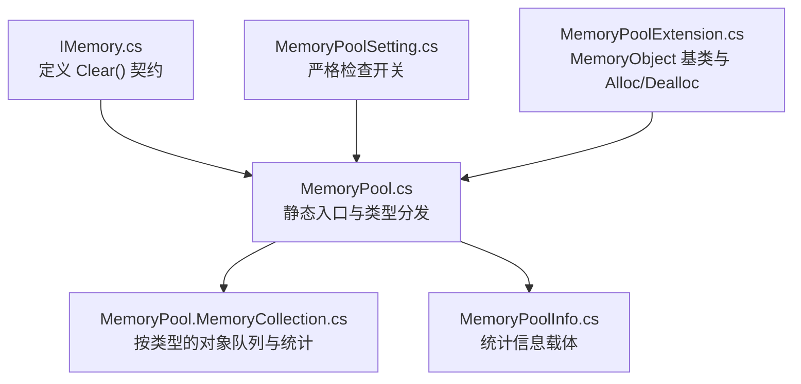
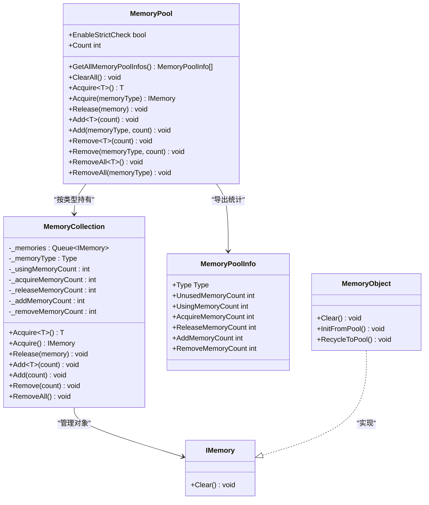
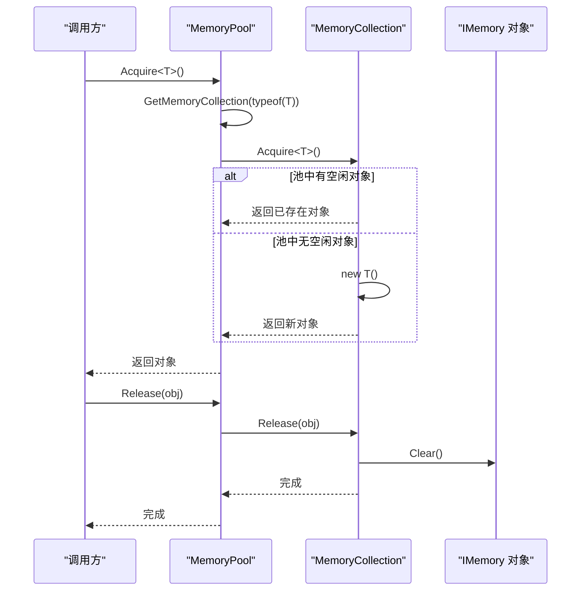
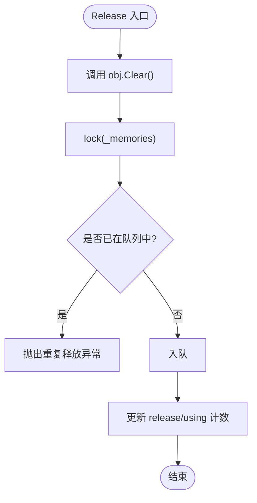
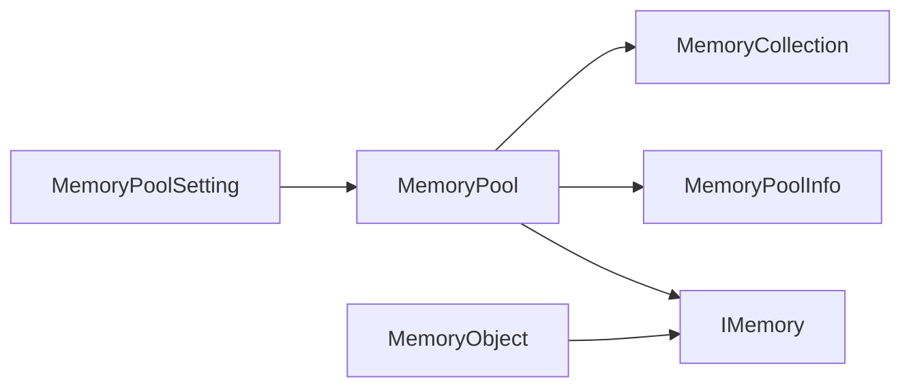

# 内存池系统

<cite>
**本文引用的文件**   
- [MemoryPool.cs](file://UnityProject/Assets/TEngine/Runtime/Core/MemoryPool/MemoryPool.cs)
- [MemoryPool.MemoryCollection.cs](file://UnityProject/Assets/TEngine/Runtime/Core/MemoryPool/MemoryPool.MemoryCollection.cs)
- [IMemory.cs](file://UnityProject/Assets/TEngine/Runtime/Core/MemoryPool/IMemory.cs)
- [MemoryPoolSetting.cs](file://UnityProject/Assets/TEngine/Runtime/Core/MemoryPool/MemoryPoolSetting.cs)
- [MemoryPoolInfo.cs](file://UnityProject/Assets/TEngine/Runtime/Core/MemoryPool/MemoryPoolInfo.cs)
- [MemoryPoolExtension.cs](file://UnityProject/Assets/TEngine/Runtime/Core/MemoryPool/MemoryPoolExtension.cs)
- [3-3-内存池模块.md](file://Books/3-3-内存池模块.md)
</cite>

## 目录
1. [简介](#简介)
2. [项目结构](#项目结构)
3. [核心组件](#核心组件)
4. [架构总览](#架构总览)
5. [详细组件分析](#详细组件分析)
6. [依赖关系分析](#依赖关系分析)
7. [性能与容量控制](#性能与容量控制)
8. [配置与监控](#配置与监控)
9. [故障排查指南](#故障排查指南)
10. [结论](#结论)
11. [附录：API 速查](#附录api-速查)

## 简介
本文件系统性地解析 TEngine 的内存池子系统，围绕 MemoryPool、MemoryCollection 与 IMemory 接口展开，说明其预分配与复用机制、线程安全策略、类型隔离与容量控制，并给出配置参数、性能监控与泄漏检测的使用方法。同时提供优化实践、常见问题与调优建议，帮助读者在高频创建/销毁场景下获得稳定且高性能的内存管理方案。

## 项目结构
内存池相关代码位于 UnityProject/Assets/TEngine/Runtime/Core/MemoryPool 目录下，核心文件如下：
- IMemory.cs：定义可被内存池管理的对象契约
- MemoryPool.cs：静态入口，负责按类型分发到对应收集器
- MemoryPool.MemoryCollection.cs：按类型维护对象队列与统计
- MemoryPoolSetting.cs：编辑器/运行期开关严格检查的配置组件
- MemoryPoolInfo.cs：内存池统计信息的数据载体
- MemoryPoolExtension.cs：为 MemoryObject 基类提供 Alloc/Dealloc 扩展

图表来源
- [IMemory.cs:1-14](file://UnityProject/Assets/TEngine/Runtime/Core/MemoryPool/IMemory.cs#L1-L14)
- [MemoryPool.cs:1-208](file://UnityProject/Assets/TEngine/Runtime/Core/MemoryPool/MemoryPool.cs#L1-L208)
- [MemoryPool.MemoryCollection.cs:1-157](file://UnityProject/Assets/TEngine/Runtime/Core/MemoryPool/MemoryPool.MemoryCollection.cs#L1-L157)
- [MemoryPoolSetting.cs:1-80](file://UnityProject/Assets/TEngine/Runtime/Core/MemoryPool/MemoryPoolSetting.cs#L1-L80)
- [MemoryPoolInfo.cs:1-119](file://UnityProject/Assets/TEngine/Runtime/Core/MemoryPool/MemoryPoolInfo.cs#L1-L119)
- [MemoryPoolExtension.cs:1-57](file://UnityProject/Assets/TEngine/Runtime/Core/MemoryPool/MemoryPoolExtension.cs#L1-L57)

章节来源
- [3-3-内存池模块.md:1-159](file://Books/3-3-内存池模块.md#L1-L159)

## 核心组件
- IMemory：所有可被内存池管理的对象必须实现的接口，仅要求实现 Clear() 方法用于回收前的清理。
- MemoryPool：静态门面，提供 Acquire/Release/Add/Remove/RemoveAll 等 API，内部按类型维护 MemoryCollection 实例，并提供全局统计与清理能力。
- MemoryCollection：私有内部类，封装每个类型的对象队列、使用计数与操作计数，负责实际的分配、归还与批量增删。
- MemoryPoolSetting：Unity MonoBehaviour 组件，用于在开发/编辑器环境启用严格检查（如重复释放检测）。
- MemoryPoolInfo：不可变结构体，承载每种类型的未使用/使用中/获取/归还/增加/移除数量等统计。
- MemoryPoolExtension：提供 MemoryObject 抽象基类与 Alloc/Dealloc 便捷 API，简化初始化与回收流程。

章节来源
- [IMemory.cs:1-14](file://UnityProject/Assets/TEngine/Runtime/Core/MemoryPool/IMemory.cs#L1-L14)
- [MemoryPool.cs:1-208](file://UnityProject/Assets/TEngine/Runtime/Core/MemoryPool/MemoryPool.cs#L1-L208)
- [MemoryPool.MemoryCollection.cs:1-157](file://UnityProject/Assets/TEngine/Runtime/Core/MemoryPool/MemoryPool.MemoryCollection.cs#L1-L157)
- [MemoryPoolSetting.cs:1-80](file://UnityProject/Assets/TEngine/Runtime/Core/MemoryPool/MemoryPoolSetting.cs#L1-L80)
- [MemoryPoolInfo.cs:1-119](file://UnityProject/Assets/TEngine/Runtime/Core/MemoryPool/MemoryPoolInfo.cs#L1-L119)
- [MemoryPoolExtension.cs:1-57](file://UnityProject/Assets/TEngine/Runtime/Core/MemoryPool/MemoryPoolExtension.cs#L1-L57)

## 架构总览
内存池采用“静态门面 + 类型化收集器”的分层设计：
- 调用方通过 MemoryPool 的泛型或非泛型 API 获取或归还对象
- MemoryPool 根据类型查找或创建对应的 MemoryCollection
- MemoryCollection 以 Queue 存储空闲对象，并在空时按需 new 新实例
- 统计信息通过 MemoryPoolInfo 暴露给上层进行监控与分析

图表来源
- [MemoryPool.cs:1-208](file://UnityProject/Assets/TEngine/Runtime/Core/MemoryPool/MemoryPool.cs#L1-L208)
- [MemoryPool.MemoryCollection.cs:1-157](file://UnityProject/Assets/TEngine/Runtime/Core/MemoryPool/MemoryPool.MemoryCollection.cs#L1-L157)
- [IMemory.cs:1-14](file://UnityProject/Assets/TEngine/Runtime/Core/MemoryPool/IMemory.cs#L1-L14)
- [MemoryPoolInfo.cs:1-119](file://UnityProject/Assets/TEngine/Runtime/Core/MemoryPool/MemoryPoolInfo.cs#L1-L119)
- [MemoryPoolExtension.cs:1-57](file://UnityProject/Assets/TEngine/Runtime/Core/MemoryPool/MemoryPoolExtension.cs#L1-L57)

## 详细组件分析

### IMemory 接口
- 职责：为内存池对象定义统一的清理契约，确保对象归还前能正确释放内部资源。
- 复杂度：O(1)，仅包含一个方法。
- 典型用法：自定义数据结构包装类、事件参数对象等频繁创建销毁的对象实现该接口，并在 Clear 中清空引用、重置状态。

章节来源
- [IMemory.cs:1-14](file://UnityProject/Assets/TEngine/Runtime/Core/MemoryPool/IMemory.cs#L1-L14)

### MemoryPool 静态门面
- 职责：对外暴露统一 API；按类型懒加载 MemoryCollection；提供全局统计与清理；支持严格检查开关。
- 线程安全：对共享字典 _memoryCollections 的访问加锁；具体队列操作由 MemoryCollection 内部加锁。
- 关键流程：
  - Acquire<T>()：委托至对应 MemoryCollection.Acquire<T>()
  - Release(IMemory)：校验类型有效性后交由对应 MemoryCollection.Release()
  - GetAllMemoryPoolInfos()：遍历各收集器构造 MemoryPoolInfo 数组
  - ClearAll()：清空所有收集器并重置字典

图表来源
- [MemoryPool.cs:66-101](file://UnityProject/Assets/TEngine/Runtime/Core/MemoryPool/MemoryPool.cs#L66-L101)
- [MemoryPool.MemoryCollection.cs:46-98](file://UnityProject/Assets/TEngine/Runtime/Core/MemoryPool/MemoryPool.MemoryCollection.cs#L46-L98)

章节来源
- [MemoryPool.cs:1-208](file://UnityProject/Assets/TEngine/Runtime/Core/MemoryPool/MemoryPool.cs#L1-L208)

### MemoryCollection 类型化收集器
- 职责：维护某一种 IMemory 类型的空闲队列与统计计数；负责对象的分配、归还、批量增删。
- 数据结构：Queue<IMemory> 作为空闲池；多个 int 字段记录 using/acquire/release/add/remove 次数。
- 线程安全：对队列操作的临界区使用 lock(_memories) 保护；统计更新在锁外进行，避免长持锁。
- 容量控制：无硬上限，按需 new；可通过 Add(count) 预分配；Remove(count)/RemoveAll() 主动收缩。
- 严格检查：当 EnableStrictCheck 开启时，Release 会检测是否重复释放同一对象。

图表来源
- [MemoryPool.MemoryCollection.cs:83-98](file://UnityProject/Assets/TEngine/Runtime/Core/MemoryPool/MemoryPool.MemoryCollection.cs#L83-L98)

章节来源
- [MemoryPool.MemoryCollection.cs:1-157](file://UnityProject/Assets/TEngine/Runtime/Core/MemoryPool/MemoryPool.MemoryCollection.cs#L1-L157)

### MemoryPoolSetting 配置组件
- 作用：在 Start 阶段根据枚举设置 MemoryPool.EnableStrictCheck，随后销毁自身。
- 模式：AlwaysEnable / OnlyEnableWhenDevelopment / OnlyEnableInEditor / AlwaysDisable。
- 影响：开启后，Release 时会检测重复释放，有助于发现错误用法。

章节来源
- [MemoryPoolSetting.cs:1-80](file://UnityProject/Assets/TEngine/Runtime/Core/MemoryPool/MemoryPoolSetting.cs#L1-L80)

### MemoryPoolInfo 统计信息
- 内容：类型、未使用数、使用中数、累计获取/归还/增加/移除次数。
- 用途：配合 MemoryPool.GetAllMemoryPoolInfos() 输出全量统计，便于分析与定位问题。

章节来源
- [MemoryPoolInfo.cs:1-119](file://UnityProject/Assets/TEngine/Runtime/Core/MemoryPool/MemoryPoolInfo.cs#L1-L119)

### MemoryPoolExtension 与 MemoryObject
- MemoryObject：抽象基类，实现 IMemory 的默认 Clear，并要求子类实现 InitFromPool 与 RecycleToPool。
- MemoryPool.Alloc<T>()：从池获取对象后自动调用 InitFromPool。
- MemoryPool.Dealloc(MemoryObject)：先调用 RecycleToPool，再归还至池。

章节来源
- [MemoryPoolExtension.cs:1-57](file://UnityProject/Assets/TEngine/Runtime/Core/MemoryPool/MemoryPoolExtension.cs#L1-L57)

## 依赖关系分析
- MemoryPool 依赖：
  - Dictionary<Type, MemoryCollection> 维护类型到收集器的映射
  - MemoryCollection 负责具体类型的对象生命周期
  - MemoryPoolInfo 用于统计导出
  - IMemory 是所有可管理对象的契约
- MemoryCollection 依赖：
  - Queue<IMemory> 作为空闲对象容器
  - Activator.CreateInstance(Type) 在无缓存对象时创建新实例
- 外部依赖：
  - MemoryPoolSetting 依赖 UnityEngine 与 Debug 环境判断
  - 文档参考 Books/3-3-内存池模块.md 的使用示例与最佳实践

图表来源
- [MemoryPool.cs:1-208](file://UnityProject/Assets/TEngine/Runtime/Core/MemoryPool/MemoryPool.cs#L1-L208)
- [MemoryPool.MemoryCollection.cs:1-157](file://UnityProject/Assets/TEngine/Runtime/Core/MemoryPool/MemoryPool.MemoryCollection.cs#L1-L157)
- [MemoryPoolSetting.cs:1-80](file://UnityProject/Assets/TEngine/Runtime/Core/MemoryPool/MemoryPoolSetting.cs#L1-L80)
- [MemoryPoolExtension.cs:1-57](file://UnityProject/Assets/TEngine/Runtime/Core/MemoryPool/MemoryPoolExtension.cs#L1-L57)
- [IMemory.cs:1-14](file://UnityProject/Assets/TEngine/Runtime/Core/MemoryPool/IMemory.cs#L1-L14)

## 性能与容量控制
- 预分配与复用
  - 优先从队列取出空闲对象，避免 GC 分配
  - 通过 Add(count) 预热池，减少首次分配抖动
- 容量策略
  - 无硬性上限，按需增长；可通过 Remove(count)/RemoveAll() 主动收缩
  - 结合统计指标（UnusedMemoryCount、AddMemoryCount）评估是否需要扩容或缩容
- 线程安全
  - 全局字典访问加锁；队列操作在各自收集器内加锁
  - 统计更新在锁外执行，降低锁竞争
- 严格检查
  - 开启后可检测重复释放，代价是 Contains 检查带来额外开销
  - 建议在开发/测试环境开启，生产环境关闭

章节来源
- [MemoryPool.cs:1-208](file://UnityProject/Assets/TEngine/Runtime/Core/MemoryPool/MemoryPool.cs#L1-L208)
- [MemoryPool.MemoryCollection.cs:1-157](file://UnityProject/Assets/TEngine/Runtime/Core/MemoryPool/MemoryPool.MemoryCollection.cs#L1-L157)
- [MemoryPoolSetting.cs:1-80](file://UnityProject/Assets/TEngine/Runtime/Core/MemoryPool/MemoryPoolSetting.cs#L1-L80)

## 配置与监控
- 配置项
  - MemoryPool.EnableStrictCheck：全局严格检查开关
  - MemoryPoolSetting.m_EnableStrictCheck：Unity 组件配置，支持按环境自动启用
- 监控接口
  - MemoryPool.Count：内存池类型数量
  - MemoryPool.GetAllMemoryPoolInfos()：获取每种类型的统计快照
  - MemoryPoolInfo.*：未使用/使用中/获取/归还/增加/移除计数
- 使用建议
  - 在启动阶段打印一次统计快照，对比不同阶段的增量变化
  - 关注 UsingMemoryCount 持续增长的情况，排查未释放对象
  - 关注 AddMemoryCount 远大于 UnusedMemoryCount，考虑调整预分配策略

章节来源
- [MemoryPool.cs:14-48](file://UnityProject/Assets/TEngine/Runtime/Core/MemoryPool/MemoryPool.cs#L14-L48)
- [MemoryPoolInfo.cs:20-116](file://UnityProject/Assets/TEngine/Runtime/Core/MemoryPool/MemoryPoolInfo.cs#L20-L116)
- [MemoryPoolSetting.cs:37-78](file://UnityProject/Assets/TEngine/Runtime/Core/MemoryPool/MemoryPoolSetting.cs#L37-L78)

## 故障排查指南
- 常见错误
  - 重复释放：Release 同一对象多次，触发严格检查异常
  - 释放后继续使用：对象已被回收，内部状态已 Clear，继续访问导致逻辑错误
  - 非 IMemory 类型传入：严格检查模式下类型校验失败
- 定位方法
  - 开启严格检查，复现问题并捕获异常堆栈
  - 使用 GetAllMemoryPoolInfos() 观察 UsingMemoryCount 是否异常增长
  - 针对特定类型 RemoveAll 后再次 Acquire，验证是否能正常重建
- 修复建议
  - 确保每次 Release 后立即置空引用，避免误用
  - 在 Clear 中彻底释放引用、重置状态
  - 将易遗漏释放的路径集中到 try/finally 或使用 Alloc/Dealloc 配对

章节来源
- [MemoryPool.cs:164-185](file://UnityProject/Assets/TEngine/Runtime/Core/MemoryPool/MemoryPool.cs#L164-L185)
- [MemoryPool.MemoryCollection.cs:83-98](file://UnityProject/Assets/TEngine/Runtime/Core/MemoryPool/MemoryPool.MemoryCollection.cs#L83-L98)
- [3-3-内存池模块.md:107-139](file://Books/3-3-内存池模块.md#L107-L139)

## 结论
TEngine 内存池通过轻量化的类型化收集器与严格的对象契约，实现了高效的对象复用与可控的容量增长。配合严格检查与统计接口，可在开发阶段快速定位内存泄漏与误用问题，在生产环境保持低开销运行。合理预分配、及时释放与正确的 Clear 实现，是发挥内存池性能的关键。

## 附录：API 速查
- 获取/释放
  - MemoryPool.Acquire<T>() / MemoryPool.Acquire(Type)
  - MemoryPool.Release(IMemory)
- 批量管理
  - MemoryPool.Add<T>(count) / MemoryPool.Add(Type, count)
  - MemoryPool.Remove<T>(count) / MemoryPool.Remove(Type, count)
  - MemoryPool.RemoveAll<T>() / MemoryPool.RemoveAll(Type)
- 统计与清理
  - MemoryPool.Count
  - MemoryPool.GetAllMemoryPoolInfos()
  - MemoryPool.ClearAll()
- 扩展 API（基于 MemoryObject）
  - MemoryPool.Alloc<T>()
  - MemoryPool.Dealloc(MemoryObject)

章节来源
- [MemoryPool.cs:66-162](file://UnityProject/Assets/TEngine/Runtime/Core/MemoryPool/MemoryPool.cs#L66-L162)
- [MemoryPoolExtension.cs:28-55](file://UnityProject/Assets/TEngine/Runtime/Core/MemoryPool/MemoryPoolExtension.cs#L28-L55)