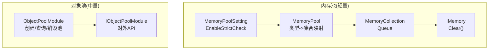
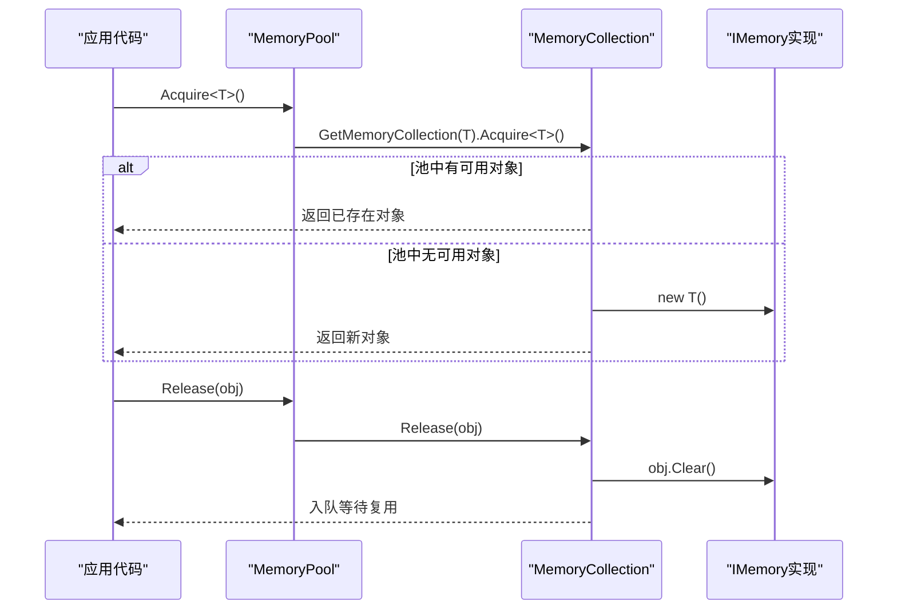
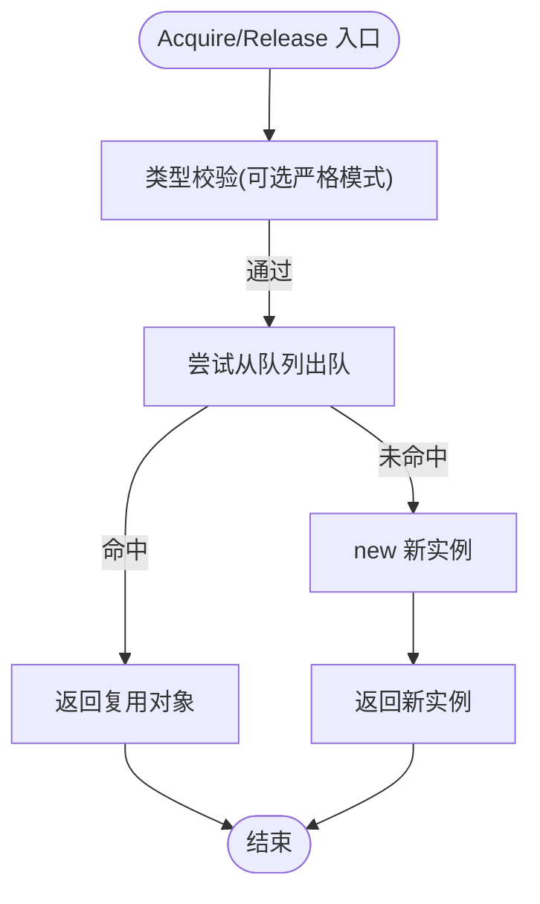
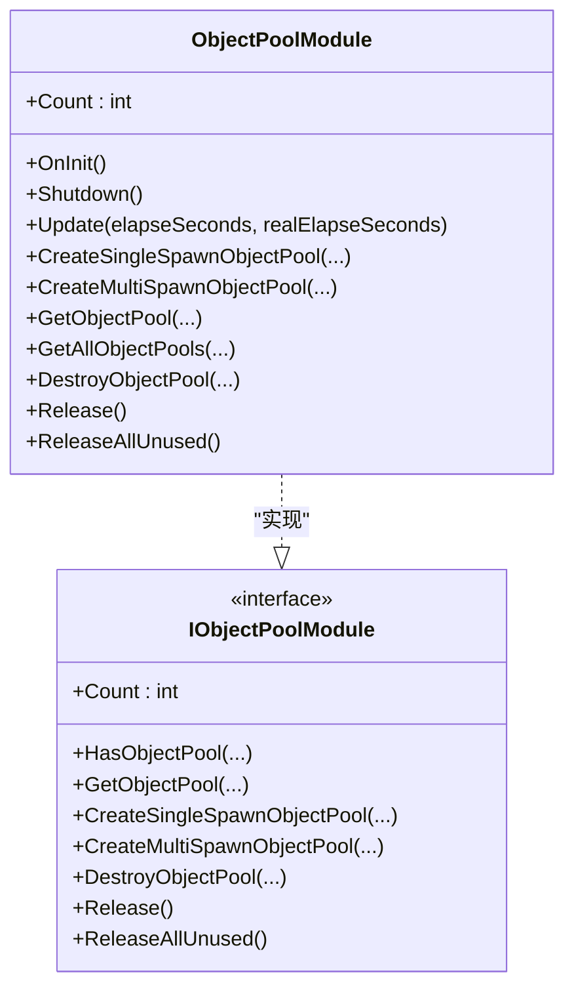
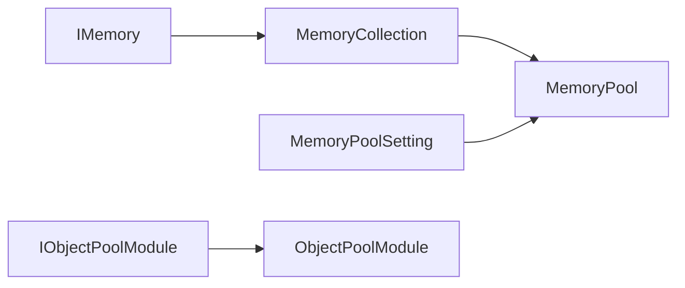

# 内存管理

<cite>
**本文引用的文件**   
- [MemoryPool.cs](file://UnityProject/Assets/TEngine/Runtime/Core/MemoryPool/MemoryPool.cs)
- [MemoryPool.MemoryCollection.cs](file://UnityProject/Assets/TEngine/Runtime/Core/MemoryPool/MemoryPool.MemoryCollection.cs)
- [IMemory.cs](file://UnityProject/Assets/TEngine/Runtime/Core/MemoryPool/IMemory.cs)
- [MemoryPoolSetting.cs](file://UnityProject/Assets/TEngine/Runtime/Core/MemoryPool/MemoryPoolSetting.cs)
- [ObjectPoolModule.cs](file://UnityProject/Assets/TEngine/Runtime/Module/ObjectPoolModule/ObjectPoolModule.cs)
- [IObjectPoolModule.cs](file://UnityProject/Assets/TEngine/Runtime/Module/ObjectPoolModule/IObjectPoolModule.cs)
- [3-3-内存池模块.md](file://Books/3-3-内存池模块.md)
- [3-4-对象池模块.md](file://Books/3-4-对象池模块.md)
</cite>

## 目录
1. [引言](#引言)
2. [项目结构](#项目结构)
3. [核心组件](#核心组件)
4. [架构总览](#架构总览)
5. [详细组件分析](#详细组件分析)
6. [依赖关系分析](#依赖关系分析)
7. [性能与优化](#性能与优化)
8. [监控、分析与泄漏检测](#监控分析与泄漏检测)
9. [常见问题排查](#常见问题排查)
10. [结论](#结论)
11. [附录：配置与最佳实践](#附录配置与最佳实践)

## 引言
本文件系统性梳理 TEngine 的内存管理体系，重点围绕“轻量级内存池”和“中量级对象池”两大子系统展开。通过对象复用策略降低 GC 压力、提升分配/释放吞吐；同时提供严格的检查机制、统计信息与可观测性接口，帮助开发者在开发期发现误用与泄漏风险。文档还给出 LRU/ARC 缓存算法的应用建议与配置方法，以及性能调优与排障指南。

## 项目结构
- 内存池（轻量级）
  - 入口与类型分发：MemoryPool.cs
  - 按类型维护的队列集合：MemoryPool.MemoryCollection.cs
  - 内存对象契约：IMemory.cs
  - 编辑器/运行期严格检查开关：MemoryPoolSetting.cs
- 对象池（中量级）
  - 对象池管理器：ObjectPoolModule.cs
  - 对外接口：IObjectPoolModule.cs
- 文档参考
  - 内存池使用与最佳实践：3-3-内存池模块.md
  - 对象池使用与最佳实践：3-4-对象池模块.md

图示来源
- [MemoryPool.cs:1-208](file://UnityProject/Assets/TEngine/Runtime/Core/MemoryPool/MemoryPool.cs#L1-L208)
- [MemoryPool.MemoryCollection.cs:1-157](file://UnityProject/Assets/TEngine/Runtime/Core/MemoryPool/MemoryPool.MemoryCollection.cs#L1-L157)
- [IMemory.cs:1-14](file://UnityProject/Assets/TEngine/Runtime/Core/MemoryPool/IMemory.cs#L1-L14)
- [MemoryPoolSetting.cs:1-80](file://UnityProject/Assets/TEngine/Runtime/Core/MemoryPool/MemoryPoolSetting.cs#L1-L80)
- [ObjectPoolModule.cs:1-800](file://UnityProject/Assets/TEngine/Runtime/Module/ObjectPoolModule/ObjectPoolModule.cs#L1-L800)
- [IObjectPoolModule.cs:1-745](file://UnityProject/Assets/TEngine/Runtime/Module/ObjectPoolModule/IObjectPoolModule.cs#L1-L745)

章节来源
- [MemoryPool.cs:1-208](file://UnityProject/Assets/TEngine/Runtime/Core/MemoryPool/MemoryPool.cs#L1-L208)
- [MemoryPool.MemoryCollection.cs:1-157](file://UnityProject/Assets/TEngine/Runtime/Core/MemoryPool/MemoryPool.MemoryCollection.cs#L1-L157)
- [IMemory.cs:1-14](file://UnityProject/Assets/TEngine/Runtime/Core/MemoryPool/IMemory.cs#L1-L14)
- [MemoryPoolSetting.cs:1-80](file://UnityProject/Assets/TEngine/Runtime/Core/MemoryPool/MemoryPoolSetting.cs#L1-L80)
- [ObjectPoolModule.cs:1-800](file://UnityProject/Assets/TEngine/Runtime/Module/ObjectPoolModule/ObjectPoolModule.cs#L1-L800)
- [IObjectPoolModule.cs:1-745](file://UnityProject/Assets/TEngine/Runtime/Module/ObjectPoolModule/IObjectPoolModule.cs#L1-L745)

## 核心组件
- MemoryPool：静态入口，按类型维护 MemoryCollection，提供 Acquire/Release/Add/Remove 等 API，支持严格检查开关与全局统计信息导出。
- MemoryCollection：基于 Queue<IMemory> 的线程安全实现，负责对象的出队/入队、计数与清理调用。
- IMemory：所有可被内存池管理的对象必须实现的接口，要求实现 Clear() 以正确释放内部引用。
- MemoryPoolSetting：MonoBehaviour，用于在场景启动时根据配置启用严格检查，并输出日志提示。
- ObjectPoolModule：对象池管理器，负责创建、查找、销毁对象池，支持单次/多次获取模式、容量、过期时间、优先级与自动释放间隔等参数。
- IObjectPoolModule：对象池管理器的对外接口定义，暴露创建与查询能力。

章节来源
- [MemoryPool.cs:1-208](file://UnityProject/Assets/TEngine/Runtime/Core/MemoryPool/MemoryPool.cs#L1-L208)
- [MemoryPool.MemoryCollection.cs:1-157](file://UnityProject/Assets/TEngine/Runtime/Core/MemoryPool/MemoryPool.MemoryCollection.cs#L1-L157)
- [IMemory.cs:1-14](file://UnityProject/Assets/TEngine/Runtime/Core/MemoryPool/IMemory.cs#L1-L14)
- [MemoryPoolSetting.cs:1-80](file://UnityProject/Assets/TEngine/Runtime/Core/MemoryPool/MemoryPoolSetting.cs#L1-L80)
- [ObjectPoolModule.cs:1-800](file://UnityProject/Assets/TEngine/Runtime/Module/ObjectPoolModule/ObjectPoolModule.cs#L1-L800)
- [IObjectPoolModule.cs:1-745](file://UnityProject/Assets/TEngine/Runtime/Module/ObjectPoolModule/IObjectPoolModule.cs#L1-L745)

## 架构总览
内存池与对象池分别面向不同粒度的对象生命周期管理：
- 内存池：面向轻量、频繁分配/释放的数据结构或临时对象，强调低开销与快速回收。
- 对象池：面向 Unity 对象或业务实体，强调生命周期管理与复用策略（容量、过期、优先级、自动释放）。

图示来源
- [MemoryPool.cs:66-101](file://UnityProject/Assets/TEngine/Runtime/Core/MemoryPool/MemoryPool.cs#L66-L101)
- [MemoryPool.MemoryCollection.cs:46-98](file://UnityProject/Assets/TEngine/Runtime/Core/MemoryPool/MemoryPool.MemoryCollection.cs#L46-L98)

## 详细组件分析

### 内存池（MemoryPool + MemoryCollection）
- 设计要点
  - 类型到集合的映射：Dictionary<Type, MemoryCollection>，保证同类型对象共用一个队列。
  - 线程安全：关键操作加锁，避免并发竞争。
  - 严格检查：EnableStrictCheck 开启后，对类型合法性、重复释放等进行校验。
  - 统计信息：记录未使用/使用中/累计获取/释放/新增/移除数量，便于诊断。
- 分配与回收流程
  - 分配：优先从队列取回对象；若无则 new 新实例。
  - 回收：先调用 Clear() 清空内部状态，再入队复用。
- 复杂度
  - 分配/回收均摊 O(1)，队列操作常数时间。
  - 严格检查模式下 Contains 可能带来额外开销，应仅在开发期开启。

图示来源
- [MemoryPool.cs:164-205](file://UnityProject/Assets/TEngine/Runtime/Core/MemoryPool/MemoryPool.cs#L164-L205)
- [MemoryPool.MemoryCollection.cs:46-81](file://UnityProject/Assets/TEngine/Runtime/Core/MemoryPool/MemoryPool.MemoryCollection.cs#L46-L81)

章节来源
- [MemoryPool.cs:1-208](file://UnityProject/Assets/TEngine/Runtime/Core/MemoryPool/MemoryPool.cs#L1-L208)
- [MemoryPool.MemoryCollection.cs:1-157](file://UnityProject/Assets/TEngine/Runtime/Core/MemoryPool/MemoryPool.MemoryCollection.cs#L1-L157)

### 对象池（ObjectPoolModule）
- 设计要点
  - 统一管理多个对象池，支持按类型+名称定位。
  - 两种模式：单次获取（同一时刻仅一个实例活跃）、多次获取（允许同时多个实例）。
  - 生命周期控制：容量上限、对象过期时间、自动释放间隔、优先级排序。
  - 轮询更新：实现 IUpdateModule，定期执行 Update 以推进各池的生命周期。
- 典型流程
  - 创建池：CreateSingleSpawnObjectPool / CreateMultiSpawnObjectPool。
  - 获取对象：Spawn。
  - 归还对象：Unspawn。
  - 销毁池：DestroyObjectPool。

图示来源
- [ObjectPoolModule.cs:1-800](file://UnityProject/Assets/TEngine/Runtime/Module/ObjectPoolModule/ObjectPoolModule.cs#L1-L800)
- [IObjectPoolModule.cs:1-745](file://UnityProject/Assets/TEngine/Runtime/Module/ObjectPoolModule/IObjectPoolModule.cs#L1-L745)

章节来源
- [ObjectPoolModule.cs:1-800](file://UnityProject/Assets/TEngine/Runtime/Module/ObjectPoolModule/ObjectPoolModule.cs#L1-L800)
- [IObjectPoolModule.cs:1-745](file://UnityProject/Assets/TEngine/Runtime/Module/ObjectPoolModule/IObjectPoolModule.cs#L1-L745)

### 内存对象契约（IMemory）
- 职责：为内存池对象提供统一的清理入口 Clear()，确保释放内部引用、重置状态，避免二次释放或脏数据复用。
- 使用约束：Release 后禁止继续使用对象；严禁重复 Release。

章节来源
- [IMemory.cs:1-14](file://UnityProject/Assets/TEngine/Runtime/Core/MemoryPool/IMemory.cs#L1-L14)

### 严格检查开关（MemoryPoolSetting）
- 功能：在场景启动时根据配置启用严格检查，并在启用时输出性能警告日志。
- 适用场景：开发/测试环境开启，生产环境关闭以避免额外开销。

章节来源
- [MemoryPoolSetting.cs:1-80](file://UnityProject/Assets/TEngine/Runtime/Core/MemoryPool/MemoryPoolSetting.cs#L1-L80)

## 依赖关系分析
- MemoryPool 依赖 MemoryCollection 进行具体类型的对象队列管理。
- MemoryCollection 依赖 IMemory 接口完成对象清理。
- MemoryPoolSetting 驱动 MemoryPool.EnableStrictCheck 行为。
- ObjectPoolModule 实现 IObjectPoolModule 接口，作为对象池的统一入口。

图示来源
- [MemoryPool.cs:1-208](file://UnityProject/Assets/TEngine/Runtime/Core/MemoryPool/MemoryPool.cs#L1-L208)
- [MemoryPool.MemoryCollection.cs:1-157](file://UnityProject/Assets/TEngine/Runtime/Core/MemoryPool/MemoryPool.MemoryCollection.cs#L1-L157)
- [IMemory.cs:1-14](file://UnityProject/Assets/TEngine/Runtime/Core/MemoryPool/IMemory.cs#L1-L14)
- [MemoryPoolSetting.cs:1-80](file://UnityProject/Assets/TEngine/Runtime/Core/MemoryPool/MemoryPoolSetting.cs#L1-L80)
- [ObjectPoolModule.cs:1-800](file://UnityProject/Assets/TEngine/Runtime/Module/ObjectPoolModule/ObjectPoolModule.cs#L1-L800)
- [IObjectPoolModule.cs:1-745](file://UnityProject/Assets/TEngine/Runtime/Module/ObjectPoolModule/IObjectPoolModule.cs#L1-L745)

## 性能与优化
- 分配/回收路径
  - 内存池：队列出队/入队 O(1)，new 仅在池空时触发。
  - 对象池：按池策略 Spawn/Unspawn，结合容量与过期策略减少 GC。
- 严格检查
  - 开发期开启以提升安全性；生产期关闭以降低开销。
- 预分配
  - 针对热点类型，提前 Add(count) 预热，减少运行时扩容与分配抖动。
- 容量与过期
  - 合理设置对象池容量与过期时间，避免长期驻留导致内存膨胀。
- 批量操作
  - 使用 Remove/RemoveAll 控制池规模，配合 ReleaseAllUnused 释放闲置对象。

[本节为通用指导，不直接分析具体文件]

## 监控、分析与泄漏检测
- 内存池统计
  - 通过 GetAllMemoryPoolInfos 获取各类型的未使用/使用中/累计获取/释放/新增/移除计数，辅助定位热点类型与异常增长。
- 严格检查
  - EnableStrictCheck 开启后，可对非法类型、重复释放等行为抛出异常，便于在开发期捕获问题。
- 对象池观察
  - 通过 ObjectPoolModule 的 Count、GetAllObjectPools 等方法枚举池，结合业务埋点观察 Spawn/Unspawn 频率与滞留情况。

章节来源
- [MemoryPool.cs:29-48](file://UnityProject/Assets/TEngine/Runtime/Core/MemoryPool/MemoryPool.cs#L29-L48)
- [MemoryPool.cs:164-185](file://UnityProject/Assets/TEngine/Runtime/Core/MemoryPool/MemoryPool.cs#L164-L185)
- [ObjectPoolModule.cs:23-41](file://UnityProject/Assets/TEngine/Runtime/Module/ObjectPoolModule/ObjectPoolModule.cs#L23-L41)

## 常见问题排查
- Release 后继续访问对象
  - 现象：对象状态被 Clear() 重置，后续访问出现空引用或脏数据。
  - 处理：Release 后立即置空引用；开启严格检查尽早暴露问题。
- 重复 Release
  - 现象：破坏池内状态，可能导致重复入队或计数异常。
  - 处理：开启严格检查；在业务层增加防重逻辑。
- 类型不匹配
  - 现象：传入类型非 IMemory 或非预期子类。
  - 处理：严格检查会抛出异常；确保泛型参数与实际类型一致。
- 对象池未正确初始化/释放
  - 现象：Spawn 失败或对象长期滞留。
  - 处理：检查池容量、过期时间与 AutoReleaseInterval；必要时调用 ReleaseAllUnused。

章节来源
- [MemoryPool.MemoryCollection.cs:83-98](file://UnityProject/Assets/TEngine/Runtime/Core/MemoryPool/MemoryPool.MemoryCollection.cs#L83-L98)
- [MemoryPool.cs:164-185](file://UnityProject/Assets/TEngine/Runtime/Core/MemoryPool/MemoryPool.cs#L164-L185)
- [3-3-内存池模块.md:107-139](file://Books/3-3-内存池模块.md#L107-L139)
- [3-4-对象池模块.md:208-218](file://Books/3-4-对象池模块.md#L208-L218)

## 结论
TEngine 的内存管理由“轻量级内存池”和“中量级对象池”协同构成：前者专注于高频小对象的快速分配与回收，后者聚焦于复杂对象的生命周期与复用策略。通过严格检查、统计信息与可观测接口，开发者可在开发期高效定位问题，在生产期获得稳定且低 GC 压力的运行体验。

[本节为总结性内容，不直接分析具体文件]

## 附录：配置与最佳实践

### 内存池最佳实践
- 适合场景：频繁创建/销毁的小对象、数据结构包装类、事件参数、临时数据。
- 不适合场景：大型对象、复杂初始化对象、长生命周期对象。
- 正确使用
  - 在 Clear() 中彻底释放内部引用。
  - Release 后立即置空引用，禁止二次 Release。
- 配置建议
  - 开发/测试环境开启严格检查；生产环境关闭。
  - 热点类型预分配，减少运行时分配抖动。

章节来源
- [3-3-内存池模块.md:92-139](file://Books/3-3-内存池模块.md#L92-L139)
- [MemoryPoolSetting.cs:36-79](file://UnityProject/Assets/TEngine/Runtime/Core/MemoryPool/MemoryPoolSetting.cs#L36-L79)

### 对象池最佳实践
- 适合场景：GameObject、UI 列表项、游戏实体等需要复用的对象。
- 池类型选择
  - 单次获取：唯一对象（如玩家、主摄像机）。
  - 多次获取：可复用对象（如子弹、特效）。
- 生命周期管理
  - 在 Release 中清理所有引用，避免泄漏。
  - 合理设置容量、过期时间与自动释放间隔。

章节来源
- [3-4-对象池模块.md:187-218](file://Books/3-4-对象池模块.md#L187-L218)
- [ObjectPoolModule.cs:366-733](file://UnityProject/Assets/TEngine/Runtime/Module/ObjectPoolModule/ObjectPoolModule.cs#L366-L733)

### LRU 与 ARC 缓存算法的应用与配置
- 应用场景
  - LRU（最近最少使用）：适用于资源加载缓存、配置表缓存等，淘汰长时间未访问的资源，平衡命中率与内存占用。
  - ARC（自适应替换缓存）：适用于动态热点变化的资源，依据访问频率自适应调整保留策略，提高整体命中率。
- 配置建议
  - 容量上限：根据目标平台内存预算设定最大条目数。
  - 淘汰策略：LRU 侧重时间维度，ARC 侧重频率维度，可按业务热点特征选择或组合。
  - 预热策略：启动阶段预加载高概率资源，降低冷启动延迟。
- 与池化技术的关系
  - 缓存层（LRU/ARC）与对象/内存池分层协作：缓存决定“是否保留”，池决定“如何复用”。

[本节为概念性说明，不直接分析具体文件]