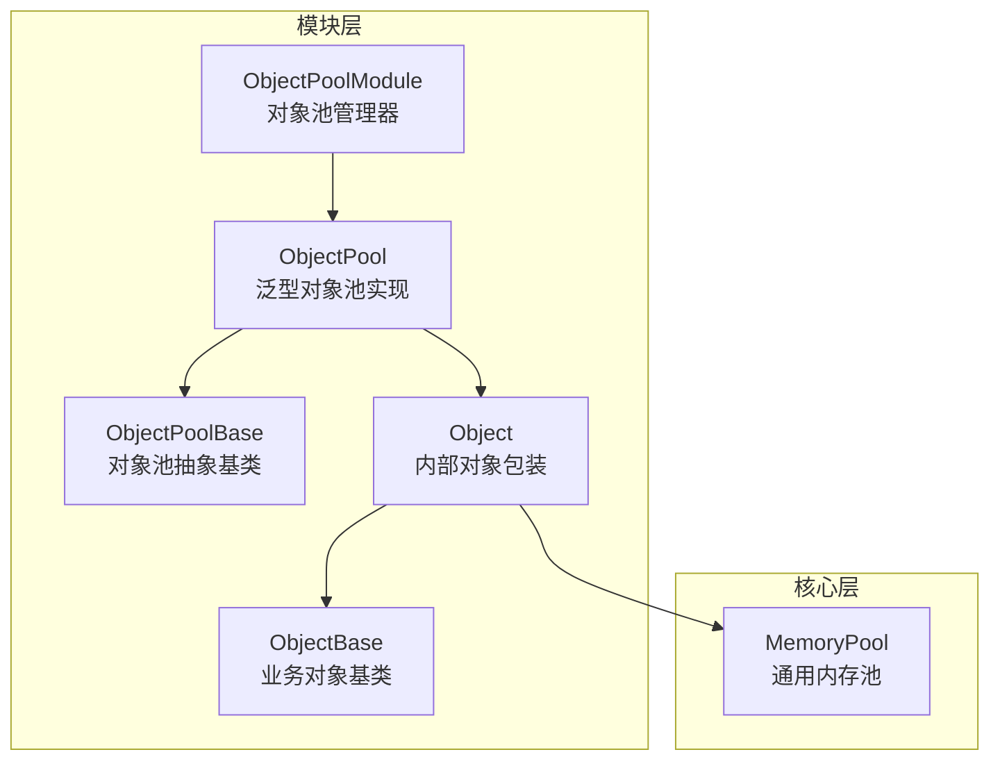
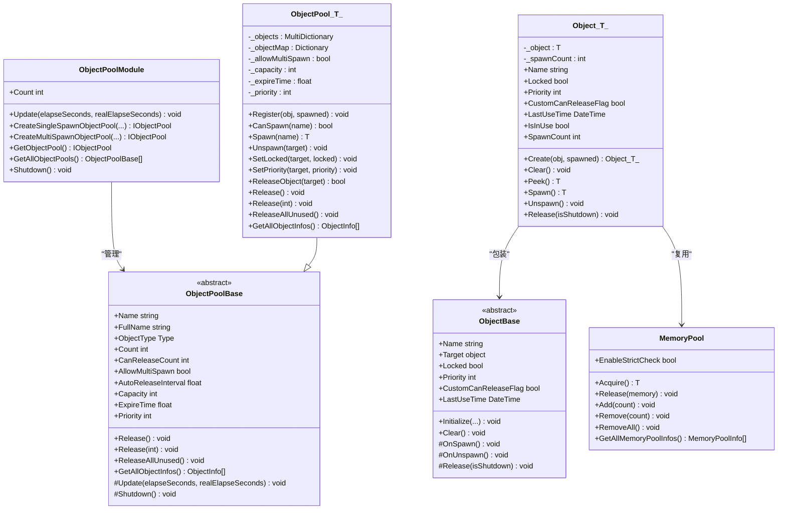
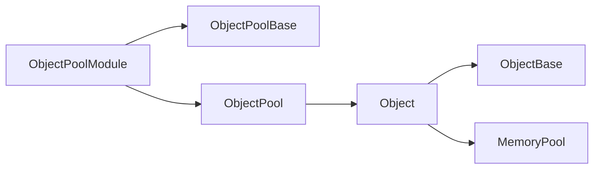
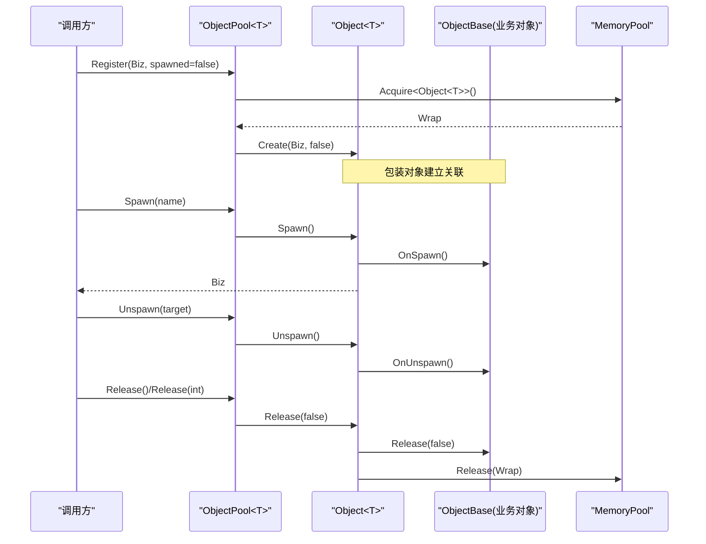
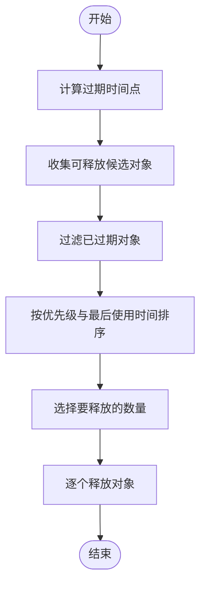

# 对象池系统

<cite>
**本文引用的文件**   
- [ObjectPoolModule.cs](file://UnityProject/Assets/TEngine/Runtime/Module/ObjectPoolModule/ObjectPoolModule.cs)
- [ObjectPoolBase.cs](file://UnityProject/Assets/TEngine/Runtime/Module/ObjectPoolModule/ObjectPoolBase.cs)
- [ObjectPoolModule.Object.cs](file://UnityProject/Assets/TEngine/Runtime/Module/ObjectPoolModule/ObjectPoolModule.Object.cs)
- [ObjectPoolModule.ObjectPool.cs](file://UnityProject/Assets/TEngine/Runtime/Module/ObjectPoolModule/ObjectPoolModule.ObjectPool.cs)
- [ObjectBase.cs](file://UnityProject/Assets/TEngine/Runtime/Module/ObjectPoolModule/ObjectBase.cs)
- [MemoryPool.cs](file://UnityProject/Assets/TEngine/Runtime/Core/MemoryPool/MemoryPool.cs)
- [MemoryPoolSetting.cs](file://UnityProject/Assets/TEngine/Runtime/Core/MemoryPool/MemoryPoolSetting.cs)
- [3-4-对象池模块.md](file://Books/3-4-对象池模块.md)
</cite>

## 目录
1. [简介](#简介)
2. [项目结构](#项目结构)
3. [核心组件](#核心组件)
4. [架构总览](#架构总览)
5. [详细组件分析](#详细组件分析)
6. [依赖关系分析](#依赖关系分析)
7. [性能与内存优化](#性能与内存优化)
8. [配置与监控](#配置与监控)
9. [常见问题排查](#常见问题排查)
10. [结论](#结论)

## 简介
本文件系统性梳理 TEngine 的对象池子系统，围绕 ObjectPoolModule、ObjectPoolBase、ObjectBase 三大核心，解释对象创建、获取、归还、销毁的生命周期管理；说明引用计数、自动回收策略、容量与过期控制；并提供配置选项、性能监控与内存分析方法，以及常见使用场景、最佳实践和故障排查指南。

## 项目结构
对象池相关代码位于 Runtime 的 Module 与 Core 两个层次：
- Module 层：对象池对外暴露的管理器与具体实现（ObjectPoolModule、ObjectPoolBase、ObjectPool<T>）
- Core 层：通用内存池（MemoryPool），用于复用内部包装对象，降低 GC 压力

图表来源
- [ObjectPoolModule.cs:9-41](file://UnityProject/Assets/TEngine/Runtime/Module/ObjectPoolModule/ObjectPoolModule.cs#L9-L41)
- [ObjectPoolBase.cs:8-132](file://UnityProject/Assets/TEngine/Runtime/Module/ObjectPoolModule/ObjectPoolBase.cs#L8-L132)
- [ObjectPoolModule.ObjectPool.cs:12-49](file://UnityProject/Assets/TEngine/Runtime/Module/ObjectPoolModule/ObjectPoolModule.ObjectPool.cs#L12-L49)
- [ObjectPoolModule.Object.cs:11-187](file://UnityProject/Assets/TEngine/Runtime/Module/ObjectPoolModule/ObjectPoolModule.Object.cs#L11-L187)
- [ObjectBase.cs:8-163](file://UnityProject/Assets/TEngine/Runtime/Module/ObjectPoolModule/ObjectBase.cs#L8-L163)
- [MemoryPool.cs:9-205](file://UnityProject/Assets/TEngine/Runtime/Core/MemoryPool/MemoryPool.cs#L9-L205)

章节来源
- [ObjectPoolModule.cs:9-41](file://UnityProject/Assets/TEngine/Runtime/Module/ObjectPoolModule/ObjectPoolModule.cs#L9-L41)
- [ObjectPoolBase.cs:8-132](file://UnityProject/Assets/TEngine/Runtime/Module/ObjectPoolModule/ObjectPoolBase.cs#L8-L132)
- [ObjectPoolModule.ObjectPool.cs:12-49](file://UnityProject/Assets/TEngine/Runtime/Module/ObjectPoolModule/ObjectPoolModule.ObjectPool.cs#L12-L49)
- [ObjectPoolModule.Object.cs:11-187](file://UnityProject/Assets/TEngine/Runtime/Module/ObjectPoolModule/ObjectPoolModule.Object.cs#L11-L187)
- [ObjectBase.cs:8-163](file://UnityProject/Assets/TEngine/Runtime/Module/ObjectPoolModule/ObjectBase.cs#L8-L163)
- [MemoryPool.cs:9-205](file://UnityProject/Assets/TEngine/Runtime/Core/MemoryPool/MemoryPool.cs#L9-L205)

## 核心组件
- ObjectPoolModule：对象池管理器，负责创建、查找、遍历、更新与关闭所有对象池，并实现 IUpdateModule 轮询以驱动自动释放。
- ObjectPoolBase：对象池抽象基类，定义名称、类型、容量、过期时间、优先级、自动释放间隔等属性与统一接口。
- ObjectPool<T>：具体对象池实现，维护对象集合、映射表、可释放候选集，提供注册、获取、归还、锁定、优先级设置、批量释放等能力。
- Object<T>：内部对象包装，持有实际业务对象与获取计数，封装 OnSpawn/OnUnspawn/Release 生命周期钩子。
- ObjectBase：业务对象基类，提供名称、目标实体、锁定、优先级、最后使用时间等元数据，以及 Initialize/OnSpawn/OnUnspawn/Release 生命周期方法。
- MemoryPool：通用内存池，为内部包装对象（如 Object<T>）提供无分配复用，减少 GC 压力。

章节来源
- [ObjectPoolModule.cs:9-41](file://UnityProject/Assets/TEngine/Runtime/Module/ObjectPoolModule/ObjectPoolModule.cs#L9-L41)
- [ObjectPoolBase.cs:8-132](file://UnityProject/Assets/TEngine/Runtime/Module/ObjectPoolModule/ObjectPoolBase.cs#L8-L132)
- [ObjectPoolModule.ObjectPool.cs:12-49](file://UnityProject/Assets/TEngine/Runtime/Module/ObjectPoolModule/ObjectPoolModule.ObjectPool.cs#L12-L49)
- [ObjectPoolModule.Object.cs:11-187](file://UnityProject/Assets/TEngine/Runtime/Module/ObjectPoolModule/ObjectPoolModule.Object.cs#L11-L187)
- [ObjectBase.cs:8-163](file://UnityProject/Assets/TEngine/Runtime/Module/ObjectPoolModule/ObjectBase.cs#L8-L163)
- [MemoryPool.cs:9-205](file://UnityProject/Assets/TEngine/Runtime/Core/MemoryPool/MemoryPool.cs#L9-L205)

## 架构总览
对象池系统采用“管理器 + 抽象基类 + 泛型实现 + 内部包装”的分层设计：
- ObjectPoolModule 作为入口，统一管理多个对象池实例，按优先级排序与轮询更新。
- ObjectPoolBase 定义统一能力，ObjectPool<T> 提供具体实现。
- Object<T> 作为内部包装，将业务对象与池化元数据（是否在使用、获取计数、最后使用时间等）绑定。
- ObjectBase 是业务对象基类，通过 Initialize 注入目标实体，并通过 OnSpawn/OnUnspawn/Release 完成生命周期回调。
- MemoryPool 在底层为内部包装对象提供复用，避免频繁分配。

图表来源
- [ObjectPoolModule.cs:9-41](file://UnityProject/Assets/TEngine/Runtime/Module/ObjectPoolModule/ObjectPoolModule.cs#L9-L41)
- [ObjectPoolBase.cs:8-132](file://UnityProject/Assets/TEngine/Runtime/Module/ObjectPoolModule/ObjectPoolBase.cs#L8-L132)
- [ObjectPoolModule.ObjectPool.cs:12-49](file://UnityProject/Assets/TEngine/Runtime/Module/ObjectPoolModule/ObjectPoolModule.ObjectPool.cs#L12-L49)
- [ObjectPoolModule.Object.cs:11-187](file://UnityProject/Assets/TEngine/Runtime/Module/ObjectPoolModule/ObjectPoolModule.Object.cs#L11-L187)
- [ObjectBase.cs:8-163](file://UnityProject/Assets/TEngine/Runtime/Module/ObjectPoolModule/ObjectBase.cs#L8-L163)
- [MemoryPool.cs:9-205](file://UnityProject/Assets/TEngine/Runtime/Core/MemoryPool/MemoryPool.cs#L9-L205)

## 详细组件分析

### ObjectPoolModule：对象池管理器
职责
- 创建单例/多例对象池（CreateSingleSpawnObjectPool / CreateMultiSpawnObjectPool）
- 查询是否存在或获取指定对象池（HasObjectPool / GetObjectPool）
- 遍历所有对象池（GetAllObjectPools）
- 每帧 Update 驱动各对象池的自动释放逻辑
- Shutdown 时关闭并清理所有对象池

关键行为
- 默认常量：DEFAULT_CAPACITY、DEFAULT_EXPIRE_TIME、DEFAULT_PRIORITY
- 通过 TypeNamePair 区分同类型的不同命名对象池
- 支持按条件筛选对象池（Predicate）

章节来源
- [ObjectPoolModule.cs:11-51](file://UnityProject/Assets/TEngine/Runtime/Module/ObjectPoolModule/ObjectPoolModule.cs#L11-L51)
- [ObjectPoolModule.cs:53-70](file://UnityProject/Assets/TEngine/Runtime/Module/ObjectPoolModule/ObjectPoolModule.cs#L53-L70)
- [ObjectPoolModule.cs:72-155](file://UnityProject/Assets/TEngine/Runtime/Module/ObjectPoolModule/ObjectPoolModule.cs#L72-L155)
- [ObjectPoolModule.cs:157-364](file://UnityProject/Assets/TEngine/Runtime/Module/ObjectPoolModule/ObjectPoolModule.cs#L157-L364)
- [ObjectPoolModule.cs:366-733](file://UnityProject/Assets/TEngine/Runtime/Module/ObjectPoolModule/ObjectPoolModule.cs#L366-L733)

### ObjectPoolBase：对象池抽象基类
职责
- 定义对象池的统一属性：名称、完整名称、对象类型、数量、可释放数量、是否允许多次获取、自动释放间隔、容量、过期时间、优先级
- 定义统一操作：释放、批量释放、释放所有未使用对象、获取对象信息、更新与关闭

章节来源
- [ObjectPoolBase.cs:8-132](file://UnityProject/Assets/TEngine/Runtime/Module/ObjectPoolModule/ObjectPoolBase.cs#L8-L132)

### ObjectPool<T>：泛型对象池实现
数据结构
- _objects：按名称分组的多重字典，存储内部对象
- _objectMap：目标实体到内部对象的映射，快速定位
- _cachedCanReleaseObjects/_cachedToReleaseObjects：缓存列表，减少分配
- 配置字段：_allowMultiSpawn、_autoReleaseInterval、_capacity、_expireTime、_priority、_autoReleaseTime

核心流程
- Register：注册业务对象到池中，若超过容量则触发 Release
- CanSpawn/Spawn：根据名称查找可用对象，支持单次/多次获取模式
- Unspawn：归还对象，若超容且不再被使用则触发 Release
- SetLocked/SetPriority：动态调整对象锁定与优先级
- ReleaseObject：按条件释放单个对象
- Release/Release(int)/Release(callback)：批量释放，结合过期时间与优先级策略
- ReleaseAllUnused：释放所有未使用对象
- GetAllObjectInfos：导出对象信息数组
- Update：累计真实时间，达到间隔后执行 Release
- Shutdown：释放所有对象并清空容器

章节来源
- [ObjectPoolModule.ObjectPool.cs:12-49](file://UnityProject/Assets/TEngine/Runtime/Module/ObjectPoolModule/ObjectPoolModule.ObjectPool.cs#L12-L49)
- [ObjectPoolModule.ObjectPool.cs:143-163](file://UnityProject/Assets/TEngine/Runtime/Module/ObjectPoolModule/ObjectPoolModule.ObjectPool.cs#L143-L163)
- [ObjectPoolModule.ObjectPool.cs:165-235](file://UnityProject/Assets/TEngine/Runtime/Module/ObjectPoolModule/ObjectPoolModule.ObjectPool.cs#L165-L235)
- [ObjectPoolModule.ObjectPool.cs:237-277](file://UnityProject/Assets/TEngine/Runtime/Module/ObjectPoolModule/ObjectPoolModule.ObjectPool.cs#L237-L277)
- [ObjectPoolModule.ObjectPool.cs:279-357](file://UnityProject/Assets/TEngine/Runtime/Module/ObjectPoolModule/ObjectPoolModule.ObjectPool.cs#L279-L357)
- [ObjectPoolModule.ObjectPool.cs:359-403](file://UnityProject/Assets/TEngine/Runtime/Module/ObjectPoolModule/ObjectPoolModule.ObjectPool.cs#L359-L403)
- [ObjectPoolModule.ObjectPool.cs:405-479](file://UnityProject/Assets/TEngine/Runtime/Module/ObjectPoolModule/ObjectPoolModule.ObjectPool.cs#L405-L479)
- [ObjectPoolModule.ObjectPool.cs:481-523](file://UnityProject/Assets/TEngine/Runtime/Module/ObjectPoolModule/ObjectPoolModule.ObjectPool.cs#L481-L523)
- [ObjectPoolModule.ObjectPool.cs:525-599](file://UnityProject/Assets/TEngine/Runtime/Module/ObjectPoolModule/ObjectPoolModule.ObjectPool.cs#L525-L599)

### Object<T>：内部对象包装
职责
- 持有业务对象与获取计数
- 暴露 Name/Locked/Priority/CustomCanReleaseFlag/LastUseTime/IsInUse/SpawnCount
- 封装 Create/Clear/Peek/Spawn/Unspawn/Release 生命周期

关键点
- Spawn 增加计数并更新时间，调用 OnSpawn
- Unspawn 调用 OnUnspawn，减少计数，防止负数
- Release 调用业务对象 Release 并归还内部包装到 MemoryPool

章节来源
- [ObjectPoolModule.Object.cs:11-187](file://UnityProject/Assets/TEngine/Runtime/Module/ObjectPoolModule/ObjectPoolModule.Object.cs#L11-L187)

### ObjectBase：业务对象基类
职责
- 提供 Name/Target/Locked/Priority/CustomCanReleaseFlag/LastUseTime 等元数据
- 提供多种 Initialize 重载，初始化名称、目标实体、锁定状态、优先级与最后使用时间
- 提供 Clear 重置
- 提供 OnSpawn/OnUnspawn/Release 生命周期钩子，供子类实现资源管理与清理

章节来源
- [ObjectBase.cs:8-163](file://UnityProject/Assets/TEngine/Runtime/Module/ObjectPoolModule/ObjectBase.cs#L8-L163)

### MemoryPool：通用内存池
职责
- 为 IMemory 类型提供 Acquire/Release/Add/Remove/RemoveAll 等操作
- 提供统计信息与强制检查开关 EnableStrictCheck
- 通过 MemoryCollection 按类型管理对象集合

作用
- 对象池内部包装对象（Object<T>）通过 MemoryPool 复用，减少 GC 分配

章节来源
- [MemoryPool.cs:9-205](file://UnityProject/Assets/TEngine/Runtime/Core/MemoryPool/MemoryPool.cs#L9-L205)

## 依赖关系分析
- ObjectPoolModule 依赖 ObjectPoolBase 与 ObjectPool<T> 进行对象池管理
- ObjectPool<T> 依赖 Object<T> 与 ObjectBase，并使用 MemoryPool 复用内部包装
- Object<T> 依赖 ObjectBase 与 MemoryPool
- ObjectBase 实现 IMemory，以便被 MemoryPool 管理

图表来源
- [ObjectPoolModule.cs:9-41](file://UnityProject/Assets/TEngine/Runtime/Module/ObjectPoolModule/ObjectPoolModule.cs#L9-L41)
- [ObjectPoolModule.ObjectPool.cs:12-49](file://UnityProject/Assets/TEngine/Runtime/Module/ObjectPoolModule/ObjectPoolModule.ObjectPool.cs#L12-L49)
- [ObjectPoolModule.Object.cs:11-187](file://UnityProject/Assets/TEngine/Runtime/Module/ObjectPoolModule/ObjectPoolModule.Object.cs#L11-L187)
- [ObjectBase.cs:8-163](file://UnityProject/Assets/TEngine/Runtime/Module/ObjectPoolModule/ObjectBase.cs#L8-L163)
- [MemoryPool.cs:9-205](file://UnityProject/Assets/TEngine/Runtime/Core/MemoryPool/MemoryPool.cs#L9-L205)

章节来源
- [ObjectPoolModule.cs:9-41](file://UnityProject/Assets/TEngine/Runtime/Module/ObjectPoolModule/ObjectPoolModule.cs#L9-L41)
- [ObjectPoolModule.ObjectPool.cs:12-49](file://UnityProject/Assets/TEngine/Runtime/Module/ObjectPoolModule/ObjectPoolModule.ObjectPool.cs#L12-L49)
- [ObjectPoolModule.Object.cs:11-187](file://UnityProject/Assets/TEngine/Runtime/Module/ObjectPoolModule/ObjectPoolModule.Object.cs#L11-L187)
- [ObjectBase.cs:8-163](file://UnityProject/Assets/TEngine/Runtime/Module/ObjectPoolModule/ObjectBase.cs#L8-L163)
- [MemoryPool.cs:9-205](file://UnityProject/Assets/TEngine/Runtime/Core/MemoryPool/MemoryPool.cs#L9-L205)

## 详细组件分析

### 对象生命周期与引用计数
- 创建与注册：业务对象通过 ObjectPool<T>.Register 注册，内部包装 Object<T> 从 MemoryPool 获取，并记录初始获取计数（已获取则为 1）。
- 获取（Spawn）：Object<T>.Spawn 增加获取计数，更新时间戳，并调用 OnSpawn。
- 归还（Unspawn）：Object<T>.Unspawn 调用 OnUnspawn，减少获取计数，确保计数非负。
- 释放（Release）：Object<T>.Release 调用业务对象 Release，并将内部包装归还 MemoryPool。
- 自动回收：ObjectPool<T>.Update 累计时间，到达 AutoReleaseInterval 后执行 Release，依据过期时间与优先级策略选择释放对象。

图表来源
- [ObjectPoolModule.ObjectPool.cs:143-163](file://UnityProject/Assets/TEngine/Runtime/Module/ObjectPoolModule/ObjectPoolModule.ObjectPool.cs#L143-L163)
- [ObjectPoolModule.ObjectPool.cs:201-235](file://UnityProject/Assets/TEngine/Runtime/Module/ObjectPoolModule/ObjectPoolModule.ObjectPool.cs#L201-L235)
- [ObjectPoolModule.ObjectPool.cs:237-277](file://UnityProject/Assets/TEngine/Runtime/Module/ObjectPoolModule/ObjectPoolModule.ObjectPool.cs#L237-L277)
- [ObjectPoolModule.ObjectPool.cs:405-479](file://UnityProject/Assets/TEngine/Runtime/Module/ObjectPoolModule/ObjectPoolModule.ObjectPool.cs#L405-L479)
- [ObjectPoolModule.Object.cs:116-187](file://UnityProject/Assets/TEngine/Runtime/Module/ObjectPoolModule/ObjectPoolModule.Object.cs#L116-L187)
- [MemoryPool.cs:71-101](file://UnityProject/Assets/TEngine/Runtime/Core/MemoryPool/MemoryPool.cs#L71-L101)

章节来源
- [ObjectPoolModule.ObjectPool.cs:143-163](file://UnityProject/Assets/TEngine/Runtime/Module/ObjectPoolModule/ObjectPoolModule.ObjectPool.cs#L143-L163)
- [ObjectPoolModule.ObjectPool.cs:201-235](file://UnityProject/Assets/TEngine/Runtime/Module/ObjectPoolModule/ObjectPoolModule.ObjectPool.cs#L201-L235)
- [ObjectPoolModule.ObjectPool.cs:237-277](file://UnityProject/Assets/TEngine/Runtime/Module/ObjectPoolModule/ObjectPoolModule.ObjectPool.cs#L237-L277)
- [ObjectPoolModule.ObjectPool.cs:405-479](file://UnityProject/Assets/TEngine/Runtime/Module/ObjectPoolModule/ObjectPoolModule.ObjectPool.cs#L405-L479)
- [ObjectPoolModule.Object.cs:116-187](file://UnityProject/Assets/TEngine/Runtime/Module/ObjectPoolModule/ObjectPoolModule.Object.cs#L116-L187)
- [MemoryPool.cs:71-101](file://UnityProject/Assets/TEngine/Runtime/Core/MemoryPool/MemoryPool.cs#L71-L101)

### 自动回收策略与过期机制
- 过期时间：当 ExpireTime < float.MaxValue 时，计算过期时间点，优先释放 LastUseTime <= expireTime 的对象。
- 优先级与最近使用时间：对剩余候选对象按 Priority 升序、LastUseTime 降序排序，优先释放低优先级且较久未使用的对象。
- 自动释放间隔：AutoReleaseInterval 控制每帧累积时间，达到阈值后执行 Release。

图表来源
- [ObjectPoolModule.ObjectPool.cs:436-466](file://UnityProject/Assets/TEngine/Runtime/Module/ObjectPoolModule/ObjectPoolModule.ObjectPool.cs#L436-L466)
- [ObjectPoolModule.ObjectPool.cs:561-599](file://UnityProject/Assets/TEngine/Runtime/Module/ObjectPoolModule/ObjectPoolModule.ObjectPool.cs#L561-L599)

章节来源
- [ObjectPoolModule.ObjectPool.cs:436-466](file://UnityProject/Assets/TEngine/Runtime/Module/ObjectPoolModule/ObjectPoolModule.ObjectPool.cs#L436-L466)
- [ObjectPoolModule.ObjectPool.cs:561-599](file://UnityProject/Assets/TEngine/Runtime/Module/ObjectPoolModule/ObjectPoolModule.ObjectPool.cs#L561-L599)

### 对象池配置选项
- 容量 Capacity：限制对象池最大对象数量，超出时触发释放。
- 过期时间 ExpireTime：对象最后使用时间超过该值将被优先释放。
- 自动释放间隔 AutoReleaseInterval：控制自动释放频率。
- 优先级 Priority：对象级优先级，影响释放顺序。
- 允许多次获取 AllowMultiSpawn：决定同一对象能否同时被多次获取。

章节来源
- [ObjectPoolBase.cs:63-105](file://UnityProject/Assets/TEngine/Runtime/Module/ObjectPoolModule/ObjectPoolBase.cs#L63-L105)
- [ObjectPoolModule.ObjectPool.cs:73-141](file://UnityProject/Assets/TEngine/Runtime/Module/ObjectPoolModule/ObjectPoolModule.ObjectPool.cs#L73-L141)

### 性能监控与内存使用分析
- 对象池层面：
  - Count：当前对象总数
  - CanReleaseCount：可释放对象数量
  - GetAllObjectInfos：导出对象信息（名称、锁定、自定义释放标记、优先级、最后使用时间、获取计数）
- 内存池层面：
  - MemoryPool.GetAllMemoryPoolInfos：获取所有内存池统计（未使用、使用中、获取/释放次数等）
  - MemoryPool.EnableStrictCheck：开启严格检查（开发期建议启用）

章节来源
- [ObjectPoolBase.cs:47-127](file://UnityProject/Assets/TEngine/Runtime/Module/ObjectPoolModule/ObjectPoolBase.cs#L47-L127)
- [ObjectPoolModule.ObjectPool.cs:481-498](file://UnityProject/Assets/TEngine/Runtime/Module/ObjectPoolModule/ObjectPoolModule.ObjectPool.cs#L481-L498)
- [MemoryPool.cs:29-48](file://UnityProject/Assets/TEngine/Runtime/Core/MemoryPool/MemoryPool.cs#L29-L48)
- [MemoryPoolSetting.cs:35-79](file://UnityProject/Assets/TEngine/Runtime/Core/MemoryPool/MemoryPoolSetting.cs#L35-L79)

## 依赖关系分析
- ObjectPoolModule 与 ObjectPoolBase/ObjectPool<T> 解耦，便于扩展新的对象池类型。
- ObjectPool<T> 通过多重字典与映射表提升查找效率，同时使用缓存列表减少分配。
- Object<T> 与 MemoryPool 协作，避免内部包装对象频繁分配。
- ObjectBase 实现 IMemory，使业务对象也可纳入通用内存池体系（如需）。

章节来源
- [ObjectPoolModule.cs:9-41](file://UnityProject/Assets/TEngine/Runtime/Module/ObjectPoolModule/ObjectPoolModule.cs#L9-L41)
- [ObjectPoolModule.ObjectPool.cs:12-49](file://UnityProject/Assets/TEngine/Runtime/Module/ObjectPoolModule/ObjectPoolModule.ObjectPool.cs#L12-L49)
- [ObjectPoolModule.Object.cs:11-187](file://UnityProject/Assets/TEngine/Runtime/Module/ObjectPoolModule/ObjectPoolModule.Object.cs#L11-L187)
- [ObjectBase.cs:8-163](file://UnityProject/Assets/TEngine/Runtime/Module/ObjectPoolModule/ObjectBase.cs#L8-L163)
- [MemoryPool.cs:9-205](file://UnityProject/Assets/TEngine/Runtime/Core/MemoryPool/MemoryPool.cs#L9-L205)

## 性能与内存优化
- 使用对象池复用 GameObject/UI 项/特效等频繁创建销毁的对象，显著降低 GC 压力。
- 合理设置 Capacity 与 ExpireTime，避免对象池膨胀。
- 使用 AutoReleaseInterval 定期回收空闲对象，保持内存稳定。
- 利用 Priority 与 LastUseTime 控制释放顺序，优先释放低优先级与长时间未用对象。
- 在开发阶段开启 MemoryPool.EnableStrictCheck，尽早发现内存池误用问题。

[本节为通用指导，不直接分析具体文件]

## 配置与监控
- 对象池创建 API：
  - CreateSingleSpawnObjectPool<T>(name, capacity, expireTime, priority)
  - CreateMultiSpawnObjectPool<T>(name, capacity, expireTime, priority)
- 对象池运行期 API：
  - Spawn/Unspawn/Register/CanSpawn/SetLocked/SetPriority/ReleaseObject/Release/ReleaseAllUnused
- 监控指标：
  - ObjectPool.Count / CanReleaseCount / GetAllObjectInfos
  - MemoryPool.GetAllMemoryPoolInfos / EnableStrictCheck

章节来源
- [ObjectPoolModule.cs:366-733](file://UnityProject/Assets/TEngine/Runtime/Module/ObjectPoolModule/ObjectPoolModule.cs#L366-L733)
- [ObjectPoolModule.ObjectPool.cs:143-479](file://UnityProject/Assets/TEngine/Runtime/Module/ObjectPoolModule/ObjectPoolModule.ObjectPool.cs#L143-L479)
- [MemoryPool.cs:29-48](file://UnityProject/Assets/TEngine/Runtime/Core/MemoryPool/MemoryPool.cs#L29-L48)
- [MemoryPoolSetting.cs:35-79](file://UnityProject/Assets/TEngine/Runtime/Core/MemoryPool/MemoryPoolSetting.cs#L35-L79)

## 常见问题排查
- 获取不到对象：
  - 检查 CanSpawn(name) 返回是否为真，确认对象未被占用（单次获取模式下 IsInUse=true 不可再次获取）
  - 确认对象已正确 Register 到对象池
- 归还失败或报错：
  - 检查 Unspawn(target) 传入的目标是否在对象池中存在
  - 检查是否重复 Unspawn 导致获取计数为负
- 内存泄漏：
  - 确保在 ObjectBase.Release 中清理所有外部引用（如 Target、事件订阅、委托等）
  - 使用 MemoryPool.GetAllMemoryPoolInfos 与对象池 GetAllObjectInfos 对比统计，定位异常增长
- 性能抖动：
  - 调整 AutoReleaseInterval，避免过于频繁的释放造成 CPU 抖动
  - 合理设置 Capacity，避免频繁扩容与收缩

章节来源
- [ObjectPoolModule.ObjectPool.cs:165-235](file://UnityProject/Assets/TEngine/Runtime/Module/ObjectPoolModule/ObjectPoolModule.ObjectPool.cs#L165-L235)
- [ObjectPoolModule.ObjectPool.cs:237-277](file://UnityProject/Assets/TEngine/Runtime/Module/ObjectPoolModule/ObjectPoolModule.ObjectPool.cs#L237-L277)
- [ObjectPoolModule.Object.cs:156-187](file://UnityProject/Assets/TEngine/Runtime/Module/ObjectPoolModule/ObjectPoolModule.Object.cs#L156-L187)
- [ObjectBase.cs:144-163](file://UnityProject/Assets/TEngine/Runtime/Module/ObjectPoolModule/ObjectBase.cs#L144-L163)
- [MemoryPool.cs:29-48](file://UnityProject/Assets/TEngine/Runtime/Core/MemoryPool/MemoryPool.cs#L29-L48)

## 结论
TEngine 的对象池系统通过分层设计与严格的引用计数、过期与优先级策略，实现了高效、可控的对象复用与自动回收。配合通用内存池 MemoryPool，进一步降低 GC 压力。在实际项目中，应合理配置容量与过期时间，正确使用生命周期钩子，并结合监控工具持续优化性能与内存占用。

[本节为总结性内容，不直接分析具体文件]

## 附录
- 使用示例与最佳实践参考文档：[3-4-对象池模块.md](file://Books/3-4-对象池模块.md)

章节来源
- [3-4-对象池模块.md:1-226](file://Books/3-4-对象池模块.md#L1-L226)