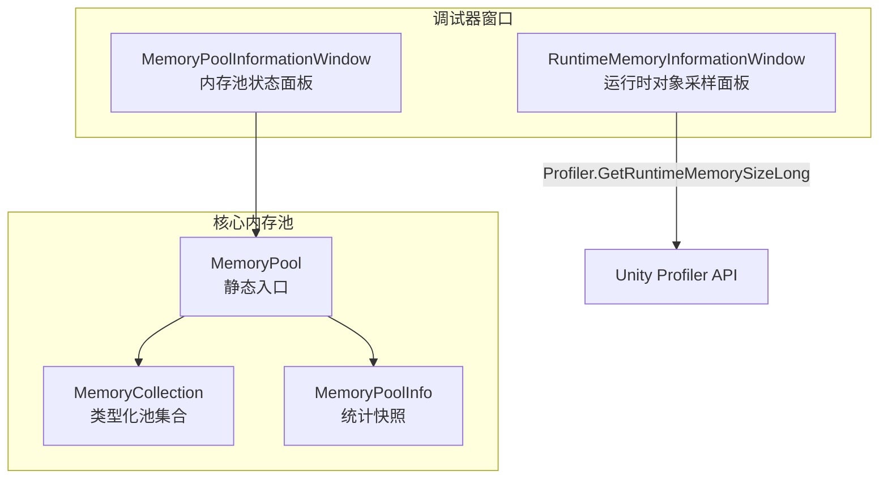
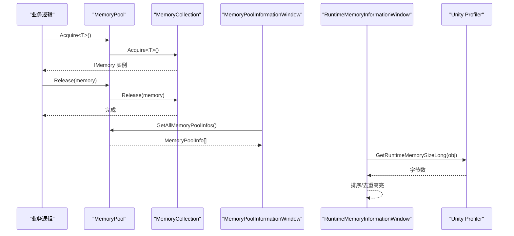
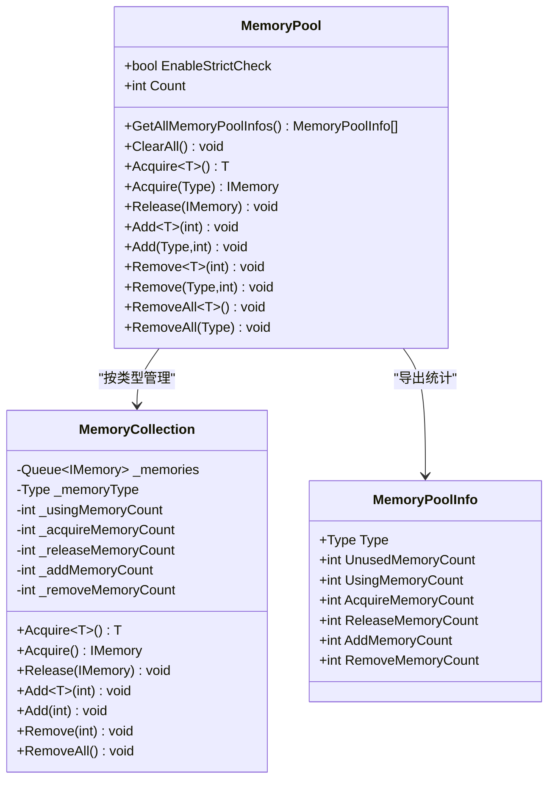
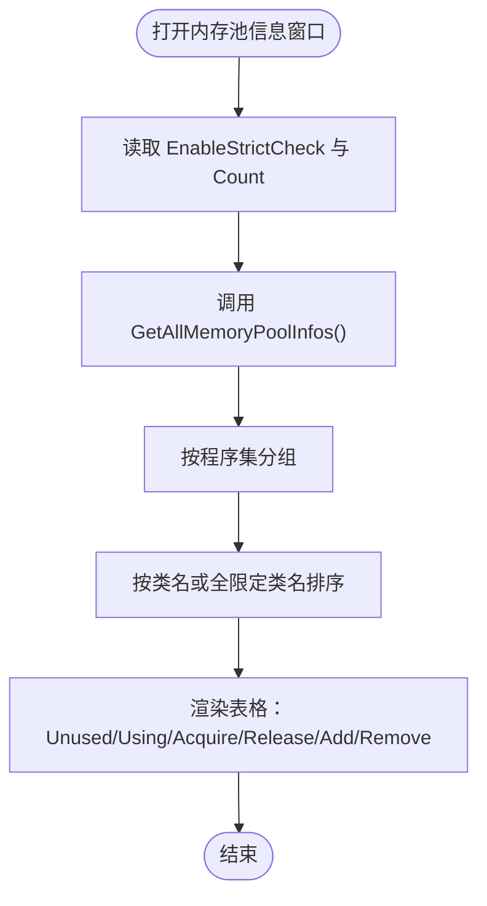
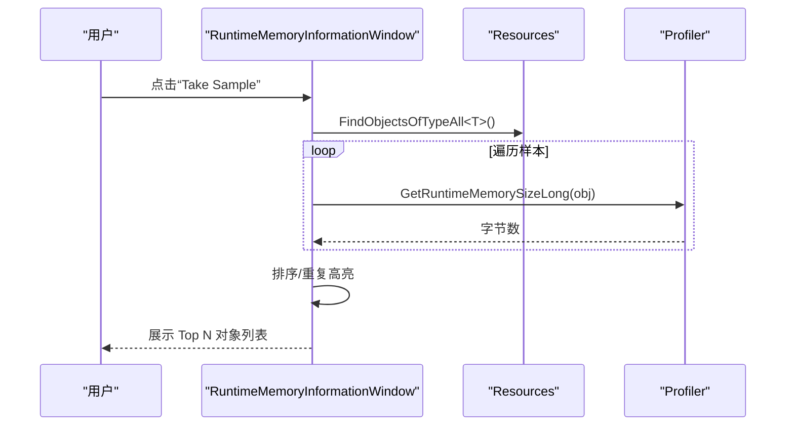
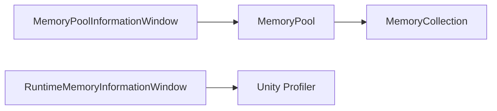

# 性能监控与分析

<cite>
**本文引用的文件**   
- [MemoryPool.cs](file://UnityProject/Assets/TEngine/Runtime/Core/MemoryPool/MemoryPool.cs)
- [MemoryPool.MemoryCollection.cs](file://UnityProject/Assets/TEngine/Runtime/Core/MemoryPool/MemoryPool.MemoryCollection.cs)
- [MemoryPoolInfo.cs](file://UnityProject/Assets/TEngine/Runtime/Core/MemoryPool/MemoryPoolInfo.cs)
- [DebuggerModule.MemoryPoolInformationWindow.cs](file://UnityProject/Assets/TEngine/Runtime/Module/DebugerModule/Component/DebuggerModule.MemoryPoolInformationWindow.cs)
- [DebuggerModule.RuntimeMemoryInformationWindow.cs](file://UnityProject/Assets/TEngine/Runtime/Module/DebugerModule/Component/DebuggerModule.RuntimeMemoryInformationWindow.cs)
</cite>

## 目录
1. [简介](#简介)
2. [项目结构](#项目结构)
3. [核心组件](#核心组件)
4. [架构总览](#架构总览)
5. [详细组件分析](#详细组件分析)
6. [依赖关系分析](#依赖关系分析)
7. [性能考量与优化建议](#性能考量与优化建议)
8. [故障诊断指南](#故障诊断指南)
9. [结论](#结论)
10. [附录](#附录)

## 简介
本文件聚焦 TEngine 的内存性能监控与分析，围绕以下目标展开：
- 内存使用监控：通过内存池统计与运行时对象采样，掌握内存占用趋势。
- GC 压力分析：结合获取/归还计数、新增/移除数量等指标定位频繁分配热点。
- 性能瓶颈定位：利用调试窗口与 Profiler 数据交叉验证，快速收敛问题范围。
- 调试工具使用：详解 MemoryPoolInformationWindow 与 RuntimeMemoryInformationWindow 的使用方法与解读要点。
- 指标收集与分析方法：定义关键指标口径、采集频率与可视化呈现方式。
- 优化实践：提供内存泄漏检测流程、基准测试方案、告警配置与自动化测试落地建议。

## 项目结构
与内存监控与分析直接相关的代码位于以下路径：
- 核心内存池实现：Runtime/Core/MemoryPool
- 调试器信息窗口：Runtime/Module/DebugerModule/Component

图示来源
- [MemoryPool.cs:9-48](file://UnityProject/Assets/TEngine/Runtime/Core/MemoryPool/MemoryPool.cs#L9-L48)
- [MemoryPool.MemoryCollection.cs:11-44](file://UnityProject/Assets/TEngine/Runtime/Core/MemoryPool/MemoryPool.MemoryCollection.cs#L11-L44)
- [MemoryPoolInfo.cs:10-39](file://UnityProject/Assets/TEngine/Runtime/Core/MemoryPool/MemoryPoolInfo.cs#L10-L39)
- [DebuggerModule.MemoryPoolInformationWindow.cs:9-33](file://UnityProject/Assets/TEngine/Runtime/Module/DebugerModule/Component/DebuggerModule.MemoryPoolInformationWindow.cs#L9-L33)
- [DebuggerModule.RuntimeMemoryInformationWindow.cs:82-103](file://UnityProject/Assets/TEngine/Runtime/Module/DebugerModule/Component/DebuggerModule.RuntimeMemoryInformationWindow.cs#L82-L103)

章节来源
- [MemoryPool.cs:9-48](file://UnityProject/Assets/TEngine/Runtime/Core/MemoryPool/MemoryPool.cs#L9-L48)
- [MemoryPool.MemoryCollection.cs:11-44](file://UnityProject/Assets/TEngine/Runtime/Core/MemoryPool/MemoryPool.MemoryCollection.cs#L11-L44)
- [MemoryPoolInfo.cs:10-39](file://UnityProject/Assets/TEngine/Runtime/Core/MemoryPool/MemoryPoolInfo.cs#L10-L39)
- [DebuggerModule.MemoryPoolInformationWindow.cs:9-33](file://UnityProject/Assets/TEngine/Runtime/Module/DebugerModule/Component/DebuggerModule.MemoryPoolInformationWindow.cs#L9-L33)
- [DebuggerModule.RuntimeMemoryInformationWindow.cs:82-103](file://UnityProject/Assets/TEngine/Runtime/Module/DebugerModule/Component/DebuggerModule.RuntimeMemoryInformationWindow.cs#L82-L103)

## 核心组件
- MemoryPool：面向业务的全局内存池入口，负责按类型维护 MemoryCollection，并提供获取、归还、增删与统计能力。
- MemoryCollection：针对具体类型的队列式内存池，维护未使用/使用中对象计数与操作累计数。
- MemoryPoolInfo：不可变统计快照，包含类型名、未使用/正在使用数量、获取/归还/新增/移除次数。
- MemoryPoolInformationWindow：编辑器调试窗口，展示各程序集下的内存池统计，支持全限定类名排序显示。
- RuntimeMemoryInformationWindow：运行时对象采样窗口，基于 Unity Profiler 对指定类型对象进行内存大小采样与重复项高亮。

章节来源
- [MemoryPool.cs:9-48](file://UnityProject/Assets/TEngine/Runtime/Core/MemoryPool/MemoryPool.cs#L9-L48)
- [MemoryPool.MemoryCollection.cs:11-44](file://UnityProject/Assets/TEngine/Runtime/Core/MemoryPool/MemoryPool.MemoryCollection.cs#L11-L44)
- [MemoryPoolInfo.cs:10-39](file://UnityProject/Assets/TEngine/Runtime/Core/MemoryPool/MemoryPoolInfo.cs#L10-L39)
- [DebuggerModule.MemoryPoolInformationWindow.cs:9-33](file://UnityProject/Assets/TEngine/Runtime/Module/DebugerModule/Component/DebuggerModule.MemoryPoolInformationWindow.cs#L9-L33)
- [DebuggerModule.RuntimeMemoryInformationWindow.cs:23-47](file://UnityProject/Assets/TEngine/Runtime/Module/DebugerModule/Component/DebuggerModule.RuntimeMemoryInformationWindow.cs#L23-L47)

## 架构总览
下图展示了从业务调用到内存池、再到调试窗口的完整链路，以及运行时对象采样如何借助 Unity Profiler 完成。

图示来源
- [MemoryPool.cs:71-100](file://UnityProject/Assets/TEngine/Runtime/Core/MemoryPool/MemoryPool.cs#L71-L100)
- [MemoryPool.MemoryCollection.cs:46-98](file://UnityProject/Assets/TEngine/Runtime/Core/MemoryPool/MemoryPool.MemoryCollection.cs#L46-L98)
- [DebuggerModule.MemoryPoolInformationWindow.cs:30-44](file://UnityProject/Assets/TEngine/Runtime/Module/DebugerModule/Component/DebuggerModule.MemoryPoolInformationWindow.cs#L30-L44)
- [DebuggerModule.RuntimeMemoryInformationWindow.cs:82-103](file://UnityProject/Assets/TEngine/Runtime/Module/DebugerModule/Component/DebuggerModule.RuntimeMemoryInformationWindow.cs#L82-L103)

## 详细组件分析

### 内存池核心：MemoryPool 与 MemoryCollection
- 设计要点
  - 全局字典维护 Type -> MemoryCollection 映射，保证类型隔离。
  - 严格检查开关 EnableStrictCheck，用于校验类型合法性与重复释放。
  - 线程安全：关键集合与队列操作均加锁保护。
- 关键行为
  - Acquire：优先复用空闲对象；否则新建并计入 Add 计数。
  - Release：先 Clear，再入队；严格模式下检测重复释放。
  - Add/Remove/RemoveAll：预分配或收缩池容量，更新对应计数。
  - GetAllMemoryPoolInfos：导出当前所有类型的统计快照。

图示来源
- [MemoryPool.cs:9-48](file://UnityProject/Assets/TEngine/Runtime/Core/MemoryPool/MemoryPool.cs#L9-L48)
- [MemoryPool.MemoryCollection.cs:11-44](file://UnityProject/Assets/TEngine/Runtime/Core/MemoryPool/MemoryPool.MemoryCollection.cs#L11-L44)
- [MemoryPoolInfo.cs:10-39](file://UnityProject/Assets/TEngine/Runtime/Core/MemoryPool/MemoryPoolInfo.cs#L10-L39)

章节来源
- [MemoryPool.cs:11-27](file://UnityProject/Assets/TEngine/Runtime/Core/MemoryPool/MemoryPool.cs#L11-L27)
- [MemoryPool.cs:71-100](file://UnityProject/Assets/TEngine/Runtime/Core/MemoryPool/MemoryPool.cs#L71-L100)
- [MemoryPool.cs:108-162](file://UnityProject/Assets/TEngine/Runtime/Core/MemoryPool/MemoryPool.cs#L108-L162)
- [MemoryPool.cs:164-205](file://UnityProject/Assets/TEngine/Runtime/Core/MemoryPool/MemoryPool.cs#L164-L205)
- [MemoryPool.MemoryCollection.cs:21-44](file://UnityProject/Assets/TEngine/Runtime/Core/MemoryPool/MemoryPool.MemoryCollection.cs#L21-L44)
- [MemoryPool.MemoryCollection.cs:46-98](file://UnityProject/Assets/TEngine/Runtime/Core/MemoryPool/MemoryPool.MemoryCollection.cs#L46-L98)
- [MemoryPool.MemoryCollection.cs:100-153](file://UnityProject/Assets/TEngine/Runtime/Core/MemoryPool/MemoryPool.MemoryCollection.cs#L100-L153)

### 调试窗口：MemoryPoolInformationWindow
- 功能概述
  - 展示“严格检查”开关与内存池总数。
  - 按程序集分组列出各类型的未使用/使用中/获取/归还/新增/移除计数。
  - 支持切换“显示全限定类名”，并按名称排序。
- 使用建议
  - 在开发阶段开启“严格检查”，尽早发现重复释放与类型不匹配。
  - 关注 UsingMemoryCount 持续增长且 Acquire/Release 差值异常的类型。
  - 观察 Add/Remove 波动是否频繁，评估是否需要调整预分配策略。

图示来源
- [DebuggerModule.MemoryPoolInformationWindow.cs:20-78](file://UnityProject/Assets/TEngine/Runtime/Module/DebugerModule/Component/DebuggerModule.MemoryPoolInformationWindow.cs#L20-L78)
- [MemoryPool.cs:33-48](file://UnityProject/Assets/TEngine/Runtime/Core/MemoryPool/MemoryPool.cs#L33-L48)

章节来源
- [DebuggerModule.MemoryPoolInformationWindow.cs:9-107](file://UnityProject/Assets/TEngine/Runtime/Module/DebugerModule/Component/DebuggerModule.MemoryPoolInformationWindow.cs#L9-L107)

### 运行时对象采样：RuntimeMemoryInformationWindow
- 功能概述
  - 点击按钮触发采样，遍历 Resources.FindObjectsOfTypeAll<T>()。
  - 使用 Profiler.GetRuntimeMemorySizeLong/GetRuntimeMemorySize 获取每个对象的字节数。
  - 按 Size 降序排序，并对同名同类型同大小的对象进行重复高亮提示。
- 使用建议
  - 针对 UI 元素、场景对象、资源句柄等高频分配类型进行采样。
  - 对比多次采样结果，识别持续增长的对象集合。
  - 将采样结果与内存池统计关联，区分托管对象与引擎资源。

图示来源
- [DebuggerModule.RuntimeMemoryInformationWindow.cs:23-47](file://UnityProject/Assets/TEngine/Runtime/Module/DebugerModule/Component/DebuggerModule.RuntimeMemoryInformationWindow.cs#L23-L47)
- [DebuggerModule.RuntimeMemoryInformationWindow.cs:82-103](file://UnityProject/Assets/TEngine/Runtime/Module/DebugerModule/Component/DebuggerModule.RuntimeMemoryInformationWindow.cs#L82-L103)

章节来源
- [DebuggerModule.RuntimeMemoryInformationWindow.cs:12-135](file://UnityProject/Assets/TEngine/Runtime/Module/DebugerModule/Component/DebuggerModule.RuntimeMemoryInformationWindow.cs#L12-L135)

## 依赖关系分析
- 组件耦合
  - MemoryPool 依赖 MemoryCollection 实现具体类型池逻辑。
  - MemoryPoolInformationWindow 依赖 MemoryPool 提供的统计接口。
  - RuntimeMemoryInformationWindow 依赖 Unity Profiler API 进行对象内存采样。
- 外部依赖
  - Unity Profiler：用于运行时对象内存大小查询。
  - Unity Editor GUI：调试窗口绘制（GUILayout）。

图示来源
- [MemoryPool.cs:9-48](file://UnityProject/Assets/TEngine/Runtime/Core/MemoryPool/MemoryPool.cs#L9-L48)
- [DebuggerModule.MemoryPoolInformationWindow.cs:30-44](file://UnityProject/Assets/TEngine/Runtime/Module/DebugerModule/Component/DebuggerModule.MemoryPoolInformationWindow.cs#L30-L44)
- [DebuggerModule.RuntimeMemoryInformationWindow.cs:82-103](file://UnityProject/Assets/TEngine/Runtime/Module/DebugerModule/Component/DebuggerModule.RuntimeMemoryInformationWindow.cs#L82-L103)

章节来源
- [MemoryPool.cs:9-48](file://UnityProject/Assets/TEngine/Runtime/Core/MemoryPool/MemoryPool.cs#L9-L48)
- [DebuggerModule.MemoryPoolInformationWindow.cs:30-44](file://UnityProject/Assets/TEngine/Runtime/Module/DebugerModule/Component/DebuggerModule.MemoryPoolInformationWindow.cs#L30-L44)
- [DebuggerModule.RuntimeMemoryInformationWindow.cs:82-103](file://UnityProject/Assets/TEngine/Runtime/Module/DebugerModule/Component/DebuggerModule.RuntimeMemoryInformationWindow.cs#L82-L103)

## 性能考量与优化建议
- 指标口径
  - 未使用对象数（Unused）：池内可复用对象数量。
  - 正在使用对象数（Using）：当前被借出未归还的数量。
  - 获取次数（Acquire）：累计借出次数。
  - 归还次数（Release）：累计归还次数。
  - 新增次数（Add）：累计创建新对象次数。
  - 移除次数（Remove）：累计主动移除对象次数。
- 分析方法
  - 若 Using 持续上升且 Acquire/Release 差值扩大，可能存在泄漏或未正确归还。
  - 若 Add 频繁增长，说明池预热不足或峰值突发，考虑预分配或自适应扩容。
  - 若 Remove 频繁，可能池过大导致内存浪费，需动态收缩或降低初始容量。
- 优化建议
  - 开启严格检查模式，尽早捕获重复释放与类型错误。
  - 对热点类型进行批量预分配，减少运行时分配抖动。
  - 结合 RuntimeMemoryInformationWindow 的采样结果，定位大对象与重复对象。
  - 定期清理不再使用的池或限制最大池规模，避免长期驻留。

[本节为通用指导，无需特定文件引用]

## 故障诊断指南
- 常见问题
  - 重复释放：严格模式下会抛出异常，便于快速定位。
  - 类型不匹配：严格模式会校验类型合法性，防止误用。
  - 内存泄漏：Using 持续增长，Acquire/Release 差值异常。
  - 频繁分配：Add 计数快速增长，GC 压力增大。
- 排查步骤
  - 打开 MemoryPoolInformationWindow，查看各类型统计。
  - 开启严格检查，复现问题并观察异常堆栈。
  - 使用 RuntimeMemoryInformationWindow 对可疑类型采样，确认对象增长。
  - 结合 Unity Profiler 的 Allocation 与 GC 事件，定位分配热点。
- 处理措施
  - 修正对象生命周期管理，确保成对 Acquire/Release。
  - 调整池初始化参数，平衡内存占用与分配成本。
  - 对大对象采用延迟加载或分片缓存，降低峰值内存。

章节来源
- [MemoryPool.cs:164-185](file://UnityProject/Assets/TEngine/Runtime/Core/MemoryPool/MemoryPool.cs#L164-L185)
- [MemoryPool.MemoryCollection.cs:83-98](file://UnityProject/Assets/TEngine/Runtime/Core/MemoryPool/MemoryPool.MemoryCollection.cs#L83-L98)
- [DebuggerModule.MemoryPoolInformationWindow.cs:20-78](file://UnityProject/Assets/TEngine/Runtime/Module/DebugerModule/Component/DebuggerModule.MemoryPoolInformationWindow.cs#L20-L78)
- [DebuggerModule.RuntimeMemoryInformationWindow.cs:82-103](file://UnityProject/Assets/TEngine/Runtime/Module/DebugerModule/Component/DebuggerModule.RuntimeMemoryInformationWindow.cs#L82-L103)

## 结论
TEngine 的内存池体系提供了类型隔离、线程安全与完善的统计能力，配合调试窗口与 Unity Profiler，能够高效完成内存使用监控、GC 压力分析与性能瓶颈定位。建议在开发期启用严格检查，建立常态化的内存采样与基线对比机制，并结合自动化测试保障性能回归。

[本节为总结性内容，无需特定文件引用]

## 附录
- 性能基准测试建议
  - 固定场景与输入，记录不同池配置下的 Alloc/GC 曲线。
  - 对比预分配与懒分配的吞吐与延迟差异。
- 监控告警配置思路
  - 当 Using > 阈值或 Acquire/Release 差值 > 阈值时触发告警。
  - 当 Add 速率超过阈值时提示池预热不足。
- 自动化性能测试实施方案
  - 在 CI 中运行压测脚本，输出内存池统计与 Profiler 报告。
  - 对比历史基线，失败则阻断合并请求。

[本节为通用指导，无需特定文件引用]