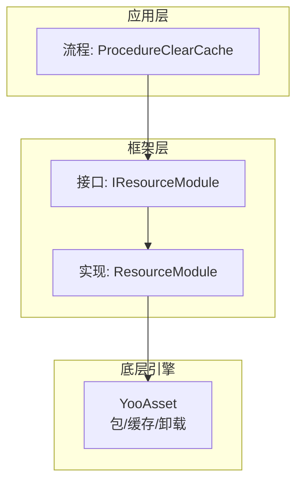
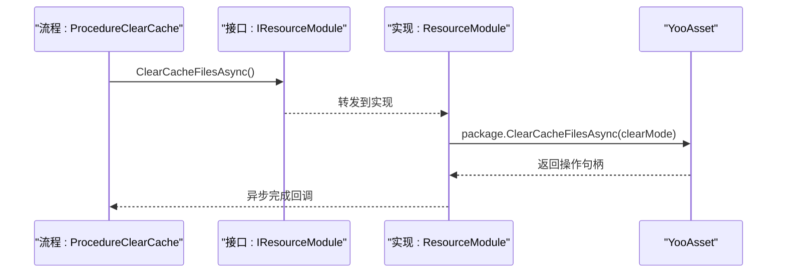
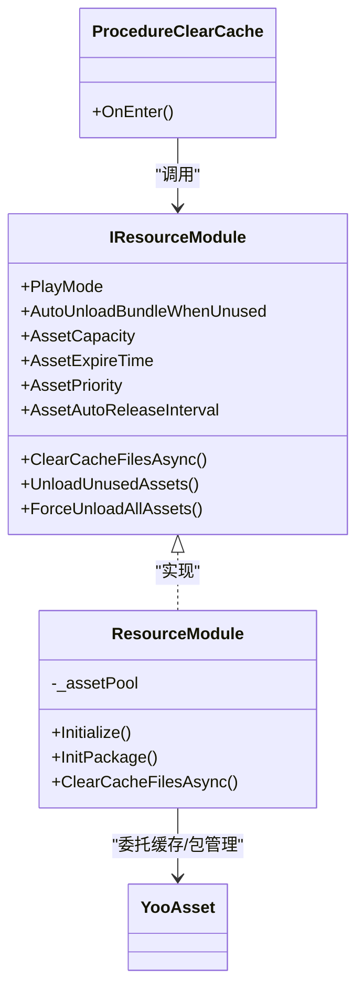

# 缓存策略

<cite>
**本文引用的文件**   
- [ResourceModule.cs](file://UnityProject/Assets/TEngine/Runtime/Module/ResourceModule/ResourceModule.cs)
- [IResourceModule.cs](file://UnityProject/Assets/TEngine/Runtime/Module/ResourceModule/IResourceModule.cs)
- [ProcedureClearCache.cs](file://UnityProject/Assets/GameScripts/Procedure/ProcedureClearCache.cs)
- [3-1-资源模块.md](file://Books/3-1-资源模块.md)
</cite>

## 目录
1. [引言](#引言)
2. [项目结构](#项目结构)
3. [核心组件](#核心组件)
4. [架构总览](#架构总览)
5. [详细组件分析](#详细组件分析)
6. [依赖关系分析](#依赖关系分析)
7. [性能与内存特性](#性能与内存特性)
8. [配置与参数](#配置与参数)
9. [监控与诊断](#监控与诊断)
10. [常见问题与排错](#常见问题与排错)
11. [结论](#结论)

## 引言
本文件聚焦 TEngine 的缓存策略，围绕 LRU（最近最少使用）与 ARC（自适应替换缓存）在资源加载与释放中的应用进行系统化说明。文档从系统架构、数据流、关键接口与实现要点出发，给出可操作的配置建议、监控指标与调优方法，帮助读者在复杂业务场景下稳定控制命中率与内存占用。

## 项目结构
TEngine 的资源管理基于 YooAsset 构建，并在上层提供统一的资源模块抽象。缓存策略由资源模块对外暴露能力，流程层通过统一入口触发清理等操作；底层实际缓存与包管理由 YooAsset 负责。

图表来源
- [ProcedureClearCache.cs:16-33](file://UnityProject/Assets/GameScripts/Procedure/ProcedureClearCache.cs#L16-L33)
- [IResourceModule.cs:283-295](file://UnityProject/Assets/TEngine/Runtime/Module/ResourceModule/IResourceModule.cs#L283-L295)
- [ResourceModule.cs:369-388](file://UnityProject/Assets/TEngine/Runtime/Module/ResourceModule/ResourceModule.cs#L369-L388)

章节来源
- [3-1-资源模块.md:1-28](file://Books/3-1-资源模块.md#L1-L28)

## 核心组件
- 资源模块接口 IResourceModule：定义资源生命周期、加载、版本与缓存清理等统一 API。
- 资源模块实现 ResourceModule：封装 YooAsset 初始化、包管理、对象池、自动卸载与缓存清理等能力。
- 流程 ProcedureClearCache：在游戏启动流程中调用资源模块清理未使用的缓存文件。

章节来源
- [IResourceModule.cs:12-110](file://UnityProject/Assets/TEngine/Runtime/Module/ResourceModule/IResourceModule.cs#L12-L110)
- [ResourceModule.cs:17-138](file://UnityProject/Assets/TEngine/Runtime/Module/ResourceModule/ResourceModule.cs#L17-L138)
- [ProcedureClearCache.cs:10-33](file://UnityProject/Assets/GameScripts/Procedure/ProcedureClearCache.cs#L10-L33)

## 架构总览
下图展示“流程 → 资源模块 → YooAsset”的调用链，以及缓存清理的关键路径。

图表来源
- [ProcedureClearCache.cs:23-33](file://UnityProject/Assets/GameScripts/Procedure/ProcedureClearCache.cs#L23-L33)
- [IResourceModule.cs:283-295](file://UnityProject/Assets/TEngine/Runtime/Module/ResourceModule/IResourceModule.cs#L283-L295)
- [ResourceModule.cs:369-388](file://UnityProject/Assets/TEngine/Runtime/Module/ResourceModule/ResourceModule.cs#L369-L388)

## 详细组件分析

### 资源模块接口 IResourceModule
职责
- 定义资源模块的统一能力边界：运行模式、加密方式、下载并发、对象池参数、资源加载/卸载、版本管理、缓存清理等。
- 为上层流程与业务提供稳定的 API 契约。

关键点
- 对象池相关参数：容量、过期时间、优先级、自动释放间隔。
- 资源卸载与回收：支持按需卸载、强制卸载全部、低内存回调保护。
- 缓存清理：提供按模式的异步清理接口。

章节来源
- [IResourceModule.cs:66-110](file://UnityProject/Assets/TEngine/Runtime/Module/ResourceModule/IResourceModule.cs#L66-L110)
- [IResourceModule.cs:112-131](file://UnityProject/Assets/TEngine/Runtime/Module/ResourceModule/IResourceModule.cs#L112-L131)
- [IResourceModule.cs:283-295](file://UnityProject/Assets/TEngine/Runtime/Module/ResourceModule/IResourceModule.cs#L283-L295)

### 资源模块实现 ResourceModule
职责
- 初始化 YooAsset 与默认包，设置每帧最大时间切片。
- 根据运行模式（离线/联机/WebGL）创建不同文件系统与远程服务。
- 提供资源加载、实例化、引用追踪、对象池管理与自动卸载。
- 提供缓存清理与沙盒清理能力。

关键点
- 初始化与包管理：Initialize、InitPackage、GetPackageVersion、UpdatePackageManifestAsync、CreateResourceDownloader。
- 资源对象池：Spawn/注册/释放，结合 AutoUnloadBundleWhenUnused 控制包级自动卸载。
- 缓存清理：ClearCacheFilesAsync 委托给 YooAsset 包对象执行。

章节来源
- [ResourceModule.cs:119-138](file://UnityProject/Assets/TEngine/Runtime/Module/ResourceModule/ResourceModule.cs#L119-L138)
- [ResourceModule.cs:140-261](file://UnityProject/Assets/TEngine/Runtime/Module/ResourceModule/ResourceModule.cs#L140-L261)
- [ResourceModule.cs:369-388](file://UnityProject/Assets/TEngine/Runtime/Module/ResourceModule/ResourceModule.cs#L369-L388)

### 流程 ProcedureClearCache
职责
- 在游戏流程中提示用户并调用资源模块清理未使用的缓存文件，完成后进入预加载阶段。

章节来源
- [ProcedureClearCache.cs:16-33](file://UnityProject/Assets/GameScripts/Procedure/ProcedureClearCache.cs#L16-L33)

## 依赖关系分析
- 流程层依赖接口 IResourceModule，不直接耦合具体实现，便于扩展与测试。
- ResourceModule 作为实现类，依赖 YooAsset 提供的包与缓存能力。
- 资源对象池与自动卸载逻辑在 ResourceModule 内部协调，确保内存可控。

图表来源
- [IResourceModule.cs:12-110](file://UnityProject/Assets/TEngine/Runtime/Module/ResourceModule/IResourceModule.cs#L12-L110)
- [ResourceModule.cs:17-138](file://UnityProject/Assets/TEngine/Runtime/Module/ResourceModule/ResourceModule.cs#L17-L138)
- [ProcedureClearCache.cs:16-33](file://UnityProject/Assets/GameScripts/Procedure/ProcedureClearCache.cs#L16-L33)

## 性能与内存特性
- LRU 与 ARC 的定位
  - 文档与 README 明确提及资源模块支持 LRU 与 ARC 两种缓存策略，用于严格管理资源内存。
  - 在 TEngine 中，LRU/ARC 的具体淘汰算法由 YooAsset 提供；TEngine 通过 ResourceModule 暴露配置与行为（如自动卸载、对象池参数）。
- 命中率优化
  - 合理设置对象池容量与过期时间，减少频繁分配与销毁。
  - 使用 LoadGameObject 或带 AssetsReference 的方式，避免重复加载相同资源。
  - 对热点资源采用分组包管理，提升局部性。
- 内存占用控制
  - 启用 AutoUnloadBundleWhenUnused，让未引用包自动释放。
  - 定期调用 UnloadUnusedAssets 或在低内存回调中触发 ForceUnloadUnusedAssets。
  - 使用 ClearCacheFilesAsync 清理磁盘缓存，降低安装包体积与 IO 压力。

章节来源
- [README.md:30](file://README.md#L30)
- [3-1-资源模块.md:19-23](file://Books/3-1-资源模块.md#L19-L23)
- [ResourceModule.cs:39-39](file://UnityProject/Assets/TEngine/Runtime/Module/ResourceModule/ResourceModule.cs#L39-L39)
- [ResourceModule.cs:390-447](file://UnityProject/Assets/TEngine/Runtime/Module/ResourceModule/ResourceModule.cs#L390-L447)

## 配置与参数
- 运行模式与服务器地址
  - PlayMode：EditorSimulateMode / OfflinePlayMode / HostPlayMode / WebPlayMode。
  - HostServerURL / FallbackHostServerURL：热更主备地址。
  - LoadResWayWebGL：WebGL 平台选择 Remote 或 StreamingAssets。
- 对象池与缓存
  - AssetCapacity：对象池容量。
  - AssetExpireTime：对象过期时间（秒）。
  - AssetPriority：对象池优先级。
  - AssetAutoReleaseInterval：自动释放可释放对象的间隔（秒）。
  - AutoUnloadBundleWhenUnused：是否自动卸载引用计数为 0 的资源包。
- 异步与下载
  - Milliseconds：每帧最大时间切片（毫秒）。
  - DownloadingMaxNum / FailedTryAgain：并发下载数与失败重试次数。

章节来源
- [IResourceModule.cs:66-110](file://UnityProject/Assets/TEngine/Runtime/Module/ResourceModule/IResourceModule.cs#L66-L110)
- [ResourceModule.cs:19-39](file://UnityProject/Assets/TEngine/Runtime/Module/ResourceModule/ResourceModule.cs#L19-L39)
- [3-1-资源模块.md:64-94](file://Books/3-1-资源模块.md#L64-L94)

## 监控与诊断
- 关键指标
  - 包版本与清单状态：GetPackageVersion、RequestPackageVersionAsync、UpdatePackageManifestAsync。
  - 资源存在性与定位有效性：HasAsset、CheckLocationValid。
  - 对象池与卸载：UnloadUnusedAssets、ForceUnloadAllAssets、ForceUnloadUnusedAssets。
  - 磁盘缓存：ClearCacheFilesAsync、ClearAllBundleFiles。
- 诊断建议
  - 在低内存事件时触发 OnLowMemory，观察卸载效果。
  - 通过 HasAsset 判断资源是否在线/本地，辅助定位加载瓶颈。
  - 使用 ClearCacheFilesAsync 清理未使用缓存，评估磁盘空间变化。

章节来源
- [ResourceModule.cs:290-341](file://UnityProject/Assets/TEngine/Runtime/Module/ResourceModule/ResourceModule.cs#L290-L341)
- [ResourceModule.cs:451-620](file://UnityProject/Assets/TEngine/Runtime/Module/ResourceModule/ResourceModule.cs#L451-L620)
- [ResourceModule.cs:390-447](file://UnityProject/Assets/TEngine/Runtime/Module/ResourceModule/ResourceModule.cs#L390-L447)
- [ResourceModule.cs:369-388](file://UnityProject/Assets/TEngine/Runtime/Module/ResourceModule/ResourceModule.cs#L369-L388)

## 常见问题与排错
- 资源加载失败
  - 检查 CheckLocationValid 与 HasAsset，确认资源是否存在或需远端更新。
- 内存泄漏
  - 优先使用 LoadGameObject 或 AssetsReference 绑定动态资源，避免手动 Dispose 遗漏。
  - 定期调用 UnloadUnusedAssets，或在低内存回调中触发强制释放。
- 缓存膨胀
  - 使用 ClearCacheFilesAsync 清理未使用缓存，必要时 ClearAllBundleFiles 彻底清理。
- WebGL 平台差异
  - 根据 LoadResWayWebGL 选择 Remote 或 StreamingAssets，避免访问路径错误。

章节来源
- [ResourceModule.cs:571-620](file://UnityProject/Assets/TEngine/Runtime/Module/ResourceModule/ResourceModule.cs#L571-L620)
- [ResourceModule.cs:390-447](file://UnityProject/Assets/TEngine/Runtime/Module/ResourceModule/ResourceModule.cs#L390-L447)
- [ResourceModule.cs:369-388](file://UnityProject/Assets/TEngine/Runtime/Module/ResourceModule/ResourceModule.cs#L369-L388)
- [3-1-资源模块.md:45-56](file://Books/3-1-资源模块.md#L45-L56)

## 结论
TEngine 将 LRU/ARC 等缓存淘汰策略下沉至 YooAsset，并通过 ResourceModule 提供统一的配置与行为控制。开发者应结合对象池参数、自动卸载开关与缓存清理接口，针对业务热点与内存约束进行精细化调优。配合监控指标与诊断手段，可在保证高命中率的同时，有效控制内存与磁盘占用。