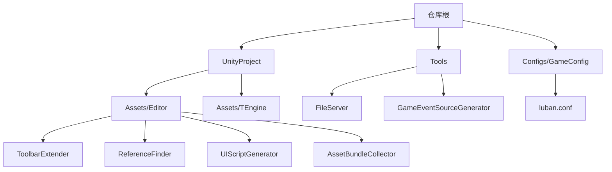
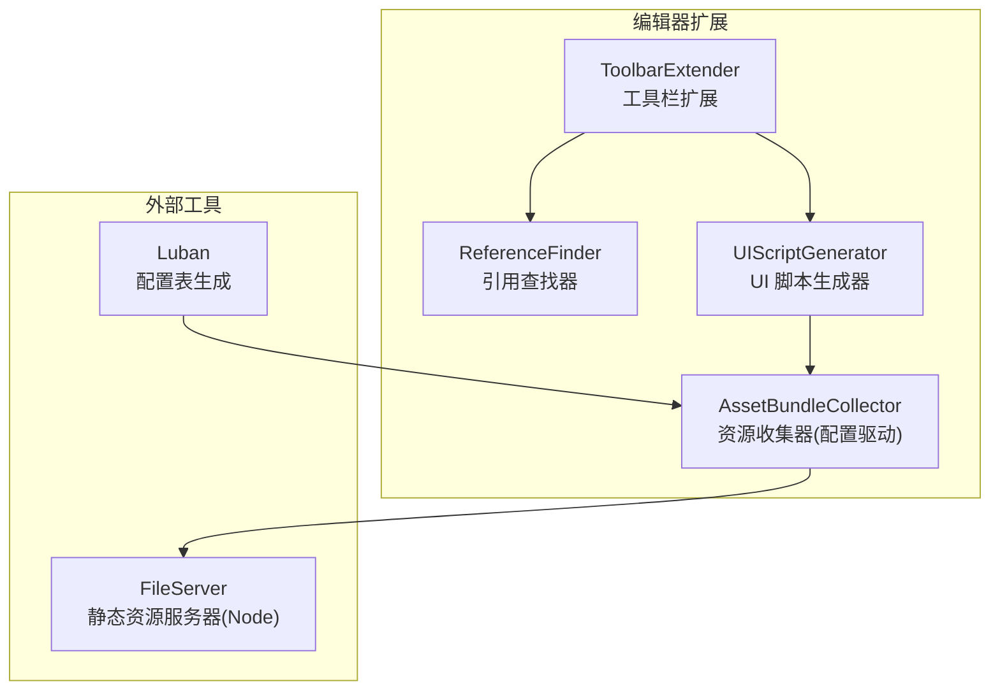
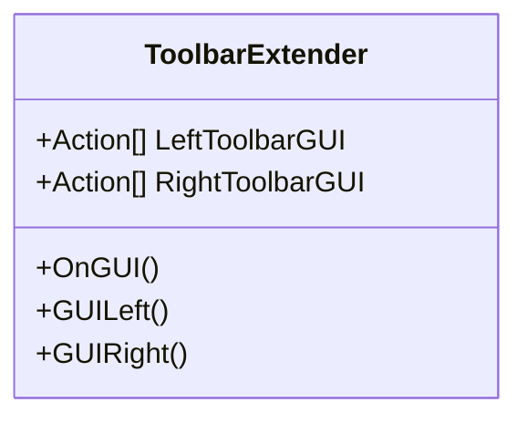
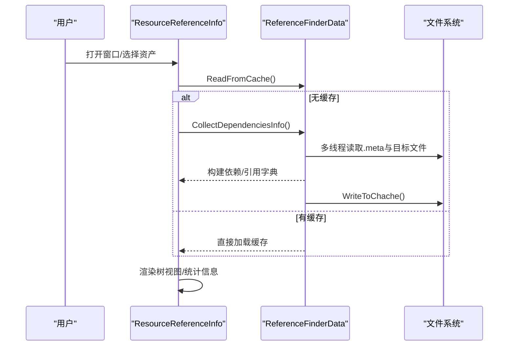
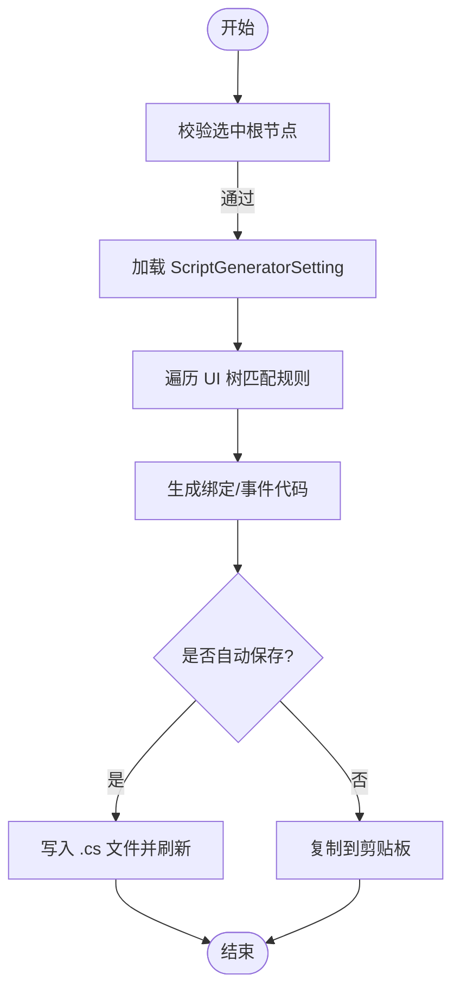
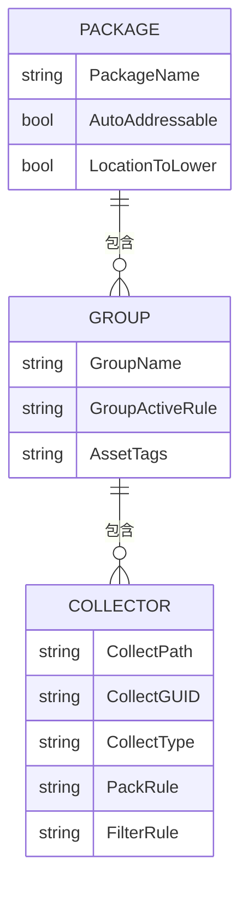
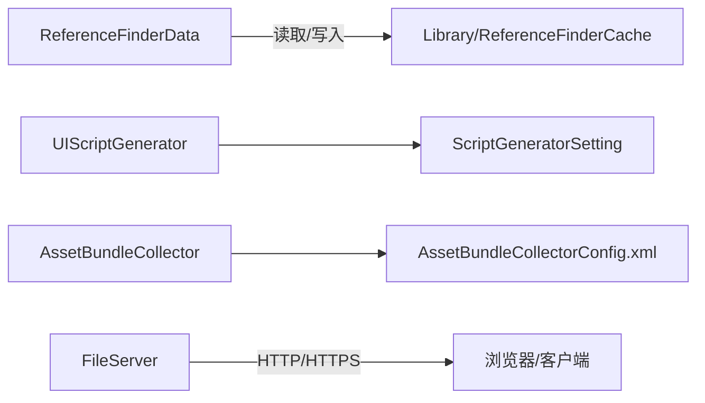

# 开发工具

<cite>
**本文引用的文件**   
- [README.md](file://README.md)
- [FileServer README.md](file://Tools/FileServer/README.md)
- [ToolbarExtender.cs](file://UnityProject/Assets/Editor/ToolbarExtender/ToolbarExtender.cs)
- [ResourceReferenceInfo.cs](file://UnityProject/Assets/Editor/ReferenceFinder/ResourceReferenceInfo.cs)
- [ReferenceFinderData.cs](file://UnityProject/Assets/Editor/ReferenceFinder/ReferenceFinderData.cs)
- [AssetBundleCollectorConfig.xml](file://UnityProject/Assets/Editor/AssetBundleCollector/AssetBundleCollectorConfig.xml)
- [ScriptAutoGenerator.cs](file://UnityProject/Assets/Editor/UIScriptGenerator/ScriptAutoGenerator.cs)
- [ScriptGeneratorSetting.cs](file://UnityProject/Assets/Editor/UIScriptGenerator/ScriptGeneratorSetting.cs)
</cite>

## 目录
1. [简介](#简介)
2. [项目结构](#项目结构)
3. [核心组件](#核心组件)
4. [架构总览](#架构总览)
5. [详细组件分析](#详细组件分析)
6. [依赖关系分析](#依赖关系分析)
7. [性能与构建](#性能与构建)
8. [故障排查指南](#故障排查指南)
9. [结论](#结论)
10. [附录](#附录)

## 简介
本文件面向 TEngine 开发工具的深度使用与扩展，覆盖以下主题：
- 编辑器扩展：工具栏扩展、属性检查器增强、自定义窗口
- 开发辅助工具：文件服务器、事件源生成器
- 效率工具：资源收集器、引用查找器、UI 脚本生成器
- 构建工具链：自动化构建、资源打包、平台适配
- 调试与日志：调试工具、性能分析与日志系统
- 扩展机制与自定义开发方法

TEngine 提供开箱即用的 Unity 框架解决方案，内置资源管理、事件系统、UI 框架、配置表、流程管理等模块，并配套丰富的编辑器工具以提升开发效率。

章节来源
- [README.md:20-33](file://README.md#L20-L33)

## 项目结构
仓库根目录包含文档、构建脚本、工具集以及 Unity 工程。关键路径如下：
- Tools：独立工具（Node 静态服务器、Luban 构建脚本、C# 事件源生成器）
- UnityProject/Assets/Editor：编辑器扩展与工具（工具栏扩展、引用查找器、UI 脚本生成器、资源收集器配置等）
- UnityProject/Assets/TEngine：框架运行时与编辑器核心
- Configs/GameConfig：配置表相关（Luban 配置与生成脚本）

图表来源
- [README.md:173-199](file://README.md#L173-L199)

章节来源
- [README.md:173-199](file://README.md#L173-L199)

## 核心组件
本节聚焦编辑器侧的关键工具与能力：
- 工具栏扩展：在 Unity 顶部工具栏左右两侧注入自定义按钮或控件
- 引用查找器：扫描资产依赖与引用关系，支持缓存与多线程加速
- UI 脚本生成器：根据命名规则自动生成 UI 绑定代码与事件桩
- 资源收集器：基于 XML 配置将资源按包分组打包
- 文件服务器：Node.js 静态资源服务，便于热更资源本地预览

章节来源
- [ToolbarExtender.cs:1-173](file://UnityProject/Assets/Editor/ToolbarExtender/ToolbarExtender.cs#L1-L173)
- [ResourceReferenceInfo.cs:1-311](file://UnityProject/Assets/Editor/ReferenceFinder/ResourceReferenceInfo.cs#L1-L311)
- [ReferenceFinderData.cs:1-417](file://UnityProject/Assets/Editor/ReferenceFinder/ReferenceFinderData.cs#L1-L417)
- [ScriptAutoGenerator.cs:1-829](file://UnityProject/Assets/Editor/UIScriptGenerator/ScriptAutoGenerator.cs#L1-L829)
- [ScriptGeneratorSetting.cs:1-207](file://UnityProject/Assets/Editor/UIScriptGenerator/ScriptGeneratorSetting.cs#L1-L207)
- [AssetBundleCollectorConfig.xml:1-48](file://UnityProject/Assets/Editor/AssetBundleCollector/AssetBundleCollectorConfig.xml#L1-L48)
- [FileServer README.md:1-43](file://Tools/FileServer/README.md#L1-L43)

## 架构总览
下图展示编辑器工具之间的交互关系与数据流：

图表来源
- [ToolbarExtender.cs:1-173](file://UnityProject/Assets/Editor/ToolbarExtender/ToolbarExtender.cs#L1-L173)
- [ResourceReferenceInfo.cs:1-311](file://UnityProject/Assets/Editor/ReferenceFinder/ResourceReferenceInfo.cs#L1-L311)
- [ScriptAutoGenerator.cs:1-829](file://UnityProject/Assets/Editor/UIScriptGenerator/ScriptAutoGenerator.cs#L1-L829)
- [AssetBundleCollectorConfig.xml:1-48](file://UnityProject/Assets/Editor/AssetBundleCollector/AssetBundleCollectorConfig.xml#L1-L48)
- [FileServer README.md:1-43](file://Tools/FileServer/README.md#L1-L43)

## 详细组件分析

### 工具栏扩展（ToolbarExtender）
- 作用：在 Unity 顶部工具栏左侧与右侧区域绘制自定义控件，兼容多版本 Unity
- 关键点：
  - 通过反射获取 Toolbar 内部字段以计算布局空间
  - 暴露 LeftToolbarGUI 与 RightToolbarGUI 列表供外部注册回调
  - 自动处理不同 Unity 版本的间距与按钮宽度差异

图表来源
- [ToolbarExtender.cs:1-173](file://UnityProject/Assets/Editor/ToolbarExtender/ToolbarExtender.cs#L1-L173)

章节来源
- [ToolbarExtender.cs:1-173](file://UnityProject/Assets/Editor/ToolbarExtender/ToolbarExtender.cs#L1-L173)

### 引用查找器（ReferenceFinder）
- 作用：扫描工程中资产的依赖与引用关系，支持“依赖模式/引用模式”切换，并提供可视化树与统计信息
- 关键流程：
  - 首次打开时读取缓存；若无缓存则启动多线程扫描 meta 与目标文件，提取 guid 与依赖
  - 合并各线程结果，构建依赖图并反向推导引用关系
  - 将结果序列化到 Library/ReferenceFinderCache，后续快速加载
  - 界面支持拖拽选择资产、展开/折叠、统计 prefab/mat 数量

图表来源
- [ResourceReferenceInfo.cs:1-311](file://UnityProject/Assets/Editor/ReferenceFinder/ResourceReferenceInfo.cs#L1-L311)
- [ReferenceFinderData.cs:1-417](file://UnityProject/Assets/Editor/ReferenceFinder/ReferenceFinderData.cs#L1-L417)

章节来源
- [ResourceReferenceInfo.cs:1-311](file://UnityProject/Assets/Editor/ReferenceFinder/ResourceReferenceInfo.cs#L1-L311)
- [ReferenceFinderData.cs:1-417](file://UnityProject/Assets/Editor/ReferenceFinder/ReferenceFinderData.cs#L1-L417)

### UI 脚本生成器（UIScriptGenerator）
- 作用：根据 UI 节点命名规则自动生成绑定代码与事件桩，支持 UniTask 异步回调
- 关键能力：
  - 菜单入口：GameObject/ScriptGenerator/* 多种生成选项
  - 生成内容：变量声明、绑定逻辑、生命周期回调、事件桩
  - 可配置项：命名空间、保存路径、Widget 前缀、组件映射规则、是否启用 Nullable
  - 预制体模式：检测并正确保存预制体变更

图表来源
- [ScriptAutoGenerator.cs:1-829](file://UnityProject/Assets/Editor/UIScriptGenerator/ScriptAutoGenerator.cs#L1-L829)
- [ScriptGeneratorSetting.cs:1-207](file://UnityProject/Assets/Editor/UIScriptGenerator/ScriptGeneratorSetting.cs#L1-L207)

章节来源
- [ScriptAutoGenerator.cs:1-829](file://UnityProject/Assets/Editor/UIScriptGenerator/ScriptAutoGenerator.cs#L1-L829)
- [ScriptGeneratorSetting.cs:1-207](file://UnityProject/Assets/Editor/UIScriptGenerator/ScriptGeneratorSetting.cs#L1-L207)

### 资源收集器（AssetBundleCollector）
- 作用：通过 XML 配置定义包、组、收集器，将资源按目录/标签组织为 AB 包
- 关键配置项：
  - Package：包名、地址规则、是否自动 Addressable
  - Group：组名、激活规则、标签过滤
  - Collector：收集路径、GUID、收集类型、打包规则、过滤器

图表来源
- [AssetBundleCollectorConfig.xml:1-48](file://UnityProject/Assets/Editor/AssetBundleCollector/AssetBundleCollectorConfig.xml#L1-L48)

章节来源
- [AssetBundleCollectorConfig.xml:1-48](file://UnityProject/Assets/Editor/AssetBundleCollector/AssetBundleCollectorConfig.xml#L1-L48)

### 文件服务器（FileServer）
- 作用：提供 Node.js 静态资源服务，用于本地热更资源预览与调试
- 主要用法：
  - 全局安装后使用 server 命令启动
  - 支持端口、默认页、字符编码、跨域、HTTPS 等参数
  - 适合与 YooAsset 的 HostPlayMode 配合进行离线/在线资源验证

章节来源
- [FileServer README.md:1-43](file://Tools/FileServer/README.md#L1-L43)

### 事件源生成器（GameEventSourceGenerator）
- 作用：基于 Analyzer + Source Generator 方案，对游戏事件接口进行静态分析与代码生成
- 组成：
  - GameEventAnalyzer：静态分析事件定义与参数
  - CodeFix：提供修复建议（如参数数量、类型不匹配）
  - SourceGenerator：生成事件接口与相关代码

章节来源
- [GameEventSourceGenerator 目录结构](file://Tools/GameEventSourceGenerator)

## 依赖关系分析
- 编辑器工具之间松耦合，主要通过 Unity Editor API 与配置文件交互
- 引用查找器依赖文件系统与 AssetDatabase，采用多线程提升吞吐
- UI 脚本生成器依赖 ScriptGeneratorSetting 的配置与规则
- 资源收集器由 XML 配置驱动，与 YooAsset 生态协同

图表来源
- [ReferenceFinderData.cs:1-417](file://UnityProject/Assets/Editor/ReferenceFinder/ReferenceFinderData.cs#L1-L417)
- [ScriptGeneratorSetting.cs:1-207](file://UnityProject/Assets/Editor/UIScriptGenerator/ScriptGeneratorSetting.cs#L1-L207)
- [AssetBundleCollectorConfig.xml:1-48](file://UnityProject/Assets/Editor/AssetBundleCollector/AssetBundleCollectorConfig.xml#L1-L48)
- [FileServer README.md:1-43](file://Tools/FileServer/README.md#L1-L43)

章节来源
- [ReferenceFinderData.cs:1-417](file://UnityProject/Assets/Editor/ReferenceFinder/ReferenceFinderData.cs#L1-L417)
- [ScriptGeneratorSetting.cs:1-207](file://UnityProject/Assets/Editor/UIScriptGenerator/ScriptGeneratorSetting.cs#L1-L207)
- [AssetBundleCollectorConfig.xml:1-48](file://UnityProject/Assets/Editor/AssetBundleCollector/AssetBundleCollectorConfig.xml#L1-L48)
- [FileServer README.md:1-43](file://Tools/FileServer/README.md#L1-L43)

## 性能与构建
- 引用查找器：
  - 多线程扫描与分片读取，降低 IO 阻塞
  - 二进制缓存减少重复扫描开销
  - 进度条与取消操作提升交互体验
- UI 脚本生成器：
  - 基于规则匹配与字符串拼接，避免反射开销
  - 支持 UniTask 异步回调模板，减少样板代码
- 资源收集器：
  - 按目录/标签分组，减少冗余打包
  - 支持 AutoAddressable 集成，简化地址化流程
- 构建工具链：
  - Luban 配置表生成：通过 Configs/GameConfig/luban.conf 与生成脚本完成
  - HybridCLR 热更新：参考 README 的快速开始步骤执行安装、符号生成、DLL 构建与 AB 打包
  - 平台适配：YooAsset 与 HybridCLR 已打通 Windows/Android/iOS/WebGL 等平台流程

章节来源
- [ReferenceFinderData.cs:1-417](file://UnityProject/Assets/Editor/ReferenceFinder/ReferenceFinderData.cs#L1-L417)
- [ScriptAutoGenerator.cs:1-829](file://UnityProject/Assets/Editor/UIScriptGenerator/ScriptAutoGenerator.cs#L1-L829)
- [AssetBundleCollectorConfig.xml:1-48](file://UnityProject/Assets/Editor/AssetBundleCollector/AssetBundleCollectorConfig.xml#L1-L48)
- [README.md:52-85](file://README.md#L52-L85)

## 故障排查指南
- 引用查找器
  - 现象：缓存无效/丢失/不匹配
  - 排查：点击“点击更新本地缓存”，确认缓存路径与权限；检查资产路径与 GUID 一致性
  - 参考：[ReferenceFinderData.cs:296-327](file://UnityProject/Assets/Editor/ReferenceFinder/ReferenceFinderData.cs#L296-L327)
- UI 脚本生成器
  - 现象：未生成事件桩或绑定失败
  - 排查：确认命名规则匹配、组件存在、命名空间与保存路径正确；检查是否勾选 UseBindComponent
  - 参考：[ScriptGeneratorSetting.cs:31-65](file://UnityProject/Assets/Editor/UIScriptGenerator/ScriptGeneratorSetting.cs#L31-L65), [ScriptAutoGenerator.cs:275-363](file://UnityProject/Assets/Editor/UIScriptGenerator/ScriptAutoGenerator.cs#L275-L363)
- 资源收集器
  - 现象：AB 包未按预期拆分
  - 排查：检查 XML 中 Collector 的 CollectPath、PackRule、FilterRule 配置是否正确
  - 参考：[AssetBundleCollectorConfig.xml:1-48](file://UnityProject/Assets/Editor/AssetBundleCollector/AssetBundleCollectorConfig.xml#L1-L48)
- 文件服务器
  - 现象：跨域/HTTPS 无法访问
  - 排查：使用 -cors 与 -h 参数；确认端口与默认页设置
  - 参考：[FileServer README.md:1-43](file://Tools/FileServer/README.md#L1-L43)

章节来源
- [ReferenceFinderData.cs:296-327](file://UnityProject/Assets/Editor/ReferenceFinder/ReferenceFinderData.cs#L296-L327)
- [ScriptGeneratorSetting.cs:31-65](file://UnityProject/Assets/Editor/UIScriptGenerator/ScriptGeneratorSetting.cs#L31-L65)
- [ScriptAutoGenerator.cs:275-363](file://UnityProject/Assets/Editor/UIScriptGenerator/ScriptAutoGenerator.cs#L275-L363)
- [AssetBundleCollectorConfig.xml:1-48](file://UnityProject/Assets/Editor/AssetBundleCollector/AssetBundleCollectorConfig.xml#L1-L48)
- [FileServer README.md:1-43](file://Tools/FileServer/README.md#L1-L43)

## 结论
TEngine 的开发工具体系围绕“高效编辑体验 + 自动化构建 + 可观测性”展开：
- 工具栏扩展与自定义窗口提升日常操作效率
- 引用查找器与资源收集器保障资产质量与打包可控
- UI 脚本生成器减少样板代码，统一 UI 开发规范
- 文件服务器与 Luban 完善热更与配置表工作流
- 多线程与缓存策略优化编辑器性能

章节来源
- [README.md:20-33](file://README.md#L20-L33)

## 附录
- 快速开始与平台运行说明请参考 README 对应章节
- 如需进一步扩展编辑器功能，可在 ToolbarExtender 中注册 LeftToolbarGUI/RightToolbarGUI 回调，或在 ReferenceFinder/UIScriptGenerator 基础上二次封装

章节来源
- [README.md:52-85](file://README.md#L52-L85)