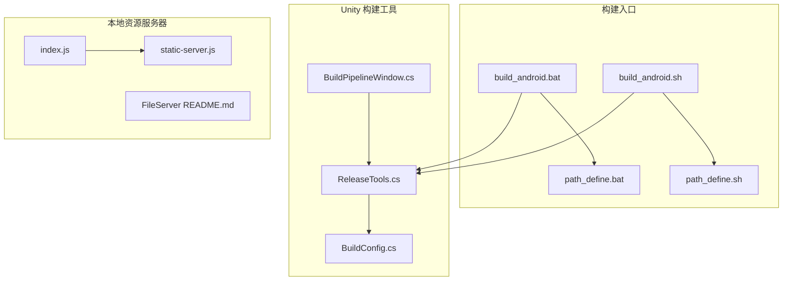
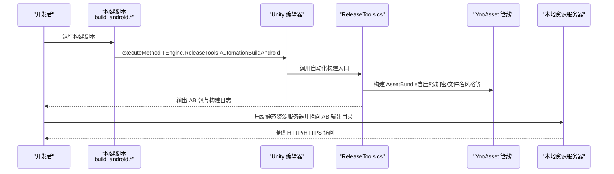
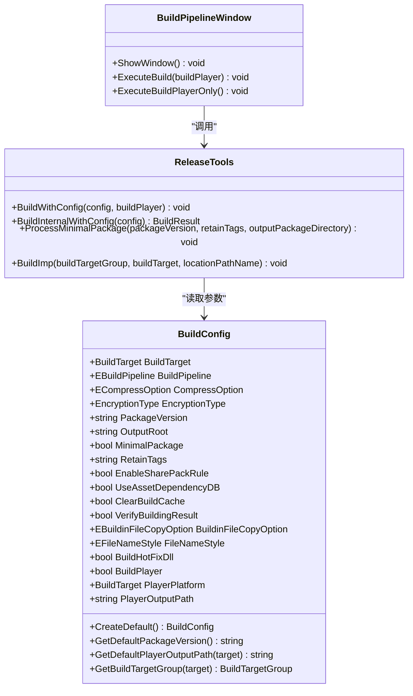
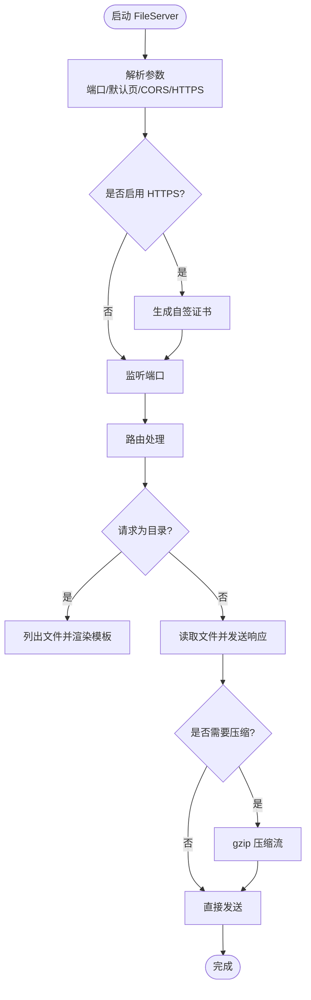
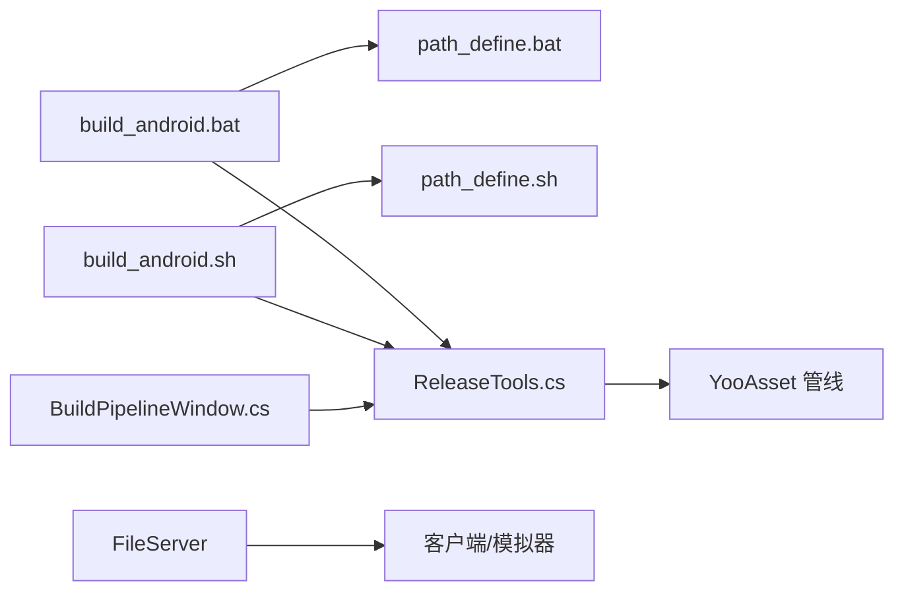

# 构建工具

<cite>
**本文引用的文件**   
- [README.md](file://README.md)
- [build_android.bat](file://BuildCLI/build_android.bat)
- [build_android.sh](file://BuildCLI/build_android.sh)
- [path_define.bat](file://BuildCLI/path_define.bat)
- [path_define.sh](file://BuildCLI/path_define.sh)
- [ReleaseTools.cs](file://UnityProject/Assets/TEngine/Editor/ReleaseTools/ReleaseTools.cs)
- [BuildConfig.cs](file://UnityProject/Assets/TEngine/Editor/ReleaseTools/BuildConfig.cs)
- [BuildPipelineWindow.cs](file://UnityProject/Assets/TEngine/Editor/ReleaseTools/BuildPipelineWindow.cs)
- [index.js](file://Tools/FileServer/index.js)
- [static-server.js](file://Tools/FileServer/src/static-server.js)
- [README.md（FileServer）](file://Tools/FileServer/README.md)
</cite>

## 目录
1. [简介](#简介)
2. [项目结构](#项目结构)
3. [核心组件](#核心组件)
4. [架构总览](#架构总览)
5. [详细组件分析](#详细组件分析)
6. [依赖关系分析](#依赖关系分析)
7. [性能与优化建议](#性能与优化建议)
8. [故障排查指南](#故障排查指南)
9. [结论](#结论)
10. [附录：命令与参数速查](#附录命令与参数速查)

## 简介
本文件面向 TEngine 的构建与发布工作流，覆盖跨平台自动化构建、资源打包、最小包策略、代码混淆与签名、本地静态资源服务器搭建与配置、以及常见错误排查与性能优化建议。文档以仓库现有脚本与编辑器工具为依据，提供可操作的步骤与最佳实践。

## 项目结构
围绕构建与发布的重点目录与文件如下：
- BuildCLI：跨平台构建入口脚本（Windows/macOS/Linux），调用 Unity 命令行执行自动化构建。
- UnityProject/Assets/TEngine/Editor/ReleaseTools：Unity 编辑器侧的构建工具链，包含一键打包、参数化构建、AB 构建、最小包后处理、Player 构建等。
- Tools/FileServer：基于 Node.js 的静态资源服务器，用于热更新资源的本地测试与调试。

图表来源
- [build_android.bat:1-9](file://BuildCLI/build_android.bat#L1-L9)
- [build_android.sh:1-19](file://BuildCLI/build_android.sh#L1-L19)
- [path_define.bat:1-7](file://BuildCLI/path_define.bat#L1-L7)
- [path_define.sh:1-15](file://BuildCLI/path_define.sh#L1-L15)
- [ReleaseTools.cs:18-159](file://UnityProject/Assets/TEngine/Editor/ReleaseTools/ReleaseTools.cs#L18-L159)
- [BuildConfig.cs:8-89](file://UnityProject/Assets/TEngine/Editor/ReleaseTools/BuildConfig.cs#L8-L89)
- [BuildPipelineWindow.cs:86-116](file://UnityProject/Assets/TEngine/Editor/ReleaseTools/BuildPipelineWindow.cs#L86-L116)
- [index.js:1-4](file://Tools/FileServer/index.js#L1-L4)
- [static-server.js:22-33](file://Tools/FileServer/src/static-server.js#L22-L33)
- [README.md（FileServer）:1-43](file://Tools/FileServer/README.md#L1-L43)

章节来源
- [README.md:20-33](file://README.md#L20-L33)

## 核心组件
- 跨平台构建脚本：通过 Unity 命令行在批模式下执行自动化构建，支持 Android/iOS 等平台。
- Unity 构建工具：
  - ReleaseTools：统一构建入口，负责 AB 构建、最小包后处理、Player 构建。
  - BuildConfig：构建参数模型与默认值。
  - BuildPipelineWindow：可视化打包窗口，持久化用户设置。
- 本地资源服务器：Node.js 实现的静态资源服务，支持端口、编码、CORS、HTTPS 等能力，便于热更新资源本地调试。

章节来源
- [ReleaseTools.cs:18-159](file://UnityProject/Assets/TEngine/Editor/ReleaseTools/ReleaseTools.cs#L18-L159)
- [BuildConfig.cs:8-89](file://UnityProject/Assets/TEngine/Editor/ReleaseTools/BuildConfig.cs#L8-L89)
- [BuildPipelineWindow.cs:86-116](file://UnityProject/Assets/TEngine/Editor/ReleaseTools/BuildPipelineWindow.cs#L86-L116)
- [static-server.js:22-33](file://Tools/FileServer/src/static-server.js#L22-L33)

## 架构总览
下图展示从 CLI 到 Unity 构建再到资源服务器的端到端流程。

图表来源
- [build_android.bat:1-9](file://BuildCLI/build_android.bat#L1-L9)
- [build_android.sh:1-19](file://BuildCLI/build_android.sh#L1-L19)
- [ReleaseTools.cs:88-159](file://UnityProject/Assets/TEngine/Editor/ReleaseTools/ReleaseTools.cs#L88-L159)
- [static-server.js:287-334](file://Tools/FileServer/src/static-server.js#L287-L334)

## 详细组件分析

### 跨平台构建脚本（Android/iOS）
- Windows 批处理脚本：
  - 切换至脚本目录，加载路径定义，调用 Unity 执行自动化构建方法，输出日志文件。
- Shell 脚本（macOS/Linux）：
  - 加载环境变量，调用 Unity 执行相同自动化构建方法，循环打印日志文件内容。

关键要点
- 通过 -executeMethod 指定 Unity 内静态方法，实现无头构建。
- 通过 -CustomArgs 传递语言等自定义参数。
- 路径定义脚本需根据本机环境修改 Unity 安装路径与工作区路径。

章节来源
- [build_android.bat:1-9](file://BuildCLI/build_android.bat#L1-L9)
- [build_android.sh:1-19](file://BuildCLI/build_android.sh#L1-L19)
- [path_define.bat:1-7](file://BuildCLI/path_define.bat#L1-L7)
- [path_define.sh:1-15](file://BuildCLI/path_define.sh#L1-L15)

### Unity 构建工具（ReleaseTools / BuildConfig / BuildPipelineWindow）
- ReleaseTools：
  - 提供 CLI 入口与菜单入口，统一走 BuildWithConfig 流程。
  - 构建 AssetBundle：选择 SBP 或内置管线，设置压缩、加密、文件名风格、共享打包规则、依赖数据库等。
  - 最小包模式：解析构建报告，按保留 Tag 删除 StreamingAssets 中的 .bundle 文件，清理空目录。
  - Player 构建：切换目标平台并调用 Unity 构建 Player。
- BuildConfig：
  - 集中管理构建参数，包括平台、管线、压缩、加密、版本号、输出目录、最小包开关与保留 Tag、高级选项、是否编译热更 DLL、是否构建 Player 及其输出路径。
- BuildPipelineWindow：
  - 可视化编辑上述参数，持久化到 EditorPrefs，支持一键构建 AB、仅构建 Player、一键构建 AB+Player，并实时显示构建日志。

图表来源
- [BuildConfig.cs:8-89](file://UnityProject/Assets/TEngine/Editor/ReleaseTools/BuildConfig.cs#L8-L89)
- [ReleaseTools.cs:119-214](file://UnityProject/Assets/TEngine/Editor/ReleaseTools/ReleaseTools.cs#L119-L214)
- [ReleaseTools.cs:290-402](file://UnityProject/Assets/TEngine/Editor/ReleaseTools/ReleaseTools.cs#L290-L402)
- [ReleaseTools.cs:408-431](file://UnityProject/Assets/TEngine/Editor/ReleaseTools/ReleaseTools.cs#L408-L431)
- [BuildPipelineWindow.cs:86-116](file://UnityProject/Assets/TEngine/Editor/ReleaseTools/BuildPipelineWindow.cs#L86-L116)
- [BuildPipelineWindow.cs:468-512](file://UnityProject/Assets/TEngine/Editor/ReleaseTools/BuildPipelineWindow.cs#L468-L512)

章节来源
- [ReleaseTools.cs:18-159](file://UnityProject/Assets/TEngine/Editor/ReleaseTools/ReleaseTools.cs#L18-L159)
- [ReleaseTools.cs:290-402](file://UnityProject/Assets/TEngine/Editor/ReleaseTools/ReleaseTools.cs#L290-L402)
- [BuildConfig.cs:8-89](file://UnityProject/Assets/TEngine/Editor/ReleaseTools/BuildConfig.cs#L8-L89)
- [BuildPipelineWindow.cs:86-116](file://UnityProject/Assets/TEngine/Editor/ReleaseTools/BuildPipelineWindow.cs#L86-L116)

### 本地静态资源服务器（FileServer）
- 入口 index.js 转发到 bin/app.js。
- static-server.js 实现静态文件服务：
  - 支持端口、默认页、自动打开浏览器、字符编码、CORS、HTTPS（自签证书）。
  - 对 CSS/JS/HTML 进行 gzip 压缩传输。
  - 文件夹浏览与重定向逻辑。
  - 端口占用自动递增重试。

图表来源
- [index.js:1-4](file://Tools/FileServer/index.js#L1-L4)
- [static-server.js:22-33](file://Tools/FileServer/src/static-server.js#L22-L33)
- [static-server.js:76-97](file://Tools/FileServer/src/static-server.js#L76-L97)
- [static-server.js:108-125](file://Tools/FileServer/src/static-server.js#L108-L125)
- [static-server.js:155-199](file://Tools/FileServer/src/static-server.js#L155-L199)
- [static-server.js:287-334](file://Tools/FileServer/src/static-server.js#L287-L334)

章节来源
- [README.md（FileServer）:1-43](file://Tools/FileServer/README.md#L1-L43)
- [static-server.js:22-33](file://Tools/FileServer/src/static-server.js#L22-L33)

## 依赖关系分析
- 构建脚本依赖 Unity 安装路径与工作区路径，由 path_define.* 提供。
- Unity 构建工具依赖 YooAsset 管线与编辑器 API。
- 资源服务器独立于 Unity，用于本地调试热更新资源。

图表来源
- [build_android.bat:1-9](file://BuildCLI/build_android.bat#L1-L9)
- [build_android.sh:1-19](file://BuildCLI/build_android.sh#L1-L19)
- [path_define.bat:1-7](file://BuildCLI/path_define.bat#L1-L7)
- [path_define.sh:1-15](file://BuildCLI/path_define.sh#L1-L15)
- [ReleaseTools.cs:165-214](file://UnityProject/Assets/TEngine/Editor/ReleaseTools/ReleaseTools.cs#L165-L214)
- [BuildPipelineWindow.cs:468-512](file://UnityProject/Assets/TEngine/Editor/ReleaseTools/BuildPipelineWindow.cs#L468-L512)

章节来源
- [ReleaseTools.cs:165-214](file://UnityProject/Assets/TEngine/Editor/ReleaseTools/ReleaseTools.cs#L165-L214)

## 性能与优化建议
- 构建管线选择：
  - ScriptableBuildPipeline（SBP）通常具备更好的并行与增量构建能力；BuiltinBuildPipeline 作为兼容备选。
- 压缩策略：
  - LZ4 适合快速构建与运行时解压；LZMA 体积更小但构建较慢。
- 依赖数据库与共享打包：
  - 启用 UseAssetDependencyDB 与 EnableSharePackRule 可提升构建速度与减少重复资源。
- 最小包模式：
  - 在 HostPlayMode 场景下，删除 StreamingAssets 中非必要的 .bundle 可显著减小首包体积。
- 文件名风格：
  - BundleName_HashName 兼顾可读性与缓存命中。
- 构建缓存：
  - 日常开发关闭 ClearBuildCache 以利用增量构建；CI 或全量构建时开启。

章节来源
- [ReleaseTools.cs:165-214](file://UnityProject/Assets/TEngine/Editor/ReleaseTools/ReleaseTools.cs#L165-L214)
- [BuildPipelineWindow.cs:274-311](file://UnityProject/Assets/TEngine/Editor/ReleaseTools/BuildPipelineWindow.cs#L274-L311)

## 故障排查指南
- 构建脚本无法找到 Unity 或工作区路径：
  - 检查 path_define.* 中的 UNITYEDITOR_PATH 与 WORKSPACE 是否为当前机器真实路径。
- Unity 命令行参数错误：
  - 确认 -executeMethod 名称与命名空间一致，且 Unity 版本满足要求。
- AB 构建失败：
  - 查看构建日志与 YooAsset 构建报告，检查压缩、加密、文件名风格等配置是否合理。
- 最小包模式未生效：
  - 确认已启用 MinimalPackage 且 RetainTags 配置正确；检查 StreamingAssets 是否存在及构建报告是否生成。
- 本地资源服务器端口占用：
  - FileServer 会自动尝试下一个可用端口；也可手动指定端口避免冲突。
- CORS 问题：
  - 在 FileServer 启动时开启 CORS 选项，确保跨域访问正常。

章节来源
- [path_define.bat:1-7](file://BuildCLI/path_define.bat#L1-L7)
- [path_define.sh:1-15](file://BuildCLI/path_define.sh#L1-L15)
- [ReleaseTools.cs:290-402](file://UnityProject/Assets/TEngine/Editor/ReleaseTools/ReleaseTools.cs#L290-L402)
- [static-server.js:287-334](file://Tools/FileServer/src/static-server.js#L287-L334)

## 结论
TEngine 的构建体系以“脚本驱动 + Unity 编辑器工具”为核心，配合 YooAsset 的资源管线与本地静态资源服务器，形成完整的跨平台构建、资源打包与热更新调试闭环。通过合理的参数配置与最小包策略，可在保证开发效率的同时获得良好的产物体积与运行性能。

## 附录：命令与参数速查
- 跨平台构建脚本
  - Windows：运行 build_android.bat，内部调用 Unity 执行 TEngine.ReleaseTools.AutomationBuildAndroid。
  - macOS/Linux：运行 build_android.sh，功能同上。
  - 路径定义：修改 path_define.bat 或 path_define.sh 以适配本机环境。
- Unity 构建工具
  - 菜单入口：TEngine/Build/一键打包Android、iOS、Windows 等。
  - 可视化窗口：TEngine/Build/打包工具窗口，支持 AB 构建、Player 构建与一键构建。
  - 关键参数：
    - 目标平台、构建管线、压缩方式、加密方式、资源版本号、AB 输出目录。
    - 最小包模式与保留 Tag。
    - 共享打包、依赖数据库、构建缓存、验证结果、内置文件拷贝、文件名风格。
    - 是否编译热更 DLL、是否构建 Player 及其输出路径。
- 本地资源服务器
  - 安装与启动参考 Tools/FileServer/README.md。
  - 常用选项：端口、默认页、字符编码、CORS、HTTPS、自动打开浏览器。

章节来源
- [build_android.bat:1-9](file://BuildCLI/build_android.bat#L1-L9)
- [build_android.sh:1-19](file://BuildCLI/build_android.sh#L1-L19)
- [path_define.bat:1-7](file://BuildCLI/path_define.bat#L1-L7)
- [path_define.sh:1-15](file://BuildCLI/path_define.sh#L1-L15)
- [ReleaseTools.cs:88-159](file://UnityProject/Assets/TEngine/Editor/ReleaseTools/ReleaseTools.cs#L88-L159)
- [BuildPipelineWindow.cs:86-116](file://UnityProject/Assets/TEngine/Editor/ReleaseTools/BuildPipelineWindow.cs#L86-L116)
- [README.md（FileServer）:1-43](file://Tools/FileServer/README.md#L1-L43)