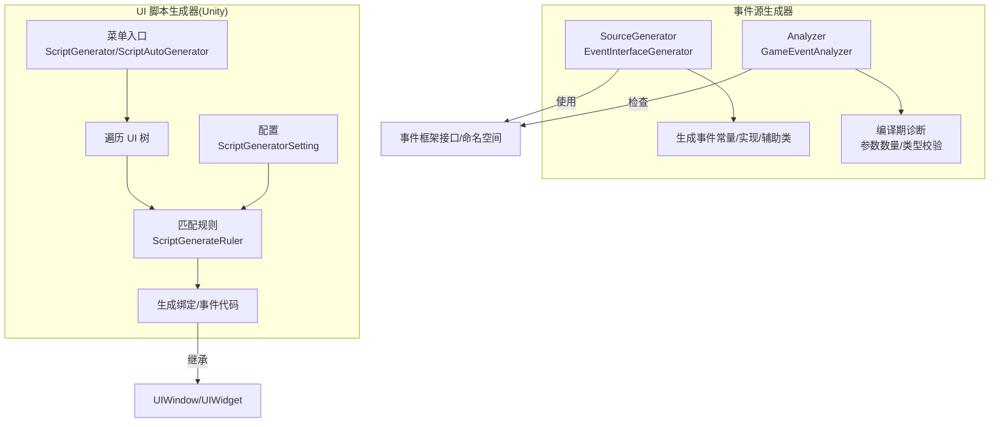
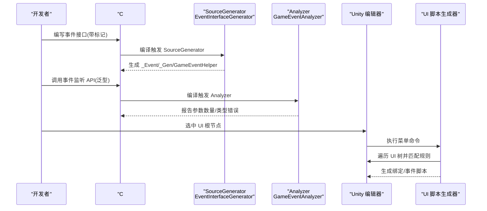
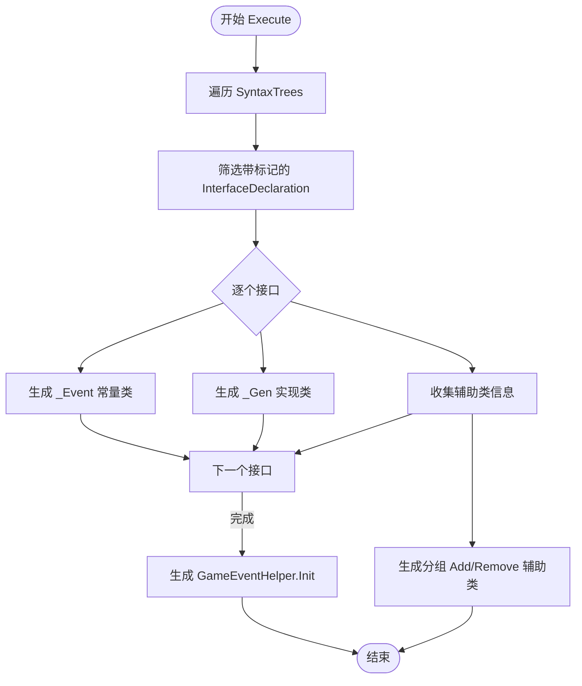
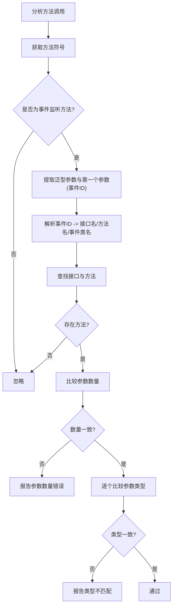
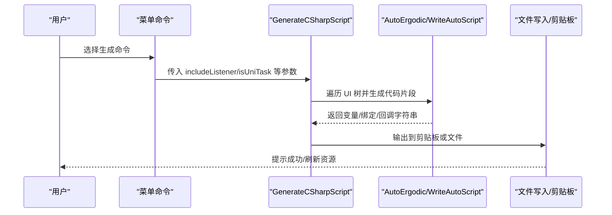
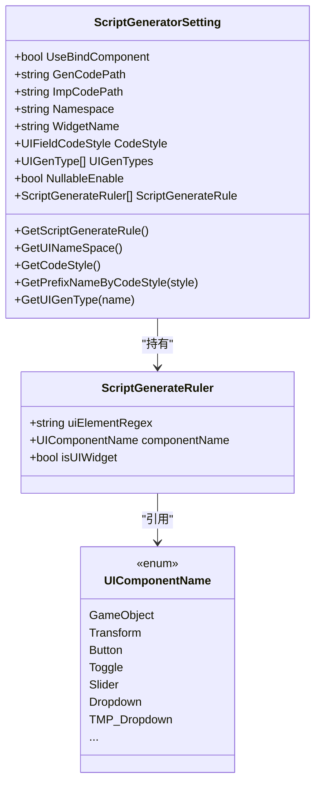
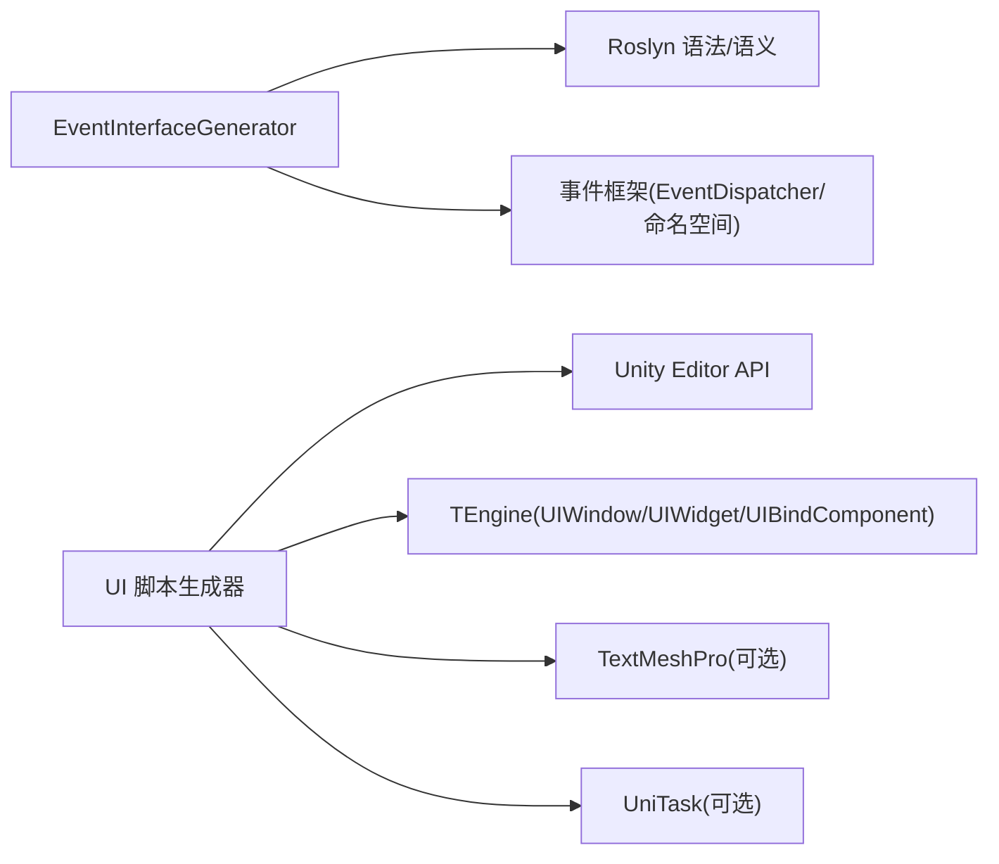

# 源码生成器

<cite>
**本文引用的文件**   
- [EventInterfaceGenerator.cs](file://Tools/GameEventSourceGenerator/SourceGenerator/Generator/EventInterfaceGenerator.cs)
- [GameEventAnalyzer.cs](file://Tools/GameEventSourceGenerator/GameEventAnalyzer/Analyzer/GameEventAnalyzer.cs)
- [ScriptGenerator.cs](file://UnityProject/Assets/Editor/UIScriptGenerator/ScriptGenerator.cs)
- [ScriptAutoGenerator.cs](file://UnityProject/Assets/Editor/UIScriptGenerator/ScriptAutoGenerator.cs)
- [ScriptGenerateRuler.cs](file://UnityProject/Assets/Editor/UIScriptGenerator/ScriptGenerateRuler.cs)
- [ScriptGeneratorSetting.cs](file://UnityProject/Assets/Editor/UIScriptGenerator/ScriptGeneratorSetting.cs)
</cite>

## 目录
1. [简介](#简介)
2. [项目结构](#项目结构)
3. [核心组件](#核心组件)
4. [架构总览](#架构总览)
5. [详细组件分析](#详细组件分析)
6. [依赖关系分析](#依赖关系分析)
7. [性能考虑](#性能考虑)
8. [故障排查指南](#故障排查指南)
9. [结论](#结论)
10. [附录](#附录)

## 简介
本文件面向 TEngine 的源码生成体系，系统性阐述以下能力：
- 事件源生成器：基于 C# Source Generator 与 Analyzer，自动为事件接口生成类型安全的事件常量、实现类与辅助类，并在编译期校验监听调用参数数量与类型。
- UI 脚本生成器：在 Unity 编辑器中扫描 UI 树，自动生成属性绑定、事件回调与可选的 UniTask 异步签名；支持“UIBindComponent”模式与“传统 FindChild”模式，并提供规则化命名与可定制模板。
- 工作机制：从语法分析（Roslyn）到代码生成（StringBuilder 模板），再到编译集成（ISourceGenerator + DiagnosticAnalyzer）与 Unity 构建管线集成。
- 扩展指南：如何新增 UI 组件规则、自定义生成器输出、接入新的 UI 基类或事件框架扩展点。

## 项目结构
TEngine 源码生成相关代码分为两大子系统：
- 事件源生成器（跨平台 .NET 工程可用）
  - SourceGenerator：事件接口扫描与代码生成
  - Analyzer：编译期诊断与类型/参数校验
- UI 脚本生成器（Unity Editor 工具）
  - ScriptGenerator / ScriptAutoGenerator：菜单入口、遍历 UI 树、生成脚本
  - ScriptGenerateRuler / ScriptGeneratorSetting：规则与配置

图表来源
- [EventInterfaceGenerator.cs:1-330](file://Tools/GameEventSourceGenerator/SourceGenerator/Generator/EventInterfaceGenerator.cs#L1-L330)
- [GameEventAnalyzer.cs:1-167](file://Tools/GameEventSourceGenerator/GameEventAnalyzer/Analyzer/GameEventAnalyzer.cs#L1-L167)
- [ScriptGenerator.cs:1-343](file://UnityProject/Assets/Editor/UIScriptGenerator/ScriptGenerator.cs#L1-L343)
- [ScriptAutoGenerator.cs:1-829](file://UnityProject/Assets/Editor/UIScriptGenerator/ScriptAutoGenerator.cs#L1-L829)
- [ScriptGenerateRuler.cs:1-100](file://UnityProject/Assets/Editor/UIScriptGenerator/ScriptGenerateRuler.cs#L1-L100)
- [ScriptGeneratorSetting.cs:1-207](file://UnityProject/Assets/Editor/UIScriptGenerator/ScriptGeneratorSetting.cs#L1-L207)

章节来源
- [EventInterfaceGenerator.cs:1-330](file://Tools/GameEventSourceGenerator/SourceGenerator/Generator/EventInterfaceGenerator.cs#L1-L330)
- [GameEventAnalyzer.cs:1-167](file://Tools/GameEventSourceGenerator/GameEventAnalyzer/Analyzer/GameEventAnalyzer.cs#L1-L167)
- [ScriptGenerator.cs:1-343](file://UnityProject/Assets/Editor/UIScriptGenerator/ScriptGenerator.cs#L1-L343)
- [ScriptAutoGenerator.cs:1-829](file://UnityProject/Assets/Editor/UIScriptGenerator/ScriptAutoGenerator.cs#L1-L829)
- [ScriptGenerateRuler.cs:1-100](file://UnityProject/Assets/Editor/UIScriptGenerator/ScriptGenerateRuler.cs#L1-L100)
- [ScriptGeneratorSetting.cs:1-207](file://UnityProject/Assets/Editor/UIScriptGenerator/ScriptGeneratorSetting.cs#L1-L207)

## 核心组件
- 事件接口生成器（EventInterfaceGenerator）
  - 扫描带有特定属性的接口，生成：
    - 事件常量类（_Event）
    - 接口实现类（_Gen）
    - 辅助类（GameEventHelper.Init 与分组 Add/Remove 方法）
  - 通过 Roslyn 语义模型推导 Action 泛型参数，保证类型安全。
- 事件分析器（GameEventAnalyzer）
  - 在编译期对事件监听调用进行静态检查：
    - 参数数量不匹配
    - 参数类型不匹配
- UI 脚本生成器（ScriptGenerator / ScriptAutoGenerator）
  - 提供多种菜单命令，支持：
    - 仅属性绑定
    - 属性+事件绑定
    - 传统 FindChild 模式 vs UIBindComponent 模式
    - UniTask 异步回调签名
  - 根据规则表（ScriptGenerateRuler）与全局设置（ScriptGeneratorSetting）生成代码。
- 规则与配置（ScriptGenerateRuler / ScriptGeneratorSetting）
  - 规则表：节点名前缀 -> 组件类型 -> 是否 Widget
  - 配置项：命名空间、保存路径、代码风格、UI 基类映射等

章节来源
- [EventInterfaceGenerator.cs:1-330](file://Tools/GameEventSourceGenerator/SourceGenerator/Generator/EventInterfaceGenerator.cs#L1-L330)
- [GameEventAnalyzer.cs:1-167](file://Tools/GameEventSourceGenerator/GameEventAnalyzer/Analyzer/GameEventAnalyzer.cs#L1-L167)
- [ScriptGenerator.cs:1-343](file://UnityProject/Assets/Editor/UIScriptGenerator/ScriptGenerator.cs#L1-L343)
- [ScriptAutoGenerator.cs:1-829](file://UnityProject/Assets/Editor/UIScriptGenerator/ScriptAutoGenerator.cs#L1-L829)
- [ScriptGenerateRuler.cs:1-100](file://UnityProject/Assets/Editor/UIScriptGenerator/ScriptGenerateRuler.cs#L1-L100)
- [ScriptGeneratorSetting.cs:1-207](file://UnityProject/Assets/Editor/UIScriptGenerator/ScriptGeneratorSetting.cs#L1-L207)

## 架构总览
下图展示事件源生成器与 UI 脚本生成器的整体协作关系与数据流。

图表来源
- [EventInterfaceGenerator.cs:30-74](file://Tools/GameEventSourceGenerator/SourceGenerator/Generator/EventInterfaceGenerator.cs#L30-L74)
- [GameEventAnalyzer.cs:57-65](file://Tools/GameEventSourceGenerator/GameEventAnalyzer/Analyzer/GameEventAnalyzer.cs#L57-L65)
- [ScriptGenerator.cs:12-58](file://UnityProject/Assets/Editor/UIScriptGenerator/ScriptGenerator.cs#L12-L58)
- [ScriptAutoGenerator.cs:30-76](file://UnityProject/Assets/Editor/UIScriptGenerator/ScriptAutoGenerator.cs#L30-L76)

## 详细组件分析

### 事件接口生成器（EventInterfaceGenerator）
- 功能要点
  - 扫描所有被特定属性标记的接口，提取方法签名与参数类型。
  - 生成三类代码：
    - 事件常量类（_Event.g.cs）：将每个方法名转为事件 ID 常量。
    - 接口实现类（_Gen.g.cs）：封装 EventDispatcher.Send，转发调用。
    - 辅助类（GameEventHelper.Init.g.cs 与 GameEventHelper.g.cs）：集中初始化与分组 Add/Remove 监听方法。
  - 通过语义模型推导 Action<T...> 的类型参数，确保类型安全。
- 关键流程
  - Execute 阶段遍历语法树，收集接口信息。
  - 针对每个接口生成常量类、实现类与辅助类。
  - 汇总所有生成的实现类名，生成统一初始化入口。

图表来源
- [EventInterfaceGenerator.cs:30-74](file://Tools/GameEventSourceGenerator/SourceGenerator/Generator/EventInterfaceGenerator.cs#L30-L74)
- [EventInterfaceGenerator.cs:76-134](file://Tools/GameEventSourceGenerator/SourceGenerator/Generator/EventInterfaceGenerator.cs#L76-L134)
- [EventInterfaceGenerator.cs:229-313](file://Tools/GameEventSourceGenerator/SourceGenerator/Generator/EventInterfaceGenerator.cs#L229-L313)

章节来源
- [EventInterfaceGenerator.cs:1-330](file://Tools/GameEventSourceGenerator/SourceGenerator/Generator/EventInterfaceGenerator.cs#L1-L330)

### 事件分析器（GameEventAnalyzer）
- 功能要点
  - 在编译期检查事件监听调用的泛型参数：
    - 参数数量是否与接口方法一致
    - 参数类型是否与接口方法一致
  - 通过解析事件 ID 表达式，定位对应接口与方法，进行严格比对。
- 关键流程
  - Initialize 注册 InvocationExpression 分析回调。
  - AnalyzeInvocation 获取方法符号与泛型参数，解析事件 ID，查找接口与方法，逐项比较类型与数量。

图表来源
- [GameEventAnalyzer.cs:57-65](file://Tools/GameEventSourceGenerator/GameEventAnalyzer/Analyzer/GameEventAnalyzer.cs#L57-L65)
- [GameEventAnalyzer.cs:72-166](file://Tools/GameEventSourceGenerator/GameEventAnalyzer/Analyzer/GameEventAnalyzer.cs#L72-L166)

章节来源
- [GameEventAnalyzer.cs:1-167](file://Tools/GameEventSourceGenerator/GameEventAnalyzer/Analyzer/GameEventAnalyzer.cs#L1-L167)

### UI 脚本生成器（ScriptGenerator / ScriptAutoGenerator）
- 功能要点
  - 提供多组菜单命令，支持：
    - 仅属性绑定（FindChild 模式）
    - 属性+事件绑定（FindChild 模式）
    - 属性绑定（UIBindComponent 模式）
    - 属性+事件绑定（UIBindComponent 模式）
    - 以上均支持 UniTask 异步回调签名
  - 自动遍历 UI 树，按规则表匹配组件类型，生成字段声明、绑定逻辑与事件回调。
  - 支持两种输出方式：
    - 剪贴板复制（手动粘贴）
    - 自动写入文件（含只读保护与增量覆盖）
- 关键流程
  - GenerateCSharpScript：组装变量、绑定、OnCreate、回调字符串，最终输出完整脚本。
  - AutoErgodic/WriteAutoScript：递归遍历子节点，匹配规则，生成绑定与事件代码。
  - GenerateImpCSharpScript：生成 partial 实现类，包含空的事件回调骨架。
  - GenerateUIComponentScript：为预制体添加/更新 UIBindComponent 并记录组件引用。

图表来源
- [ScriptAutoGenerator.cs:89-254](file://UnityProject/Assets/Editor/UIScriptGenerator/ScriptAutoGenerator.cs#L89-L254)
- [ScriptAutoGenerator.cs:258-363](file://UnityProject/Assets/Editor/UIScriptGenerator/ScriptAutoGenerator.cs#L258-L363)
- [ScriptAutoGenerator.cs:367-436](file://UnityProject/Assets/Editor/UIScriptGenerator/ScriptAutoGenerator.cs#L367-L436)
- [ScriptAutoGenerator.cs:533-633](file://UnityProject/Assets/Editor/UIScriptGenerator/ScriptAutoGenerator.cs#L533-L633)

章节来源
- [ScriptGenerator.cs:1-343](file://UnityProject/Assets/Editor/UIScriptGenerator/ScriptGenerator.cs#L1-L343)
- [ScriptAutoGenerator.cs:1-829](file://UnityProject/Assets/Editor/UIScriptGenerator/ScriptAutoGenerator.cs#L1-L829)

### 规则与配置（ScriptGenerateRuler / ScriptGeneratorSetting）
- 规则表（ScriptGenerateRuler）
  - uiElementRegex：节点名前缀匹配规则
  - componentName：目标组件类型枚举
  - isUIWidget：是否作为 UI 子组件（跳过继续遍历）
- 配置（ScriptGeneratorSetting）
  - UseBindComponent：切换 UIBindComponent 模式
  - GenCodePath/ImpCodePath：生成代码与实现类保存路径
  - Namespace：生成脚本命名空间
  - WidgetName：子组件前缀（默认 item）
  - CodeStyle：字段命名风格（下划线或 m_）
  - UIGenTypes：UIWindow/UIWidget 映射与泛型支持
  - NullableEnable：是否启用可空注解
  - ScriptGenerateRule：默认规则集合（Button/Toggle/Slider/Dropdown 等）

图表来源
- [ScriptGeneratorSetting.cs:10-207](file://UnityProject/Assets/Editor/UIScriptGenerator/ScriptGeneratorSetting.cs#L10-L207)
- [ScriptGenerateRuler.cs:25-100](file://UnityProject/Assets/Editor/UIScriptGenerator/ScriptGenerateRuler.cs#L25-L100)

章节来源
- [ScriptGenerateRuler.cs:1-100](file://UnityProject/Assets/Editor/UIScriptGenerator/ScriptGenerateRuler.cs#L1-L100)
- [ScriptGeneratorSetting.cs:1-207](file://UnityProject/Assets/Editor/UIScriptGenerator/ScriptGeneratorSetting.cs#L1-L207)

## 依赖关系分析
- 事件源生成器
  - 依赖 Roslyn（Microsoft.CodeAnalysis.*）进行语法与语义分析。
  - 生成代码依赖事件框架命名空间与 EventDispatcher。
- UI 脚本生成器
  - 依赖 Unity Editor API（Selection.activeTransform、AssetDatabase 等）。
  - 生成代码依赖 TEngine 的 UIWindow/UIWidget 与 UIBindComponent。
  - 可选依赖 TMPro 与 Cysharp.Threading.Tasks（UniTask）。

图表来源
- [EventInterfaceGenerator.cs:1-10](file://Tools/GameEventSourceGenerator/SourceGenerator/Generator/EventInterfaceGenerator.cs#L1-L10)
- [ScriptGenerator.cs:1-10](file://UnityProject/Assets/Editor/UIScriptGenerator/ScriptGenerator.cs#L1-L10)
- [ScriptAutoGenerator.cs:1-11](file://UnityProject/Assets/Editor/UIScriptGenerator/ScriptAutoGenerator.cs#L1-L11)

章节来源
- [EventInterfaceGenerator.cs:1-330](file://Tools/GameEventSourceGenerator/SourceGenerator/Generator/EventInterfaceGenerator.cs#L1-L330)
- [ScriptGenerator.cs:1-343](file://UnityProject/Assets/Editor/UIScriptGenerator/ScriptGenerator.cs#L1-L343)
- [ScriptAutoGenerator.cs:1-829](file://UnityProject/Assets/Editor/UIScriptGenerator/ScriptAutoGenerator.cs#L1-L829)

## 性能考虑
- SourceGenerator
  - 仅在编译时运行一次，避免运行时开销。
  - 使用 StringBuilder 拼接代码，减少内存分配。
  - 通过语义模型一次性推导类型，避免重复计算。
- Analyzer
  - 禁用对自动生成代码的分析，降低扫描范围。
  - 启用并发执行，提升分析吞吐。
- UI 脚本生成器
  - 递归遍历 UI 树时跳过 Widget 节点，减少不必要的处理。
  - 生成代码采用增量覆盖与只读保护，避免频繁 AssetDatabase.Refresh。

[本节为通用指导，无需具体文件引用]

## 故障排查指南
- 事件监听参数数量/类型报错
  - 现象：编译时报错，提示参数数量不一致或类型不匹配。
  - 排查：
    - 确认监听调用处的泛型参数与接口方法签名一致。
    - 检查事件 ID 表达式是否正确指向 _Event 常量。
  - 参考：
    - [GameEventAnalyzer.cs:131-165](file://Tools/GameEventSourceGenerator/GameEventAnalyzer/Analyzer/GameEventAnalyzer.cs#L131-L165)
- 未生成事件常量/实现类
  - 现象：编译后未出现 _Event/_Gen 文件。
  - 排查：
    - 确认接口是否带有所需属性标记。
    - 检查 SourceGenerator 是否已正确引入项目。
  - 参考：
    - [EventInterfaceGenerator.cs:36-65](file://Tools/GameEventSourceGenerator/SourceGenerator/Generator/EventInterfaceGenerator.cs#L36-L65)
- UI 脚本未生成或字段为空
  - 现象：生成的脚本缺少字段或事件回调。
  - 排查：
    - 检查节点命名是否符合规则表前缀。
    - 确认 ScriptGeneratorSetting 中的规则列表是否包含该组件。
    - 若使用 UIBindComponent 模式，确认根物体是否存在 UIBindComponent。
  - 参考：
    - [ScriptAutoGenerator.cs:275-363](file://UnityProject/Assets/Editor/UIScriptGenerator/ScriptAutoGenerator.cs#L275-L363)
    - [ScriptGeneratorSetting.cs:67-97](file://UnityProject/Assets/Editor/UIScriptGenerator/ScriptGeneratorSetting.cs#L67-L97)
- 预制体模式下保存失败
  - 现象：生成 UIBindComponent 后无法保存或应用更改。
  - 排查：
    - 确认是否在预制体编辑模式。
    - 检查 SavePrefabChanges 异常日志。
  - 参考：
    - [ScriptAutoGenerator.cs:726-776](file://UnityProject/Assets/Editor/UIScriptGenerator/ScriptAutoGenerator.cs#L726-L776)

章节来源
- [GameEventAnalyzer.cs:131-165](file://Tools/GameEventSourceGenerator/GameEventAnalyzer/Analyzer/GameEventAnalyzer.cs#L131-L165)
- [EventInterfaceGenerator.cs:36-65](file://Tools/GameEventSourceGenerator/SourceGenerator/Generator/EventInterfaceGenerator.cs#L36-L65)
- [ScriptAutoGenerator.cs:275-363](file://UnityProject/Assets/Editor/UIScriptGenerator/ScriptAutoGenerator.cs#L275-L363)
- [ScriptGeneratorSetting.cs:67-97](file://UnityProject/Assets/Editor/UIScriptGenerator/ScriptGeneratorSetting.cs#L67-L97)
- [ScriptAutoGenerator.cs:726-776](file://UnityProject/Assets/Editor/UIScriptGenerator/ScriptAutoGenerator.cs#L726-L776)

## 结论
TEngine 的源码生成体系以 Roslyn 为核心，结合 Unity 编辑器工具，实现了：
- 事件系统：接口驱动、类型安全、编译期校验，显著降低运行时错误。
- UI 开发：自动化属性绑定与事件回调，支持多种模式与模板定制，提升开发效率。
- 可扩展性：规则表与配置项解耦，便于扩展新组件与新基类；SourceGenerator/Analyzer 架构清晰，易于二次开发。

[本节为总结性内容，无需具体文件引用]

## 附录
- 快速上手建议
  - 事件接口：定义接口并添加所需属性标记，编译后即可使用 _Event 常量与 _Gen 实现。
  - UI 脚本：在 Unity 中选中 UI 根节点，选择相应菜单命令，按需勾选 UniTask 与 UIBindComponent 模式。
  - 规则配置：在 ScriptGeneratorSetting 中维护规则表，确保节点命名与组件类型匹配。
- 扩展开发要点
  - 新增 UI 组件：在 ScriptGenerateRuler 中添加规则，或在 ScriptGeneratorSetting 的默认规则中补充。
  - 自定义 UI 基类：在 ScriptGeneratorSetting.UIGenTypes 中注册新的 UI 类型映射。
  - 扩展事件框架：在 EventInterfaceGenerator 中调整命名空间与辅助类生成逻辑。

[本节为概念性内容，无需具体文件引用]