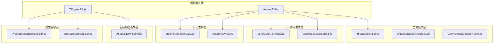
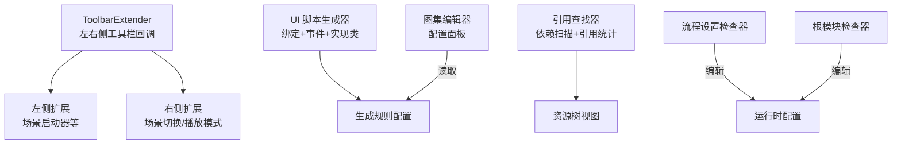
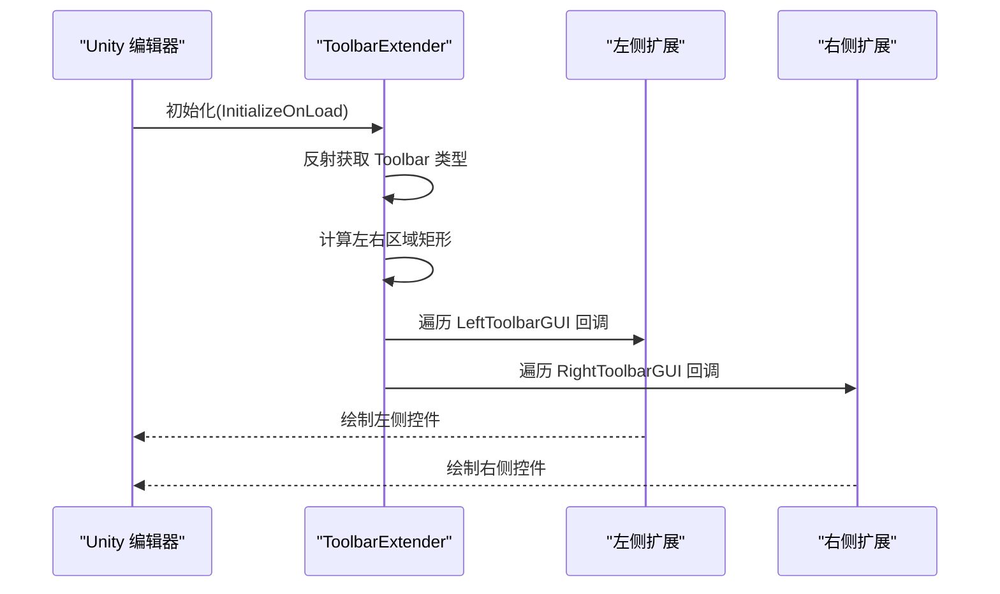
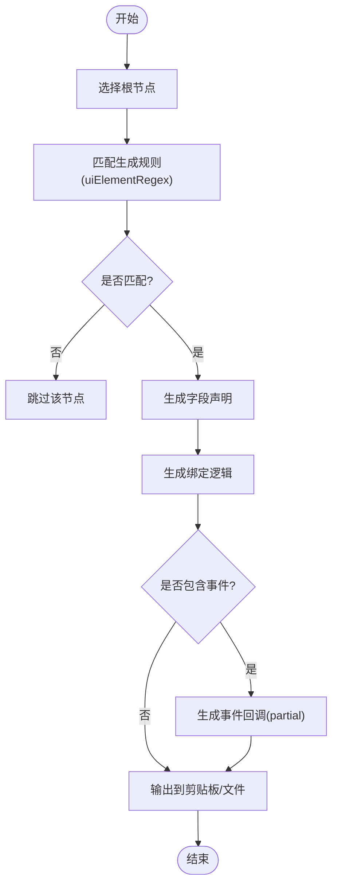
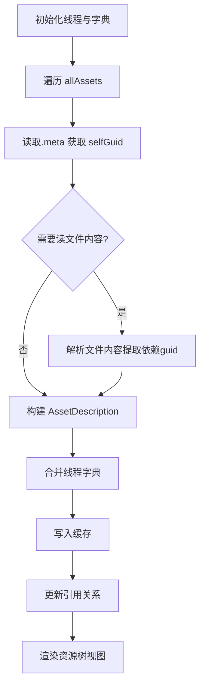
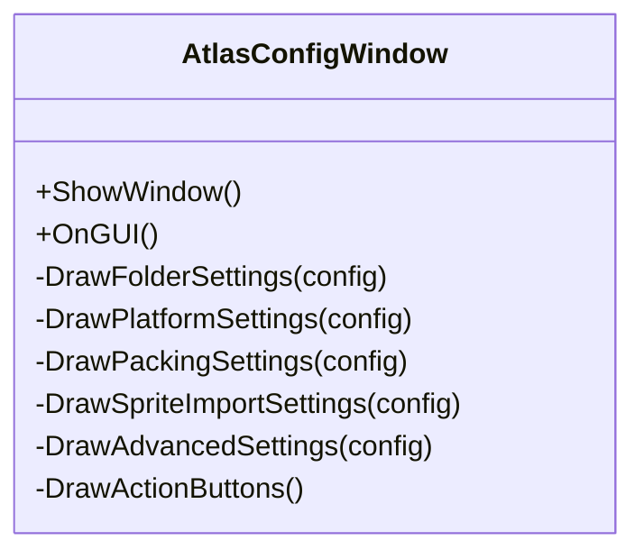
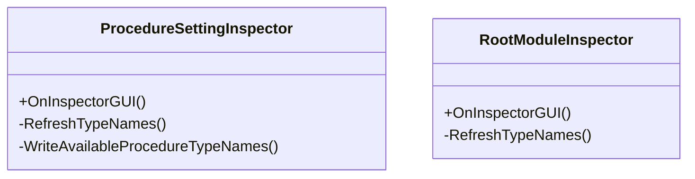
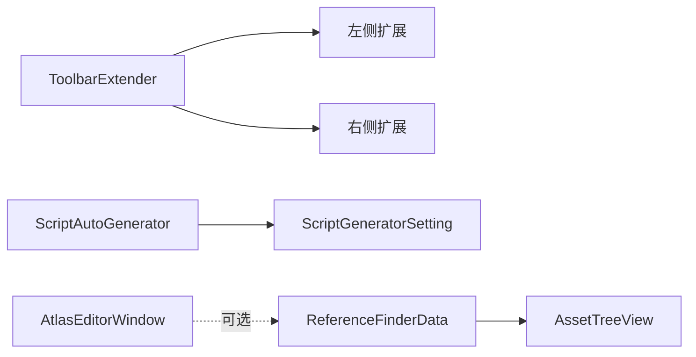

# 编辑器扩展

<cite>
**本文引用的文件**   
- [ToolbarExtender.cs](file://UnityProject/Assets/Editor/ToolbarExtender/ToolbarExtender.cs)
- [UnityToolbarExtenderLeft.cs](file://UnityProject/Assets/Editor/ToolbarExtender/UnityToolbarExtenderLeft/UnityToolbarExtenderLeft.cs)
- [UnityToolbarExtenderRight.cs](file://UnityProject/Assets/Editor/ToolbarExtender/UnityToolbarExtenderRight/UnityToolbarExtenderRight.cs)
- [AtlasEditorWindow.cs](file://UnityProject/Assets/TEngine/Editor/AtlasMakerEditor/AtlasEditorWindow.cs)
- [ScriptAutoGenerator.cs](file://UnityProject/Assets/Editor/UIScriptGenerator/ScriptAutoGenerator.cs)
- [ScriptGeneratorSetting.cs](file://UnityProject/Assets/Editor/UIScriptGenerator/ScriptGeneratorSetting.cs)
- [ReferenceFinderData.cs](file://UnityProject/Assets/Editor/ReferenceFinder/ReferenceFinderData.cs)
- [AssetTreeView.cs](file://UnityProject/Assets/Editor/ReferenceFinder/AssetTreeView.cs)
- [ProcedureSettingInspector.cs](file://UnityProject/Assets/TEngine/Editor/Inspector/ProcedureSettingInspector.cs)
- [RootModuleInspector.cs](file://UnityProject/Assets/TEngine/Editor/Inspector/RootModuleInspector.cs)
</cite>

## 目录
1. [简介](#简介)
2. [项目结构](#项目结构)
3. [核心组件](#核心组件)
4. [架构总览](#架构总览)
5. [详细组件分析](#详细组件分析)
6. [依赖关系分析](#依赖关系分析)
7. [性能考虑](#性能考虑)
8. [故障排除指南](#故障排除指南)
9. [结论](#结论)

## 简介
本文件面向 TEngine 的编辑器扩展，系统性介绍以下能力：
- 工具栏扩展：左侧与右侧工具栏的自定义扩展开发方式与集成点
- 属性检查器增强：自定义 Inspector 绘制、游戏对象检查器优化
- 图集制作编辑器：配置面板、精灵后处理等使用方法
- UI 脚本生成器：代码自动生成规则、组件绑定与实现类分离
- 引用查找器与资源收集器：依赖扫描、引用统计与缓存机制

## 项目结构
编辑器扩展主要分布在 UnityProject/Assets/Editor 与 UnityProject/Assets/TEngine/Editor 两个目录下：
- ToolbarExtender：工具栏扩展基础框架与左右侧扩展入口
- UIScriptGenerator：UI 脚本生成器（自动绑定、事件监听、实现类生成）
- ReferenceFinder：引用查找器（依赖扫描、引用统计、树形展示）
- AtlasMakerEditor：图集制作编辑器的配置窗口与流程控制
- Inspector：对 TEngine 核心模块的检查器增强

**图示来源**
- [ToolbarExtender.cs:1-173](file://UnityProject/Assets/Editor/ToolbarExtender/ToolbarExtender.cs#L1-L173)
- [UnityToolbarExtenderLeft.cs:1-20](file://UnityProject/Assets/Editor/ToolbarExtender/UnityToolbarExtenderLeft/UnityToolbarExtenderLeft.cs#L1-L20)
- [UnityToolbarExtenderRight.cs:1-25](file://UnityProject/Assets/Editor/ToolbarExtender/UnityToolbarExtenderRight/UnityToolbarExtenderRight.cs#L1-L25)
- [ScriptAutoGenerator.cs:1-800](file://UnityProject/Assets/Editor/UIScriptGenerator/ScriptAutoGenerator.cs#L1-L800)
- [ScriptGeneratorSetting.cs:1-207](file://UnityProject/Assets/Editor/UIScriptGenerator/ScriptGeneratorSetting.cs#L1-L207)
- [ReferenceFinderData.cs:1-417](file://UnityProject/Assets/Editor/ReferenceFinder/ReferenceFinderData.cs#L1-L417)
- [AssetTreeView.cs:1-181](file://UnityProject/Assets/Editor/ReferenceFinder/AssetTreeView.cs#L1-L181)
- [AtlasEditorWindow.cs:1-328](file://UnityProject/Assets/TEngine/Editor/AtlasMakerEditor/AtlasEditorWindow.cs#L1-L328)
- [ProcedureSettingInspector.cs:1-159](file://UnityProject/Assets/TEngine/Editor/Inspector/ProcedureSettingInspector.cs#L1-L159)
- [RootModuleInspector.cs:1-248](file://UnityProject/Assets/TEngine/Editor/Inspector/RootModuleInspector.cs#L1-L248)

**章节来源**
- [ToolbarExtender.cs:1-173](file://UnityProject/Assets/Editor/ToolbarExtender/ToolbarExtender.cs#L1-L173)
- [ScriptAutoGenerator.cs:1-800](file://UnityProject/Assets/Editor/UIScriptGenerator/ScriptAutoGenerator.cs#L1-L800)
- [ReferenceFinderData.cs:1-417](file://UnityProject/Assets/Editor/ReferenceFinder/ReferenceFinderData.cs#L1-L417)
- [AtlasEditorWindow.cs:1-328](file://UnityProject/Assets/TEngine/Editor/AtlasMakerEditor/AtlasEditorWindow.cs#L1-L328)
- [ProcedureSettingInspector.cs:1-159](file://UnityProject/Assets/TEngine/Editor/Inspector/ProcedureSettingInspector.cs#L1-L159)
- [RootModuleInspector.cs:1-248](file://UnityProject/Assets/TEngine/Editor/Inspector/RootModuleInspector.cs#L1-L248)

## 核心组件
- 工具栏扩展：提供统一的左右侧工具栏绘制回调，支持在 Unity 主工具栏两侧添加自定义按钮与控件
- UI 脚本生成器：基于命名规则与配置，自动生成 UI 绑定脚本与事件回调，支持 UniTask 模式与实现类分离
- 引用查找器：多线程扫描资源依赖，构建引用关系图，提供可视化树与引用计数
- 图集制作编辑器：集中管理图集打包参数、平台格式、压缩质量、剔除透明区域等
- 检查器增强：为 TEngine 核心模块提供更友好的属性编辑体验

**章节来源**
- [ToolbarExtender.cs:1-173](file://UnityProject/Assets/Editor/ToolbarExtender/ToolbarExtender.cs#L1-L173)
- [ScriptAutoGenerator.cs:1-800](file://UnityProject/Assets/Editor/UIScriptGenerator/ScriptAutoGenerator.cs#L1-L800)
- [ReferenceFinderData.cs:1-417](file://UnityProject/Assets/Editor/ReferenceFinder/ReferenceFinderData.cs#L1-L417)
- [AtlasEditorWindow.cs:1-328](file://UnityProject/Assets/TEngine/Editor/AtlasMakerEditor/AtlasEditorWindow.cs#L1-L328)
- [ProcedureSettingInspector.cs:1-159](file://UnityProject/Assets/TEngine/Editor/Inspector/ProcedureSettingInspector.cs#L1-L159)
- [RootModuleInspector.cs:1-248](file://UnityProject/Assets/TEngine/Editor/Inspector/RootModuleInspector.cs#L1-L248)

## 架构总览
编辑器扩展通过“插件式”回调与配置驱动的方式，将不同功能模块解耦。工具栏扩展作为统一入口，UI 脚本生成器与引用查找器分别负责代码生成与资源依赖分析，图集编辑器提供打包策略配置，检查器增强提升核心模块的可编辑性。

**图示来源**
- [ToolbarExtender.cs:1-173](file://UnityProject/Assets/Editor/ToolbarExtender/ToolbarExtender.cs#L1-L173)
- [UnityToolbarExtenderLeft.cs:1-20](file://UnityProject/Assets/Editor/ToolbarExtender/UnityToolbarExtenderLeft/UnityToolbarExtenderLeft.cs#L1-L20)
- [UnityToolbarExtenderRight.cs:1-25](file://UnityProject/Assets/Editor/ToolbarExtender/UnityToolbarExtenderRight/UnityToolbarExtenderRight.cs#L1-L25)
- [ScriptAutoGenerator.cs:1-800](file://UnityProject/Assets/Editor/UIScriptGenerator/ScriptAutoGenerator.cs#L1-L800)
- [ScriptGeneratorSetting.cs:1-207](file://UnityProject/Assets/Editor/UIScriptGenerator/ScriptGeneratorSetting.cs#L1-L207)
- [ReferenceFinderData.cs:1-417](file://UnityProject/Assets/Editor/ReferenceFinder/ReferenceFinderData.cs#L1-L417)
- [AssetTreeView.cs:1-181](file://UnityProject/Assets/Editor/ReferenceFinder/AssetTreeView.cs#L1-L181)
- [AtlasEditorWindow.cs:1-328](file://UnityProject/Assets/TEngine/Editor/AtlasMakerEditor/AtlasEditorWindow.cs#L1-L328)
- [ProcedureSettingInspector.cs:1-159](file://UnityProject/Assets/TEngine/Editor/Inspector/ProcedureSettingInspector.cs#L1-L159)
- [RootModuleInspector.cs:1-248](file://UnityProject/Assets/TEngine/Editor/Inspector/RootModuleInspector.cs#L1-L248)

## 详细组件分析

### 工具栏扩展（左侧与右侧）
- 设计要点
  - 通过反射获取 Unity 内部 Toolbar 类型，计算左右区域矩形范围
  - 维护 LeftToolbarGUI 与 RightToolbarGUI 回调列表，按序绘制
  - 兼容多版本 Unity，适配不同版本的工具栏布局常量
- 使用方式
  - 左侧扩展：注册 OnToolbarGUI_SceneLauncher 等回调，订阅运行状态变化
  - 右侧扩展：注册 OnToolbarGUI_SceneSwitch 与 OnToolbarGUI_EditorPlayMode，订阅项目变更

**图示来源**
- [ToolbarExtender.cs:1-173](file://UnityProject/Assets/Editor/ToolbarExtender/ToolbarExtender.cs#L1-L173)
- [UnityToolbarExtenderLeft.cs:1-20](file://UnityProject/Assets/Editor/ToolbarExtender/UnityToolbarExtenderLeft/UnityToolbarExtenderLeft.cs#L1-L20)
- [UnityToolbarExtenderRight.cs:1-25](file://UnityProject/Assets/Editor/ToolbarExtender/UnityToolbarExtenderRight/UnityToolbarExtenderRight.cs#L1-L25)

**章节来源**
- [ToolbarExtender.cs:1-173](file://UnityProject/Assets/Editor/ToolbarExtender/ToolbarExtender.cs#L1-L173)
- [UnityToolbarExtenderLeft.cs:1-20](file://UnityProject/Assets/Editor/ToolbarExtender/UnityToolbarExtenderLeft/UnityToolbarExtenderLeft.cs#L1-L20)
- [UnityToolbarExtenderRight.cs:1-25](file://UnityProject/Assets/Editor/ToolbarExtender/UnityToolbarExtenderRight/UnityToolbarExtenderRight.cs#L1-L25)

### UI 脚本生成器（绑定与事件）
- 设计要点
  - 基于 ScriptGeneratorSetting 的配置规则，匹配节点名前缀并生成字段与绑定逻辑
  - 支持两种模式：仅绑定组件；或同时生成事件回调（Button/Toggle/Dropdown/Slider）
  - 支持 UniTask 异步回调封装，以及实现类分离（partial class）
  - 自动生成到剪贴板或指定路径，并在预制体模式下正确保存
- 关键流程
  - 选择根节点 -> 遍历子树 -> 匹配规则 -> 生成变量声明与绑定代码 -> 生成事件回调 -> 输出文件或复制到剪贴板

**图示来源**
- [ScriptAutoGenerator.cs:1-800](file://UnityProject/Assets/Editor/UIScriptGenerator/ScriptAutoGenerator.cs#L1-L800)
- [ScriptGeneratorSetting.cs:1-207](file://UnityProject/Assets/Editor/UIScriptGenerator/ScriptGeneratorSetting.cs#L1-L207)

**章节来源**
- [ScriptAutoGenerator.cs:1-800](file://UnityProject/Assets/Editor/UIScriptGenerator/ScriptAutoGenerator.cs#L1-L800)
- [ScriptGeneratorSetting.cs:1-207](file://UnityProject/Assets/Editor/UIScriptGenerator/ScriptGeneratorSetting.cs#L1-L207)

### 引用查找器（依赖扫描与引用统计）
- 设计要点
  - 多线程扫描 .prefab/.unity/.mat/.asset/.anim/.controller 等资源文件
  - 解析 meta 文件中的 guid，正则提取依赖 guid 列表
  - 构建 AssetDescription 模型，维护 dependencies 与 references 双向关系
  - 提供缓存读写（二进制序列化），加速后续查询
  - 树形视图展示名称、路径、状态、引用数量，支持排序与展开
- 关键流程
  - 收集依赖信息 -> 多线程读取资产 -> 合并字典 -> 写缓存 -> 更新引用信息 -> 显示树视图

**图示来源**
- [ReferenceFinderData.cs:1-417](file://UnityProject/Assets/Editor/ReferenceFinder/ReferenceFinderData.cs#L1-L417)
- [AssetTreeView.cs:1-181](file://UnityProject/Assets/Editor/ReferenceFinder/AssetTreeView.cs#L1-L181)

**章节来源**
- [ReferenceFinderData.cs:1-417](file://UnityProject/Assets/Editor/ReferenceFinder/ReferenceFinderData.cs#L1-L417)
- [AssetTreeView.cs:1-181](file://UnityProject/Assets/Editor/ReferenceFinder/AssetTreeView.cs#L1-L181)

### 图集制作编辑器（配置与后处理）
- 设计要点
  - 提供“目录设置”、“平台设置”、“图集设置”、“Sprite导入设置”、“高级设置”等分组
  - 支持 Sprite Packer Mode、Padding、Block Offset、Enable Rotation、Tight Packing
  - 支持 Android/iOS/WebGL 纹理格式与压缩质量调节
  - 支持自动生成、日志开关、V2 打包开关、排除关键词
  - 提供“立即重新生成”、“有变动重新生成”、“清空缓存”等操作按钮
- 使用建议
  - 先配置输出目录与收集目录，再根据目标平台设置纹理格式
  - 开启 Tight Packing 可减少空白像素，提高图集利用率
  - 使用排除关键词过滤不需要参与打包的资源

**图示来源**
- [AtlasEditorWindow.cs:1-328](file://UnityProject/Assets/TEngine/Editor/AtlasMakerEditor/AtlasEditorWindow.cs#L1-L328)

**章节来源**
- [AtlasEditorWindow.cs:1-328](file://UnityProject/Assets/TEngine/Editor/AtlasMakerEditor/AtlasEditorWindow.cs#L1-L328)

### 检查器增强（流程设置与根模块）
- 设计要点
  - ProcedureSettingInspector：动态列出可用流程类型，勾选可用项并设置入口流程
  - RootModuleInspector：提供文本/日志/JSON Helper 的类型下拉选择，帧率滑块、游戏速度网格、后台运行与永不休眠开关
- 使用建议
  - 在编译完成后刷新类型列表，确保新增/删除的流程或 Helper 能即时反映
  - 运行时可实时调整帧率与游戏速度，便于调试

**图示来源**
- [ProcedureSettingInspector.cs:1-159](file://UnityProject/Assets/TEngine/Editor/Inspector/ProcedureSettingInspector.cs#L1-L159)
- [RootModuleInspector.cs:1-248](file://UnityProject/Assets/TEngine/Editor/Inspector/RootModuleInspector.cs#L1-L248)

**章节来源**
- [ProcedureSettingInspector.cs:1-159](file://UnityProject/Assets/TEngine/Editor/Inspector/ProcedureSettingInspector.cs#L1-L159)
- [RootModuleInspector.cs:1-248](file://UnityProject/Assets/TEngine/Editor/Inspector/RootModuleInspector.cs#L1-L248)

## 依赖关系分析
- 工具栏扩展与左右侧扩展：ToolbarExtender 提供公共回调容器，左右侧扩展通过 InitializeOnLoad 注入回调
- UI 脚本生成器与配置：ScriptAutoGenerator 依赖 ScriptGeneratorSetting 的规则与命名空间
- 引用查找器与树视图：ReferenceFinderData 提供数据源，AssetTreeView 负责展示与交互
- 图集编辑器独立于其他模块，但可与资源管线配合使用

**图示来源**
- [ToolbarExtender.cs:1-173](file://UnityProject/Assets/Editor/ToolbarExtender/ToolbarExtender.cs#L1-L173)
- [ScriptAutoGenerator.cs:1-800](file://UnityProject/Assets/Editor/UIScriptGenerator/ScriptAutoGenerator.cs#L1-L800)
- [ScriptGeneratorSetting.cs:1-207](file://UnityProject/Assets/Editor/UIScriptGenerator/ScriptGeneratorSetting.cs#L1-L207)
- [ReferenceFinderData.cs:1-417](file://UnityProject/Assets/Editor/ReferenceFinder/ReferenceFinderData.cs#L1-L417)
- [AssetTreeView.cs:1-181](file://UnityProject/Assets/Editor/ReferenceFinder/AssetTreeView.cs#L1-L181)
- [AtlasEditorWindow.cs:1-328](file://UnityProject/Assets/TEngine/Editor/AtlasMakerEditor/AtlasEditorWindow.cs#L1-L328)

**章节来源**
- [ToolbarExtender.cs:1-173](file://UnityProject/Assets/Editor/ToolbarExtender/ToolbarExtender.cs#L1-L173)
- [ScriptAutoGenerator.cs:1-800](file://UnityProject/Assets/Editor/UIScriptGenerator/ScriptAutoGenerator.cs#L1-L800)
- [ScriptGeneratorSetting.cs:1-207](file://UnityProject/Assets/Editor/UIScriptGenerator/ScriptGeneratorSetting.cs#L1-L207)
- [ReferenceFinderData.cs:1-417](file://UnityProject/Assets/Editor/ReferenceFinder/ReferenceFinderData.cs#L1-L417)
- [AssetTreeView.cs:1-181](file://UnityProject/Assets/Editor/ReferenceFinder/AssetTreeView.cs#L1-L181)
- [AtlasEditorWindow.cs:1-328](file://UnityProject/Assets/TEngine/Editor/AtlasMakerEditor/AtlasEditorWindow.cs#L1-L328)

## 性能考虑
- 引用查找器采用多线程并行扫描，降低大项目下的扫描时间；同时使用二进制缓存减少重复 IO
- UI 脚本生成器避免频繁磁盘写入，优先复制到剪贴板，仅在自动生成时落盘
- 图集编辑器支持增量重生成与缓存清理，减少全量重建开销
- 工具栏扩展仅在 Editor 环境下执行，避免影响运行时性能

[本节为通用指导，不直接分析具体文件]

## 故障排除指南
- 工具栏扩展未显示
  - 确认已启用对应平台的兼容性条件编译（非 UNITY_6000_3_OR_NEWER）
  - 检查左右侧扩展是否正确注册回调
- UI 脚本生成失败
  - 检查 ScriptGeneratorSetting 是否存在且规则匹配
  - 确认根节点存在 UIBindComponent 组件
  - 若使用 UniTask，确保相关命名空间与库可用
- 引用查找器无数据或状态异常
  - 清理缓存后重新扫描
  - 检查资源路径与 meta 文件完整性
- 图集无法生成
  - 检查输出目录是否在 Assets 下
  - 确认 Sprite Packer Mode 与平台格式设置正确
  - 查看日志开关输出的错误信息

**章节来源**
- [ToolbarExtender.cs:1-173](file://UnityProject/Assets/Editor/ToolbarExtender/ToolbarExtender.cs#L1-L173)
- [ScriptAutoGenerator.cs:1-800](file://UnityProject/Assets/Editor/UIScriptGenerator/ScriptAutoGenerator.cs#L1-L800)
- [ReferenceFinderData.cs:1-417](file://UnityProject/Assets/Editor/ReferenceFinder/ReferenceFinderData.cs#L1-L417)
- [AtlasEditorWindow.cs:1-328](file://UnityProject/Assets/TEngine/Editor/AtlasMakerEditor/AtlasEditorWindow.cs#L1-L328)

## 结论
TEngine 编辑器扩展以模块化与配置驱动为核心，提供了从工具栏到资源管理的完整工作流。通过合理的规则与界面增强，开发者可以高效完成 UI 绑定、资源依赖分析与图集打包，显著提升开发与迭代效率。