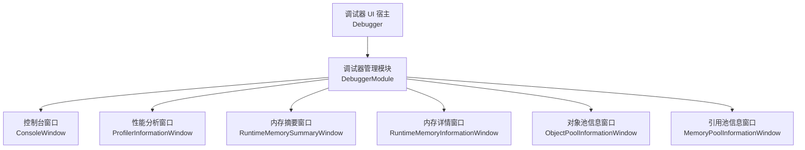
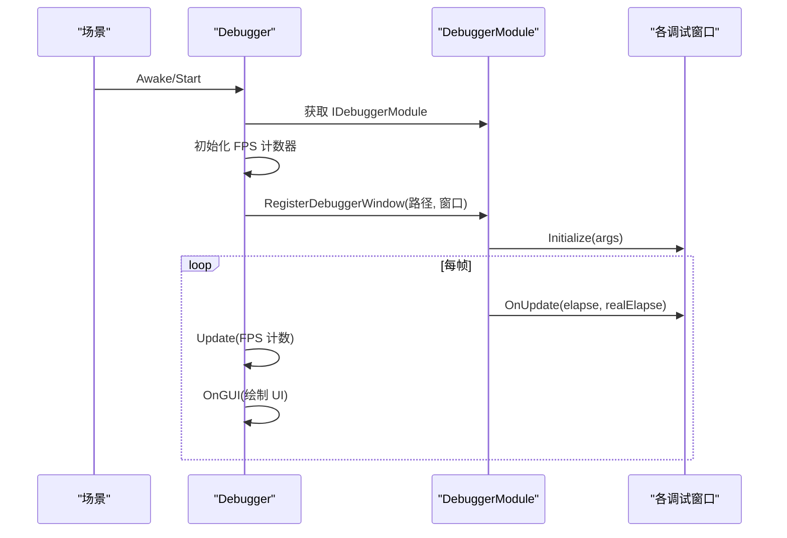
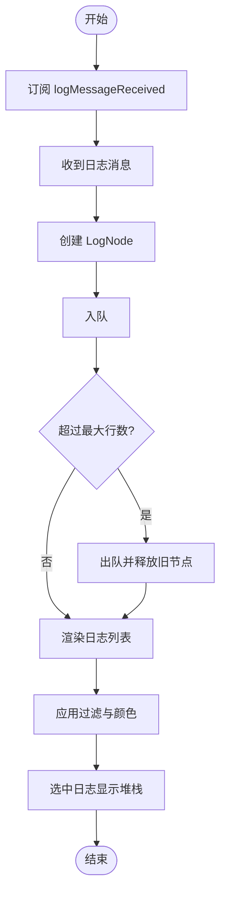
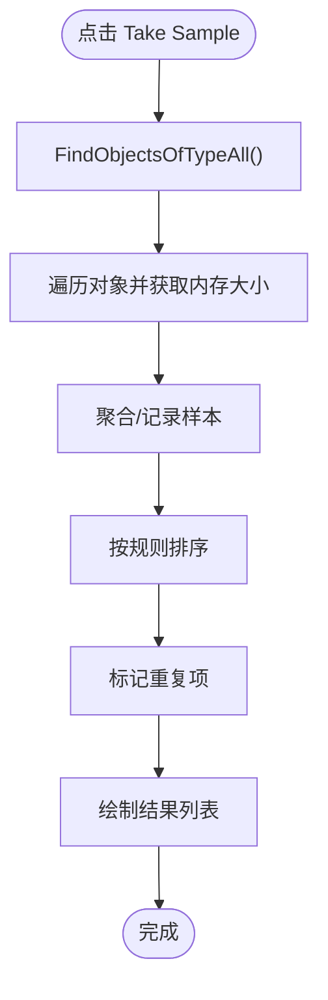
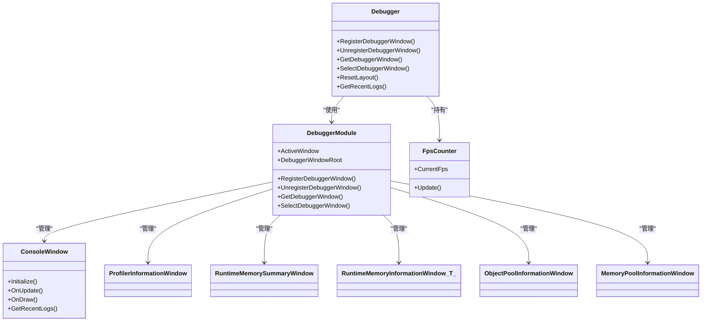

# 调试工具

<cite>
**本文引用的文件**   
- [Debugger.cs](file://UnityProject/Assets/TEngine/Runtime/Module/DebugerModule/Debugger.cs)
- [DebuggerModule.cs](file://UnityProject/Assets/TEngine/Runtime/Module/DebugerModule/DebuggerModule.cs)
- [DebuggerComponent.ConsoleWindow.cs](file://UnityProject/Assets/TEngine/Runtime/Module/DebugerModule/DebuggerComponent.ConsoleWindow.cs)
- [DebuggerComponent.FpsCounter.cs](file://UnityProject/Assets/TEngine/Runtime/Module/DebugerModule/DebuggerComponent.FpsCounter.cs)
- [DebuggerModule.LogNode.cs](file://UnityProject/Assets/TEngine/Runtime/Module/DebugerModule/Component/DebuggerModule.LogNode.cs)
- [DebuggerModule.ProfilerInformationWindow.cs](file://UnityProject/Assets/TEngine/Runtime/Module/DebugerModule/Component/DebuggerModule.ProfilerInformationWindow.cs)
- [DebuggerModule.RuntimeMemoryInformationWindow.cs](file://UnityProject/Assets/TEngine/Runtime/Module/DebugerModule/Component/DebuggerModule.RuntimeMemoryInformationWindow.cs)
- [DebuggerModule.RuntimeMemorySummaryWindow.cs](file://UnityProject/Assets/TEngine/Runtime/Module/DebugerModule/Component/DebuggerModule.RuntimeMemorySummaryWindow.cs)
- [DebuggerModule.ObjectPoolInformationWindow.cs](file://UnityProject/Assets/TEngine/Runtime/Module/DebugerModule/Component/DebuggerModule.ObjectPoolInformationWindow.cs)
- [DebuggerModule.MemoryPoolInformationWindow.cs](file://UnityProject/Assets/TEngine/Runtime/Module/DebugerModule/Component/DebuggerModule.MemoryPoolInformationWindow.cs)
</cite>

## 目录
1. [简介](#简介)
2. [项目结构](#项目结构)
3. [核心组件](#核心组件)
4. [架构总览](#架构总览)
5. [详细组件分析](#详细组件分析)
6. [依赖关系分析](#依赖关系分析)
7. [性能考量](#性能考量)
8. [故障排查指南](#故障排查指南)
9. [结论](#结论)
10. [附录](#附录)

## 简介
本文件面向 TEngine 的运行时调试工具，系统性介绍调试器模块的功能与使用方式，包括控制台日志、FPS 监控、内存分析、性能分析等调试面板；运行时信息查看（环境、图形、输入等）；以及调试器的定制化配置方法（自定义调试窗口、日志过滤、性能指标收集）。同时提供调试技巧与问题诊断方法，帮助开发者快速定位和解决游戏中的问题。

## 项目结构
调试器相关代码位于 UnityProject/Assets/TEngine/Runtime/Module/DebugerModule 目录下，核心由“调试器 UI 宿主”“调试器管理模块”“各类调试窗口”组成：
- 调试器 UI 宿主：负责绘制漂浮图标与完整窗口、注册/切换调试窗口、保存布局与缩放等。
- 调试器管理模块：维护调试窗口的树形分组、生命周期回调、更新轮询。
- 调试窗口：控制台、FPS、Profiler、内存统计、对象池/引用池、运行时信息等。

图表来源
- [Debugger.cs:148-235](file://UnityProject/Assets/TEngine/Runtime/Module/DebugerModule/Debugger.cs#L148-L235)
- [DebuggerModule.cs:16-53](file://UnityProject/Assets/TEngine/Runtime/Module/DebugerModule/DebuggerModule.cs#L16-L53)

章节来源
- [Debugger.cs:148-235](file://UnityProject/Assets/TEngine/Runtime/Module/DebugerModule/Debugger.cs#L148-L235)
- [DebuggerModule.cs:16-53](file://UnityProject/Assets/TEngine/Runtime/Module/DebugerModule/DebuggerModule.cs#L16-L53)

## 核心组件
- 调试器 UI 宿主（Debugger）
  - 负责加载并显示所有调试窗口，支持漂浮图标与完整窗口两种模式，记录窗口位置、大小、缩放比例到 PlayerPrefs。
  - 提供 RegisterDebuggerWindow/UnregisterDebuggerWindow/GetDebuggerWindow/SelectDebuggerWindow 等 API，用于扩展与访问调试窗口。
  - 内置 FPS 计数器，并在漂浮图标上实时显示当前帧率。
- 调试器管理模块（DebuggerModule）
  - 实现 IDebuggerModule，维护根节点 DebuggerWindowGroup，统一调度各窗口的 Initialize/OnUpdate/OnDraw/Shutdown。
  - 控制 ActiveWindow 开关，决定 UI 是否渲染与更新。
- 控制台窗口（ConsoleWindow）
  - 订阅 Application.logMessageReceived，按类型分类统计 Info/Warning/Error/Fatal，支持滚动锁定、多级别过滤、颜色定制、清空、复制堆栈等。
  - 通过 LogNode 缓存日志条目，限制最大行数，避免无限增长。
- FPS 计数器（FpsCounter）
  - 基于固定时间间隔统计帧数，输出 CurrentFps，供 UI 展示。
- 性能与内存分析窗口
  - ProfilerInformationWindow：展示 Profiler 能力与内存指标。
  - RuntimeMemorySummaryWindow：对运行时所有 UnityEngine.Object 进行采样，按类型聚合数量与占用。
  - RuntimeMemoryInformationWindow<T>：针对特定类型（Texture/Mesh/Material/Shader/AnimationClip/AudioClip/Font/TextAsset/ScriptableObject/Object）采样并按名称/类型/大小排序，标记重复项。
- 对象池与引用池信息窗口
  - ObjectPoolInformationWindow：展示对象池总数及各池实例的详细状态。
  - MemoryPoolInformationWindow：展示引用池全局状态与各程序集下的内存池使用情况。

章节来源
- [Debugger.cs:148-235](file://UnityProject/Assets/TEngine/Runtime/Module/DebugerModule/Debugger.cs#L148-L235)
- [DebuggerModule.cs:16-53](file://UnityProject/Assets/TEngine/Runtime/Module/DebugerModule/DebuggerModule.cs#L16-L53)
- [DebuggerComponent.ConsoleWindow.cs:125-179](file://UnityProject/Assets/TEngine/Runtime/Module/DebugerModule/DebuggerComponent.ConsoleWindow.cs#L125-L179)
- [DebuggerComponent.FpsCounter.cs:13-64](file://UnityProject/Assets/TEngine/Runtime/Module/DebugerModule/DebuggerComponent.FpsCounter.cs#L13-L64)
- [DebuggerModule.ProfilerInformationWindow.cs:10-57](file://UnityProject/Assets/TEngine/Runtime/Module/DebugerModule/Component/DebuggerModule.ProfilerInformationWindow.cs#L10-L57)
- [DebuggerModule.RuntimeMemorySummaryWindow.cs:20-102](file://UnityProject/Assets/TEngine/Runtime/Module/DebugerModule/Component/DebuggerModule.RuntimeMemorySummaryWindow.cs#L20-L102)
- [DebuggerModule.RuntimeMemoryInformationWindow.cs:23-114](file://UnityProject/Assets/TEngine/Runtime/Module/DebugerModule/Component/DebuggerModule.RuntimeMemoryInformationWindow.cs#L23-L114)
- [DebuggerModule.ObjectPoolInformationWindow.cs:12-35](file://UnityProject/Assets/TEngine/Runtime/Module/DebugerModule/Component/DebuggerModule.ObjectPoolInformationWindow.cs#L12-L35)
- [DebuggerModule.MemoryPoolInformationWindow.cs:20-78](file://UnityProject/Assets/TEngine/Runtime/Module/DebugerModule/Component/DebuggerModule.MemoryPoolInformationWindow.cs#L20-L78)

## 架构总览
调试器采用“UI 宿主 + 管理模块 + 可插拔窗口”的分层架构。Debugger 作为 MonoBehaviour 在场景中运行，启动时初始化 FPS 计数器并从 ModuleSystem 获取 IDebuggerModule，随后批量注册各类调试窗口。DebuggerModule 维护窗口树，统一分发生命周期回调与更新。

图表来源
- [Debugger.cs:148-235](file://UnityProject/Assets/TEngine/Runtime/Module/DebugerModule/Debugger.cs#L148-L235)
- [DebuggerModule.cs:45-53](file://UnityProject/Assets/TEngine/Runtime/Module/DebugerModule/DebuggerModule.cs#L45-L53)

## 详细组件分析

### 控制台日志（ConsoleWindow）
- 功能要点
  - 订阅 Application.logMessageReceived，将日志封装为 LogNode 入队，超过最大行数则释放最早条目。
  - 支持 Info/Warning/Error/Fatal 四类过滤与颜色定制，滚动锁定，清空日志，选择日志后展示堆栈并可复制到剪贴板。
  - 持久化用户设置（滚动锁定、过滤开关）到 PlayerPrefs。
- 关键流程
  - 接收日志 -> 创建 LogNode -> 入队 -> 超限清理 -> 刷新计数 -> 绘制列表与堆栈。

图表来源
- [DebuggerComponent.ConsoleWindow.cs:125-179](file://UnityProject/Assets/TEngine/Runtime/Module/DebugerModule/DebuggerComponent.ConsoleWindow.cs#L125-L179)
- [DebuggerComponent.ConsoleWindow.cs:182-278](file://UnityProject/Assets/TEngine/Runtime/Module/DebugerModule/DebuggerComponent.ConsoleWindow.cs#L182-L278)
- [DebuggerComponent.ConsoleWindow.cs:362-374](file://UnityProject/Assets/TEngine/Runtime/Module/DebugerModule/DebuggerComponent.ConsoleWindow.cs#L362-L374)

章节来源
- [DebuggerComponent.ConsoleWindow.cs:125-179](file://UnityProject/Assets/TEngine/Runtime/Module/DebugerModule/DebuggerComponent.ConsoleWindow.cs#L125-L179)
- [DebuggerComponent.ConsoleWindow.cs:182-278](file://UnityProject/Assets/TEngine/Runtime/Module/DebugerModule/DebuggerComponent.ConsoleWindow.cs#L182-L278)
- [DebuggerModule.LogNode.cs:11-115](file://UnityProject/Assets/TEngine/Runtime/Module/DebugerModule/Component/DebuggerModule.LogNode.cs#L11-L115)

### FPS 监控（FpsCounter）
- 功能要点
  - 以固定时间间隔统计帧数，计算平均帧率，暴露 CurrentFps。
  - 在 Debugger 的 Update 中调用，并在漂浮图标标题中显示。
- 复杂度
  - 时间复杂度 O(1)，空间复杂度 O(1)。

章节来源
- [DebuggerComponent.FpsCounter.cs:13-64](file://UnityProject/Assets/TEngine/Runtime/Module/DebugerModule/DebuggerComponent.FpsCounter.cs#L13-L64)
- [Debugger.cs:237-240](file://UnityProject/Assets/TEngine/Runtime/Module/DebugerModule/Debugger.cs#L237-L240)
- [Debugger.cs:391-419](file://UnityProject/Assets/TEngine/Runtime/Module/DebugerModule/Debugger.cs#L391-L419)

### 性能分析（ProfilerInformationWindow）
- 功能要点
  - 展示 Profiler.supported/enabled、二进制日志开关、分配调用栈开关、区域计数、Mono 内存、已用堆、总分配/保留/未保留内存、图形驱动分配、临时分配器等。
- 适用场景
  - 快速确认 Profiler 能力与当前采集状态，辅助定位内存异常或性能瓶颈。

章节来源
- [DebuggerModule.ProfilerInformationWindow.cs:10-57](file://UnityProject/Assets/TEngine/Runtime/Module/DebugerModule/Component/DebuggerModule.ProfilerInformationWindow.cs#L10-L57)

### 运行时内存分析（RuntimeMemorySummaryWindow / RuntimeMemoryInformationWindow<T>）
- 摘要窗口（RuntimeMemorySummaryWindow）
  - 遍历 Resources.FindObjectsOfTypeAll<UnityEngine.Object>，按类型聚合 Count 与 Size，支持采样按钮与结果排序。
- 详情窗口（RuntimeMemoryInformationWindow<T>）
  - 针对指定泛型类型 T 采样，列出每个实例的名称、类型、占用大小，按大小/类型/名称排序，标记重复项（同名同类型同大小）。
- 复杂度
  - 摘要：O(N log N) 排序，N 为对象数量。
  - 详情：O(M log M) 排序，M 为 T 类型对象数量。

图表来源
- [DebuggerModule.RuntimeMemorySummaryWindow.cs:61-102](file://UnityProject/Assets/TEngine/Runtime/Module/DebugerModule/Component/DebuggerModule.RuntimeMemorySummaryWindow.cs#L61-L102)
- [DebuggerModule.RuntimeMemoryInformationWindow.cs:82-114](file://UnityProject/Assets/TEngine/Runtime/Module/DebugerModule/Component/DebuggerModule.RuntimeMemoryInformationWindow.cs#L82-L114)

章节来源
- [DebuggerModule.RuntimeMemorySummaryWindow.cs:20-102](file://UnityProject/Assets/TEngine/Runtime/Module/DebugerModule/Component/DebuggerModule.RuntimeMemorySummaryWindow.cs#L20-L102)
- [DebuggerModule.RuntimeMemoryInformationWindow.cs:23-114](file://UnityProject/Assets/TEngine/Runtime/Module/DebugerModule/Component/DebuggerModule.RuntimeMemoryInformationWindow.cs#L23-L114)

### 对象池与引用池信息（ObjectPoolInformationWindow / MemoryPoolInformationWindow）
- 对象池信息窗口
  - 展示对象池总数，逐个展开各池实例的属性（名称、类型、自动释放间隔、容量、已用/可释放数量、过期时间、优先级），以及对象级信息（名称、锁定、占用、标志、优先级、最后使用时间）。
- 引用池信息窗口
  - 展示全局启用严格检查、引用池总数，按程序集分组展示各内存池的 Unused/Using/Acquire/Release/Add/Remove 计数，支持显示完整类名排序。

章节来源
- [DebuggerModule.ObjectPoolInformationWindow.cs:12-35](file://UnityProject/Assets/TEngine/Runtime/Module/DebugerModule/Component/DebuggerModule.ObjectPoolInformationWindow.cs#L12-L35)
- [DebuggerModule.ObjectPoolInformationWindow.cs:37-84](file://UnityProject/Assets/TEngine/Runtime/Module/DebugerModule/Component/DebuggerModule.ObjectPoolInformationWindow.cs#L37-L84)
- [DebuggerModule.MemoryPoolInformationWindow.cs:20-78](file://UnityProject/Assets/TEngine/Runtime/Module/DebugerModule/Component/DebuggerModule.MemoryPoolInformationWindow.cs#L20-L78)
- [DebuggerModule.MemoryPoolInformationWindow.cs:80-103](file://UnityProject/Assets/TEngine/Runtime/Module/DebugerModule/Component/DebuggerModule.MemoryPoolInformationWindow.cs#L80-L103)

### 运行时信息查看（环境与图形、输入等）
- 在 Debugger.Start 中注册了 Environment/Screen/Graphics/Input/* 等窗口，具体实现文件位于 Component 目录下（如 EnvironmentInformationWindow、GraphicsInformationWindow、InputSummaryInformationWindow 等）。这些窗口通过 Unity 运行时 API 读取系统、图形管线与输入设备状态，并以表格形式呈现。
- 使用建议
  - 在开发阶段开启对应窗口，观察平台差异、图形质量、输入事件频率与延迟等。

章节来源
- [Debugger.cs:183-215](file://UnityProject/Assets/TEngine/Runtime/Module/DebugerModule/Debugger.cs#L183-L215)

## 依赖关系分析
- Debugger 依赖 DebuggerModule 提供的窗口管理与更新机制。
- 控制台窗口依赖 LogNode 数据结构与 MemoryPool 进行对象复用。
- 内存分析窗口依赖 Unity Profiling API 与 Resources.FindObjectsOfTypeAll。
- 对象池/引用池窗口依赖框架内 IObjectPoolModule 与 MemoryPool 的全局统计接口。

图表来源
- [Debugger.cs:274-336](file://UnityProject/Assets/TEngine/Runtime/Module/DebugerModule/Debugger.cs#L274-L336)
- [DebuggerModule.cs:64-114](file://UnityProject/Assets/TEngine/Runtime/Module/DebugerModule/DebuggerModule.cs#L64-L114)

章节来源
- [Debugger.cs:274-336](file://UnityProject/Assets/TEngine/Runtime/Module/DebugerModule/Debugger.cs#L274-L336)
- [DebuggerModule.cs:64-114](file://UnityProject/Assets/TEngine/Runtime/Module/DebugerModule/DebuggerModule.cs#L64-L114)

## 性能考量
- 日志缓冲
  - 控制台窗口通过队列与最大行数限制控制内存增长，建议使用合理的 MaxLine，避免过多历史日志造成 GC 压力。
- 内存采样
  - 内存摘要与详情窗口会遍历对象图并调用 Profiler API，建议在需要时手动触发采样，避免频繁采样影响性能。
- UI 绘制
  - 大量对象列表绘制可能带来 GUI 开销，建议按需分页或限制显示条数（例如详情窗口默认只显示前若干条）。
- FPS 统计
  - FPS 计数器以固定间隔更新，避免每帧复杂计算，保持轻量。

[本节为通用指导，不直接分析具体文件]

## 故障排查指南
- 控制台无日志
  - 检查 Debugger.ActiveWindow 是否为真，确保 DebuggerModule 已初始化且未被禁用。
  - 检查 ConsoleWindow 的过滤开关是否关闭了对应级别。
- 内存采样结果为空
  - 确认已点击 Take Sample 按钮；若仍为空，检查是否存在目标对象或 Profiler 是否可用。
- 对象池/引用池数据异常
  - 检查 IObjectPoolModule 与 MemoryPool 是否被正确初始化；确认对象是否正确归还与释放。
- 窗口布局错乱
  - 使用 ResetLayout 恢复默认布局；检查 PlayerPrefs 中的 Debugger.* 键值是否损坏。

章节来源
- [Debugger.cs:148-181](file://UnityProject/Assets/TEngine/Runtime/Module/DebugerModule/Debugger.cs#L148-L181)
- [Debugger.cs:312-317](file://UnityProject/Assets/TEngine/Runtime/Module/DebugerModule/Debugger.cs#L312-L317)
- [DebuggerComponent.ConsoleWindow.cs:125-179](file://UnityProject/Assets/TEngine/Runtime/Module/DebugerModule/DebuggerComponent.ConsoleWindow.cs#L125-L179)

## 结论
TEngine 调试工具提供了完善的运行时观测能力：控制台日志、FPS 监控、Profiler 与内存分析、对象池/引用池可视化，以及环境与图形、输入等运行时信息窗口。通过模块化设计，开发者可以便捷地扩展自定义调试窗口、调整日志过滤策略与性能指标采集，从而高效定位与解决问题。

[本节为总结性内容，不直接分析具体文件]

## 附录
- 常用 API 速查
  - 注册/注销调试窗口：Debugger.RegisterDebuggerWindow / UnregisterDebuggerWindow
  - 获取/选中调试窗口：Debugger.GetDebuggerWindow / SelectDebuggerWindow
  - 获取最近日志：Debugger.GetRecentLogs
  - 重置布局：Debugger.ResetLayout
- 最佳实践
  - 仅在开发构建中启用调试器，或在发布构建中按需开启关键面板。
  - 合理设置控制台最大行数与过滤条件，减少无用日志干扰。
  - 定期执行内存采样，关注重复对象与高占用类型，结合 Profiler 深入分析。

[本节为补充说明，不直接分析具体文件]