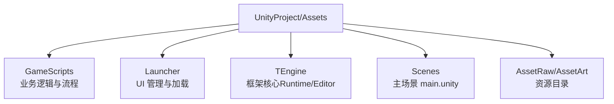
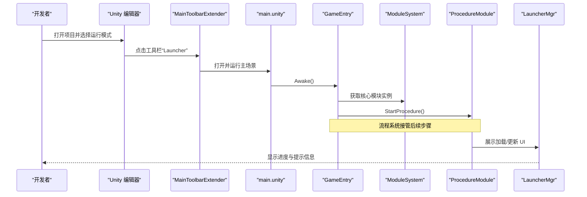
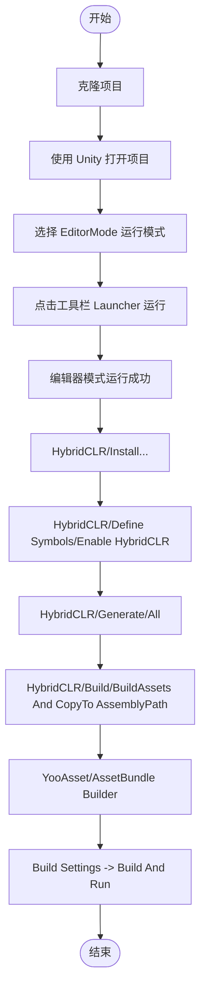
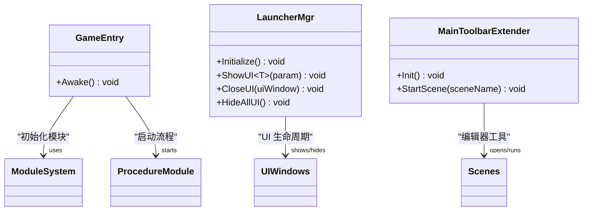

# 快速开始

<cite>
**本文引用的文件**   
- [README.md](file://README.md)
- [Books/1-快速开始.md](file://Books/1-快速开始.md)
- [UnityProject/Assets/GameScripts/GameEntry.cs](file://UnityProject/Assets/GameScripts/GameEntry.cs)
- [UnityProject/Assets/Launcher/Scripts/LauncherMgr.cs](file://UnityProject/Assets/Launcher/Scripts/LauncherMgr.cs)
- [UnityProject/Assets/Editor/ToolbarExtender/Unity6000_OR_New/MainToolbarExtender.cs](file://UnityProject/Assets/Editor/ToolbarExtender/Unity6000_OR_New/MainToolbarExtender.cs)
</cite>

## 目录
1. [简介](#简介)
2. [项目结构](#项目结构)
3. [核心组件](#核心组件)
4. [架构总览](#架构总览)
5. [详细组件分析](#详细组件分析)
6. [依赖关系分析](#依赖关系分析)
7. [性能注意事项](#性能注意事项)
8. [故障排除指南](#故障排除指南)
9. [结论](#结论)
10. [附录](#附录)

## 简介
本指南面向首次接触 TEngine 的开发者，目标是让你在 5 分钟内成功运行 Demo 项目。内容涵盖：
- 环境要求与依赖项安装
- 克隆与打开项目
- 编辑器模式运行与打包运行（含 HybridCLR 热更新配置）
- 第一个 Hello World 示例（基于框架流程模块的最小可运行入口）
- 常见问题与排错建议

## 项目结构
TEngine 采用“框架 + 业务”的分层组织方式，核心框架位于 UnityProject/Assets/TEngine，业务逻辑位于 UnityProject/Assets/GameScripts，启动器与 UI 管理位于 UnityProject/Assets/Launcher。

图示来源
- [README.md:173-201](file://README.md#L173-L201)

章节来源
- [README.md:173-201](file://README.md#L173-L201)

## 核心组件
- GameEntry：游戏入口，负责初始化核心模块并启动流程系统。
- LauncherMgr：启动器 UI 管理，提供窗口显示、关闭与进度提示等能力。
- MainToolbarExtender：编辑器工具栏扩展，提供一键启动场景与切换运行模式的便捷入口。

章节来源
- [UnityProject/Assets/GameScripts/GameEntry.cs:1-15](file://UnityProject/Assets/GameScripts/GameEntry.cs#L1-L15)
- [UnityProject/Assets/Launcher/Scripts/LauncherMgr.cs:1-135](file://UnityProject/Assets/Launcher/Scripts/LauncherMgr.cs#L1-L135)
- [UnityProject/Assets/Editor/ToolbarExtender/Unity6000_OR_New/MainToolbarExtender.cs:1-382](file://UnityProject/Assets/Editor/ToolbarExtender/Unity6000_OR_New/MainToolbarExtender.cs#L1-L382)

## 架构总览
下图展示了从编辑器点击“Launcher”到游戏流程启动的主路径，以及运行时 UI 管理的交互关系。

图示来源
- [UnityProject/Assets/Editor/ToolbarExtender/Unity6000_OR_New/MainToolbarExtender.cs:22-41](file://UnityProject/Assets/Editor/ToolbarExtender/Unity6000_OR_New/MainToolbarExtender.cs#L22-L41)
- [UnityProject/Assets/GameScripts/GameEntry.cs:6-14](file://UnityProject/Assets/GameScripts/GameEntry.cs#L6-L14)
- [UnityProject/Assets/Launcher/Scripts/LauncherMgr.cs:18-66](file://UnityProject/Assets/Launcher/Scripts/LauncherMgr.cs#L18-L66)

## 详细组件分析

### 环境与依赖
- Unity 版本
  - 推荐：2021.3.20f1c1
  - 支持：2019.4 / 2020.3 / 2021.3 / 2022.3
- 开发环境
  - .NET 4.x
  - Visual Studio 2019+ 或 Rider
- 平台支持
  - Windows、macOS、Android、iOS、WebGL、微信小游戏

章节来源
- [README.md:52-84](file://README.md#L52-L84)
- [Books/1-快速开始.md:25-32](file://Books/1-快速开始.md#L25-L32)

### 安装与环境配置
1. 克隆项目
   - 使用 Git 将仓库克隆至本地。
2. 打开项目
   - 使用推荐的 Unity 版本打开 UnityProject。
3. 编辑器模式运行
   - 在顶部工具栏选择“EditorMode (编辑器下的模拟模式)”。
   - 点击工具栏“Launcher”按钮，即可运行主场景。
4. 打包运行（含 HybridCLR 热更新）
   - 依次执行以下菜单命令：
     - HybridCLR/Install...
     - HybridCLR/Define Symbols/Enable HybridCLR
     - HybridCLR/Generate/All
     - HybridCLR/Build/BuildAssets And CopyTo AssemblyPath
     - YooAsset/AssetBundle Builder
   - 打开 Build Settings，点击 Build And Run。

章节来源
- [README.md:52-84](file://README.md#L52-L84)
- [Books/1-快速开始.md:15-23](file://Books/1-快速开始.md#L15-L23)

### 第一个 Hello World 示例
目标：在不修改任何代码的情况下，通过框架内置流程与 UI 管理，完成一次最小化的“Hello World”体验。

步骤：
1. 使用推荐 Unity 版本打开项目。
2. 在顶部工具栏选择“EditorMode (编辑器下的模拟模式)”。
3. 点击工具栏“Launcher”按钮，运行主场景。
4. 观察启动流程：
   - GameEntry 初始化核心模块并启动流程系统。
   - 流程系统驱动后续步骤（如资源初始化、下载、装配加载等）。
   - LauncherMgr 负责展示加载与更新相关的 UI。

说明：
- 该示例不要求你编写任何代码，仅演示如何借助框架的流程与 UI 管理能力运行一个完整的最小闭环。
- 若需自定义“Hello World”，可在流程系统中添加自定义步骤或在 UI 层增加简单文本面板。

章节来源
- [UnityProject/Assets/GameScripts/GameEntry.cs:6-14](file://UnityProject/Assets/GameScripts/GameEntry.cs#L6-L14)
- [UnityProject/Assets/Launcher/Scripts/LauncherMgr.cs:18-66](file://UnityProject/Assets/Launcher/Scripts/LauncherMgr.cs#L18-L66)
- [UnityProject/Assets/Editor/ToolbarExtender/Unity6000_OR_New/MainToolbarExtender.cs:22-41](file://UnityProject/Assets/Editor/ToolbarExtender/Unity6000_OR_New/MainToolbarExtender.cs#L22-L41)

### 编辑器模式运行与打包运行流程图

图示来源
- [README.md:52-84](file://README.md#L52-L84)
- [Books/1-快速开始.md:15-23](file://Books/1-快速开始.md#L15-L23)

## 依赖关系分析
- GameEntry 依赖 ModuleSystem 与流程系统，用于初始化与启动。
- LauncherMgr 依赖 UI 资源与生命周期回调，用于展示与隐藏窗口。
- MainToolbarExtender 依赖 Unity 编辑器 API，用于一键启动场景与切换运行模式。

图示来源
- [UnityProject/Assets/GameScripts/GameEntry.cs:6-14](file://UnityProject/Assets/GameScripts/GameEntry.cs#L6-L14)
- [UnityProject/Assets/Launcher/Scripts/LauncherMgr.cs:18-131](file://UnityProject/Assets/Launcher/Scripts/LauncherMgr.cs#L18-L131)
- [UnityProject/Assets/Editor/ToolbarExtender/Unity6000_OR_New/MainToolbarExtender.cs:22-41](file://UnityProject/Assets/Editor/ToolbarExtender/Unity6000_OR_New/MainToolbarExtender.cs#L22-L41)

章节来源
- [UnityProject/Assets/GameScripts/GameEntry.cs:1-15](file://UnityProject/Assets/GameScripts/GameEntry.cs#L1-L15)
- [UnityProject/Assets/Launcher/Scripts/LauncherMgr.cs:1-135](file://UnityProject/Assets/Launcher/Scripts/LauncherMgr.cs#L1-L135)
- [UnityProject/Assets/Editor/ToolbarExtender/Unity6000_OR_New/MainToolbarExtender.cs:1-382](file://UnityProject/Assets/Editor/ToolbarExtender/Unity6000_OR_New/MainToolbarExtender.cs#L1-L382)

## 性能注意事项
- 使用 UniTask 异步系统与零 GC 事件分发，避免频繁分配内存。
- 资源管理基于 YooAsset，启用 LRU/ARC 缓存策略，自动释放资源。
- 建议在流程中按需加载资源，避免一次性加载过多数据。

[本节为通用指导，不直接分析具体文件]

## 故障排除指南
- 无法找到 UIRoot 节点
  - 现象：控制台输出找不到 UIRoot 节点的错误日志。
  - 处理：检查资源路径或 Hierarchy 中的游戏对象是否存在。
- 找不到场景文件
  - 现象：编辑器工具栏尝试打开场景时报错。
  - 处理：确认场景文件存在且名称匹配；必要时重新导入或修复引用。
- 构建失败或热更新异常
  - 现象：HybridCLR 或 YooAsset 相关构建报错。
  - 处理：参考 HybridCLR 常见错误文档进行排查；确保已按顺序执行所有生成与构建步骤。

章节来源
- [UnityProject/Assets/Launcher/Scripts/LauncherMgr.cs:18-29](file://UnityProject/Assets/Launcher/Scripts/LauncherMgr.cs#L18-L29)
- [UnityProject/Assets/Editor/ToolbarExtender/Unity6000_OR_New/MainToolbarExtender.cs:117-144](file://UnityProject/Assets/Editor/ToolbarExtender/Unity6000_OR_New/MainToolbarExtender.cs#L117-L144)
- [README.md:75-84](file://README.md#L75-L84)

## 结论
通过本指南，你可以在 5 分钟内完成 TEngine 的环境搭建、项目打开与运行，并理解编辑器模式与打包运行的关键步骤。结合框架的流程系统与 UI 管理，你可以快速扩展自己的“Hello World”示例，并逐步接入更复杂的业务逻辑。

[本节为总结性内容，不直接分析具体文件]

## 附录
- 各平台运行截图与更多示例请参考官方文档与社区资源。
- 服务器端可选方案与生态推荐见 README 的“服务器支持”与“开源项目推荐”部分。

[本节为补充信息，不直接分析具体文件]