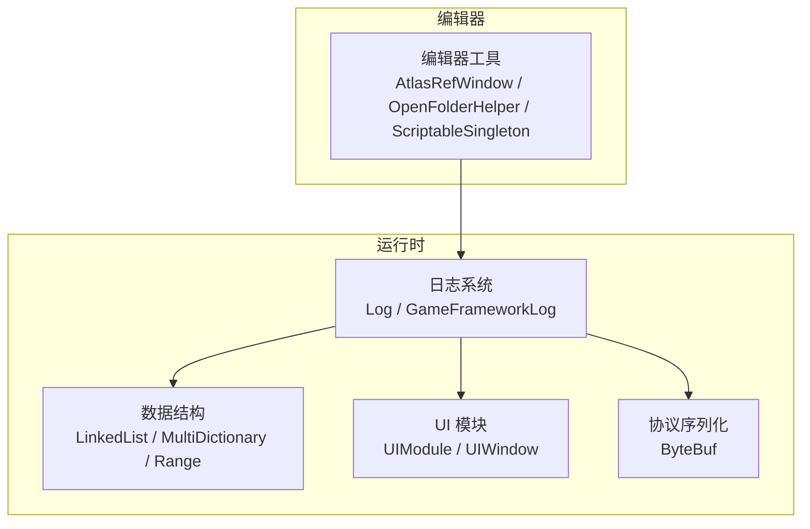
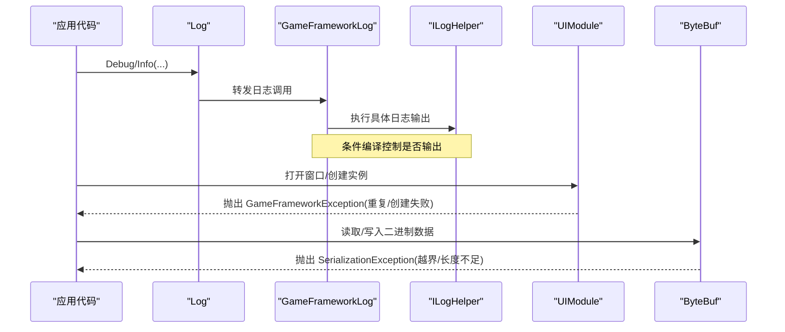
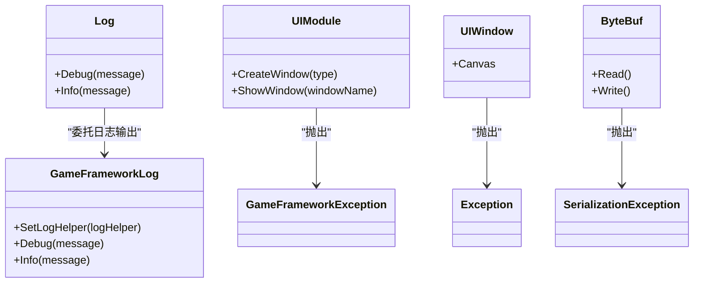

# 常见错误对照表

<cite>
**本文引用的文件**   
- [README.md](file://README.md)
- [FAQ.md](file://Books/FAQ.md)
- [Log.cs](file://UnityProject/Assets/TEngine/Runtime/Core/Log/Log.cs)
- [GameFrameworkLog.cs](file://UnityProject/Assets/TEngine/Runtime/Core/Log/GameFrameworkLog.cs)
- [UIModule.cs](file://UnityProject/Assets/GameScripts/HotFix/GameLogic/Module/UIModule/UIModule.cs)
- [UIWindow.cs](file://UnityProject/Assets/GameScripts/HotFix/GameLogic/Module/UIModule/UIWindow.cs)
- [ByteBuf.cs](file://UnityProject/Assets/GameScripts/HotFix/GameProto/LubanLib/ByteBuf.cs)
- [GameFrameworkException.cs](file://UnityProject/Assets/TEngine/Runtime/Core/Utility/GameFrameworkException.cs)
- [GameFrameworkLinkedList.cs](file://UnityProject/Assets/TEngine/Runtime/Core/DataStruct/GameFrameworkLinkedList.cs)
- [GameFrameworkLinkedListRange.cs](file://UnityProject/Assets/TEngine/Runtime/Core/DataStruct/GameFrameworkLinkedListRange.cs)
- [GameFrameworkMultiDictionary.cs](file://UnityProject/Assets/TEngine/Runtime/Core/DataStruct/GameFrameworkMultiDictionary.cs)
- [TypeNamePair.cs](file://UnityProject/Assets/TEngine/Runtime/Core/DataStruct/TypeNamePair.cs)
- [EditorScriptableSingleton.cs](file://UnityProject/Assets/TEngine/Editor/Utility/EditorScriptableSingleton.cs)
- [OpenFolderHelper.cs](file://UnityProject/Assets/TEngine/Editor/Utility/OpenFolderHelper.cs)
- [AtlasRefWindow.cs](file://UnityProject/Assets/Editor/AtlasRefWindow/AtlasRefWindow.cs)
</cite>

## 目录
1. [简介](#简介)
2. [项目结构](#项目结构)
3. [核心组件](#核心组件)
4. [架构总览](#架构总览)
5. [详细组件分析](#详细组件分析)
6. [依赖关系分析](#依赖关系分析)
7. [性能注意事项](#性能注意事项)
8. [故障排查指南](#故障排查指南)
9. [结论](#结论)
10. [附录](#附录)

## 简介
本文件为 TEngine 框架的“常见错误对照表”，聚焦开发过程中常见的编译错误、运行时异常、模块初始化失败与配置错误，按错误类型分类整理。每个条目包含：错误现象、原因分析、影响范围、解决步骤与预防措施，并附带快速索引与关联文档链接，帮助开发者快速定位与解决问题。

## 项目结构
TEngine 在 Unity 工程中以模块化方式组织，核心运行时位于 Assets/TEngine/Runtime，业务逻辑位于 Assets/GameScripts/HotFix，编辑器工具位于 Assets/Editor 与 Assets/TEngine/Editor。日志系统贯穿各模块，用于统一输出调试、信息与错误日志。

图表来源
- [Log.cs:1-800](file://UnityProject/Assets/TEngine/Runtime/Core/Log/Log.cs#L1-L800)
- [GameFrameworkLog.cs:1-800](file://UnityProject/Assets/TEngine/Runtime/Core/Log/GameFrameworkLog.cs#L1-L800)
- [UIModule.cs:520-680](file://UnityProject/Assets/GameScripts/HotFix/GameLogic/Module/UIModule/UIModule.cs#L520-L680)
- [ByteBuf.cs:18-18](file://UnityProject/Assets/GameScripts/HotFix/GameProto/LubanLib/ByteBuf.cs#L18-L18)
- [AtlasRefWindow.cs:280-640](file://UnityProject/Assets/Editor/AtlasRefWindow/AtlasRefWindow.cs#L280-L640)

章节来源
- [README.md:1-334](file://README.md#L1-L334)

## 核心组件
- 日志系统：提供 Debug/Info 等分级日志输出，支持条件编译开关，便于生产环境裁剪日志开销。
- UI 模块：负责窗口生命周期管理、实例创建与重复打开保护。
- 协议序列化：基于 ByteBuf 的二进制读写，抛出 SerializationException 以提示数据越界或长度不足。
- 数据结构：链表、多字典、范围校验等基础容器，对非法状态抛出 GameFrameworkException。
- 编辑器工具：图集窗口、路径校验、平台相关操作封装，抛出 ArgumentException/InvalidOperationException 等。

章节来源
- [Log.cs:1-800](file://UnityProject/Assets/TEngine/Runtime/Core/Log/Log.cs#L1-L800)
- [GameFrameworkLog.cs:1-800](file://UnityProject/Assets/TEngine/Runtime/Core/Log/GameFrameworkLog.cs#L1-L800)
- [UIModule.cs:520-680](file://UnityProject/Assets/GameScripts/HotFix/GameLogic/Module/UIModule/UIModule.cs#L520-L680)
- [ByteBuf.cs:18-18](file://UnityProject/Assets/GameScripts/HotFix/GameProto/LubanLib/ByteBuf.cs#L18-L18)
- [GameFrameworkLinkedList.cs:250-360](file://UnityProject/Assets/TEngine/Runtime/Core/DataStruct/GameFrameworkLinkedList.cs#L250-L360)
- [GameFrameworkLinkedListRange.cs:20-130](file://UnityProject/Assets/TEngine/Runtime/Core/DataStruct/GameFrameworkLinkedListRange.cs#L20-L130)
- [GameFrameworkMultiDictionary.cs:200-220](file://UnityProject/Assets/TEngine/Runtime/Core/DataStruct/GameFrameworkMultiDictionary.cs#L200-L220)
- [TypeNamePair.cs:30-60](file://UnityProject/Assets/TEngine/Runtime/Core/DataStruct/TypeNamePair.cs#L30-L60)
- [EditorScriptableSingleton.cs:80-100](file://UnityProject/Assets/TEngine/Editor/Utility/EditorScriptableSingleton.cs#L80-L100)
- [OpenFolderHelper.cs:70-85](file://UnityProject/Assets/TEngine/Editor/Utility/OpenFolderHelper.cs#L70-L85)
- [AtlasRefWindow.cs:280-640](file://UnityProject/Assets/Editor/AtlasRefWindow/AtlasRefWindow.cs#L280-L640)

## 架构总览
下图展示日志系统在 TEngine 中的调用链与异常传播路径，以及 UI 模块与协议序列化的关键交互点。

图表来源
- [Log.cs:1-800](file://UnityProject/Assets/TEngine/Runtime/Core/Log/Log.cs#L1-L800)
- [GameFrameworkLog.cs:1-800](file://UnityProject/Assets/TEngine/Runtime/Core/Log/GameFrameworkLog.cs#L1-L800)
- [UIModule.cs:520-680](file://UnityProject/Assets/GameScripts/HotFix/GameLogic/Module/UIModule/UIModule.cs#L520-L680)
- [ByteBuf.cs:18-18](file://UnityProject/Assets/GameScripts/HotFix/GameProto/LubanLib/ByteBuf.cs#L18-L18)

## 详细组件分析

### 一、编译错误（编辑器与构建阶段）
- 现象
  - 编辑器脚本抛 ArgumentOutOfRangeException、ArgumentException、InvalidOperationException 等。
  - 路径为空或不合法导致编辑器工具报错。
- 原因分析
  - 图集窗口参数校验失败（索引越界、类型不匹配）。
  - 编辑器单例相对路径为空或未正确设置。
  - 非目标平台调用平台相关功能。
- 影响范围
  - 编辑器工具不可用；构建流程中断。
- 解决步骤
  - 检查图集窗口输入参数与类型选择是否正确。
  - 确保编辑器配置中相对路径有效且存在。
  - 避免在非目标平台调用平台相关 API。
- 预防措施
  - 在编辑器入口增加参数合法性校验。
  - 使用统一的配置校验工具集中处理路径与平台限制。

章节来源
- [AtlasRefWindow.cs:280-640](file://UnityProject/Assets/Editor/AtlasRefWindow/AtlasRefWindow.cs#L280-L640)
- [EditorScriptableSingleton.cs:80-100](file://UnityProject/Assets/TEngine/Editor/Utility/EditorScriptableSingleton.cs#L80-L100)
- [OpenFolderHelper.cs:70-85](file://UnityProject/Assets/TEngine/Editor/Utility/OpenFolderHelper.cs#L70-L85)

### 二、运行时异常（UI 模块）
- 现象
  - 窗口创建失败或重复打开时报错。
  - 面板缺少 Canvas 组件导致崩溃。
- 原因分析
  - 窗口类型未注册或构造失败。
  - 重复打开同名窗口未做幂等处理。
  - 预制体结构不符合预期（缺少 Canvas）。
- 影响范围
  - UI 层无法显示；业务流程中断。
- 解决步骤
  - 确认窗口类型已正确注册。
  - 避免重复打开同一窗口，或在打开前进行存在性检查。
  - 检查窗口预制体结构，确保包含 Canvas。
- 预防措施
  - 在 UIModule 中统一捕获并包装异常，提供更明确的错误信息。
  - 在加载窗口前进行结构校验。

章节来源
- [UIModule.cs:520-680](file://UnityProject/Assets/GameScripts/HotFix/GameLogic/Module/UIModule/UIModule.cs#L520-L680)
- [UIWindow.cs:480-490](file://UnityProject/Assets/GameScripts/HotFix/GameLogic/Module/UIModule/UIWindow.cs#L480-L490)

### 三、运行时异常（协议序列化）
- 现象
  - 二进制读写时抛出 SerializationException，提示超出最大段大小、超出最大尺寸或段数据不足。
- 原因分析
  - 数据长度与协议定义不一致。
  - 网络分包或粘包处理不当。
  - 反序列化顺序与序列化顺序不一致。
- 影响范围
  - 协议解析失败；可能导致游戏逻辑错误或崩溃。
- 解决步骤
  - 核对协议定义与实际数据包长度。
  - 检查分包/粘包逻辑，确保边界正确。
  - 统一序列化/反序列化顺序。
- 预防措施
  - 在发送端增加长度校验与签名校验。
  - 在接收端增加数据完整性校验与异常恢复机制。

章节来源
- [ByteBuf.cs:18-18](file://UnityProject/Assets/GameScripts/HotFix/GameProto/LubanLib/ByteBuf.cs#L18-L18)

### 四、运行时异常（数据结构）
- 现象
  - 链表访问 First/Last 或遍历时报 GameFrameworkException。
  - 范围对象无效或多字典状态异常。
  - 类型对 Type 无效。
- 原因分析
  - 空集合访问首尾元素。
  - 范围越界或区间非法。
  - 字典内部状态被破坏。
  - 类型未正确赋值或为空。
- 影响范围
  - 数据访问失败；可能引发后续逻辑错误。
- 解决步骤
  - 在访问前检查集合是否为空。
  - 校验范围上下界与区间合法性。
  - 修复多字典的插入/删除逻辑，保证一致性。
  - 确保 TypeNamePair 的 Type 字段正确赋值。
- 预防措施
  - 在公共 API 入口处增加前置条件校验。
  - 对关键数据结构增加单元测试覆盖。

章节来源
- [GameFrameworkLinkedList.cs:250-360](file://UnityProject/Assets/TEngine/Runtime/Core/DataStruct/GameFrameworkLinkedList.cs#L250-L360)
- [GameFrameworkLinkedListRange.cs:20-130](file://UnityProject/Assets/TEngine/Runtime/Core/DataStruct/GameFrameworkLinkedListRange.cs#L20-L130)
- [GameFrameworkMultiDictionary.cs:200-220](file://UnityProject/Assets/TEngine/Runtime/Core/DataStruct/GameFrameworkMultiDictionary.cs#L200-L220)
- [TypeNamePair.cs:30-60](file://UnityProject/Assets/TEngine/Runtime/Core/DataStruct/TypeNamePair.cs#L30-L60)

### 五、模块初始化失败（日志系统）
- 现象
  - 日志无输出或输出异常。
- 原因分析
  - ILogHelper 未设置或为空。
  - 条件编译未启用相应日志级别。
- 影响范围
  - 调试困难；问题难以复现。
- 解决步骤
  - 在应用启动时设置有效的 ILogHelper。
  - 根据需求启用 ENABLE_LOG/ENABLE_DEBUG_LOG/ENABLE_INFO_LOG 等宏。
- 预防措施
  - 在框架初始化阶段强制校验日志辅助器是否就绪。
  - 提供默认实现以避免空引用。

章节来源
- [GameFrameworkLog.cs:1-800](file://UnityProject/Assets/TEngine/Runtime/Core/Log/GameFrameworkLog.cs#L1-L800)
- [Log.cs:1-800](file://UnityProject/Assets/TEngine/Runtime/Core/Log/Log.cs#L1-L800)

### 六、配置错误（编辑器与资源）
- 现象
  - 图集输出目录或 UI Prefab 目录无效。
  - 保存预制体时出错。
- 原因分析
  - 编辑器配置路径为空或不存在。
  - 权限或路径格式不正确。
- 影响范围
  - 图集生成失败；UI 资源缺失。
- 解决步骤
  - 检查编辑器配置中的路径设置。
  - 确保目录存在且具有写入权限。
  - 修正预制体保存时的路径与命名规则。
- 预防措施
  - 在编辑器工具中增加路径有效性校验与自动创建目录。
  - 提供友好的错误提示与回退策略。

章节来源
- [AtlasRefWindow.cs:580-640](file://UnityProject/Assets/Editor/AtlasRefWindow/AtlasRefWindow.cs#L580-L640)

## 依赖关系分析
- 日志系统作为基础设施，被 UI 模块、协议序列化与编辑器工具广泛依赖。
- UI 模块依赖 Unity 场景对象（Canvas），并在实例化与生命周期管理中抛出 GameFrameworkException。
- 协议序列化依赖 ByteBuf，对数据边界敏感，需严格校验。
- 数据结构为上层模块提供稳定容器能力，但需要调用方保证前置条件。

图表来源
- [Log.cs:1-800](file://UnityProject/Assets/TEngine/Runtime/Core/Log/Log.cs#L1-L800)
- [GameFrameworkLog.cs:1-800](file://UnityProject/Assets/TEngine/Runtime/Core/Log/GameFrameworkLog.cs#L1-L800)
- [UIModule.cs:520-680](file://UnityProject/Assets/GameScripts/HotFix/GameLogic/Module/UIModule/UIModule.cs#L520-L680)
- [UIWindow.cs:480-490](file://UnityProject/Assets/GameScripts/HotFix/GameLogic/Module/UIModule/UIWindow.cs#L480-L490)
- [ByteBuf.cs:18-18](file://UnityProject/Assets/GameScripts/HotFix/GameProto/LubanLib/ByteBuf.cs#L18-L18)
- [GameFrameworkException.cs:10-10](file://UnityProject/Assets/TEngine/Runtime/Core/Utility/GameFrameworkException.cs#L10-L10)

## 性能注意事项
- 日志输出在高频率调用下会产生额外开销，建议在生产环境关闭非必要日志级别。
- 协议序列化应避免频繁分配临时对象，尽量复用缓冲区。
- UI 窗口创建与销毁应遵循池化策略，减少 GC 压力。
- 数据结构访问前应进行 O(1) 前置校验，避免不必要的异常分支。

[本节为通用指导，无需列出具体文件来源]

## 故障排查指南
- 快速搜索关键词
  - “所有指定目标目录均无效”
  - “SerializationException”
  - “GameFrameworkException”
  - “Canvas 未找到”
  - “路径不能为空”
- 常见问题定位
  - 若出现“所有指定目标目录均无效”，优先检查编辑器配置中的路径设置与权限。
  - 若出现“SerializationException”，检查协议定义与数据包长度一致性。
  - 若出现“GameFrameworkException”，检查 UI 窗口注册与重复打开逻辑。
  - 若出现“Canvas 未找到”，检查窗口预制体结构。
  - 若出现“路径不能为空”，检查编辑器单例配置与路径校验逻辑。
- 关联文档
  - 常见问题 FAQ：[FAQ.md](file://Books/FAQ.md)
  - 快速开始与环境要求：[README.md](file://README.md)

章节来源
- [FAQ.md:1-15](file://Books/FAQ.md#L1-L15)
- [README.md:50-90](file://README.md#L50-L90)

## 结论
通过对 TEngine 框架中日志系统、UI 模块、协议序列化与数据结构等核心组件的错误模式进行分析，本文提供了按类别组织的错误对照表与解决方案。建议团队在开发过程中遵循本文的预防措施，结合日志系统与单元测试，尽早发现并修复潜在问题，提升稳定性与可维护性。

[本节为总结性内容，无需列出具体文件来源]

## 附录
- 错误代码索引（按异常类型）
  - ArgumentOutOfRangeException：编辑器图集窗口参数校验失败
  - ArgumentException：编辑器路径为空或不合法
  - InvalidOperationException：编辑器工具内部状态异常
  - GameFrameworkException：UI 模块与数据结构非法状态
  - SerializationException：协议序列化数据越界或长度不足
  - Exception：UI 面板缺少 Canvas 等结构性错误

章节来源
- [AtlasRefWindow.cs:280-640](file://UnityProject/Assets/Editor/AtlasRefWindow/AtlasRefWindow.cs#L280-L640)
- [EditorScriptableSingleton.cs:80-100](file://UnityProject/Assets/TEngine/Editor/Utility/EditorScriptableSingleton.cs#L80-L100)
- [OpenFolderHelper.cs:70-85](file://UnityProject/Assets/TEngine/Editor/Utility/OpenFolderHelper.cs#L70-L85)
- [UIModule.cs:520-680](file://UnityProject/Assets/GameScripts/HotFix/GameLogic/Module/UIModule/UIModule.cs#L520-L680)
- [UIWindow.cs:480-490](file://UnityProject/Assets/GameScripts/HotFix/GameLogic/Module/UIModule/UIWindow.cs#L480-L490)
- [ByteBuf.cs:18-18](file://UnityProject/Assets/GameScripts/HotFix/GameProto/LubanLib/ByteBuf.cs#L18-L18)
- [GameFrameworkLinkedList.cs:250-360](file://UnityProject/Assets/TEngine/Runtime/Core/DataStruct/GameFrameworkLinkedList.cs#L250-L360)
- [GameFrameworkLinkedListRange.cs:20-130](file://UnityProject/Assets/TEngine/Runtime/Core/DataStruct/GameFrameworkLinkedListRange.cs#L20-L130)
- [GameFrameworkMultiDictionary.cs:200-220](file://UnityProject/Assets/TEngine/Runtime/Core/DataStruct/GameFrameworkMultiDictionary.cs#L200-L220)
- [TypeNamePair.cs:30-60](file://UnityProject/Assets/TEngine/Runtime/Core/DataStruct/TypeNamePair.cs#L30-L60)