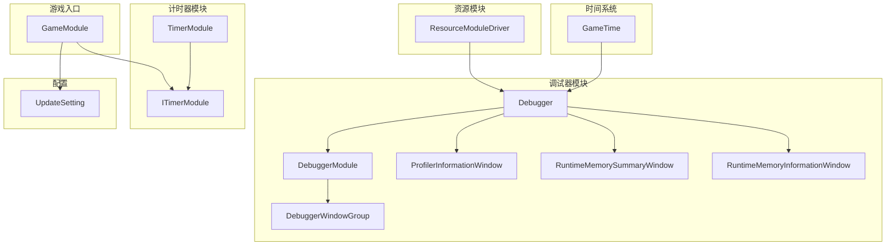
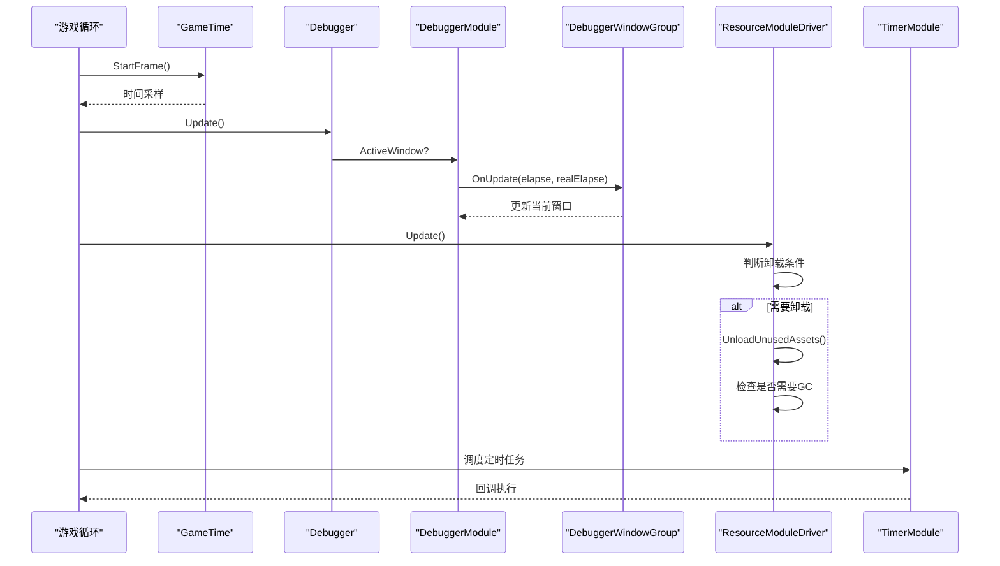
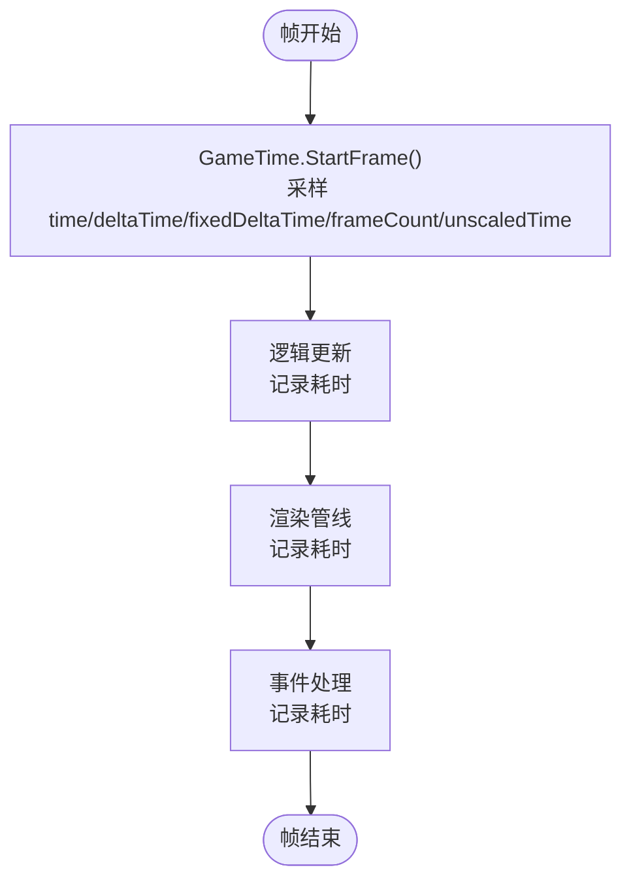
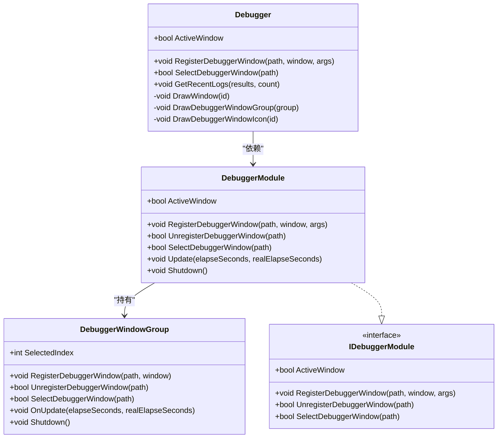
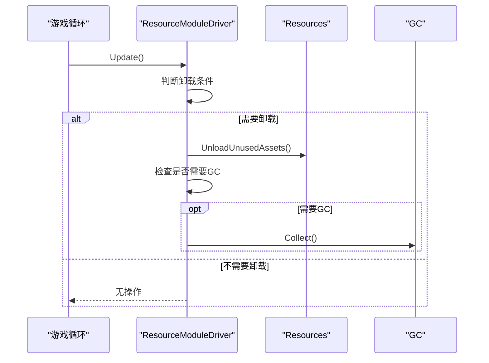
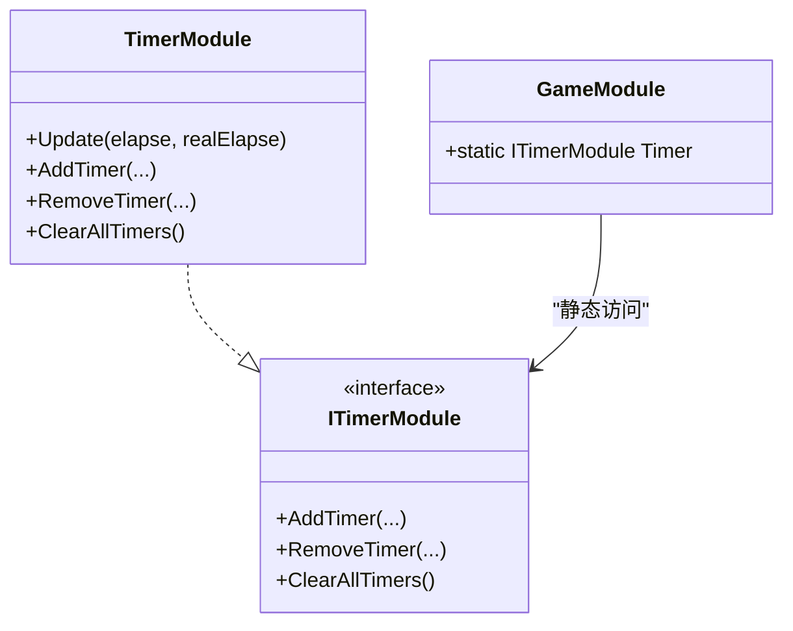
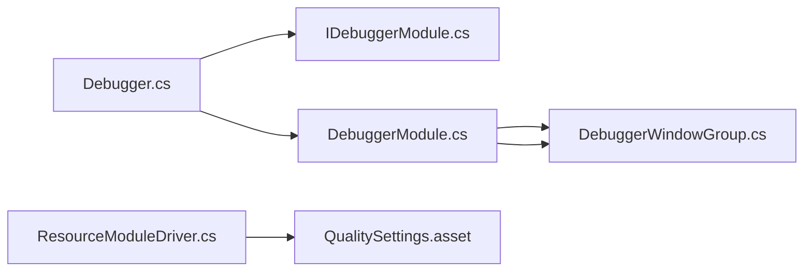

# CPU 性能问题排查

<cite>
**本文引用的文件**   
- [README.md](file://README.md)
- [GameTime.cs](file://UnityProject/Assets/TEngine/Runtime/Core/GameTime/GameTime.cs)
- [UpdateSetting.cs](file://UnityProject/Assets/TEngine/Runtime/Core/UpdateSetting.cs)
- [性能优化.md](file://UnityProject/repowiki/zh/content/性能优化/性能优化.md)
- [Debugger.cs](file://UnityProject/Assets/TEngine/Runtime/Module/DebugerModule/Debugger.cs)
- [DebuggerModule.cs](file://UnityProject/Assets/TEngine/Runtime/Module/DebugerModule/DebuggerModule.cs)
- [DebuggerManager.DebuggerWindowGroup.cs](file://UnityProject/Assets/TEngine/Runtime/Module/DebugerModule/DebuggerManager.DebuggerWindowGroup.cs)
- [IDebuggerModule.cs](file://UnityProject/Assets/TEngine/Runtime/Module/DebugerModule/IDebuggerModule.cs)
- [DebuggerModule.ProfilerInformationWindow.cs](file://UnityProject/Assets/TEngine/Runtime/Module/DebugerModule/Component/DebuggerModule.ProfilerInformationWindow.cs)
- [DebuggerModule.RuntimeMemorySummaryWindow.cs](file://UnityProject/Assets/TEngine/Runtime/Module/DebugerModule/Component/DebuggerModule.RuntimeMemorySummaryWindow.cs)
- [DebuggerModule.RuntimeMemoryInformationWindow.cs](file://UnityProject/Assets/TEngine/Runtime/Module/DebugerModule/Component/DebuggerModule.RuntimeMemoryInformationWindow.cs)
- [ResourceModuleDriver.cs](file://UnityProject/Assets/TEngine/Runtime/Module/ResourceModule/ResourceModuleDriver.cs)
- [ITimerModule.cs](file://UnityProject/Assets/TEngine/Runtime/Module/TimerModule/ITimerModule.cs)
- [TimerModule.cs](file://UnityProject/Assets/TEngine/Runtime/Module/TimerModule/TimerModule.cs)
- [GameModule.cs](file://UnityProject/Assets/GameScripts/HotFix/GameLogic/GameModule.cs)
</cite>

## 目录
1. [简介](#简介)
2. [项目结构](#项目结构)
3. [核心组件](#核心组件)
4. [架构总览](#架构总览)
5. [详细组件分析](#详细组件分析)
6. [依赖关系分析](#依赖关系分析)
7. [性能考量与优化策略](#性能考量与优化策略)
8. [故障排查指南](#故障排查指南)
9. [结论](#结论)
10. [附录](#附录)

## 简介
本指南聚焦 TEngine 框架在 CPU 性能方面的常见问题与解决方案，包括主线程耗时过高、帧率下降、逻辑更新瓶颈、定时器执行效率、事件处理性能等。文档结合框架内置的调试器模块、时间系统、资源卸载策略与计时器模块，提供可操作的诊断流程、可视化监控方法、热点定位技巧与基准测试方案，帮助开发者快速定位并解决 CPU 瓶颈。

## 项目结构
围绕 CPU 性能相关能力，TEngine 主要涉及以下子系统：
- 时间系统：统一封装 Unity Time 采样，为帧级统计与逻辑更新提供稳定时间源。
- 调试器模块：提供 FPS、Profiler、内存、对象池等可视化面板，辅助定位 CPU 热点。
- 资源模块驱动：周期性触发资源卸载与可选 GC，降低内存峰值与抖动对 CPU 的影响。
- 计时器模块：统一管理定时任务，避免频繁分配与主线程阻塞。
- 配置设置：通过 UpdateSetting 控制热更与资源加载行为，间接影响运行时 CPU 压力。

**图表来源**
- [GameTime.cs:1-55](file://UnityProject/Assets/TEngine/Runtime/Core/GameTime/GameTime.cs#L1-L55)
- [Debugger.cs:1-429](file://UnityProject/Assets/TEngine/Runtime/Module/DebugerModule/Debugger.cs#L1-L429)
- [DebuggerModule.cs:1-116](file://UnityProject/Assets/TEngine/Runtime/Module/DebugerModule/DebuggerModule.cs#L1-L116)
- [DebuggerManager.DebuggerWindowGroup.cs:1-294](file://UnityProject/Assets/TEngine/Runtime/Module/DebugerModule/DebuggerManager.DebuggerWindowGroup.cs#L1-L294)
- [DebuggerModule.ProfilerInformationWindow.cs:1-60](file://UnityProject/Assets/TEngine/Runtime/Module/DebugerModule/Component/DebuggerModule.ProfilerInformationWindow.cs#L1-L60)
- [DebuggerModule.RuntimeMemorySummaryWindow.cs:57-97](file://UnityProject/Assets/TEngine/Runtime/Module/DebugerModule/Component/DebuggerModule.RuntimeMemorySummaryWindow.cs#L57-L97)
- [DebuggerModule.RuntimeMemoryInformationWindow.cs:82-109](file://UnityProject/Assets/TEngine/Runtime/Module/DebugerModule/Component/DebuggerModule.RuntimeMemoryInformationWindow.cs#L82-L109)
- [ResourceModuleDriver.cs:307-334](file://UnityProject/Assets/TEngine/Runtime/Module/ResourceModule/ResourceModuleDriver.cs#L307-L334)
- [ITimerModule.cs:1-55](file://UnityProject/Assets/TEngine/Runtime/Module/TimerModule/ITimerModule.cs#L1-L55)
- [TimerModule.cs:1-200](file://UnityProject/Assets/TEngine/Runtime/Module/TimerModule/TimerModule.cs#L1-L200)
- [GameModule.cs:70-120](file://UnityProject/Assets/GameScripts/HotFix/GameLogic/GameModule.cs#L70-L120)
- [UpdateSetting.cs:50-220](file://UnityProject/Assets/TEngine/Runtime/Core/UpdateSetting.cs#L50-L220)

**章节来源**
- [README.md:20-34](file://README.md#L20-L34)
- [性能优化.md:30-89](file://UnityProject/repowiki/zh/content/性能优化/性能优化.md#L30-L89)

## 核心组件
- 时间系统（GameTime）
  - 提供每帧时间采样（time、deltaTime、unscaledDeltaTime、fixedDeltaTime、frameCount、unscaledTime），用于计算帧时长、统计 FPS 与逻辑更新耗时。
- 调试器模块（Debugger / DebuggerModule / DebuggerWindowGroup）
  - 管理调试窗口注册、选择与绘制；FPS 计数与日志采集；集成 Profiler 信息窗口与内存汇总/明细窗口。
- 资源模块驱动（ResourceModuleDriver）
  - 周期性触发 UnloadUnusedAssets 与可选 GC.Collect，降低内存峰值与抖动对 CPU 的影响。
- 计时器模块（ITimerModule / TimerModule）
  - 统一管理定时任务，减少分配与主线程阻塞风险。
- 游戏入口（GameModule）
  - 暴露 ITimerModule 静态访问点，便于业务侧使用计时器。
- 配置（UpdateSetting）
  - 控制热更与资源加载行为，影响运行时 CPU 压力。

**章节来源**
- [GameTime.cs:1-55](file://UnityProject/Assets/TEngine/Runtime/Core/GameTime/GameTime.cs#L1-L55)
- [Debugger.cs:1-429](file://UnityProject/Assets/TEngine/Runtime/Module/DebugerModule/Debugger.cs#L1-L429)
- [DebuggerModule.cs:1-116](file://UnityProject/Assets/TEngine/Runtime/Module/DebugerModule/DebuggerModule.cs#L1-L116)
- [DebuggerManager.DebuggerWindowGroup.cs:1-294](file://UnityProject/Assets/TEngine/Runtime/Module/DebugerModule/DebuggerManager.DebuggerWindowGroup.cs#L1-L294)
- [ResourceModuleDriver.cs:307-334](file://UnityProject/Assets/TEngine/Runtime/Module/ResourceModule/ResourceModuleDriver.cs#L307-L334)
- [ITimerModule.cs:1-55](file://UnityProject/Assets/TEngine/Runtime/Module/TimerModule/ITimerModule.cs#L1-L55)
- [TimerModule.cs:1-200](file://UnityProject/Assets/TEngine/Runtime/Module/TimerModule/TimerModule.cs#L1-L200)
- [GameModule.cs:70-120](file://UnityProject/Assets/GameScripts/HotFix/GameLogic/GameModule.cs#L70-L120)
- [UpdateSetting.cs:50-220](file://UnityProject/Assets/TEngine/Runtime/Core/UpdateSetting.cs#L50-L220)

## 架构总览
下图展示 CPU 性能相关的关键交互：时间系统为调试器提供帧时长数据；调试器聚合 FPS、Profiler、内存等信息；资源模块驱动按策略释放资源；计时器模块为业务逻辑提供高效定时能力。

**图表来源**
- [GameTime.cs:45-53](file://UnityProject/Assets/TEngine/Runtime/Core/GameTime/GameTime.cs#L45-L53)
- [Debugger.cs:183-235](file://UnityProject/Assets/TEngine/Runtime/Module/DebugerModule/Debugger.cs#L183-L235)
- [DebuggerModule.cs:66-114](file://UnityProject/Assets/TEngine/Runtime/Module/DebugerModule/DebuggerModule.cs#L66-L114)
- [DebuggerManager.DebuggerWindowGroup.cs:193-230](file://UnityProject/Assets/TEngine/Runtime/Module/DebugerModule/DebuggerManager.DebuggerWindowGroup.cs#L193-L230)
- [ResourceModuleDriver.cs:307-334](file://UnityProject/Assets/TEngine/Runtime/Module/ResourceModule/ResourceModuleDriver.cs#L307-L334)
- [TimerModule.cs:1-200](file://UnityProject/Assets/TEngine/Runtime/Module/TimerModule/TimerModule.cs#L1-L200)

## 详细组件分析

### 时间系统与主线程耗时统计
- GameTime 每帧采样 Unity Time 字段，提供稳定的时间源，便于计算 delta 与 FPS。
- 建议在主循环中记录 StartFrame 到各阶段结束的时间差，识别逻辑更新、渲染、事件处理的耗时分布。

**图表来源**
- [GameTime.cs:45-53](file://UnityProject/Assets/TEngine/Runtime/Core/GameTime/GameTime.cs#L45-L53)

**章节来源**
- [GameTime.cs:1-55](file://UnityProject/Assets/TEngine/Runtime/Core/GameTime/GameTime.cs#L1-L55)

### 调试器模块与 FPS/Profiler/内存面板
- Debugger 负责窗口激活、布局与 FPS 计数，并通过 ModuleSystem 获取 IDebuggerModule 注册各类信息窗口。
- ProfilerInformationWindow 展示关键指标（Mono/Heap/Allocated/Reserved 等）。
- RuntimeMemorySummaryWindow 遍历所有对象，按类型统计数量与内存大小。
- RuntimeMemoryInformationWindow<T> 针对特定类型进行采样、排序与高亮重复项。

**图表来源**
- [Debugger.cs:1-429](file://UnityProject/Assets/TEngine/Runtime/Module/DebugerModule/Debugger.cs#L1-L429)
- [DebuggerModule.cs:1-116](file://UnityProject/Assets/TEngine/Runtime/Module/DebugerModule/DebuggerModule.cs#L1-L116)
- [DebuggerManager.DebuggerWindowGroup.cs:1-294](file://UnityProject/Assets/TEngine/Runtime/Module/DebugerModule/DebuggerManager.DebuggerWindowGroup.cs#L1-L294)
- [IDebuggerModule.cs:1-55](file://UnityProject/Assets/TEngine/Runtime/Module/DebugerModule/IDebuggerModule.cs#L1-L55)

**章节来源**
- [Debugger.cs:183-235](file://UnityProject/Assets/TEngine/Runtime/Module/DebugerModule/Debugger.cs#L183-L235)
- [DebuggerModule.cs:66-114](file://UnityProject/Assets/TEngine/Runtime/Module/DebugerModule/DebuggerModule.cs#L66-L114)
- [DebuggerManager.DebuggerWindowGroup.cs:193-230](file://UnityProject/Assets/TEngine/Runtime/Module/DebugerModule/DebuggerManager.DebuggerWindowGroup.cs#L193-L230)
- [DebuggerModule.ProfilerInformationWindow.cs:12-56](file://UnityProject/Assets/TEngine/Runtime/Module/DebugerModule/Component/DebuggerModule.ProfilerInformationWindow.cs#L12-L56)
- [DebuggerModule.RuntimeMemorySummaryWindow.cs:61-97](file://UnityProject/Assets/TEngine/Runtime/Module/DebugerModule/Component/DebuggerModule.RuntimeMemorySummaryWindow.cs#L61-L97)
- [DebuggerModule.RuntimeMemoryInformationWindow.cs:82-109](file://UnityProject/Assets/TEngine/Runtime/Module/DebugerModule/Component/DebuggerModule.RuntimeMemoryInformationWindow.cs#L82-L109)

### 资源卸载与 GC 策略对 CPU 的影响
- ResourceModuleDriver 在合适时机调用 Resources.UnloadUnusedAssets，并可触发 GC.Collect，降低内存峰值与抖动。
- 质量设置（QualitySettings.asset）影响渲染与资源需求，间接影响 CPU 占用。

**图表来源**
- [ResourceModuleDriver.cs:307-334](file://UnityProject/Assets/TEngine/Runtime/Module/ResourceModule/ResourceModuleDriver.cs#L307-L334)

**章节来源**
- [性能优化.md:245-278](file://UnityProject/repowiki/zh/content/性能优化/性能优化.md#L245-L278)

### 计时器模块与定时器执行效率
- ITimerModule 定义计时器接口，TimerModule 实现 IUpdateModule 与 ITimerModule，统一管理定时任务。
- GameModule 暴露静态 Timer 属性，便于业务侧便捷使用。

**图表来源**
- [ITimerModule.cs:1-55](file://UnityProject/Assets/TEngine/Runtime/Module/TimerModule/ITimerModule.cs#L1-L55)
- [TimerModule.cs:1-200](file://UnityProject/Assets/TEngine/Runtime/Module/TimerModule/TimerModule.cs#L1-L200)
- [GameModule.cs:70-120](file://UnityProject/Assets/GameScripts/HotFix/GameLogic/GameModule.cs#L70-L120)

**章节来源**
- [ITimerModule.cs:1-55](file://UnityProject/Assets/TEngine/Runtime/Module/TimerModule/ITimerModule.cs#L1-L55)
- [TimerModule.cs:1-200](file://UnityProject/Assets/TEngine/Runtime/Module/TimerModule/TimerModule.cs#L1-L200)
- [GameModule.cs:70-120](file://UnityProject/Assets/GameScripts/HotFix/GameLogic/GameModule.cs#L70-L120)

### 配置设置对 CPU 压力的间接影响
- UpdateSetting 控制热更程序集、AOT 元程序集、资源下载路径、WebGL 加载方式等，影响运行时资源加载与解析开销。
- 合理配置可减少启动与运行时的 CPU 峰值。

**章节来源**
- [UpdateSetting.cs:50-220](file://UnityProject/Assets/TEngine/Runtime/Core/UpdateSetting.cs#L50-L220)

## 依赖关系分析
- 调试器模块内部依赖清晰：Debugger 依赖 IDebuggerModule，DebuggerModule 持有 DebuggerWindowGroup，后者提供窗口注册/注销/选择/更新能力。
- 调试器模块与资源模块解耦：调试器仅消费资源模块提供的信息（如内存、对象池等），不直接参与资源加载/卸载逻辑。
- 质量设置与资源模块相互作用：质量等级影响渲染管线与资源需求，资源模块据此决定卸载策略与 GC 触发时机。

**图表来源**
- [Debugger.cs:1-429](file://UnityProject/Assets/TEngine/Runtime/Module/DebugerModule/Debugger.cs#L1-L429)
- [IDebuggerModule.cs:1-55](file://UnityProject/Assets/TEngine/Runtime/Module/DebugerModule/IDebuggerModule.cs#L1-L55)
- [DebuggerModule.cs:1-116](file://UnityProject/Assets/TEngine/Runtime/Module/DebugerModule/DebuggerModule.cs#L1-L116)
- [DebuggerManager.DebuggerWindowGroup.cs:1-294](file://UnityProject/Assets/TEngine/Runtime/Module/DebugerModule/DebuggerManager.DebuggerWindowGroup.cs#L1-L294)
- [ResourceModuleDriver.cs:307-334](file://UnityProject/Assets/TEngine/Runtime/Module/ResourceModule/ResourceModuleDriver.cs#L307-L334)

**章节来源**
- [性能优化.md:280-307](file://UnityProject/repowiki/zh/content/性能优化/性能优化.md#L280-L307)

## 性能考量与优化策略
- 渲染优化
  - 结合质量设置动态调整，避免低端设备启用过高画质。
  - 使用批量渲染与剔除，减少 DrawCall 与带宽压力。
- 内存优化
  - 定期触发 UnloadUnusedAssets 与可选 GC.Collect，降低峰值内存。
  - 使用内存分析面板识别异常类型对象，针对性优化资源复用与生命周期。
- CPU 优化
  - 异步优先，避免主线程阻塞；利用对象池/内存池减少 GC 压力。
  - 通过 FPS 与 Profiler 面板监控 CPU 占用，定位热点函数与线程争用。
  - 将长耗时逻辑拆分到多帧或后台线程，结合计时器模块进行平滑调度。
  - 批量处理事件与 UI 更新，减少逐条处理的分配与分支开销。

**章节来源**
- [性能优化.md:309-324](file://UnityProject/repowiki/zh/content/性能优化/性能优化.md#L309-L324)

## 故障排查指南
- 调试器窗口无法显示
  - 检查 ActiveWindow 类型（AlwaysOpen/OnlyOpenWhenDevelopment/OnlyOpenInEditor）与构建配置。
  - 确认窗口已正确注册到 DebuggerModule，并通过路径选择。
- 内存采样异常
  - 确保在目标类型上使用正确的泛型窗口（如 Texture/Mesh/Material 等）。
  - 注意重复项高亮可能指示资源未正确释放或复用不当。
- 资源卸载无效
  - 检查卸载条件与计时器逻辑，避免过于频繁触发导致性能抖动。
  - 结合质量设置评估是否应降低画质以减少资源占用。
- 定时器执行卡顿
  - 检查 TimerModule 的任务调度频率与回调复杂度，避免在主线程执行重计算。
  - 使用 GameModule.Timer 静态访问点，确保任务生命周期管理正确。

**章节来源**
- [Debugger.cs:217-234](file://UnityProject/Assets/TEngine/Runtime/Module/DebugerModule/Debugger.cs#L217-L234)
- [DebuggerModule.cs:66-114](file://UnityProject/Assets/TEngine/Runtime/Module/DebugerModule/DebuggerModule.cs#L66-L114)
- [DebuggerModule.RuntimeMemoryInformationWindow.cs:82-109](file://UnityProject/Assets/TEngine/Runtime/Module/DebugerModule/Component/DebuggerModule.RuntimeMemoryInformationWindow.cs#L82-L109)
- [ResourceModuleDriver.cs:307-334](file://UnityProject/Assets/TEngine/Runtime/Module/ResourceModule/ResourceModuleDriver.cs#L307-L334)
- [GameModule.cs:70-120](file://UnityProject/Assets/GameScripts/HotFix/GameLogic/GameModule.cs#L70-L120)

## 结论
TEngine 的性能优化体系以“可视化监控 + 主动释放 + 质量自适应”为核心：通过调试器模块提供实时的帧率、Profiler、内存与对象池信息，结合资源模块的卸载与 GC 策略，形成闭环的性能保障。CPU 性能问题的排查应围绕时间采样、调试器面板、资源卸载策略与计时器模块展开，持续使用可视化工具进行回归验证，并结合异步编程、批量处理与算法优化提升主线程稳定性。

## 附录
- 性能分析方法与工具使用
  - 使用 ProfilerInformationWindow 查看内存与分配关键指标，定位内存增长来源。
  - 使用 RuntimeMemoryInformationWindow<T> 对特定类型进行采样与排序，识别异常对象。
  - 使用 FPS 与日志系统快速发现帧率波动与错误。
- 最佳实践
  - 异步加载与按需释放，避免一次性加载过多资源。
  - 使用对象池/内存池减少 GC 压力，提升主线程稳定性。
  - 在低端设备上降低质量等级，必要时延迟或合并卸载操作。
  - 将长耗时逻辑拆分到多帧或后台线程，结合计时器模块进行平滑调度。
- 常见问题与解决方案
  - 内存泄漏：通过重复项高亮与类型分布定位未释放对象，优化生命周期管理。
  - 卡顿：降低质量或减少一次性资源加载，合理安排卸载与 GC 时机。