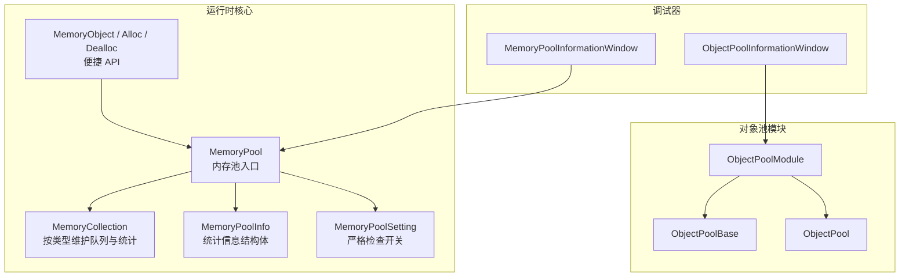
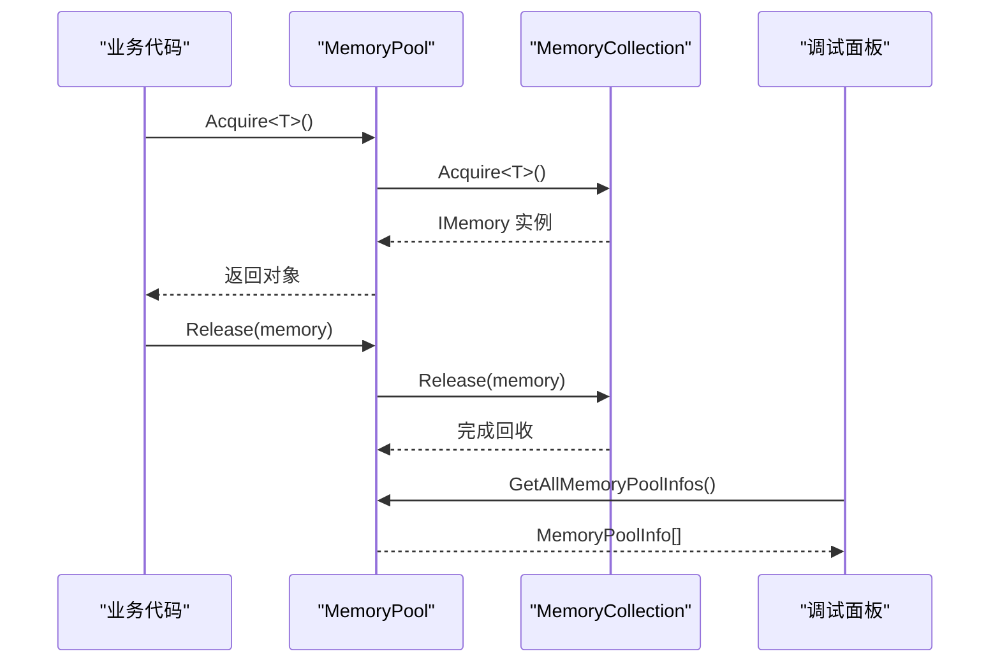
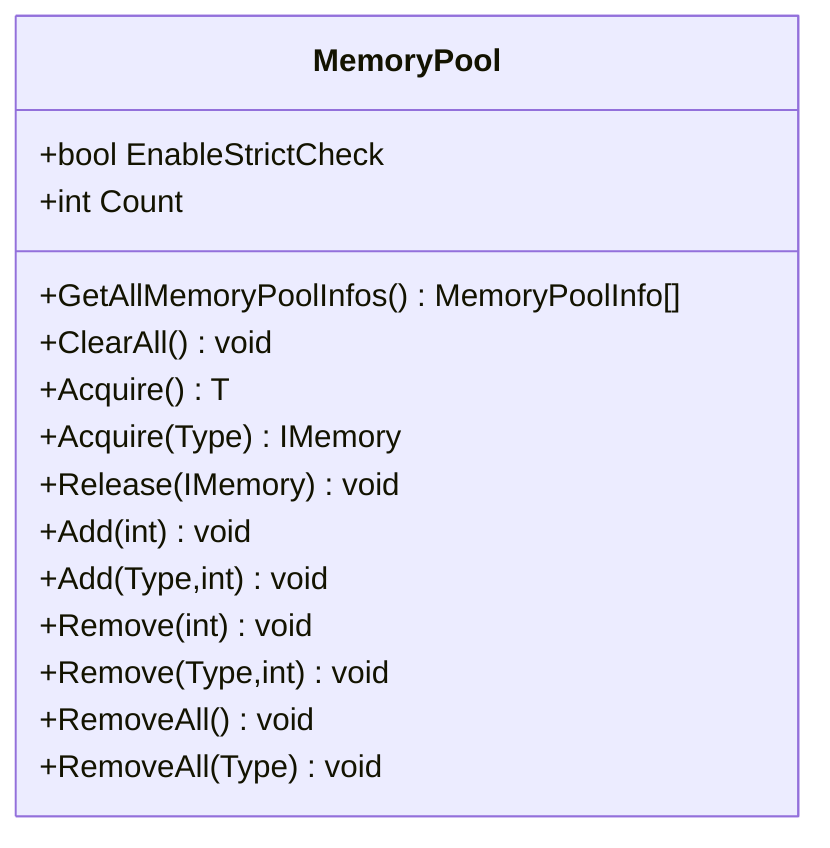
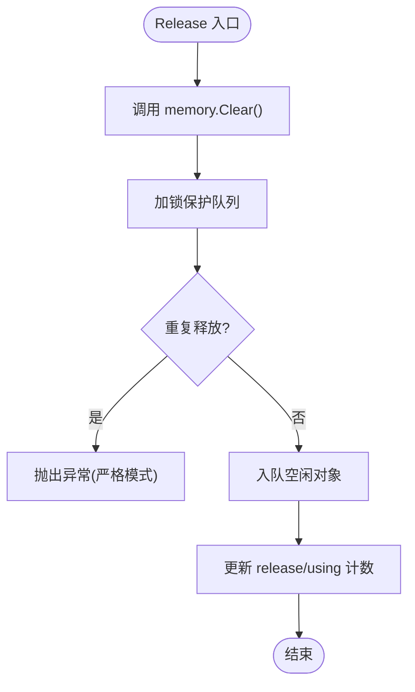
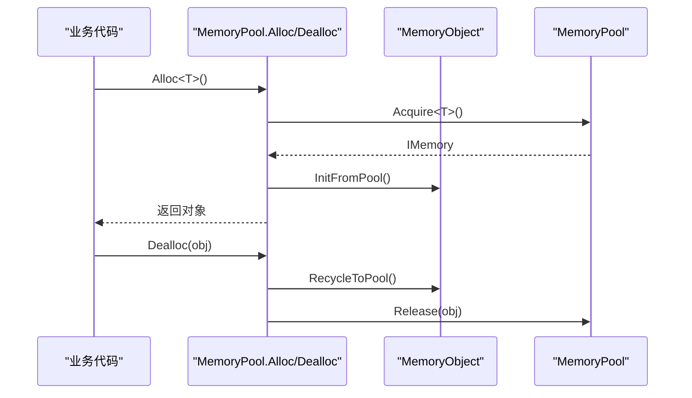
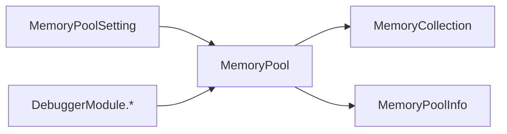

# 内存性能问题排查

<cite>
**本文引用的文件**   
- [README.md](file://README.md)
- [MemoryPool.cs](file://UnityProject/Assets/TEngine/Runtime/Core/MemoryPool/MemoryPool.cs)
- [MemoryPool.MemoryCollection.cs](file://UnityProject/Assets/TEngine/Runtime/Core/MemoryPool/MemoryPool.MemoryCollection.cs)
- [MemoryPoolExtension.cs](file://UnityProject/Assets/TEngine/Runtime/Core/MemoryPool/MemoryPoolExtension.cs)
- [MemoryPoolInfo.cs](file://UnityProject/Assets/TEngine/Runtime/Core/MemoryPool/MemoryPoolInfo.cs)
- [MemoryPoolSetting.cs](file://UnityProject/Assets/TEngine/Runtime/Core/MemoryPool/MemoryPoolSetting.cs)
- [DebuggerModule.ObjectPoolInformationWindow.cs](file://UnityProject/Assets/TEngine/Runtime/Module/DebugerModule/Component/DebuggerModule.ObjectPoolInformationWindow.cs)
- [DebuggerModule.MemoryPoolInformationWindow.cs](file://UnityProject/Assets/TEngine/Runtime/Module/DebugerModule/Component/DebuggerModule.MemoryPoolInformationWindow.cs)
- [ObjectPoolBase.cs](file://UnityProject/Assets/TEngine/Runtime/Module/ObjectPoolModule/ObjectPoolBase.cs)
- [ObjectPoolModule.cs](file://UnityProject/Assets/TEngine/Runtime/Module/ObjectPoolModule/ObjectPoolModule.cs)
- [ObjectPoolModule.ObjectPool.cs](file://UnityProject/Assets/TEngine/Runtime/Module/ObjectPoolModule/ObjectPoolModule.ObjectPool.cs)
</cite>

## 目录
1. [简介](#简介)
2. [项目结构](#项目结构)
3. [核心组件](#核心组件)
4. [架构总览](#架构总览)
5. [详细组件分析](#详细组件分析)
6. [依赖关系分析](#依赖关系分析)
7. [性能考量与优化](#性能考量与优化)
8. [故障排查指南](#故障排查指南)
9. [结论](#结论)
10. [附录：基准测试与泄漏检测方案](#附录基准测试与泄漏检测方案)

## 简介
本指南聚焦 TEngine 框架的内存性能问题排查与优化，覆盖以下关键主题：
- 内存泄漏检测、GC 频繁触发、内存碎片化等常见问题的诊断方法
- 使用内置监控工具分析内存池使用情况、对象池效率、资源占用等指标
- 内存优化最佳实践：对象池使用策略、内存池配置优化、垃圾回收调优
- 内存基准测试方法与内存泄漏检测方案

## 项目结构
与内存相关的核心实现位于 Runtime 层的 MemoryPool 与 ObjectPoolModule，同时提供 DebugerModule 可视化面板用于运行时观测。

图表来源
- [MemoryPool.cs:9-205](file://UnityProject/Assets/TEngine/Runtime/Core/MemoryPool/MemoryPool.cs#L9-L205)
- [MemoryPool.MemoryCollection.cs:11-153](file://UnityProject/Assets/TEngine/Runtime/Core/MemoryPool/MemoryPool.MemoryCollection.cs#L11-L153)
- [MemoryPoolExtension.cs:8-55](file://UnityProject/Assets/TEngine/Runtime/Core/MemoryPool/MemoryPoolExtension.cs#L8-L55)
- [MemoryPoolInfo.cs:9-117](file://UnityProject/Assets/TEngine/Runtime/Core/MemoryPool/MemoryPoolInfo.cs#L9-L117)
- [MemoryPoolSetting.cs:35-78](file://UnityProject/Assets/TEngine/Runtime/Core/MemoryPool/MemoryPoolSetting.cs#L35-L78)
- [ObjectPoolBase.cs](file://UnityProject/Assets/TEngine/Runtime/Module/ObjectPoolModule/ObjectPoolBase.cs)
- [ObjectPoolModule.cs](file://UnityProject/Assets/TEngine/Runtime/Module/ObjectPoolModule/ObjectPoolModule.cs)
- [ObjectPoolModule.ObjectPool.cs](file://UnityProject/Assets/TEngine/Runtime/Module/ObjectPoolModule/ObjectPoolModule.ObjectPool.cs)
- [DebuggerModule.MemoryPoolInformationWindow.cs](file://UnityProject/Assets/TEngine/Runtime/Module/DebugerModule/Component/DebuggerModule.MemoryPoolInformationWindow.cs)
- [DebuggerModule.ObjectPoolInformationWindow.cs](file://UnityProject/Assets/TEngine/Runtime/Module/DebugerModule/Component/DebuggerModule.ObjectPoolInformationWindow.cs)

章节来源
- [README.md:20-33](file://README.md#L20-L33)

## 核心组件
- 内存池（MemoryPool）
  - 全局静态入口，按类型维护内存集合，提供 Acquire/Release/Add/Remove/RemoveAll 等方法
  - 支持强制检查模式（EnableStrictCheck），用于校验类型与重复释放
  - 暴露 GetAllMemoryPoolInfos 获取各类型的统计信息
- 内存集合（MemoryCollection）
  - 内部类，基于 Queue<IMemory> 管理空闲对象
  - 维护 using/acquire/release/add/remove 计数，便于定位异常增长或泄露
- 扩展 API（MemoryObject/Alloc/Dealloc）
  - 提供 InitFromPool/RecycleToPool 生命周期钩子，简化初始化与回收逻辑
- 统计信息（MemoryPoolInfo）
  - 轻量结构体，承载类型与各项计数，供 UI 展示与分析
- 设置项（MemoryPoolSetting）
  - MonoBehaviour 组件，根据配置在启动时启用严格检查并销毁自身

章节来源
- [MemoryPool.cs:9-205](file://UnityProject/Assets/TEngine/Runtime/Core/MemoryPool/MemoryPool.cs#L9-L205)
- [MemoryPool.MemoryCollection.cs:11-153](file://UnityProject/Assets/TEngine/Runtime/Core/MemoryPool/MemoryPool.MemoryCollection.cs#L11-L153)
- [MemoryPoolExtension.cs:8-55](file://UnityProject/Assets/TEngine/Runtime/Core/MemoryPool/MemoryPoolExtension.cs#L8-L55)
- [MemoryPoolInfo.cs:9-117](file://UnityProject/Assets/TEngine/Runtime/Core/MemoryPool/MemoryPoolInfo.cs#L9-L117)
- [MemoryPoolSetting.cs:35-78](file://UnityProject/Assets/TEngine/Runtime/Core/MemoryPool/MemoryPoolSetting.cs#L35-L78)

## 架构总览
下图展示了从业务代码到内存池、再到统计与调试面板的调用链。

图表来源
- [MemoryPool.cs:33-48](file://UnityProject/Assets/TEngine/Runtime/Core/MemoryPool/MemoryPool.cs#L33-L48)
- [MemoryPool.cs:71-101](file://UnityProject/Assets/TEngine/Runtime/Core/MemoryPool/MemoryPool.cs#L71-L101)
- [MemoryPool.MemoryCollection.cs:46-98](file://UnityProject/Assets/TEngine/Runtime/Core/MemoryPool/MemoryPool.MemoryCollection.cs#L46-L98)

## 详细组件分析

### 内存池（MemoryPool）
- 职责
  - 维护 Type -> MemoryCollection 映射
  - 对外提供统一的分配/归还/扩容/收缩接口
  - 提供统计信息导出，供调试面板展示
- 关键点
  - EnableStrictCheck 开启后，对类型合法性与重复释放进行强校验
  - Count 与 GetAllMemoryPoolInfos 为只读统计入口
  - ClearAll 可清空所有池，适合场景切换或热更清理

图表来源
- [MemoryPool.cs:9-205](file://UnityProject/Assets/TEngine/Runtime/Core/MemoryPool/MemoryPool.cs#L9-L205)

章节来源
- [MemoryPool.cs:9-205](file://UnityProject/Assets/TEngine/Runtime/Core/MemoryPool/MemoryPool.cs#L9-L205)

### 内存集合（MemoryCollection）
- 职责
  - 以队列形式缓存空闲对象
  - 维护 using/acquire/release/add/remove 计数
  - 在 Release 前调用 Clear()，避免脏数据复用
- 关键点
  - 当 EnableStrictCheck 开启时，Release 会检查是否重复入队
  - Add/Remove/RemoveAll 控制池大小，影响 GC 压力与碎片化

图表来源
- [MemoryPool.MemoryCollection.cs:83-98](file://UnityProject/Assets/TEngine/Runtime/Core/MemoryPool/MemoryPool.MemoryCollection.cs#L83-L98)

章节来源
- [MemoryPool.MemoryCollection.cs:11-153](file://UnityProject/Assets/TEngine/Runtime/Core/MemoryPool/MemoryPool.MemoryCollection.cs#L11-L153)

### 扩展 API（MemoryObject/Alloc/Dealloc）
- 职责
  - 提供 InitFromPool/RecycleToPool 生命周期钩子
  - 封装 Alloc/Dealloc，自动执行初始化与回收后再归还池
- 关键点
  - Dealloc 先执行 RecycleToPool，再调用 Release，确保状态正确

图表来源
- [MemoryPoolExtension.cs:8-55](file://UnityProject/Assets/TEngine/Runtime/Core/MemoryPool/MemoryPoolExtension.cs#L8-L55)
- [MemoryPool.cs:71-101](file://UnityProject/Assets/TEngine/Runtime/Core/MemoryPool/MemoryPool.cs#L71-L101)

章节来源
- [MemoryPoolExtension.cs:8-55](file://UnityProject/Assets/TEngine/Runtime/Core/MemoryPool/MemoryPoolExtension.cs#L8-L55)

### 统计信息（MemoryPoolInfo）
- 字段说明
  - Type：池对应的类型
  - UnusedMemoryCount：空闲对象数量
  - UsingMemoryCount：正在使用的对象数量
  - AcquireMemoryCount：累计获取次数
  - ReleaseMemoryCount：累计归还次数
  - AddMemoryCount：累计增加次数
  - RemoveMemoryCount：累计移除次数
- 用途
  - 通过 GetAllMemoryPoolInfos 获取数组，结合调试面板观察趋势

章节来源
- [MemoryPoolInfo.cs:9-117](file://UnityProject/Assets/TEngine/Runtime/Core/MemoryPool/MemoryPoolInfo.cs#L9-L117)
- [MemoryPool.cs:33-48](file://UnityProject/Assets/TEngine/Runtime/Core/MemoryPool/MemoryPool.cs#L33-L48)

### 设置项（MemoryPoolSetting）
- 作用
  - 根据配置在 Start 时启用严格检查，随后销毁自身
- 建议
  - 开发阶段启用严格检查，生产环境关闭以提升性能

章节来源
- [MemoryPoolSetting.cs:35-78](file://UnityProject/Assets/TEngine/Runtime/Core/MemoryPool/MemoryPoolSetting.cs#L35-L78)

### 对象池模块（ObjectPoolModule）
- 角色
  - 管理游戏对象的创建、缓存与回收
  - 提供 ObjectPool<T> 泛型实现，配合 ObjectPoolBase 抽象基类
- 与内存池的关系
  - 对象池关注 GameObject 生命周期；内存池关注轻量数据结构复用
  - 两者协同可减少 GC 压力，降低碎片化

章节来源
- [ObjectPoolBase.cs](file://UnityProject/Assets/TEngine/Runtime/Module/ObjectPoolModule/ObjectPoolBase.cs)
- [ObjectPoolModule.cs](file://UnityProject/Assets/TEngine/Runtime/Module/ObjectPoolModule/ObjectPoolModule.cs)
- [ObjectPoolModule.ObjectPool.cs](file://UnityProject/Assets/TEngine/Runtime/Module/ObjectPoolModule/ObjectPoolModule.ObjectPool.cs)

## 依赖关系分析
- 耦合度
  - MemoryPool 与 MemoryCollection 高内聚，职责清晰
  - MemoryPoolSetting 仅负责配置注入，不侵入核心逻辑
  - DebugerModule 通过 GetAllMemoryPoolInfos 读取统计，低耦合
- 外部依赖
  - Unity 平台相关（MonoBehaviour、Log）
  - System.Collections.Generic（Queue、Dictionary）

图表来源
- [MemoryPool.cs:9-205](file://UnityProject/Assets/TEngine/Runtime/Core/MemoryPool/MemoryPool.cs#L9-L205)
- [MemoryPool.MemoryCollection.cs:11-153](file://UnityProject/Assets/TEngine/Runtime/Core/MemoryPool/MemoryPool.MemoryCollection.cs#L11-L153)
- [MemoryPoolInfo.cs:9-117](file://UnityProject/Assets/TEngine/Runtime/Core/MemoryPool/MemoryPoolInfo.cs#L9-L117)
- [MemoryPoolSetting.cs:35-78](file://UnityProject/Assets/TEngine/Runtime/Core/MemoryPool/MemoryPoolSetting.cs#L35-L78)
- [DebuggerModule.MemoryPoolInformationWindow.cs](file://UnityProject/Assets/TEngine/Runtime/Module/DebugerModule/Component/DebuggerModule.MemoryPoolInformationWindow.cs)

## 性能考量与优化
- 对象池使用策略
  - 高频短生命周期对象优先走内存池（如消息、事件参数、临时计算结构）
  - 大对象或带非托管资源的对象谨慎放入池，必要时显式释放
- 内存池配置优化
  - 预分配：通过 Add<T>(count) 预热热点类型，减少首次分配抖动
  - 容量控制：定期 Remove/RemoveAll 控制闲置对象规模，避免无限增长
  - 严格检查：仅在开发/编辑器环境启用，避免运行时开销
- 垃圾回收调优
  - 减少装箱/拆箱与临时字符串拼接
  - 避免在热点路径频繁创建匿名委托/闭包
  - 合理分帧处理大批量分配，降低瞬时峰值
- 对象池与内存池协同
  - 对象池管理 GameObject/UI 等重型资源
  - 内存池管理轻量数据结构，二者互补降低 GC 压力

[本节为通用指导，不直接分析具体文件]

## 故障排查指南
- 内存泄漏检测
  - 现象：UsingMemoryCount 持续增长，AcquireMemoryCount >> ReleaseMemoryCount
  - 步骤：
    1) 打开调试面板，观察各类型统计曲线
    2) 开启严格检查，捕获重复释放或非法类型
    3) 定位未归还的对象来源，补充 Release/Dealloc 调用
- GC 频繁触发
  - 现象：帧时间抖动、卡顿明显
  - 步骤：
    1) 使用 Profiler 观察 GC 触发点
    2) 将热点分配迁移至内存池，减少临时对象
    3) 分批处理大量分配，避免单帧峰值过高
- 内存碎片化
  - 现象：进程内存缓慢上涨但可用堆空间不足
  - 步骤：
    1) 控制池的最大规模，避免长期持有过多对象
    2) 定期 Remove/RemoveAll 回收闲置对象
    3) 避免池内对象尺寸差异过大，必要时拆分多个池
- 调试面板使用
  - 内存池面板：查看 MemoryPoolInfo[]，关注 Unused/Using/Acquire/Release 差值
  - 对象池面板：观察对象创建/回收频率与存活数

章节来源
- [DebuggerModule.MemoryPoolInformationWindow.cs](file://UnityProject/Assets/TEngine/Runtime/Module/DebugerModule/Component/DebuggerModule.MemoryPoolInformationWindow.cs)
- [DebuggerModule.ObjectPoolInformationWindow.cs](file://UnityProject/Assets/TEngine/Runtime/Module/DebugerModule/Component/DebuggerModule.ObjectPoolInformationWindow.cs)
- [MemoryPool.cs:33-48](file://UnityProject/Assets/TEngine/Runtime/Core/MemoryPool/MemoryPool.cs#L33-L48)
- [MemoryPool.MemoryCollection.cs:83-98](file://UnityProject/Assets/TEngine/Runtime/Core/MemoryPool/MemoryPool.MemoryCollection.cs#L83-L98)

## 结论
- TEngine 的内存池与对象池提供了完善的对象复用机制，配合调试面板可快速定位内存问题
- 建议在开发阶段启用严格检查，生产环境关闭以获得更好性能
- 通过预热池、控制容量、分帧分配等手段，可有效缓解 GC 压力与内存碎片化

[本节为总结性内容，不直接分析具体文件]

## 附录：基准测试与泄漏检测方案
- 基准测试方法
  - 设计对比实验：启用/禁用内存池，统计 FPS、GC 次数、峰值内存
  - 压测流程：固定时长运行，采集 MemoryPoolInfo 曲线，记录 Acquire/Release 差值
  - 结果评估：比较不同池大小与预热数量的效果，选择最优配置
- 泄漏检测方案
  - 自动化断言：在关键节点断言 UsingMemoryCount 稳定，异常则告警
  - 回放复现：录制用户操作序列，重放并持续监测统计指标
  - 回归门禁：CI 中集成内存基准，超过阈值即失败

[本节为方法论指导，不直接分析具体文件]