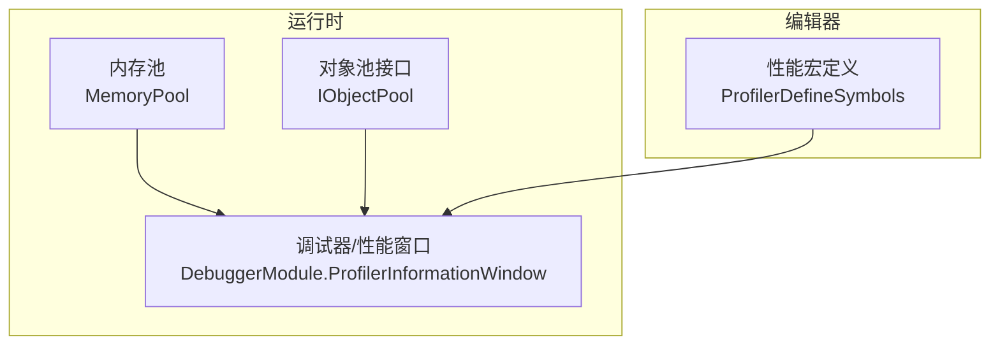
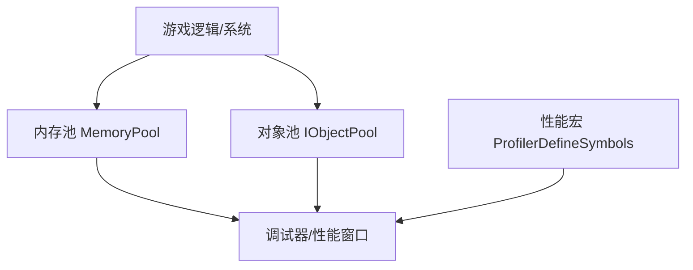
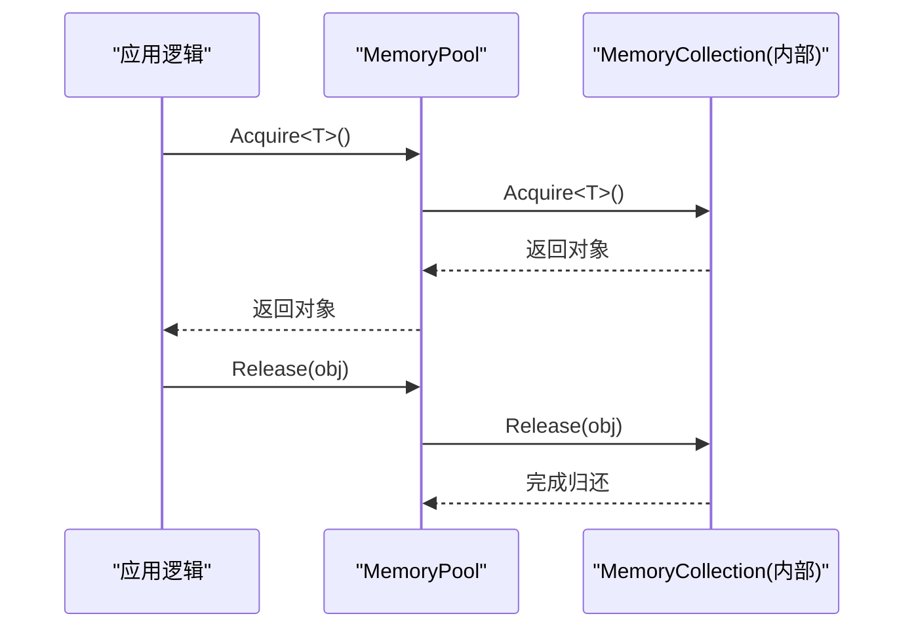
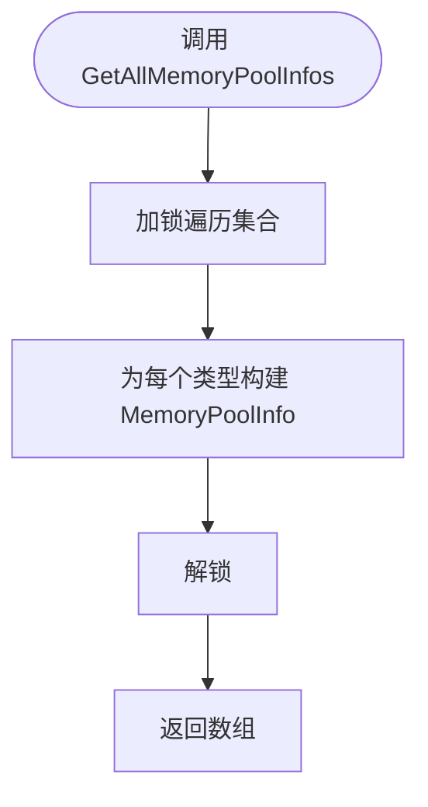
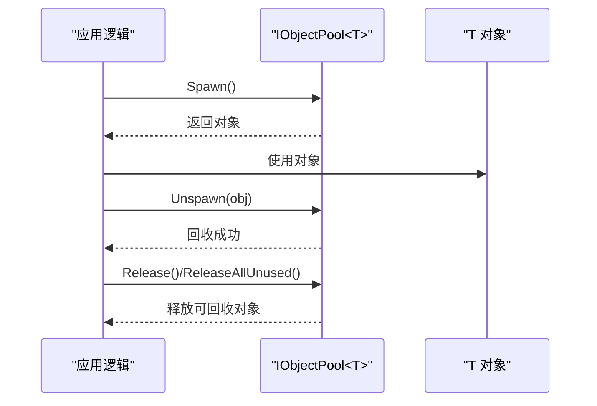
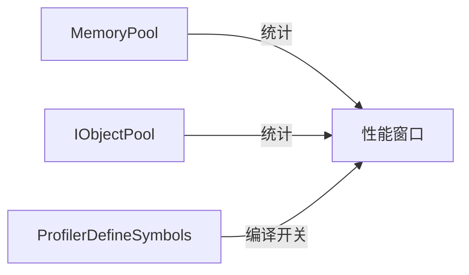

# 性能问题排查

<cite>
**本文引用的文件**   
- [README.md](file://README.md)
- [MemoryPool.cs](file://UnityProject/Assets/TEngine/Runtime/Core/MemoryPool/MemoryPool.cs)
- [MemoryPoolInfo.cs](file://UnityProject/Assets/TEngine/Runtime/Core/MemoryPool/MemoryPoolInfo.cs)
- [IObjectPool.cs](file://UnityProject/Assets/TEngine/Runtime/Module/ObjectPoolModule/IObjectPool.cs)
- [ProfilerDefineSymbols.cs](file://UnityProject/Assets/TEngine/Editor/DefineSymbols/ProfilerDefineSymbols.cs)
- [DebuggerModule.ProfilerInformationWindow.cs](file://UnityProject/Assets/TEngine/Runtime/Module/DebugerModule/Component/DebuggerModule.ProfilerInformationWindow.cs)
</cite>

## 目录
1. [简介](#简介)
2. [项目结构](#项目结构)
3. [核心组件](#核心组件)
4. [架构总览](#架构总览)
5. [详细组件分析](#详细组件分析)
6. [依赖关系分析](#依赖关系分析)
7. [性能考量与优化策略](#性能考量与优化策略)
8. [故障排查指南](#故障排查指南)
9. [结论](#结论)
10. [附录：基准测试与回归检测方案](#附录基准测试与回归检测方案)

## 简介
本指南面向 TEngine 框架使用者，聚焦游戏运行时常见性能瓶颈的诊断与优化，包括内存泄漏、GC 频繁触发、帧率下降、CPU 占用过高等问题。文档结合框架内置的内存池、对象池以及调试器/性能监控能力，提供从指标采集到根因定位再到优化落地的完整方法论，并给出基准测试与回归检测建议，帮助团队持续优化游戏性能。

## 项目结构
TEngine 在 Unity 项目中以模块化的方式组织，核心运行时位于 Assets/TEngine/Runtime，编辑器工具位于 Assets/TEngine/Editor。与性能密切相关的子系统包括：
- 内存池（Core/MemoryPool）：用于减少小对象分配与 GC 压力
- 对象池（Module/ObjectPoolModule）：用于复用 GameObject/组件等重型资源
- 调试器与性能信息窗口（Module/DebugerModule）：用于运行时观测关键指标
- 性能宏开关（Editor/DefineSymbols）：控制性能相关代码路径

图表来源
- [MemoryPool.cs:1-208](file://UnityProject/Assets/TEngine/Runtime/Core/MemoryPool/MemoryPool.cs#L1-L208)
- [IObjectPool.cs:1-212](file://UnityProject/Assets/TEngine/Runtime/Module/ObjectPoolModule/IObjectPool.cs#L1-L212)
- [DebuggerModule.ProfilerInformationWindow.cs](file://UnityProject/Assets/TEngine/Runtime/Module/DebugerModule/Component/DebuggerModule.ProfilerInformationWindow.cs)
- [ProfilerDefineSymbols.cs](file://UnityProject/Assets/TEngine/Editor/DefineSymbols/ProfilerDefineSymbols.cs)

章节来源
- [README.md:101-170](file://README.md#L101-L170)

## 核心组件
- 内存池（MemoryPool）
  - 作用：按类型维护 IMemory 实现对象的池化，支持获取、归还、批量增删、统计信息导出与严格模式校验。
  - 关键能力：
    - 获取/归还：Acquire/Release
    - 批量管理：Add/Remove/RemoveAll
    - 统计导出：GetAllMemoryPoolInfos
    - 严格检查：EnableStrictCheck
- 对象池接口（IObjectPool<T>）
  - 作用：统一抽象对象池行为，包含创建、获取、回收、释放、锁定、优先级、过期时间、容量与自动释放间隔等。
  - 关键能力：
    - Spawn/Unspawn
    - Release/ReleaseAllUnused
    - SetLocked/SetPriority
    - Capacity/AutoReleaseInterval/ExpireTime/Count/CanReleaseCount
- 调试器/性能信息窗口（DebuggerModule.ProfilerInformationWindow）
  - 作用：在编辑器或运行期展示性能相关信息，便于观察内存池、对象池等指标。
- 性能宏定义（ProfilerDefineSymbols）
  - 作用：通过编译符号控制性能相关代码路径，避免发布包中不必要的开销。

章节来源
- [MemoryPool.cs:1-208](file://UnityProject/Assets/TEngine/Runtime/Core/MemoryPool/MemoryPool.cs#L1-L208)
- [MemoryPoolInfo.cs:1-119](file://UnityProject/Assets/TEngine/Runtime/Core/MemoryPool/MemoryPoolInfo.cs#L1-L119)
- [IObjectPool.cs:1-212](file://UnityProject/Assets/TEngine/Runtime/Module/ObjectPoolModule/IObjectPool.cs#L1-L212)
- [DebuggerModule.ProfilerInformationWindow.cs](file://UnityProject/Assets/TEngine/Runtime/Module/DebugerModule/Component/DebuggerModule.ProfilerInformationWindow.cs)
- [ProfilerDefineSymbols.cs](file://UnityProject/Assets/TEngine/Editor/DefineSymbols/ProfilerDefineSymbols.cs)

## 架构总览
下图展示了性能相关子系统之间的交互关系：业务逻辑通过内存池与对象池进行资源分配与复用；调试器/性能窗口聚合关键指标；性能宏定义控制是否启用额外统计与检查。

图表来源
- [MemoryPool.cs:1-208](file://UnityProject/Assets/TEngine/Runtime/Core/MemoryPool/MemoryPool.cs#L1-L208)
- [IObjectPool.cs:1-212](file://UnityProject/Assets/TEngine/Runtime/Module/ObjectPoolModule/IObjectPool.cs#L1-L212)
- [DebuggerModule.ProfilerInformationWindow.cs](file://UnityProject/Assets/TEngine/Runtime/Module/DebugerModule/Component/DebuggerModule.ProfilerInformationWindow.cs)
- [ProfilerDefineSymbols.cs](file://UnityProject/Assets/TEngine/Editor/DefineSymbols/ProfilerDefineSymbols.cs)

## 详细组件分析

### 内存池（MemoryPool）分析与使用
- 设计要点
  - 按类型维护集合，支持泛型与非泛型 API
  - 提供统计信息导出，便于外部观测
  - 可选严格模式校验类型合法性
- 典型流程（获取/归还）

图表来源
- [MemoryPool.cs:66-101](file://UnityProject/Assets/TEngine/Runtime/Core/MemoryPool/MemoryPool.cs#L66-L101)

- 统计信息导出流程

图表来源
- [MemoryPool.cs:33-48](file://UnityProject/Assets/TEngine/Runtime/Core/MemoryPool/MemoryPool.cs#L33-L48)
- [MemoryPoolInfo.cs:30-39](file://UnityProject/Assets/TEngine/Runtime/Core/MemoryPool/MemoryPoolInfo.cs#L30-L39)

- 关键指标说明（MemoryPoolInfo）
  - Type：池类型
  - UnusedMemoryCount：未使用数量
  - UsingMemoryCount：正在使用数量
  - AcquireMemoryCount：累计获取次数
  - ReleaseMemoryCount：累计归还次数
  - AddMemoryCount：累计扩容添加次数
  - RemoveMemoryCount：累计收缩移除次数

章节来源
- [MemoryPool.cs:1-208](file://UnityProject/Assets/TEngine/Runtime/Core/MemoryPool/MemoryPool.cs#L1-L208)
- [MemoryPoolInfo.cs:1-119](file://UnityProject/Assets/TEngine/Runtime/Core/MemoryPool/MemoryPoolInfo.cs#L1-L119)

### 对象池（IObjectPool<T>）分析与使用
- 设计要点
  - 统一的对象池抽象，涵盖生命周期、容量、过期、优先级、自动释放等
  - 支持按名称区分实例，支持锁定防止被回收
- 常用操作序列（Spawn/Unspawn/Release）

图表来源
- [IObjectPool.cs:115-209](file://UnityProject/Assets/TEngine/Runtime/Module/ObjectPoolModule/IObjectPool.cs#L115-L209)

- 关键属性与方法
  - 生命周期：Register/Spawn/Unspawn
  - 释放策略：Release/Release(int)/Release(callback)/ReleaseAllUnused
  - 对象控制：SetLocked/SetPriority
  - 池配置：Capacity/AutoReleaseInterval/ExpireTime/AllowMultiSpawn/Name/FullName/ObjectType/Count/CanReleaseCount/Priority

章节来源
- [IObjectPool.cs:1-212](file://UnityProject/Assets/TEngine/Runtime/Module/ObjectPoolModule/IObjectPool.cs#L1-L212)

### 调试器与性能信息窗口
- 功能定位
  - 在编辑器或运行期展示性能相关信息，辅助定位内存与对象池使用异常
- 使用建议
  - 开启性能宏后，可在性能窗口中查看内存池与对象池的关键指标
  - 结合日志与堆栈快照，快速定位泄漏点

章节来源
- [DebuggerModule.ProfilerInformationWindow.cs](file://UnityProject/Assets/TEngine/Runtime/Module/DebugerModule/Component/DebuggerModule.ProfilerInformationWindow.cs)
- [ProfilerDefineSymbols.cs](file://UnityProject/Assets/TEngine/Editor/DefineSymbols/ProfilerDefineSymbols.cs)

## 依赖关系分析
- 耦合关系
  - 内存池与对象池均向调试器/性能窗口暴露指标，形成“生产者-消费者”关系
  - 性能宏定义影响性能窗口的可见性与统计精度
- 潜在风险
  - 过度开启严格检查可能带来额外 CPU 开销
  - 对象池未正确释放将导致内存增长与 GC 抖动

图表来源
- [MemoryPool.cs:33-48](file://UnityProject/Assets/TEngine/Runtime/Core/MemoryPool/MemoryPool.cs#L33-L48)
- [IObjectPool.cs:115-209](file://UnityProject/Assets/TEngine/Runtime/Module/ObjectPoolModule/IObjectPool.cs#L115-L209)
- [DebuggerModule.ProfilerInformationWindow.cs](file://UnityProject/Assets/TEngine/Runtime/Module/DebugerModule/Component/DebuggerModule.ProfilerInformationWindow.cs)
- [ProfilerDefineSymbols.cs](file://UnityProject/Assets/TEngine/Editor/DefineSymbols/ProfilerDefineSymbols.cs)

## 性能考量与优化策略
- 内存泄漏排查
  - 关注 MemoryPoolInfo 中的 UsingMemoryCount 持续增长且 Acquire/Release 不平衡
  - 检查对象池是否存在未 Unspawn 的对象，或 Release 条件不满足
  - 利用性能宏开启更严格的统计与检查，配合调试器窗口观察
- GC 频繁触发
  - 优先使用内存池替代频繁 new 的小对象
  - 避免在热路径中进行装箱、字符串拼接、反射与 LINQ 等易产生临时对象的操作
  - 合理设置对象池 AutoReleaseInterval 与 ExpireTime，避免长期持有
- 帧率下降
  - 将非关键任务拆分到多帧执行，避免单帧耗时过长
  - 合并 UI 更新与渲染批次，减少 DrawCall
  - 使用对象池复用高频创建的 GameObject/组件
- CPU 占用过高
  - 关闭非必要严格检查（EnableStrictCheck）
  - 降低事件分发频率，合并批量处理
  - 避免每帧全量扫描，采用增量或事件驱动

[本节为通用指导，不直接分析具体文件]

## 故障排查指南
- 症状：内存持续增长
  - 检查项：
    - MemoryPoolInfo.UsingMemoryCount 是否持续上升
    - 是否存在未 Release 的对象池对象
    - 是否有长生命周期引用未清理
  - 工具：
    - 打开性能窗口，观察内存池与对象池指标
    - 开启性能宏，启用更详细的统计
- 症状：GC 频繁
  - 检查项：
    - 是否在热路径中频繁分配临时对象
    - 对象池容量是否过小导致频繁扩容
  - 工具：
    - 使用 Unity Profiler 与 TEngine 性能窗口联合分析
- 症状：帧率波动大
  - 检查项：
    - 是否存在单帧阻塞逻辑
    - UI 刷新是否过于频繁
  - 工具：
    - 使用 Unity Profiler 的 Frame Debugger 与脚本分析
- 症状：CPU 占用高
  - 检查项：
    - 是否开启过多严格检查
    - 是否大量使用反射/序列化/网络同步
  - 工具：
    - 性能窗口 + Unity Profiler CPU 火焰图

章节来源
- [MemoryPool.cs:164-185](file://UnityProject/Assets/TEngine/Runtime/Core/MemoryPool/MemoryPool.cs#L164-L185)
- [IObjectPool.cs:168-209](file://UnityProject/Assets/TEngine/Runtime/Module/ObjectPoolModule/IObjectPool.cs#L168-L209)
- [DebuggerModule.ProfilerInformationWindow.cs](file://UnityProject/Assets/TEngine/Runtime/Module/DebugerModule/Component/DebuggerModule.ProfilerInformationWindow.cs)
- [ProfilerDefineSymbols.cs](file://UnityProject/Assets/TEngine/Editor/DefineSymbols/ProfilerDefineSymbols.cs)

## 结论
TEngine 提供了完善的内存池与对象池机制，并结合调试器/性能窗口与性能宏定义，为性能问题的诊断与优化提供了坚实基础。通过合理的池化策略、严格的资源生命周期管理与持续的基准测试与回归检测，可以有效降低内存泄漏与 GC 抖动，稳定帧率并控制 CPU 占用。

[本节为总结性内容，不直接分析具体文件]

## 附录：基准测试与回归检测方案
- 基准测试方法
  - 场景化压测：构造典型玩法场景，记录 FPS、内存峰值、GC 次数与时长、CPU 热点
  - 组件级压测：对内存池与对象池进行吞吐与延迟测试，评估不同容量与过期策略的影响
  - 数据对比：在不同版本间对比关键指标，识别性能回归
- 回归检测方案
  - 自动化压测：在 CI 中运行压测用例，输出报告并与基线对比
  - 阈值告警：当内存增长、GC 次数或 FPS 超过阈值时触发告警
  - 可视化看板：汇总历史趋势，辅助定位渐进式退化

[本节为通用指导，不直接分析具体文件]