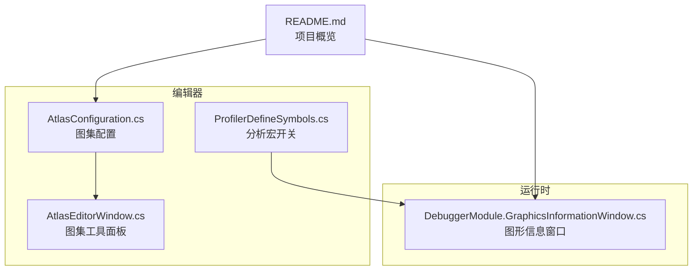
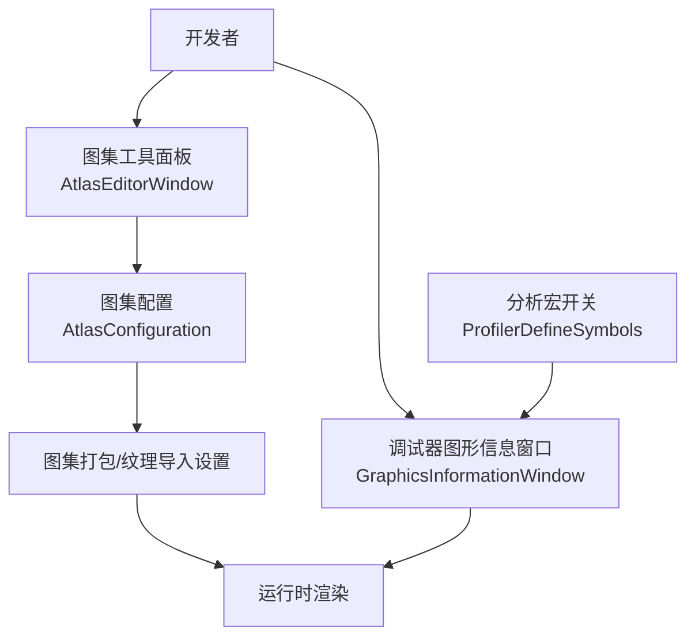
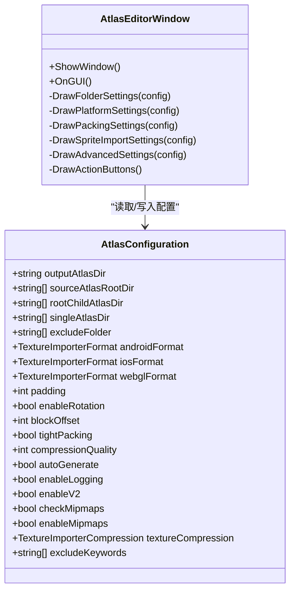
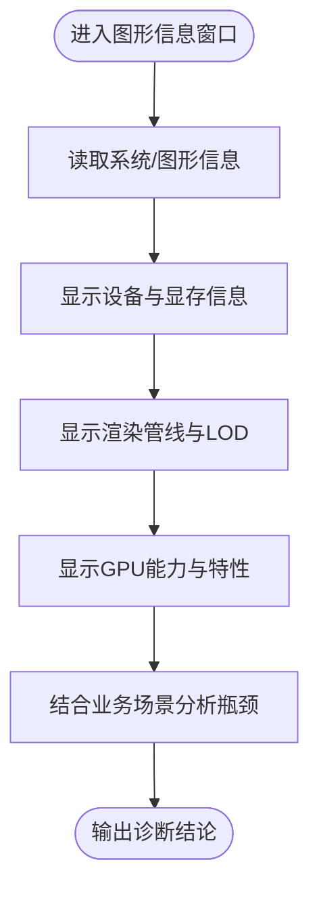
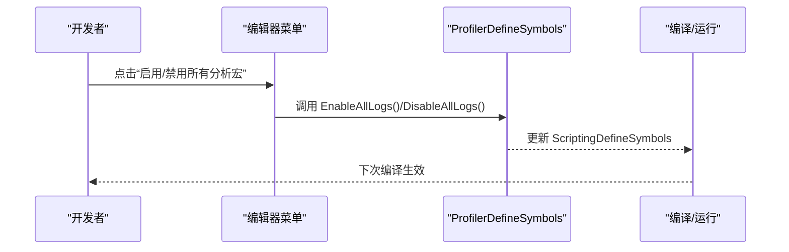
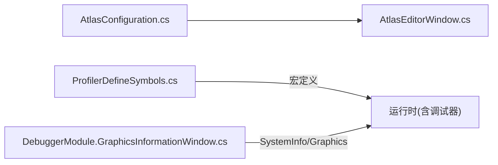

# 渲染性能问题排查

<cite>
**本文引用的文件**   
- [README.md](file://README.md)
- [ProfilerDefineSymbols.cs](file://UnityProject/Assets/TEngine/Editor/DefineSymbols/ProfilerDefineSymbols.cs)
- [DebuggerModule.GraphicsInformationWindow.cs](file://UnityProject/Assets/TEngine/Runtime/Module/DebugerModule/Component/DebuggerModule.GraphicsInformationWindow.cs)
- [AtlasConfiguration.cs](file://UnityProject/Assets/TEngine/Editor/AtlasMakerEditor/AtlasConfiguration.cs)
- [AtlasEditorWindow.cs](file://UnityProject/Assets/TEngine/Editor/AtlasMakerEditor/AtlasEditorWindow.cs)
</cite>

## 目录
1. [引言](#引言)
2. [项目结构](#项目结构)
3. [核心组件](#核心组件)
4. [架构总览](#架构总览)
5. [详细组件分析](#详细组件分析)
6. [依赖关系分析](#依赖关系分析)
7. [性能考量与优化实践](#性能考量与优化实践)
8. [故障排查指南](#故障排查指南)
9. [结论](#结论)
10. [附录](#附录)

## 引言
本指南面向 TEngine 项目的渲染性能问题排查与优化，聚焦 GPU 占用过高、Draw Call 过多、纹理加载卡顿等常见问题。文档结合框架内置的调试信息窗口与图集工具，提供从诊断到优化的完整流程，并给出基准测试方法与监控方案，帮助开发者快速定位瓶颈并落地优化策略。

## 项目结构
本项目为 Unity 工程，包含编辑器工具、运行时模块与示例场景。与渲染性能相关的重点目录与文件：
- 编辑器侧：图集打包配置与工具（AtlasMakerEditor）
- 运行侧：调试器图形信息窗口（DebuggerModule.GraphicsInformationWindow）
- 宏定义开关：ProfilerDefineSymbols（用于开启/关闭分析相关宏）

图表来源
- [README.md:173-201](file://README.md#L173-L201)
- [AtlasConfiguration.cs:7-52](file://UnityProject/Assets/TEngine/Editor/AtlasMakerEditor/AtlasConfiguration.cs#L7-L52)
- [AtlasEditorWindow.cs:8-90](file://UnityProject/Assets/TEngine/Editor/AtlasMakerEditor/AtlasEditorWindow.cs#L8-L90)
- [ProfilerDefineSymbols.cs:8-42](file://UnityProject/Assets/TEngine/Editor/DefineSymbols/ProfilerDefineSymbols.cs#L8-L42)
- [DebuggerModule.GraphicsInformationWindow.cs:7-154](file://UnityProject/Assets/TEngine/Runtime/Module/DebugerModule/Component/DebuggerModule.GraphicsInformationWindow.cs#L7-L154)

章节来源
- [README.md:173-201](file://README.md#L173-L201)

## 核心组件
- 图集配置与工具
  - AtlasConfiguration：集中管理图集输出路径、平台纹理格式、打包参数（padding、rotation、tightPacking）、压缩质量、Mipmap 控制等。
  - AtlasEditorWindow：可视化编辑上述配置，支持 Sprite Packer 模式切换、压缩质量滑块、自动重新生成与缓存清理。
- 调试器图形信息窗口
  - DebuggerModule.GraphicsInformationWindow：展示设备能力、渲染管线、LOD、GPU 特性等关键指标，辅助判断硬件与渲染设置是否合理。
- 分析宏开关
  - ProfilerDefineSymbols：提供菜单一键启用/禁用分析相关宏，便于在构建或运行期打开/关闭性能分析代码路径。

章节来源
- [AtlasConfiguration.cs:7-52](file://UnityProject/Assets/TEngine/Editor/AtlasMakerEditor/AtlasConfiguration.cs#L7-L52)
- [AtlasEditorWindow.cs:8-90](file://UnityProject/Assets/TEngine/Editor/AtlasMakerEditor/AtlasEditorWindow.cs#L8-L90)
- [DebuggerModule.GraphicsInformationWindow.cs:7-154](file://UnityProject/Assets/TEngine/Runtime/Module/DebugerModule/Component/DebuggerModule.GraphicsInformationWindow.cs#L7-L154)
- [ProfilerDefineSymbols.cs:8-42](file://UnityProject/Assets/TEngine/Editor/DefineSymbols/ProfilerDefineSymbols.cs#L8-L42)

## 架构总览
下图展示了“编辑器图集工具”和“运行时调试器”的关系，以及它们如何影响渲染性能的关键路径：图集打包减少 Draw Call 与纹理带宽；调试器窗口提供设备与渲染管线信息以指导优化方向。

图表来源
- [AtlasEditorWindow.cs:8-90](file://UnityProject/Assets/TEngine/Editor/AtlasMakerEditor/AtlasEditorWindow.cs#L8-L90)
- [AtlasConfiguration.cs:7-52](file://UnityProject/Assets/TEngine/Editor/AtlasMakerEditor/AtlasConfiguration.cs#L7-L52)
- [DebuggerModule.GraphicsInformationWindow.cs:7-154](file://UnityProject/Assets/TEngine/Runtime/Module/DebugerModule/Component/DebuggerModule.GraphicsInformationWindow.cs#L7-L154)
- [ProfilerDefineSymbols.cs:8-42](file://UnityProject/Assets/TEngine/Editor/DefineSymbols/ProfilerDefineSymbols.cs#L8-L42)

## 详细组件分析

### 组件一：图集配置与工具（AtlasConfiguration / AtlasEditorWindow）
- 职责
  - 统一管理图集输出目录、收集/排除目录、单张图集目录。
  - 平台纹理格式（Android/iOS/WebGL）与压缩质量。
  - 打包参数：padding、blockOffset、enableRotation、tightPacking。
  - Sprite Packer 模式（V1/V2）与 Mipmap 控制。
- 对渲染性能的影响
  - 合理的图集打包可显著降低 Draw Call 与状态切换。
  - 合适的纹理压缩格式与质量能降低显存占用与带宽压力。
  - tightPacking 与 rotation 提升空间利用率，减少冗余空白。
- 使用建议
  - 根据目标平台选择合适纹理格式（如 ASTC）。
  - 开启 tightPacking 与 enableRotation 提高打包效率。
  - 控制 padding/blockOffset 避免采样泄漏。
  - 按需启用/禁用 Mipmap，平衡清晰度与内存。

图表来源
- [AtlasConfiguration.cs:7-52](file://UnityProject/Assets/TEngine/Editor/AtlasMakerEditor/AtlasConfiguration.cs#L7-L52)
- [AtlasEditorWindow.cs:8-90](file://UnityProject/Assets/TEngine/Editor/AtlasMakerEditor/AtlasEditorWindow.cs#L8-L90)

章节来源
- [AtlasConfiguration.cs:7-52](file://UnityProject/Assets/TEngine/Editor/AtlasMakerEditor/AtlasConfiguration.cs#L7-L52)
- [AtlasEditorWindow.cs:8-90](file://UnityProject/Assets/TEngine/Editor/AtlasMakerEditor/AtlasEditorWindow.cs#L8-L90)

### 组件二：调试器图形信息窗口（DebuggerModule.GraphicsInformationWindow）
- 职责
  - 展示设备 ID/名称/厂商、显存大小、多线程渲染、Shader Level、全局 LOD、渲染管线、GPU 特性（如异步读回、GPU Fence、Ray Tracing 等）。
- 对性能诊断的价值
  - 通过 Shader Level 与全局 LOD 评估着色器复杂度与层级细节是否合理。
  - 通过 GPU 特性判断是否可利用现代 API 能力（如异步读回、多视图、Conservative Raster）。
  - 结合渲染线程模式与设备能力，评估驱动/平台差异导致的性能波动。

图表来源
- [DebuggerModule.GraphicsInformationWindow.cs:7-154](file://UnityProject/Assets/TEngine/Runtime/Module/DebugerModule/Component/DebuggerModule.GraphicsInformationWindow.cs#L7-L154)

章节来源
- [DebuggerModule.GraphicsInformationWindow.cs:7-154](file://UnityProject/Assets/TEngine/Runtime/Module/DebugerModule/Component/DebuggerModule.GraphicsInformationWindow.cs#L7-L154)

### 组件三：分析宏开关（ProfilerDefineSymbols）
- 职责
  - 提供菜单项一键启用/禁用分析相关宏（FIRST_PROFILER、T_PROFILER），便于在不同构建/运行阶段控制分析代码的编译与执行。
- 使用建议
  - 在性能分析与回归对比时，统一宏开关状态以保证数据可比性。
  - 发布构建默认关闭分析宏以减少开销。

图表来源
- [ProfilerDefineSymbols.cs:8-42](file://UnityProject/Assets/TEngine/Editor/DefineSymbols/ProfilerDefineSymbols.cs#L8-L42)

章节来源
- [ProfilerDefineSymbols.cs:8-42](file://UnityProject/Assets/TEngine/Editor/DefineSymbols/ProfilerDefineSymbols.cs#L8-L42)

## 依赖关系分析
- 编辑器图集工具依赖 AtlasConfiguration 进行持久化配置读写。
- 调试器图形信息窗口依赖 Unity SystemInfo/Graphics API 暴露的设备与能力信息。
- 分析宏开关通过 Editor 层修改 ScriptingDefineSymbols，影响后续编译产物。

图表来源
- [AtlasConfiguration.cs:7-52](file://UnityProject/Assets/TEngine/Editor/AtlasMakerEditor/AtlasConfiguration.cs#L7-L52)
- [AtlasEditorWindow.cs:8-90](file://UnityProject/Assets/TEngine/Editor/AtlasMakerEditor/AtlasEditorWindow.cs#L8-L90)
- [ProfilerDefineSymbols.cs:8-42](file://UnityProject/Assets/TEngine/Editor/DefineSymbols/ProfilerDefineSymbols.cs#L8-L42)
- [DebuggerModule.GraphicsInformationWindow.cs:7-154](file://UnityProject/Assets/TEngine/Runtime/Module/DebugerModule/Component/DebuggerModule.GraphicsInformationWindow.cs#L7-L154)

章节来源
- [AtlasConfiguration.cs:7-52](file://UnityProject/Assets/TEngine/Editor/AtlasMakerEditor/AtlasConfiguration.cs#L7-L52)
- [AtlasEditorWindow.cs:8-90](file://UnityProject/Assets/TEngine/Editor/AtlasMakerEditor/AtlasEditorWindow.cs#L8-L90)
- [ProfilerDefineSymbols.cs:8-42](file://UnityProject/Assets/TEngine/Editor/DefineSymbols/ProfilerDefineSymbols.cs#L8-L42)
- [DebuggerModule.GraphicsInformationWindow.cs:7-154](file://UnityProject/Assets/TEngine/Runtime/Module/DebugerModule/Component/DebuggerModule.GraphicsInformationWindow.cs#L7-L154)

## 性能考量与优化实践

### 常见渲染性能问题与诊断要点
- GPU 占用过高
  - 关注 Shader Level、全局 LOD、复杂材质与后处理。
  - 检查 GPU 特性（如 Ray Tracing、Compute Shaders）是否被过度使用。
  - 利用调试器窗口核对设备能力与当前渲染设置是否匹配。
- Draw Call 过多
  - 优先使用图集合并同类材质与纹理。
  - 调整 Sprite Packer 模式（V1/V2），开启 rotation/tightPacking。
  - 减少不必要的材质实例与状态切换。
- 纹理加载卡顿
  - 选择合适的纹理压缩格式（ASTC 等）与压缩质量。
  - 合理使用 Mipmap，避免过大未压缩纹理。
  - 预加载关键资源，分帧/异步加载非关键资源。

### 优化清单（基于仓库内可用能力）
- 图集与批处理
  - 使用 AtlasEditorWindow 调整 padding/blockOffset/rotation/tightPacking。
  - 按平台设置纹理格式（androidFormat/iosFormat/webglFormat）。
  - 控制 compressionQuality 平衡体积与画质。
- 纹理与材质
  - 在 Sprite 导入设置中控制 Mipmap 与压缩类型（textureCompression）。
  - 避免频繁更换材质与纹理，尽量复用共享材质。
- LOD 与着色器
  - 通过全局 LOD（globalMaximumLOD）与 Shader Level 评估复杂度。
  - 针对低端设备限制高成本特性（如阴影、反射、后处理）。
- 渲染管线与特性
  - 根据 Graphics.activeTier/Rendering Threading Mode 调优。
  - 利用 supportsAsyncGPUReadback/GPUFence 等特性优化 IO 与同步。

[本节为通用优化建议，不直接分析具体文件]

## 故障排查指南

### 步骤一：开启分析宏
- 在编辑器菜单中使用“启用所有分析宏”，确保分析相关代码路径被编译。
- 若需对比基线，先“禁用所有分析宏”再逐步开启。

章节来源
- [ProfilerDefineSymbols.cs:8-42](file://UnityProject/Assets/TEngine/Editor/DefineSymbols/ProfilerDefineSymbols.cs#L8-L42)

### 步骤二：采集图形信息
- 运行游戏后打开调试器图形信息窗口，记录以下关键项：
  - 设备与显存、渲染线程模式、Shader Level、全局 LOD、渲染管线。
  - GPU 能力（如 Async GPU Readback、GPU Fence、Ray Tracing）。
- 将采集到的信息与当前场景复杂度、材质数量、纹理尺寸进行关联分析。

章节来源
- [DebuggerModule.GraphicsInformationWindow.cs:7-154](file://UnityProject/Assets/TEngine/Runtime/Module/DebugerModule/Component/DebuggerModule.GraphicsInformationWindow.cs#L7-L154)

### 步骤三：校验图集与纹理
- 使用图集工具面板：
  - 确认输出目录、收集/排除目录是否正确。
  - 调整打包参数（padding/blockOffset/rotation/tightPacking）。
  - 设置平台纹理格式与压缩质量。
  - 根据需要开启/关闭 Mipmap。
- 重新生成图集并观察运行时的 Draw Call 与显存变化。

章节来源
- [AtlasEditorWindow.cs:8-90](file://UnityProject/Assets/TEngine/Editor/AtlasMakerEditor/AtlasEditorWindow.cs#L8-L90)
- [AtlasConfiguration.cs:7-52](file://UnityProject/Assets/TEngine/Editor/AtlasMakerEditor/AtlasConfiguration.cs#L7-L52)

### 步骤四：定位瓶颈与验证优化
- 若 Draw Call 仍偏高：
  - 进一步合并图集、减少材质种类、剔除透明区域。
  - 检查是否有动态材质/纹理导致无法批处理。
- 若 GPU 占用仍高：
  - 降低 Shader 复杂度、减少全局 LOD、关闭不必要特效。
  - 根据设备能力关闭高级特性（如 Ray Tracing）。
- 若纹理加载卡顿：
  - 调整压缩格式与质量，启用 Mipmap，拆分大纹理为图集。
  - 采用异步/分帧加载策略，预热关键资源。

[本节为通用排查流程，不直接分析具体文件]

## 结论
通过结合编辑器图集工具与运行时调试器图形信息窗口，TEngine 项目能够系统化地诊断与优化渲染性能。优先从图集与纹理入手降低 Draw Call 与显存压力，再结合设备能力与渲染管线信息进行着色器与特效层面的精细化调优。配合分析宏开关与基准测试方法，可实现持续的性能回归检测与稳定优化。

[本节为总结性内容，不直接分析具体文件]

## 附录

### 渲染性能基准测试方法（建议）
- 固定场景与输入，重复运行 N 次，统计平均帧时、峰值帧时、Draw Call、三角面数、纹理带宽、GPU 占用。
- 对比不同图集配置与纹理压缩设置的差异，选取最优组合。
- 在低端设备上复测，确保跨平台一致性。

[本节为通用方法说明，不直接分析具体文件]

### GPU 性能监控方案（建议）
- 使用 Unity Profiler/GPU Profiler 抓取帧级与 GPU 级耗时。
- 结合调试器图形信息窗口中的设备与特性信息，解释异常点。
- 建立自动化脚本定期跑测并归档结果，形成性能基线。

[本节为通用方法说明，不直接分析具体文件]