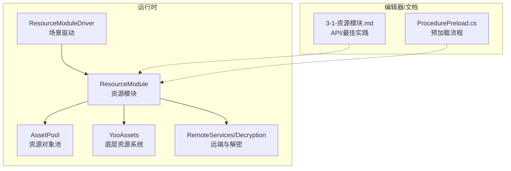
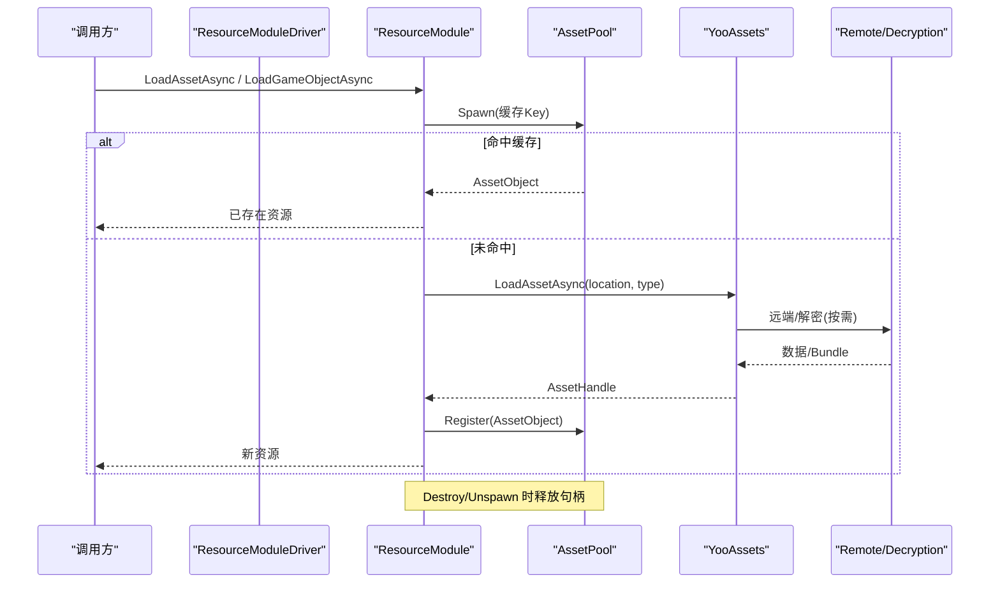
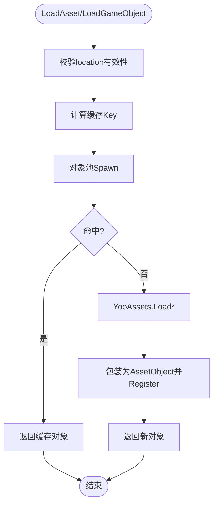
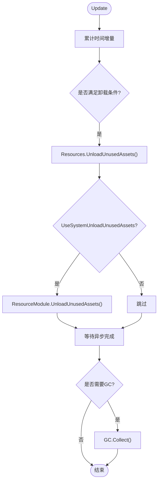
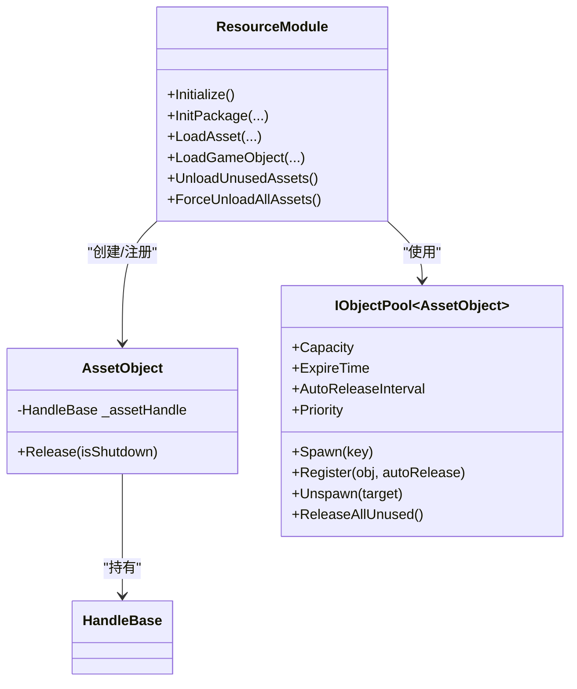
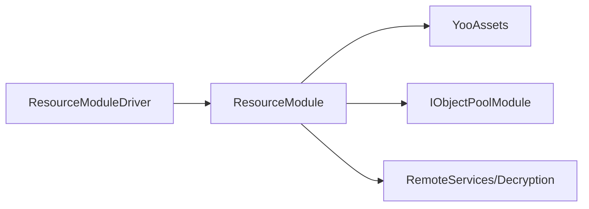

# 资源加载性能问题排查

<cite>
**本文引用的文件**   
- [3-1-资源模块.md](file://Books/3-1-资源模块.md)
- [ResourceModule.cs](file://UnityProject/Assets/TEngine/Runtime/Module/ResourceModule/ResourceModule.cs)
- [ResourceModuleDriver.cs](file://UnityProject/Assets/TEngine/Runtime/Module/ResourceModule/ResourceModuleDriver.cs)
- [ResourceModule.AssetObject.cs](file://UnityProject/Assets/TEngine/Runtime/Module/ResourceModule/ResourceModule.AssetObject.cs)
- [ResourceModule.Pool.cs](file://UnityProject/Assets/TEngine/Runtime/Module/ResourceModule/ResourceModule.Pool.cs)
- [ResourceModule.Services.cs](file://UnityProject/Assets/TEngine/Runtime/Module/ResourceModule/ResourceModule.Services.cs)
- [ProcedurePreload.cs](file://UnityProject/Assets/GameScripts/Procedure/ProcedurePreload.cs)
</cite>

## 目录
1. [引言](#引言)
2. [项目结构](#项目结构)
3. [核心组件](#核心组件)
4. [架构总览](#架构总览)
5. [详细组件分析](#详细组件分析)
6. [依赖关系分析](#依赖关系分析)
7. [性能考量与优化策略](#性能考量与优化策略)
8. [故障诊断与排错指南](#故障诊断与排错指南)
9. [结论](#结论)
10. [附录：基准测试与泄漏检测](#附录基准测试与泄漏检测)

## 引言
本指南聚焦 TEngine 框架在 YooAsset 之上的资源加载性能问题，围绕“卡顿、内存峰值过高、释放不及时”三大典型症状，提供从监控到定位再到优化的完整方法论。文档基于仓库中的资源模块实现与配置，结合 YooAsset 能力，给出可落地的诊断步骤、优化实践与基准测试方案，帮助开发者快速识别并解决资源加载性能瓶颈。

## 项目结构
资源模块位于 UnityProject/Assets/TEngine/Runtime/Module/ResourceModule，核心由以下文件组成：
- ResourceModule.cs：资源模块主逻辑（初始化、包管理、加载接口、回收）
- ResourceModuleDriver.cs：场景驱动脚本（参数注入、周期卸载、GC 触发）
- ResourceModule.AssetObject.cs：资源对象封装（句柄生命周期）
- ResourceModule.Pool.cs：资源对象池（容量、过期、优先级）
- ResourceModule.Services.cs：远端服务与解密服务
- Books/3-1-资源模块.md：资源模块使用文档与最佳实践
- ProcedurePreload.cs：预加载流程入口（用于启动期预取关键资源）

图表来源
- [ResourceModuleDriver.cs:236-270](file://UnityProject/Assets/TEngine/Runtime/Module/ResourceModule/ResourceModuleDriver.cs#L236-L270)
- [ResourceModule.cs:119-138](file://UnityProject/Assets/TEngine/Runtime/Module/ResourceModule/ResourceModule.cs#L119-L138)
- [ResourceModule.Pool.cs:59-66](file://UnityProject/Assets/TEngine/Runtime/Module/ResourceModule/ResourceModule.Pool.cs#L59-L66)
- [ResourceModule.Services.cs:12-32](file://UnityProject/Assets/TEngine/Runtime/Module/ResourceModule/ResourceModule.Services.cs#L12-L32)

章节来源
- [ResourceModule.cs:119-138](file://UnityProject/Assets/TEngine/Runtime/Module/ResourceModule/ResourceModule.cs#L119-L138)
- [ResourceModuleDriver.cs:236-270](file://UnityProject/Assets/TEngine/Runtime/Module/ResourceModule/ResourceModuleDriver.cs#L236-L270)
- [3-1-资源模块.md:1-150](file://Books/3-1-资源模块.md#L1-L150)

## 核心组件
- ResourceModule：对外暴露资源加载、查询、下载、清理等 API；内部维护默认包、包字典、资源信息缓存、正在加载集合；通过 YooAssets 完成实际加载与卸载。
- ResourceModuleDriver：将场景配置映射到 ResourceModule，负责周期性调用系统卸载与资源模块卸载，必要时触发 GC。
- AssetObject：包装 YooAsset 的 HandleBase，统一资源引用与释放。
- Pool：基于 IObjectPoolModule 创建多实例对象池，控制资源对象的复用、过期与自动释放。
- Services：远端地址拼接与多种解密实现（流式、偏移、Web）。

章节来源
- [ResourceModule.cs:17-117](file://UnityProject/Assets/TEngine/Runtime/Module/ResourceModule/ResourceModule.cs#L17-L117)
- [ResourceModule.Driver.cs:11-123](file://UnityProject/Assets/TEngine/Runtime/Module/ResourceModule/ResourceModuleDriver.cs#L11-L123)
- [ResourceModule.AssetObject.cs:11-62](file://UnityProject/Assets/TEngine/Runtime/Module/ResourceModule/ResourceModule.AssetObject.cs#L11-L62)
- [ResourceModule.Pool.cs:5-66](file://UnityProject/Assets/TEngine/Runtime/Module/ResourceModule/ResourceModule.Pool.cs#L5-L66)
- [ResourceModule.Services.cs:12-32](file://UnityProject/Assets/TEngine/Runtime/Module/ResourceModule/ResourceModule.Services.cs#L12-L32)

## 架构总览
下图展示一次典型异步资源加载的生命周期：从调用方进入 ResourceModule，经对象池命中或新建、YooAsset 加载、返回对象并注册到对象池，最终在销毁或超时后释放句柄。

图表来源
- [ResourceModule.cs:692-724](file://UnityProject/Assets/TEngine/Runtime/Module/ResourceModule/ResourceModule.cs#L692-L724)
- [ResourceModule.cs:727-759](file://UnityProject/Assets/TEngine/Runtime/Module/ResourceModule/ResourceModule.cs#L727-L759)
- [ResourceModule.AssetObject.cs:16-61](file://UnityProject/Assets/TEngine/Runtime/Module/ResourceModule/ResourceModule.AssetObject.cs#L16-L61)
- [ResourceModule.Services.cs:12-32](file://UnityProject/Assets/TEngine/Runtime/Module/ResourceModule/ResourceModule.Services.cs#L12-L32)

## 详细组件分析

### ResourceModule：加载、缓存与回收
- 初始化：设置 YooAssets 日志与时间切片，创建/获取默认包，绑定对象池。
- 包初始化：根据运行模式（EditorSimulateMode/OfflinePlayMode/HostPlayMode/WebPlayMode）构建不同参数，支持远程服务与 Web 解密。
- 资源加载：同步/异步接口均先走对象池缓存，未命中则通过 YooAssets 加载并注册到对象池。
- 回收机制：UnloadUnusedAssets 会遍历所有包执行卸载；ForceUnloadAllAssets 强制卸载全部；OnLowMemory 触发低内存回收。

图表来源
- [ResourceModule.cs:692-724](file://UnityProject/Assets/TEngine/Runtime/Module/ResourceModule/ResourceModule.cs#L692-L724)
- [ResourceModule.cs:727-759](file://UnityProject/Assets/TEngine/Runtime/Module/ResourceModule/ResourceModule.cs#L727-L759)

章节来源
- [ResourceModule.cs:119-138](file://UnityProject/Assets/TEngine/Runtime/Module/ResourceModule/ResourceModule.cs#L119-L138)
- [ResourceModule.cs:140-261](file://UnityProject/Assets/TEngine/Runtime/Module/ResourceModule/ResourceModule.cs#L140-L261)
- [ResourceModule.cs:390-447](file://UnityProject/Assets/TEngine/Runtime/Module/ResourceModule/ResourceModule.cs#L390-L447)
- [ResourceModule.cs:692-759](file://UnityProject/Assets/TEngine/Runtime/Module/ResourceModule/ResourceModule.cs#L692-L759)

### ResourceModuleDriver：周期卸载与GC
- 启动阶段：读取场景配置，注入到 ResourceModule，并设置远端地址、WebGL 加载方式、并发下载数、重试次数等。
- Update 循环：按最小/最大间隔触发 Resources.UnloadUnusedAssets()，并在启用系统卸载策略时调用 ResourceModule.UnloadUnusedAssets()；完成后若标记需要 GC，则执行 GC.Collect()。

图表来源
- [ResourceModuleDriver.cs:289-320](file://UnityProject/Assets/TEngine/Runtime/Module/ResourceModule/ResourceModuleDriver.cs#L289-L320)

章节来源
- [ResourceModuleDriver.cs:236-270](file://UnityProject/Assets/TEngine/Runtime/Module/ResourceModule/ResourceModuleDriver.cs#L236-L270)
- [ResourceModuleDriver.cs:289-320](file://UnityProject/Assets/TEngine/Runtime/Module/ResourceModule/ResourceModuleDriver.cs#L289-L320)

### AssetObject 与 Pool：句柄与复用
- AssetObject：持有 YooAsset HandleBase，在 Release 中确保句柄被 Dispose，避免资源泄漏。
- Pool：通过 IObjectPoolModule 创建多实例对象池，暴露容量、过期时间、优先级等参数，并提供 UnloadAsset 主动归还。

图表来源
- [ResourceModule.cs:692-724](file://UnityProject/Assets/TEngine/Runtime/Module/ResourceModule/ResourceModule.cs#L692-L724)
- [ResourceModule.AssetObject.cs:16-61](file://UnityProject/Assets/TEngine/Runtime/Module/ResourceModule/ResourceModule.AssetObject.cs#L16-L61)
- [ResourceModule.Pool.cs:5-66](file://UnityProject/Assets/TEngine/Runtime/Module/ResourceModule/ResourceModule.Pool.cs#L5-L66)

章节来源
- [ResourceModule.AssetObject.cs:11-62](file://UnityProject/Assets/TEngine/Runtime/Module/ResourceModule/ResourceModule.AssetObject.cs#L11-L62)
- [ResourceModule.Pool.cs:5-66](file://UnityProject/Assets/TEngine/Runtime/Module/ResourceModule/ResourceModule.Pool.cs#L5-L66)

### Services：远端与解密
- RemoteServices：拼接默认与备用远端 URL。
- 解密服务：支持 FileStream/FileOffset 两种解密方式，以及 WebGL 下的对应实现。
- BundleStream：自定义流，读取时对数据进行 XOR 解密。

章节来源
- [ResourceModule.Services.cs:12-32](file://UnityProject/Assets/TEngine/Runtime/Module/ResourceModule/ResourceModule.Services.cs#L12-L32)
- [ResourceModule.Services.cs:37-117](file://UnityProject/Assets/TEngine/Runtime/Module/ResourceModule/ResourceModule.Services.cs#L37-L117)
- [ResourceModule.Services.cs:122-197](file://UnityProject/Assets/TEngine/Runtime/Module/ResourceModule/ResourceModule.Services.cs#L122-L197)
- [ResourceModule.Services.cs:204-269](file://UnityProject/Assets/TEngine/Runtime/Module/ResourceModule/ResourceModule.Services.cs#L204-L269)

## 依赖关系分析
- ResourceModule 依赖 YooAssets 进行实际的资源加载与卸载，并通过 IObjectPoolModule 管理资源对象池。
- ResourceModuleDriver 作为 MonoBehaviour，负责将场景配置注入 ResourceModule，并周期性地触发系统卸载与资源模块卸载。
- Services 为可选扩展，提供远端访问与解密能力，影响网络 IO 与 CPU 开销。

图表来源
- [ResourceModuleDriver.cs:236-270](file://UnityProject/Assets/TEngine/Runtime/Module/ResourceModule/ResourceModuleDriver.cs#L236-L270)
- [ResourceModule.cs:119-138](file://UnityProject/Assets/TEngine/Runtime/Module/ResourceModule/ResourceModule.cs#L119-L138)
- [ResourceModule.Services.cs:12-32](file://UnityProject/Assets/TEngine/Runtime/Module/ResourceModule/ResourceModule.Services.cs#L12-L32)

章节来源
- [ResourceModuleDriver.cs:236-270](file://UnityProject/Assets/TEngine/Runtime/Module/ResourceModule/ResourceModuleDriver.cs#L236-L270)
- [ResourceModule.cs:119-138](file://UnityProject/Assets/TEngine/Runtime/Module/ResourceModule/ResourceModule.cs#L119-L138)

## 性能考量与优化策略

### 常见症状与根因
- 加载卡顿
  - 同步加载阻塞主线程
  - 大量资源同时加载导致 IO/CPU 峰值
  - 解密/解压开销过大
- 内存峰值过高
  - 对象池容量不足导致频繁分配
  - 资源未及时归还或释放
  - 图集/纹理重复加载
- 释放不及时
  - 未调用 UnloadUnusedAssets
  - 对象池过期时间过长
  - 手动持有引用未释放

### 优化清单
- 优先使用异步加载（UniTask），避免同步阻塞
- 合理设置 Milliseconds（每帧时间切片），平衡吞吐与卡顿
- 调整对象池容量、过期时间与自动释放间隔
- 使用预加载策略，提前加载首屏关键资源
- 合并小图到图集，减少 DrawCall 与加载次数
- 合理使用资源包，按模块拆分，降低单包体积
- 启用 AutoUnloadBundleWhenUnused，自动释放空闲包
- 定期调用 UnloadUnusedAssets，必要时触发 GC

章节来源
- [3-1-资源模块.md:24-28](file://Books/3-1-资源模块.md#L24-L28)
- [3-1-资源模块.md:581-637](file://Books/3-1-资源模块.md#L581-L637)
- [ResourceModule.cs:32-39](file://UnityProject/Assets/TEngine/Runtime/Module/ResourceModule/ResourceModule.cs#L32-L39)
- [ResourceModuleDriver.cs:155-179](file://UnityProject/Assets/TEngine/Runtime/Module/ResourceModule/ResourceModuleDriver.cs#L155-L179)

## 故障诊断与排错指南

### 诊断步骤
- 确认运行模式与远端配置
  - 检查 PlayMode、HostServerURL、FallbackHostServerURL、LoadResWayWebGL
- 观察加载耗时与卡顿
  - 统计 LoadAssetAsync/LoadGameObjectAsync 耗时
  - 关注 YooAssets.SetOperationSystemMaxTimeSlice(Milliseconds) 设置
- 监控内存峰值与释放
  - 观察 Resources.UnloadUnusedAssets 与 ResourceModule.UnloadUnusedAssets 调用时机
  - 检查对象池容量与过期时间
- 验证资源是否存在与是否需要远程下载
  - HasAsset/IsNeedDownloadFromRemote 辅助判断

### 常见问题定位
- 卡顿
  - 同步加载：改为异步
  - 并发过高：调低 DownloadingMaxNum
  - 解密开销：评估 FileStream/FileOffset 选择
- 内存峰值
  - 对象池过小：提高 AssetCapacity
  - 过期时间过长：缩短 AssetExpireTime
  - 未释放：确保 Destroy/Unspawn 路径正确
- 释放不及时
  - 未调用 UnloadUnusedAssets：启用 UseSystemUnloadUnusedAssets 或定时触发
  - GC 不触发：必要时允许 GC.Collect

章节来源
- [ResourceModuleDriver.cs:236-270](file://UnityProject/Assets/TEngine/Runtime/Module/ResourceModule/ResourceModuleDriver.cs#L236-L270)
- [ResourceModuleDriver.cs:289-320](file://UnityProject/Assets/TEngine/Runtime/Module/ResourceModule/ResourceModuleDriver.cs#L289-L320)
- [ResourceModule.cs:390-447](file://UnityProject/Assets/TEngine/Runtime/Module/ResourceModule/ResourceModule.cs#L390-L447)
- [ResourceModule.cs:458-602](file://UnityProject/Assets/TEngine/Runtime/Module/ResourceModule/ResourceModule.cs#L458-L602)

## 结论
通过合理利用 ResourceModule 提供的异步加载、对象池与回收机制，并结合 ResourceModuleDriver 的周期卸载策略，可以有效缓解资源加载卡顿与内存峰值问题。配合预加载、图集化、分包与合理的远端/解密配置，可在保证体验的同时提升整体性能稳定性。

## 附录：基准测试与泄漏检测

### 基准测试方法
- 启动期预加载
  - 使用 ProcedurePreload 预加载首屏关键资源，测量首次交互延迟
- 加载吞吐
  - 批量异步加载 N 个资源，统计平均/分位耗时与失败率
- 内存曲线
  - 记录加载前后内存峰值与稳定值，对比对象池容量与过期时间的影响
- 释放效果
  - 触发 UnloadUnusedAssets 与 GC，观察内存回落幅度与耗时

### 泄漏检测方案
- 句柄泄漏
  - 检查 AssetObject.Release 是否正确调用 HandleBase.Dispose
- 引用未释放
  - 确保 Destroy 或显式 UnloadAsset 路径可达
- 对象池泄漏
  - 核对 Spawn/Register/Unspawn 配对，避免悬挂引用
- 远端/解密异常
  - 检查 RemoteServices 与 Decryption 实现，避免异常路径下资源未释放

章节来源
- [ResourceModule.AssetObject.cs:50-61](file://UnityProject/Assets/TEngine/Runtime/Module/ResourceModule/ResourceModule.AssetObject.cs#L50-L61)
- [ResourceModule.Pool.cs:47-66](file://UnityProject/Assets/TEngine/Runtime/Module/ResourceModule/ResourceModule.Pool.cs#L47-L66)
- [ResourceModule.Services.cs:12-32](file://UnityProject/Assets/TEngine/Runtime/Module/ResourceModule/ResourceModule.Services.cs#L12-L32)
- [ProcedurePreload.cs](file://UnityProject/Assets/GameScripts/Procedure/ProcedurePreload.cs)