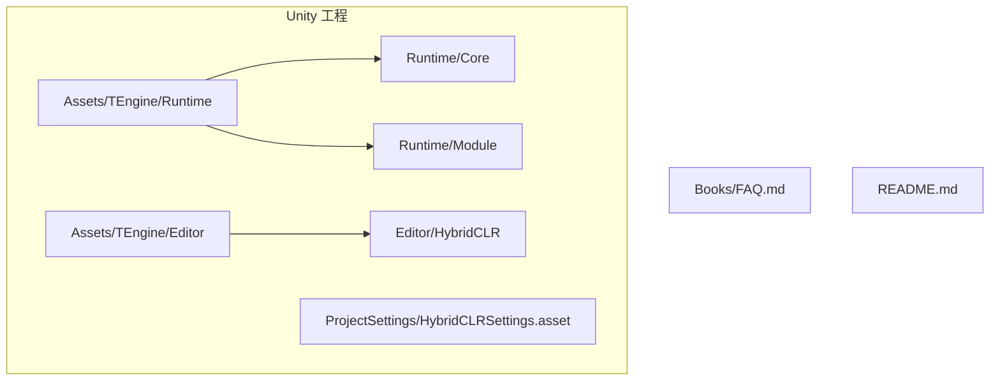
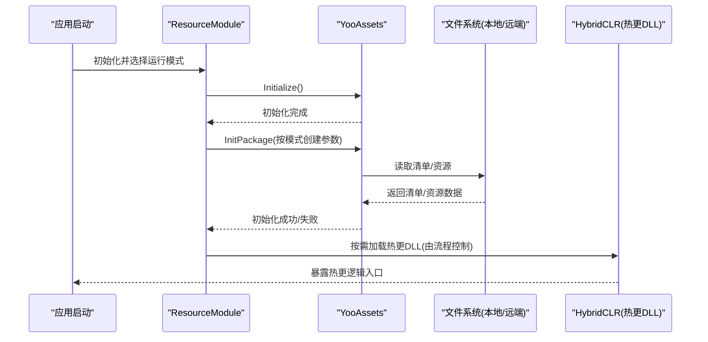
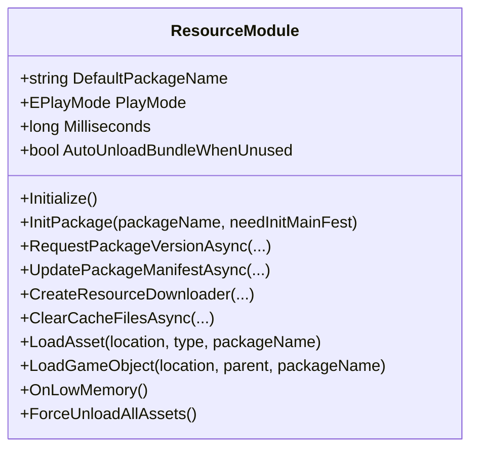
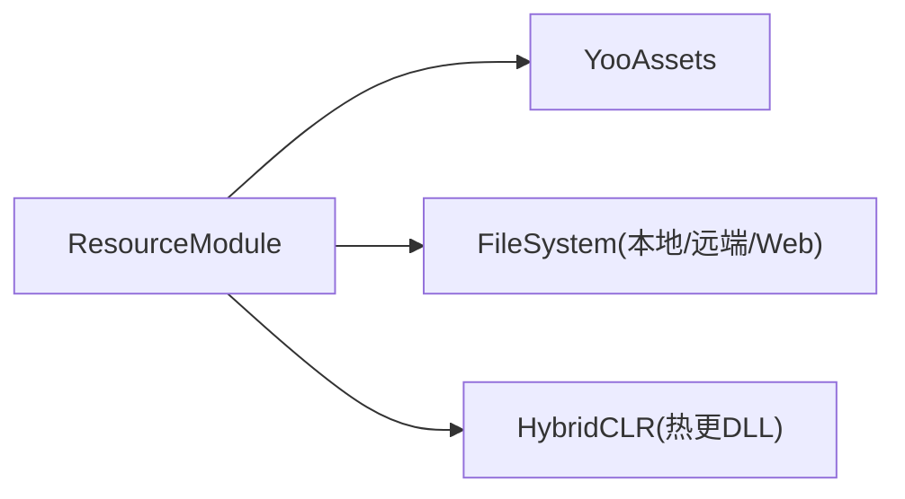
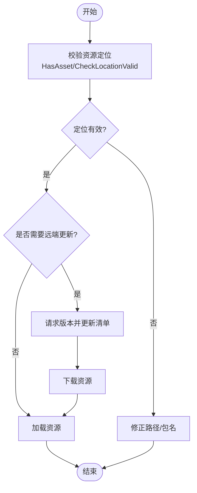

# 故障排除

<cite>
**本文引用的文件**   
- [README.md](file://README.md)
- [FAQ.md](file://Books/FAQ.md)
- [ResourceModule.cs](file://UnityProject/Assets/TEngine/Runtime/Module/ResourceModule/ResourceModule.cs)
- [HybridCLRSettings.asset](file://UnityProject/ProjectSettings/HybridCLRSettings.asset)
</cite>

## 目录
1. [简介](#简介)
2. [项目结构](#项目结构)
3. [核心组件](#核心组件)
4. [架构总览](#架构总览)
5. [详细组件分析](#详细组件分析)
6. [依赖关系分析](#依赖关系分析)
7. [性能注意事项](#性能注意事项)
8. [故障排除指南](#故障排除指南)
9. [结论](#结论)
10. [附录](#附录)

## 简介
本指南面向 TEngine 开发者，聚焦常见开发、环境、构建与热更新问题的诊断与解决。内容覆盖：
- 热更新（HybridCLR）配置错误、DLL 加载失败、版本不兼容
- 资源加载失败、内存溢出、性能瓶颈排查
- 日志分析、性能监控、调试工具使用
- 错误代码对照表、常见问题 FAQ、社区支持渠道
- 性能调优建议与优化技巧

## 项目结构
TEngine 在 Unity 工程中以模块化方式组织，关键路径包括：
- UnityProject/Assets/TEngine/Runtime：运行时核心模块（含资源、事件、内存池等）
- UnityProject/Assets/TEngine/Editor：编辑器工具与 HybridCLR 集成脚本
- UnityProject/ProjectSettings/HybridCLRSettings.asset：HybridCLR 工程级设置
- Books/FAQ.md：常见问题汇总与外部文档链接

图表来源
- [README.md:173-201](file://README.md#L173-L201)
- [HybridCLRSettings.asset](file://UnityProject/ProjectSettings/HybridCLRSettings.asset)

章节来源
- [README.md:173-201](file://README.md#L173-L201)

## 核心组件
- 资源模块（ResourceModule）：基于 YooAsset 的资源管理，提供多运行模式（编辑器模拟、离线、主机、WebGL）、包初始化、清单更新、下载器、缓存清理、低内存回收等能力。
- HybridCLR 集成：通过工程设置与编辑器工具完成热更新 DLL 生成与部署流程。
- 日志系统：统一日志输出，便于问题定位与性能分析。

章节来源
- [ResourceModule.cs:14-117](file://UnityProject/Assets/TEngine/Runtime/Module/ResourceModule/ResourceModule.cs#L14-L117)

## 架构总览
下图展示资源加载与热更新相关的关键交互：

图表来源
- [ResourceModule.cs:119-260](file://UnityProject/Assets/TEngine/Runtime/Module/ResourceModule/ResourceModule.cs#L119-L260)

## 详细组件分析

### 资源模块（ResourceModule）
- 职责
  - 初始化 YooAssets 与默认包
  - 根据运行模式（编辑器模拟、离线、主机、WebGL）创建对应参数并初始化包
  - 提供清单版本请求与更新、资源下载器、缓存清理、低内存回收
  - 提供同步/异步资源加载接口，封装 AssetHandle 生命周期
- 关键点
  - 运行模式分支决定文件系统与远程服务配置
  - WebGL 平台存在特殊处理（微信小游戏与浏览器差异）
  - 低内存回调触发强制卸载未使用资源

图表来源
- [ResourceModule.cs:14-117](file://UnityProject/Assets/TEngine/Runtime/Module/ResourceModule/ResourceModule.cs#L14-L117)
- [ResourceModule.cs:119-260](file://UnityProject/Assets/TEngine/Runtime/Module/ResourceModule/ResourceModule.cs#L119-L260)
- [ResourceModule.cs:390-447](file://UnityProject/Assets/TEngine/Runtime/Module/ResourceModule/ResourceModule.cs#L390-L447)
- [ResourceModule.cs:692-800](file://UnityProject/Assets/TEngine/Runtime/Module/ResourceModule/ResourceModule.cs#L692-L800)

章节来源
- [ResourceModule.cs:14-117](file://UnityProject/Assets/TEngine/Runtime/Module/ResourceModule/ResourceModule.cs#L14-L117)
- [ResourceModule.cs:119-260](file://UnityProject/Assets/TEngine/Runtime/Module/ResourceModule/ResourceModule.cs#L119-L260)
- [ResourceModule.cs:390-447](file://UnityProject/Assets/TEngine/Runtime/Module/ResourceModule/ResourceModule.cs#L390-L447)
- [ResourceModule.cs:692-800](file://UnityProject/Assets/TEngine/Runtime/Module/ResourceModule/ResourceModule.cs#L692-L800)

### 热更新（HybridCLR）
- 工程设置位于 ProjectSettings/HybridCLRSettings.asset
- 快速开始中提供了安装、启用符号、生成与构建的菜单步骤
- 常见问题可参考官方常见错误文档

章节来源
- [HybridCLRSettings.asset](file://UnityProject/ProjectSettings/HybridCLRSettings.asset)
- [README.md:75-84](file://README.md#L75-L84)

## 依赖关系分析
- ResourceModule 依赖 YooAsset 进行资源管理与文件系统访问
- 运行模式影响文件系统与远程服务的初始化参数
- WebGL 平台存在条件编译分支，需特别注意微信小游戏与浏览器的差异

图表来源
- [ResourceModule.cs:119-260](file://UnityProject/Assets/TEngine/Runtime/Module/ResourceModule/ResourceModule.cs#L119-L260)

章节来源
- [ResourceModule.cs:119-260](file://UnityProject/Assets/TEngine/Runtime/Module/ResourceModule/ResourceModule.cs#L119-L260)

## 性能注意事项
- 合理设置异步时间切片（Milliseconds），避免单帧耗时过长
- 开启自动卸载未使用的 Bundle（AutoUnloadBundleWhenUnused）以降低常驻内存
- 利用低内存回调（OnLowMemory）触发强制卸载策略
- 使用 LRU/ARC 缓存策略，减少重复加载与内存峰值

[本节为通用指导，不直接分析具体文件]

## 故障排除指南

### 一、环境与构建问题
- Unity 版本不匹配
  - 现象：编译报错或运行异常
  - 排查：确认 Unity 版本满足要求（推荐 2021.3.20f1c1）
  - 解决：升级或切换至推荐版本
- .NET 环境缺失
  - 现象：无法解析程序集或编译失败
  - 排查：检查 .NET 4.x 是否安装
  - 解决：安装对应 .NET SDK 或调整 Unity 目标框架

章节来源
- [README.md:54-59](file://README.md#L54-L59)

### 二、热更新（HybridCLR）问题
- 未安装或未启用 HybridCLR
  - 现象：热更新相关菜单不可用或构建失败
  - 排查：执行“HybridCLR/Install...”、“Define Symbols/Enable HybridCLR”
  - 解决：按顺序执行安装、启用符号、生成与构建
- 生成或构建失败
  - 现象：热更 DLL 未生成或拷贝失败
  - 排查：查看控制台错误；确认生成路径与权限
  - 解决：清理缓存后重试；检查路径定义脚本
- 版本不兼容
  - 现象：运行时报类型缺失或方法找不到
  - 排查：核对客户端与服务器/资源清单的版本一致性
  - 解决：重新打包资源与清单，确保版本号一致

章节来源
- [README.md:75-84](file://README.md#L75-L84)
- [HybridCLRSettings.asset](file://UnityProject/ProjectSettings/HybridCLRSettings.asset)

### 三、资源加载失败
- 资源定位无效
  - 现象：加载返回空或提示找不到位置
  - 排查：检查 location 与 packageName 是否正确；调用 HasAsset/CheckLocationValid 验证
  - 解决：修正资源路径或包名；确保 AB 已正确构建与发布
- 远端资源未更新
  - 现象：本地已有旧资源但远端有新版本
  - 排查：检查 RequestPackageVersionAsync 与 UpdatePackageManifestAsync 返回值
  - 解决：确保远端清单可达且版本正确；必要时清理缓存后重试
- WebGL 平台资源加载异常
  - 现象：浏览器或微信小游戏下资源加载失败
  - 排查：确认 LoadResWayWebGL 配置与 WeChatWASM 路径
  - 解决：按平台分支调整 WebServer/WebRemote 参数

图表来源
- [ResourceModule.cs:577-620](file://UnityProject/Assets/TEngine/Runtime/Module/ResourceModule/ResourceModule.cs#L577-L620)
- [ResourceModule.cs:314-341](file://UnityProject/Assets/TEngine/Runtime/Module/ResourceModule/ResourceModule.cs#L314-L341)
- [ResourceModule.cs:352-381](file://UnityProject/Assets/TEngine/Runtime/Module/ResourceModule/ResourceModule.cs#L352-L381)

章节来源
- [ResourceModule.cs:577-620](file://UnityProject/Assets/TEngine/Runtime/Module/ResourceModule/ResourceModule.cs#L577-L620)
- [ResourceModule.cs:314-341](file://UnityProject/Assets/TEngine/Runtime/Module/ResourceModule/ResourceModule.cs#L314-L341)
- [ResourceModule.cs:352-381](file://UnityProject/Assets/TEngine/Runtime/Module/ResourceModule/ResourceModule.cs#L352-L381)

### 四、内存溢出与资源泄漏
- 症状
  - 频繁 GC、卡顿、崩溃
  - 长时间运行后内存持续增长
- 排查
  - 观察 OnLowMemory 回调是否触发
  - 检查是否调用 UnloadUnusedAssets/ForceUnloadAllAssets
  - 确认资源引用计数是否正确释放
- 解决
  - 合理设置 AutoUnloadBundleWhenUnused
  - 使用对象池复用 GameObject/组件
  - 避免长生命周期持有短生命周期资源引用

章节来源
- [ResourceModule.cs:390-447](file://UnityProject/Assets/TEngine/Runtime/Module/ResourceModule/ResourceModule.cs#L390-L447)

### 五、性能瓶颈定位
- 指标采集
  - 使用 Unity Profiler 与帧率统计
  - 关注资源加载耗时、网络请求耗时、GC 次数
- 优化建议
  - 调整 Milliseconds 切分异步任务
  - 预加载关键资源，减少首屏等待
  - 合并小资源，减少 I/O 次数
  - 使用图集与压缩纹理降低显存占用

[本节为通用指导，不直接分析具体文件]

### 六、日志分析与调试工具
- 日志输出
  - 使用 Log.Info/Warning/Error/Fatal 分级记录关键流程
  - 在资源初始化、清单更新、下载阶段打印状态码
- 调试建议
  - 在 EditorSimulateMode 下优先验证资源路径与清单
  - 在 HostPlayMode 下检查远端地址与回退地址
  - 在 WebGL 下区分浏览器与微信小游戏行为差异

章节来源
- [ResourceModule.cs:173-233](file://UnityProject/Assets/TEngine/Runtime/Module/ResourceModule/ResourceModule.cs#L173-L233)

### 七、错误代码对照表
- 资源系统操作状态
  - Succeed：操作成功
  - Failed：操作失败
  - Processing：进行中
- 资源存在性判断
  - Valid：定位有效
  - NotExist：资源不存在
  - AssetOnline：需要远端更新
  - AssetOnDisk：本地可用
- 说明
  - 上述枚举值在资源模块内部用于流程控制与日志输出，建议在自定义流程中结合这些状态进行分支处理

章节来源
- [ResourceModule.cs:151-162](file://UnityProject/Assets/TEngine/Runtime/Module/ResourceModule/ResourceModule.cs#L151-L162)
- [ResourceModule.cs:577-602](file://UnityProject/Assets/TEngine/Runtime/Module/ResourceModule/ResourceModule.cs#L577-L602)

### 八、常见问题 FAQ
- 获取更多帮助
  - 常见错误详细文档（外部链接）
  - GitHub Issues
  - DeepWiki 文档
  - HybridCLR 官方常见错误文档

章节来源
- [FAQ.md:1-15](file://Books/FAQ.md#L1-L15)

### 九、社区支持与贡献
- 提交 Issue 与 Pull Request
- 赞助与支持项目发展

章节来源
- [README.md:307-334](file://README.md#L307-L334)

## 结论
通过系统化地检查环境、HybridCLR 配置、资源清单与远端服务，并结合日志与性能工具，可以快速定位并解决 TEngine 的热更新与资源加载问题。建议在生产环境中持续监控内存与帧率，配合合理的缓存与卸载策略，保障稳定与性能。

## 附录
- 快速开始中的 HybridCLR 步骤可作为热更新问题的第一排查点
- 资源模块的多运行模式参数是定位资源加载问题的关键线索

章节来源
- [README.md:75-84](file://README.md#L75-L84)
- [ResourceModule.cs:173-233](file://UnityProject/Assets/TEngine/Runtime/Module/ResourceModule/ResourceModule.cs#L173-L233)