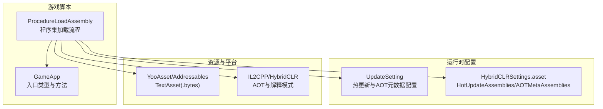
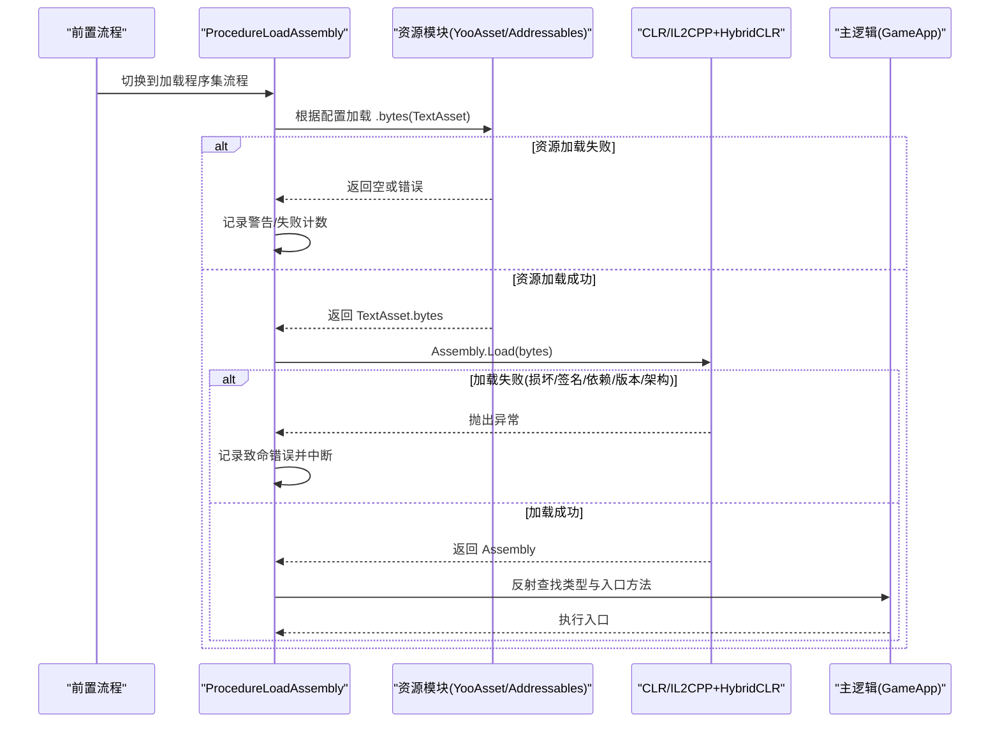
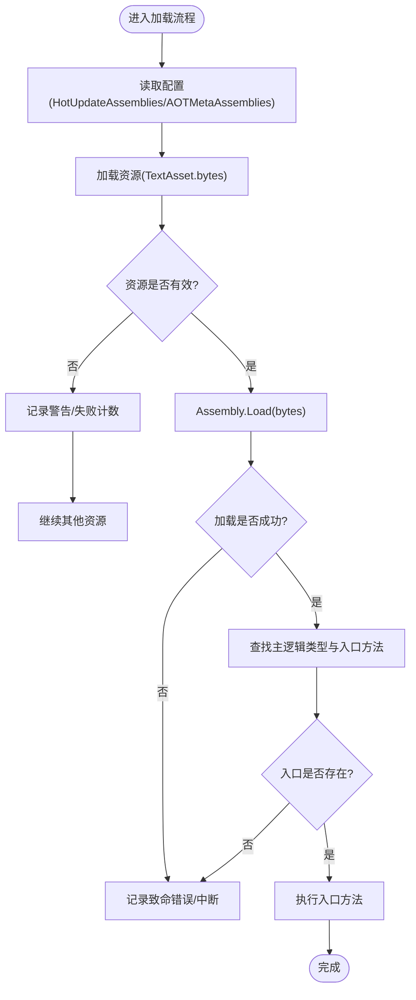
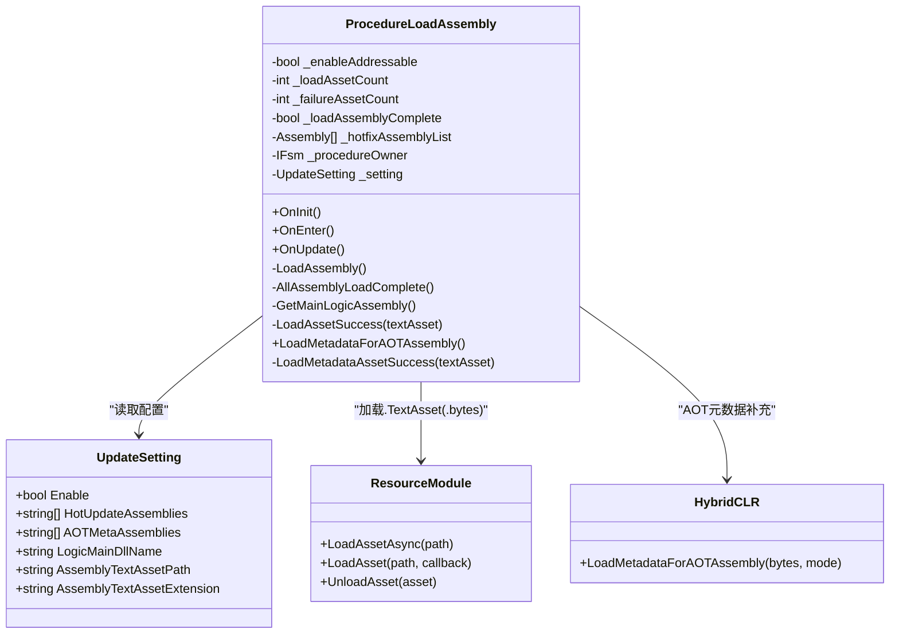

# DLL 加载失败问题排查

<cite>
**本文引用的文件**   
- [ProcedureLoadAssembly.cs](file://UnityProject/Assets/GameScripts/Procedure/ProcedureLoadAssembly.cs)
- [UpdateSetting.cs](file://UnityProject/Assets/TEngine/Runtime/Core/UpdateSetting.cs)
- [HybridCLRSettings.asset](file://UnityProject/ProjectSettings/HybridCLRSettings.asset)
- [Log.cs](file://UnityProject/Assets/TEngine/Runtime/Core/Log/Log.cs)
</cite>

## 目录
1. [简介](#简介)
2. [项目结构](#项目结构)
3. [核心组件](#核心组件)
4. [架构总览](#架构总览)
5. [详细组件分析](#详细组件分析)
6. [依赖关系分析](#依赖关系分析)
7. [性能与内存考量](#性能与内存考量)
8. [故障排查指南](#故障排查指南)
9. [结论](#结论)

## 简介
本指南聚焦于热更新场景下的 DLL 加载失败问题，结合 TEngine 的 HybridCLR 集成与资源加载流程，系统梳理常见原因（路径错误、权限不足、依赖缺失、签名验证失败、版本不兼容、架构不匹配等），并给出从日志分析到依赖检查、再到内存泄漏检测的完整排障方法。文档同时解释动态加载流程、内存映射与符号解析在 Unity + IL2CPP + HybridCLR 环境中的行为差异，帮助开发者快速定位与修复问题。

## 项目结构
本项目采用 Unity 工程组织方式，热更新相关代码集中在 GameScripts/Procedure 与 Runtime/Core 配置中；HybridCLR 设置位于 ProjectSettings。关键路径如下：
- 程序集加载流程：GameScripts/Procedure/ProcedureLoadAssembly.cs
- 热更新与 AOT 元数据配置：Runtime/Core/UpdateSetting.cs
- HybridCLR 全局设置：ProjectSettings/HybridCLRSettings.asset
- 日志输出：Runtime/Core/Log/Log.cs

图表来源
- [ProcedureLoadAssembly.cs:50-108](file://UnityProject/Assets/GameScripts/Procedure/ProcedureLoadAssembly.cs#L50-L108)
- [UpdateSetting.cs:59-90](file://UnityProject/Assets/TEngine/Runtime/Core/UpdateSetting.cs#L59-L90)
- [HybridCLRSettings.asset:19-23](file://UnityProject/ProjectSettings/HybridCLRSettings.asset#L19-L23)

章节来源
- [ProcedureLoadAssembly.cs:50-108](file://UnityProject/Assets/GameScripts/Procedure/ProcedureLoadAssembly.cs#L50-L108)
- [UpdateSetting.cs:59-90](file://UnityProject/Assets/TEngine/Runtime/Core/UpdateSetting.cs#L59-L90)
- [HybridCLRSettings.asset:19-23](file://UnityProject/ProjectSettings/HybridCLRSettings.asset#L19-L23)

## 核心组件
- ProcedureLoadAssembly：负责按配置加载主逻辑与热更新程序集，调用 YooAsset/Addressables 获取 TextAsset(.bytes)，并通过 Assembly.Load 完成加载；随后查找主逻辑类型与入口方法并启动。
- UpdateSetting：集中管理热更新程序集列表、AOT 元数据程序集、主逻辑程序集名、资源路径与扩展名等。
- HybridCLRSettings.asset：定义 HotUpdateAssemblies 与 AOT 相关参数，影响构建期裁剪与运行期元数据补充。
- Log：统一日志输出，便于追踪加载失败与异常堆栈。

章节来源
- [ProcedureLoadAssembly.cs:19-294](file://UnityProject/Assets/GameScripts/Procedure/ProcedureLoadAssembly.cs#L19-L294)
- [UpdateSetting.cs:50-90](file://UnityProject/Assets/TEngine/Runtime/Core/UpdateSetting.cs#L50-L90)
- [HybridCLRSettings.asset:19-23](file://UnityProject/ProjectSettings/HybridCLRSettings.asset#L19-L23)
- [Log.cs](file://UnityProject/Assets/TEngine/Runtime/Core/Log/Log.cs)

## 架构总览
下图展示从“进入加载流程”到“成功启动主逻辑”的关键步骤，以及可能失败的分支点。

图表来源
- [ProcedureLoadAssembly.cs:50-108](file://UnityProject/Assets/GameScripts/Procedure/ProcedureLoadAssembly.cs#L50-L108)
- [ProcedureLoadAssembly.cs:185-218](file://UnityProject/Assets/GameScripts/Procedure/ProcedureLoadAssembly.cs#L185-L218)
- [ProcedureLoadAssembly.cs:124-150](file://UnityProject/Assets/GameScripts/Procedure/ProcedureLoadAssembly.cs#L124-L150)

## 详细组件分析

### 程序集加载流程（ProcedureLoadAssembly）
- 初始化与进入：读取 UpdateSetting，准备加载主逻辑与热更新程序集。
- 资源加载：遍历 HotUpdateAssemblies，通过资源模块加载对应 TextAsset(.bytes)。
- 程序集加载：使用 Assembly.Load(bytes) 将字节数组加载为程序集。
- 主逻辑校验：查找主逻辑程序集、类型与入口方法，若缺失则记录致命错误。
- AOT 元数据：在非编辑器环境下，为 AOT 程序集加载原始元数据，避免泛型函数无 native 实现时崩溃。

图表来源
- [ProcedureLoadAssembly.cs:50-108](file://UnityProject/Assets/GameScripts/Procedure/ProcedureLoadAssembly.cs#L50-L108)
- [ProcedureLoadAssembly.cs:185-218](file://UnityProject/Assets/GameScripts/Procedure/ProcedureLoadAssembly.cs#L185-L218)
- [ProcedureLoadAssembly.cs:124-150](file://UnityProject/Assets/GameScripts/Procedure/ProcedureLoadAssembly.cs#L124-L150)

章节来源
- [ProcedureLoadAssembly.cs:50-108](file://UnityProject/Assets/GameScripts/Procedure/ProcedureLoadAssembly.cs#L50-L108)
- [ProcedureLoadAssembly.cs:185-218](file://UnityProject/Assets/GameScripts/Procedure/ProcedureLoadAssembly.cs#L185-L218)
- [ProcedureLoadAssembly.cs:124-150](file://UnityProject/Assets/GameScripts/Procedure/ProcedureLoadAssembly.cs#L124-L150)

### 配置项（UpdateSetting）
- Enable：控制是否启用热更新（受编译宏 ENABLE_HYBRIDCLR 影响）。
- HotUpdateAssemblies：热更新程序集名称列表，用于决定需要加载哪些 .bytes。
- AOTMetaAssemblies：需要补充元数据的 AOT 程序集列表，供 HybridCLR 在运行期进行解释模式回退。
- LogicMainDllName：主逻辑程序集名，用于识别并启动主逻辑。
- AssemblyTextAssetPath/Extension：资源目录与扩展名，决定 TextAsset 的资源路径。

章节来源
- [UpdateSetting.cs:59-90](file://UnityProject/Assets/TEngine/Runtime/Core/UpdateSetting.cs#L59-L90)

### HybridCLR 设置（HybridCLRSettings.asset）
- hotUpdateAssemblies：与 UpdateSetting.HotUpdateAssemblies 同步，决定构建期保留与打包的程序集。
- linkPreserveLevel/outputLinkFile：链接器保留级别与输出文件，影响运行期可发现性。
- outputAOTGenericReferenceFile/maxGenericReferenceIteration：AOT 泛型引用生成与迭代次数，影响解释模式回退能力。

章节来源
- [HybridCLRSettings.asset:19-23](file://UnityProject/ProjectSettings/HybridCLRSettings.asset#L19-L23)

## 依赖关系分析
- ProcedureLoadAssembly 依赖 UpdateSetting 提供程序集清单与路径。
- ProcedureLoadAssembly 依赖资源模块（YooAsset/Addressables）加载 TextAsset(.bytes)。
- ProcedureLoadAssembly 依赖 CLR/IL2CPP+HybridCLR 完成程序集加载与 AOT 元数据补充。
- 主逻辑（GameApp）作为入口类型被反射调用，需确保类型与入口方法存在。

图表来源
- [ProcedureLoadAssembly.cs:19-294](file://UnityProject/Assets/GameScripts/Procedure/ProcedureLoadAssembly.cs#L19-L294)
- [UpdateSetting.cs:50-90](file://UnityProject/Assets/TEngine/Runtime/Core/UpdateSetting.cs#L50-L90)

章节来源
- [ProcedureLoadAssembly.cs:19-294](file://UnityProject/Assets/GameScripts/Procedure/ProcedureLoadAssembly.cs#L19-L294)
- [UpdateSetting.cs:50-90](file://UnityProject/Assets/TEngine/Runtime/Core/UpdateSetting.cs#L50-L90)

## 性能与内存考量
- 程序集加载时机：在预加载完成后切换至加载程序集流程，避免阻塞首帧。
- 资源卸载：每次加载成功后立即 UnloadAsset，减少内存占用。
- AOT 元数据：仅在非编辑器环境下加载，避免不必要的开销。
- 反射调用：仅在主逻辑入口处进行一次反射查找，降低运行时成本。

章节来源
- [ProcedureLoadAssembly.cs:185-218](file://UnityProject/Assets/GameScripts/Procedure/ProcedureLoadAssembly.cs#L185-L218)
- [ProcedureLoadAssembly.cs:224-292](file://UnityProject/Assets/GameScripts/Procedure/ProcedureLoadAssembly.cs#L224-L292)

## 故障排查指南

### 一、常见加载失败原因与定位
- 路径错误
  - 现象：资源模块无法找到 .bytes 文件，返回空或错误。
  - 排查：核对 UpdateSetting.AssemblyTextAssetPath 与 AssemblyTextAssetExtension；确认 HotUpdateAssemblies 列表与实际文件名一致。
  - 参考：[UpdateSetting.cs:82-90](file://UnityProject/Assets/TEngine/Runtime/Core/UpdateSetting.cs#L82-L90)、[ProcedureLoadAssembly.cs:78-94](file://UnityProject/Assets/GameScripts/Procedure/ProcedureLoadAssembly.cs#L78-L94)

- 权限不足
  - 现象：Windows 平台下写入 StreamingAssets 或下载目录失败。
  - 排查：以管理员权限运行构建工具；检查目标目录写权限；确认资源服务器地址可访问。
  - 建议：在部署前校验目录权限与网络连通性。

- 依赖缺失
  - 现象：Assembly.Load 抛出 MissingMethodException/MissingFieldException。
  - 排查：确认所有依赖程序集已包含在 HotUpdateAssemblies；检查链接器保留级别与 link.xml 配置。
  - 参考：[HybridCLRSettings.asset:19-23](file://UnityProject/ProjectSettings/HybridCLRSettings.asset#L19-L23)

- 文件损坏
  - 现象：Assembly.Load 抛出 BadImageFormatException。
  - 排查：校验 .bytes 完整性（MD5/SHA）；重新构建并分发；检查传输过程是否被截断。
  - 参考：[ProcedureLoadAssembly.cs:197-212](file://UnityProject/Assets/GameScripts/Procedure/ProcedureLoadAssembly.cs#L197-L212)

- 签名验证失败
  - 现象：在强命名或企业安全策略下，程序集加载被拒绝。
  - 排查：确认程序集签名策略与信任链；必要时调整安全策略或移除强命名。
  - 注意：Unity/IL2CPP 通常不强制强命名，但企业环境可能有额外限制。

- 版本不兼容
  - 现象：运行时找不到所需 API 或类型签名变更导致加载失败。
  - 排查：保持主逻辑与热更新程序集的 ABI 兼容；避免破坏性变更；使用增量更新策略。
  - 建议：在 CI 中增加兼容性检查与回归测试。

- 架构不匹配
  - 现象：x86/x64/ARM 架构不一致导致加载失败。
  - 排查：确保构建目标与运行平台一致；检查 IL2CPP 输出与 HybridCLR 生成的 AOT 元数据是否匹配。
  - 参考：[UpdateSetting.cs:184-218](file://UnityProject/Assets/TEngine/Runtime/Core/UpdateSetting.cs#L184-L218)

### 二、安全机制导致的加载问题
- AOT 元数据缺失
  - 现象：AOT 泛型函数无 native 实现，运行时报错或崩溃。
  - 处理：为非编辑器环境加载 AOT 元数据，使 HybridCLR 自动替换为解释模式。
  - 参考：[ProcedureLoadAssembly.cs:224-292](file://UnityProject/Assets/GameScripts/Procedure/ProcedureLoadAssembly.cs#L224-L292)

- 链接器裁剪过度
  - 现象：运行期找不到类型或方法。
  - 处理：调整 linkPreserveLevel 与 link.xml，保留必要类型；检查 outputAOTGenericReferenceFile 生成是否正确。
  - 参考：[HybridCLRSettings.asset:23-29](file://UnityProject/ProjectSettings/HybridCLRSettings.asset#L23-L29)

### 三、技术细节与排障要点
- 动态加载流程
  - 资源加载：YooAsset/Addressables 加载 TextAsset(.bytes)。
  - 程序集加载：Assembly.Load(bytes) 将字节数组载入 CLR。
  - 入口调用：反射查找主逻辑类型与入口方法并执行。
  - 参考：[ProcedureLoadAssembly.cs:50-108](file://UnityProject/Assets/GameScripts/Procedure/ProcedureLoadAssembly.cs#L50-L108)、[ProcedureLoadAssembly.cs:185-218](file://UnityProject/Assets/GameScripts/Procedure/ProcedureLoadAssembly.cs#L185-L218)、[ProcedureLoadAssembly.cs:124-150](file://UnityProject/Assets/GameScripts/Procedure/ProcedureLoadAssembly.cs#L124-L150)

- 内存映射与符号解析
  - IL2CPP 将托管代码编译为原生代码，HybridCLR 在运行期为 AOT 程序集补充元数据并进行解释模式回退。
  - 符号解析失败通常由裁剪或依赖缺失引起，需检查链接器配置与依赖清单。
  - 参考：[ProcedureLoadAssembly.cs:224-292](file://UnityProject/Assets/GameScripts/Procedure/ProcedureLoadAssembly.cs#L224-L292)

### 四、日志分析与调试技巧
- 关键日志点
  - 资源加载失败：Load Asset failed。
  - 程序集加载异常：Assembly.Load 抛出的异常信息。
  - AOT 元数据加载结果：LoadMetadataForAOTAssembly 返回值与模式。
  - 主逻辑缺失：未找到主逻辑类型或入口方法。
  - 参考：[ProcedureLoadAssembly.cs:190-212](file://UnityProject/Assets/GameScripts/Procedure/ProcedureLoadAssembly.cs#L190-L212)、[ProcedureLoadAssembly.cs:278-285](file://UnityProject/Assets/GameScripts/Procedure/ProcedureLoadAssembly.cs#L278-L285)、[ProcedureLoadAssembly.cs:132-146](file://UnityProject/Assets/GameScripts/Procedure/ProcedureLoadAssembly.cs#L132-L146)

- 依赖关系检查
  - 使用 HybridCLR 工具检查 AOT 泛型引用与桥接方法是否生成。
  - 检查 link.xml 是否保留必要类型与字段。
  - 参考：[HybridCLRSettings.asset:23-29](file://UnityProject/ProjectSettings/HybridCLRSettings.asset#L23-L29)

- 内存泄漏检测
  - 观察 UnloadAsset 是否在每个资源加载成功后调用。
  - 使用 Unity Profiler 跟踪程序集与资源内存占用变化。
  - 参考：[ProcedureLoadAssembly.cs:217-218](file://UnityProject/Assets/GameScripts/Procedure/ProcedureLoadAssembly.cs#L217-L218)

章节来源
- [ProcedureLoadAssembly.cs:190-212](file://UnityProject/Assets/GameScripts/Procedure/ProcedureLoadAssembly.cs#L190-L212)
- [ProcedureLoadAssembly.cs:278-285](file://UnityProject/Assets/GameScripts/Procedure/ProcedureLoadAssembly.cs#L278-L285)
- [ProcedureLoadAssembly.cs:132-146](file://UnityProject/Assets/GameScripts/Procedure/ProcedureLoadAssembly.cs#L132-L146)
- [HybridCLRSettings.asset:23-29](file://UnityProject/ProjectSettings/HybridCLRSettings.asset#L23-L29)

## 结论
DLL 加载失败在热更新场景中多由路径、权限、依赖、签名、版本与架构等因素引发。通过规范配置（UpdateSetting/HybridCLRSettings）、完善资源加载与卸载流程、合理处理 AOT 元数据与链接器裁剪，并结合日志分析与依赖检查，可显著提升加载稳定性与可维护性。建议在 CI 中加入完整性校验与兼容性测试，持续优化热更新体验。