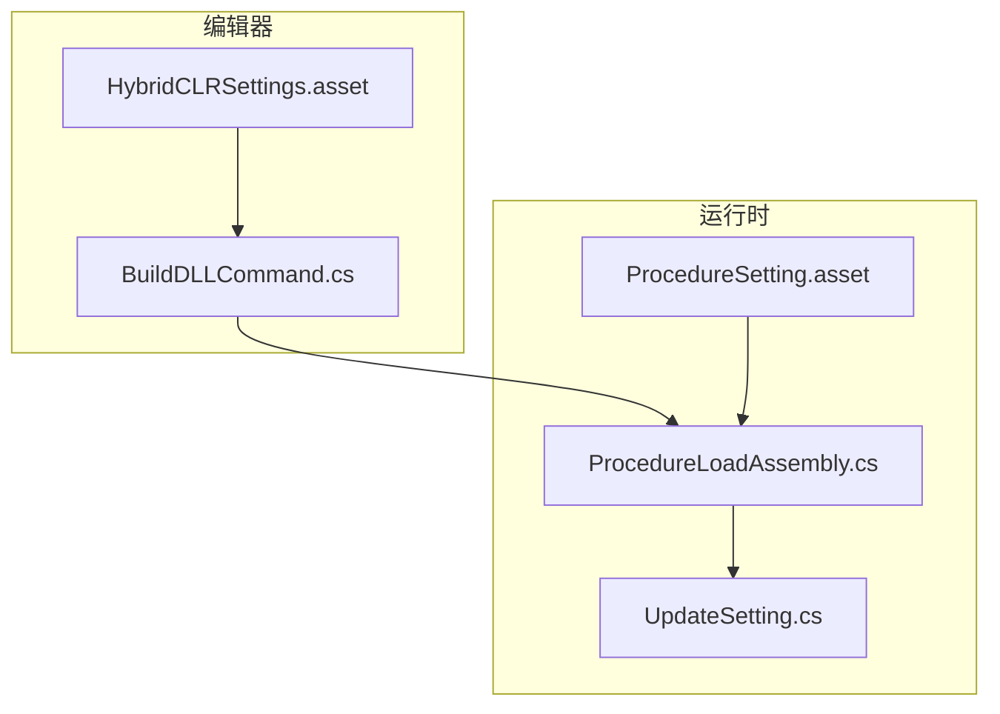
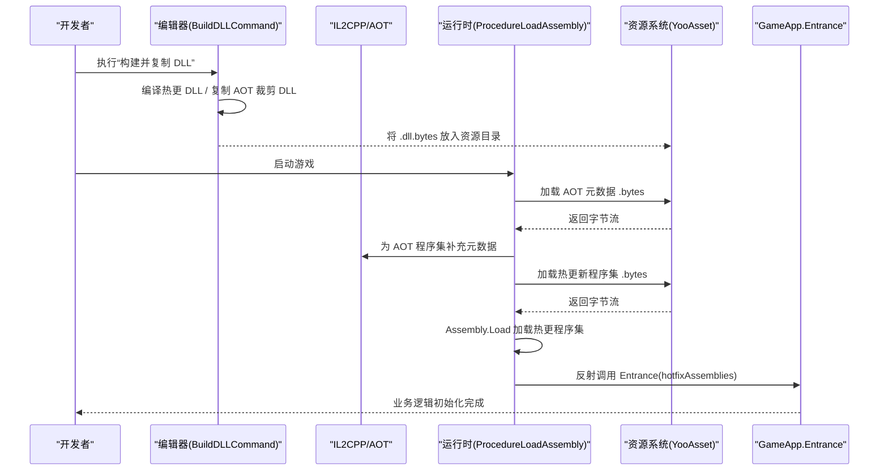
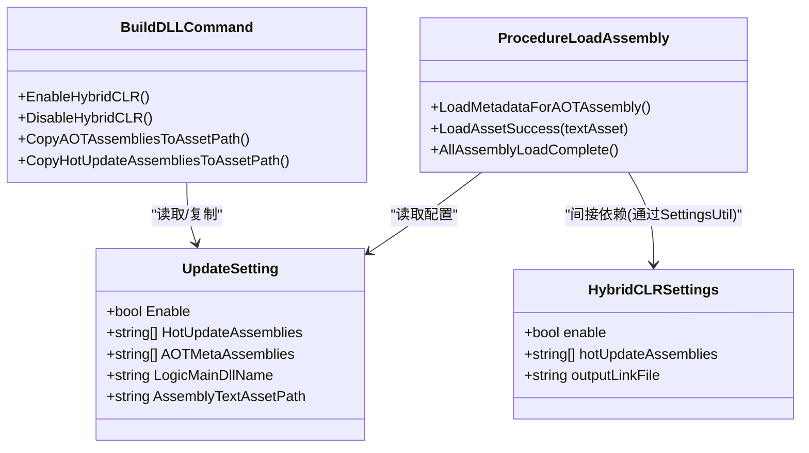

# HybridCLR 配置问题排查

<cite>
**本文引用的文件**   
- [README.md](file://README.md)
- [HybridCLRSettings.asset](file://UnityProject/ProjectSettings/HybridCLRSettings.asset)
- [BuildDLLCommand.cs](file://UnityProject/Assets/TEngine/Editor/HybridCLR/BuildDLLCommand.cs)
- [ProcedureLoadAssembly.cs](file://UnityProject/Assets/GameScripts/Procedure/ProcedureLoadAssembly.cs)
- [UpdateSetting.cs](file://UnityProject/Assets/TEngine/Runtime/Core/UpdateSetting.cs)
- [ProcedureSetting.asset](file://UnityProject/Assets/TEngine/Settings/ProcedureSetting.asset)
</cite>

## 目录
1. [简介](#简介)
2. [项目结构](#项目结构)
3. [核心组件](#核心组件)
4. [架构总览](#架构总览)
5. [详细组件分析](#详细组件分析)
6. [依赖关系分析](#依赖关系分析)
7. [性能与AOT限制](#性能与aot限制)
8. [常见问题与解决方案](#常见问题与解决方案)
9. [日志分析与调试指南](#日志分析与调试指南)
10. [结论](#结论)

## 简介
本指南聚焦于 TEngine 项目中 HybridCLR 的配置、安装、构建与运行期加载的常见问题排查，覆盖 Unity 版本兼容性、IL2CPP 编译选项、AOT 元数据补充、热更新域加载异常、类型映射错误等。文档结合仓库中的实际代码与配置，提供可操作的诊断步骤、流程图与排错清单，帮助快速定位并解决问题。

## 项目结构
本项目在 Unity 工程内通过以下关键位置集成 HybridCLR：
- 项目设置：HybridCLRSettings.asset（启用、仓库地址、热更程序集列表、链接器输出等）
- 编辑器工具：BuildDLLCommand.cs（宏开关、打包 AOT/热更 DLL、复制资源）
- 运行时流程：ProcedureLoadAssembly.cs（加载 AOT 元数据、加载热更程序集、调用主入口）
- 配置数据：UpdateSetting.cs（热更程序集、AOT 元数据、逻辑主程序集名、资源路径等）
- 流程注册：ProcedureSetting.asset（启动流程包含 ProcedureLoadAssembly）

图表来源
- [HybridCLRSettings.asset:1-30](file://UnityProject/ProjectSettings/HybridCLRSettings.asset#L1-L30)
- [BuildDLLCommand.cs:1-174](file://UnityProject/Assets/TEngine/Editor/HybridCLR/BuildDLLCommand.cs#L1-L174)
- [ProcedureLoadAssembly.cs:1-294](file://UnityProject/Assets/GameScripts/Procedure/ProcedureLoadAssembly.cs#L1-L294)
- [UpdateSetting.cs:50-90](file://UnityProject/Assets/TEngine/Runtime/Core/UpdateSetting.cs#L50-L90)
- [ProcedureSetting.asset:1-28](file://UnityProject/Assets/TEngine/Settings/ProcedureSetting.asset#L1-L28)

章节来源
- [README.md:52-85](file://README.md#L52-L85)
- [ProcedureSetting.asset:15-27](file://UnityProject/Assets/TEngine/Settings/ProcedureSetting.asset#L15-L27)

## 核心组件
- HybridCLRSettings.asset：控制是否启用 HybridCLR、仓库地址、热更新程序集列表、链接器输出路径、泛型引用迭代次数等。
- BuildDLLCommand.cs：提供菜单命令以启用/禁用 HybridCLR 宏定义；负责编译热更 DLL、复制 AOT 裁剪后 DLL 与热更 DLL 到资源目录；可选 Obfuz 混淆。
- ProcedureLoadAssembly.cs：启动阶段加载 AOT 元数据、加载热更新程序集、校验主逻辑程序集与入口方法，最终调用 GameApp.Entrance。
- UpdateSetting.cs：集中管理热更新相关配置，包括热更新程序集、AOT 元数据程序集、主逻辑程序集名、资源路径、平台名称等。
- ProcedureSetting.asset：声明可用的流程类型，确保 ProcedureLoadAssembly 被纳入启动流程。

章节来源
- [HybridCLRSettings.asset:15-30](file://UnityProject/ProjectSettings/HybridCLRSettings.asset#L15-L30)
- [BuildDLLCommand.cs:18-58](file://UnityProject/Assets/TEngine/Editor/HybridCLR/BuildDLLCommand.cs#L18-L58)
- [ProcedureLoadAssembly.cs:42-150](file://UnityProject/Assets/GameScripts/Procedure/ProcedureLoadAssembly.cs#L42-L150)
- [UpdateSetting.cs:59-90](file://UnityProject/Assets/TEngine/Runtime/Core/UpdateSetting.cs#L59-L90)
- [ProcedureSetting.asset:15-27](file://UnityProject/Assets/TEngine/Settings/ProcedureSetting.asset#L15-L27)

## 架构总览
下图展示从编辑器构建到运行时加载的关键交互：

图表来源
- [BuildDLLCommand.cs:86-134](file://UnityProject/Assets/TEngine/Editor/HybridCLR/BuildDLLCommand.cs#L86-L134)
- [ProcedureLoadAssembly.cs:50-150](file://UnityProject/Assets/GameScripts/Procedure/ProcedureLoadAssembly.cs#L50-L150)
- [ProcedureLoadAssembly.cs:220-292](file://UnityProject/Assets/GameScripts/Procedure/ProcedureLoadAssembly.cs#L220-L292)

## 详细组件分析

### 组件一：HybridCLRSettings.asset（全局设置）
- enable：是否启用 HybridCLR。
- hotUpdateAssemblies：热更新程序集列表（如 GameProto、GameLogic）。
- outputLinkFile、outputAOTGenericReferenceFile：链接器与泛型引用生成输出。
- maxGenericReferenceIteration、maxMethodBridgeGenericIteration：泛型桥接与引用迭代上限。

常见配置问题
- 未勾选 enable：导致运行时不进入热更新流程。
- hotUpdateAssemblies 与实际程序集不一致：导致找不到热更程序集或主逻辑程序集。
- linkPreserveLevel 过高：可能裁剪掉反射所需成员，引发类型映射错误。

章节来源
- [HybridCLRSettings.asset:15-30](file://UnityProject/ProjectSettings/HybridCLRSettings.asset#L15-L30)

### 组件二：BuildDLLCommand.cs（编辑器构建与复制）
职责
- 启用/禁用 ENABLE_HYBRIDCLR 宏定义。
- 编译热更 DLL（CompileDllCommand.CompileDll）。
- 复制 AOT 裁剪后的 DLL 与热更 DLL 到资源目录（AssemblyTextAssetPath）。
- 可选混淆（Obfuz）并复制混淆产物。

关键点
- CopyAOTAssembliesToAssetPath：读取 AssembliesPostIl2CppStrip/{Target} 下的裁剪 DLL，复制到 AssetRaw/DLL（默认）。
- CopyHotUpdateAssembliesToAssetPath：复制热更 DLL 到相同目录。
- 若开启 Obfuz，会先混淆再复制混淆产物。

常见问题
- 未先构建一次应用：AOT 裁剪 DLL 不存在，导致无法复制。
- 目标平台选择错误：复制路径与目标平台不匹配。
- 混淆后程序集名变化：需确保 SettingsUtil.HotUpdateAssemblyNamesIncludePreserved 与混淆输出一致。

章节来源
- [BuildDLLCommand.cs:21-58](file://UnityProject/Assets/TEngine/Editor/HybridCLR/BuildDLLCommand.cs#L21-L58)
- [BuildDLLCommand.cs:86-134](file://UnityProject/Assets/TEngine/Editor/HybridCLR/BuildDLLCommand.cs#L86-L134)
- [BuildDLLCommand.cs:136-174](file://UnityProject/Assets/TEngine/Editor/HybridCLR/BuildDLLCommand.cs#L136-L174)

### 组件三：ProcedureLoadAssembly.cs（运行时加载）
职责
- 在非编辑器环境下加载 AOT 元数据（LoadMetadataForAOTAssembly）。
- 加载热更新程序集（Assembly.Load），收集热更程序集列表。
- 查找主逻辑程序集（LogicMainDllName），反射调用 GameApp.Entrance。

关键流程
- LoadMetadataForAOTAssembly：遍历 AOTMetaAssemblies，加载对应 .bytes，调用 HybridCLR.RuntimeApi.LoadMetadataForAOTAssembly。
- LoadAssetSuccess：加载热更程序集字节流，Assembly.Load，记录成功/失败计数。
- AllAssemblyLoadComplete：校验主程序集与入口方法存在，调用入口。

常见问题
- AOT 元数据缺失：AOTMetaAssemblies 未配置或未复制 .bytes。
- 热更程序集未加载：HotUpdateAssemblies 与实际资源名不一致。
- 主逻辑程序集缺失：LogicMainDllName 与实际程序集名不一致。
- 入口方法缺失：GameApp.Entrance 不存在或签名不匹配。

章节来源
- [ProcedureLoadAssembly.cs:42-150](file://UnityProject/Assets/GameScripts/Procedure/ProcedureLoadAssembly.cs#L42-L150)
- [ProcedureLoadAssembly.cs:181-292](file://UnityProject/Assets/GameScripts/Procedure/ProcedureLoadAssembly.cs#L181-L292)

### 组件四：UpdateSetting.cs（热更新配置）
关键字段
- Enable：由 ENABLE_HYBRIDCLR 宏决定。
- HotUpdateAssemblies：热更新程序集列表。
- AOTMetaAssemblies：需要补充元数据的 AOT 程序集列表。
- LogicMainDllName：主逻辑程序集文件名（不含扩展名）。
- AssemblyTextAssetPath：程序集资源目录（默认 AssetRaw/DLL）。
- GetPlatformName：根据平台返回目录名（Android、IOS、Windows64 等）。

注意事项
- 若 ReplaceAssetPathWithAddress 开启，则使用 Addressable 替代路径，影响资源加载路径解析。
- WebGL 下 LoadResWayWebGL 决定远程或本地资源访问方式。

章节来源
- [UpdateSetting.cs:50-90](file://UnityProject/Assets/TEngine/Runtime/Core/UpdateSetting.cs#L50-L90)
- [UpdateSetting.cs:110-178](file://UnityProject/Assets/TEngine/Runtime/Core/UpdateSetting.cs#L110-L178)
- [UpdateSetting.cs:180-218](file://UnityProject/Assets/TEngine/Runtime/Core/UpdateSetting.cs#L180-L218)

### 组件五：ProcedureSetting.asset（流程注册）
- availableProcedureTypeNames 必须包含 Procedure.ProcedureLoadAssembly。
- entranceProcedureTypeName 指定启动入口流程（通常为 ProcedureLaunch）。

章节来源
- [ProcedureSetting.asset:15-27](file://UnityProject/Assets/TEngine/Settings/ProcedureSetting.asset#L15-L27)

## 依赖关系分析
- 编辑器侧：BuildDLLCommand 依赖 HybridCLR.SettingsUtil、InstallerController、SettingsUtil 等，负责宏开关与资源复制。
- 运行时侧：ProcedureLoadAssembly 依赖 UpdateSetting（读取配置）、YooAsset（加载资源）、HybridCLR.RuntimeApi（AOT 元数据）。
- 配置侧：HybridCLRSettings.asset 与 UpdateSetting.cs 共同决定热更程序集与 AOT 元数据。

图表来源
- [BuildDLLCommand.cs:18-58](file://UnityProject/Assets/TEngine/Editor/HybridCLR/BuildDLLCommand.cs#L18-L58)
- [ProcedureLoadAssembly.cs:50-150](file://UnityProject/Assets/GameScripts/Procedure/ProcedureLoadAssembly.cs#L50-L150)
- [UpdateSetting.cs:59-90](file://UnityProject/Assets/TEngine/Runtime/Core/UpdateSetting.cs#L59-L90)
- [HybridCLRSettings.asset:15-30](file://UnityProject/ProjectSettings/HybridCLRSettings.asset#L15-L30)

## 性能与AOT限制
- AOT 元数据补充：通过 LoadMetadataForAOTAssembly 为 AOT 程序集补充元数据，避免泛型函数无 native 实现时回退解释模式。
- 泛型引用迭代：HybridCLRSettings.asset 中 maxGenericReferenceIteration 与 maxMethodBridgeGenericIteration 控制泛型桥接与引用扫描深度，过大可能增加构建时间。
- 链接器裁剪：linkPreserveLevel 越高，保留越多，但包体增大；过低可能导致反射或动态调用失败。
- 资源加载：大量 .bytes 同时加载会增加内存峰值，建议分批加载并按需释放。

章节来源
- [HybridCLRSettings.asset:25-30](file://UnityProject/ProjectSettings/HybridCLRSettings.asset#L25-L30)
- [ProcedureLoadAssembly.cs:220-292](file://UnityProject/Assets/GameScripts/Procedure/ProcedureLoadAssembly.cs#L220-L292)

## 常见问题与解决方案

### 1. Unity 版本与平台兼容性
- 推荐 Unity 2021.3.20f1c1，支持 2019.4/2020.3/2021.3/2022.3。
- 平台：Windows、macOS、Android、iOS、WebGL、微信小游戏。
- 若出现 IL2CPP 编译失败，检查 Unity 版本与 HybridCLR 仓库地址是否匹配。

章节来源
- [README.md:52-60](file://README.md#L52-L60)
- [README.md:207-219](file://README.md#L207-L219)
- [HybridCLRSettings.asset:16-18](file://UnityProject/ProjectSettings/HybridCLRSettings.asset#L16-L18)

### 2. 插件安装与宏开关
- 启用 HybridCLR：菜单“HybridCLR/Define Symbols/Enable HybridCLR”，自动安装 HybridCLR 并添加 ENABLE_HYBRIDCLR 宏。
- 禁用 HybridCLR：菜单“HybridCLR/Define Symbols/Disable HybridCLR”，移除宏并关闭设置。
- 若安装失败，检查 InstallerController.HasInstalledHybridCLR 与 InstallDefaultHybridCLR 的执行结果。

章节来源
- [BuildDLLCommand.cs:21-58](file://UnityProject/Assets/TEngine/Editor/HybridCLR/BuildDLLCommand.cs#L21-L58)

### 3. IL2CPP 编译选项与链接器
- outputLinkFile：链接器输出 link.xml，用于保留反射所需类型。
- outputAOTGenericReferenceFile：AOT 泛型引用生成文件，避免泛型缺失。
- linkPreserveLevel：调整裁剪级别，平衡包体与功能完整性。

章节来源
- [HybridCLRSettings.asset:25-27](file://UnityProject/ProjectSettings/HybridCLRSettings.asset#L25-L27)

### 4. AOT 限制与元数据补充
- 必须在非编辑器环境加载 AOT 元数据（LoadMetadataForAOTAssembly）。
- AOTMetaAssemblies 必须包含所有需要反射或泛型的 AOT 程序集（如 mscorlib、System、TEngine.Runtime、UniTask、YooAsset）。
- 若出现“泛型函数无 native 实现”，确认已正确加载元数据且未过度裁剪。

章节来源
- [ProcedureLoadAssembly.cs:220-292](file://UnityProject/Assets/GameScripts/Procedure/ProcedureLoadAssembly.cs#L220-L292)
- [UpdateSetting.cs:71-76](file://UnityProject/Assets/TEngine/Runtime/Core/UpdateSetting.cs#L71-L76)

### 5. 热更新域加载异常
- 现象：热更程序集未加载或主逻辑程序集缺失。
- 排查：
  - 确认 HotUpdateAssemblies 与资源目录中的 .bytes 文件名一致。
  - 确认 LogicMainDllName 与实际主程序集名一致。
  - 确认 AssemblyTextAssetPath 指向正确的资源目录。
  - 检查 LoadAssetSuccess 是否抛出异常或计数未归零。

章节来源
- [ProcedureLoadAssembly.cs:70-150](file://UnityProject/Assets/GameScripts/Procedure/ProcedureLoadAssembly.cs#L70-L150)
- [UpdateSetting.cs:71-90](file://UnityProject/Assets/TEngine/Runtime/Core/UpdateSetting.cs#L71-L90)

### 6. 类型映射错误（反射/动态调用失败）
- 原因：链接器裁剪过度、未保留反射所需成员、混淆破坏符号。
- 解决：
  - 调整 linkPreserveLevel 或手动维护 link.xml。
  - 若启用 Obfuz，确保混淆后程序集名与 SettingsUtil.HotUpdateAssemblyNamesIncludePreserved 一致。
  - 对关键类型与方法添加 Preserve 属性或显式引用。

章节来源
- [BuildDLLCommand.cs:109-134](file://UnityProject/Assets/TEngine/Editor/HybridCLR/BuildDLLCommand.cs#L109-L134)
- [HybridCLRSettings.asset:25-27](file://UnityProject/ProjectSettings/HybridCLRSettings.asset#L25-L27)

### 7. 初始化失败（GameApp.Entrance 未调用）
- 现象：启动流程结束但未进入游戏逻辑。
- 排查：
  - 确认主逻辑程序集已加载且类型 GameApp 存在。
  - 确认入口方法 Entrance 存在且签名匹配。
  - 检查 AllAssemblyLoadComplete 的日志与条件分支。

章节来源
- [ProcedureLoadAssembly.cs:124-150](file://UnityProject/Assets/GameScripts/Procedure/ProcedureLoadAssembly.cs#L124-L150)

## 日志分析与调试指南

### 关键日志点
- ProcedureLoadAssembly.OnEnter：确认流程进入。
- LoadMetadataAssetSuccess：AOT 元数据加载结果与返回码。
- LoadAssetSuccess：热更程序集加载结果与程序集名。
- AllAssemblyLoadComplete：主程序集与入口方法校验结果。

### 调试步骤
1. 打开控制台，过滤“HybridCLR”“LoadMetadata”“LoadAsset”关键词。
2. 确认 AOT 元数据加载成功（返回码正常）。
3. 确认热更程序集全部加载成功（计数归零）。
4. 确认主程序集与入口方法存在。
5. 若失败，检查资源路径、程序集名、宏开关与链接器配置。

章节来源
- [ProcedureLoadAssembly.cs:42-48](file://UnityProject/Assets/GameScripts/Procedure/ProcedureLoadAssembly.cs#L42-L48)
- [ProcedureLoadAssembly.cs:260-292](file://UnityProject/Assets/GameScripts/Procedure/ProcedureLoadAssembly.cs#L260-L292)
- [ProcedureLoadAssembly.cs:181-218](file://UnityProject/Assets/GameScripts/Procedure/ProcedureLoadAssembly.cs#L181-L218)

### 性能监控技巧
- 观察热更程序集加载耗时与内存峰值。
- 分批加载 AOT 元数据与热更程序集，避免一次性加载过多 .bytes。
- 调整 maxGenericReferenceIteration 与 linkPreserveLevel，平衡构建时间与包体。

[本节为通用指导，不直接分析具体文件]

## 结论
通过合理配置 HybridCLRSettings.asset、正确使用 BuildDLLCommand 进行构建与资源复制、在运行时按顺序加载 AOT 元数据与热更程序集，并在 UpdateSetting 中保持程序集名与路径一致，可显著降低 HybridCLR 相关问题概率。遇到初始化失败、热更新域加载异常或类型映射错误时，优先检查宏开关、资源路径、程序集名、链接器裁剪与 AOT 元数据加载结果。结合日志分析与性能监控，可快速定位并修复问题。