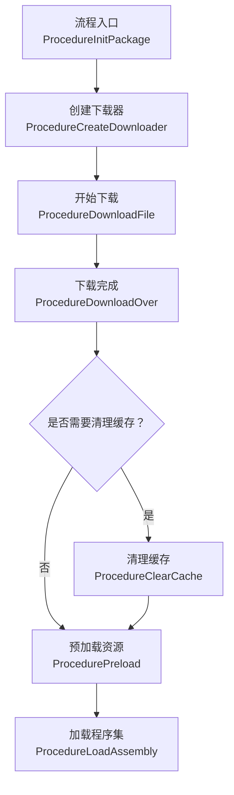
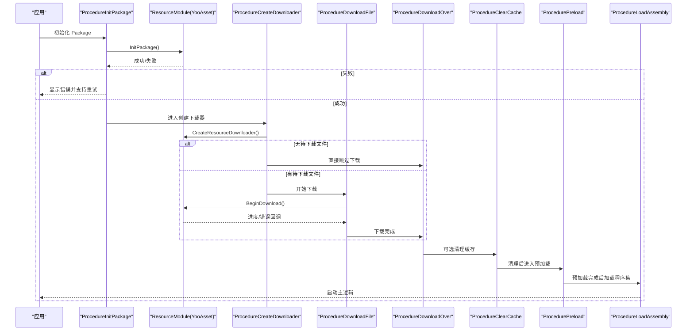
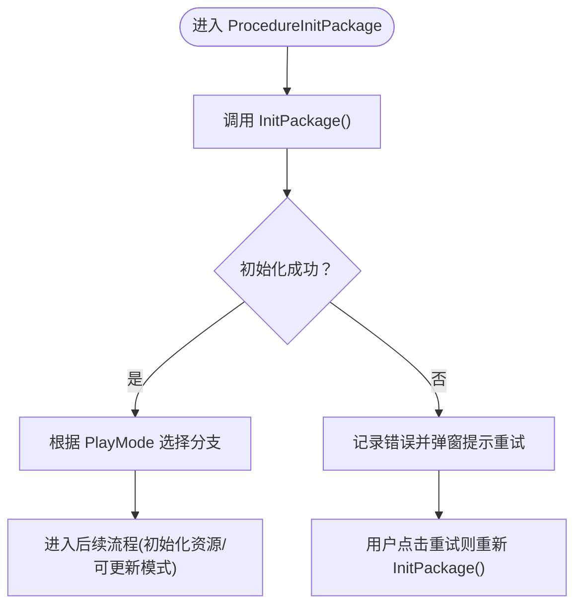
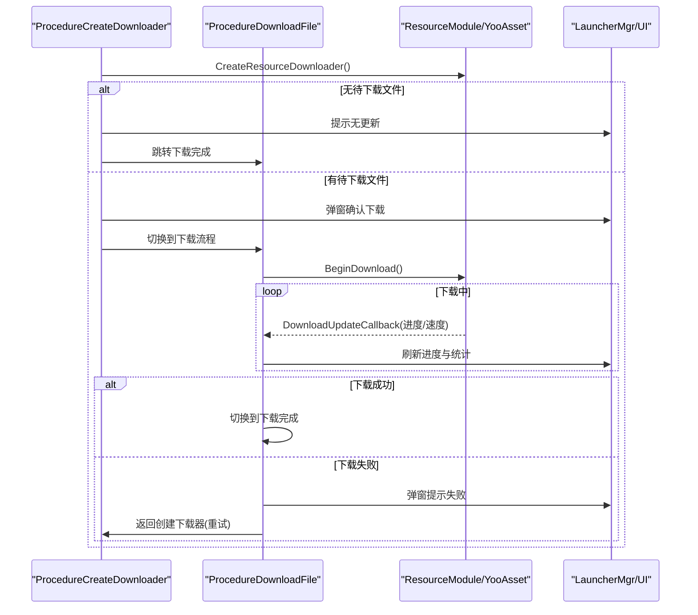
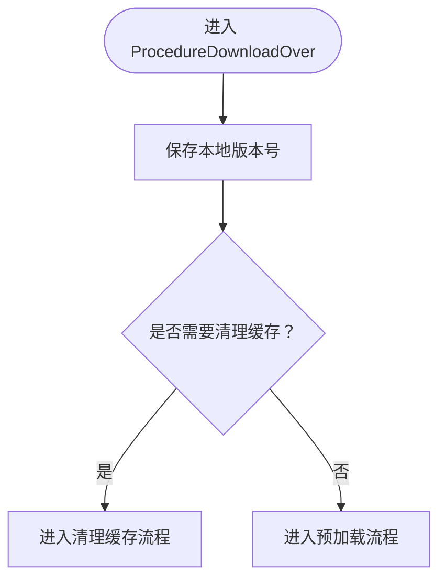
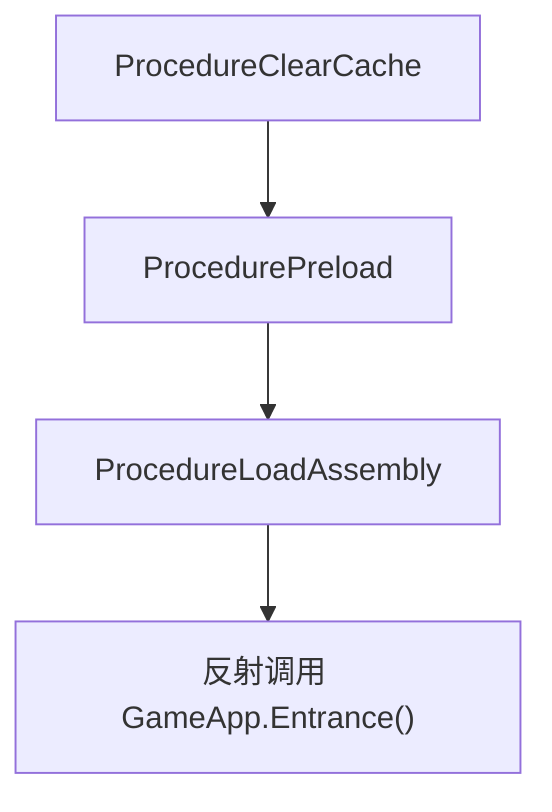
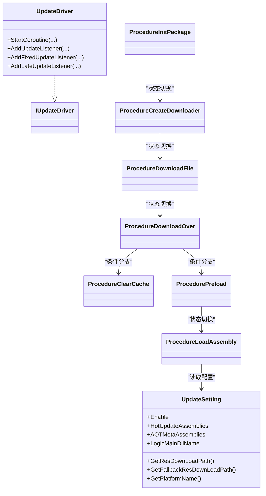

# 热更新流程异常排查

<cite>
**本文引用的文件**   
- [UpdateSetting.cs](file://UnityProject/Assets/TEngine/Runtime/Core/UpdateSetting.cs)
- [UpdateDriver.cs](file://UnityProject/Assets/TEngine/Runtime(Module)/UpdataDriver/UpdateDriver.cs)
- [IUpdateDriver.cs](file://UnityProject/Assets/TEngine/Runtime(Module)/UpdataDriver/IUpdateDriver.cs)
- [ProcedureInitPackage.cs](file://UnityProject/Assets/GameScripts/Procedure/ProcedureInitPackage.cs)
- [ProcedureCreateDownloader.cs](file://UnityProject/Assets/GameScripts/Procedure/ProcedureCreateDownloader.cs)
- [ProcedureDownloadFile.cs](file://UnityProject/Assets/GameScripts/Procedure/ProcedureDownloadFile.cs)
- [ProcedureDownloadOver.cs](file://UnityProject/Assets/GameScripts/Procedure/ProcedureDownloadOver.cs)
- [ProcedurePreload.cs](file://UnityProject/Assets/GameScripts/Procedure/ProcedurePreload.cs)
- [ProcedureLoadAssembly.cs](file://UnityProject/Assets/GameScripts/Procedure/ProcedureLoadAssembly.cs)
- [ProcedureClearCache.cs](file://UnityProject/Assets/GameScripts/Procedure/ProcedureClearCache.cs)
</cite>

## 目录
1. [引言](#引言)
2. [项目结构](#项目结构)
3. [核心组件](#核心组件)
4. [架构总览](#架构总览)
5. [详细组件分析](#详细组件分析)
6. [依赖关系分析](#依赖关系分析)
7. [性能与稳定性考量](#性能与稳定性考量)
8. [故障排查指南](#故障排查指南)
9. [结论](#结论)

## 引言
本指南聚焦于 TEngine 热更新流程的异常排查，覆盖启动失败、流程中断、状态同步异常等常见问题。围绕“检查—下载—验证—安装”四个阶段，结合代码实现给出诊断方法、处理策略与高级功能（监控、断点续传、重试）的配置建议，帮助开发者确保热更新的稳定性与可靠性。

## 项目结构
热更新相关流程由一组 Procedure 组成，配合 UpdateSetting 配置与 UpdateDriver 提供的运行时能力，驱动 YooAsset 完成资源初始化、补丁下载、缓存清理、预加载与程序集加载。

图表来源
- [ProcedureInitPackage.cs:31-89](file://UnityProject/Assets/GameScripts/Procedure/ProcedureInitPackage.cs#L31-L89)
- [ProcedureCreateDownloader.cs:30-74](file://UnityProject/Assets/GameScripts/Procedure/ProcedureCreateDownloader.cs#L30-L74)
- [ProcedureDownloadFile.cs:49-64](file://UnityProject/Assets/GameScripts/Procedure/ProcedureDownloadFile.cs#L49-L64)
- [ProcedureDownloadOver.cs:14-33](file://UnityProject/Assets/GameScripts/Procedure/ProcedureDownloadOver.cs#L14-L33)
- [ProcedurePreload.cs:118-173](file://UnityProject/Assets/GameScripts/Procedure/ProcedurePreload.cs#L118-L173)
- [ProcedureLoadAssembly.cs:50-150](file://UnityProject/Assets/GameScripts/Procedure/ProcedureLoadAssembly.cs#L50-L150)

章节来源
- [ProcedureInitPackage.cs:31-89](file://UnityProject/Assets/GameScripts/Procedure/ProcedureInitPackage.cs#L31-L89)
- [ProcedureCreateDownloader.cs:30-74](file://UnityProject/Assets/GameScripts/Procedure/ProcedureCreateDownloader.cs#L30-L74)
- [ProcedureDownloadFile.cs:49-64](file://UnityProject/Assets/GameScripts/Procedure/ProcedureDownloadFile.cs#L49-L64)
- [ProcedureDownloadOver.cs:14-33](file://UnityProject/Assets/GameScripts/Procedure/ProcedureDownloadOver.cs#L14-L33)
- [ProcedurePreload.cs:118-173](file://UnityProject/Assets/GameScripts/Procedure/ProcedurePreload.cs#L118-L173)
- [ProcedureLoadAssembly.cs:50-150](file://UnityProject/Assets/GameScripts/Procedure/ProcedureLoadAssembly.cs#L50-L150)

## 核心组件
- UpdateSetting：集中管理热更新开关、主逻辑 DLL、AOT 元数据列表、资源服务器地址、平台路径拼接、WebGL 加载方式等。
- UpdateDriver：封装协程调度与 Unity 生命周期事件注入，为流程提供稳定的运行环境。
- IUpdateDriver：对外暴露统一接口，解耦具体实现。
- Procedure*：按阶段组织热更新流程，负责状态切换、错误提示、重试与进度展示。

章节来源
- [UpdateSetting.cs:50-218](file://UnityProject/Assets/TEngine/Runtime/Core/UpdateSetting.cs#L50-L218)
- [UpdateDriver.cs:11-120](file://UnityProject/Assets/TEngine/Runtime(Module)/UpdataDriver/UpdateDriver.cs#L11-L120)
- [IUpdateDriver.cs:8-119](file://UnityProject/Assets/TEngine/Runtime(Module)/UpdataDriver/IUpdateDriver.cs#L8-L119)

## 架构总览
下图展示了热更新从资源初始化到游戏启动的关键调用链与状态流转。

图表来源
- [ProcedureInitPackage.cs:31-89](file://UnityProject/Assets/GameScripts/Procedure/ProcedureInitPackage.cs#L31-L89)
- [ProcedureCreateDownloader.cs:30-74](file://UnityProject/Assets/GameScripts/Procedure/ProcedureCreateDownloader.cs#L30-L74)
- [ProcedureDownloadFile.cs:49-64](file://UnityProject/Assets/GameScripts/Procedure/ProcedureDownloadFile.cs#L49-L64)
- [ProcedureDownloadOver.cs:14-33](file://UnityProject/Assets/GameScripts/Procedure/ProcedureDownloadOver.cs#L14-L33)
- [ProcedurePreload.cs:118-173](file://UnityProject/Assets/GameScripts/Procedure/ProcedurePreload.cs#L118-L173)
- [ProcedureLoadAssembly.cs:50-150](file://UnityProject/Assets/GameScripts/Procedure/ProcedureLoadAssembly.cs#L50-L150)

## 详细组件分析

### 阶段一：检查（资源初始化）
- 职责：初始化 YooAsset Package，根据 PlayMode 决定后续流程；失败时弹窗提示并支持重试。
- 关键点：
  - 初始化失败会捕获异常并输出错误信息，同时弹出重试对话框。
  - 针对特定 404 错误进行友好提示，便于定位清单缺失问题。
- 常见异常与处理：
  - 清单 404：检查本地 StreamingAssets/package/DefaultPackage/PackageManifest_DefaultPackage.version 是否存在。
  - 网络或路径错误：确认资源服务器地址与平台路径拼接正确。

图表来源
- [ProcedureInitPackage.cs:31-89](file://UnityProject/Assets/GameScripts/Procedure/ProcedureInitPackage.cs#L31-L89)

章节来源
- [ProcedureInitPackage.cs:31-89](file://UnityProject/Assets/GameScripts/Procedure/ProcedureInitPackage.cs#L31-L89)

### 阶段二：下载（补丁下载）
- 职责：创建下载器，统计待下载数量与大小，提示用户确认后开始下载；实时展示进度、速度与剩余时间；下载失败回退到创建下载器以重试。
- 关键点：
  - 使用 YooAsset 的 ResourceDownloaderOperation 进行下载。
  - 通过 DownloadErrorCallback 捕获单个文件下载失败，触发重试或退出。
  - 通过 DownloadUpdateCallback 刷新 UI 与日志。
- 常见异常与处理：
  - 单文件下载失败：弹窗提示文件名，允许重试或退出。
  - 无待下载文件：直接进入下载完成流程。

图表来源
- [ProcedureCreateDownloader.cs:30-74](file://UnityProject/Assets/GameScripts/Procedure/ProcedureCreateDownloader.cs#L30-L74)
- [ProcedureDownloadFile.cs:49-64](file://UnityProject/Assets/GameScripts/Procedure/ProcedureDownloadFile.cs#L49-L64)

章节来源
- [ProcedureCreateDownloader.cs:30-74](file://UnityProject/Assets/GameScripts/Procedure/ProcedureCreateDownloader.cs#L30-L74)
- [ProcedureDownloadFile.cs:49-64](file://UnityProject/Assets/GameScripts/Procedure/ProcedureDownloadFile.cs#L49-L64)

### 阶段三：验证（下载完成与版本保存）
- 职责：下载完成后保存本地版本号，并根据是否需清理缓存决定下一步。
- 关键点：
  - 将当前 PackageVersion 写入 PlayerPrefs，用于后续校验与回滚策略。
  - 若需要清理缓存，则进入清理流程；否则直接进入预加载。

图表来源
- [ProcedureDownloadOver.cs:14-33](file://UnityProject/Assets/GameScripts/Procedure/ProcedureDownloadOver.cs#L14-L33)

章节来源
- [ProcedureDownloadOver.cs:14-33](file://UnityProject/Assets/GameScripts/Procedure/ProcedureDownloadOver.cs#L14-L33)

### 阶段四：安装（清理缓存、预加载、加载程序集）
- 清理缓存：异步清理未使用的缓存文件，完成后进入预加载。
- 预加载：按标签（PRELOAD、WEBGL_PRELOAD）批量预加载资源，更新 UI 进度，完成后进入程序集加载。
- 加载程序集：在启用 HybridCLR 的情况下，先加载 AOT 元数据，再加载热更新程序集；最终反射调用主逻辑入口。

图表来源
- [ProcedureClearCache.cs:16-33](file://UnityProject/Assets/GameScripts/Procedure/ProcedureClearCache.cs#L16-L33)
- [ProcedurePreload.cs:118-173](file://UnityProject/Assets/GameScripts/Procedure/ProcedurePreload.cs#L118-L173)
- [ProcedureLoadAssembly.cs:50-150](file://UnityProject/Assets/GameScripts/Procedure/ProcedureLoadAssembly.cs#L50-L150)

章节来源
- [ProcedureClearCache.cs:16-33](file://UnityProject/Assets/GameScripts/Procedure/ProcedureClearCache.cs#L16-L33)
- [ProcedurePreload.cs:118-173](file://UnityProject/Assets/GameScripts/Procedure/ProcedurePreload.cs#L118-L173)
- [ProcedureLoadAssembly.cs:50-150](file://UnityProject/Assets/GameScripts/Procedure/ProcedureLoadAssembly.cs#L50-L150)

## 依赖关系分析
- UpdateSetting 被 ProcedureLoadAssembly 读取，用于确定热更新程序集、AOT 元数据、主逻辑 DLL 名称与资源路径。
- UpdateDriver 提供协程与帧事件注入，供各流程稳定运行。
- 各 Procedure 通过 _resourceModule 访问 YooAsset 的能力（InitPackage、CreateResourceDownloader、LoadAssetAsync、ClearCacheFilesAsync 等）。

图表来源
- [UpdateSetting.cs:50-218](file://UnityProject/Assets/TEngine/Runtime/Core/UpdateSetting.cs#L50-L218)
- [UpdateDriver.cs:11-120](file://UnityProject/Assets/TEngine/Runtime(Module)/UpdataDriver/UpdateDriver.cs#L11-L120)
- [IUpdateDriver.cs:8-119](file://UnityProject/Assets/TEngine/Runtime(Module)/UpdataDriver/IUpdateDriver.cs#L8-L119)
- [ProcedureInitPackage.cs:31-89](file://UnityProject/Assets/GameScripts/Procedure/ProcedureInitPackage.cs#L31-L89)
- [ProcedureCreateDownloader.cs:30-74](file://UnityProject/Assets/GameScripts/Procedure/ProcedureCreateDownloader.cs#L30-L74)
- [ProcedureDownloadFile.cs:49-64](file://UnityProject/Assets/GameScripts/Procedure/ProcedureDownloadFile.cs#L49-L64)
- [ProcedureDownloadOver.cs:14-33](file://UnityProject/Assets/GameScripts/Procedure/ProcedureDownloadOver.cs#L14-L33)
- [ProcedurePreload.cs:118-173](file://UnityProject/Assets/GameScripts/Procedure/ProcedurePreload.cs#L118-L173)
- [ProcedureLoadAssembly.cs:50-150](file://UnityProject/Assets/GameScripts/Procedure/ProcedureLoadAssembly.cs#L50-L150)

章节来源
- [UpdateSetting.cs:50-218](file://UnityProject/Assets/TEngine/Runtime/Core/UpdateSetting.cs#L50-L218)
- [UpdateDriver.cs:11-120](file://UnityProject/Assets/TEngine/Runtime(Module)/UpdataDriver/UpdateDriver.cs#L11-L120)
- [IUpdateDriver.cs:8-119](file://UnityProject/Assets/TEngine/Runtime(Module)/UpdataDriver/IUpdateDriver.cs#L8-L119)

## 性能与稳定性考量
- 下载进度与速度计算：采用滑动窗口平均速度，避免瞬时抖动影响 UI 体验。
- 预加载分批与标签化：通过 PRELOAD/WEBGL_PRELOAD 标签控制不同平台的预加载范围，减少首屏压力。
- 资源卸载：程序集加载成功后及时 UnloadAsset，降低内存占用。
- 平台适配：UpdateSetting.GetPlatformName 自动拼接平台目录，避免跨平台路径错误。

[本节为通用指导，不直接分析具体文件]

## 故障排查指南

### 启动失败（资源初始化阶段）
- 现象：初始化 Package 失败，弹窗提示“资源初始化失败”，可能包含 HTTP 404。
- 排查步骤：
  1. 检查本地清单文件是否存在：StreamingAssets/package/DefaultPackage/PackageManifest_DefaultPackage.version。
  2. 核对 UpdateSetting 中的资源服务器地址与平台路径是否正确。
  3. 观察日志中的 initializationOperation.Error 详情。
- 处理策略：
  - 若为 404，补充清单文件或修正路径。
  - 若为网络错误，检查网络连通性与代理设置。
  - 使用内置重试机制再次尝试初始化。

章节来源
- [ProcedureInitPackage.cs:71-118](file://UnityProject/Assets/GameScripts/Procedure/ProcedureInitPackage.cs#L71-L118)

### 流程中断（下载阶段）
- 现象：单个文件下载失败，弹窗提示文件名，可选择重试或退出。
- 排查步骤：
  1. 查看 DownloadErrorCallback 中的 FileName 与错误码。
  2. 检查该文件在资源服务器的可用性与权限。
  3. 确认磁盘空间充足（创建下载器前已有提示）。
- 处理策略：
  - 对临时性网络错误，允许重试（回到 ProcedureCreateDownloader）。
  - 对持久性资源缺失，修正服务端资源或客户端路径。

章节来源
- [ProcedureDownloadFile.cs:66-70](file://UnityProject/Assets/GameScripts/Procedure/ProcedureDownloadFile.cs#L66-L70)
- [ProcedureCreateDownloader.cs:57-68](file://UnityProject/Assets/GameScripts/Procedure/ProcedureCreateDownloader.cs#L57-L68)

### 状态同步异常（流程状态机）
- 现象：流程卡在某一阶段，UI 不更新或进度不变化。
- 排查步骤：
  1. 检查 OnEnter/OnUpdate 中是否调用了 ChangeState/ChangeProcedureToLoadAssembly。
  2. 确认 UI 刷新逻辑（LauncherMgr.ShowUI/RefreshProgress）是否正常执行。
  3. 观察日志输出，确认关键节点是否到达。
- 处理策略：
  - 在关键节点增加日志与埋点，确保状态切换路径完整。
  - 对长时间阻塞的操作（如 BeginDownload），确保异步回调能正确推进流程。

章节来源
- [ProcedureDownloadFile.cs:49-64](file://UnityProject/Assets/GameScripts/Procedure/ProcedureDownloadFile.cs#L49-L64)
- [ProcedurePreload.cs:54-100](file://UnityProject/Assets/GameScripts/Procedure/ProcedurePreload.cs#L54-L100)

### 资源校验错误（程序集加载阶段）
- 现象：程序集加载失败，日志出现“Main logic assembly missing”或类型/入口方法缺失。
- 排查步骤：
  1. 核对 UpdateSetting.LogicMainDllName 与实际主逻辑 DLL 名称一致。
  2. 检查热更新程序集是否已正确加载（HotUpdateAssemblies 列表）。
  3. 确认主逻辑类名与入口方法名（GameApp.Entrance）存在且可反射调用。
- 处理策略：
  - 修正程序集命名与配置。
  - 确保 ENABLE_HYBRIDCLR 宏定义与 Player Settings 一致。
  - 若 AOT 元数据缺失，检查 AOTMetaAssemblies 列表与对应资源。

章节来源
- [ProcedureLoadAssembly.cs:124-150](file://UnityProject/Assets/GameScripts/Procedure/ProcedureLoadAssembly.cs#L124-L150)
- [ProcedureLoadAssembly.cs:152-179](file://UnityProject/Assets/GameScripts/Procedure/ProcedureLoadAssembly.cs#L152-L179)
- [ProcedureLoadAssembly.cs:224-292](file://UnityProject/Assets/GameScripts/Procedure/ProcedureLoadAssembly.cs#L224-L292)

### 网络请求失败
- 现象：初始化或下载阶段报网络错误。
- 排查步骤：
  1. 检查 UpdateSetting.ResDownLoadPath 与 FallbackResDownLoadPath 是否可达。
  2. 确认平台路径拼接结果（GetPlatformName）与服务端目录一致。
  3. 观察浏览器或抓包工具，确认请求 URL 与响应状态。
- 处理策略：
  - 修正服务器地址与端口。
  - 配置备用地址以实现故障转移。
  - 在网络不稳定场景下，增加重试与退避策略（可在上层封装）。

章节来源
- [UpdateSetting.cs:167-178](file://UnityProject/Assets/TEngine/Runtime/Core/UpdateSetting.cs#L167-L178)
- [UpdateSetting.cs:184-218](file://UnityProject/Assets/TEngine/Runtime/Core/UpdateSetting.cs#L184-L218)

### 断点续传与重试机制
- 现状：
  - 下载失败时仅对单个文件触发回调，未实现断点续传。
  - 初始化阶段有重试按钮，但下载阶段的重试依赖于用户交互。
- 建议：
  - 在 ProcedureDownloadFile 中引入断点续传逻辑（基于 YooAsset 的 Resume 能力或自定义分片）。
  - 对网络错误实现指数退避重试，限制最大重试次数。
  - 在下载开始前检测磁盘空间，不足时提前提示并中止流程。

[本节为通用指导，不直接分析具体文件]

### 监控与日志
- 建议在以下位置增加结构化日志与埋点：
  - 初始化成功/失败、PlayMode 分支。
  - 创建下载器、发现待下载文件数量与大小。
  - 下载进度、速度、剩余时间、错误回调。
  - 清理缓存完成、预加载完成、程序集加载完成。
- 使用 UpdateDriver 的 AddUpdateListener 等接口，确保在正确的线程与生命周期内上报。

章节来源
- [UpdateDriver.cs:122-202](file://UnityProject/Assets/TEngine/Runtime(Module)/UpdataDriver/UpdateDriver.cs#L122-L202)

## 结论
通过对热更新各阶段的深入分析与可视化，明确了检查、下载、验证、安装的关键风险点与处理策略。结合 UpdateSetting 的配置能力与 UpdateDriver 的运行支撑，开发者可在现有流程基础上增强断点续传、重试与监控能力，显著提升热更新的稳定性与用户体验。实际落地时，建议优先完善错误分类与重试策略，并建立完善的日志与埋点体系，以便快速定位与修复问题。