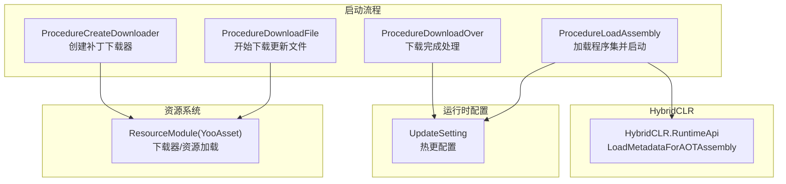
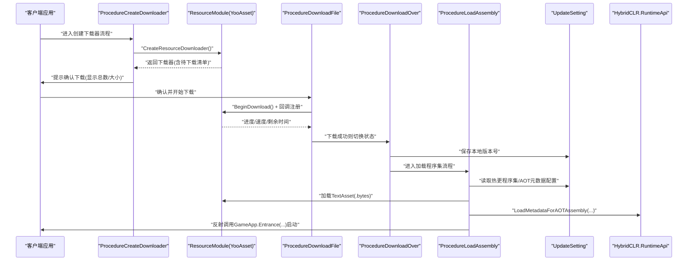
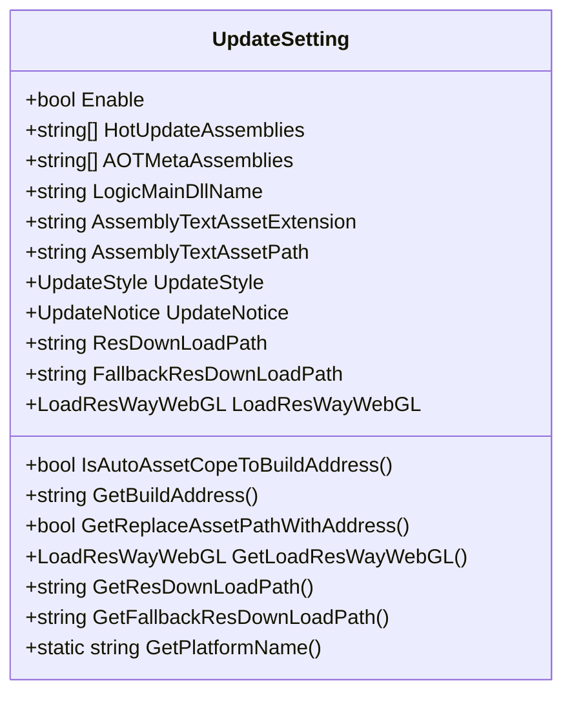
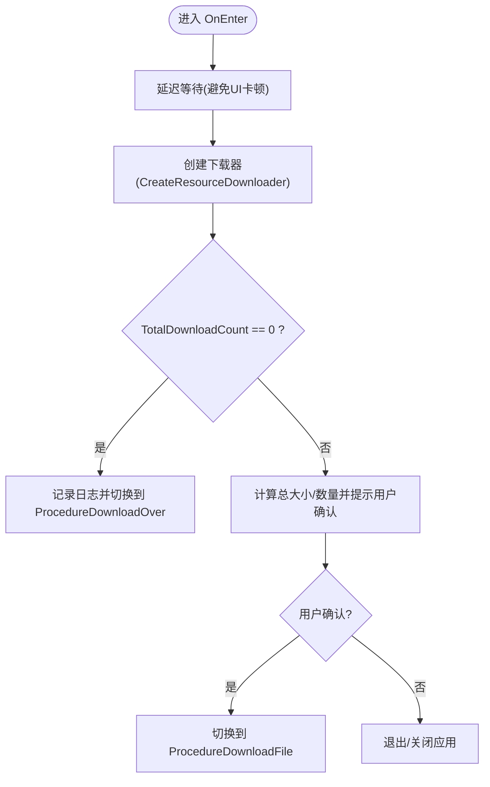
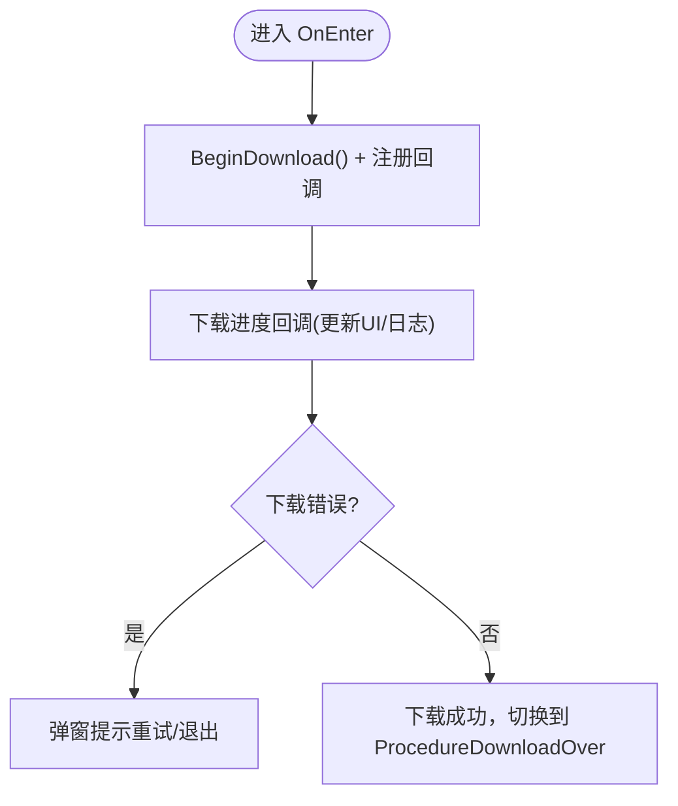
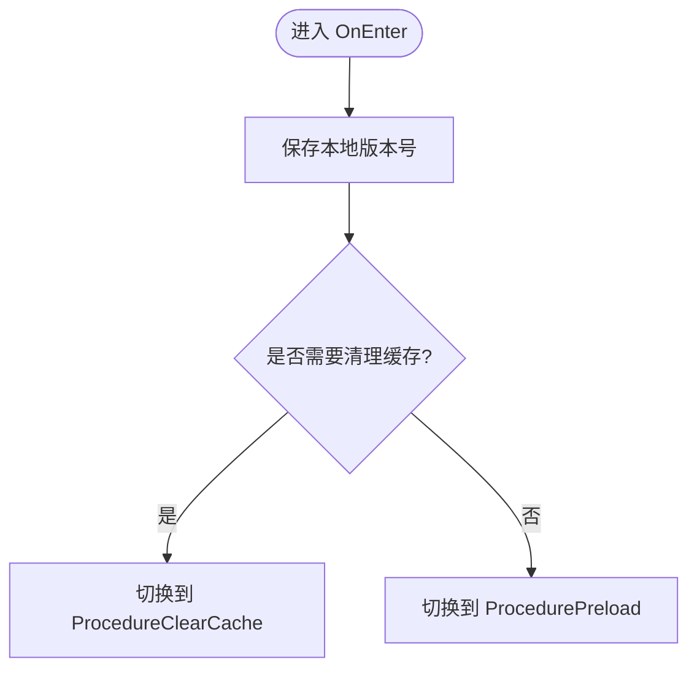
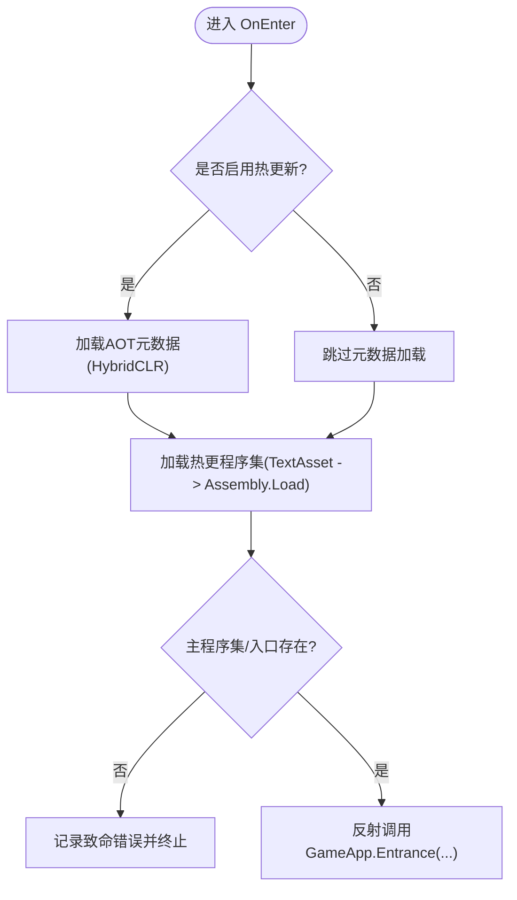
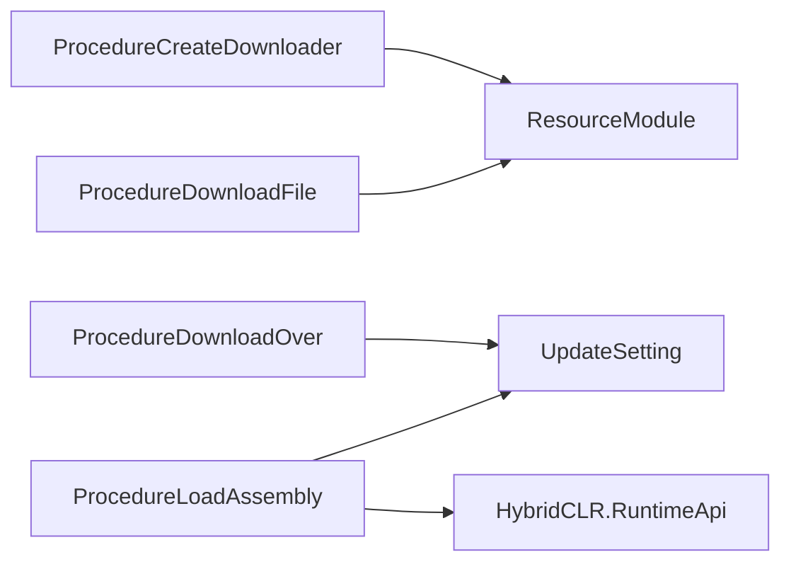

# 热更新问题排查

<cite>
**本文引用的文件**   
- [README.md](file://README.md)
- [UpdateSetting.cs](file://UnityProject/Assets/TEngine/Runtime/Core/UpdateSetting.cs)
- [ProcedureCreateDownloader.cs](file://UnityProject/Assets/GameScripts/Procedure/ProcedureCreateDownloader.cs)
- [ProcedureDownloadFile.cs](file://UnityProject/Assets/GameScripts/Procedure/ProcedureDownloadFile.cs)
- [ProcedureDownloadOver.cs](file://UnityProject/Assets/GameScripts/Procedure/ProcedureDownloadOver.cs)
- [ProcedureLoadAssembly.cs](file://UnityProject/Assets/GameScripts/Procedure/ProcedureLoadAssembly.cs)
</cite>

## 目录
1. [简介](#简介)
2. [项目结构](#项目结构)
3. [核心组件](#核心组件)
4. [架构总览](#架构总览)
5. [详细组件分析](#详细组件分析)
6. [依赖关系分析](#依赖关系分析)
7. [性能与监控](#性能与监控)
8. [故障排查指南](#故障排查指南)
9. [结论](#结论)
10. [附录](#附录)

## 简介
本指南聚焦 TEngine 的热更新问题排查，围绕 HybridCLR 集成、DLL 加载失败、版本不兼容、热更新流程异常等主题，提供从生成、发布、下载、验签到安全机制、签名验证、回滚策略的完整诊断与解决思路。文档同时给出日志分析方法、性能监控技巧与调试工具使用建议，帮助开发者快速定位并修复热更新相关问题。

## 项目结构
TEngine 将热更新相关能力分布在以下位置：
- 运行时配置：UpdateSetting（热更开关、程序集列表、资源服务器地址、平台路径等）
- 启动流程：Procedure* 系列流程节点负责创建下载器、下载文件、下载完成处理、加载程序集并启动游戏
- 资源系统：基于 YooAsset 的资源模块，提供下载器与资源加载能力
- HybridCLR：在编辑器与构建阶段进行元数据与 AOT 支持，运行时通过 LoadMetadataForAOTAssembly 为 AOT 程序集补充元数据

图表来源
- [ProcedureCreateDownloader.cs:30-74](file://UnityProject/Assets/GameScripts/Procedure/ProcedureCreateDownloader.cs#L30-L74)
- [ProcedureDownloadFile.cs:38-64](file://UnityProject/Assets/GameScripts/Procedure/ProcedureDownloadFile.cs#L38-L64)
- [ProcedureDownloadOver.cs:14-33](file://UnityProject/Assets/GameScripts/Procedure/ProcedureDownloadOver.cs#L14-L33)
- [ProcedureLoadAssembly.cs:42-150](file://UnityProject/Assets/GameScripts/Procedure/ProcedureLoadAssembly.cs#L42-L150)
- [UpdateSetting.cs:50-178](file://UnityProject/Assets/TEngine/Runtime/Core/UpdateSetting.cs#L50-L178)

章节来源
- [README.md:75-85](file://README.md#L75-L85)

## 核心组件
- UpdateSetting：集中管理热更新开关、热更程序集列表、AOT 元数据程序集、主逻辑 DLL 名称、资源服务器地址、平台路径、WebGL 加载方式、构建输出路径等关键参数。
- ProcedureCreateDownloader：创建 YooAsset 下载器，统计待下载文件数量与大小，提示用户确认后进入下载流程。
- ProcedureDownloadFile：注册下载回调，展示进度、速度、剩余时间，处理下载错误并回退重试或退出。
- ProcedureDownloadOver：保存本地版本号，根据是否需要清理缓存决定后续流程。
- ProcedureLoadAssembly：加载热更程序集与 AOT 元数据，校验主入口类型与方法，调用 GameApp.Entrance 启动业务逻辑。

章节来源
- [UpdateSetting.cs:50-178](file://UnityProject/Assets/TEngine/Runtime/Core/UpdateSetting.cs#L50-L178)
- [ProcedureCreateDownloader.cs:30-74](file://UnityProject/Assets/GameScripts/Procedure/ProcedureCreateDownloader.cs#L30-L74)
- [ProcedureDownloadFile.cs:38-102](file://UnityProject/Assets/GameScripts/Procedure/ProcedureDownloadFile.cs#L38-L102)
- [ProcedureDownloadOver.cs:14-33](file://UnityProject/Assets/GameScripts/Procedure/ProcedureDownloadOver.cs#L14-L33)
- [ProcedureLoadAssembly.cs:42-150](file://UnityProject/Assets/GameScripts/Procedure/ProcedureLoadAssembly.cs#L42-L150)

## 架构总览
下图展示了热更新从“发现更新”到“加载程序集并启动”的端到端流程，以及各组件之间的交互关系。

图表来源
- [ProcedureCreateDownloader.cs:30-74](file://UnityProject/Assets/GameScripts/Procedure/ProcedureCreateDownloader.cs#L30-L74)
- [ProcedureDownloadFile.cs:38-64](file://UnityProject/Assets/GameScripts/Procedure/ProcedureDownloadFile.cs#L38-L64)
- [ProcedureDownloadOver.cs:14-33](file://UnityProject/Assets/GameScripts/Procedure/ProcedureDownloadOver.cs#L14-L33)
- [ProcedureLoadAssembly.cs:42-150](file://UnityProject/Assets/GameScripts/Procedure/ProcedureLoadAssembly.cs#L42-L150)
- [UpdateSetting.cs:50-178](file://UnityProject/Assets/TEngine/Runtime/Core/UpdateSetting.cs#L50-L178)

## 详细组件分析

### 组件一：UpdateSetting（热更新配置）
- 作用：集中管理热更新开关、热更程序集列表、AOT 元数据程序集、主逻辑 DLL 名称、资源服务器地址、备用地址、平台路径、WebGL 加载方式、构建输出路径等。
- 关键点：
  - Enable 属性由 ENABLE_HYBRIDCLR 宏控制，用于判断是否启用热更新。
  - HotUpdateAssemblies 指定需要热更的程序集名（如 GameProto.dll、GameLogic.dll）。
  - AOTMetaAssemblies 指定需要为 AOT 程序集补充元数据的程序集。
  - LogicMainDllName 指定主逻辑程序集名，用于反射查找入口。
  - GetResDownLoadPath()/GetFallbackResDownLoadPath() 根据项目名称与平台名拼接远程资源路径。
  - GetPlatformName() 根据运行平台返回平台标识（Windows64/MacOS/Android/iOS/WebGL 等）。

图表来源
- [UpdateSetting.cs:50-178](file://UnityProject/Assets/TEngine/Runtime/Core/UpdateSetting.cs#L50-L178)

章节来源
- [UpdateSetting.cs:50-178](file://UnityProject/Assets/TEngine/Runtime/Core/UpdateSetting.cs#L50-L178)

### 组件二：ProcedureCreateDownloader（创建下载器）
- 作用：创建 YooAsset 下载器，统计待下载文件数量与大小，提示用户确认后进入下载流程。
- 关键点：
  - 使用 ResourceModule.CreateResourceDownloader() 获取下载器。
  - 若 TotalDownloadCount == 0，直接跳过下载流程。
  - 否则弹出消息框，让用户确认是否下载，确认后切换到 ProcedureDownloadFile。

图表来源
- [ProcedureCreateDownloader.cs:30-74](file://UnityProject/Assets/GameScripts/Procedure/ProcedureCreateDownloader.cs#L30-L74)

章节来源
- [ProcedureCreateDownloader.cs:30-74](file://UnityProject/Assets/GameScripts/Procedure/ProcedureCreateDownloader.cs#L30-L74)

### 组件三：ProcedureDownloadFile（下载文件）
- 作用：注册下载回调，展示进度、速度、剩余时间，处理下载错误并回退重试或退出。
- 关键点：
  - 设置 DownloadErrorCallback 与 DownloadUpdateCallback。
  - 使用滑动窗口计算平均速度，估算剩余时间。
  - 下载失败时弹窗提示，可选择重试或退出。

图表来源
- [ProcedureDownloadFile.cs:38-102](file://UnityProject/Assets/GameScripts/Procedure/ProcedureDownloadFile.cs#L38-L102)

章节来源
- [ProcedureDownloadFile.cs:38-102](file://UnityProject/Assets/GameScripts/Procedure/ProcedureDownloadFile.cs#L38-L102)

### 组件四：ProcedureDownloadOver（下载完成）
- 作用：下载完成后保存本地版本号，并根据是否需要清理缓存决定后续流程。
- 关键点：
  - 保存本地版本号到 PlayerPrefs。
  - 根据 _needClearCache 决定是否进入清理缓存流程，否则进入预加载流程。

图表来源
- [ProcedureDownloadOver.cs:14-33](file://UnityProject/Assets/GameScripts/Procedure/ProcedureDownloadOver.cs#L14-L33)

章节来源
- [ProcedureDownloadOver.cs:14-33](file://UnityProject/Assets/GameScripts/Procedure/ProcedureDownloadOver.cs#L14-L33)

### 组件五：ProcedureLoadAssembly（加载程序集）
- 作用：加载热更程序集与 AOT 元数据，校验主入口类型与方法，调用 GameApp.Entrance 启动业务逻辑。
- 关键点：
  - 在非编辑器环境下，为 AOT 程序集加载元数据（HybridCLR.RuntimeApi.LoadMetadataForAOTAssembly）。
  - 根据 UpdateSetting.HotUpdateAssemblies 列表加载 TextAsset(.bytes)，并通过 Assembly.Load 载入。
  - 反射查找主逻辑程序集中的 GameApp 类型与 Entrance 方法，传入热更程序集列表后启动。

图表来源
- [ProcedureLoadAssembly.cs:42-150](file://UnityProject/Assets/GameScripts/Procedure/ProcedureLoadAssembly.cs#L42-L150)
- [ProcedureLoadAssembly.cs:220-292](file://UnityProject/Assets/GameScripts/Procedure/ProcedureLoadAssembly.cs#L220-L292)

章节来源
- [ProcedureLoadAssembly.cs:42-150](file://UnityProject/Assets/GameScripts/Procedure/ProcedureLoadAssembly.cs#L42-L150)
- [ProcedureLoadAssembly.cs:220-292](file://UnityProject/Assets/GameScripts/Procedure/ProcedureLoadAssembly.cs#L220-L292)

## 依赖关系分析
- ProcedureCreateDownloader 依赖 ResourceModule 以创建下载器。
- ProcedureDownloadFile 依赖 ResourceModule 的 Downloader 进行下载与回调。
- ProcedureDownloadOver 依赖 Settings.UpdateSetting 保存本地版本。
- ProcedureLoadAssembly 依赖 UpdateSetting 获取热更程序集与 AOT 元数据配置，并依赖 HybridCLR.RuntimeApi 为 AOT 程序集补充元数据。
- UpdateSetting 提供统一的配置访问接口，贯穿整个热更新流程。

图表来源
- [ProcedureCreateDownloader.cs:30-74](file://UnityProject/Assets/GameScripts/Procedure/ProcedureCreateDownloader.cs#L30-L74)
- [ProcedureDownloadFile.cs:38-64](file://UnityProject/Assets/GameScripts/Procedure/ProcedureDownloadFile.cs#L38-L64)
- [ProcedureDownloadOver.cs:14-33](file://UnityProject/Assets/GameScripts/Procedure/ProcedureDownloadOver.cs#L14-L33)
- [ProcedureLoadAssembly.cs:42-150](file://UnityProject/Assets/GameScripts/Procedure/ProcedureLoadAssembly.cs#L42-L150)
- [UpdateSetting.cs:50-178](file://UnityProject/Assets/TEngine/Runtime/Core/UpdateSetting.cs#L50-L178)

章节来源
- [ProcedureCreateDownloader.cs:30-74](file://UnityProject/Assets/GameScripts/Procedure/ProcedureCreateDownloader.cs#L30-L74)
- [ProcedureDownloadFile.cs:38-64](file://UnityProject/Assets/GameScripts/Procedure/ProcedureDownloadFile.cs#L38-L64)
- [ProcedureDownloadOver.cs:14-33](file://UnityProject/Assets/GameScripts/Procedure/ProcedureDownloadOver.cs#L14-L33)
- [ProcedureLoadAssembly.cs:42-150](file://UnityProject/Assets/GameScripts/Procedure/ProcedureLoadAssembly.cs#L42-L150)
- [UpdateSetting.cs:50-178](file://UnityProject/Assets/TEngine/Runtime/Core/UpdateSetting.cs#L50-L178)

## 性能与监控
- 下载速度估算：使用滑动窗口计算平均速度，减少瞬时抖动对 UI 的影响。
- 进度与剩余时间：在下载回调中实时计算并刷新 UI，便于用户感知。
- 内存优化：通过 ReplaceAssetPathWithAddress 选项可减少运行时清单占用的内存。
- 日志输出：在关键步骤（创建下载器、下载进度、下载错误、加载程序集、AOT 元数据加载）输出日志，便于问题定位。

[本节为通用指导，不涉及具体文件分析]

## 故障排查指南

### 一、HybridCLR 集成问题
常见问题：
- 未开启 ENABLE_HYBRIDCLR 宏导致 Enable 为 false，热更新流程被禁用。
- 未执行 HybridCLR 生成步骤导致元数据缺失或 AOT 泛型函数无法解释执行。
- AOT 元数据程序集列表为空或未正确配置，导致 AOT 泛型函数回退解释模式失败。

排查步骤：
- 检查 Player Settings 是否定义 ENABLE_HYBRIDCLR。
- 确认已执行 HybridCLR 菜单中的安装、符号定义、Generate All、BuildAssets And CopyTo AssemblyPath。
- 核对 UpdateSetting.AOTMetaAssemblies 是否包含必要的 AOT 程序集（如 mscorlib.dll、System.dll、System.Core.dll、TEngine.Runtime.dll、UniTask.dll、YooAsset.dll）。
- 观察 ProcedureLoadAssembly 中 LoadMetadataForAOTAssembly 的返回值与日志，确认元数据加载是否成功。

章节来源
- [README.md:75-85](file://README.md#L75-L85)
- [UpdateSetting.cs:59-75](file://UnityProject/Assets/TEngine/Runtime/Core/UpdateSetting.cs#L59-L75)
- [ProcedureLoadAssembly.cs:220-292](file://UnityProject/Assets/GameScripts/Procedure/ProcedureLoadAssembly.cs#L220-L292)

### 二、DLL 加载失败
常见问题：
- 热更程序集 TextAsset 未找到或路径不正确。
- Assembly.Load 抛出异常（依赖缺失、版本不一致、IL2CPP 裁剪问题）。
- 主逻辑程序集名称与 LogicMainDllName 不一致，导致找不到入口。

排查步骤：
- 检查 UpdateSetting.HotUpdateAssemblies 与 AssemblyTextAssetPath/Extension 配置是否正确。
- 确认资源服务器上的 .bytes 文件是否存在且可访问。
- 查看 ProcedureLoadAssembly 的 LoadAssetSuccess 日志与异常信息，定位具体失败的程序集。
- 确保 LogicMainDllName 与实际主程序集名称一致，且程序集中包含 GameApp 类型与 Entrance 方法。

章节来源
- [UpdateSetting.cs:72-90](file://UnityProject/Assets/TEngine/Runtime/Core/UpdateSetting.cs#L72-L90)
- [ProcedureLoadAssembly.cs:76-108](file://UnityProject/Assets/GameScripts/Procedure/ProcedureLoadAssembly.cs#L76-L108)
- [ProcedureLoadAssembly.cs:181-218](file://UnityProject/Assets/GameScripts/Procedure/ProcedureLoadAssembly.cs#L181-L218)
- [ProcedureLoadAssembly.cs:124-150](file://UnityProject/Assets/GameScripts/Procedure/ProcedureLoadAssembly.cs#L124-L150)

### 三、版本不兼容
常见问题：
- 客户端本地版本号与服务端最新版本不一致，导致重复下载或无法进入游戏。
- 强制更新模式下，新版本不可用导致无法继续流程。
- 资源服务器地址或平台路径配置错误，导致清单或文件无法匹配。

排查步骤：
- 检查 UpdateSetting.GetResDownLoadPath()/GetFallbackResDownLoadPath() 返回的路径是否与服务器目录结构一致。
- 确认 UpdateSetting.GetPlatformName() 返回的平台标识与服务器目录命名一致。
- 在 ProcedureDownloadOver 中检查本地版本号保存逻辑，确保 GAME_VERSION 键值正确。
- 在强制更新模式下，若下载失败应阻止进入游戏并提示用户重试或退出。

章节来源
- [UpdateSetting.cs:167-178](file://UnityProject/Assets/TEngine/Runtime/Core/UpdateSetting.cs#L167-L178)
- [UpdateSetting.cs:184-218](file://UnityProject/Assets/TEngine/Runtime/Core/UpdateSetting.cs#L184-L218)
- [ProcedureDownloadOver.cs:14-33](file://UnityProject/Assets/GameScripts/Procedure/ProcedureDownloadOver.cs#L14-L33)

### 四、热更新流程异常
常见问题：
- 未发现任何待下载文件，流程直接跳过。
- 下载过程中出现网络错误，未正确处理重试或退出。
- 下载完成后未保存版本号或缓存清理逻辑异常。

排查步骤：
- 在 ProcedureCreateDownloader 中检查 TotalDownloadCount 是否为 0，确认服务端清单是否正确。
- 在 ProcedureDownloadFile 中检查 DownloadErrorCallback 与 DownloadUpdateCallback 的触发情况，确认 UI 与日志是否正常。
- 在 ProcedureDownloadOver 中检查 _needClearCache 标志与后续流程切换逻辑。

章节来源
- [ProcedureCreateDownloader.cs:41-69](file://UnityProject/Assets/GameScripts/Procedure/ProcedureCreateDownloader.cs#L41-L69)
- [ProcedureDownloadFile.cs:49-64](file://UnityProject/Assets/GameScripts/Procedure/ProcedureDownloadFile.cs#L49-L64)
- [ProcedureDownloadFile.cs:66-102](file://UnityProject/Assets/GameScripts/Procedure/ProcedureDownloadFile.cs#L66-L102)
- [ProcedureDownloadOver.cs:14-33](file://UnityProject/Assets/GameScripts/Procedure/ProcedureDownloadOver.cs#L14-L33)

### 五、热更新包生成、发布、下载、验证
- 生成：执行 HybridCLR 菜单中的 BuildAssets And CopyTo AssemblyPath，确保热更程序集 .bytes 文件生成。
- 发布：使用 YooAsset/AssetBundle Builder 构建 AB，并将资源复制到 StreamingAssets 或上传至资源服务器。
- 下载：客户端通过 ResourceModule.CreateResourceDownloader() 获取下载器，按清单下载文件。
- 验证：下载完成后保存本地版本号，并在加载程序集阶段校验主入口类型与方法。

章节来源
- [README.md:75-85](file://README.md#L75-L85)
- [ProcedureCreateDownloader.cs:41-69](file://UnityProject/Assets/GameScripts/Procedure/ProcedureCreateDownloader.cs#L41-L69)
- [ProcedureDownloadFile.cs:49-64](file://UnityProject/Assets/GameScripts/Procedure/ProcedureDownloadFile.cs#L49-L64)
- [ProcedureDownloadOver.cs:14-33](file://UnityProject/Assets/GameScripts/Procedure/ProcedureDownloadOver.cs#L14-L33)
- [ProcedureLoadAssembly.cs:124-150](file://UnityProject/Assets/GameScripts/Procedure/ProcedureLoadAssembly.cs#L124-L150)

### 六、热更新安全机制、签名验证、回滚策略
- 安全机制：建议在资源服务器侧实现 HTTPS、签名校验与完整性校验；客户端在下载完成后对 .bytes 文件进行哈希校验与签名验证。
- 签名验证：可在下载完成后增加签名校验步骤，若校验失败则拒绝加载该程序集并提示用户。
- 回滚策略：若新版本加载失败，应自动回滚到上一个稳定版本（通过本地版本号与备份清单），并提示用户重试或退出。

[本节为通用指导，不涉及具体文件分析]

### 七、日志分析方法
- 关键日志点：
  - 创建下载器：记录待下载文件数量与大小。
  - 下载进度：记录当前进度、速度、剩余时间。
  - 下载错误：记录失败文件名与错误原因。
  - 加载程序集：记录每个程序集的加载结果与异常信息。
  - AOT 元数据加载：记录 LoadMetadataForAOTAssembly 的返回值与模式。
- 建议：
  - 统一日志格式，包含时间戳、流程节点、关键参数。
  - 对致命错误进行堆栈记录，便于回溯。
  - 在 CI 环境中输出结构化日志，便于自动化分析。

章节来源
- [ProcedureCreateDownloader.cs:30-74](file://UnityProject/Assets/GameScripts/Procedure/ProcedureCreateDownloader.cs#L30-L74)
- [ProcedureDownloadFile.cs:66-102](file://UnityProject/Assets/GameScripts/Procedure/ProcedureDownloadFile.cs#L66-L102)
- [ProcedureLoadAssembly.cs:181-218](file://UnityProject/Assets/GameScripts/Procedure/ProcedureLoadAssembly.cs#L181-L218)
- [ProcedureLoadAssembly.cs:220-292](file://UnityProject/Assets/GameScripts/Procedure/ProcedureLoadAssembly.cs#L220-L292)

### 八、性能监控技巧
- 下载性能：监控平均速度与峰值速度，识别网络瓶颈。
- 内存占用：通过 ReplaceAssetPathWithAddress 减少清单内存占用；监控加载程序集后的内存变化。
- 启动耗时：记录从创建下载器到启动 GameApp.Entrance 的总耗时，定位慢点。

[本节为通用指导，不涉及具体文件分析]

### 九、调试工具使用指南
- Unity Profiler：监控 CPU、GPU、内存、网络 I/O。
- HybridCLR 工具：使用编辑器菜单进行安装、符号定义、Generate All、BuildAssets And CopyTo AssemblyPath。
- YooAsset 工具：使用 AssetBundle Builder 构建资源，并在模拟器中验证资源加载。
- 日志工具：结合 Unity Console 与自定义日志输出，定位问题。

章节来源
- [README.md:75-85](file://README.md#L75-L85)

## 结论
通过对 UpdateSetting、Procedure* 流程节点与 HybridCLR 的深入分析，可以系统化地排查热更新相关问题。重点在于：
- 正确配置热更新开关与程序集列表。
- 确保资源服务器地址与平台路径一致。
- 完善下载错误处理与版本号保存逻辑。
- 强化 AOT 元数据加载与主入口校验。
- 建立完善的日志与监控体系，提升问题定位效率。

[本节为总结性内容，不涉及具体文件分析]

## 附录
- 快速开始参考：[README.md:75-85](file://README.md#L75-L85)
- 热更新配置参考：[UpdateSetting.cs:50-178](file://UnityProject/Assets/TEngine/Runtime/Core/UpdateSetting.cs#L50-L178)
- 流程节点参考：
  - [ProcedureCreateDownloader.cs:30-74](file://UnityProject/Assets/GameScripts/Procedure/ProcedureCreateDownloader.cs#L30-L74)
  - [ProcedureDownloadFile.cs:38-102](file://UnityProject/Assets/GameScripts/Procedure/ProcedureDownloadFile.cs#L38-L102)
  - [ProcedureDownloadOver.cs:14-33](file://UnityProject/Assets/GameScripts/Procedure/ProcedureDownloadOver.cs#L14-L33)
  - [ProcedureLoadAssembly.cs:42-150](file://UnityProject/Assets/GameScripts/Procedure/ProcedureLoadAssembly.cs#L42-L150)
  - [ProcedureLoadAssembly.cs:220-292](file://UnityProject/Assets/GameScripts/Procedure/ProcedureLoadAssembly.cs#L220-L292)