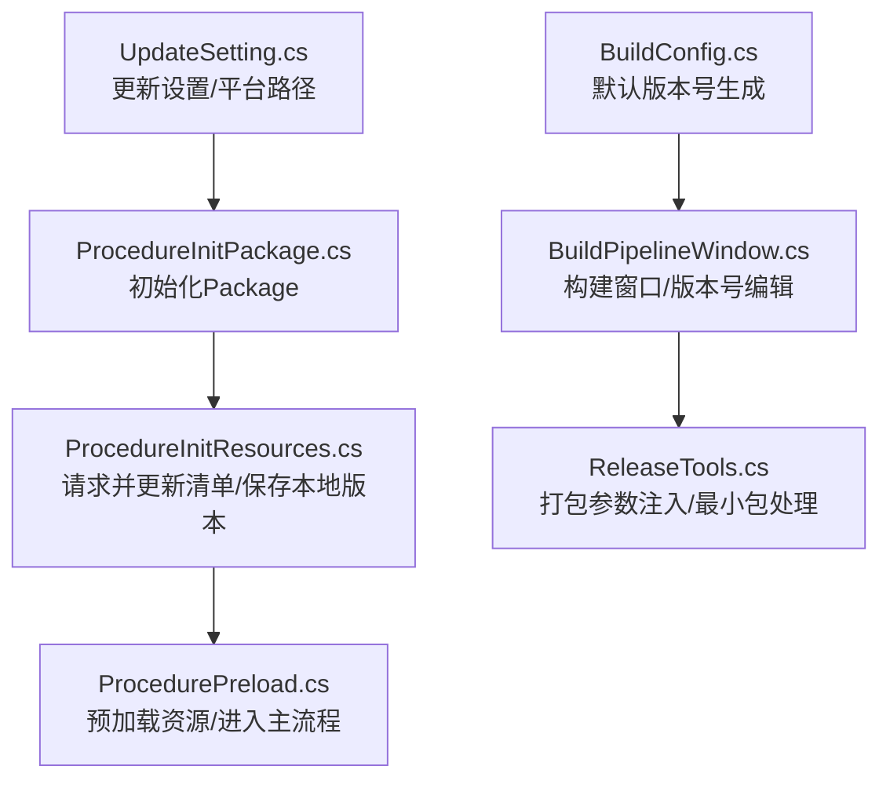
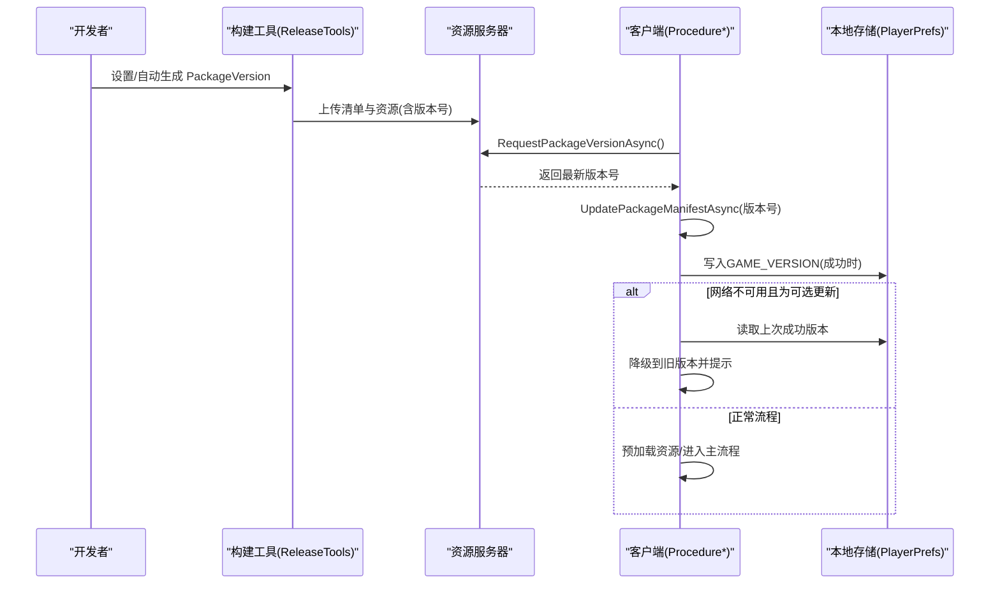
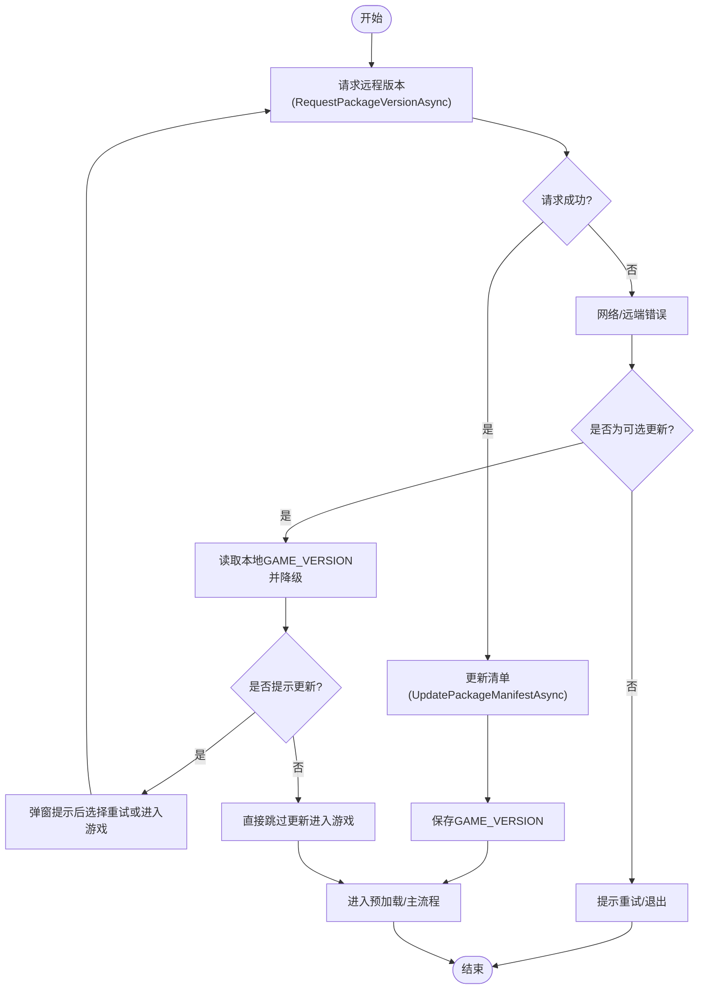
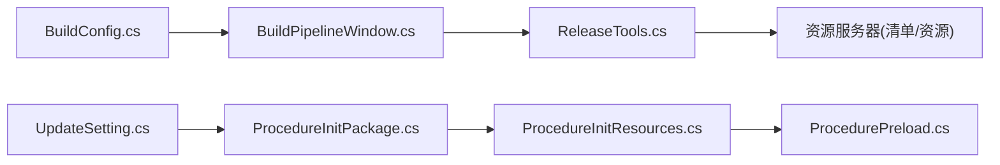

# 版本兼容性问题排查

<cite>
**本文引用的文件**   
- [README.md](file://README.md)
- [UpdateSetting.cs](file://UnityProject/Assets/TEngine/Runtime/Core/UpdateSetting.cs)
- [ProcedureInitPackage.cs](file://UnityProject/Assets/GameScripts/Procedure/ProcedureInitPackage.cs)
- [ProcedureInitResources.cs](file://UnityProject/Assets/GameScripts/Procedure/ProcedureInitResources.cs)
- [ProcedurePreload.cs](file://UnityProject/Assets/GameScripts/Procedure/ProcedurePreload.cs)
- [BuildConfig.cs](file://UnityProject/Assets/TEngine/Editor/ReleaseTools/BuildConfig.cs)
- [BuildPipelineWindow.cs](file://UnityProject/Assets/TEngine/Editor/ReleaseTools/BuildPipelineWindow.cs)
- [ReleaseTools.cs](file://UnityProject/Assets/TEngine/Editor/ReleaseTools/ReleaseTools.cs)
</cite>

## 目录
1. [简介](#简介)
2. [项目结构](#项目结构)
3. [核心组件](#核心组件)
4. [架构总览](#架构总览)
5. [详细组件分析](#详细组件分析)
6. [依赖关系分析](#依赖关系分析)
7. [性能与稳定性考量](#性能与稳定性考量)
8. [故障排查指南](#故障排查指南)
9. [结论](#结论)
10. [附录](#附录)

## 简介
本指南聚焦于客户端与服务器版本不匹配、热更新包版本冲突、配置表版本不一致等兼容性问题的诊断与修复。结合 TEngine 的启动流程、资源模块与构建发布工具，系统梳理版本号管理策略、向后/向前兼容性设计、版本检查机制、自动回滚、灰度发布与回滚恢复流程，并提供版本对比工具与兼容性测试方法，帮助开发者在生产环境中稳定地管理与解决版本兼容性问题。

## 项目结构
围绕版本与热更新相关的关键路径如下：
- 运行时设置与平台适配：UpdateSetting.cs
- 启动流程（初始化 Package、初始化资源、预加载）：ProcedureInitPackage.cs、ProcedureInitResources.cs、ProcedurePreload.cs
- 编辑器构建与发布（版本号生成、打包参数注入）：BuildConfig.cs、BuildPipelineWindow.cs、ReleaseTools.cs

图示来源
- [UpdateSetting.cs:50-178](file://UnityProject/Assets/TEngine/Runtime/Core/UpdateSetting.cs#L50-L178)
- [ProcedureInitPackage.cs:31-89](file://UnityProject/Assets/GameScripts/Procedure/ProcedureInitPackage.cs#L31-L89)
- [ProcedureInitResources.cs:71-105](file://UnityProject/Assets/GameScripts/Procedure/ProcedureInitResources.cs#L71-L105)
- [ProcedurePreload.cs:118-156](file://UnityProject/Assets/GameScripts/Procedure/ProcedurePreload.cs#L118-L156)
- [BuildConfig.cs:15-62](file://UnityProject/Assets/TEngine/Editor/ReleaseTools/BuildConfig.cs#L15-L62)
- [BuildPipelineWindow.cs:197-200](file://UnityProject/Assets/TEngine/Editor/ReleaseTools/BuildPipelineWindow.cs#L197-L200)
- [ReleaseTools.cs:202-250](file://UnityProject/Assets/TEngine/Editor/ReleaseTools/ReleaseTools.cs#L202-L250)

章节来源
- [README.md:173-201](file://README.md#L173-L201)

## 核心组件
- UpdateSetting：定义更新策略（强制/可选）、提示策略、资源服务器地址、WebGL 加载方式、平台名称映射等，是版本与资源下载路径的核心配置。
- ProcedureInitPackage：负责 YooAsset Package 初始化，失败时展示 UI 并支持重试；对缺失 version 清单给出明确错误提示。
- ProcedureInitResources：负责拉取远程 packageVersion、更新清单、持久化本地版本、根据网络与更新策略决定是否继续或回退到上次成功版本。
- ProcedurePreload：在资源准备完成后进行预加载，刷新 UI 版本信息，随后进入程序集加载阶段。
- BuildConfig / BuildPipelineWindow / ReleaseTools：编辑器侧的版本号生成、编辑与打包参数注入，确保服务端清单与客户端期望一致。

章节来源
- [UpdateSetting.cs:50-178](file://UnityProject/Assets/TEngine/Runtime/Core/UpdateSetting.cs#L50-L178)
- [ProcedureInitPackage.cs:31-118](file://UnityProject/Assets/GameScripts/Procedure/ProcedureInitPackage.cs#L31-L118)
- [ProcedureInitResources.cs:71-170](file://UnityProject/Assets/GameScripts/Procedure/ProcedureInitResources.cs#L71-L170)
- [ProcedurePreload.cs:118-172](file://UnityProject/Assets/GameScripts/Procedure/ProcedurePreload.cs#L118-L172)
- [BuildConfig.cs:15-62](file://UnityProject/Assets/TEngine/Editor/ReleaseTools/BuildConfig.cs#L15-L62)
- [BuildPipelineWindow.cs:197-200](file://UnityProject/Assets/TEngine/Editor/ReleaseTools/BuildPipelineWindow.cs#L197-L200)
- [ReleaseTools.cs:202-250](file://UnityProject/Assets/TEngine/Editor/ReleaseTools/ReleaseTools.cs#L202-L250)

## 架构总览
下图展示了从“构建发布”到“客户端启动与版本校验”的端到端流程，以及关键断点与回退路径。

图示来源
- [ProcedureInitResources.cs:77-105](file://UnityProject/Assets/GameScripts/Procedure/ProcedureInitResources.cs#L77-L105)
- [ProcedureInitResources.cs:136-170](file://UnityProject/Assets/GameScripts/Procedure/ProcedureInitResources.cs#L136-L170)
- [ReleaseTools.cs:202-250](file://UnityProject/Assets/TEngine/Editor/ReleaseTools/ReleaseTools.cs#L202-L250)

## 详细组件分析

### 版本检查与回退流程（ProcedureInitResources）
- 拉取远程 packageVersion 并更新清单；成功后将新版本写入本地缓存。
- 若网络异常且为可选更新，则尝试使用本地已记录版本回退，并根据是否提示决定继续或跳过更新。
- 该流程是“向后兼容”的关键：当新清单不可用时，客户端可继续使用旧版本运行。

图示来源
- [ProcedureInitResources.cs:77-105](file://UnityProject/Assets/GameScripts/Procedure/ProcedureInitResources.cs#L77-L105)
- [ProcedureInitResources.cs:136-170](file://UnityProject/Assets/GameScripts/Procedure/ProcedureInitResources.cs#L136-L170)

章节来源
- [ProcedureInitResources.cs:71-170](file://UnityProject/Assets/GameScripts/Procedure/ProcedureInitResources.cs#L71-L170)

### 资源初始化与错误提示（ProcedureInitPackage）
- 初始化 Package 失败时显示启动 UI 并弹出对话框，提供重试与退出选项。
- 针对缺失 version 清单的错误进行友好提示，便于快速定位问题。

章节来源
- [ProcedureInitPackage.cs:31-118](file://UnityProject/Assets/GameScripts/Procedure/ProcedureInitPackage.cs#L31-L118)

### 预加载与版本信息刷新（ProcedurePreload）
- 预加载阶段会触发 UI 刷新版本信息，并在资源就绪后进入程序集加载流程。
- 通过事件通知 UI 层刷新当前版本，便于用户感知。

章节来源
- [ProcedurePreload.cs:41-52](file://UnityProject/Assets/GameScripts/Procedure/ProcedurePreload.cs#L41-L52)
- [ProcedurePreload.cs:118-172](file://UnityProject/Assets/GameScripts/Procedure/ProcedurePreload.cs#L118-L172)

### 更新设置与平台路径（UpdateSetting）
- 定义强制/可选更新、提示策略、资源服务器地址与备用地址。
- 提供平台名称映射，用于拼接正确的资源路径，避免跨平台路径不一致导致的 404。

章节来源
- [UpdateSetting.cs:50-178](file://UnityProject/Assets/TEngine/Runtime/Core/UpdateSetting.cs#L50-L178)

### 构建与发布（BuildConfig / BuildPipelineWindow / ReleaseTools）
- BuildConfig：提供默认版本号生成逻辑，保证每次构建有稳定的版本号。
- BuildPipelineWindow：编辑器中可视化编辑版本号，未填写时自动生成。
- ReleaseTools：将版本号注入打包参数，参与最小包处理与输出路径命名。

章节来源
- [BuildConfig.cs:15-62](file://UnityProject/Assets/TEngine/Editor/ReleaseTools/BuildConfig.cs#L15-L62)
- [BuildPipelineWindow.cs:197-200](file://UnityProject/Assets/TEngine/Editor/ReleaseTools/BuildPipelineWindow.cs#L197-L200)
- [BuildPipelineWindow.cs:474-477](file://UnityProject/Assets/TEngine/Editor/ReleaseTools/BuildPipelineWindow.cs#L474-L477)
- [BuildPipelineWindow.cs:588-622](file://UnityProject/Assets/TEngine/Editor/ReleaseTools/BuildPipelineWindow.cs#L588-L622)
- [ReleaseTools.cs:202-250](file://UnityProject/Assets/TEngine/Editor/ReleaseTools/ReleaseTools.cs#L202-L250)

## 依赖关系分析
- 客户端启动流程强依赖资源模块的清单与版本号一致性。
- 编辑器构建工具生成的版本号需与服务端发布的清单保持一致，否则客户端无法拉取清单或出现 404。
- UpdateSetting 的平台路径决定了客户端访问的资源根路径，路径错误会导致清单或资源不可达。

图示来源
- [BuildConfig.cs:15-62](file://UnityProject/Assets/TEngine/Editor/ReleaseTools/BuildConfig.cs#L15-L62)
- [BuildPipelineWindow.cs:197-200](file://UnityProject/Assets/TEngine/Editor/ReleaseTools/BuildPipelineWindow.cs#L197-L200)
- [ReleaseTools.cs:202-250](file://UnityProject/Assets/TEngine/Editor/ReleaseTools/ReleaseTools.cs#L202-L250)
- [UpdateSetting.cs:50-178](file://UnityProject/Assets/TEngine/Runtime/Core/UpdateSetting.cs#L50-L178)
- [ProcedureInitPackage.cs:31-118](file://UnityProject/Assets/GameScripts/Procedure/ProcedureInitPackage.cs#L31-L118)
- [ProcedureInitResources.cs:71-170](file://UnityProject/Assets/GameScripts/Procedure/ProcedureInitResources.cs#L71-L170)
- [ProcedurePreload.cs:118-172](file://UnityProject/Assets/GameScripts/Procedure/ProcedurePreload.cs#L118-L172)

## 性能与稳定性考量
- 优先使用本地缓存版本回退，减少因网络抖动导致的启动失败。
- 预加载阶段异步并行加载资源，提升首屏体验。
- 通过 UpdateSetting 的平台路径与备用地址降低单点故障风险。

[本节为通用指导，无需代码引用]

## 故障排查指南

### 常见问题与定位要点
- 客户端与服务器版本不匹配
  - 现象：清单或资源 404、初始化失败。
  - 排查：确认编辑器构建时的 PackageVersion 与服务端发布的一致；检查 UpdateSetting 的平台路径是否正确。
  - 参考：
    - [ProcedureInitPackage.cs:102-105](file://UnityProject/Assets/GameScripts/Procedure/ProcedureInitPackage.cs#L102-L105)
    - [UpdateSetting.cs:167-178](file://UnityProject/Assets/TEngine/Runtime/Core/UpdateSetting.cs#L167-L178)
    - [BuildConfig.cs:50-62](file://UnityProject/Assets/TEngine/Editor/ReleaseTools/BuildConfig.cs#L50-L62)

- 热更新包版本冲突
  - 现象：客户端拉取到新版本但本地旧数据不兼容。
  - 处理：利用可选更新模式与本地 GAME_VERSION 回退；必要时增加数据迁移逻辑。
  - 参考：
    - [ProcedureInitResources.cs:136-170](file://UnityProject/Assets/GameScripts/Procedure/ProcedureInitResources.cs#L136-L170)

- 配置表版本不一致
  - 现象：业务逻辑按新配置表解析失败。
  - 处理：在配置表生成与客户端加载之间加入版本校验；对新增字段采用默认值或兼容分支。
  - 建议：在预加载前完成配置表版本比对与必要的数据迁移。

- WebGL 平台资源加载异常
  - 现象：WebGL 下资源路径或加载方式不正确导致 404。
  - 处理：检查 UpdateSetting 的 LoadResWayWebGL 与资源服务器可达性。
  - 参考：
    - [UpdateSetting.cs:110-115](file://UnityProject/Assets/TEngine/Runtime/Core/UpdateSetting.cs#L110-L115)

### 版本检查机制与自动回滚
- 版本检查：客户端启动时请求远程 packageVersion，成功后更新清单并持久化本地版本。
- 自动回滚：网络不可用且为可选更新时，读取本地 GAME_VERSION 作为回退版本，并可提示用户选择重试或跳过。
- 参考：
  - [ProcedureInitResources.cs:77-105](file://UnityProject/Assets/GameScripts/Procedure/ProcedureInitResources.cs#L77-L105)
  - [ProcedureInitResources.cs:136-170](file://UnityProject/Assets/GameScripts/Procedure/ProcedureInitResources.cs#L136-L170)

### 灰度发布与回滚恢复
- 灰度发布：通过服务端控制不同渠道/分组的 PackageVersion，配合客户端的可选更新策略实现灰度。
- 回滚恢复：服务端下线新版本并保留旧版清单与资源；客户端在检测到不可用或校验失败时自动回退到本地已记录版本。
- 实践建议：
  - 在构建流水线中固化版本号生成规则，避免人为失误。
  - 发布前校验清单与资源的完整性与一致性。
  - 上线后监控客户端日志中的版本变更与回退事件。

### 版本对比工具与兼容性测试
- 版本对比：比较客户端本地 GAME_VERSION 与服务端最新 packageVersion，识别差异与潜在风险。
- 兼容性测试：
  - 单元测试：覆盖可选/强制更新分支、网络异常分支、本地无记录分支。
  - 集成测试：模拟服务端返回不同版本清单，验证客户端是否能正确回退或升级。
  - 回归测试：在不同平台（Windows/Android/iOS/WebGL）验证路径与加载方式。

## 结论
通过统一的版本号管理、严格的清单与资源一致性校验、可选更新与本地回退机制，TEngine 能够在复杂网络与多平台环境下保障版本兼容性。结合编辑器构建工具的自动化版本号生成与发布参数注入，可显著降低人为错误带来的版本不一致风险。建议在灰度发布与回滚恢复中引入更细粒度的分组控制与监控告警，进一步提升线上稳定性。

## 附录
- 最佳实践清单
  - 始终使用构建工具自动生成 PackageVersion，禁止手动随意修改。
  - 保持客户端与服务器对版本号语义的一致性（如语义化版本或时间戳）。
  - 对新增配置字段采用默认值或兼容分支，避免破坏旧客户端。
  - 在预加载阶段完成配置表版本校验与数据迁移。
  - 为可选更新提供友好的用户提示与一键重试入口。
  - 建立版本对比与兼容性测试用例，纳入 CI 门禁。

[本节为通用指导，无需代码引用]