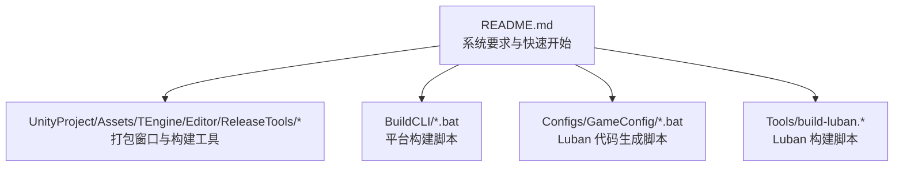
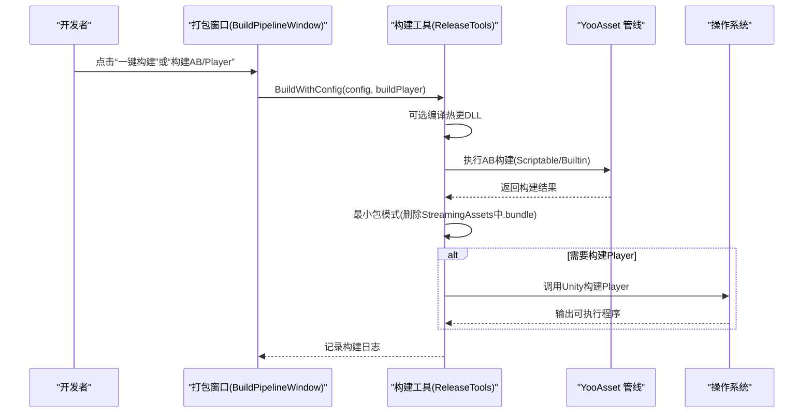
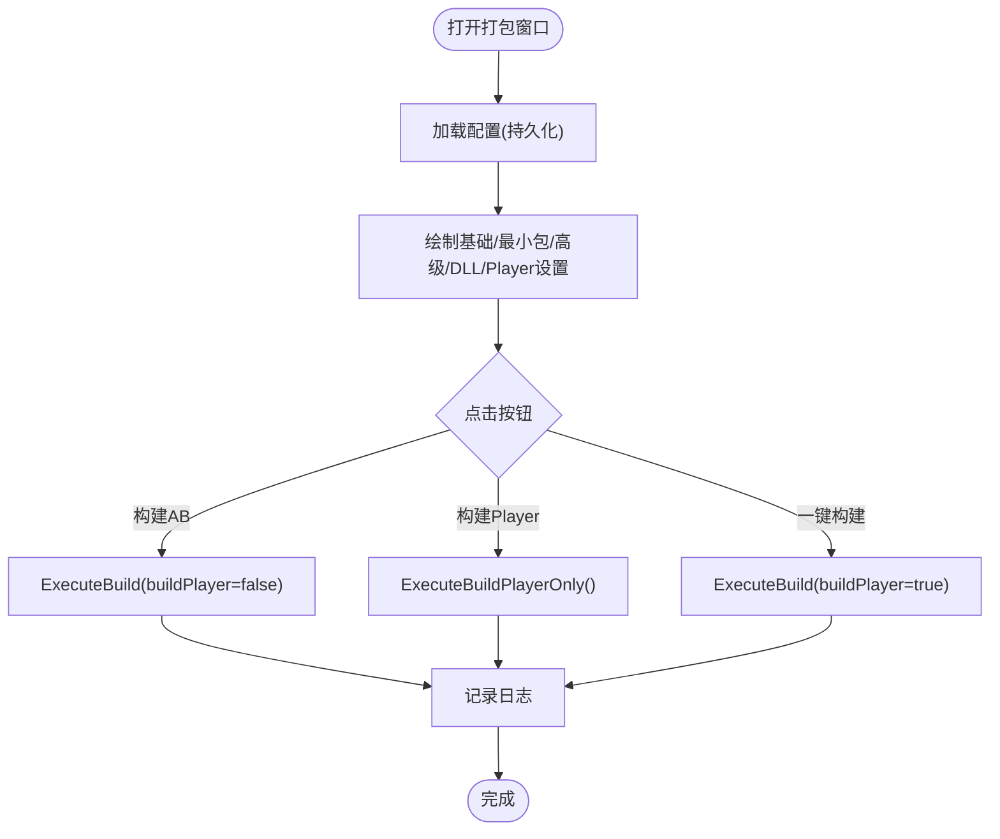
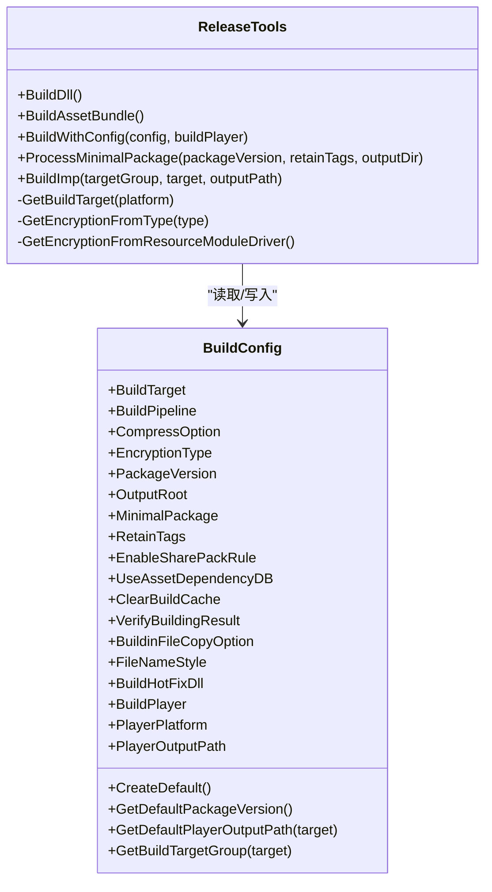
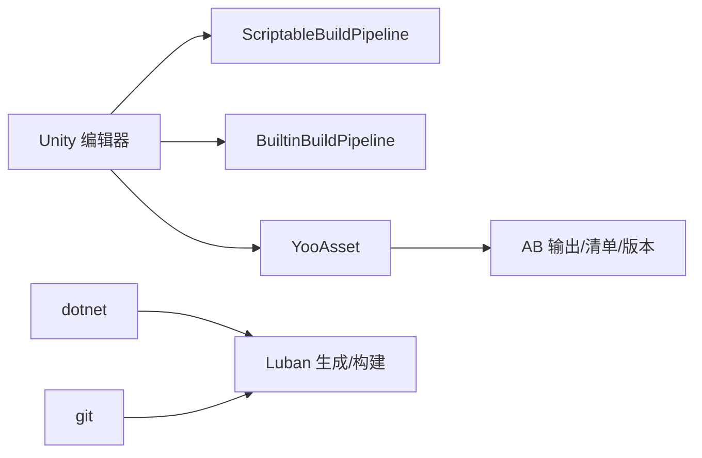

# 环境问题排查

<cite>
**本文引用的文件**   
- [README.md](file://README.md)
- [FAQ.md](file://Books/FAQ.md)
- [BuildPipelineWindow.cs](file://UnityProject/Assets/TEngine/Editor/ReleaseTools/BuildPipelineWindow.cs)
- [ReleaseTools.cs](file://UnityProject/Assets/TEngine/Editor/ReleaseTools/ReleaseTools.cs)
- [BuildConfig.cs](file://UnityProject/Assets/TEngine/Editor/ReleaseTools/BuildConfig.cs)
- [build_android.bat](file://BuildCLI/build_android.bat)
- [path_define.bat](file://BuildCLI/path_define.bat)
- [gen_code_bin_to_project.bat](file://Configs/GameConfig/gen_code_bin_to_project.bat)
- [build-luban.bat](file://Tools/build-luban.bat)
</cite>

## 目录
1. [简介](#简介)
2. [项目结构](#项目结构)
3. [核心组件](#核心组件)
4. [架构总览](#架构总览)
5. [详细组件分析](#详细组件分析)
6. [依赖关系分析](#依赖关系分析)
7. [性能与构建特性](#性能与构建特性)
8. [常见问题排查](#常见问题排查)
9. [结论](#结论)
10. [附录：环境检查清单与脚本使用](#附录环境检查清单与脚本使用)

## 简介
本指南聚焦 TEngine 框架在 Windows、Android、iOS、WebGL 等平台的环境问题诊断与解决，覆盖 Unity 版本兼容性、依赖包安装、路径配置错误、开发工具链与编译器设置、插件冲突等。文档结合仓库中的打包工具、命令行脚本与配置项，提供可操作的步骤与可视化流程图，帮助快速定位并修复环境问题。

## 项目结构
TEngine 的发布与环境相关的关键位置如下：
- Unity 项目根目录下的编辑器工具：打包窗口、构建参数、自动化入口
- BuildCLI：平台构建批处理脚本（Windows）
- Configs/GameConfig：Luban 配置表生成脚本
- Tools：Luban 源码拉取与构建脚本

**图示来源**
- [README.md:52-85](file://README.md#L52-L85)
- [BuildPipelineWindow.cs:86-116](file://UnityProject/Assets/TEngine/Editor/ReleaseTools/BuildPipelineWindow.cs#L86-L116)
- [build_android.bat:1-9](file://BuildCLI/build_android.bat#L1-L9)
- [gen_code_bin_to_project.bat:1-23](file://Configs/GameConfig/gen_code_bin_to_project.bat#L1-L23)
- [build-luban.bat:1-49](file://Tools/build-luban.bat#L1-L49)

**章节来源**
- [README.md:52-85](file://README.md#L52-L85)

## 核心组件
- 打包窗口 BuildPipelineWindow：提供可视化配置与一键构建流程，支持 AB 构建与 Player 构建，内置日志输出与最小包模式。
- 构建工具 ReleaseTools：封装 AssetBundle 构建、Player 构建、最小包后处理、加密服务选择等逻辑，并提供 CLI 入口。
- 构建参数 BuildConfig：集中管理目标平台、压缩方式、加密类型、输出路径、是否构建热更 DLL 等选项。
- 平台构建脚本 build_android.bat：通过 Unity 命令行调用自动化构建入口。
- Luban 相关脚本：gen_code_bin_to_project.bat 用于生成配置表代码与二进制；build-luban.bat 用于拉取并构建 Luban。

**章节来源**
- [BuildPipelineWindow.cs:86-116](file://UnityProject/Assets/TEngine/Editor/ReleaseTools/BuildPipelineWindow.cs#L86-L116)
- [ReleaseTools.cs:119-159](file://UnityProject/Assets/TEngine/Editor/ReleaseTools/ReleaseTools.cs#L119-L159)
- [BuildConfig.cs:8-36](file://UnityProject/Assets/TEngine/Editor/ReleaseTools/BuildConfig.cs#L8-L36)
- [build_android.bat:1-9](file://BuildCLI/build_android.bat#L1-L9)
- [gen_code_bin_to_project.bat:1-23](file://Configs/GameConfig/gen_code_bin_to_project.bat#L1-L23)
- [build-luban.bat:1-49](file://Tools/build-luban.bat#L1-L49)

## 架构总览
下图展示从用户操作到最终产物输出的关键流程，包括 AB 构建、最小包处理与 Player 构建。

**图示来源**
- [BuildPipelineWindow.cs:399-426](file://UnityProject/Assets/TEngine/Editor/ReleaseTools/BuildPipelineWindow.cs#L399-L426)
- [ReleaseTools.cs:119-159](file://UnityProject/Assets/TEngine/Editor/ReleaseTools/ReleaseTools.cs#L119-L159)
- [ReleaseTools.cs:165-214](file://UnityProject/Assets/TEngine/Editor/ReleaseTools/ReleaseTools.cs#L165-L214)
- [ReleaseTools.cs:290-365](file://UnityProject/Assets/TEngine/Editor/ReleaseTools/ReleaseTools.cs#L290-L365)
- [ReleaseTools.cs:408-431](file://UnityProject/Assets/TEngine/Editor/ReleaseTools/ReleaseTools.cs#L408-L431)

## 详细组件分析

### 打包窗口 BuildPipelineWindow
- 功能要点
  - 提供目标平台、构建管线、压缩方式、加密方式、资源版本号、输出目录等基础设置。
  - 支持最小包模式，按 Tag 保留 bundle，其余删除以减小首包体积。
  - 高级设置包含共享打包、依赖数据库、增量构建开关、验证构建结果、内置文件拷贝策略与文件名风格。
  - 热更 DLL 设置：可在构建前自动编译 HybridCLR 热更程序集。
  - Player 设置：可选择目标平台与输出路径，支持仅构建 Player。
  - 构建日志：实时收集构建过程中的错误与警告，便于定位问题。

**图示来源**
- [BuildPipelineWindow.cs:163-225](file://UnityProject/Assets/TEngine/Editor/ReleaseTools/BuildPipelineWindow.cs#L163-L225)
- [BuildPipelineWindow.cs:231-268](file://UnityProject/Assets/TEngine/Editor/ReleaseTools/BuildPipelineWindow.cs#L231-L268)
- [BuildPipelineWindow.cs:274-311](file://UnityProject/Assets/TEngine/Editor/ReleaseTools/BuildPipelineWindow.cs#L274-L311)
- [BuildPipelineWindow.cs:317-334](file://UnityProject/Assets/TEngine/Editor/ReleaseTools/BuildPipelineWindow.cs#L317-L334)
- [BuildPipelineWindow.cs:340-379](file://UnityProject/Assets/TEngine/Editor/ReleaseTools/BuildPipelineWindow.cs#L340-L379)
- [BuildPipelineWindow.cs:399-426](file://UnityProject/Assets/TEngine/Editor/ReleaseTools/BuildPipelineWindow.cs#L399-L426)
- [BuildPipelineWindow.cs:435-462](file://UnityProject/Assets/TEngine/Editor/ReleaseTools/BuildPipelineWindow.cs#L435-L462)

**章节来源**
- [BuildPipelineWindow.cs:86-116](file://UnityProject/Assets/TEngine/Editor/ReleaseTools/BuildPipelineWindow.cs#L86-L116)
- [BuildPipelineWindow.cs:163-379](file://UnityProject/Assets/TEngine/Editor/ReleaseTools/BuildPipelineWindow.cs#L163-L379)
- [BuildPipelineWindow.cs:399-462](file://UnityProject/Assets/TEngine/Editor/ReleaseTools/BuildPipelineWindow.cs#L399-L462)

### 构建工具 ReleaseTools
- 功能要点
  - 提供 CLI 入口与菜单入口，统一通过 BuildWithConfig 执行完整构建流程。
  - 根据配置选择 ScriptableBuildPipeline 或 BuiltinBuildPipeline，并设置压缩、加密、输出目录等参数。
  - 最小包模式：解析构建报告 JSON，按 Tag 过滤保留 bundle，删除 StreamingAssets 下多余 .bundle 文件。
  - Player 构建：切换目标平台组与目标，调用 Unity 构建 API 输出可执行程序。
  - 加密服务：根据 EncryptionType 枚举或 ResourceModuleDriver 配置获取对应加密实现。

**图示来源**
- [ReleaseTools.cs:22-62](file://UnityProject/Assets/TEngine/Editor/ReleaseTools/ReleaseTools.cs#L22-L62)
- [ReleaseTools.cs:119-159](file://UnityProject/Assets/TEngine/Editor/ReleaseTools/ReleaseTools.cs#L119-L159)
- [ReleaseTools.cs:165-214](file://UnityProject/Assets/TEngine/Editor/ReleaseTools/ReleaseTools.cs#L165-L214)
- [ReleaseTools.cs:290-365](file://UnityProject/Assets/TEngine/Editor/ReleaseTools/ReleaseTools.cs#L290-L365)
- [ReleaseTools.cs:408-431](file://UnityProject/Assets/TEngine/Editor/ReleaseTools/ReleaseTools.cs#L408-L431)
- [ReleaseTools.cs:437-531](file://UnityProject/Assets/TEngine/Editor/ReleaseTools/ReleaseTools.cs#L437-L531)
- [BuildConfig.cs:8-89](file://UnityProject/Assets/TEngine/Editor/ReleaseTools/BuildConfig.cs#L8-L89)

**章节来源**
- [ReleaseTools.cs:119-159](file://UnityProject/Assets/TEngine/Editor/ReleaseTools/ReleaseTools.cs#L119-L159)
- [ReleaseTools.cs:165-214](file://UnityProject/Assets/TEngine/Editor/ReleaseTools/ReleaseTools.cs#L165-L214)
- [ReleaseTools.cs:290-365](file://UnityProject/Assets/TEngine/Editor/ReleaseTools/ReleaseTools.cs#L290-L365)
- [ReleaseTools.cs:408-431](file://UnityProject/Assets/TEngine/Editor/ReleaseTools/ReleaseTools.cs#L408-L431)
- [BuildConfig.cs:8-89](file://UnityProject/Assets/TEngine/Editor/ReleaseTools/BuildConfig.cs#L8-L89)

### 平台构建脚本 build_android.bat
- 作用：切换到工作目录，加载路径定义，调用 Unity 命令行执行 Android 自动化构建入口。
- 关键点：WORKSPACE 与 UNITYEDITOR_PATH 需正确配置，否则无法启动 Unity 或找不到项目。

**章节来源**
- [build_android.bat:1-9](file://BuildCLI/build_android.bat#L1-L9)
- [path_define.bat:1-7](file://BuildCLI/path_define.bat#L1-L7)

### Luban 配置表生成与构建
- gen_code_bin_to_project.bat：复制自定义模板，调用 dotnet 运行 Luban 生成客户端代码与二进制数据。
- build-luban.bat：若本地无 Luban 源码则克隆，检查更新，清理旧输出，dotnet build 生成 Luban.dll。

**章节来源**
- [gen_code_bin_to_project.bat:1-23](file://Configs/GameConfig/gen_code_bin_to_project.bat#L1-L23)
- [build-luban.bat:1-49](file://Tools/build-luban.bat#L1-L49)

## 依赖关系分析
- Unity 版本与平台模块
  - 推荐 Unity 2021.3.20f1c1，支持 2019.4/2020.3/2021.3/2022.3。
  - Standalone 构建需要 IL2CPP 模块；iOS 导出 Xcode 项目无需本地签名证书。
- 外部工具链
  - dotnet：用于 Luban 代码生成与构建。
  - git：用于克隆与更新 Luban 源码。
- 构建管线
  - ScriptableBuildPipeline 与 BuiltinBuildPipeline 两种选择，影响打包速度与资源组织。
- 资源与加密
  - YooAsset 负责资源打包与缓存策略；加密服务支持文件偏移与文件流加密。

**图示来源**
- [README.md:205-225](file://README.md#L205-L225)
- [BuildPipelineWindow.cs:32-43](file://UnityProject/Assets/TEngine/Editor/ReleaseTools/BuildPipelineWindow.cs#L32-L43)
- [ReleaseTools.cs:165-214](file://UnityProject/Assets/TEngine/Editor/ReleaseTools/ReleaseTools.cs#L165-L214)
- [build-luban.bat:1-49](file://Tools/build-luban.bat#L1-L49)

**章节来源**
- [README.md:205-225](file://README.md#L205-L225)
- [BuildPipelineWindow.cs:32-43](file://UnityProject/Assets/TEngine/Editor/ReleaseTools/BuildPipelineWindow.cs#L32-L43)
- [ReleaseTools.cs:165-214](file://UnityProject/Assets/TEngine/Editor/ReleaseTools/ReleaseTools.cs#L165-L214)
- [build-luban.bat:1-49](file://Tools/build-luban.bat#L1-L49)

## 性能与构建特性
- 构建管线选择
  - ScriptableBuildPipeline：适合大规模工程，支持依赖数据库与增量构建，提升打包速度。
  - BuiltinBuildPipeline：兼容性好，但性能与灵活性略逊。
- 压缩与加密
  - 压缩方式：不压缩、LZMA（高压缩）、LZ4（快速压缩）。
  - 加密方式：无加密、文件偏移加密、文件流加密。
- 最小包模式
  - 删除 StreamingAssets 中非保留 Tag 的 .bundle，显著减小首包体积，适用于在线下载资源的场景。
- 资源校验
  - 构建后可启用验证构建结果，确保资源完整性。

**章节来源**
- [BuildPipelineWindow.cs:32-43](file://UnityProject/Assets/TEngine/Editor/ReleaseTools/BuildPipelineWindow.cs#L32-L43)
- [BuildPipelineWindow.cs:231-268](file://UnityProject/Assets/TEngine/Editor/ReleaseTools/BuildPipelineWindow.cs#L231-L268)
- [ReleaseTools.cs:165-214](file://UnityProject/Assets/TEngine/Editor/ReleaseTools/ReleaseTools.cs#L165-L214)
- [ReleaseTools.cs:290-365](file://UnityProject/Assets/TEngine/Editor/ReleaseTools/ReleaseTools.cs#L290-L365)

## 常见问题排查

### Unity 版本与平台模块
- 症状
  - 构建 Standalone 失败，提示缺少 IL2CPP 模块。
  - iOS 导出 Xcode 项目时报签名相关错误。
- 原因
  - Unity 未安装对应平台的 IL2CPP 模块。
  - iOS 导出无需本地签名证书，但需确保 Xcode 工具链可用。
- 解决
  - 通过 Unity Hub 安装 Windows/Mac 的 IL2CPP 模块。
  - 确认 Xcode 已安装且命令行工具可用。

**章节来源**
- [README.md:205-225](file://README.md#L205-L225)

### 路径配置错误（WORKSPACE、UNITYEDITOR_PATH）
- 症状
  - 运行 build_android.bat 报找不到 Unity 或项目路径。
- 原因
  - path_define.bat 中 WORKSPACE 与 UNITYEDITOR_PATH 指向不正确。
- 解决
  - 修改 path_define.bat，确保 WORKSPACE 指向 UnityProject 目录，UNITYEDITOR_PATH 指向 Unity 编辑器安装路径。

**章节来源**
- [build_android.bat:1-9](file://BuildCLI/build_android.bat#L1-L9)
- [path_define.bat:1-7](file://BuildCLI/path_define.bat#L1-L7)

### Luban 代码生成失败（dotnet 或路径问题）
- 症状
  - 运行 gen_code_bin_to_project.bat 报找不到 dotnet 或 Luban.dll。
- 原因
  - 未安装 dotnet SDK，或 LUBAN_DLL 路径配置错误。
- 解决
  - 安装 .NET SDK，确保 dotnet 命令可用。
  - 检查 gen_code_bin_to_project.bat 中 LUBAN_DLL 路径是否正确。
  - 如本地无 Luban，先运行 build-luban.bat 拉取并构建 Luban。

**章节来源**
- [gen_code_bin_to_project.bat:1-23](file://Configs/GameConfig/gen_code_bin_to_project.bat#L1-L23)
- [build-luban.bat:1-49](file://Tools/build-luban.bat#L1-L49)

### 构建 AB 失败（输出目录、压缩/加密配置）
- 症状
  - 构建 AB 报错，或输出目录不存在。
- 原因
  - OutputRoot 为相对路径但未正确解析，或压缩/加密配置不匹配当前平台。
- 解决
  - 在打包窗口中检查“AB输出目录”，必要时改为绝对路径。
  - 调整压缩方式与加密方式，确保与目标平台兼容。

**章节来源**
- [BuildPipelineWindow.cs:163-225](file://UnityProject/Assets/TEngine/Editor/ReleaseTools/BuildPipelineWindow.cs#L163-L225)
- [ReleaseTools.cs:165-214](file://UnityProject/Assets/TEngine/Editor/ReleaseTools/ReleaseTools.cs#L165-L214)

### 最小包模式导致资源缺失
- 症状
  - 运行游戏时缺少某些资源，提示 bundle 未找到。
- 原因
  - 最小包模式下删除了非保留 Tag 的 .bundle，但业务仍依赖这些资源。
- 解决
  - 在打包窗口中设置“保留Tag”，确保必要 bundle 不被删除。
  - 检查构建报告 JSON 中 bundle 的 Tag 是否与预期一致。

**章节来源**
- [BuildPipelineWindow.cs:231-268](file://UnityProject/Assets/TEngine/Editor/ReleaseTools/BuildPipelineWindow.cs#L231-L268)
- [ReleaseTools.cs:290-365](file://UnityProject/Assets/TEngine/Editor/ReleaseTools/ReleaseTools.cs#L290-L365)

### Player 构建失败（目标平台组、输出路径）
- 症状
  - 构建 Player 失败，或输出路径无效。
- 原因
  - PlayerPlatform 与 BuildTargetGroup 不匹配，或输出路径不可写。
- 解决
  - 在打包窗口中检查“Player平台”与“输出路径”。
  - 确保目标平台组与目标平台一致，输出路径存在且可写。

**章节来源**
- [BuildPipelineWindow.cs:340-379](file://UnityProject/Assets/TEngine/Editor/ReleaseTools/BuildPipelineWindow.cs#L340-L379)
- [ReleaseTools.cs:408-431](file://UnityProject/Assets/TEngine/Editor/ReleaseTools/ReleaseTools.cs#L408-L431)
- [BuildConfig.cs:56-85](file://UnityProject/Assets/TEngine/Editor/ReleaseTools/BuildConfig.cs#L56-L85)

### 插件冲突与热更新 DLL 编译
- 症状
  - 构建前编译热更 DLL 失败，或与其他插件冲突。
- 原因
  - HybridCLR 未正确安装或符号未启用，或其他插件干扰编译。
- 解决
  - 在打包窗口中关闭“构建前编译热更DLL”，单独排查 HybridCLR 与插件冲突。
  - 参考 README 中的 HybridCLR 常见错误链接进行排查。

**章节来源**
- [BuildPipelineWindow.cs:317-334](file://UnityProject/Assets/TEngine/Editor/ReleaseTools/BuildPipelineWindow.cs#L317-L334)
- [README.md:75-85](file://README.md#L75-L85)

## 结论
通过理解打包窗口、构建工具与脚本的职责边界，并结合平台模块、工具链与路径配置的规范，可以快速定位并解决 TEngine 的环境问题。建议优先使用打包窗口进行可视化配置与日志分析，再结合命令行脚本进行自动化构建与回归测试。

## 附录：环境检查清单与脚本使用
- Unity 版本检查
  - 确认 Unity 版本符合推荐与支持列表。
- 平台模块检查
  - Standalone 需安装 IL2CPP 模块；iOS 导出需 Xcode 工具链。
- 工具链检查
  - dotnet 与 git 命令可用；Luban 源码可克隆与构建。
- 路径检查
  - path_define.bat 中 WORKSPACE 与 UNITYEDITOR_PATH 正确。
  - gen_code_bin_to_project.bat 中 LUBAN_DLL 路径正确。
- 构建流程检查
  - 使用打包窗口进行 AB 与 Player 构建，观察日志与输出目录。
  - 最小包模式需设置保留 Tag，避免资源缺失。

**章节来源**
- [README.md:52-85](file://README.md#L52-L85)
- [README.md:205-225](file://README.md#L205-L225)
- [build_android.bat:1-9](file://BuildCLI/build_android.bat#L1-L9)
- [path_define.bat:1-7](file://BuildCLI/path_define.bat#L1-L7)
- [gen_code_bin_to_project.bat:1-23](file://Configs/GameConfig/gen_code_bin_to_project.bat#L1-L23)
- [build-luban.bat:1-49](file://Tools/build-luban.bat#L1-L49)
- [FAQ.md:1-15](file://Books/FAQ.md#L1-L15)