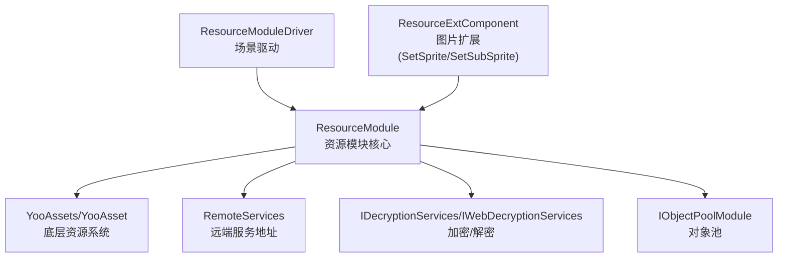
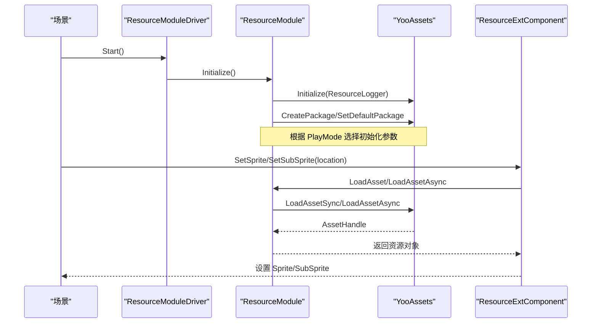
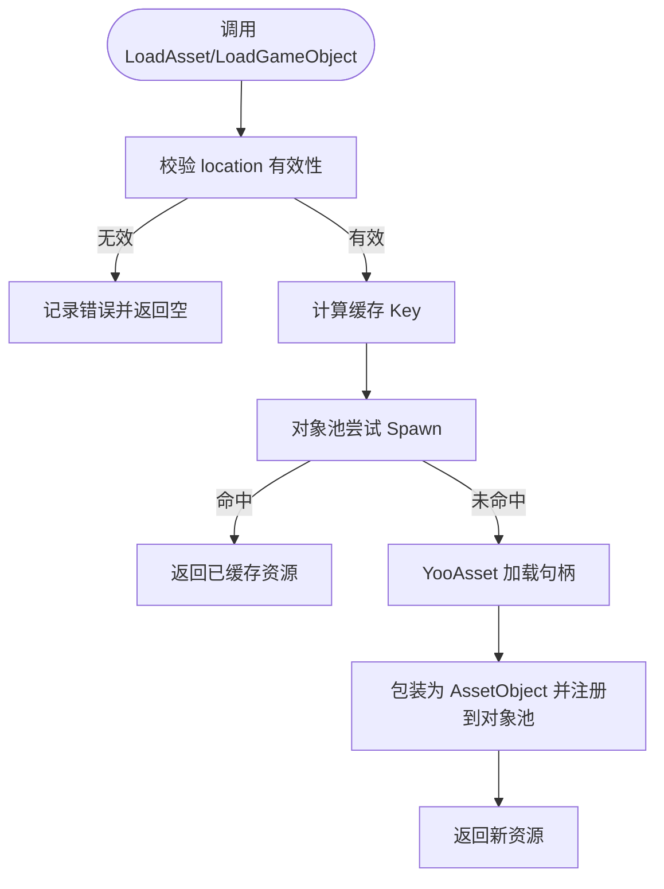
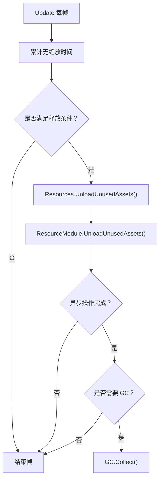
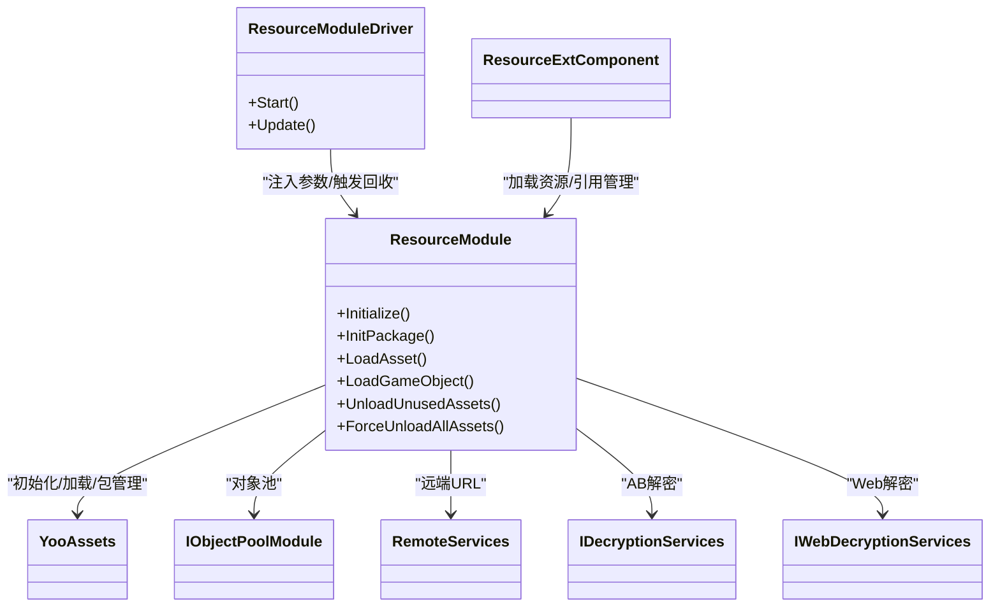

# 资源管理问题排查

<cite>
**本文引用的文件**   
- [Books/3-1-资源模块.md](file://Books/3-1-资源模块.md)
- [ResourceModule.cs](file://UnityProject/Assets/TEngine/Runtime/Module/ResourceModule/ResourceModule.cs)
- [ResourceModuleDriver.cs](file://UnityProject/Assets/TEngine/Runtime/Module/ResourceModule/ResourceModuleDriver.cs)
- [ResourceModule.Services.cs](file://UnityProject/Assets/TEngine/Runtime/Module/ResourceModule/ResourceModule.Services.cs)
- [ResourceModule.AssetObject.cs](file://UnityProject/Assets/TEngine/Runtime/Module/ResourceModule/ResourceModule.AssetObject.cs)
- [ResourceModule.Pool.cs](file://UnityProject/Assets/TEngine/Runtime/Module/ResourceModule/ResourceModule.Pool.cs)
- [ResourceExtComponent.cs](file://UnityProject/Assets/TEngine/Runtime/Module/ResourceModule/Extension/ResourceExtComponent.cs)
</cite>

## 目录
1. [引言](#引言)
2. [项目结构](#项目结构)
3. [核心组件](#核心组件)
4. [架构总览](#架构总览)
5. [详细组件分析](#详细组件分析)
6. [依赖关系分析](#依赖关系分析)
7. [性能与内存优化](#性能与内存优化)
8. [常见问题排查指南](#常见问题排查指南)
9. [结论](#结论)
10. [附录：监控与报告](#附录监控与报告)

## 引言
本指南面向 TEngine 框架的资源管理问题排查，聚焦以下场景：
- 资源加载失败、异步加载异常
- 内存溢出、资源泄漏
- YooAsset 集成问题、资源打包配置错误
- 缓存策略不当、卸载策略不合理
- 资源引用管理与依赖关系分析
- 资源监控工具使用、使用分析报告与内存泄漏检测方法

目标是通过系统化诊断流程、可视化架构图与流程图，帮助开发者快速定位并解决问题。

## 项目结构
资源管理相关代码主要位于 UnityProject/Assets/TEngine/Runtime/Module/ResourceModule 下，配合文档 Books/3-1-资源模块.md 提供高层说明。关键文件职责如下：
- ResourceModule.cs：资源模块主实现，封装 YooAsset 初始化、包管理、加载/卸载、版本与清单更新等能力
- ResourceModuleDriver.cs：场景中的 MonoBehaviour 驱动，负责参数注入、自动释放调度、系统级 GC 触发
- ResourceModule.Services.cs：远端服务地址、加密/解密服务（含 Web 平台）
- ResourceModule.AssetObject.cs：资源对象包装，持有 AssetHandle 并负责释放
- ResourceModule.Pool.cs：资源对象池配置与 UnloadAsset 接口
- ResourceExtComponent.cs：图片设置扩展（SetSprite/SetSubSprite），分帧回收、请求去重与超时保护
- Books/3-1-资源模块.md：资源模块概念、API、最佳实践与运行模式说明

图表来源
- [ResourceModuleDriver.cs:236-270](file://UnityProject/Assets/TEngine/Runtime/Module/ResourceModule/ResourceModuleDriver.cs#L236-L270)
- [ResourceModule.cs:119-138](file://UnityProject/Assets/TEngine/Runtime/Module/ResourceModule/ResourceModule.cs#L119-L138)
- [ResourceModule.Services.cs:12-32](file://UnityProject/Assets/TEngine/Runtime/Module/ResourceModule/ResourceModule.Services.cs#L12-L32)

章节来源
- [Books/3-1-资源模块.md:1-120](file://Books/3-1-资源模块.md#L1-L120)
- [ResourceModule.cs:119-138](file://UnityProject/Assets/TEngine/Runtime/Module/ResourceModule/ResourceModule.cs#L119-L138)
- [ResourceModuleDriver.cs:236-270](file://UnityProject/Assets/TEngine/Runtime/Module/ResourceModule/ResourceModuleDriver.cs#L236-L270)

## 核心组件
- 资源模块（ResourceModule）
  - 负责 YooAsset 初始化、多运行模式（EditorSimulateMode/OfflinePlayMode/HostPlayMode/WebPlayMode）
  - 提供同步/异步加载、GameObject 实例化、资源信息查询、包版本与清单更新、下载器创建、缓存清理
  - 维护资源对象池与引用计数，支持低内存回调与强制回收
- 资源驱动（ResourceModuleDriver）
  - 将场景配置映射到 ResourceModule
  - 周期性触发系统 UnloadUnusedAssets 与 ResourceModule.UnloadUnusedAssets
  - 可选触发 GC.Collect
- 资源对象（AssetObject）
  - 包装 AssetHandle，统一生命周期管理，在对象池回收时释放句柄
- 资源对象池（Pool）
  - 暴露容量、过期时间、优先级等配置；提供 UnloadAsset 接口
- 远端服务与加解密（Services）
  - RemoteServices 提供默认/备用服务器 URL
  - FileStream/FileOffset 及其 Web 对应实现，用于 AB 流或偏移解密
- 图片扩展（ResourceExtComponent）
  - SetSprite/SetSubSprite 自动绑定引用、分帧回收、请求去重与超时保护

章节来源
- [ResourceModule.cs:119-138](file://UnityProject/Assets/TEngine/Runtime/Module/ResourceModule/ResourceModule.cs#L119-L138)
- [ResourceModule.cs:140-261](file://UnityProject/Assets/TEngine/Runtime/Module/ResourceModule/ResourceModule.cs#L140-L261)
- [ResourceModule.cs:390-447](file://UnityProject/Assets/TEngine/Runtime/Module/ResourceModule/ResourceModule.cs#L390-L447)
- [ResourceModule.Driver.cs:236-320](file://UnityProject/Assets/TEngine/Runtime/Module/ResourceModule/ResourceModuleDriver.cs#L236-L320)
- [ResourceModule.AssetObject.cs:16-61](file://UnityProject/Assets/TEngine/Runtime/Module/ResourceModule/ResourceModule.AssetObject.cs#L16-L61)
- [ResourceModule.Pool.cs:43-66](file://UnityProject/Assets/TEngine/Runtime/Module/ResourceModule/ResourceModule.Pool.cs#L43-L66)
- [ResourceModule.Services.cs:12-32](file://UnityProject/Assets/TEngine/Runtime/Module/ResourceModule/ResourceModule.Services.cs#L12-L32)
- [ResourceModule.Services.cs:37-241](file://UnityProject/Assets/TEngine/Runtime/Module/ResourceModule/ResourceModule.Services.cs#L37-L241)
- [ResourceExtComponent.cs:78-195](file://UnityProject/Assets/TEngine/Runtime/Module/ResourceModule/Extension/ResourceExtComponent.cs#L78-L195)

## 架构总览
下图展示从场景驱动到资源模块再到 YooAsset 的调用链，以及图片扩展对资源模块的依赖。

图表来源
- [ResourceModuleDriver.cs:236-270](file://UnityProject/Assets/TEngine/Runtime/Module/ResourceModule/ResourceModuleDriver.cs#L236-L270)
- [ResourceModule.cs:119-138](file://UnityProject/Assets/TEngine/Runtime/Module/ResourceModule/ResourceModule.cs#L119-L138)
- [ResourceModule.cs:692-724](file://UnityProject/Assets/TEngine/Runtime/Module/ResourceModule/ResourceModule.cs#L692-L724)
- [ResourceExtComponent.cs:152-156](file://UnityProject/Assets/TEngine/Runtime/Module/ResourceModule/Extension/ResourceExtComponent.cs#L152-L156)

## 详细组件分析

### 资源模块（ResourceModule）
- 初始化与运行模式
  - Initialize 中调用 YooAssets.Initialize 并设置默认包
  - InitPackage 根据 EditorSimulateMode/OfflinePlayMode/HostPlayMode/WebPlayMode 构建不同参数
  - WebGL 分支根据 LoadResWayWebGL 选择 Remote 或 StreamingAssets
- 包与清单
  - RequestPackageVersionAsync/UpdatePackageManifestAsync 支持热更新清单拉取与更新
- 资源加载
  - LoadAsset/LoadGameObject 先校验 location，再走对象池复用或 YooAsset 加载
  - 异步加载通过 UniTask 封装，内部有等待同 key 加载完成的逻辑
- 资源回收
  - OnLowMemory 触发强制回收
  - UnloadUnusedAssets/ForceUnloadAllAssets/ForceUnloadUnusedAssets 分别对应不同回收粒度
- 资源信息查询
  - GetAssetInfo/HasAsset/CheckLocationValid 提供存在性与有效性检查

图表来源
- [ResourceModule.cs:692-724](file://UnityProject/Assets/TEngine/Runtime/Module/ResourceModule/ResourceModule.cs#L692-L724)
- [ResourceModule.cs:727-760](file://UnityProject/Assets/TEngine/Runtime/Module/ResourceModule/ResourceModule.cs#L727-L760)
- [ResourceModule.AssetObject.cs:16-61](file://UnityProject/Assets/TEngine/Runtime/Module/ResourceModule/ResourceModule.AssetObject.cs#L16-L61)

章节来源
- [ResourceModule.cs:119-138](file://UnityProject/Assets/TEngine/Runtime/Module/ResourceModule/ResourceModule.cs#L119-L138)
- [ResourceModule.cs:140-261](file://UnityProject/Assets/TEngine/Runtime/Module/ResourceModule/ResourceModule.cs#L140-L261)
- [ResourceModule.cs:692-724](file://UnityProject/Assets/TEngine/Runtime/Module/ResourceModule/ResourceModule.cs#L692-L724)
- [ResourceModule.cs:727-760](file://UnityProject/Assets/TEngine/Runtime/Module/ResourceModule/ResourceModule.cs#L727-L760)
- [ResourceModule.cs:390-447](file://UnityProject/Assets/TEngine/Runtime/Module/ResourceModule/ResourceModule.cs#L390-L447)

### 资源驱动（ResourceModuleDriver）
- 启动时将场景配置映射到 ResourceModule（包名、运行模式、加密类型、毫秒切片、自动卸载、远程地址、并发下载数、重试次数等）
- Update 中按间隔触发系统 UnloadUnusedAssets 与 ResourceModule.UnloadUnusedAssets，必要时执行 GC.Collect

图表来源
- [ResourceModuleDriver.cs:289-320](file://UnityProject/Assets/TEngine/Runtime/Module/ResourceModule/ResourceModuleDriver.cs#L289-L320)

章节来源
- [ResourceModuleDriver.cs:236-270](file://UnityProject/Assets/TEngine/Runtime/Module/ResourceModule/ResourceModuleDriver.cs#L236-L270)
- [ResourceModuleDriver.cs:289-320](file://UnityProject/Assets/TEngine/Runtime/Module/ResourceModule/ResourceModuleDriver.cs#L289-L320)

### 远端服务与加解密（Services）
- RemoteServices：拼接默认/备用服务器 URL
- IDecryptionServices/IWebDecryptionServices：
  - FileStream/FileOffset 系列用于本地 AB 流或偏移读取
  - Web 对应实现用于 WebGL 环境下的内存解密

章节来源
- [ResourceModule.Services.cs:12-32](file://UnityProject/Assets/TEngine/Runtime/Module/ResourceModule/ResourceModule.Services.cs#L12-L32)
- [ResourceModule.Services.cs:37-241](file://UnityProject/Assets/TEngine/Runtime/Module/ResourceModule/ResourceModule.Services.cs#L37-L241)

### 资源对象与对象池（AssetObject & Pool）
- AssetObject：包装 AssetHandle，在 Release 时判断有效性并 Dispose
- Pool：对外暴露对象池配置项与 UnloadAsset 方法

章节来源
- [ResourceModule.AssetObject.cs:16-61](file://UnityProject/Assets/TEngine/Runtime/Module/ResourceModule/ResourceModule.AssetObject.cs#L16-L61)
- [ResourceModule.Pool.cs:43-66](file://UnityProject/Assets/TEngine/Runtime/Module/ResourceModule/ResourceModule.Pool.cs#L43-L66)

### 图片扩展（ResourceExtComponent）
- SetSprite/SetSubSprite：自动绑定引用、分帧扫描回收、请求去重、取消与失败不写回当前图片
- 超时保护：编辑器模式下等待同 key 加载最多 60s，避免死等

章节来源
- [ResourceExtComponent.cs:78-195](file://UnityProject/Assets/TEngine/Runtime/Module/ResourceModule/Extension/ResourceExtComponent.cs#L78-L195)

## 依赖关系分析
- ResourceModuleDriver 依赖 ResourceModule 进行运行时参数注入与资源回收调度
- ResourceModule 依赖 YooAssets 进行资源加载、包管理与清单更新
- ResourceModule 依赖 IObjectPoolModule 提供的对象池能力
- ResourceModule 依赖 RemoteServices 与 IDecryptionServices/IWebDecryptionServices 处理网络与加密
- ResourceExtComponent 依赖 ResourceModule 进行资源加载与引用管理

图表来源
- [ResourceModuleDriver.cs:236-270](file://UnityProject/Assets/TEngine/Runtime/Module/ResourceModule/ResourceModuleDriver.cs#L236-L270)
- [ResourceModule.cs:119-138](file://UnityProject/Assets/TEngine/Runtime/Module/ResourceModule/ResourceModule.cs#L119-L138)
- [ResourceModule.Services.cs:12-32](file://UnityProject/Assets/TEngine/Runtime/Module/ResourceModule/ResourceModule.Services.cs#L12-L32)
- [ResourceExtComponent.cs:152-156](file://UnityProject/Assets/TEngine/Runtime/Module/ResourceModule/Extension/ResourceExtComponent.cs#L152-L156)

## 性能与内存优化
- 异步时间切片
  - 通过 Milliseconds 控制 YooAsset 每帧最大耗时，避免卡顿
- 对象池容量与过期
  - AssetCapacity/AssetExpireTime/AssetAutoReleaseInterval 控制资源对象池行为
- 自动卸载策略
  - AutoUnloadBundleWhenUnused 控制引用计数为 0 的包自动卸载
  - ResourceModuleDriver 周期触发系统 UnloadUnusedAssets 与 ResourceModule.UnloadUnusedAssets
- WebGL 限制
  - ForceUnloadAllAssets 在 WebGL 不支持，需避免直接调用
- 图片扩展分帧回收
  - maxProcessPerFrame 控制每帧回收数量，避免一次性大量回收导致卡顿

章节来源
- [ResourceModule.cs:31-39](file://UnityProject/Assets/TEngine/Runtime/Module/ResourceModule/ResourceModule.cs#L31-L39)
- [ResourceModule.cs:429-447](file://UnityProject/Assets/TEngine/Runtime/Module/ResourceModule/ResourceModule.cs#L429-L447)
- [ResourceModule.Pool.cs:10-41](file://UnityProject/Assets/TEngine/Runtime/Module/ResourceModule/ResourceModule.Pool.cs#L10-L41)
- [ResourceModuleDriver.cs:289-320](file://UnityProject/Assets/TEngine/Runtime/Module/ResourceModule/ResourceModuleDriver.cs#L289-L320)
- [ResourceExtComponent.cs:43-47](file://UnityProject/Assets/TEngine/Runtime/Module/ResourceModule/Extension/ResourceExtComponent.cs#L43-L47)

## 常见问题排查指南

### 1. 资源加载失败
常见原因
- 资源定位地址无效或未打包
- 运行模式配置错误（如编辑器模拟模式误用）
- WebGL 资源加载方式配置不当（Remote vs StreamingAssets）
- 远端服务地址不可达或清单版本不一致

诊断步骤
- 使用 HasAsset/CheckLocationValid 检查资源是否存在与地址有效性
- 确认 PlayMode 与场景 ResourceModuleDriver 配置一致
- 检查 HostServerURL/FallbackHostServerURL 与 LoadResWayWebGL
- 查看日志输出（Could not found location / Invalid asset name）

解决建议
- 修正资源命名与打包配置，确保唯一且可寻址
- 根据平台选择正确运行模式与 WebGL 加载方式
- 校验远端服务可达性，必要时切换备用服务器
- 若需要热更新，确保 RequestPackageVersionAsync/UpdatePackageManifestAsync 成功

章节来源
- [ResourceModule.cs:577-620](file://UnityProject/Assets/TEngine/Runtime/Module/ResourceModule/ResourceModule.cs#L577-L620)
- [ResourceModule.cs:692-724](file://UnityProject/Assets/TEngine/Runtime/Module/ResourceModule/ResourceModule.cs#L692-L724)
- [ResourceModule.cs:140-261](file://UnityProject/Assets/TEngine/Runtime/Module/ResourceModule/ResourceModule.cs#L140-L261)
- [Books/3-1-资源模块.md:64-94](file://Books/3-1-资源模块.md#L64-L94)

### 2. 异步加载异常
常见原因
- 等待同 key 加载超时（编辑器模式 60s）
- 取消 Token 未正确处理
- 资源地址无效导致回调返回空

诊断步骤
- 检查日志“LoadAssetAsync Waiting ... timeout”
- 确认调用方是否正确传递 CancellationToken
- 使用 CheckLocationValid 提前校验地址

解决建议
- 合理设置超时与重试策略
- 在取消时主动取消请求，避免写回旧图
- 对异步回调做空值与错误处理

章节来源
- [ResourceExtComponent.cs:172-195](file://UnityProject/Assets/TEngine/Runtime/Module/ResourceModule/Extension/ResourceExtComponent.cs#L172-L195)
- [ResourceModule.cs:769-800](file://UnityProject/Assets/TEngine/Runtime/Module/ResourceModule/ResourceModule.cs#L769-L800)

### 3. 内存溢出
常见原因
- 对象池容量过小或过期时间过短
- 未及时触发 UnloadUnusedAssets
- WebGL 上调用 ForceUnloadAllAssets 被忽略
- 图片扩展未分帧回收导致瞬时压力

诊断步骤
- 观察 ResourceModuleDriver.Update 的释放间隔与系统 UnloadUnusedAssets 执行情况
- 检查 AssetCapacity/AssetExpireTime/AssetAutoReleaseInterval
- 确认是否在 WebGL 调用了 ForceUnloadAllAssets

解决建议
- 增大对象池容量与过期时间，调整自动释放间隔
- 启用 UseSystemUnloadUnusedAssets 并按需触发 GC
- 避免在 WebGL 调用 ForceUnloadAllAssets
- 保持图片扩展的分帧回收策略

章节来源
- [ResourceModuleDriver.cs:289-320](file://UnityProject/Assets/TEngine/Runtime/Module/ResourceModule/ResourceModuleDriver.cs#L289-L320)
- [ResourceModule.Pool.cs:10-41](file://UnityProject/Assets/TEngine/Runtime/Module/ResourceModule/ResourceModule.Pool.cs#L10-L41)
- [ResourceModule.cs:429-447](file://UnityProject/Assets/TEngine/Runtime/Module/ResourceModule/ResourceModule.cs#L429-L447)
- [ResourceExtComponent.cs:109-150](file://UnityProject/Assets/TEngine/Runtime/Module/ResourceModule/Extension/ResourceExtComponent.cs#L109-L150)

### 4. 资源泄漏
常见原因
- 手动加载资源后未调用 UnloadAsset
- GameObject 克隆后未绑定 AssetsReference
- 图片扩展未正确归还图集克隆或未完成请求

诊断步骤
- 检查是否使用 LoadAsset 而非 LoadGameObject/LoadGameObjectAsync
- 动态资源是否通过 AssetsReference.Ref 绑定
- 图片扩展的 ReleaseUnused 是否正常执行

解决建议
- 优先使用 LoadGameObject/LoadGameObjectAsync，自动添加 AssetsReference
- 动态资源使用 AssetsReference.Ref 绑定引用
- 确保图片扩展的 ReleaseUnused 被调用，必要时手动触发

章节来源
- [Books/3-1-资源模块.md:100-134](file://Books/3-1-资源模块.md#L100-L134)
- [ResourceModule.Pool.cs:43-53](file://UnityProject/Assets/TEngine/Runtime/Module/ResourceModule/ResourceModule.Pool.cs#L43-L53)
- [ResourceExtComponent.cs:109-170](file://UnityProject/Assets/TEngine/Runtime/Module/ResourceModule/Extension/ResourceExtComponent.cs#L109-L170)

### 5. YooAsset 集成问题
常见原因
- 运行模式配置错误
- 远端服务地址未设置或不可达
- WebGL 加载方式选择不当
- 清单版本不一致导致加载失败

诊断步骤
- 检查 ResourceModuleDriver.PlayMode 与 Settings.UpdateSetting 配置
- 检查 HostServerURL/FallbackHostServerURL 与 LoadResWayWebGL
- 查看 RequestPackageVersionAsync/UpdatePackageManifestAsync 状态

解决建议
- 根据平台选择合适运行模式与 WebGL 加载方式
- 校验远端服务可达性，必要时切换备用服务器
- 确保清单版本一致，必要时重新拉取清单

章节来源
- [ResourceModuleDriver.cs:236-270](file://UnityProject/Assets/TEngine/Runtime/Module/ResourceModule/ResourceModuleDriver.cs#L236-L270)
- [ResourceModule.cs:140-261](file://UnityProject/Assets/TEngine/Runtime/Module/ResourceModule/ResourceModule.cs#L140-L261)
- [Books/3-1-资源模块.md:64-94](file://Books/3-1-资源模块.md#L64-L94)

### 6. 资源打包配置错误
常见原因
- 资源命名重复
- 资源后缀未按要求省略
- 资源包未初始化或包名不一致

诊断步骤
- 检查资源命名唯一性与加载地址不带后缀
- 确认 InitPackage 的 packageName 与调用处一致
- 使用 GetAssetInfo/HasAsset 验证资源存在性

解决建议
- 规范资源命名，避免重复
- 加载地址不带后缀
- 确保包初始化成功，必要时重新打包

章节来源
- [Books/3-1-资源模块.md:390-394](file://Books/3-1-资源模块.md#L390-L394)
- [ResourceModule.cs:533-569](file://UnityProject/Assets/TEngine/Runtime/Module/ResourceModule/ResourceModule.cs#L533-L569)
- [ResourceModule.cs:577-620](file://UnityProject/Assets/TEngine/Runtime/Module/ResourceModule/ResourceModule.cs#L577-L620)

### 7. 缓存策略不当
常见原因
- 对象池容量过小导致频繁重建
- 过期时间过短导致资源过早回收
- 自动释放间隔过长导致内存占用高

诊断步骤
- 检查 AssetCapacity/AssetExpireTime/AssetAutoReleaseInterval
- 观察 ReleaseUnused 的执行频率与回收效果

解决建议
- 根据业务峰值调整容量与过期时间
- 缩短自动释放间隔以更快释放无用资源
- 结合 UseSystemUnloadUnusedAssets 与 GC 策略

章节来源
- [ResourceModule.Pool.cs:10-41](file://UnityProject/Assets/TEngine/Runtime/Module/ResourceModule/ResourceModule.Pool.cs#L10-L41)
- [ResourceModuleDriver.cs:289-320](file://UnityProject/Assets/TEngine/Runtime/Module/ResourceModule/ResourceModuleDriver.cs#L289-L320)

### 8. 资源卸载策略的配置和优化
- 自动卸载包：AutoUnloadBundleWhenUnused
- 系统卸载：UseSystemUnloadUnusedAssets + min/max 间隔
- 低内存回调：OnLowMemory -> ForceUnloadUnusedAssets
- WebGL 限制：避免 ForceUnloadAllAssets

章节来源
- [ResourceModule.cs:31-39](file://UnityProject/Assets/TEngine/Runtime/Module/ResourceModule/ResourceModule.cs#L31-L39)
- [ResourceModule.cs:390-447](file://UnityProject/Assets/TEngine/Runtime/Module/ResourceModule/ResourceModule.cs#L390-L447)
- [ResourceModuleDriver.cs:289-320](file://UnityProject/Assets/TEngine/Runtime/Module/ResourceModule/ResourceModuleDriver.cs#L289-L320)

## 结论
通过上述架构分析与排查流程，可以系统性地定位与解决 TEngine 资源管理中的加载失败、内存溢出、资源泄漏、缓存与卸载策略等问题。关键在于：
- 正确使用 LoadGameObject/LoadGameObjectAsync 与 AssetsReference
- 合理配置运行模式、远端服务与 WebGL 加载方式
- 调整对象池与自动释放策略，结合系统卸载与 GC
- 利用 HasAsset/CheckLocationValid 与日志进行快速诊断

## 附录：监控与报告
- 资源使用分析
  - 使用 GetAssetInfo/GetAssetInfos 获取资源信息与列表
  - 使用 HasAsset/IsNeedDownloadFromRemote 检查资源存在性与在线状态
- 内存泄漏检测
  - 定期调用 UnloadUnusedAssets 与 ForceUnloadUnusedAssets
  - 在低内存回调中触发强制回收
  - 结合 Unity Profiler 与 Memory Profiler 观察对象池与资源占用
- 资源监控工具
  - 使用 ResourceModuleDriver 的 LastUnloadUnusedAssetsOperationElapseSeconds 观察释放间隔
  - 使用 ResourceExtComponent 的 ReleaseUnused 手动触发分帧回收

章节来源
- [ResourceModule.cs:495-569](file://UnityProject/Assets/TEngine/Runtime/Module/ResourceModule/ResourceModule.cs#L495-L569)
- [ResourceModule.cs:577-620](file://UnityProject/Assets/TEngine/Runtime/Module/ResourceModule/ResourceModule.cs#L577-L620)
- [ResourceModuleDriver.cs:184-184](file://UnityProject/Assets/TEngine/Runtime/Module/ResourceModule/ResourceModuleDriver.cs#L184-L184)
- [ResourceExtComponent.cs:109-170](file://UnityProject/Assets/TEngine/Runtime/Module/ResourceModule/Extension/ResourceExtComponent.cs#L109-L170)