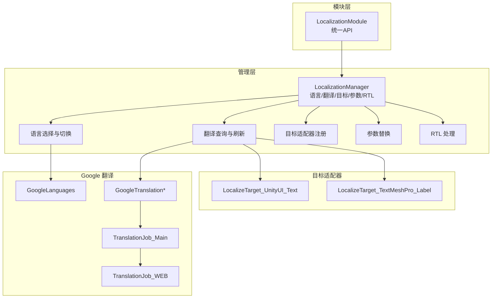
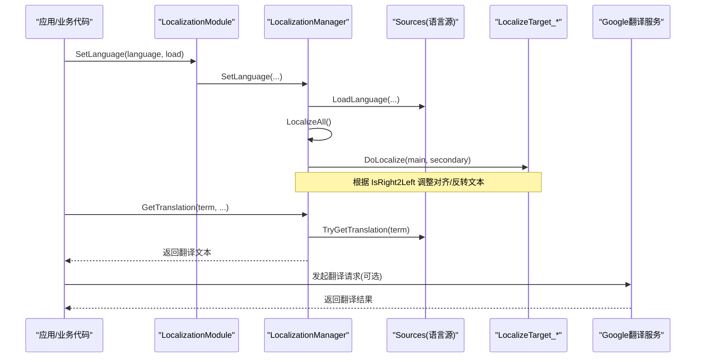
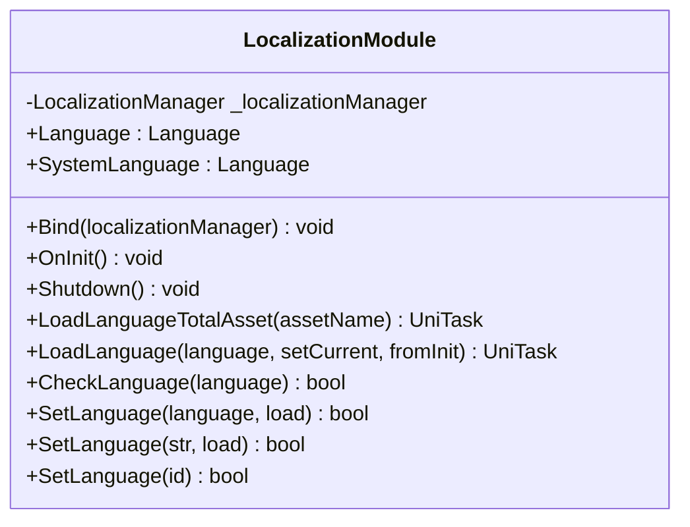
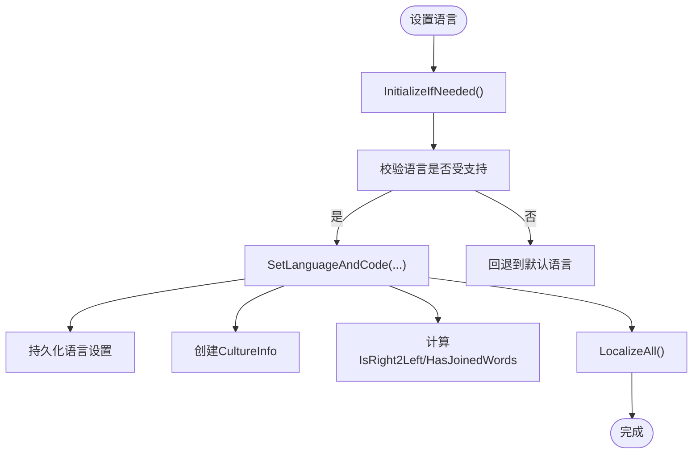
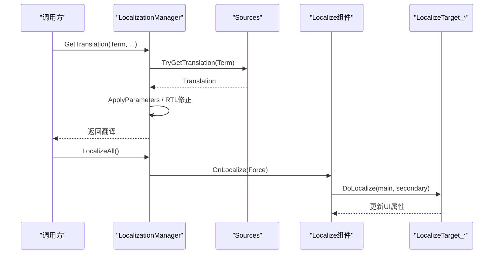
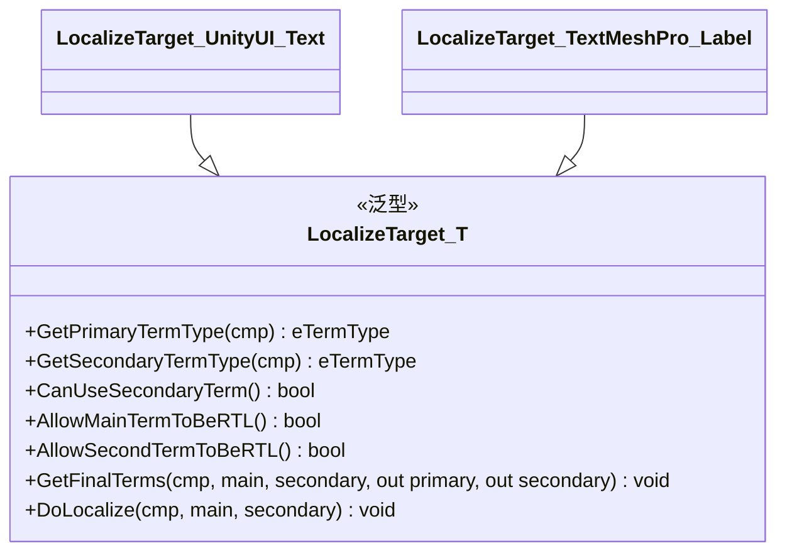
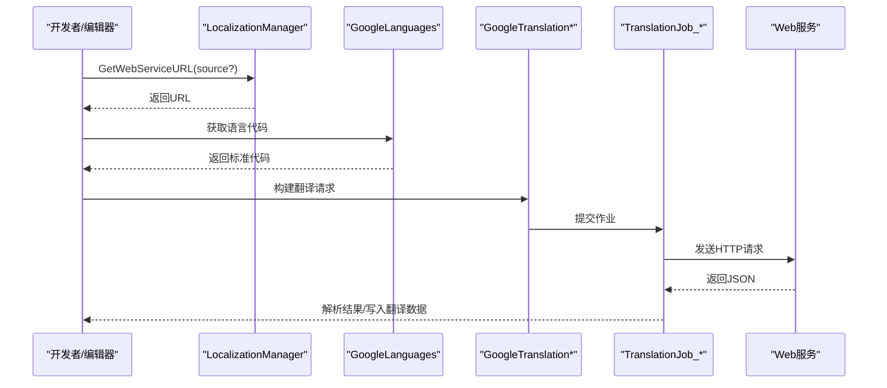
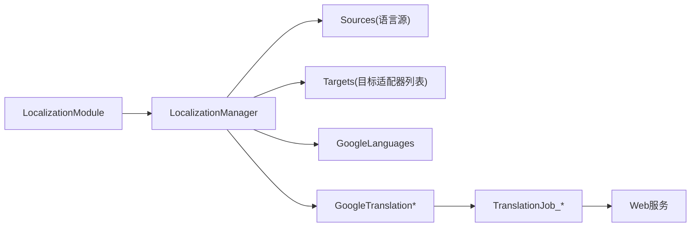

# 本地化系统

<cite>
**本文引用的文件**   
- [LocalizationModule.cs](file://UnityProject/Assets/TEngine/Runtime/Module/LocalizationModule/LocalizationModule.cs)
- [ILocalizationModule.cs](file://UnityProject/Assets/TEngine/Runtime/Module/LocalizationModule/ILocalizationModule.cs)
- [Language.cs](file://UnityProject/Assets/TEngine/Runtime/Module/LocalizationModule/Language.cs)
- [LocalizationManager.cs](file://UnityProject/Assets/TEngine/Runtime/Module/LocalizationModule/Core/Manager/LocalizationManager.cs)
- [LocalizationManager_Language.cs](file://UnityProject/Assets/TEngine/Runtime/Module/LocalizationModule/Core/Manager/LocalizationManager_Language.cs)
- [LocalizationManager_Parameters.cs](file://UnityProject/Assets/TEngine/Runtime/Module/LocalizationModule/Core/Manager/LocalizationManager_Parameters.cs)
- [LocalizationManager_RTL.cs](file://UnityProject/Assets/TEngine/Runtime/Module/LocalizationModule/Core/Manager/LocalizationManager_RTL.cs)
- [LocalizationManager_Targets.cs](file://UnityProject/Assets/TEngine/Runtime/Module/LocalizationModule/Core/Manager/LocalizationManager_Targets.cs)
- [LocalizationManager_Translation.cs](file://UnityProject/Assets/TEngine/Runtime/Module/LocalizationModule/Core/Manager/LocalizationManager_Translation.cs)
- [LocalizeTarget_UnityUI_Text.cs](file://UnityProject/Assets/TEngine/Runtime/Module/LocalizationModule/Core/Targets/LocalizeTarget_UnityUI_Text.cs)
- [LocalizeTarget_TextMeshPro_Label.cs](file://UnityProject/Assets/TEngine/Runtime/Module/LocalizationModule/Core/Targets/LocalizeTarget_TextMeshPro_Label.cs)
- [GoogleLanguages.cs](file://UnityProject/Assets/TEngine/Runtime/Module/LocalizationModule/Core/Google/GoogleLanguages.cs)
- [GoogleTranslation.cs](file://UnityProject/Assets/TEngine/Runtime/Module/LocalizationModule/Core/Google/GoogleTranslation.cs)
- [GoogleTranslation_Post.cs](file://UnityProject/Assets/TEngine/Runtime/Module/LocalizationModule/Core/Google/GoogleTranslation_Post.cs)
- [GoogleTranslation_Queries.cs](file://UnityProject/Assets/TEngine/Runtime/Module/LocalizationModule/Core/Google/GoogleTranslation_Queries.cs)
- [TranslationJob_Main.cs](file://UnityProject/Assets/TEngine/Runtime/Module/LocalizationModule/Core/Google/TranslationJob_Main.cs)
- [TranslationJob_WEB.cs](file://UnityProject/Assets/TEngine/Runtime/Module/LocalizationModule/Core/Google/TranslationJob_WEB.cs)
</cite>

## 目录
1. [简介](#简介)
2. [项目结构](#项目结构)
3. [核心组件](#核心组件)
4. [架构总览](#架构总览)
5. [详细组件分析](#详细组件分析)
6. [依赖关系分析](#依赖关系分析)
7. [性能与缓存策略](#性能与缓存策略)
8. [调试与故障排查](#调试与故障排查)
9. [最佳实践](#最佳实践)
10. [结论](#结论)

## 简介
本文件系统性梳理 TEngine 的本地化系统，围绕 LocalizationModule 的架构设计、多语言文本管理、运行时语言切换、翻译数据加载与缓存、Google 翻译集成、本地化目标适配器（LocalizeTarget）模式展开，并提供开发工作流、RTL 支持、调试优化与 UI 框架/配置系统集成建议。

## 项目结构
本地化系统位于 Runtime/Module/LocalizationModule 下，分为模块入口、管理器、目标适配器和 Google 翻译工具等层次：
- 模块入口：LocalizationModule 暴露统一 API，桥接底层 LocalizationManager
- 管理器：LocalizationManager 及其分文件实现负责语言选择、翻译查询、目标注册、参数处理、RTL 逻辑
- 目标适配器：针对 UnityUI、TextMeshPro 等 UI 组件提供本地化更新能力
- Google 翻译：语言代码映射、翻译请求封装、作业调度与 Web 通信

图表来源
- [LocalizationModule.cs:1-114](file://UnityProject/Assets/TEngine/Runtime/Module/LocalizationModule/LocalizationModule.cs#L1-L114)
- [LocalizationManager.cs:1-93](file://UnityProject/Assets/TEngine/Runtime/Module/LocalizationModule/Core/Manager/LocalizationManager.cs#L1-L93)
- [LocalizationManager_Language.cs:1-349](file://UnityProject/Assets/TEngine/Runtime/Module/LocalizationModule/Core/Manager/LocalizationManager_Language.cs#L1-L349)
- [LocalizationManager_Translation.cs:1-226](file://UnityProject/Assets/TEngine/Runtime/Module/LocalizationModule/Core/Manager/LocalizationManager_Translation.cs#L1-L226)
- [LocalizationManager_Targets.cs:1-31](file://UnityProject/Assets/TEngine/Runtime/Module/LocalizationModule/Core/Manager/LocalizationManager_Targets.cs#L1-L31)
- [LocalizeTarget_UnityUI_Text.cs:1-112](file://UnityProject/Assets/TEngine/Runtime/Module/LocalizationModule/Core/Targets/LocalizeTarget_UnityUI_Text.cs#L1-L112)
- [LocalizeTarget_TextMeshPro_Label.cs:1-191](file://UnityProject/Assets/TEngine/Runtime/Module/LocalizationModule/Core/Targets/LocalizeTarget_TextMeshPro_Label.cs#L1-L191)
- [GoogleLanguages.cs](file://UnityProject/Assets/TEngine/Runtime/Module/LocalizationModule/Core/Google/GoogleLanguages.cs)
- [GoogleTranslation.cs](file://UnityProject/Assets/TEngine/Runtime/Module/LocalizationModule/Core/Google/GoogleTranslation.cs)
- [TranslationJob_Main.cs](file://UnityProject/Assets/TEngine/Runtime/Module/LocalizationModule/Core/Google/TranslationJob_Main.cs)
- [TranslationJob_WEB.cs](file://UnityProject/Assets/TEngine/Runtime/Module/LocalizationModule/Core/Google/TranslationJob_WEB.cs)

章节来源
- [LocalizationModule.cs:1-114](file://UnityProject/Assets/TEngine/Runtime/Module/LocalizationModule/LocalizationModule.cs#L1-L114)
- [LocalizationManager.cs:1-93](file://UnityProject/Assets/TEngine/Runtime/Module/LocalizationModule/Core/Manager/LocalizationManager.cs#L1-L93)

## 核心组件
- LocalizationModule：对外暴露语言设置、资源加载、检查等接口，内部委托给 LocalizationManager
- LocalizationManager：静态管理器，负责初始化、语言选择、翻译查询、目标刷新、参数替换、RTL 处理、Google 服务 URL 获取等
- LocalizeTarget_*：针对不同 UI 组件的本地化目标适配器，自动注册并执行文本/字体/材质等属性的本地化更新
- Google 翻译相关：GoogleLanguages 提供语言代码映射；GoogleTranslation* 封装翻译请求；TranslationJob_* 负责异步任务与 Web 调用

章节来源
- [LocalizationModule.cs:1-114](file://UnityProject/Assets/TEngine/Runtime/Module/LocalizationModule/LocalizationModule.cs#L1-L114)
- [LocalizationManager.cs:1-93](file://UnityProject/Assets/TEngine/Runtime/Module/LocalizationModule/Core/Manager/LocalizationManager.cs#L1-L93)
- [LocalizationManager_Translation.cs:1-226](file://UnityProject/Assets/TEngine/Runtime/Module/LocalizationModule/Core/Manager/LocalizationManager_Translation.cs#L1-L226)
- [LocalizeTarget_UnityUI_Text.cs:1-112](file://UnityProject/Assets/TEngine/Runtime/Module/LocalizationModule/Core/Targets/LocalizeTarget_UnityUI_Text.cs#L1-L112)
- [LocalizeTarget_TextMeshPro_Label.cs:1-191](file://UnityProject/Assets/TEngine/Runtime/Module/LocalizationModule/Core/Targets/LocalizeTarget_TextMeshPro_Label.cs#L1-L191)

## 架构总览
下图展示从模块入口到管理器、再到目标适配器的调用链，以及 Google 翻译集成的位置。

图表来源
- [LocalizationModule.cs:1-114](file://UnityProject/Assets/TEngine/Runtime/Module/LocalizationModule/LocalizationModule.cs#L1-L114)
- [LocalizationManager_Translation.cs:1-226](file://UnityProject/Assets/TEngine/Runtime/Module/LocalizationModule/Core/Manager/LocalizationManager_Translation.cs#L1-L226)
- [LocalizationManager_Language.cs:1-349](file://UnityProject/Assets/TEngine/Runtime/Module/LocalizationModule/Core/Manager/LocalizationManager_Language.cs#L1-L349)
- [LocalizeTarget_UnityUI_Text.cs:1-112](file://UnityProject/Assets/TEngine/Runtime/Module/LocalizationModule/Core/Targets/LocalizeTarget_UnityUI_Text.cs#L1-L112)
- [LocalizeTarget_TextMeshPro_Label.cs:1-191](file://UnityProject/Assets/TEngine/Runtime/Module/LocalizationModule/Core/Targets/LocalizeTarget_TextMeshPro_Label.cs#L1-L191)

## 详细组件分析

### LocalizationModule 与 ILocalizationModule
- 职责：作为模块门面，封装对 LocalizationManager 的调用，提供 Language 属性、SetLanguage 重载、LoadLanguage、CheckLanguage 等方法
- 生命周期：OnInit/Shutdown 中完成绑定与销毁
- 设计要点：通过 Bind(LocalizationManager) 注入具体实现，便于扩展或替换

图表来源
- [LocalizationModule.cs:1-114](file://UnityProject/Assets/TEngine/Runtime/Module/LocalizationModule/LocalizationModule.cs#L1-L114)

章节来源
- [LocalizationModule.cs:1-114](file://UnityProject/Assets/TEngine/Runtime/Module/LocalizationModule/LocalizationModule.cs#L1-L114)
- [ILocalizationModule.cs](file://UnityProject/Assets/TEngine/Runtime/Module/LocalizationModule/ILocalizationModule.cs)

### LocalizationManager 语言管理与切换
- 启动流程：InitializeIfNeeded 确保 Sources 已更新，SelectStartupLanguage 选择初始语言（优先系统语言或已保存语言）
- 当前语言：CurrentLanguage/CurrentLanguageCode/CurrentRegion/CurrentRegionCode 提供便捷访问
- 切换逻辑：SetLanguageAndCode 持久化语言、设置 Culture、计算 RTL/连字标志、触发 LocalizeAll
- 语言检测：HasLanguage/GetSupportedLanguage/GetLanguageCode/GetLanguageFromCode 支持名称与代码双向查找

图表来源
- [LocalizationManager.cs:16-34](file://UnityProject/Assets/TEngine/Runtime/Module/LocalizationModule/Core/Manager/LocalizationManager.cs#L16-L34)
- [LocalizationManager_Language.cs:114-130](file://UnityProject/Assets/TEngine/Runtime/Module/LocalizationModule/Core/Manager/LocalizationManager_Language.cs#L114-L130)
- [LocalizationManager_Language.cs:163-205](file://UnityProject/Assets/TEngine/Runtime/Module/LocalizationModule/Core/Manager/LocalizationManager_Language.cs#L163-L205)

章节来源
- [LocalizationManager.cs:1-93](file://UnityProject/Assets/TEngine/Runtime/Module/LocalizationModule/Core/Manager/LocalizationManager.cs#L1-L93)
- [LocalizationManager_Language.cs:1-349](file://UnityProject/Assets/TEngine/Runtime/Module/LocalizationModule/Core/Manager/LocalizationManager_Language.cs#L1-L349)

### 翻译查询与刷新
- 查询：GetTranslation/TryGetTranslation 遍历 Sources 查找术语，支持参数替换与 RTL 修正
- 刷新：LocalizeAll 在编辑器/运行时有不同路径，最终调用 DoLocalizeAll 遍历场景中的 Localize 组件并触发 OnLocalize
- 事件：OnLocalizeEvent 允许外部监听刷新时机

图表来源
- [LocalizationManager_Translation.cs:25-60](file://UnityProject/Assets/TEngine/Runtime/Module/LocalizationModule/Core/Manager/LocalizationManager_Translation.cs#L25-L60)
- [LocalizationManager_Translation.cs:110-152](file://UnityProject/Assets/TEngine/Runtime/Module/LocalizationModule/Core/Manager/LocalizationManager_Translation.cs#L110-L152)

章节来源
- [LocalizationManager_Translation.cs:1-226](file://UnityProject/Assets/TEngine/Runtime/Module/LocalizationModule/Core/Manager/LocalizationManager_Translation.cs#L1-L226)

### 本地化目标适配器（LocalizeTarget）
- 设计模式：基于 ILocalizeTargetDescriptor 的统一接口，按优先级注册；每个 UI 类型一个适配器
- UnityUI Text：主术语为文本，次术语为字体；根据 IsRight2Left 调整对齐方式，必要时标记顶点脏
- TextMeshPro Label：支持字体/材质本地化；设置 isRightToLeftText，必要时反转文本；维护左右对齐映射

图表来源
- [LocalizeTarget_UnityUI_Text.cs:11-112](file://UnityProject/Assets/TEngine/Runtime/Module/LocalizationModule/Core/Targets/LocalizeTarget_UnityUI_Text.cs#L11-L112)
- [LocalizeTarget_TextMeshPro_Label.cs:13-191](file://UnityProject/Assets/TEngine/Runtime/Module/LocalizationModule/Core/Targets/LocalizeTarget_TextMeshPro_Label.cs#L13-L191)
- [LocalizationManager_Targets.cs:10-28](file://UnityProject/Assets/TEngine/Runtime/Module/LocalizationModule/Core/Manager/LocalizationManager_Targets.cs#L10-L28)

章节来源
- [LocalizeTarget_UnityUI_Text.cs:1-112](file://UnityProject/Assets/TEngine/Runtime/Module/LocalizationModule/Core/Targets/LocalizeTarget_UnityUI_Text.cs#L1-L112)
- [LocalizeTarget_TextMeshPro_Label.cs:1-191](file://UnityProject/Assets/TEngine/Runtime/Module/LocalizationModule/Core/Targets/LocalizeTarget_TextMeshPro_Label.cs#L1-L191)
- [LocalizationManager_Targets.cs:1-31](file://UnityProject/Assets/TEngine/Runtime/Module/LocalizationModule/Core/Manager/LocalizationManager_Targets.cs#L1-L31)

### Google 翻译集成
- 语言代码：GoogleLanguages 提供语言代码映射，用于将自然语言名映射为标准代码
- 翻译请求：GoogleTranslation* 封装 GET/POST 请求与 JSON 解析
- 作业调度：TranslationJob_Main 协调翻译作业，TranslationJob_WEB 负责网络通信
- 服务 URL：LocalizationManager.GetWebServiceURL 支持按 Source 或全局配置

图表来源
- [LocalizationManager.cs:41-56](file://UnityProject/Assets/TEngine/Runtime/Module/LocalizationModule/Core/Manager/LocalizationManager.cs#L41-L56)
- [GoogleLanguages.cs](file://UnityProject/Assets/TEngine/Runtime/Module/LocalizationModule/Core/Google/GoogleLanguages.cs)
- [GoogleTranslation.cs](file://UnityProject/Assets/TEngine/Runtime/Module/LocalizationModule/Core/Google/GoogleTranslation.cs)
- [GoogleTranslation_Post.cs](file://UnityProject/Assets/TEngine/Runtime/Module/LocalizationModule/Core/Google/GoogleTranslation_Post.cs)
- [GoogleTranslation_Queries.cs](file://UnityProject/Assets/TEngine/Runtime/Module/LocalizationModule/Core/Google/GoogleTranslation_Queries.cs)
- [TranslationJob_Main.cs](file://UnityProject/Assets/TEngine/Runtime/Module/LocalizationModule/Core/Google/TranslationJob_Main.cs)
- [TranslationJob_WEB.cs](file://UnityProject/Assets/TEngine/Runtime/Module/LocalizationModule/Core/Google/TranslationJob_WEB.cs)

章节来源
- [LocalizationManager.cs:41-56](file://UnityProject/Assets/TEngine/Runtime/Module/LocalizationModule/Core/Manager/LocalizationManager.cs#L41-L56)
- [GoogleLanguages.cs](file://UnityProject/Assets/TEngine/Runtime/Module/LocalizationModule/Core/Google/GoogleLanguages.cs)
- [GoogleTranslation.cs](file://UnityProject/Assets/TEngine/Runtime/Module/LocalizationModule/Core/Google/GoogleTranslation.cs)
- [GoogleTranslation_Post.cs](file://UnityProject/Assets/TEngine/Runtime/Module/LocalizationModule/Core/Google/GoogleTranslation_Post.cs)
- [GoogleTranslation_Queries.cs](file://UnityProject/Assets/TEngine/Runtime/Module/LocalizationModule/Core/Google/GoogleTranslation_Queries.cs)
- [TranslationJob_Main.cs](file://UnityProject/Assets/TEngine/Runtime/Module/LocalizationModule/Core/Google/TranslationJob_Main.cs)
- [TranslationJob_WEB.cs](file://UnityProject/Assets/TEngine/Runtime/Module/LocalizationModule/Core/Google/TranslationJob_WEB.cs)

## 依赖关系分析
- LocalizationModule 依赖 LocalizationManager（通过 Bind 注入）
- LocalizationManager 聚合 Sources（语言源）、Targets（目标适配器）、Google 工具类
- LocalizeTarget_* 通过 LocalizationManager.RegisterTarget 注册，按优先级排序
- Google 翻译模块与 Manager 解耦，通过 URL 与语言代码进行协作

图表来源
- [LocalizationModule.cs:1-114](file://UnityProject/Assets/TEngine/Runtime/Module/LocalizationModule/LocalizationModule.cs#L1-L114)
- [LocalizationManager_Targets.cs:10-28](file://UnityProject/Assets/TEngine/Runtime/Module/LocalizationModule/Core/Manager/LocalizationManager_Targets.cs#L10-L28)
- [LocalizationManager.cs:41-56](file://UnityProject/Assets/TEngine/Runtime/Module/LocalizationModule/Core/Manager/LocalizationManager.cs#L41-L56)

章节来源
- [LocalizationModule.cs:1-114](file://UnityProject/Assets/TEngine/Runtime/Module/LocalizationModule/LocalizationModule.cs#L1-L114)
- [LocalizationManager_Targets.cs:1-31](file://UnityProject/Assets/TEngine/Runtime/Module/LocalizationModule/Core/Manager/LocalizationManager_Targets.cs#L1-L31)
- [LocalizationManager.cs:1-93](file://UnityProject/Assets/TEngine/Runtime/Module/LocalizationModule/Core/Manager/LocalizationManager.cs#L1-L93)

## 性能与缓存策略
- 延迟初始化：InitializeIfNeeded 仅在首次访问时加载 Sources 与选择语言，避免启动开销
- 批量刷新：LocalizeAll 使用协程合并多次刷新，减少重复 UI 重建
- 目标优先级：RegisterTarget 按 Priority 插入，保证关键 UI 优先更新
- 参数替换：ApplyLocalizationParams 按需执行，避免不必要的字符串处理
- RTL 优化：仅在 IsRight2Left 且 FixForRTL 开启时执行文本反转与对齐调整

章节来源
- [LocalizationManager.cs:16-34](file://UnityProject/Assets/TEngine/Runtime/Module/LocalizationModule/Core/Manager/LocalizationManager.cs#L16-L34)
- [LocalizationManager_Translation.cs:110-152](file://UnityProject/Assets/TEngine/Runtime/Module/LocalizationModule/Core/Manager/LocalizationManager_Translation.cs#L110-L152)
- [LocalizationManager_Targets.cs:14-28](file://UnityProject/Assets/TEngine/Runtime/Module/LocalizationModule/Core/Manager/LocalizationManager_Targets.cs#L14-L28)

## 调试与故障排查
- 编辑器退出播放模式清理：OnEditorPlayModeStateChanged 清空事件订阅、重新加载语言、清理临时 .loc 文件
- 刷新事件：OnLocalizeEvent 可用于监听刷新时机，辅助定位 UI 未更新问题
- 术语查询失败：TryGetTranslation 返回 false 时检查 Term 是否存在、Sources 是否正确加载、overrideLanguage 是否匹配
- RTL 显示异常：确认 IsRight2Left 与 CorrectAlignmentForRTL 设置，检查目标适配器的对齐映射

章节来源
- [LocalizationManager.cs:58-89](file://UnityProject/Assets/TEngine/Runtime/Module/LocalizationModule/Core/Manager/LocalizationManager.cs#L58-L89)
- [LocalizationManager_Translation.cs:14-21](file://UnityProject/Assets/TEngine/Runtime/Module/LocalizationModule/Core/Manager/LocalizationManager_Translation.cs#L14-L21)
- [LocalizationManager_Translation.cs:38-60](file://UnityProject/Assets/TEngine/Runtime/Module/LocalizationModule/Core/Manager/LocalizationManager_Translation.cs#L38-L60)

## 最佳实践
- 文本提取与翻译工作流
  - 使用术语表（Term）统一管理文案，避免硬编码字符串
  - 结合 Google 翻译快速生成初稿，人工校对后导入 Sources
  - 利用 GetCategories/GetTermsList 审计缺失翻译
- RTL 语言支持
  - 启用 CorrectAlignmentForRTL，让目标适配器自动调整对齐
  - 对复杂排版（如混合数字/符号）使用 ignoreRTLnumbers 控制
- 动态语言切换
  - 通过 SetLanguage 切换语言并触发 LocalizeAll
  - 在切换前预加载目标语言资源，避免卡顿
- 与 UI 框架集成
  - 为常用 UI 组件添加 LocalizeTarget_* 适配器
  - 在 UI 基类中统一调用 GetTranslation 或 Localize 组件
- 与配置系统集成
  - 使用 PersistentStorage 保存用户语言偏好
  - 在启动流程中读取配置并调用 SelectStartupLanguage

[本节为通用指导，不直接分析具体文件]

## 结论
TEngine 本地化系统以 LocalizationModule 为入口、LocalizationManager 为核心，通过可插拔的目标适配器与 Google 翻译集成，实现了多语言文本的管理、缓存、刷新与运行时切换。其模块化设计与清晰的职责划分，使系统在可扩展性、性能与可维护性方面具备良好基础。遵循本文的最佳实践，可在大型项目中稳定高效地落地国际化需求。