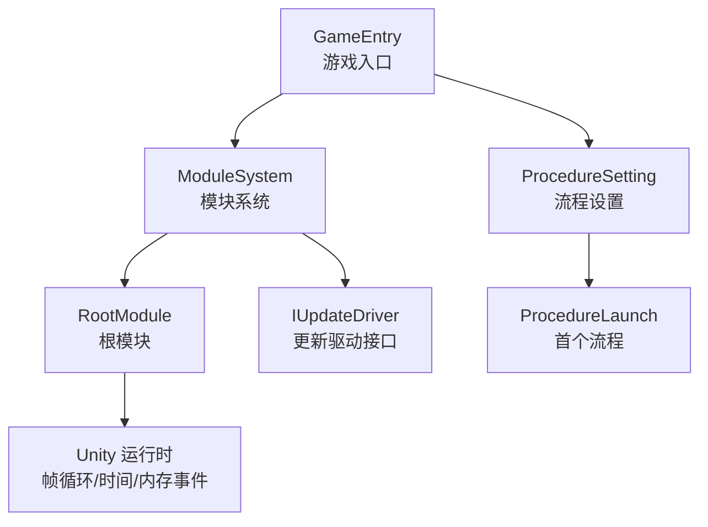
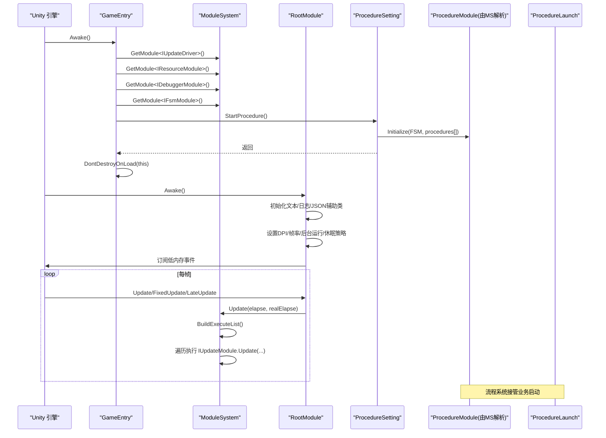
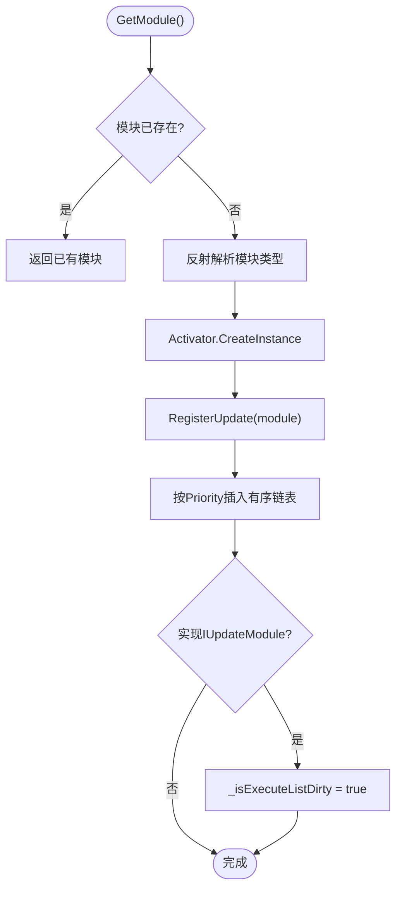
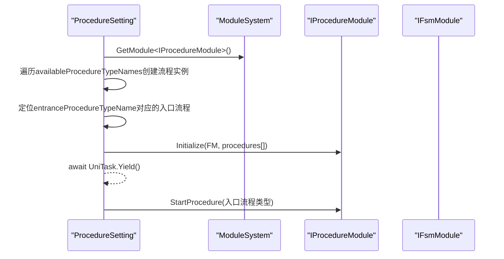
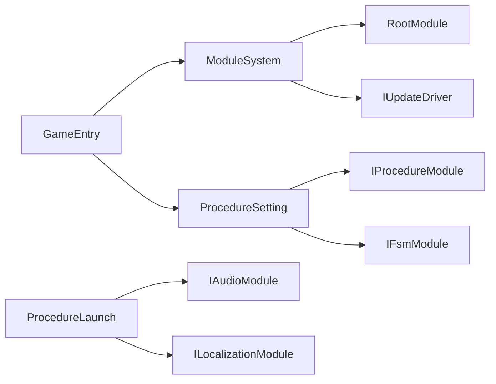

# 启动流程

<cite>
**本文引用的文件**   
- [GameEntry.cs](file://UnityProject/Assets/GameScripts/GameEntry.cs)
- [RootModule.cs](file://UnityProject/Assets/TEngine/Runtime/Module/RootModule.cs)
- [ModuleSystem.cs](file://UnityProject/Assets/TEngine/Runtime/Core/ModuleSystem.cs)
- [IUpdateDriver.cs](file://UnityProject/Assets/TEngine/Runtime/Module/UpdataDriver/IUpdateDriver.cs)
- [ProcedureSetting.cs](file://UnityProject/Assets/TEngine/Runtime/Module/ProcedureModule/ProcedureSetting.cs)
- [ProcedureLaunch.cs](file://UnityProject/Assets/GameScripts/Procedure/ProcedureLaunch.cs)
</cite>

## 目录
1. [简介](#简介)
2. [项目结构](#项目结构)
3. [核心组件](#核心组件)
4. [架构总览](#架构总览)
5. [详细组件分析](#详细组件分析)
6. [依赖关系分析](#依赖关系分析)
7. [性能考虑](#性能考虑)
8. [故障排查指南](#故障排查指南)
9. [结论](#结论)

## 简介
本文面向 TEngine 的启动流程，系统性梳理从 Unity 引擎初始化到游戏可运行状态的完整链路。重点覆盖：
- GameEntry 入口与模块系统初始化
- RootModule 对 Unity 运行时环境的统一配置
- ModuleSystem 的模块发现、创建、优先级排序与更新调度
- Procedure（流程）系统的启动与热更新环境下的差异
- 启动时序图与模块依赖图
- 启动性能优化建议与常见问题排查

## 项目结构
本项目的启动相关代码主要分布在以下位置：
- 游戏入口：UnityProject/Assets/GameScripts/GameEntry.cs
- 根模块与环境初始化：UnityProject/Assets/TEngine/Runtime/Module/RootModule.cs
- 模块系统：UnityProject/Assets/TEngine/Runtime/Core/ModuleSystem.cs
- 更新驱动接口：UnityProject/Assets/TEngine/Runtime/Module/UpdataDriver/IUpdateDriver.cs
- 流程设置与启动：UnityProject/Assets/TEngine/Runtime/Module/ProcedureModule/ProcedureSetting.cs
- 首个流程实现（示例）：UnityProject/Assets/GameScripts/Procedure/ProcedureLaunch.cs

图表来源
- [GameEntry.cs:6-14](file://UnityProject/Assets/GameScripts/GameEntry.cs#L6-L14)
- [ModuleSystem.cs:9-207](file://UnityProject/Assets/TEngine/Runtime/Core/ModuleSystem.cs#L9-L207)
- [RootModule.cs:116-167](file://UnityProject/Assets/TEngine/Runtime/Module/RootModule.cs#L116-L167)
- [IUpdateDriver.cs:8-119](file://UnityProject/Assets/TEngine/Runtime/Module/UpdataDriver/IUpdateDriver.cs#L8-L119)
- [ProcedureSetting.cs:55-102](file://UnityProject/Assets/TEngine/Runtime/Module/ProcedureModule/ProcedureSetting.cs#L55-L102)
- [ProcedureLaunch.cs:17-43](file://UnityProject/Assets/GameScripts/Procedure/ProcedureLaunch.cs#L17-L43)

章节来源
- [GameEntry.cs:6-14](file://UnityProject/Assets/GameScripts/GameEntry.cs#L6-L14)
- [RootModule.cs:116-167](file://UnityProject/Assets/TEngine/Runtime/Module/RootModule.cs#L116-L167)
- [ModuleSystem.cs:9-207](file://UnityProject/Assets/TEngine/Runtime/Core/ModuleSystem.cs#L9-L207)
- [ProcedureSetting.cs:55-102](file://UnityProject/Assets/TEngine/Runtime/Module/ProcedureModule/ProcedureSetting.cs#L55-L102)
- [ProcedureLaunch.cs:17-43](file://UnityProject/Assets/GameScripts/Procedure/ProcedureLaunch.cs#L17-L43)

## 核心组件
- GameEntry：作为 Unity 场景中的 MonoBehaviour 入口，负责在 Awake 中触发关键模块的获取与流程启动。
- RootModule：框架根节点，负责文本/日志/JSON 辅助类注入、屏幕 DPI、帧率、后台运行、休眠策略等全局设置，并订阅低内存事件。
- ModuleSystem：模块容器与调度中心，提供按接口类型自动发现与实例化模块的能力，维护模块注册顺序、更新执行列表，并在 Update 中统一调用 IUpdateModule。
- IUpdateDriver：对外暴露的更新驱动抽象，封装协程控制与 Unity 生命周期回调的监听注入。
- ProcedureSetting：ScriptableObject 配置，集中声明可用流程类型与入口流程，负责流程模块初始化与入口流程启动。
- ProcedureLaunch：首个流程示例，负责热更新 UI 初始化、语言与声音配置，并在首帧后切换到下一个流程。

章节来源
- [GameEntry.cs:6-14](file://UnityProject/Assets/GameScripts/GameEntry.cs#L6-L14)
- [RootModule.cs:116-167](file://UnityProject/Assets/TEngine/Runtime/Module/RootModule.cs#L116-L167)
- [ModuleSystem.cs:9-207](file://UnityProject/Assets/TEngine/Runtime/Core/ModuleSystem.cs#L9-L207)
- [IUpdateDriver.cs:8-119](file://UnityProject/Assets/TEngine/Runtime/Module/UpdataDriver/IUpdateDriver.cs#L8-L119)
- [ProcedureSetting.cs:55-102](file://UnityProject/Assets/TEngine/Runtime/Module/ProcedureModule/ProcedureSetting.cs#L55-L102)
- [ProcedureLaunch.cs:17-43](file://UnityProject/Assets/GameScripts/Procedure/ProcedureLaunch.cs#L17-L43)

## 架构总览
下图展示从程序入口到游戏可运行状态的关键阶段与交互：

图表来源
- [GameEntry.cs:6-14](file://UnityProject/Assets/GameScripts/GameEntry.cs#L6-L14)
- [ModuleSystem.cs:29-42](file://UnityProject/Assets/TEngine/Runtime/Core/ModuleSystem.cs#L29-L42)
- [RootModule.cs:116-167](file://UnityProject/Assets/TEngine/Runtime/Module/RootModule.cs#L116-L167)
- [ProcedureSetting.cs:55-102](file://UnityProject/Assets/TEngine/Runtime/Module/ProcedureModule/ProcedureSetting.cs#L55-L102)
- [ProcedureLaunch.cs:17-43](file://UnityProject/Assets/GameScripts/Procedure/ProcedureLaunch.cs#L17-L43)

## 详细组件分析

### GameEntry 入口与流程触发
- 职责：在 Awake 中按需获取关键模块（更新驱动、资源、调试器、FSM），随后通过 Settings.ProcedureSetting.StartProcedure() 启动流程。
- 关键点：
  - 使用 ModuleSystem.GetModule<T>() 以接口形式获取模块，若未注册则自动发现并创建对应实现。
  - 将自身设为 DontDestroyOnLoad，确保跨场景持久化。
  - 流程启动为异步 UniTaskVoid，避免阻塞主线程。

章节来源
- [GameEntry.cs:6-14](file://UnityProject/Assets/GameScripts/GameEntry.cs#L6-L14)

### RootModule 环境与全局配置
- 职责：
  - 初始化文本、日志、JSON 辅助类（通过反射加载指定类型）。
  - 设置屏幕 DPI、目标帧率、游戏速度、后台运行、禁止休眠等全局参数。
  - 订阅 Application.lowMemory 事件，触发对象池与资源模块的低内存回收。
  - 在 Update/FixedUpdate/LateUpdate 中驱动 GameTime 与 ModuleSystem.Update。
- 异常处理：
  - 当找不到或无法创建辅助类时抛出或记录错误，保证早期失败快速暴露。
- 性能要点：
  - 仅在 OnDestroy 中调用 ModuleSystem.Shutdown()，避免编辑器下频繁销毁带来的开销。

章节来源
- [RootModule.cs:116-167](file://UnityProject/Assets/TEngine/Runtime/Module/RootModule.cs#L116-L167)
- [RootModule.cs:214-285](file://UnityProject/Assets/TEngine/Runtime/Module/RootModule.cs#L214-L285)
- [RootModule.cs:287-302](file://UnityProject/Assets/TEngine/Runtime/Module/RootModule.cs#L287-L302)

### ModuleSystem 模块系统与更新调度
- 模块发现与创建：
  - 通过接口类型名构造全限定名，反射查找并实例化模块。
  - 将模块加入内部链表，按 Priority 排序，同时维护独立更新执行列表。
- 更新调度：
  - 每次 Update 前检查执行列表是否脏标记，必要时重建执行列表。
  - 遍历 IUpdateModule 集合调用 Update(elapseSeconds, realElapseSeconds)。
- 关闭清理：
  - Shutdown 按逆序调用各模块 Shutdown，清空所有集合，释放内存池与 Marshal 缓存。

图表来源
- [ModuleSystem.cs:68-120](file://UnityProject/Assets/TEngine/Runtime/Core/ModuleSystem.cs#L68-L120)
- [ModuleSystem.cs:143-194](file://UnityProject/Assets/TEngine/Runtime/Core/ModuleSystem.cs#L143-L194)
- [ModuleSystem.cs:199-206](file://UnityProject/Assets/TEngine/Runtime/Core/ModuleSystem.cs#L199-L206)

章节来源
- [ModuleSystem.cs:9-207](file://UnityProject/Assets/TEngine/Runtime/Core/ModuleSystem.cs#L9-L207)

### IUpdateDriver 更新驱动接口
- 职责：
  - 封装协程控制（Start/Stop）。
  - 提供 Add/Remove Update/FixedUpdate/LateUpdate 监听器。
  - 提供 Destroy、OnDrawGizmos、OnApplicationPause 等 Unity 事件的监听注入。
- 设计意义：
  - 解耦业务逻辑与 Unity 生命周期，便于测试与多平台适配。

章节来源
- [IUpdateDriver.cs:8-119](file://UnityProject/Assets/TEngine/Runtime/Module/UpdataDriver/IUpdateDriver.cs#L8-L119)

### ProcedureSetting 流程设置与启动
- 职责：
  - 读取 ScriptableObject 配置的可用流程类型数组与入口流程类型。
  - 反射创建流程实例，定位入口流程。
  - 初始化流程模块（传入 FSM 与流程实例数组），然后异步启动入口流程。
- 错误处理：
  - 找不到流程类型或无法创建实例时记录错误并提前返回。
  - 未找到入口流程时记录错误并提前返回。

图表来源
- [ProcedureSetting.cs:55-102](file://UnityProject/Assets/TEngine/Runtime/Module/ProcedureModule/ProcedureSetting.cs#L55-L102)

章节来源
- [ProcedureSetting.cs:55-102](file://UnityProject/Assets/TEngine/Runtime/Module/ProcedureModule/ProcedureSetting.cs#L55-L102)

### ProcedureLaunch 首个流程（含热更新 UI 初始化）
- 职责：
  - 初始化热更新 UI（LauncherMgr.Initialize）。
  - 初始化语言与声音设置（从 PlayerPrefs 读取并写入模块）。
  - 单帧后切换到下一个流程（如 Splash）。
- 热更新环境差异：
  - 在编辑器模拟模式下，优先使用 Inspector 上设置的编辑器语言；否则根据系统语言与用户偏好进行回退与校验。
  - 声音设置依据用户偏好进行恢复。

章节来源
- [ProcedureLaunch.cs:17-43](file://UnityProject/Assets/GameScripts/Procedure/ProcedureLaunch.cs#L17-L43)
- [ProcedureLaunch.cs:45-92](file://UnityProject/Assets/GameScripts/Procedure/ProcedureLaunch.cs#L45-L92)

## 依赖关系分析
- 入口依赖：
  - GameEntry 依赖 ModuleSystem 与 ProcedureSetting。
- 模块系统依赖：
  - ModuleSystem 依赖反射机制与 Utility 工具集，管理模块生命周期与更新调度。
- 根模块依赖：
  - RootModule 依赖 Utility.Text/Log/Json 辅助类与 Unity 运行时 API。
- 流程系统依赖：
  - ProcedureSetting 依赖 IProcedureModule 与 IFsmModule（由 ModuleSystem 解析）。
  - ProcedureLaunch 依赖 IAudioModule、ILocalizationModule 等资源与功能模块。

图表来源
- [GameEntry.cs:6-14](file://UnityProject/Assets/GameScripts/GameEntry.cs#L6-L14)
- [ModuleSystem.cs:9-207](file://UnityProject/Assets/TEngine/Runtime/Core/ModuleSystem.cs#L9-L207)
- [ProcedureSetting.cs:55-102](file://UnityProject/Assets/TEngine/Runtime/Module/ProcedureModule/ProcedureSetting.cs#L55-L102)
- [ProcedureLaunch.cs:17-43](file://UnityProject/Assets/GameScripts/Procedure/ProcedureLaunch.cs#L17-L43)

章节来源
- [GameEntry.cs:6-14](file://UnityProject/Assets/GameScripts/GameEntry.cs#L6-L14)
- [ModuleSystem.cs:9-207](file://UnityProject/Assets/TEngine/Runtime/Core/ModuleSystem.cs#L9-L207)
- [ProcedureSetting.cs:55-102](file://UnityProject/Assets/TEngine/Runtime/Module/ProcedureModule/ProcedureSetting.cs#L55-L102)
- [ProcedureLaunch.cs:17-43](file://UnityProject/Assets/GameScripts/Procedure/ProcedureLaunch.cs#L17-L43)

## 性能考虑
- 模块加载与反射：
  - 模块类型解析与实例化发生在首次 GetModule<T>() 时，应避免在热路径重复调用。
  - 合理设置模块 Priority，减少 Update 执行列表重建次数。
- 更新调度：
  - 仅实现 IUpdateModule 的模块才会进入执行列表，避免不必要的 Update 调用。
  - 利用 ModuleSystem._isExecuteListDirty 机制，批量注册模块以减少重建频率。
- 资源与内存：
  - 利用 RootModule.OnLowMemory 触发对象池与资源模块的释放，降低峰值内存。
  - 谨慎使用大量协程，通过 IUpdateDriver 统一管理生命周期。
- 流程启动：
  - 使用异步流程启动（UniTaskVoid）避免阻塞主线程，首帧切换流程保持流畅。

[本节为通用性能建议，不直接分析具体文件]

## 故障排查指南
- 模块未找到或创建失败：
  - 现象：GetModule<T>() 抛异常或返回空。
  - 排查：确认模块命名空间与程序集名称正确，接口命名规范（以 I 开头），以及 Type.GetType 能解析到实现类。
  - 参考：模块解析与创建逻辑。
- 流程未启动或入口流程无效：
  - 现象：流程模块初始化成功但无流程运行。
  - 排查：检查 ScriptableObject 中 availableProcedureTypeNames 与 entranceProcedureTypeName 配置是否正确，流程类型是否能被反射创建。
  - 参考：流程设置与启动逻辑。
- 低内存导致卡顿或崩溃：
  - 现象：设备低内存警告后出现卡顿。
  - 排查：确认 OnLowMemory 回调是否触发对象池与资源模块的释放。
  - 参考：RootModule 低内存处理。
- 语言与声音配置异常：
  - 现象：语言未生效或声音设置未恢复。
  - 排查：检查 ProcedureLaunch 中对 LocalizationModule 与 AudioModule 的设置逻辑，以及 PlayerPrefs 键值是否存在。
  - 参考：首个流程的语言与声音初始化。

章节来源
- [ModuleSystem.cs:68-120](file://UnityProject/Assets/TEngine/Runtime/Core/ModuleSystem.cs#L68-L120)
- [ProcedureSetting.cs:55-102](file://UnityProject/Assets/TEngine/Runtime/Module/ProcedureModule/ProcedureSetting.cs#L55-L102)
- [RootModule.cs:287-302](file://UnityProject/Assets/TEngine/Runtime/Module/RootModule.cs#L287-L302)
- [ProcedureLaunch.cs:45-92](file://UnityProject/Assets/GameScripts/Procedure/ProcedureLaunch.cs#L45-L92)

## 结论
TEngine 的启动流程以 GameEntry 为入口，通过 ModuleSystem 按需发现与创建模块，并由 RootModule 统一配置 Unity 运行时环境。流程系统通过 ProcedureSetting 集中管理流程类型与入口流程，最终由 ProcedureLaunch 等流程逐步推进至游戏可运行状态。该架构具备良好的扩展性与可维护性，配合异步流程与模块优先级机制，可在保证稳定性的前提下提升启动性能。针对热更新环境，流程层提供了语言与声音等初始化的差异化处理，确保在不同运行模式下的行为一致性。

[本节为总结性内容，不直接分析具体文件]